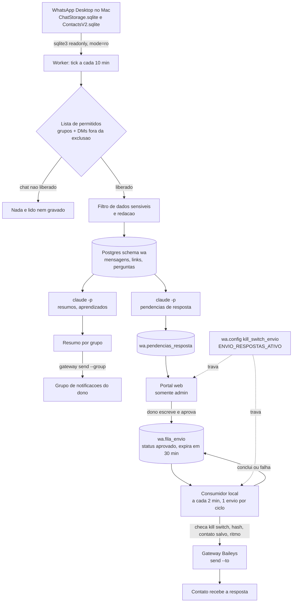

# PROMPT — Construa meu sistema pessoal de inteligência de WhatsApp

Autor: Juliano Torriani

Versão 1.2 • 09/10/2026 • Português do Brasil • Plataforma de ingestão: macOS

## Para quem recebe este arquivo

Salve este arquivo como `PROMPT.md` em uma pasta de projeto vazia, abra essa pasta no Codex e escreva:

> Leia o PROMPT.md inteiro, extraia os arquivos incorporados e implemente o sistema conforme os requisitos e critérios de aceite. Comece agora. Continue até concluir tudo que puder testar, pedindo minha intervenção apenas para credenciais, escolhas pessoais, permissões do macOS e pareamento. Não envie mensagens reais sem minha aprovação explícita.

Este arquivo contém o PRD, os contratos funcionais, nove migrations de referência, código do worker, testes e o gateway com suporte a envio individual. Não é necessário acessar a máquina ou os repositórios privados. Dependências públicas ainda precisam ser instaladas; contas, credenciais, WhatsApp Desktop, permissões e pareamento pertencem a você. O arquivo é uma especificação com código de base, não uma afirmação de instalação já homologada no seu computador.

Não cole centenas de páginas na conversa: entregue o arquivo ao Codex, que poderá ler e extrair por seções. O código dos anexos é referência técnica; as exigências deste PRD prevalecem sobre defaults, comentários e comportamentos antigos. Preserve a licença MIT incluída no gateway.

---

## Estado do pacote

Este repositório já inclui portal standalone, worker, gateway local, migration de instalação e testes. Comece pelo SETUP.md. Reutilize a implementação existente, valide os requisitos abaixo e conclua somente o que faltar na máquina receptora. Não reescreva componentes funcionais nem aplique migrations históricas junto da migration standalone.

## 1. Sua missão como agente de implementação

Atue como engenheiro responsável pelo produto. Construa um sistema independente, funcional, testável, com instalação assistida e interface clara. Implemente de fato: não encerre entregando somente planejamento, telas com dados fictícios ou tarefas para outro desenvolvedor.

Trabalhe em uma pasta do usuário, sem alterar aplicativos existentes. Inspecione arquivos já presentes e preserve alterações. Reutilize o código incorporado, corrigindo os pontos desta especificação. Não procure arquivos externos privados, não clone seus repositórios e não reutilize ambientes pessoais.

Crie `IMPLEMENTATION_STATUS.md` com requisitos, evidências, decisões e bloqueios. Atualize ao terminar cada fase para permitir retomada após perda de contexto. Se faltar credencial, conclua código, banco local de teste, fixtures e interface. Informe precisamente o que depende do usuário, sem apresentar testes simulados como operação real.

Decisões técnicas rotineiras são suas. Pergunte, numa rodada curta, somente dados que não puder descobrir localmente: nome de exibição, fuso, conta de modelo, projeto próprio do Supabase, grupos autorizados e identidade do número de envio. Nunca peça senhas no chat: use configuração local protegida ou interface apropriada. Não contrate serviço pago, publique na internet ou envie mensagens por inferência.

## 2. Produto e escopo obrigatório

Uma pessoa, um Mac e um projeto Supabase próprio por instalação. Interface em PT-BR; timestamps no banco em UTC; apresentação no fuso configurado. Monorepositório simples: portal, worker e gateway. Não é SaaS multiempresa.

Fluxo principal: WhatsApp Desktop → seleção autorizada de chats → filtro de dados sensíveis → Postgres → resumos e pendências → portal → texto escrito e aprovado pelo dono → fila durável → gateway → reconciliação do resultado.

Implementar nesta entrega:

- Leitura incremental de grupos explicitamente liberados e DMs habilitadas pelo usuário, com exclusões e contato salvo.
- Resumos diários e semanais, decisões, perguntas, links, favoritos e aprendizados com fonte e tema.
- Detecção incremental de quem espera resposta; digest opcional em destino escolhido.
- Portal com login e todas as telas da seção 7, incluindo editor manual da resposta e aprovação individual.
- Consumidor durável, cancelamento, expiração, limites de ritmo, interrupção global e tratamento de envio incerto.
- Configuração guiada, diagnósticos, agendamento macOS, recuperação após reinício, backup/restauração e testes.

Não implementar como se já existisse: geração automática de respostas na voz do dono, transcrição de áudio, embeddings calculados, envio de mídia, prospecção, disparo em massa e versão nativa Windows/Linux. As colunas de embedding podem ficar nulas. Áudio sem transcrição deve ser sinalizado. Um futuro gerador de rascunhos nunca pode aprovar sua própria resposta.

**Identidade do envio:** o gateway manda em nome da conta pareada. Se a leitura for da conta principal e o gateway de uma secundária, a resposta sai da secundária, não do número principal. Mostrar esse fato no onboarding e antes do primeiro envio; não prometer que a conversa original ficará respondida no WhatsApp. O status local significa envio registrado pelo sistema. Usar contas e contatos de teste controlados pelo usuário no piloto.

## 3. Configuração e padrões seguros

Gerar `.env.example`, `config/business.example.json`, configuração local com schema validado e `.gitignore`. Exemplos sem valores pessoais. Arquivos reais fora do Git; diretórios 0700, segredos e estado 0600. Inicialização idempotente, sem sobrescrever configuração existente.

```json
{
  "productName": "Inteligência WhatsApp",
  "ownerName": "",
  "timezone": "America/Sao_Paulo",
  "language": "pt-BR",
  "dm": {"enabled": false, "onlySavedContacts": true, "pendingDays": 14},
  "ingestion": {"intervalSeconds": 600, "reconcileHours": 72},
  "pending": {"intervalSeconds": 900, "maxModelConversations": 10},
  "send": {"enabled": false, "replyEnabled": false, "intervalSeconds": 60, "maxPerHour": 5},
  "notificationGroupJid": "",
  "dmDigestDestinationJid": "",
  "learningTopics": []
}
```

Converter esse contrato de onboarding para os nomes existentes em `worker/src/config.mjs`; manter uma única fonte de configuração, sem dois JSONs concorrentes. Configuração inválida bloqueia a capacidade afetada; nunca recupera credenciais do ambiente de outro aplicativo.

Variáveis documentadas: `SUPABASE_URL`, `SUPABASE_PUBLISHABLE_KEY`, `WA_DB_HOST`, `WA_DB_PORT`, `WA_DB_NAME`, `WA_DB_USER`, `WA_DB_PASSWORD`, `WAI_STATE_DIR`, `WAI_CONFIG_DIR`, `WAI_TIMEZONE`, `WAI_MODEL`, `WAI_LLM_BIN`, `WAI_GATEWAY_BIN`, `WAI_GATEWAY_DATA_DIR`, `WAI_GATEWAY_RUNTIME_DIR`, `WAI_GATEWAY_LAUNCH_AGENT`, `WAI_GATEWAY_ALLOW_SEND_TO`. Use apenas variáveis públicas necessárias no bundle do portal. Senha SQL e qualquer chave privilegiada nunca chegam ao navegador.

Modelo inicial: adaptador da CLI Claude incorporado, autenticado na conta do receptor. Não pressupor que ter Codex instalado também fornece `claude` ou acesso a um modelo em runtime. Se o usuário tiver outro provedor, implementar adaptador equivalente com saída estruturada, timeout, contagem de uso e teste; confirmar o provedor antes de enviar conversas reais. Escolher modelo disponível e registrar nome e versão/configuração efetivos. Não inventar preço de tokens; custo indisponível deve aparecer como indisponível.

Preflight: detectar sistema operacional, Node compatível com as versões escolhidas, gerenciador de pacotes, `sqlite3`, `psql`, autenticação do modelo, banco e WhatsApp Desktop. Em Windows/Linux, construir e testar componentes portáveis com fixtures e informar que a ingestão real deste PRD requer Mac. Não fingir que os caminhos macOS funcionam em outra plataforma.

## 4. Estrutura de implementação

```text
PROMPT.md
IMPLEMENTATION_STATUS.md
package.json                     comandos da instalação completa
portal/                          Next.js, React, TypeScript strict, Supabase Auth
worker/                          módulos ESM Node incorporados + adaptações
 gateway/                        gateway local incorporado + correções
supabase/migrations/             uma migration consolidada para projeto vazio
supabase/tests/                  testes reais de SQL, RLS, RPCs e concorrência
scripts/                         setup, doctor, backup, restore, smoke
config/                          somente exemplos versionados
docs/                            setup, operação, segurança, contratos e validação
test/fixtures/                   somente dados sintéticos
reference/                       anexos de origem; não aplicar automaticamente
```

O espaço antes de `gateway/` acima é apenas visual: a pasta é `gateway` na raiz. Gerar lockfile, fixar versões compatíveis e documentar runtime. Portal escuta em loopback por padrão. `npm run dev` sobe o portal e o modo local de desenvolvimento sem ativar envios; agendamento e gateway possuem comandos próprios. `npm run verify` executa checks reais, não scripts vazios.

Não executar `npm install -g` de um pacote privado para obter o gateway: ele está incluído. Instalar como pacote local e localizar seu entrypoint pelo projeto. O `package.json` incorporado do gateway só descreve o JavaScript distribuído; adicionar testes e ferramentas de qualidade na versão final. Não exigir `src/` de TypeScript que não veio com o pacote.

## 5. Banco completo e independente

Os nove SQLs incorporados contêm tabelas, índices, triggers, funções e views do sistema. São uma sequência histórica, **não a migration pronta de instalação**. Usar `supabase/migrations/20261009000000_wa_standalone.sql`, já incluída; revisar e testar os requisitos abaixo antes de operar. Não deixar como tarefa manual para o receptor.

### Entidades obrigatórias

`wa.admins`, `chats`, `participantes`, `mensagens`, `links`, `link_mencoes`, `perguntas`, `resumos`, `decisoes`, `aprendizados`, `pendencias_resposta`, `sugestoes_resposta`, `fila_envio`, `auditoria`, `ingestao_execucoes`, `config`, `notificacao_destino`.

Preservar tipos, checks, chaves naturais, relacionamentos, índices, políticas e assinaturas dos anexos, salvo as correções normativas deste PRD. O contrato funcional incorporado descreve colunas e invariantes. Gerar tipos TypeScript a partir do banco final.

### Bootstrap e isolamento

- Criar schemas `wa` e `extensions`; habilitar `pg_trgm` e `pgcrypto`. A migration standalone usa arrays `double precision[]` reservados, sem geração de embeddings e sem dependência de pgvector. Testar em projeto vazio.
- `wa.admins(user_id uuid primary key references auth.users(id))` substitui o vínculo do portal original. `wa.is_admin()` consulta apenas essa tabela por `auth.uid()`. Nenhuma dependência de `clientes_*`.
- Primeiro admin: criar/autenticar usuário próprio e cadastrá-lo por comando local privilegiado. Nunca promover automaticamente o primeiro login pela API pública. Não aceitar `user_id` do corpo de uma requisição como identidade autenticada.
- RLS em todas as tabelas; sem acesso de `anon`; `authenticated` só lê como admin e usa RPCs explicitamente autorizadas. `admins` não recebe policy de escrita para usuário comum.
- Revogar EXECUTE padrão de PUBLIC nas funções sensíveis e conceder por assinatura e papel. Auditar grants finais de toda função `security definer`, inclusive overloads e rotas antigas de aprovação. Desativar o caminho legado `aprovar_sugestao` se puder contornar o fluxo de aprovação vigente.
- Preferir role SQL própria para worker com permissões explícitas de ingestão/consumo; sem poder de criar admin, aprovar resposta humana ou alterar o mecanismo de autorização. Se usar conexão administrativa no bootstrap, separá-la da conexão de operação. Definir `WA_DB_USER` e TLS conforme conexão efetiva; não embutir `postgres.<ref>` como única opção.
- O schema `wa` deve estar exposto na Data API para o portal e selecionado no cliente Supabase. Exposição de schema não autoriza leitura: grants e RLS continuam restritos. Não copiar o exemplo de grants amplos da documentação.
- Em projeto novo e isolado, aplicar migration pelo fluxo normal da CLI e conferir schema/histórico. Não usar `migration repair` para simular uma aplicação; isso era contingência do projeto antigo. Nunca resetar banco remoto com dados para facilitar teste.

### Estado inicial

`kill_switch_envio = false` (somente booleano JSON false libera), `ENVIO_RESPOSTAS_ATIVO = false`, `ENVIO_RESPOSTAS_INTERVALO_S = 60`, `ENVIO_RESPOSTAS_MAX_HORA = 5`, `aprendizado_temas = []`. Localmente `ENVIO_ATIVO = false`, DMs desativadas, allowlist vazia, notificações sem destino, `gateway_aceita_to = false`, daemon sem `WAI_GATEWAY_ALLOW_SEND_TO=1`.

A sequência histórica pode conter defaults diferentes: a migration final e os testes precisam usar os valores acima. Não executar os nove SQLs e depois confiar que o resultado coincide.

### Integridade e transações

Aprovar, cancelar, reivindicar, concluir e liberar reaprovação são transacionais. Banco deriva destino, usuário e hash, não confia nos enviados pelo frontend. Uma aprovação viva por pendência; apenas uma reivindicação para consumidores concorrentes; ritmo global protegido por lock no banco. Auditoria somente acréscimo e sem texto de mensagem.

Reconciliar diferença entre timeout de órfã de 5 e 10 minutos: adotar 10 minutos no banco e consumidor, mantendo heartbeat/lease se necessário; consumidor com timeout de 120 s. Órfã potencialmente enviada vira incerta, não volta automaticamente à fila.

## 6. Algoritmos obrigatórios

Os módulos incorporados fornecem a implementação de base. Não substituí-los por descrições vagas ou mocks em produção.

### Leitura, permissão e ingestão

1. Localizar ChatStorage e ContactsV2 no usuário atual; abrir exclusivamente com `sqlite3 -readonly` e URI `mode=ro`. Nunca alterar banco, WAL, journal ou permissões dos arquivos do WhatsApp.
2. Executar schema guard antes de consultar mensagens. Mudança de schema interrompe com diagnóstico de tabela/coluna; não adivinhar mapeamento. O anexo inclui os nomes esperados de tabelas e colunas e conversão do epoch Apple.
3. Consultar metadados para resolver a allowlist; só ler conteúdo de chats autorizados. `deny_always` prevalece. Arquivo ausente, malformado, permissões inseguras ou lista vazia não liberam conteúdo.
4. DMs exigem habilitação explícita e arquivo de exclusões válido. Contato desconhecido/nulo não entra em pendências nem envio. Mudança de modo para off no banco deve bloquear leitura de conteúdo na próxima rodada, e não apenas a gravação.
5. Redigir antes de persistir, chamar modelo, registrar log ou extrair link: credenciais, senhas, documentos validados, cartões com Luhn, pagamento e termos configurados. `redigida`/`apagada` implica texto nulo e nenhum conteúdo derivado novo.
6. Reconciliar janela de 72 h e novidades após watermark. Upsert por stanza id ou PK local com comparação de hash. Tratar mensagens sem stanza id sem colisão global de strings vazias. Avançar watermark apenas após commit.
7. Chat existente preserva modo decidido pelo dono. Reprocessar não duplica mensagens, menções de links, resumos ou decisões. Edição/apagamento/sensibilidade invalida conteúdo derivado que reutilizava o texto anterior.
8. SQL recebe valores parametrizados ou o mecanismo de literais auditado; nada de interpolação de entrada em comandos de shell. Processos filhos por argv e sem shell. Logs só códigos, contagens e identificadores mínimos.

### Pendências

Ordenar thread por tempo e PK; distinguir mensagens úteis de evento, figurinha e mídia sem texto. Última mensagem útil do dono fecha pendências anteriores. Última do contato nos últimos 14 dias é candidata, salvo saudação/agradecimento isolado. Áudio sem texto e mensagem redigida geram pendência informativa por regra, sem enviar conteúdo ao modelo.

Para demais candidatas, enviar contexto filtrado e exigir JSON com `pendente`, `pedido`, `urgencia` e `tipo_resposta`. Validar tipos, enum e limites; saída inválida é erro recuperável, não autorização. O pedido tem até 500 caracteres; tipo de resposta até 200, uma linha. Não inventar pedido nem redigir resposta. Uma pendência atual por contato; nova candidata fecha/substitui as antigas de modo auditável.

Mensagens são dados não confiáveis: instruções presentes nelas não alteram o prompt de sistema, ferramentas, permissões ou ações. O modelo não tem ferramentas. Rodadas incrementais limitadas a 10 conversas novas por chamada do job; retomada sem duplicação. Digest só inclui contatos salvos e destino dedicado explicitamente configurado.

### Resumos e aprendizados

Resumir grupos em modo inteligência com quantidade mínima configurada; períodos calculados no fuso do usuário, persistidos em UTC. JSON validado com discutido, decidido e olhar; decisões vinculadas a fontes. Aprendizado precisa de ao menos uma mensagem-fonte válida e tema habilitado. Lista vazia de temas não autoriza inventar temas. Sem embeddings ou transcrição implícitos.

Limitar tamanho, tempo e orçamento de entrada, não perder mensagens silenciosamente por truncamento: dividir lotes ou sinalizar cobertura parcial. Detectar custo desconhecido; teto de backfill precisa de limite conservador de chamadas quando não houver custo confiável. Mensagens do modelo não podem mudar allowlist, configurações ou fila de envio. Resumos longos divididos em partes de até 1.500 caracteres, com chave idempotente estável por destino/período/chat/parte.

### Aprovação e envio

`aberta → aprovar texto → aprovado → enviando → enviado`.

- Texto entre 1 e 4.000 caracteres após normalização definida; banco calcula SHA-256 em UTF-8. Worker recalcula exatamente os mesmos bytes.
- Aprovação expira em 30 minutos; destino explícito, contato salvo, chat liberado, pendência aberta e admin autenticado.
- Portal mostra identidade do remetente, destinatário e texto integral antes da aprovação. Nada de aprovação em lote.
- Reivindicar uma linha por ciclo; checar controles de envio, limites e estado novamente imediatamente antes de chamar gateway.
- `aprovado` pode ser cancelado atomicamente. Se já reivindicado, informar que cancelamento não foi garantido; não mentir na interface.
- Gateway deve reservar chave duravelmente ANTES de transmitir. Sucesso retorna id do provedor; `duplicate` só equivale a envio conhecido se houver recibo persistido compatível. Ledger não prova entrega/leitura no telefone.
- Queda, timeout ou resposta ambígua após possível envio: `interrompido_verificar`, nunca retry automático. Humano verifica e confirma recebido ou libera nova aprovação após confirmar que não saiu.
- Recusa comprovadamente anterior à transmissão: falha reaprovável. Prefixo `RECUSADO:` sozinho não pode encobrir erro depois da tentativa: manter contrato de códigos e testar.
- Falha ao gravar conclusão após sucesso também fica incerta. Não reenviar usando outra chave. Consultar resultado persistido do gateway para reconciliação.
- Se o contato respondeu novamente depois da aprovação, expirar/cancelar a aprovação antes de enviar texto potencialmente obsoleto; se ingestão estiver atrasada, informar limite de atualização e exigir saúde recente configurável.

Pausa local, kill switch do banco e chaves específicas precisam valer para respostas **e notificações**. Configuração ausente/indisponível/inválida bloqueia envio. A UI deve explicar que pausa é verificada antes da transmissão e não recolhe mensagem já enviada.

## 7. Portal completo

Criar app independente com Next.js App Router, autenticação Supabase por sessão validada no servidor e logout. Middleware sozinho não é autorização: guarda nas páginas, actions e banco. Visitante não autenticado vai ao login; usuário autenticado não admin recebe 404. Sem service role no cliente.

| Tela | Comportamento obrigatório |
|---|---|
| Onboarding/diagnóstico | etapas de banco, admin, modelo, WhatsApp local, permissões, allowlist, gateway; estados verificáveis |
| Visão geral | saúde dos jobs, última ingestão, contagens reais, grupos/diretos, aviso de dados atrasados |
| Dashboard | métricas derivadas de dados reais; zero/sem dados sem números inventados |
| Chat | mensagens filtradas com paginação por cursor; omitidas sem revelar original; modo de leitura |
| Pendências | filtros/busca, urgência, pedido, idade, texto manual, aprovar, cancelar, confirmar enviado, liberar reaprovação, descartar |
| Links | busca, domínio, chat, favorito; não executar HTML de título/URL |
| Aprendizados | tema, fontes, busca, aprovar/descartar, editor de temas |
| Resumos | dia/semana, chat, conteúdo, histórico de notificação e estado real |
| Configurações | fuso, limites, temas, destinos, modo de chats e controles globais; segredos nunca retornados |

Estados: carregando, vazio, erro, serviço indisponível, leitura desatualizada, envio desligado, aguardando, enviando, cancelado, expirado e incerto. Toda ação confirma no banco antes de atualizar estado. Testar teclado, foco, rótulos, contraste e viewport de 390 px. Respostas manuais devem preservar o texto aprovado: filtros de estilo que bloqueiam emoji/travessão são opcionais  e não devem proibir a escrita pessoal do receptor. Não modificar texto após aprovação.

Visual padrão DS AZUL: Inter em títulos/corpo, IBM Plex Mono em rótulos/dados; fundo preto, superfícies discretas, acento azul, borda fina. Tokens semânticos locais; nenhum caminho para o design system . Base mínima:

```css
:root,[data-ds="azul"] {
 --ds-bg:#000; --ds-surface:#0A0A0A; --ds-surface-alt:#111;
 --ds-text:#FFF; --ds-text-soft:#DDE4EC; --ds-text-meta:#8899AA;
 --ds-accent:#2B7DE1; --ds-cta-bg:#2771CB; --ds-cta-text:#FFF;
 --ds-border:rgba(221,228,236,.15); --ds-focus-ring:#2B7DE1;
 --ds-danger:#EF4444; --ds-warning:#F59E0B; --ds-success:#22C55E;
 --ds-font-sans:"Inter",system-ui,sans-serif;
 --ds-font-mono:"IBM Plex Mono",ui-monospace,monospace;
 --ds-radius-sm:4px; --ds-radius-md:8px; --ds-radius-lg:12px;
}
```

Hex fica apenas no arquivo de tokens. CTA principal azul com texto branco no escuro; preto no fundo claro, borda fina e três quadrados no hover, respeitando movimento reduzido. Sem CTA cinza como ação principal. Não usar Made Outer em web. Não inventar logo ; usar marca do receptor quando fornecida. Rodapé opcional, apenas logo oficial pequeno à esquerda quando disponível.

## 8. Gateway independente e correções obrigatórias

O anexo contém a distribuição JavaScript do gateway com o patch de envio individual já incorporado e nomes neutralizados. Não reaplicar um diff em cima dele. Baileys é um cliente não oficial; manter aviso claro sobre instabilidade/restrição de conta no setup. Não prometer ausência de banimento.

- CLI local, daemon único, socket Unix 0600 e diretório 0700, sem porta HTTP pública. Auth fora do Git. Leitura do WhatsApp continua no worker, não adicionar download de histórico/mídia ao gateway.
- Interface: `channel status`, `groups`, `pair`, `send --group <jid> --file <arquivo> --idempotency-key <chave>` e `send --to <jid> --file <arquivo> --idempotency-key <chave>`.
- `--group` e `--to` mutuamente exclusivos; destino individual apenas JID validado; nunca inferir telefone por nome. Ambiguidade de nome de grupo exige escolher JID.
- `WAI_GATEWAY_ALLOW_SEND_TO=1` deve estar no ambiente efetivo do daemon, não apenas no terminal.
- **Corrigir ledger antes de liberar envio:** reserva e conclusão duráveis, gravação atômica com fsync/rename ou SQLite transacional, trava entre processos, corrupção implica bloquear envio. As garantias devem valer para grupos e indivíduos. Não apagar entrada pending para tentar novamente.
- Arquivo temporário de mensagem 0600, cleanup em finally, logs sem conteúdo, QR exibido só no fluxo explícito de pareamento e nunca em logs.
- O gateway incorporado fixa versão RC de Baileys. Tratar como versão da referência, não como versão atual recomendada. Conferir documentação pública do projeto, escolher versão compatível, fixar e testar; mudança sem teste não é atualização bem-sucedida.
- Pareamento exige dono com celular. Não desconectar, limpar auth, fazer logout ou sobrescrever outra sessão para resolver problema. Diagnosticar primeiro.
- Exibir estados separados: processo ativo, pareado, conectado, envio aceito e entrega confirmada quando houver evidência. Reiniciar daemon não prova conexão.

## 9. Instalação e operação assistidas

Gerar `SETUP.md` simples em português. O usuário não precisa escrever SQL nem editar código.

1. Extrair anexos, preparar projeto, instalar dependências públicas com lockfile e rodar testes offline.
2. Preparar Supabase de teste próprio: local quando disponível ou projeto novo designado pelo usuário. Aplicar migration e testar RLS/RPCs. Nunca tocar banco .
3. Configurar Supabase Auth, URLs de callback local, schema exposto e admin. Testar login/não-admin.
4. Criar configuração local com lista vazia e envio desligado. Mostrar controles no portal.
5. Diagnosticar WhatsApp Desktop e schema somente leitura. Permissões macOS são concedidas pelo usuário; registrar binário Node exato e testar também via launchd.
6. Usuário escolhe um grupo de teste. Rodar dry-run sem conteúdo em stdout e depois ingestão autorizada. Confirmar metadados e redação com fixture sintética antes de processar conversas reais.
7. Autenticar provedor de modelo e gerar resumo de teste; conferir custo/uso e fontes.
8. Preparar gateway em dados próprios, parear com autorização e confirmar identidade do remetente. Não habilitar envio automaticamente como parte de `npm install`.
9. Piloto explicitamente autorizado com destinatário controlado. Aprovar texto no portal e conferir banco, ledger e recebimento. Repetir mesma chave sem reenviar; testar cancelamento e kill switch.
10. Gerar `plist`, `plist-pendencias` e o novo `plist-respostas`; imprimir antes de carregar. Node e entrypoints absolutos resolvidos na máquina receptora, nunca worktree temporário. Jobs 600/900/120 s. Logs e watchdogs com limites.
11. Ativar apenas os jobs aprovados pelo usuário. Testar ciclo real no contexto launchd, retomada após reinício e diagnóstico de erro.
12. Entregar instruções para pausar, descarregar agentes, backup e restauração.

Backup separado de banco, configuração e gateway; parar escritores do ledger antes de snapshot quando necessário. Segredos precisam de armazenamento protegido. Restore em diretório/projeto isolado primeiro; mostrar checksum e resultado. Não restaurar um ledger antigo e retomar envios automaticamente, pois isso pode duplicar mensagens já transmitidas. Documentar retenção e exclusão de dados por chat/contato; implementar dry-run com contagens e confirmação antes de apagar. A configuração `retencao_dias` não pode aparentar expiração automática se nenhum job executa a política.

## 10. Ordem de construção e evidências

| Fase | Entrega | Prova |
|---|---|---|
| 1 | extração e inventário | todos os hashes dos arquivos conferem |
| 2 | base neutralizada | nenhum caminho privado ou conta predefinida; defaults fechados |
| 3 | migration e Auth | aplicação em vazio + testes de usuário admin, não-admin e worker |
| 4 | ingestão e privacidade | SQLite sintético, reprocessamento idempotente, edição/apagamento |
| 5 | inteligência | contratos JSON, fontes, limites, erros e prompt injection |
| 6 | portal | fluxo navegável real, queries verdadeiras, actions protegidas |
| 7 | gateway e fila | concorrência, idempotência, queda em cada ponto crítico |
| 8 | integração local | browser + banco + worker + backend falso, sem envio externo |
| 9 | operação | doctor, plists, backup/restore e guia |
| 10 | piloto real | só após autorização; usuário confirma recebimento no contato de teste |

Não parar depois de um plano. Se fase externa estiver bloqueada, avançar todas as independentes e deixar evidência local. Em retomada, ler o status e continuar sem recriar o que já existe.

## 11. Testes e critérios de aceite

Reaproveitar testes incorporados e acrescentar os que cobrem adaptações. Testes da origem não provam SQL, portal ou integração externa. Não fixar um número histórico de testes como meta.

- [ ] Um arquivo foi suficiente: nenhum import/caminho/repositório privado faltante na implementação final.
- [ ] Instalação limpa com comandos documentados; scripts de lint, tipos, testes e build realmente executam.
- [ ] Migration aplicada em banco vazio, bootstrap seguro, schema exposto, RLS e grants testados via API e SQL.
- [ ] Não-admin não lê nem aprova; worker não simula humano; anon sem acesso; rota legada não contorna aprovação.
- [ ] Allowlist vazia/ausente/off e DMs desativadas impedem leitura de conteúdo; exclusões prevalecem.
- [ ] Redação antes de qualquer saída; logs/erros/fixtures sem mensagens ou dados reais; mídia não é copiada.
- [ ] Reingestão/edição/apagamento não duplica nem deixa derivados sensíveis antigos.
- [ ] Resumos e aprendizados com fontes; áudio sinalizado; nenhum rascunho de resposta automática apresentado como existente.
- [ ] Última mensagem do dono fecha pendência; saudações não abrem; desconhecido/nulo não envia.
- [ ] Aprovação exige usuário real, destino derivado, hash válido e validade; limite de 4.000 caracteres.
- [ ] Duas aprovações/reivindicações concorrentes não produzem dois envios.
- [ ] Cancelamento versus reivindicação tem resultado determinístico; limite por hora persiste entre reinícios.
- [ ] Kill switch ausente, inválido, ligado ou banco indisponível bloqueia respostas e notificações.
- [ ] Falha antes da reserva, depois da reserva, depois do envio e antes da conclusão nunca gera retry cego.
- [ ] Ledger corrompido bloqueia, não é zerado; duplicate é reconciliado com recibo.
- [ ] Portal mostra vazio/erro/atraso/incerto e funciona em mobile/teclado; nenhum número simulado em produção.
- [ ] Processo launchd funciona com caminhos e permissões do receptor; não depender do PATH interativo.
- [ ] Backup/restauração testados sem reativar fila antiga silenciosamente.
- [ ] Teste integrado local passa com backend falso, distinguido do piloto externo.
- [ ] Piloto real registrado separadamente como aprovado, executado ou bloqueado pelo motivo exato.

Ao concluir, entregar URL local, comandos de início/pausa, caminhos de configuração, relatório dos checks, limitações restantes e checklist de operação. Estados finais separados: **implementado**, **testado localmente**, **configurado na máquina**, **validado com envio real**. Nunca chamar o último de concluído apenas porque houve build ou retorno HTTP 200.

## 12. Contrato de implementação

As seções de requisitos prevalecem sobre comentários e defaults históricos dos anexos. O pacote inclui código de base e contratos completos para implementação independente. Instalar dependências públicas e configurar contas próprias continua necessário. Não há dependência de repositórios privados.

## 13. Como extrair os anexos

Cada seção a seguir começa com `### FILE: caminho/relativo`, seguida de SHA-256 e um bloco com QUATRO crases. O conteúdo entre essas cercas é o arquivo UTF-8, terminando em uma quebra de linha. Extraia por parser para uma subpasta vazia `seed/`, confira hash e recuse caminhos absolutos, `..`, symlinks ou destinos existentes. Use os arquivos para construir o projeto final; `reference/` permanece referência, não entra no executor de migrations.

O próprio Codex deve executar a extração; não exigir que o usuário copie blocos manualmente. Exemplo de extrator completo (salvar como `extract_seed.py` ao lado do PROMPT.md):

```python
from pathlib import Path
import hashlib, re
source = Path('PROMPT.md').read_text(encoding='utf-8')
pattern = r'^### FILE: ([^\n]+)\n\nSHA256: ([0-9a-f]{64})\n\n````[^\n]*\n(.*?)^````\s*$'
items = re.findall(pattern, source, re.M | re.S)
if not items:
    raise SystemExit('Nenhum anexo encontrado')
base = Path('seed')
if base.exists():
    raise SystemExit('seed já existe: conferir antes de sobrescrever')
validated = []
seen = set()
for name, expected, content in items:
    rel = Path(name)
    if rel.is_absolute() or '..' in rel.parts or name in seen:
        raise SystemExit('Caminho inválido/duplicado')
    seen.add(name)
    data = content.encode('utf-8')
    if hashlib.sha256(data).hexdigest() != expected:
        raise SystemExit('Hash incorreto: ' + name)
    validated.append((rel, data))
base.mkdir(mode=0o700)
for rel, data in validated:
    target = base / rel
    target.parent.mkdir(parents=True, exist_ok=True)
    target.write_bytes(data)
print(f'{len(validated)} arquivos extraídos e verificados')
```

Após extração, conferir a contagem no manifesto abaixo. Ler todo o contrato antes de executar qualquer código incorporado. A extração não liga serviços, não instala dependências, não consulta WhatsApp e não aplica SQL.

## 14. Manifesto dos anexos

Total: **152 arquivos**. SHA-256 calculado sobre o conteúdo UTF-8 com quebra de linha final.

| Arquivo | SHA-256 |
|---|---|
| `.env.example` | `2d9c5ae599381c554a9067c650ec641eab1db7ea2d5fe17a50d0c9c91c2a49e1` |
| `.github/workflows/ci.yml` | `6cb9424327ae74d76ca00672c2280cbd919e73bd618bcdeb80c02f0864ed7e2f` |
| `.gitignore` | `7d42c64d045406b6b195af0db819ddfde630403f26f8ed88d536d63f9a4dc249` |
| `LICENSE` | `16d08dd7f762afbee727529398e8aa5888ab6085b13652b07ddcc5868d39c3c1` |
| `README.md` | `978bb83b27d52492b1bbdbdbc20d00d36e8368bfdcadf28e0af4891dacb1d726` |
| `SETUP.md` | `adf17b56aea25dcbf1532e0952a53dc5c679515020f036a3744b0d977f66748e` |
| `VALIDACAO.md` | `3fcac258ac494faaab2bd09f223413923c8a0c82bb92087d8e0c76db495f1aef` |
| `gateway/LICENSE` | `e99a2adfc8b6e4dd48c0179789910e11fda7cc0da0eb5ac88d321d4db3ee89fe` |
| `gateway/README.md` | `6f360d8cf2b5a564a5cba7f6f73e4b18fe0acf97d54ccf9d897a59671ea006d1` |
| `gateway/dist/baileys.js` | `d9fb1399699dc274c4e135d367a4861d648f4882224c1fca2ac769c90994647b` |
| `gateway/dist/cli.js` | `02bdbc7a16757e48b6cf989bfba02914937cc8930fd16acd5ccad3d70b19dc99` |
| `gateway/dist/contracts.js` | `8e609bb71c20b858c77f0e9f90bb1319db8477b13f9f965f1a1e18524bf50881` |
| `gateway/dist/daemon-entry.js` | `42b1c51b80974d5f496582bdfe58cc360e148713f68968053884b81f5eff3bf7` |
| `gateway/dist/daemon.js` | `429418bcff7f82a4d0800c11e286d8ccfb9a38cf2da53086a81ce977ddeff764` |
| `gateway/dist/fake-backend.js` | `3810623ee0e3c84355536d19312273b6f083bbd4d57207938980d4a782784b37` |
| `gateway/dist/files.js` | `226f3a99c42d26d469ed0ecf270ddb79833e82e9606194f560f27b6cbfd29c53` |
| `gateway/dist/http.js` | `07b13d0b384771095c1930ed28e2a7b86e3e289986b2345b0830b3fcea8308cd` |
| `gateway/dist/logic.js` | `d5d6ef21b4fe0340ceeb9c676b105a127a6ced0b1d7fa1a7fa261670f50a7bb0` |
| `gateway/dist/paths.js` | `91abb075fda295056907933998c86c6e2ddbde5cfaca2190384814c93ea2eca8` |
| `gateway/dist/service.js` | `ca78b57572b0078a581d1fd7319332286600ec7a11990fe6632c8a92215145fc` |
| `gateway/package-lock.json` | `1cb3735dcc924e8d0c3decb248c5de7aaa0d753c3784120ad57d892dfbad68d0` |
| `gateway/package.json` | `9d35d79c5676add3a70a8f8925bf898e19d8d08905542bd0e1d54961c952daf9` |
| `gateway/test/daemon.test.js` | `d900918f6777185770750a597ef1a47ebdc647efdb1e85498aa9ff74bf95550e` |
| `package.json` | `85b011478057f88150fc838366ae9af7160fe98305b908fa36bec0df12f3a9a5` |
| `portal/.env.example` | `805c7288c079b0d90598c4a84a2eb2c18ea44acece7494a6b8f2ced8df523b93` |
| `portal/README.md` | `5277974b755af27cd2d34f4979b590cf50b2250c85be47a6c05d305af5eab805` |
| `portal/app/globals.css` | `1cee93327276ea1915c03d1b1e3085797f9c9f01caaf6cc0669ac298bcd0f1bf` |
| `portal/app/layout.tsx` | `aaeba00eac04b8be6804f7dc0dcd0dd26cf273b4fbcff698bb291fb770242c61` |
| `portal/app/login/actions.ts` | `254c476c0be46a716a83d51755eea5726a3dabaea26940b0e08961615ffa1cdd` |
| `portal/app/login/page.tsx` | `34b9558f4d7a20837b7bdacbbbcf5c9bfaf967b5cefdc083f015ea844eb1d749` |
| `portal/app/operacao/whatsapp/[chatId]/page.tsx` | `0023b4024a60dc253443aea16aef440eda7db0f7b10666dab47d4bad39269c31` |
| `portal/app/operacao/whatsapp/aprendizados/actions.ts` | `6ae00c980967add2da1898455f17e8785d314d3ed138e66fbbd80267a628a81d` |
| `portal/app/operacao/whatsapp/aprendizados/page.tsx` | `f401475ddd6c91e67ba693700f243b0e902487d3d0bb5429bbd682018d18c706` |
| `portal/app/operacao/whatsapp/configuracoes/page.tsx` | `5336cfc6d28ed424761a2778453477e31f9f1edd027b8db222d52c387f8225a3` |
| `portal/app/operacao/whatsapp/dashboard/page.tsx` | `d085891ba2ab5d8ae0261d3efcefb15947f49d3dcb0578d4b2576b12366fb711` |
| `portal/app/operacao/whatsapp/error.tsx` | `58546726e6504ac77c468ae95f6afb95832428eebf4830fed5b36cc48fb46a29` |
| `portal/app/operacao/whatsapp/layout.tsx` | `fced90613f2029641210e0a47e5c9d1367926feb2e374187e8d4918a43d4f960` |
| `portal/app/operacao/whatsapp/links/actions.ts` | `3e77448209b4d14e024df41329dac12d836af5cb3c16f7e90334930be8541e90` |
| `portal/app/operacao/whatsapp/links/page.tsx` | `de9209f41774932c8c672fda235c71e6f926f0c0b23a1820d7ea5c259f2abd65` |
| `portal/app/operacao/whatsapp/loading.tsx` | `907d8694b63812bab9ffe8a097bc105581881c1250316f8e123b2fb6b4050010` |
| `portal/app/operacao/whatsapp/page.tsx` | `43a15273788cc4284688e852eb1e437858f5e78ec7082756fb157bc5c6d5a57d` |
| `portal/app/operacao/whatsapp/pendencias/actions.ts` | `54437745bce1e6396500d53c1fbe355104f68e015c1587a658cf566c7bc6cc53` |
| `portal/app/operacao/whatsapp/pendencias/page.tsx` | `ccbfa7ed11ded5bdd823d57f95effb3e512b4e45436efd202dc0d0d381309d67` |
| `portal/app/operacao/whatsapp/resumos-enviados/[id]/page.tsx` | `68407aa4a6df41f4d17fe04aefb77f17676a4f779001168bea9bec9b9b250aa8` |
| `portal/app/operacao/whatsapp/resumos-enviados/page.tsx` | `d1c7c80016f94d1850f7defa6a6fb10fa9c5ea7f335fdeae4f5eb5e0a7a83b6c` |
| `portal/app/page.tsx` | `fac8f2a8e0489717507172e2f23042c1d001bae39e5ec594e53c5298e157cc17` |
| `portal/components/EmptyState.tsx` | `03ac949b04c76f3e9958fa9d0526c2c70429673b8bf262e40c7444a2085da329` |
| `portal/components/operacao/whatsapp/Aprendizados.tsx` | `2b33ab6cc8b5b946cf0a1fdd48f738bf03cd5076a05564eb5a214d3dbe6b2700` |
| `portal/components/operacao/whatsapp/Blocos.tsx` | `ca7b99228ee7ec57fcdb0f324952a12e4617fe073559fb9d63c918664331db89` |
| `portal/components/operacao/whatsapp/Graficos.tsx` | `62c157304b44e8fda80fd114fc8595193433c7188468e90eed5113e4ca9ac1ac` |
| `portal/components/operacao/whatsapp/NavWhatsapp.tsx` | `2a798c115924525209e238f43cb30ccee8b5093cb472fb122366ee4f194b86e6` |
| `portal/lib/auth/is-admin.ts` | `22c60bb297bca640c8f1280c7a854c1780d62ca92ca82a425b20f7e9a697188c` |
| `portal/lib/supabase/server.ts` | `236cf7eaed2d149dd71a636da901fac4ba0e3d51069c20350ef1bb5e52b7543e` |
| `portal/lib/utils/cn.ts` | `1d9e44f381722fe3114956d39618271e01adc83aaf52080fcd2a0bff6b888034` |
| `portal/lib/whatsapp/aprendizados.test.ts` | `89277f0945ad63cc7139258eac15ef5bc61e71ced1f1cf9bb76f66ad8f3a72d2` |
| `portal/lib/whatsapp/aprendizados.ts` | `594207191ae5500b853b3e34fb517051b7519c37fafa1ba2effc1ebbcd59da97` |
| `portal/lib/whatsapp/dados.test.ts` | `9175bb6701042bf1047369a622b42cd894c8492a313cf16f8fb93596f4873072` |
| `portal/lib/whatsapp/dados.ts` | `24d3df9a298365e9a8b7b2f54aee7475d5d67e088444bab237797e227a917a08` |
| `portal/lib/whatsapp/dashboard.test.ts` | `ee76f8908dc211c6642d8487a983e32293c17a98c777a4b6f1be757958c786a9` |
| `portal/lib/whatsapp/dashboard.ts` | `c12567504e84577f6fa27f5b2bf773fec677888e70e34bae5a4b763357d23263` |
| `portal/lib/whatsapp/formato.test.ts` | `a4fa7d754cca7da819259fd8ae48fa16d24f973679eb72dc108fb6f561ba571a` |
| `portal/lib/whatsapp/formato.ts` | `4c9929ff18aa6d1b26557baa716567c4b2f8c1aeb00cdd4a4b210800bf054c68` |
| `portal/lib/whatsapp/guarda.test.ts` | `0c90447a0dda2ab07b56329ea42837155402c56bac4acb8d5790fccbba0c56d5` |
| `portal/lib/whatsapp/guarda.ts` | `7548f895bf549ff43a72e23a8c95093af248bc4bdeb1949305cc0408127c4b99` |
| `portal/lib/whatsapp/parametros.test.ts` | `c7f36a6b1e08581e38adaf326bffab0f38ac0bf92fab22ab6b53aa6733e87092` |
| `portal/lib/whatsapp/parametros.ts` | `3d7d7886231dea1e82f42cd1190c016b650097f607e3cac8dae654fe3193efd8` |
| `portal/lib/whatsapp/resumos-detalhe.test.ts` | `5449093cabb8c194fc202d67b911048099cb076ec1cdd282babd348bd9589387` |
| `portal/lib/whatsapp/resumos-detalhe.ts` | `fc3ba09de927099e90540a43e67867af7ba02775d41adaf3ab75a116187f4fbd` |
| `portal/lib/whatsapp/tipos.ts` | `c42a27a980bad5c8474c7db693ac48c7e6a623533fcd917b88213b5155f33fe6` |
| `portal/package-lock.json` | `396140fea825df54ef9fddf0d6c2e5aae6ab1a8c2bc5160d3c14830eaced0cf8` |
| `portal/package.json` | `3c5eb4624f13d729a364e913754d46710b8ae6418e89e77c0e8288f631a79b8f` |
| `portal/postcss.config.mjs` | `a1a188221f064d964dd9958c3d48b0c23252fabbeb6099d95ee8e15c764718b0` |
| `portal/proxy.ts` | `35760c2585cfa07552f866d2c78dc97c8a198d175c9970e78e6fbc070868a219` |
| `portal/tsconfig.json` | `86c57aa7eec3e819fc7f5f7075219d9383d4ce824b751816636e581170b7cc97` |
| `reference/contrato-funcional.md` | `c8f1c160f458f2e2b1180d9371363b2accf7972c4d2fed506223b30650cfb4dd` |
| `reference/portal/aprendizados.ts` | `594207191ae5500b853b3e34fb517051b7519c37fafa1ba2effc1ebbcd59da97` |
| `reference/portal/dados.ts` | `24d3df9a298365e9a8b7b2f54aee7475d5d67e088444bab237797e227a917a08` |
| `reference/portal/dashboard.ts` | `c12567504e84577f6fa27f5b2bf773fec677888e70e34bae5a4b763357d23263` |
| `reference/portal/formato.ts` | `4c9929ff18aa6d1b26557baa716567c4b2f8c1aeb00cdd4a4b210800bf054c68` |
| `reference/portal/parametros.ts` | `3d7d7886231dea1e82f42cd1190c016b650097f607e3cac8dae654fe3193efd8` |
| `reference/portal/resumos-detalhe.ts` | `fc3ba09de927099e90540a43e67867af7ba02775d41adaf3ab75a116187f4fbd` |
| `reference/portal/tipos.ts` | `c42a27a980bad5c8474c7db693ac48c7e6a623533fcd917b88213b5155f33fe6` |
| `reference/supabase/migrations/20261007120000_wa_inteligencia_base.sql` | `82ef1575de3b12d274dcec13e7fbeff0043752f8f5fe695923c882adff979586` |
| `reference/supabase/migrations/20261007130000_wa_inteligencia_rls.sql` | `d5cb3bdc4ef34757df2d92a213472f538488facb6664d137c6b3fb9f1ff30ca3` |
| `reference/supabase/migrations/20261007140000_wa_inteligencia_funcoes.sql` | `0f4ef8c8e8599174f33b3387c23b4a4412902ead90e1d8f1ce95e6ad5f9eac8b` |
| `reference/supabase/migrations/20261007150000_wa_pendencias_resposta.sql` | `11e34e10c41ca06f9765c92a5b73ed3922083366d106f0ac2898abe1fc0be2dd` |
| `reference/supabase/migrations/20261008100000_wa_aprendizados_temas.sql` | `5a4536b4b8f9718e9d4dd56a6eb47caa597e69f74c0108e85bb9a7233c4975ff` |
| `reference/supabase/migrations/20261008120000_wa_chats_contato.sql` | `26f3a750627177cea30fe1da0354eaa083384be2d5516ab84fa7d0af360be1a7` |
| `reference/supabase/migrations/20261008130000_wa_v_pendencias_so_contatos.sql` | `9cf58201099654bce0e6a4d9928fac4263ccba3e644699f6eb599f9bba1c8f24` |
| `reference/supabase/migrations/20261008140000_wa_responder_pendencias.sql` | `5f2c24ddb4a1c32926f985293f80bb5070fc9455e0669a88a8c91a1fb6059712` |
| `reference/supabase/migrations/20261008150000_wa_links_favoritos.sql` | `b6abeed0a43f96682601122af2c5e7ef6784e963e469eb1af88138fe6c6d64de` |
| `scripts/check-syntax.mjs` | `aeece41e2f2fa82e500a413341378dccebe9f8dc51d85fdbfe5326c34e08ca41` |
| `scripts/doctor.mjs` | `f06f23dfd8867c9c53fde089c5412645d60a74396f6f18fbb8134bd6b12546f7` |
| `scripts/verify.mjs` | `66076a1911224afe742ac4530b224718c2bf9d5addf2dee8c68c3c3318c95758` |
| `supabase/bootstrap-admin.sql` | `e0ccf472bf7cd99fff1b250df0974bdd0f319634a712496b22764156b96a5b7a` |
| `supabase/config.toml` | `7e925f23b620cc9eba935e6590c86269e2f386637695224884e833f1ba03cef4` |
| `supabase/migrations/20261009000000_wa_standalone.sql` | `e79738eda68fa6083ba6c7052147c5ff9151c46ca7997e935e1c773d23d3a920` |
| `supabase/tests/bootstrap-local.sql` | `d6e8df866318eb65d9af8afc6cec0597dc0512edae78bc068f6c36682065a8ec` |
| `supabase/tests/security.sql` | `128a44f02bbbf0164f073568094fba41785760f1cd2100b1a4e556aa01274464` |
| `worker/.gitignore` | `5ed0cd75199bb7470d4c3515fc1e43702ad9dc8eb2b11faf19e9643586859ba3` |
| `worker/package.json` | `4aa18e87b953840dc466d60d8e393200bbb1fa43498bbad8ac4816dd8391f71d` |
| `worker/src/allowlist.mjs` | `b87a7103fc26c9c7c5276ed2e1a2f16d919e42437e1a1bcace4cfc4357a845a9` |
| `worker/src/aprendizados-reclassificar.mjs` | `c65583c7b6dc0aa6c654cafa6abaf0e4bb0d5ad95ca76ede868811f63d538525` |
| `worker/src/bin.mjs` | `76f35bc8a67aae5873ce5261b9dac37a2f57dd070b67686b6163479eea9f2473` |
| `worker/src/cli.mjs` | `5eae2bbea000aed2bc40cf55bcc030ec15e0b599fe48dc69ece47b5be46d3a08` |
| `worker/src/config.mjs` | `f65db93da8be28596191f3a057c5fd0913649a74341ae0cc6fb8837b501dfbe1` |
| `worker/src/contatos.mjs` | `45450c97404985820b47a6a072ff896849d4544b2df2e6f675c5aa1cd1bddcef` |
| `worker/src/db.mjs` | `b74fec30bcb19e323b369a1c56cdb290509072dcf272b188dcedf9ab2b3aa3e2` |
| `worker/src/dm.mjs` | `4181ca09abb4b7c24c1294223b0521f478516322c10c8aaf98ca5cfd550f9881` |
| `worker/src/dryrun.mjs` | `99342a32b3230b394a00f5b837cfe43db11b61f1d8e1127e01497b43e6255dc2` |
| `worker/src/formatar.mjs` | `ec071dadf1a6ea1336eb352c3de6da72de2d82d25ee58167c6f9bcc284c47b85` |
| `worker/src/gateway-command.mjs` | `e0464f327abe0dc9e5bd2749b98c0aa312ad06c8e081fe49b181d3aa871c5d80` |
| `worker/src/ingest.mjs` | `5217f844fc8d037d053f7cf881a894bc6a69e2cb024edb52e2478cb74bb5db63` |
| `worker/src/inteligencia.mjs` | `b3c9284d724988cb2e484617ac70240d60e1aee1191bb5d3b48ff89e15546fa1` |
| `worker/src/launchagent.mjs` | `3ada2776832b70072a5b27f71d188e5b272e56e583afb9e84b1c33c6878d91b7` |
| `worker/src/links.mjs` | `cd1d123dad0c7cc65286482fedb0ba497f656ad620ee12f866766ca2c99c133f` |
| `worker/src/llm.mjs` | `e788773c38978e28116188a06f8ff619711c2288011d206c33bbb481a8702091` |
| `worker/src/naocontatos.mjs` | `053fdf041853efd6da8f30384993087388890829d2394f1634daadb09b3caa71` |
| `worker/src/paths.mjs` | `9f05f584980f5fcd7b374f698d61e213d0436cfd37232a586f2d65b4b2a3787a` |
| `worker/src/pendencias.mjs` | `9d83489d8a07ba08a422565c152000d0cea0306da18d605bab88fde251cac398` |
| `worker/src/processar.mjs` | `992e59ad75241922f1661b688fe884d9d0e018603045fa3cc0d6192c48717640` |
| `worker/src/reader.mjs` | `22f26d0202a033b73a995c727c5a5045c91ce48f3668d0a689a6b0fc38c97dbe` |
| `worker/src/respostas-cli.mjs` | `375d135ba2c863326ccec446cc97e6b2d0aef28c6bf527712d32090861febeb8` |
| `worker/src/respostas.mjs` | `9d177b0b6d9fb0454a79ffae4d09323e51c6fba11ed952b247e69ae051b3e04a` |
| `worker/src/run.mjs` | `20198d9b25d2cd5e78a6a3b3fd0cfc162ff0afe49b77487d357fab47ee4c3fc9` |
| `worker/src/safejson.mjs` | `b84b5578976ae310e918faca51bd8bac8e178188cc3b3ca1c12ab3d4855a09ef` |
| `worker/src/schema-guard.mjs` | `4b70b49a3249b1394df0e830108e5f9ad1f83d4206339a468d6e633393370058` |
| `worker/src/sender.mjs` | `d43009bd1f04e2a589266c3c399c7e6b35b32f652fdd0b7f9afdd5e5136484e2` |
| `worker/src/sensitive.mjs` | `a6347d30599132c8f6e77cc73ea0defc53f0c5a87e4ec0ef0a55db7dd306b10c` |
| `worker/src/state.mjs` | `b7261674c7f4a3bfa1c37a1976a583ba3889497e4a9925c83fca5a562f6bc257` |
| `worker/src/temas.mjs` | `69377cff5487326858b7b7681e0eb43e92983066fb13397317e2ca0597cac05e` |
| `worker/src/textguard.mjs` | `2eb6bd32c3b6a86f63da9320cf48610102a9c8185a08f4363e2e914e9bb4407c` |
| `worker/test/allowlist.test.mjs` | `ce27939dbcac4c38cfe5ef0c11d9b9db5fcaaf39060d4c639c18ed01e676b75b` |
| `worker/test/ambiente.test.mjs` | `93c222bae4a884f44c60b924e1bd79ba23523e512f568e6626426a48e7b68f0d` |
| `worker/test/aprendizados-temas.test.mjs` | `939f691303b17df640657dd4161906aa39de465d85b5576ef42e004fd32132b5` |
| `worker/test/contatos.test.mjs` | `23ef56cbbcc52ef11f20811b18129101a0a6f441860f98206aefe716a1b2278d` |
| `worker/test/dm.test.mjs` | `cbf8de9e23536eb05bd053e20b15eb407c2e304d76c51d18859156fe12e59fea` |
| `worker/test/formatar.test.mjs` | `92b4407aa463a1f5140d658902502f656889064b3766a0981d1ea747f6001387` |
| `worker/test/links.test.mjs` | `fa8b6f701ae9c8681601930db4dfaf177955c480af6545f06cd303ac6b5f207c` |
| `worker/test/parte2.test.mjs` | `a84cd039585bacd5770e9aa46d48386669b1925905ed362e43c064d34802ab2e` |
| `worker/test/pendencias-atualizar.test.mjs` | `1f790e447a9622f931225d852a319d6d70c5a41b893ff7719d20d05768bbc54a` |
| `worker/test/pendencias.test.mjs` | `cca0dc3bd9387e5132f54669287fa22dca8870cfa471be18b88bf4f6c5592d7e` |
| `worker/test/portability.test.mjs` | `c8f4aafafeadf7ed7f3b86cd728451b2595bfc9957016d157e7a07447130d886` |
| `worker/test/privacidade.test.mjs` | `706d014db27e7e643e450ae5006bc7d3c441f1cbf6d0c7f56a7174be77e7d513` |
| `worker/test/processar.test.mjs` | `96e2b152afe503f84887193ae932ef6a5124e2b77c03f9bf4a259fa8cdb317c1` |
| `worker/test/respostas.test.mjs` | `e2fd759b73fea4681cda8f51a98db32512b81d61be8286bde4def8dce9ea121d` |
| `worker/test/run.mjs` | `7764ecf9d2b54097d72ca2e909ee1b647782865ae3a28f30d2e7c23753c951c0` |
| `worker/test/schema-guard.test.mjs` | `bb066ca4743962f8dbb8a19611aaa5b088e209e3a4d26e97bafa90a02d95f2d9` |
| `worker/test/sender.test.mjs` | `2cad61d8b7a39f496f652d31a297d30cc7a15c9c4b33c54e07f937da4ef57618` |
| `worker/test/sensitive.test.mjs` | `f32627b11384c2e0c7bcaa3eff455fafb52e39008b05b1f53e79153392066898` |
| `worker/test/standalone-defaults.test.mjs` | `de94aa82eb3e0cf5b55caae9f6b2794ec639e686282dcffdf7e9a34e0cb73cf5` |
| `portal/next-env.d.ts` | `879741880b6ab48da99dcc06dcc674d381c9826137b0496bf7bb368f302de9fc` |

## 15. Anexos incorporados

### FILE: .env.example

SHA256: 2d9c5ae599381c554a9067c650ec641eab1db7ea2d5fe17a50d0c9c91c2a49e1

````text
# Conexão psql para aplicar migration; nunca commit valores reais.
PGHOST=
PGPORT=5432
PGDATABASE=postgres
PGUSER=
PGPASSWORD=
PGSSLMODE=require
# Worker: prefira ~/.wa-intelligence/whatsapp-db.env com chmod 600.
WA_DB_HOST=
WA_DB_PORT=5432
WA_DB_NAME=postgres
WA_DB_USER=wa_worker
WA_DB_PASSWORD=
WA_DB_SSLMODE=require
WAI_TIMEZONE=America/Sao_Paulo
````

### FILE: .github/workflows/ci.yml

SHA256: 6cb9424327ae74d76ca00672c2280cbd919e73bd618bcdeb80c02f0864ed7e2f

````text
name: Validate
on: [push, pull_request]
permissions:
  contents: read
jobs:
  validate:
    runs-on: ubuntu-latest
    services:
      postgres:
        image: postgres:16
        env:
          POSTGRES_PASSWORD: local-test-only
        ports: ['5432:5432']
        options: >-
          --health-cmd pg_isready --health-interval 5s
          --health-timeout 5s --health-retries 10
    env:
      PGHOST: localhost
      PGPORT: 5432
      PGDATABASE: postgres
      PGUSER: postgres
      PGPASSWORD: local-test-only
    steps:
      - uses: actions/checkout@v4
      - uses: actions/setup-node@v4
        with:
          node-version: '22'
      - run: sudo apt-get update && sudo apt-get install -y sqlite3 postgresql-client
      - run: npm run setup
      - run: npm run verify
      - run: psql -X -v ON_ERROR_STOP=1 -f supabase/tests/bootstrap-local.sql
      - run: npm run db:apply
      - run: npm run db:test
````

### FILE: .gitignore

SHA256: 7d42c64d045406b6b195af0db819ddfde630403f26f8ed88d536d63f9a4dc249

````text
node_modules/
.env
.env.*
!.env.example
*.db
*.sqlite
*.sqlite-*
*.log
.DS_Store
coverage/
.next/
auth/
backups/
state.json
*allowlist*.json
*deny-terms*.txt
*dm-excluir*.json
send-ledger.json

*.tsbuildinfo
seed/
````

### FILE: LICENSE

SHA256: 16d08dd7f762afbee727529398e8aa5888ab6085b13652b07ddcc5868d39c3c1

````text
MIT License

Copyright (c) 2026 Juliano Torriani

Permission is hereby granted, free of charge, to any person obtaining a copy
of this software and associated documentation files (the "Software"), to deal
in the Software without restriction, including without limitation the rights
to use, copy, modify, merge, publish, distribute, sublicense, and/or sell
copies of the Software, and to permit persons to whom the Software is
furnished to do so, subject to the following conditions:

The above copyright notice and this permission notice shall be included in all
copies or substantial portions of the Software.

THE SOFTWARE IS PROVIDED "AS IS", WITHOUT WARRANTY OF ANY KIND, EXPRESS OR
IMPLIED, INCLUDING BUT NOT LIMITED TO THE WARRANTIES OF MERCHANTABILITY,
FITNESS FOR A PARTICULAR PURPOSE AND NONINFRINGEMENT. IN NO EVENT SHALL THE
AUTHORS OR COPYRIGHT HOLDERS BE LIABLE FOR ANY CLAIM, DAMAGES OR OTHER
LIABILITY, WHETHER IN AN ACTION OF CONTRACT, TORT OR OTHERWISE, ARISING FROM,
OUT OF OR IN CONNECTION WITH THE SOFTWARE OR THE USE OR OTHER DEALINGS IN THE
SOFTWARE.
````

### FILE: README.md

SHA256: 978bb83b27d52492b1bbdbdbc20d00d36e8368bfdcadf28e0af4891dacb1d726

````text
# Inteligência de WhatsApp

**Autor: Juliano Torriani · Licença MIT · Interface DS Azul.**

Sistema pessoal para macOS: leitura autorizada do WhatsApp Desktop, resumos, aprendizados, links e pendências de resposta. O dono escreve e aprova cada resposta antes do envio.

## Instalação assistida com Codex

Baixe este repositório, abra a pasta no Codex e envie:

> Leia SETUP.md e PROMPT.md, configure e valide o sistema nesta máquina usando o código incluído. Não envie mensagens reais sem minha aprovação. Continue as etapas independentes enquanto aguarda contas, permissões ou pareamento.

## Início rápido

Node 22.16+ e npm. A ingestão real requer macOS, WhatsApp Desktop e permissões locais. PostgreSQL/Supabase, conta de modelo e WhatsApp são seus.

```sh
npm run setup
npm run doctor
npm run verify
```

Depois siga [SETUP.md](SETUP.md) para banco, login e configuração local. Com o portal configurado:

```sh
npm run dev
```

Abra http://localhost:3040. Esse comando não liga envios nem agendamento.

## Componentes incluídos

| Pasta | Conteúdo |
|---|---|
| portal/ | Next.js independente, login Supabase, visão geral, dashboard, chats, pendências, links, aprendizados, resumos e configurações |
| worker/ | Leitura macOS, filtros, resumos, consumidor, plists e testes |
| gateway/ | CLI/daemon local, reservas duráveis de envio e backend falso de teste |
| supabase/ | Migration standalone, bootstrap admin e testes SQL |
| reference/ | Contratos e migrations históricas, não aplicar junto da migration standalone |
| PROMPT.md | Requisitos completos e código incorporado para o Codex |

Embeddings não são calculados nesta versão; campos reservados usam arrays PostgreSQL, sem dependência de pgvector. Áudios são sinalizados, não transcritos. Respostas são manuais, não imitam voz de terceiros.

## Validação e limites

O portal, worker e gateway têm testes locais; a migration e o fluxo de fila foram testados em PostgreSQL isolado. Login real Supabase, permissões macOS, pareamento e recebimento no WhatsApp precisam de validação na sua instalação. Confira [VALIDACAO.md](VALIDACAO.md).

As chaves de envio e DMs começam desligadas. O gateway utiliza cliente WhatsApp não oficial e pode sofrer incompatibilidades/restrições de conta. Nunca use este pacote para disparo em massa. Leia o guia antes de habilitar envios.

Não versione configurações pessoais, conversas, backups, bancos, sessão pareada ou segredos. O gateway mantém sua licença original; demais arquivos estão sob a licença MIT da raiz.
````

### FILE: SETUP.md

SHA256: adf17b56aea25dcbf1532e0952a53dc5c679515020f036a3744b0d977f66748e

````text
# Instalação e operação

Autor: Juliano Torriani.

## 1. Preparar o computador

Use Node 22.16+ e npm. No Mac, tenha WhatsApp Desktop conectado, sqlite3 e psql. Configure um provedor de modelo próprio; o adaptador incluído usa CLI Claude autenticada. Ter Codex instalado não autentica a CLI Claude.

Rode `npm run setup`, `npm run doctor` e `npm run verify`. Não execute os arquivos de reference como setup.

## 2. Banco próprio

Crie projeto Supabase vazio. Use a string/conexão fornecida pelo seu projeto. Configure PGHOST, PGPORT, PGUSER, PGDATABASE, PGPASSWORD e PGSSLMODE no ambiente protegido; arquivos .env não são carregados automaticamente por psql. Não cole senha no chat.

```sh
npm run db:apply
```

A migration é para instalação nova, aplicada uma vez e de forma transacional. Não é migração de um banco pessoal antigo. Pela CLI Supabase, pode usar o fluxo normal `supabase link` e `supabase db push` num projeto novo designado por você, após conferir o destino. No painel Supabase, acrescente `wa` aos schemas expostos da Data API. RLS e grants permanecem restritos.

A migration cria `wa_worker` sem login. Por conexão administrativa, habilite LOGIN e atribua uma senha própria pelo comando interativo seguro `\password wa_worker` do psql (e `alter role wa_worker login;`). Configure a conexão do worker de acordo com o host/pooler do seu projeto. O acesso administrativo fica apenas no bootstrap. Não use senha de outro aplicativo.

## 3. Login e admin

Crie seu usuário no Supabase Auth. Copie seu UUID, então, na conexão administrativa:

```sh
psql -X -v ON_ERROR_STOP=1 -v admin_id=SEU_UUID -f supabase/bootstrap-admin.sql
```

Copie `portal/.env.example` para `portal/.env.local` e preencha a URL e a chave pública do seu projeto. Autorize `http://localhost:3040` nas URLs do Auth. Rode `npm run dev`, faça login e confira que usuário não admin não acessa o módulo.

## 4. Worker e allowlist

```sh
npm run worker -- init
npm run worker -- status
```

A configuração fica em `~/.wa-intelligence/`, ou WAI_CONFIG_DIR. Mantenha arquivos 0600 e pasta 0700. Em `whatsapp-db.env`, informe WA_DB_HOST, WA_DB_PORT, WA_DB_USER, WA_DB_NAME, WA_DB_PASSWORD e WA_DB_SSLMODE. Para Supabase use TLS; somente para banco local isolado pode usar disable.

Configure WAI_TIMEZONE e autentique o modelo. Escolha um grupo de teste na allowlist; DMs continuam desligadas até sua decisão explícita e arquivo de exclusões válido. Em notificacao.gateway_entry da configuração, use caminho absoluto para `gateway/dist/cli.js` desta instalação. Destinos começam vazios.

Conceda Acesso Total ao Disco ao executável Node efetivamente usado pelo launchd. Não altere banco/WAL do WhatsApp. Rode dry-run primeiro, sem conteúdo de mensagens nos logs; só então ingest e resumo em um grupo autorizado.

## 5. Gateway e piloto

```sh
npm run gateway -- doctor
npm run gateway -- install
```

Antes de pair, confira que é uma instalação nova com diretório próprio. Pareamento é ação humana no celular. Não copie sessões de outro sistema. O número que responde é o pareado no gateway; pode ser diferente do número lido pelo Desktop. `groups` provoca conexão; depois confirme `channel status`.

Para mensagens individuais, configure WAI_GATEWAY_ALLOW_SEND_TO=1 no daemon, respostas.gateway_aceita_to=true localmente e ENVIO_RESPOSTAS_ATIVO=true no banco, apenas após validar o piloto. Notificações usam ENVIO_ATIVO local. kill_switch_envio precisa ser o booleano JSON false. Confira grupo/JID e limite baixo de 5 mensagens/hora.

Escreva e aprove uma resposta no portal para um contato de teste controlado. Execute consumidor em dry-run e depois, com autorização explícita, `node worker/src/respostas-cli.mjs --real`. Confirme o recebimento. Teste a mesma chave, cancelamento e kill switch. Não chamar build ou HTTP 200 de teste de entrega.

## 6. Agendamento

```sh
npm run worker -- plist --print
npm run worker -- plist-pendencias --print
npm run worker -- plist-respostas --print
```

Os comandos sem --print gravam os plists; não carregam automaticamente. Respostas têm dry-run por padrão, --real é opção explícita. Só carregue os agentes depois do piloto. Use caminhos absolutos de instalação estável, mantenha configuração privada fora do Git e confirme execução pelo launchd.

## 7. Pausar e recuperar

Desligue ENVIO_RESPOSTAS_ATIVO, ligue kill_switch_envio e desligue ENVIO_ATIVO local. Descarregue os LaunchAgents se quiser parar os jobs. Uma mensagem já transmitida não pode ser recolhida pelo kill switch.

Envio interrompido: confira no WhatsApp antes de liberar nova aprovação. Ledger pendente/corrompido bloqueia envio. Consulte gateway/README.md antes de remover lock/socket; nunca apagar ledger/auth como tentativa de conserto.

Backup: pare os escritores; faça dump do schema wa, configuração privada e dados do gateway em armazenamento protegido. Teste restauração em ambiente separado. Nunca restaurar ledger antigo e reativar envios automaticamente. A coluna de retenção não executa expiração automática; defina a política antes de operar com dados reais.

## 8. Teste de SQL local

Use somente banco vazio descartável: `supabase/tests/bootstrap-local.sql` cria roles e auth mínimos para testes PostgreSQL, não deve ser aplicado no Supabase real. Aplique a migration e execute `supabase/tests/security.sql`. O teste usa somente dados sintéticos e rollback.
````

### FILE: VALIDACAO.md

SHA256: 3fcac258ac494faaab2bd09f223413923c8a0c82bb92087d8e0c76db495f1aef

````text
# Validação local

- Autor: Juliano Torriani.
- Licença MIT na raiz; licença original preservada no gateway.
- Worker: 137 testes aprovados, com configuração/estado isolados e dados fictícios.
- Portal: 66 testes aprovados; TypeScript e build aprovados; login HTTP 200 e redirecionamento protegido 307 sem sessão.
- Gateway: teste integrado fake aprovado: concorrência, duplicidade, incerteza, corrupção e reinício.
- Migration standalone: aplicada em PostgreSQL 16 vazio, transacionalmente, sem dados reais.
- Testes SQL: isolamento admin/não-admin, bloqueio de aprovação pelo worker, aprovação, cancelamento, reivindicação única e conclusão.
- Somente arquivos de código/configuração exemplo foram reunidos; nenhum arquivo de sessão, banco WhatsApp, credencial ou mensagem pessoal integra o pacote.

## Limites

Não foi validada uma sessão autenticada no Supabase do receptor, pareamento ou entrega real de WhatsApp. Esses passos exigem contas e consentimento do receptor. Testes locais não provam operação de produção. CI está incluída, mas só pode ter resultado remoto após publicação.

O arquivo PROMPT contém requisitos adicionais para validar na instalação final. A lista não é uma declaração de que cada requisito possui evidência de produção. Retenção automática, transcrição e geração de respostas não estão disponíveis.
````

### FILE: gateway/LICENSE

SHA256: e99a2adfc8b6e4dd48c0179789910e11fda7cc0da0eb5ac88d321d4db3ee89fe

````text
MIT License

Copyright (c) 2026 Torriani WhatsApp Gateway contributors

Permission is hereby granted, free of charge, to any person obtaining a copy of this software and associated documentation files (the "Software"), to deal in the Software without restriction, including without limitation the rights to use, copy, modify, merge, publish, distribute, sublicense, and/or sell copies of the Software, and to permit persons to whom the Software is furnished to do so, subject to the following conditions:

The above copyright notice and this permission notice shall be included in all copies or substantial portions of the Software.

THE SOFTWARE IS PROVIDED "AS IS", WITHOUT WARRANTY OF ANY KIND, EXPRESS OR IMPLIED, INCLUDING BUT NOT LIMITED TO THE WARRANTIES OF MERCHANTABILITY, FITNESS FOR A PARTICULAR PURPOSE AND NONINFRINGEMENT.
````

### FILE: gateway/README.md

SHA256: 6f360d8cf2b5a564a5cba7f6f73e4b18fe0acf97d54ccf9d897a59671ea006d1

````text
# Gateway local

Autor: Juliano Torriani. Licença MIT.

`npm ci` instala as dependências quando o lockfile estiver presente; `npm install` pode ser usado na primeira instalação. Execute `npm test` para validar o daemon com backend simulado e diretório temporário. Nenhum teste pareia ou envia mensagens reais.

O daemon usa socket Unix privado, diretórios `0700` e arquivos `0600`. O ledger reserva uma chave antes de enviar, grava com arquivo temporário, fsync e rename e mantém envios incertos pendentes. Uma chave pendente exige conferir o WhatsApp antes de qualquer decisão de reenvio. Isso reduz duplicações, mas não promete entrega exatamente uma vez pelo serviço externo.

Só um daemon pode usar um diretório de dados. Encerramentos normais removem o lock; após queda abrupta, o arquivo `send-ledger.json.lock` permanece por segurança. Leia o PID nele, confirme que o processo terminou e que nenhum daemon usa esse diretório antes de remover manualmente o lock. Um socket remanescente também só deve ser removido depois dessa verificação. Nunca apague o ledger para resolver bloqueios; restaure um backup verificado se estiver corrompido.

Use um diretório novo nesta distribuição. Não importe autenticação ou ledger de outras instalações: as chaves de grupo desta versão têm prefixo `group:` e as individuais `to:`. `WAI_GATEWAY_DATA_DIR` e `WAI_GATEWAY_RUNTIME_DIR` permitem definir diretórios exclusivos. Nunca execute cópias do gateway em diretórios diferentes com a mesma sessão de autenticação.

Os testes validam persistência, concorrência, duplicidade, reserva incerta, corrupção e reinício local. Pareamento, entrega real e comportamento do provedor exigem validação na máquina de destino.
````

### FILE: gateway/dist/baileys.js

SHA256: d9fb1399699dc274c4e135d367a4861d648f4882224c1fca2ac769c90994647b

````text
import fs from 'node:fs/promises';
import makeWASocket, { DisconnectReason, useMultiFileAuthState } from '@whiskeysockets/baileys';
import pino from 'pino';
const silentLogger = pino({ level: 'silent' });
export class BaileysBackend {
    paths;
    socket;
    constructor(paths) {
        this.paths = paths;
    }
    async hasCredentials() { try {
        await fs.access(`${this.paths.auth}/creds.json`);
        return true;
    }
    catch {
        return false;
    } }
    async ensureConnected(onQr) {
        if (this.socket?.user)
            return this.socket;
        const { state, saveCreds } = await useMultiFileAuthState(this.paths.auth);
        return new Promise((resolve, reject) => {
            const open = () => {
                const socket = makeWASocket({
                    auth: state, logger: silentLogger, printQRInTerminal: false,
                    syncFullHistory: false, shouldSyncHistoryMessage: () => false,
                    markOnlineOnConnect: false, generateHighQualityLinkPreview: false,
                    getMessage: async () => undefined
                });
                this.socket = socket;
                socket.ev.on('creds.update', saveCreds);
                socket.ev.on('connection.update', ({ connection, lastDisconnect, qr }) => {
                    if (qr && onQr)
                        onQr(qr);
                    if (connection === 'open')
                        resolve(socket);
                    if (connection !== 'close')
                        return;
                    const code = lastDisconnect?.error?.output?.statusCode;
                    if (code === DisconnectReason.restartRequired || code === 515) {
                        open();
                        return;
                    }
                    this.socket = undefined;
                    reject(new Error(code === DisconnectReason.loggedOut ? 'Sessão encerrada pelo WhatsApp; execute pair novamente.' : `Conexão encerrada (${code ?? 'desconhecido'}).`));
                });
            };
            open();
        });
    }
    async pair(onQr) { await this.ensureConnected(onQr); }
    async connect() {
        if (!await this.hasCredentials())
            throw new Error('WhatsApp não pareado. Execute channel connect para abrir o QR.');
        await this.ensureConnected();
    }
    async disconnect() { await this.close(); }
    async logout() {
        if (await this.hasCredentials()) {
            const socket = await this.ensureConnected();
            await socket.logout();
        }
        this.socket = undefined;
        await fs.rm(this.paths.auth, { recursive: true, force: true });
        await fs.mkdir(this.paths.auth, { recursive: true, mode: 0o700 });
    }
    async status() { if (this.socket?.user)
        return 'connected'; return await this.hasCredentials() ? 'disconnected' : 'unpaired'; }
    async groups() {
        if (!await this.hasCredentials())
            throw new Error('WhatsApp não pareado. Execute pair primeiro.');
        const all = await (await this.ensureConnected()).groupFetchAllParticipating();
        return Object.values(all).map(group => ({ id: group.id, name: group.subject })).sort((a, b) => a.name.localeCompare(b.name));
    }
    async send(groupId, text) {
        const result = await (await this.ensureConnected()).sendMessage(groupId, { text });
        return { messageId: result?.key.id ?? null };
    }
    async close() { this.socket?.end(undefined); this.socket = undefined; }
}
````

### FILE: gateway/dist/cli.js

SHA256: 02bdbc7a16757e48b6cf989bfba02914937cc8930fd16acd5ccad3d70b19dc99

````text
#!/usr/bin/env node
import fs from 'node:fs/promises';
import qrcode from 'qrcode-terminal';
import { appPaths } from './paths.js';
import { requestSocket } from './http.js';
import { installService, startService, stopService, uninstallService } from './service.js';
import { BaileysBackend } from './baileys.js';
import { ensurePrivate } from './files.js';
function option(args, name) { const i = args.indexOf(name); return i >= 0 ? args[i + 1] : undefined; }
function usage() { console.log('Uso: wa-gateway <install|pair|channel|start|stop|restart|status|groups|send|logs|doctor|uninstall>'); }
async function waitForDaemon() { const p = appPaths(); for (let i = 0; i < 40; i++) {
    try {
        await requestSocket(p.socket, 'GET', '/status');
        return;
    }
    catch {
        await new Promise(r => setTimeout(r, 100));
    }
} throw new Error('Daemon não ficou pronto. Execute logs e doctor.'); }
async function main() {
    const [command, ...args] = process.argv.slice(2);
    const p = appPaths();
    if (!command || command === '--help' || command === 'help')
        return usage();
    if (command === '--version')
        return console.log('0.2.0');
    if (command === 'install' || (command === 'setup')) {
        const file = await installService();
        await startService();
        await waitForDaemon();
        console.log(`Instalado: ${file}`);
        return;
    }
    if (command === 'start') {
        await startService();
        await waitForDaemon();
        console.log('Serviço iniciado.');
        return;
    }
    if (command === 'stop') {
        await stopService();
        console.log('Serviço parado.');
        return;
    }
    if (command === 'restart') {
        await stopService();
        await startService();
        await waitForDaemon();
        console.log('Serviço reiniciado.');
        return;
    }
    if (command === 'status') {
        console.log(JSON.stringify(await requestSocket(p.socket, 'GET', '/status'), null, 2));
        return;
    }
    if (command === 'channel') {
        const [action] = args;
        if (action === 'status') {
            console.log(JSON.stringify(await requestSocket(p.socket, 'GET', '/status'), null, 2));
            return;
        }
        if (action === 'connect') {
            try {
                console.log(JSON.stringify(await requestSocket(p.socket, 'POST', '/channel/connect'), null, 2));
            }
            catch (error) {
                const message = error instanceof Error ? error.message : '';
                if (!message.includes('não pareado'))
                    throw error;
                const backend = new BaileysBackend(p);
                await backend.pair(qr => qrcode.generate(qr, { small: true }));
                await backend.close();
                await stopService();
                await startService();
                await waitForDaemon();
                console.log(JSON.stringify(await requestSocket(p.socket, 'POST', '/channel/connect'), null, 2));
            }
            return;
        }
        if (action === 'disconnect') {
            console.log(JSON.stringify(await requestSocket(p.socket, 'POST', '/channel/disconnect'), null, 2));
            return;
        }
        if (action === 'logout') {
            console.log(JSON.stringify(await requestSocket(p.socket, 'POST', '/channel/logout'), null, 2));
            return;
        }
        throw new Error('Uso: channel <connect|disconnect|status|logout>');
    }
    if (command === 'groups') {
        const result = await requestSocket(p.socket, 'GET', '/groups');
        for (const g of result.groups)
            console.log(`${g.name}\t${g.id}`);
        return;
    }
    if (command === 'send') {
        const group = option(args, '--group');
        const to = option(args, '--to');
        const file = option(args, '--file');
        if (!file || !group === !to || (to && !option(args, '--idempotency-key')))
            throw new Error('RECUSADO: uso: send (--group <nome-ou-id> | --to <jid> --idempotency-key <chave>) --file <arquivo> [--idempotency-key <chave>]');
        const text = await fs.readFile(file, 'utf8');
        console.log(JSON.stringify(await requestSocket(p.socket, 'POST', '/send', { group, to, text, idempotencyKey: option(args, '--idempotency-key') }), null, 2));
        return;
    }
    if (command === 'pair') {
        await ensurePrivate(p);
        const backend = new BaileysBackend(p);
        await backend.pair(qr => qrcode.generate(qr, { small: true }));
        console.log('WhatsApp pareado. Reinicie o serviço.');
        await backend.close();
        return;
    }
    if (command === 'logs') {
        const raw = await fs.readFile(p.log, 'utf8').catch(() => 'Sem logs.\n');
        console.log(raw.split('\n').slice(-200).join('\n'));
        return;
    }
    if (command === 'doctor') {
        const checks = { platform: process.platform, node: process.version, dataDir: p.data, credentialsPresent: false, daemon: 'unavailable' };
        try {
            await fs.access(`${p.auth}/creds.json`);
            checks.credentialsPresent = true;
        }
        catch {
            checks.credentialsPresent = false;
        }
        try {
            checks.daemon = await requestSocket(p.socket, 'GET', '/status');
        }
        catch {
            checks.daemon = 'unavailable';
        }
        checks.secureDataPermissions = ((await fs.stat(p.data).catch(() => undefined))?.mode ?? 0) & 0o077 ? false : true;
        console.log(JSON.stringify(checks, null, 2));
        return;
    }
    if (command === 'uninstall') {
        const purge = args.includes('--purge');
        const moved = await uninstallService(purge);
        console.log(purge ? `Dados movidos para recuperação em: ${moved}` : 'Serviço removido; credenciais locais preservadas. Use --purge para movê-las ao Lixo.');
        return;
    }
    throw new Error(`Comando desconhecido: ${command}`);
}
main().catch(error => { console.error(error instanceof Error ? error.message : 'Erro desconhecido.'); process.exitCode = 1; });
````

### FILE: gateway/dist/contracts.js

SHA256: 8e609bb71c20b858c77f0e9f90bb1319db8477b13f9f965f1a1e18524bf50881

````text
export {};
````

### FILE: gateway/dist/daemon-entry.js

SHA256: 42b1c51b80974d5f496582bdfe58cc360e148713f68968053884b81f5eff3bf7

````text
#!/usr/bin/env node
import { runDaemon } from './daemon.js';
runDaemon().catch(error => { console.error(`daemon_error=${error instanceof Error ? error.message : 'unknown'}`); process.exit(1); });
````

### FILE: gateway/dist/daemon.js

SHA256: 429418bcff7f82a4d0800c11e286d8ccfb9a38cf2da53086a81ce977ddeff764

````text
import fs from 'node:fs/promises';
import http from 'node:http';
import { ensurePrivate, readJson, writeJson, writePrivate } from './files.js';
import { resolveGroup, idempotencyKey } from './logic.js';
import { appPaths } from './paths.js';
import { FakeBackend } from './fake-backend.js';
// Envio por --to (contato individual): desligado por padrao. Liga com WAI_GATEWAY_ALLOW_SEND_TO=1 no ambiente do daemon.
const JID_INDIVIDUAL = /^[0-9A-Za-z._-]+@(s\.whatsapp\.net|lid)$/;
// Serializa leitura+gravacao do ledger (a chamada de envio fica FORA da trava).
let ledgerChain = Promise.resolve();
function withLedger(fn) { const r = ledgerChain.then(fn); ledgerChain = r.catch(() => { }); return r; }
function reply(res, code, value) { res.writeHead(code, { 'content-type': 'application/json' }); res.end(JSON.stringify(value)); }
async function body(req) { let raw = ''; for await (const chunk of req) {
    raw += chunk;
    if (raw.length > 1_100_000)
        throw new Error('Requisição excede o limite.');
} return raw ? JSON.parse(raw) : {}; }
export async function runDaemon(backend) {
    const paths = appPaths();
    await ensurePrivate(paths);
    // Never remove another daemon's socket. A crash leaves a lock requiring review.
    const lockPath = `${paths.ledger}.lock`;
    let lock;
    try { lock = await fs.open(lockPath, 'wx', 0o600); }
    catch (error) { throw new Error(`Gateway lock unavailable (${lockPath}): ${error.message}. Stop the existing daemon; after a crash verify its PID before removing the lock.`); }
    await lock.writeFile(`${process.pid}\n`);
    await lock.sync();
    const releaseLock = async () => { await lock.close(); await fs.rm(lockPath, { force: true }); };
    const readLedger = async () => {
        const ledger = await readJson(paths.ledger, {});
        if (!ledger || typeof ledger !== 'object' || Array.isArray(ledger) ||
            Object.values(ledger).some(entry => !entry || typeof entry !== 'object' ||
                !(entry.status === 'pending' || (typeof entry.messageId === 'string' && typeof entry.sentAt === 'string'))))
            throw new Error('Ledger inválido; envios bloqueados. Restaure um backup verificado.');
        return ledger;
    };
    try { await readLedger(); } catch (error) { await releaseLock(); throw error; }
    let gateway;
    try {
        gateway = backend ?? (process.env.WAI_GATEWAY_FAKE === '1' ? new FakeBackend() : new (await import('./baileys.js')).BaileysBackend(paths));
        await writePrivate(paths.pid, `${process.pid}\n`);
    } catch (error) { await releaseLock(); throw error; }
    const server = http.createServer(async (req, res) => {
        try {
            if (req.method === 'GET' && req.url === '/status')
                return reply(res, 200, { service: 'running', whatsapp: await gateway.status(), pid: process.pid, version: '0.2.0' });
            if (req.method === 'POST' && req.url === '/channel/connect') {
                await gateway.connect();
                return reply(res, 200, { connected: true, whatsapp: await gateway.status() });
            }
            if (req.method === 'POST' && req.url === '/channel/disconnect') {
                await gateway.disconnect();
                return reply(res, 200, { connected: false, whatsapp: await gateway.status() });
            }
            if (req.method === 'POST' && req.url === '/channel/logout') {
                await gateway.logout();
                return reply(res, 200, { loggedOut: true, whatsapp: await gateway.status() });
            }
            if (req.method === 'GET' && req.url === '/groups')
                return reply(res, 200, { groups: await gateway.groups() });
            if (req.method === 'POST' && req.url === '/send') {
                const input = await body(req);
                const text = String(input.text ?? '');
                if (!text.trim())
                    throw new Error('Arquivo vazio; envio cancelado.');
                if (Buffer.byteLength(text) > 1_000_000)
                    throw new Error('Arquivo excede 1 MB.');
                if (input.to !== undefined && input.to !== null) {
                    if (process.env.WAI_GATEWAY_ALLOW_SEND_TO !== '1')
                        throw new Error('RECUSADO: Envio por --to desligado neste gateway.');
                    if (input.group)
                        throw new Error('RECUSADO: Use --group ou --to, nunca os dois.');
                    const to = String(input.to).trim();
                    if (!JID_INDIVIDUAL.test(to))
                        throw new Error('RECUSADO: Destino --to deve ser um JID de contato individual.');
                    if (typeof input.idempotencyKey !== 'string' || !input.idempotencyKey.trim())
                        throw new Error('RECUSADO: --to exige idempotency-key.');
                    // Prefixo proprio: a chave de --to nunca colide com a de --group no mesmo ledger.
                    const keyTo = `to:${input.idempotencyKey.trim()}`;
                    // Reserva 'pending' ANTES de enviar. Chave ja existente: duplicada (enviada) ou pendente (incerta, NAO reenvia).
                    const reserva = await withLedger(async () => {
                        const ledgerTo = await readLedger();
                        const atual = ledgerTo[keyTo];
                        if (atual)
                            return atual;
                        ledgerTo[keyTo] = { to, status: 'pending', reservedAt: new Date().toISOString() };
                        await writeJson(paths.ledger, ledgerTo);
                        return null;
                    });
                    if (reserva?.status === 'pending')
                        return reply(res, 409, { sent: false, duplicate: false, pending: true, error: 'Envio anterior com esta chave ficou pendente: verificar no WhatsApp antes de qualquer reenvio.' });
                    if (reserva)
                        return reply(res, 200, { sent: false, duplicate: true, ...reserva });
                    let resTo;
                    try {
                        resTo = await gateway.send(to, text);
                    }
                    catch {
                        // Pode ter saido: a reserva fica 'pending' de proposito.
                        return reply(res, 502, { sent: false, duplicate: false, pending: true, error: 'Envio incerto: a chave ficou pendente. Verificar no WhatsApp.' });
                    }
                    const gravado = { to, messageId: resTo.messageId, sentAt: new Date().toISOString() };
                    await withLedger(async () => { const l = await readLedger(); l[keyTo] = gravado; await writeJson(paths.ledger, l); });
                    return reply(res, 200, { sent: true, duplicate: false, ...gravado });
                }
                const group = resolveGroup(await gateway.groups(), String(input.group ?? ''));
                const key = `group:${idempotencyKey(group.id, text, typeof input.idempotencyKey === 'string' ? input.idempotencyKey : undefined)}`;
                const existente = await withLedger(async () => {
                    const ledger = await readLedger();
                    if (Object.hasOwn(ledger, key)) return ledger[key];
                    Object.defineProperty(ledger, key, { value: { groupId: group.id, status: 'pending', reservedAt: new Date().toISOString() }, enumerable: true, writable: true, configurable: true });
                    await writeJson(paths.ledger, ledger);
                    return null;
                });
                if (existente?.status === 'pending')
                    return reply(res, 409, { sent: false, pending: true, error: 'Envio pendente: verificar no WhatsApp antes de reenviar.' });
                if (existente) return reply(res, 200, { sent: false, duplicate: true, ...existente });
                let result;
                try { result = await gateway.send(group.id, text); }
                catch { return reply(res, 502, { sent: false, pending: true, error: 'Envio incerto: a chave ficou pendente. Verificar no WhatsApp.' }); }
                const gravado = { groupId: group.id, messageId: result.messageId, sentAt: new Date().toISOString() };
                await withLedger(async () => { const l = await readLedger(); l[key] = gravado; await writeJson(paths.ledger, l); });
                return reply(res, 200, { sent: true, duplicate: false, ...gravado });
            }
            reply(res, 404, { error: 'Rota não encontrada.' });
        }
        catch (error) {
            reply(res, 400, { error: error?.message ?? 'Erro interno.' });
        }
    });
    let stopping;
    const shutdown = () => stopping ??= (async () => {
        await new Promise(resolve => server.close(resolve));
        try { await gateway.close(); }
        finally { await fs.rm(paths.pid, { force: true }); await releaseLock(); }
    })();
    const onSignal = () => { void shutdown().finally(() => process.exit(0)); };
    try {
        await new Promise((resolve, reject) => server.listen(paths.socket, resolve).once('error', reject));
        await fs.chmod(paths.socket, 0o600);
    } catch (error) { await gateway.close(); await releaseLock(); throw error; }
    process.once('SIGTERM', onSignal);
    process.once('SIGINT', onSignal);
    return { paths, close: async () => {
        process.removeListener('SIGTERM', onSignal);
        process.removeListener('SIGINT', onSignal);
        await shutdown();
    } };
}
````

### FILE: gateway/dist/fake-backend.js

SHA256: 3810623ee0e3c84355536d19312273b6f083bbd4d57207938980d4a782784b37

````text
export class FakeBackend {
    channel = 'unpaired';
    groupList = [{ id: '120000000000000000@g.us', name: 'Grupo Teste' }];
    async pair(onQr) { onQr('TEST-QR-NOT-REAL'); }
    async connect() { this.channel = 'connected'; }
    async disconnect() { this.channel = 'disconnected'; }
    async logout() { this.channel = 'unpaired'; }
    async status() { return this.channel; }
    async groups() { return this.groupList; }
    async send(groupId, text) { void groupId; void text; return { messageId: 'TEST-MESSAGE-ID' }; }
    async close() { }
}
````

### FILE: gateway/dist/files.js

SHA256: 226f3a99c42d26d469ed0ecf270ddb79833e82e9606194f560f27b6cbfd29c53

````text
import fs from 'node:fs/promises';
import path from 'node:path';
import { randomUUID } from 'node:crypto';
export async function ensurePrivate(paths) {
    for (const dir of [paths.data, paths.runtime, paths.auth]) {
        await fs.mkdir(dir, { recursive: true, mode: 0o700 });
        await fs.chmod(dir, 0o700);
    }
}
export async function writePrivate(file, value) {
    await fs.mkdir(path.dirname(file), { recursive: true, mode: 0o700 });
    const temporary = `${file}.${randomUUID()}.tmp`;
    let handle;
    try {
        handle = await fs.open(temporary, 'wx', 0o600);
        await handle.writeFile(value);
        await handle.sync();
        await handle.close();
        handle = undefined;
        await fs.rename(temporary, file);
        const directory = await fs.open(path.dirname(file), 'r');
        try { await directory.sync(); } finally { await directory.close(); }
    } finally {
        await handle?.close();
        await fs.rm(temporary, { force: true });
    }
}
export async function readJson(file, fallback) {
    try {
        return JSON.parse(await fs.readFile(file, 'utf8'));
    }
    catch (error) {
        if (error?.code === 'ENOENT')
            return fallback;
        throw error;
    }
}
export async function writeJson(file, value) {
    await writePrivate(file, `${JSON.stringify(value, null, 2)}\n`);
}
````

### FILE: gateway/dist/http.js

SHA256: 07b13d0b384771095c1930ed28e2a7b86e3e289986b2345b0830b3fcea8308cd

````text
import http from 'node:http';
export async function requestSocket(socketPath, method, route, body) {
    return new Promise((resolve, reject) => {
        const req = http.request({ socketPath, path: route, method, headers: { 'content-type': 'application/json' } }, res => {
            let raw = '';
            res.setEncoding('utf8');
            res.on('data', chunk => { raw += chunk; });
            res.on('end', () => {
                let data = {};
                try {
                    data = raw ? JSON.parse(raw) : {};
                }
                catch {
                    reject(new Error('Resposta inválida do daemon.'));
                    return;
                }
                if ((res.statusCode ?? 500) >= 400)
                    reject(new Error(data.error ?? `Daemon retornou ${res.statusCode}.`));
                else
                    resolve(data);
            });
        });
        req.on('error', error => reject(new Error(`Daemon indisponível: ${error.message}. Execute start.`)));
        if (body !== undefined)
            req.write(JSON.stringify(body));
        req.end();
    });
}
````

### FILE: gateway/dist/logic.js

SHA256: d5d6ef21b4fe0340ceeb9c676b105a127a6ced0b1d7fa1a7fa261670f50a7bb0

````text
import crypto from 'node:crypto';
export function resolveGroup(groups, target) {
    const value = target.trim();
    if (!value)
        throw new Error('Destino explícito é obrigatório.');
    const exactId = groups.filter(g => g.id === value);
    const exactName = groups.filter(g => g.name.localeCompare(value, undefined, { sensitivity: 'accent' }) === 0);
    const matches = exactId.length ? exactId : exactName;
    if (matches.length !== 1)
        throw new Error(matches.length ? 'Destino ambíguo; use o ID exato do grupo.' : 'Grupo não encontrado; execute groups e use nome exato ou ID.');
    if (!matches[0].id.endsWith('@g.us'))
        throw new Error('Destino não é um grupo WhatsApp válido.');
    return matches[0];
}
export function idempotencyKey(groupId, text, supplied) {
    if (supplied?.trim())
        return supplied.trim();
    return crypto.createHash('sha256').update(`${groupId}\0${text}`).digest('hex');
}
````

### FILE: gateway/dist/paths.js

SHA256: 91abb075fda295056907933998c86c6e2ddbde5cfaca2190384814c93ea2eca8

````text
import os from 'node:os';
import path from 'node:path';
export function appPaths() {
    const data = process.env.WAI_GATEWAY_DATA_DIR ?? path.join(os.homedir(), 'Library', 'Application Support', 'WA Intelligence Gateway');
    const runtime = process.env.WAI_GATEWAY_RUNTIME_DIR ?? path.join(data, 'run');
    return {
        data, runtime, auth: path.join(data, 'auth'), ledger: path.join(data, 'send-ledger.json'),
        socket: path.join(runtime, 'gateway.sock'), pid: path.join(runtime, 'gateway.pid'),
        log: path.join(data, 'gateway.log'),
        launchAgent: process.env.WAI_GATEWAY_LAUNCH_AGENT ?? path.join(os.homedir(), 'Library', 'LaunchAgents', 'local.wai.whatsapp-gateway.plist'),
        trash: path.join(os.homedir(), '.Trash')
    };
}
````

### FILE: gateway/dist/service.js

SHA256: ca78b57572b0078a581d1fd7319332286600ec7a11990fe6632c8a92215145fc

````text
import fs from 'node:fs/promises';
import path from 'node:path';
import { spawn, spawnSync } from 'node:child_process';
import { fileURLToPath } from 'node:url';
import { appPaths } from './paths.js';
import { ensurePrivate, writePrivate } from './files.js';
const label = 'local.wai.whatsapp-gateway';
function domain() { const uid = process.getuid?.(); if (uid === undefined)
    throw new Error('LaunchAgent requer macOS/Unix com UID.'); return `gui/${uid}`; }
function daemonPath() { return fileURLToPath(new URL('./daemon-entry.js', import.meta.url)); }
function launchctl(...args) { return spawnSync('/bin/launchctl', args, { encoding: 'utf8' }); }
function xml(value) { return value.replaceAll('&', '&amp;').replaceAll('<', '&lt;').replaceAll('>', '&gt;').replaceAll('"', '&quot;'); }
export async function installService() {
    if (process.platform !== 'darwin')
        throw new Error('MVP suportado somente no macOS.');
    const p = appPaths();
    await ensurePrivate(p);
    await fs.mkdir(path.dirname(p.launchAgent), { recursive: true });
    const environment = [['WAI_GATEWAY_DATA_DIR', process.env.WAI_GATEWAY_DATA_DIR], ['WAI_GATEWAY_RUNTIME_DIR', process.env.WAI_GATEWAY_RUNTIME_DIR], ['WAI_GATEWAY_FAKE', process.env.WAI_GATEWAY_FAKE]].filter((item) => Boolean(item[1]));
    const environmentXml = environment.length ? `<key>EnvironmentVariables</key><dict>${environment.map(([key, value]) => `<key>${key}</key><string>${xml(value)}</string>`).join('')}</dict>` : '';
    const plist = `<?xml version="1.0" encoding="UTF-8"?>\n<!DOCTYPE plist PUBLIC "-//Apple//DTD PLIST 1.0//EN" "http://www.apple.com/DTDs/PropertyList-1.0.dtd">\n<plist version="1.0"><dict><key>Label</key><string>${label}</string><key>ProgramArguments</key><array><string>${xml(process.execPath)}</string><string>${xml(daemonPath())}</string></array>${environmentXml}<key>RunAtLoad</key><true/><key>KeepAlive</key><true/><key>StandardOutPath</key><string>${xml(p.log)}</string><key>StandardErrorPath</key><string>${xml(p.log)}</string><key>Umask</key><integer>63</integer></dict></plist>\n`;
    await writePrivate(p.launchAgent, plist);
    return p.launchAgent;
}
export async function startService() {
    const p = appPaths();
    if (process.env.WAI_GATEWAY_DIRECT === '1') {
        const child = spawn(process.execPath, [daemonPath()], { detached: true, stdio: 'ignore', env: process.env });
        child.unref();
        return;
    }
    await fs.access(p.launchAgent).catch(() => { throw new Error('Serviço não instalado. Execute install.'); });
    launchctl('bootout', `${domain()}/${label}`);
    const result = launchctl('bootstrap', domain(), p.launchAgent);
    if (result.status !== 0)
        throw new Error(result.stderr.trim() || 'Falha ao iniciar LaunchAgent.');
}
export async function stopService() {
    const p = appPaths();
    if (process.env.WAI_GATEWAY_DIRECT === '1') {
        try {
            const pid = Number((await fs.readFile(p.pid, 'utf8')).trim());
            process.kill(pid, 'SIGTERM');
        }
        catch (error) {
            if (error?.code !== 'ENOENT' && error?.code !== 'ESRCH')
                throw error;
        }
        return;
    }
    launchctl('bootout', `${domain()}/${label}`);
}
export async function uninstallService(purge = false) {
    const p = appPaths();
    await stopService();
    await fs.rm(p.launchAgent, { force: true });
    if (purge) {
        const target = path.join(p.trash, `WA Intelligence Gateway ${new Date().toISOString().replaceAll(':', '-')}`);
        await fs.mkdir(p.trash, { recursive: true });
        await fs.rename(p.data, target).catch((error) => { if (error?.code !== 'ENOENT')
            throw error; });
        return target;
    }
}
````

### FILE: gateway/package-lock.json

SHA256: 1cb3735dcc924e8d0c3decb248c5de7aaa0d753c3784120ad57d892dfbad68d0

````text
{
  "name": "wa-gateway",
  "version": "0.2.0",
  "lockfileVersion": 3,
  "requires": true,
  "packages": {
    "": {
      "name": "wa-gateway",
      "version": "0.2.0",
      "license": "MIT",
      "dependencies": {
        "@whiskeysockets/baileys": "7.0.0-rc14",
        "pino": "9.9.5",
        "qrcode-terminal": "0.12.0"
      },
      "bin": {
        "wa-gateway": "dist/cli.js"
      },
      "engines": {
        "node": ">=20"
      }
    },
    "node_modules/@borewit/text-codec": {
      "version": "0.2.2",
      "resolved": "https://registry.npmjs.org/@borewit/text-codec/-/text-codec-0.2.2.tgz",
      "integrity": "sha512-DDaRehssg1aNrH4+2hnj1B7vnUGEjU6OIlyRdkMd0aUdIUvKXrJfXsy8LVtXAy7DRvYVluWbMspsRhz2lcW0mQ==",
      "license": "MIT",
      "funding": {
        "type": "github",
        "url": "https://github.com/sponsors/Borewit"
      }
    },
    "node_modules/@cacheable/memory": {
      "version": "2.2.0",
      "resolved": "https://registry.npmjs.org/@cacheable/memory/-/memory-2.2.0.tgz",
      "integrity": "sha512-CTLKqLItRCEixEAewD3/j9DB3/o96gpTPD4eJ1v+DGOlxZRZncRQkGYqqnAGCscYd6RNeXfGeiuCphsPtqyIfQ==",
      "license": "MIT",
      "dependencies": {
        "@cacheable/utils": "^2.5.0",
        "@keyv/bigmap": "^1.3.1",
        "hookified": "^1.15.1",
        "keyv": "^5.6.0"
      }
    },
    "node_modules/@cacheable/node-cache": {
      "version": "1.7.6",
      "resolved": "https://registry.npmjs.org/@cacheable/node-cache/-/node-cache-1.7.6.tgz",
      "integrity": "sha512-6Omk2SgNnjtxB5f/E6bTIWIt5xhdpx39fGNRQgU9lojvRxU68v+qY+SXXLsp3ZGukqoPjsK21wZ6XABFr/Ge3A==",
      "license": "MIT",
      "dependencies": {
        "cacheable": "^2.3.1",
        "hookified": "^1.14.0",
        "keyv": "^5.5.5"
      },
      "engines": {
        "node": ">=18"
      }
    },
    "node_modules/@cacheable/utils": {
      "version": "2.5.0",
      "resolved": "https://registry.npmjs.org/@cacheable/utils/-/utils-2.5.0.tgz",
      "integrity": "sha512-buipgOVDkkPXNR5+xBpDw7Zk2n1EvU7qBJCNUcL7rhQ//kfpOXPAvQ511Os0vpLYJ1pZnvudNytkQt2hst3wqA==",
      "license": "MIT",
      "dependencies": {
        "hashery": "^1.5.1",
        "keyv": "^5.6.0"
      }
    },
    "node_modules/@emnapi/runtime": {
      "version": "1.11.3",
      "resolved": "https://registry.npmjs.org/@emnapi/runtime/-/runtime-1.11.3.tgz",
      "integrity": "sha512-Xz4Tpyki7XyrpbUK1jR1AhdAdaXyhhY4lZ3neLodmhpuWfy2PAQN5B46sAiU4liOXGLkHypn/qU+jvfWSCYYLA==",
      "license": "MIT",
      "optional": true,
      "peer": true,
      "dependencies": {
        "tslib": "^2.4.0"
      }
    },
    "node_modules/@hapi/boom": {
      "version": "9.1.4",
      "resolved": "https://registry.npmjs.org/@hapi/boom/-/boom-9.1.4.tgz",
      "integrity": "sha512-Ls1oH8jaN1vNsqcaHVYJrKmgMcKsC1wcp8bujvXrHaAqD2iDYq3HoOwsxwo09Cuda5R5nC0o0IxlrlTuvPuzSw==",
      "license": "BSD-3-Clause",
      "dependencies": {
        "@hapi/hoek": "9.x.x"
      }
    },
    "node_modules/@hapi/hoek": {
      "version": "9.3.0",
      "resolved": "https://registry.npmjs.org/@hapi/hoek/-/hoek-9.3.0.tgz",
      "integrity": "sha512-/c6rf4UJlmHlC9b5BaNvzAcFv7HZ2QHaV0D4/HNlBdvFnvQq8RI4kYdhyPCl7Xj+oWvTWQ8ujhqS53LIgAe6KQ==",
      "license": "BSD-3-Clause"
    },
    "node_modules/@img/colour": {
      "version": "1.1.0",
      "resolved": "https://registry.npmjs.org/@img/colour/-/colour-1.1.0.tgz",
      "integrity": "sha512-Td76q7j57o/tLVdgS746cYARfSyxk8iEfRxewL9h4OMzYhbW4TAcppl0mT4eyqXddh6L/jwoM75mo7ixa/pCeQ==",
      "license": "MIT",
      "peer": true,
      "engines": {
        "node": ">=18"
      }
    },
    "node_modules/@img/sharp-darwin-arm64": {
      "version": "0.35.5",
      "resolved": "https://registry.npmjs.org/@img/sharp-darwin-arm64/-/sharp-darwin-arm64-0.35.5.tgz",
      "integrity": "sha512-QRUlFQ0WxvdWyqqG/WtI3iupfD5rBzmCHXSdPsY91sAtVtTo7Q4cb6zOccZ3gqEqkr0f1As1ehLqmEpDsRf+lg==",
      "cpu": [
        "arm64"
      ],
      "license": "Apache-2.0",
      "optional": true,
      "os": [
        "darwin"
      ],
      "peer": true,
      "engines": {
        "node": ">=20.9.0"
      },
      "funding": {
        "url": "https://opencollective.com/libvips"
      },
      "optionalDependencies": {
        "@img/sharp-libvips-darwin-arm64": "1.3.4"
      }
    },
    "node_modules/@img/sharp-darwin-x64": {
      "version": "0.35.5",
      "resolved": "https://registry.npmjs.org/@img/sharp-darwin-x64/-/sharp-darwin-x64-0.35.5.tgz",
      "integrity": "sha512-+BR255RhDlpygUpOc/Jdt1nT6DQ3XG/ERo5wbcdOf5Q320dKtPCKPLR1LJs9VGXRaMa8l1uUa0tkCNOXiAxZUw==",
      "cpu": [
        "x64"
      ],
      "license": "Apache-2.0",
      "optional": true,
      "os": [
        "darwin"
      ],
      "peer": true,
      "engines": {
        "node": ">=20.9.0"
      },
      "funding": {
        "url": "https://opencollective.com/libvips"
      },
      "optionalDependencies": {
        "@img/sharp-libvips-darwin-x64": "1.3.4"
      }
    },
    "node_modules/@img/sharp-freebsd-wasm32": {
      "version": "0.35.5",
      "resolved": "https://registry.npmjs.org/@img/sharp-freebsd-wasm32/-/sharp-freebsd-wasm32-0.35.5.tgz",
      "integrity": "sha512-Y/z91nEZ4uIBX5X3nfTovjU9lHNKFYbL2lpHCLVNmXQK03VIZvXBBt0KxbPGp2SdGSF+2mQU4e+hQaWOt86iAw==",
      "license": "Apache-2.0",
      "optional": true,
      "os": [
        "freebsd"
      ],
      "peer": true,
      "dependencies": {
        "@img/sharp-wasm32": "0.35.5"
      },
      "engines": {
        "node": ">=20.9.0"
      },
      "funding": {
        "url": "https://opencollective.com/libvips"
      }
    },
    "node_modules/@img/sharp-libvips-darwin-arm64": {
      "version": "1.3.4",
      "resolved": "https://registry.npmjs.org/@img/sharp-libvips-darwin-arm64/-/sharp-libvips-darwin-arm64-1.3.4.tgz",
      "integrity": "sha512-5R89nBYiRdUlSWJxPhO+GVtaXzXSxKnRu/xqMn3KTA3L9EB9Oy/P+Nn2f2vlhPuUdy/Zusb2DarbyTpGCfEDuw==",
      "cpu": [
        "arm64"
      ],
      "license": "LGPL-3.0-or-later",
      "optional": true,
      "os": [
        "darwin"
      ],
      "peer": true,
      "funding": {
        "url": "https://opencollective.com/libvips"
      }
    },
    "node_modules/@img/sharp-libvips-darwin-x64": {
      "version": "1.3.4",
      "resolved": "https://registry.npmjs.org/@img/sharp-libvips-darwin-x64/-/sharp-libvips-darwin-x64-1.3.4.tgz",
      "integrity": "sha512-iR2OKH80yi0U+dUplyh3/xdpFvps6YkCwsXenIJxqxR1v9o+xtKTGbS9H7cps+2Vxjc8B1j96p75NmTGjIhtpQ==",
      "cpu": [
        "x64"
      ],
      "license": "LGPL-3.0-or-later",
      "optional": true,
      "os": [
        "darwin"
      ],
      "peer": true,
      "funding": {
        "url": "https://opencollective.com/libvips"
      }
    },
    "node_modules/@img/sharp-libvips-linux-arm": {
      "version": "1.3.4",
      "resolved": "https://registry.npmjs.org/@img/sharp-libvips-linux-arm/-/sharp-libvips-linux-arm-1.3.4.tgz",
      "integrity": "sha512-LmRtTsOHuvM2+wlO2Db37dx5MiZhB0FvSunciw48YjdOkZz9KAiRbm8ujeMOA1INqmei5NapFxYEK1D1ZSidmw==",
      "cpu": [
        "arm"
      ],
      "license": "LGPL-3.0-or-later",
      "optional": true,
      "os": [
        "linux"
      ],
      "peer": true,
      "funding": {
        "url": "https://opencollective.com/libvips"
      }
    },
    "node_modules/@img/sharp-libvips-linux-arm64": {
      "version": "1.3.4",
      "resolved": "https://registry.npmjs.org/@img/sharp-libvips-linux-arm64/-/sharp-libvips-linux-arm64-1.3.4.tgz",
      "integrity": "sha512-Y3dgX/6lE2QhQb+Gxy0WZxfg9MEm/JBjamZpS2IklP7xIQoKN4hzAm7KcMVGtaVDt3neE9OKBC7vAfonA/Lr1A==",
      "cpu": [
        "arm64"
      ],
      "license": "LGPL-3.0-or-later",
      "optional": true,
      "os": [
        "linux"
      ],
      "peer": true,
      "funding": {
        "url": "https://opencollective.com/libvips"
      }
    },
    "node_modules/@img/sharp-libvips-linux-ppc64": {
      "version": "1.3.4",
      "resolved": "https://registry.npmjs.org/@img/sharp-libvips-linux-ppc64/-/sharp-libvips-linux-ppc64-1.3.4.tgz",
      "integrity": "sha512-Le6boB8Tai0Nis+gIxIpKx68UDVVIqdR8Tin5Yf1z2LJJQLDJvCDRqRu+jC2qCoD+eIomonmOwB4smBRxfVpYQ==",
      "cpu": [
        "ppc64"
      ],
      "license": "LGPL-3.0-or-later",
      "optional": true,
      "os": [
        "linux"
      ],
      "peer": true,
      "funding": {
        "url": "https://opencollective.com/libvips"
      }
    },
    "node_modules/@img/sharp-libvips-linux-riscv64": {
      "version": "1.3.4",
      "resolved": "https://registry.npmjs.org/@img/sharp-libvips-linux-riscv64/-/sharp-libvips-linux-riscv64-1.3.4.tgz",
      "integrity": "sha512-aHkkIEHPRdQEegJN20MLmGtxYD9R2wQr3Cwpddnu5+YKMt6Uzax7S9h5gpZTo8wyrGuZSlfQ63OevL5mTyOC7Q==",
      "cpu": [
        "riscv64"
      ],
      "license": "LGPL-3.0-or-later",
      "optional": true,
      "os": [
        "linux"
      ],
      "peer": true,
      "funding": {
        "url": "https://opencollective.com/libvips"
      }
    },
    "node_modules/@img/sharp-libvips-linux-s390x": {
      "version": "1.3.4",
      "resolved": "https://registry.npmjs.org/@img/sharp-libvips-linux-s390x/-/sharp-libvips-linux-s390x-1.3.4.tgz",
      "integrity": "sha512-ra/mB6MikESDUO7Yg+Mi95bFBb9GsObURuhnOv3OqknjGe9sZrG8tCe9q0xSIGrtLgvgw0gKnFWcK4blSgQOuQ==",
      "cpu": [
        "s390x"
      ],
      "license": "LGPL-3.0-or-later",
      "optional": true,
      "os": [
        "linux"
      ],
      "peer": true,
      "funding": {
        "url": "https://opencollective.com/libvips"
      }
    },
    "node_modules/@img/sharp-libvips-linux-x64": {
      "version": "1.3.4",
      "resolved": "https://registry.npmjs.org/@img/sharp-libvips-linux-x64/-/sharp-libvips-linux-x64-1.3.4.tgz",
      "integrity": "sha512-GJ//SSXbnwSDes02umB3nDJLFcQzw8a18V8fyhqr6tV515tOEMdImjjxj1AoafMRz56F3PHgftnj1QEKSU1zkw==",
      "cpu": [
        "x64"
      ],
      "license": "LGPL-3.0-or-later",
      "optional": true,
      "os": [
        "linux"
      ],
      "peer": true,
      "funding": {
        "url": "https://opencollective.com/libvips"
      }
    },
    "node_modules/@img/sharp-libvips-linuxmusl-arm64": {
      "version": "1.3.4",
      "resolved": "https://registry.npmjs.org/@img/sharp-libvips-linuxmusl-arm64/-/sharp-libvips-linuxmusl-arm64-1.3.4.tgz",
      "integrity": "sha512-hvulFwtjUcagsis6BBxHwGFwWoNZjgYmULGVrZcyfNbjA8hKILbRxGg15/7w5HDyXHXUos/j6baAWqnCyQ2DWA==",
      "cpu": [
        "arm64"
      ],
      "license": "LGPL-3.0-or-later",
      "optional": true,
      "os": [
        "linux"
      ],
      "peer": true,
      "funding": {
        "url": "https://opencollective.com/libvips"
      }
    },
    "node_modules/@img/sharp-libvips-linuxmusl-x64": {
      "version": "1.3.4",
      "resolved": "https://registry.npmjs.org/@img/sharp-libvips-linuxmusl-x64/-/sharp-libvips-linuxmusl-x64-1.3.4.tgz",
      "integrity": "sha512-6zXKeE/p39I1AmA3cJG35eyBGNqNddLnUXjhwBnsGjFPWqf5VKkDBEqaEkPDoTEtkxwi2vv8Tcr2mDyP4So7Fg==",
      "cpu": [
        "x64"
      ],
      "license": "LGPL-3.0-or-later",
      "optional": true,
      "os": [
        "linux"
      ],
      "peer": true,
      "funding": {
        "url": "https://opencollective.com/libvips"
      }
    },
    "node_modules/@img/sharp-linux-arm": {
      "version": "0.35.5",
      "resolved": "https://registry.npmjs.org/@img/sharp-linux-arm/-/sharp-linux-arm-0.35.5.tgz",
      "integrity": "sha512-LEaXK2WdXVK5ykcw0buWyPMsmLLL2vpHLD6yrNSW+JGEL3BZPA4tpKN6iaMc4AxTTAoaX/sU1rOL51lcIz48ZQ==",
      "cpu": [
        "arm"
      ],
      "license": "Apache-2.0",
      "optional": true,
      "os": [
        "linux"
      ],
      "peer": true,
      "engines": {
        "node": ">=20.9.0"
      },
      "funding": {
        "url": "https://opencollective.com/libvips"
      },
      "optionalDependencies": {
        "@img/sharp-libvips-linux-arm": "1.3.4"
      }
    },
    "node_modules/@img/sharp-linux-arm64": {
      "version": "0.35.5",
      "resolved": "https://registry.npmjs.org/@img/sharp-linux-arm64/-/sharp-linux-arm64-0.35.5.tgz",
      "integrity": "sha512-LYVx5JTsOM2CBzmxreh+nl64/3H6Xb09iSLknqH47z2T2DFFxDeFLP5y4dJwe6H7uGQlHPyEEtIqyo3DYsRwdQ==",
      "cpu": [
        "arm64"
      ],
      "license": "Apache-2.0",
      "optional": true,
      "os": [
        "linux"
      ],
      "peer": true,
      "engines": {
        "node": ">=20.9.0"
      },
      "funding": {
        "url": "https://opencollective.com/libvips"
      },
      "optionalDependencies": {
        "@img/sharp-libvips-linux-arm64": "1.3.4"
      }
    },
    "node_modules/@img/sharp-linux-ppc64": {
      "version": "0.35.5",
      "resolved": "https://registry.npmjs.org/@img/sharp-linux-ppc64/-/sharp-linux-ppc64-0.35.5.tgz",
      "integrity": "sha512-QVxAAq8evVRI9ia2vqgwrmWucn5Dfv+JdWzj75pD8omHLPSP7f8p20O8jxzjCcuCEQEOtYOZUmX1hkiZ0kdevA==",
      "cpu": [
        "ppc64"
      ],
      "license": "Apache-2.0",
      "optional": true,
      "os": [
        "linux"
      ],
      "peer": true,
      "engines": {
        "node": ">=20.9.0"
      },
      "funding": {
        "url": "https://opencollective.com/libvips"
      },
      "optionalDependencies": {
        "@img/sharp-libvips-linux-ppc64": "1.3.4"
      }
    },
    "node_modules/@img/sharp-linux-riscv64": {
      "version": "0.35.5",
      "resolved": "https://registry.npmjs.org/@img/sharp-linux-riscv64/-/sharp-linux-riscv64-0.35.5.tgz",
      "integrity": "sha512-LtdreXguaavKODPIfzJ4kffx7UNt1omwtK0rch4EBbbSTXPnxWmYSayXdLJw0fJzQ97kHt1gL/yh4tvU+nCyRQ==",
      "cpu": [
        "riscv64"
      ],
      "license": "Apache-2.0",
      "optional": true,
      "os": [
        "linux"
      ],
      "peer": true,
      "engines": {
        "node": ">=20.9.0"
      },
      "funding": {
        "url": "https://opencollective.com/libvips"
      },
      "optionalDependencies": {
        "@img/sharp-libvips-linux-riscv64": "1.3.4"
      }
    },
    "node_modules/@img/sharp-linux-s390x": {
      "version": "0.35.5",
      "resolved": "https://registry.npmjs.org/@img/sharp-linux-s390x/-/sharp-linux-s390x-0.35.5.tgz",
      "integrity": "sha512-UZasTOFiYzotTsGOCu42BfUzP6Tu6Do/947iRm1RsLKvlllxwGcn4RN27LibGWceix4Y+Pmw3jsnTcCQIgWjqA==",
      "cpu": [
        "s390x"
      ],
      "license": "Apache-2.0",
      "optional": true,
      "os": [
        "linux"
      ],
      "peer": true,
      "engines": {
        "node": ">=20.9.0"
      },
      "funding": {
        "url": "https://opencollective.com/libvips"
      },
      "optionalDependencies": {
        "@img/sharp-libvips-linux-s390x": "1.3.4"
      }
    },
    "node_modules/@img/sharp-linux-x64": {
      "version": "0.35.5",
      "resolved": "https://registry.npmjs.org/@img/sharp-linux-x64/-/sharp-linux-x64-0.35.5.tgz",
      "integrity": "sha512-SxFtLTeJInhAA9Q836kux2vZNeOBQEx658qvbboZScr0wIARym3IcGmW7KpVD5sbVg0Ojy+udFQdayYIZyoNog==",
      "cpu": [
        "x64"
      ],
      "license": "Apache-2.0",
      "optional": true,
      "os": [
        "linux"
      ],
      "peer": true,
      "engines": {
        "node": ">=20.9.0"
      },
      "funding": {
        "url": "https://opencollective.com/libvips"
      },
      "optionalDependencies": {
        "@img/sharp-libvips-linux-x64": "1.3.4"
      }
    },
    "node_modules/@img/sharp-linuxmusl-arm64": {
      "version": "0.35.5",
      "resolved": "https://registry.npmjs.org/@img/sharp-linuxmusl-arm64/-/sharp-linuxmusl-arm64-0.35.5.tgz",
      "integrity": "sha512-9HbMclmI1zlNkFRs3z9/eBtDjfD0sGlrX1z6b1qwmiFY5ElDLh4BC0LPBdVp7z1DXFiKlIcznf+ZlsuZzLxQqg==",
      "cpu": [
        "arm64"
      ],
      "license": "Apache-2.0",
      "optional": true,
      "os": [
        "linux"
      ],
      "peer": true,
      "engines": {
        "node": ">=20.9.0"
      },
      "funding": {
        "url": "https://opencollective.com/libvips"
      },
      "optionalDependencies": {
        "@img/sharp-libvips-linuxmusl-arm64": "1.3.4"
      }
    },
    "node_modules/@img/sharp-linuxmusl-x64": {
      "version": "0.35.5",
      "resolved": "https://registry.npmjs.org/@img/sharp-linuxmusl-x64/-/sharp-linuxmusl-x64-0.35.5.tgz",
      "integrity": "sha512-4KOphqB035HrVdqLZfCgMzzERrQkkzOwRhl4OAkRO1YCldbaFjySXMaK534Mo0V+LndnlJk+sbUyLeU0ULyD1A==",
      "cpu": [
        "x64"
      ],
      "license": "Apache-2.0",
      "optional": true,
      "os": [
        "linux"
      ],
      "peer": true,
      "engines": {
        "node": ">=20.9.0"
      },
      "funding": {
        "url": "https://opencollective.com/libvips"
      },
      "optionalDependencies": {
        "@img/sharp-libvips-linuxmusl-x64": "1.3.4"
      }
    },
    "node_modules/@img/sharp-wasm32": {
      "version": "0.35.5",
      "resolved": "https://registry.npmjs.org/@img/sharp-wasm32/-/sharp-wasm32-0.35.5.tgz",
      "integrity": "sha512-Ptsga1su4tQx+LLF1ECS9U6nz5kmrXKo6XVbtR48Ke3ZRxxgaWBu7IDtEe1quo8hiupwm6WFqxVlXaSf7IINGQ==",
      "license": "Apache-2.0 AND LGPL-3.0-or-later AND MIT",
      "optional": true,
      "peer": true,
      "dependencies": {
        "@emnapi/runtime": "^1.11.3"
      },
      "engines": {
        "node": ">=20.9.0"
      },
      "funding": {
        "url": "https://opencollective.com/libvips"
      }
    },
    "node_modules/@img/sharp-webcontainers-wasm32": {
      "version": "0.35.5",
      "resolved": "https://registry.npmjs.org/@img/sharp-webcontainers-wasm32/-/sharp-webcontainers-wasm32-0.35.5.tgz",
      "integrity": "sha512-hfhF/FmoQyTUkA0bIKFOtw536BQSeBMe6BF6QyWlrPxT754+TFLaZ7sKKTfvvM0yJgKgaYTwnFCIZ/GuDw5SUA==",
      "cpu": [
        "wasm32"
      ],
      "license": "Apache-2.0",
      "optional": true,
      "peer": true,
      "dependencies": {
        "@img/sharp-wasm32": "0.35.5"
      },
      "engines": {
        "node": ">=20.9.0"
      },
      "funding": {
        "url": "https://opencollective.com/libvips"
      }
    },
    "node_modules/@img/sharp-win32-arm64": {
      "version": "0.35.5",
      "resolved": "https://registry.npmjs.org/@img/sharp-win32-arm64/-/sharp-win32-arm64-0.35.5.tgz",
      "integrity": "sha512-X4t7g+7ZA5DKblCBEXGjUqqemj4vczING/5viFwAL8h4N3qYeyjwdCvRLHi4EdOUI+2Z7UFlp1VM+p/AuEtm6Q==",
      "cpu": [
        "arm64"
      ],
      "license": "Apache-2.0 AND LGPL-3.0-or-later",
      "optional": true,
      "os": [
        "win32"
      ],
      "peer": true,
      "engines": {
        "node": ">=20.9.0"
      },
      "funding": {
        "url": "https://opencollective.com/libvips"
      }
    },
    "node_modules/@img/sharp-win32-ia32": {
      "version": "0.35.5",
      "resolved": "https://registry.npmjs.org/@img/sharp-win32-ia32/-/sharp-win32-ia32-0.35.5.tgz",
      "integrity": "sha512-5Zm82LoBc43nhwNybZlG7Y1KO//Zhsn306fQl29ZOuStHLGTo3BWL83q3cznX0poxSAMuYL1On/BHBxkBeKr6A==",
      "cpu": [
        "ia32"
      ],
      "license": "Apache-2.0 AND LGPL-3.0-or-later",
      "optional": true,
      "os": [
        "win32"
      ],
      "peer": true,
      "engines": {
        "node": "^20.9.0"
      },
      "funding": {
        "url": "https://opencollective.com/libvips"
      }
    },
    "node_modules/@img/sharp-win32-x64": {
      "version": "0.35.5",
      "resolved": "https://registry.npmjs.org/@img/sharp-win32-x64/-/sharp-win32-x64-0.35.5.tgz",
      "integrity": "sha512-x76eH0vEiHlcMQu8Y8IenntaACtddpT6W0wmXtWrnKcnKI7ME5DdgqhAD6SEWOEl1v2zDvkZDhFA9KnURwpfqg==",
      "cpu": [
        "x64"
      ],
      "license": "Apache-2.0 AND LGPL-3.0-or-later",
      "optional": true,
      "os": [
        "win32"
      ],
      "peer": true,
      "engines": {
        "node": ">=20.9.0"
      },
      "funding": {
        "url": "https://opencollective.com/libvips"
      }
    },
    "node_modules/@keyv/bigmap": {
      "version": "1.3.1",
      "resolved": "https://registry.npmjs.org/@keyv/bigmap/-/bigmap-1.3.1.tgz",
      "integrity": "sha512-WbzE9sdmQtKy8vrNPa9BRnwZh5UF4s1KTmSK0KUVLo3eff5BlQNNWDnFOouNpKfPKDnms9xynJjsMYjMaT/aFQ==",
      "license": "MIT",
      "dependencies": {
        "hashery": "^1.4.0",
        "hookified": "^1.15.0"
      },
      "engines": {
        "node": ">= 18"
      },
      "peerDependencies": {
        "keyv": "^5.6.0"
      }
    },
    "node_modules/@keyv/serialize": {
      "version": "1.1.1",
      "resolved": "https://registry.npmjs.org/@keyv/serialize/-/serialize-1.1.1.tgz",
      "integrity": "sha512-dXn3FZhPv0US+7dtJsIi2R+c7qWYiReoEh5zUntWCf4oSpMNib8FDhSoed6m3QyZdx5hK7iLFkYk3rNxwt8vTA==",
      "license": "MIT"
    },
    "node_modules/@protobufjs/aspromise": {
      "version": "1.1.2",
      "resolved": "https://registry.npmjs.org/@protobufjs/aspromise/-/aspromise-1.1.2.tgz",
      "integrity": "sha512-j+gKExEuLmKwvz3OgROXtrJ2UG2x8Ch2YZUxahh+s1F2HZ+wAceUNLkvy6zKCPVRkU++ZWQrdxsUeQXmcg4uoQ==",
      "license": "BSD-3-Clause"
    },
    "node_modules/@protobufjs/base64": {
      "version": "1.1.2",
      "resolved": "https://registry.npmjs.org/@protobufjs/base64/-/base64-1.1.2.tgz",
      "integrity": "sha512-AZkcAA5vnN/v4PDqKyMR5lx7hZttPDgClv83E//FMNhR2TMcLUhfRUBHCmSl0oi9zMgDDqRUJkSxO3wm85+XLg==",
      "license": "BSD-3-Clause"
    },
    "node_modules/@protobufjs/codegen": {
      "version": "2.0.5",
      "resolved": "https://registry.npmjs.org/@protobufjs/codegen/-/codegen-2.0.5.tgz",
      "integrity": "sha512-zgXFLzW3Ap33e6d0Wlj4MGIm6Ce8O89n/apUaGNB/jx+hw+ruWEp7EwGUshdLKVRCxZW12fp9r40E1mQrf/34g==",
      "license": "BSD-3-Clause"
    },
    "node_modules/@protobufjs/eventemitter": {
      "version": "1.1.1",
      "resolved": "https://registry.npmjs.org/@protobufjs/eventemitter/-/eventemitter-1.1.1.tgz",
      "integrity": "sha512-vW1GmwMZNnL+gMRaovlh9yZX74kc+TTU3FObkkurpMaRtBfLP3ldjS9KQWlwZgraRE0+dheEEoAxdzcJQ8eXZg==",
      "license": "BSD-3-Clause"
    },
    "node_modules/@protobufjs/fetch": {
      "version": "1.1.1",
      "resolved": "https://registry.npmjs.org/@protobufjs/fetch/-/fetch-1.1.1.tgz",
      "integrity": "sha512-GpptLrs57adMSuHi3VNj0mAF8dwh36LMaYF6XyJ6JMWlVsc+t42tm1HSEDmOs3A8fC9yyeisgLhsTVQokOZ0zw==",
      "license": "BSD-3-Clause",
      "dependencies": {
        "@protobufjs/aspromise": "^1.1.1"
      }
    },
    "node_modules/@protobufjs/float": {
      "version": "1.0.2",
      "resolved": "https://registry.npmjs.org/@protobufjs/float/-/float-1.0.2.tgz",
      "integrity": "sha512-Ddb+kVXlXst9d+R9PfTIxh1EdNkgoRe5tOX6t01f1lYWOvJnSPDBlG241QLzcyPdoNTsblLUdujGSE4RzrTZGQ==",
      "license": "BSD-3-Clause"
    },
    "node_modules/@protobufjs/path": {
      "version": "1.1.2",
      "resolved": "https://registry.npmjs.org/@protobufjs/path/-/path-1.1.2.tgz",
      "integrity": "sha512-6JOcJ5Tm08dOHAbdR3GrvP+yUUfkjG5ePsHYczMFLq3ZmMkAD98cDgcT2iA1lJ9NVwFd4tH/iSSoe44YWkltEA==",
      "license": "BSD-3-Clause"
    },
    "node_modules/@protobufjs/pool": {
      "version": "1.1.0",
      "resolved": "https://registry.npmjs.org/@protobufjs/pool/-/pool-1.1.0.tgz",
      "integrity": "sha512-0kELaGSIDBKvcgS4zkjz1PeddatrjYcmMWOlAuAPwAeccUrPHdUqo/J6LiymHHEiJT5NrF1UVwxY14f+fy4WQw==",
      "license": "BSD-3-Clause"
    },
    "node_modules/@protobufjs/utf8": {
      "version": "1.1.2",
      "resolved": "https://registry.npmjs.org/@protobufjs/utf8/-/utf8-1.1.2.tgz",
      "integrity": "sha512-b1UQwcEZ4yCnMCD8DAL1VlbvBJE9/IX4FTIp7BG1xYpf29SLazLSrqUkj4w7Y5y7cCVP6E5tcqqcI0xemPkHug==",
      "license": "BSD-3-Clause"
    },
    "node_modules/@tokenizer/inflate": {
      "version": "0.4.1",
      "resolved": "https://registry.npmjs.org/@tokenizer/inflate/-/inflate-0.4.1.tgz",
      "integrity": "sha512-2mAv+8pkG6GIZiF1kNg1jAjh27IDxEPKwdGul3snfztFerfPGI1LjDezZp3i7BElXompqEtPmoPx6c2wgtWsOA==",
      "license": "MIT",
      "dependencies": {
        "debug": "^4.4.3",
        "token-types": "^6.1.1"
      },
      "engines": {
        "node": ">=18"
      },
      "funding": {
        "type": "github",
        "url": "https://github.com/sponsors/Borewit"
      }
    },
    "node_modules/@tokenizer/token": {
      "version": "0.3.0",
      "resolved": "https://registry.npmjs.org/@tokenizer/token/-/token-0.3.0.tgz",
      "integrity": "sha512-OvjF+z51L3ov0OyAU0duzsYuvO01PH7x4t6DJx+guahgTnBHkhJdG7soQeTSFLWN3efnHyibZ4Z8l2EuWwJN3A==",
      "license": "MIT"
    },
    "node_modules/@types/node": {
      "version": "26.6.4",
      "resolved": "https://registry.npmjs.org/@types/node/-/node-26.6.4.tgz",
      "integrity": "sha512-ldVPDCzj7fsaGZrLB0NuHuTvJcsNasysBAqMolr/cgxrLd1xbqxIr3XJiPnHHJUCxj5sNF1vnRj9aWnrVh5Jcg==",
      "license": "MIT",
      "dependencies": {
        "undici-types": "~8.9.0"
      }
    },
    "node_modules/@whiskeysockets/baileys": {
      "version": "7.0.0-rc14",
      "resolved": "https://registry.npmjs.org/@whiskeysockets/baileys/-/baileys-7.0.0-rc14.tgz",
      "integrity": "sha512-WK+X8ju8TPGxvWIsP8hrY6JB6FltYuFe+vsqKfjOYX25JObij9qLf2c3ZGdl1Q+vhFwbnT+AZmWAB5pTvzmSiQ==",
      "hasInstallScript": true,
      "license": "MIT",
      "dependencies": {
        "@cacheable/node-cache": "^1.4.0",
        "@hapi/boom": "^9.1.3",
        "async-mutex": "^0.5.0",
        "libsignal": "^6.0.0",
        "lru-cache": "^11.1.0",
        "music-metadata": "^11.12.3",
        "p-queue": "^9.0.0",
        "pino": "^9.6",
        "protobufjs": "^7.5.6",
        "whatsapp-rust-bridge": "0.5.4",
        "ws": "^8.13.0"
      },
      "engines": {
        "node": ">=20.0.0"
      },
      "peerDependencies": {
        "audio-decode": "^2.1.3",
        "jimp": "^1.6.1",
        "link-preview-js": "^3.0.0",
        "sharp": "*"
      },
      "peerDependenciesMeta": {
        "audio-decode": {
          "optional": true
        },
        "jimp": {
          "optional": true
        },
        "link-preview-js": {
          "optional": true
        }
      }
    },
    "node_modules/async-mutex": {
      "version": "0.5.0",
      "resolved": "https://registry.npmjs.org/async-mutex/-/async-mutex-0.5.0.tgz",
      "integrity": "sha512-1A94B18jkJ3DYq284ohPxoXbfTA5HsQ7/Mf4DEhcyLx3Bz27Rh59iScbB6EPiP+B+joue6YCxcMXSbFC1tZKwA==",
      "license": "MIT",
      "dependencies": {
        "tslib": "^2.4.0"
      }
    },
    "node_modules/atomic-sleep": {
      "version": "1.0.0",
      "resolved": "https://registry.npmjs.org/atomic-sleep/-/atomic-sleep-1.0.0.tgz",
      "integrity": "sha512-kNOjDqAh7px0XWNI+4QbzoiR/nTkHAWNud2uvnJquD1/x5a7EQZMJT0AczqK0Qn67oY/TTQ1LbUKajZpp3I9tQ==",
      "license": "MIT",
      "engines": {
        "node": ">=8.0.0"
      }
    },
    "node_modules/cacheable": {
      "version": "2.5.0",
      "resolved": "https://registry.npmjs.org/cacheable/-/cacheable-2.5.0.tgz",
      "integrity": "sha512-60cyAOytib/OzBw1JNSoSV/boK1AtHryDIjvVBk7XbN4ugfkM3+Sry7fEjNgPMGgOjuaZPAp8ruZ0Cxafwyq9g==",
      "license": "MIT",
      "dependencies": {
        "@cacheable/memory": "^2.2.0",
        "@cacheable/utils": "^2.5.0",
        "hookified": "^1.15.0",
        "keyv": "^5.6.0",
        "qified": "^0.10.1"
      }
    },
    "node_modules/content-type": {
      "version": "2.1.0",
      "resolved": "https://registry.npmjs.org/content-type/-/content-type-2.1.0.tgz",
      "integrity": "sha512-mj7UPXE0jaqaOsukNZRUEfEi2AcL7C/vwmwcHV0O97eO1E1pxBZuyjlZrx5seTaNBg1U6+o35wpa35Qfcc+7ag==",
      "license": "MIT",
      "engines": {
        "node": ">=18"
      },
      "funding": {
        "type": "opencollective",
        "url": "https://opencollective.com/express"
      }
    },
    "node_modules/curve25519-js": {
      "version": "0.0.4",
      "resolved": "https://registry.npmjs.org/curve25519-js/-/curve25519-js-0.0.4.tgz",
      "integrity": "sha512-axn2UMEnkhyDUPWOwVKBMVIzSQy2ejH2xRGy1wq81dqRwApXfIzfbE3hIX0ZRFBIihf/KDqK158DLwESu4AK1w==",
      "license": "MIT"
    },
    "node_modules/debug": {
      "version": "4.4.3",
      "resolved": "https://registry.npmjs.org/debug/-/debug-4.4.3.tgz",
      "integrity": "sha512-RGwwWnwQvkVfavKVt22FGLw+xYSdzARwm0ru6DhTVA3umU5hZc28V3kO4stgYryrTlLpuvgI9GiijltAjNbcqA==",
      "license": "MIT",
      "dependencies": {
        "ms": "^2.1.3"
      },
      "engines": {
        "node": ">=6.0"
      },
      "peerDependenciesMeta": {
        "supports-color": {
          "optional": true
        }
      }
    },
    "node_modules/detect-libc": {
      "version": "2.1.2",
      "resolved": "https://registry.npmjs.org/detect-libc/-/detect-libc-2.1.2.tgz",
      "integrity": "sha512-Btj2BOOO83o3WyH59e8MgXsxEQVcarkUOpEYrubB0urwnN10yQ364rsiByU11nZlqWYZm05i/of7io4mzihBtQ==",
      "license": "Apache-2.0",
      "peer": true,
      "engines": {
        "node": ">=8"
      }
    },
    "node_modules/eventemitter3": {
      "version": "5.0.4",
      "resolved": "https://registry.npmjs.org/eventemitter3/-/eventemitter3-5.0.4.tgz",
      "integrity": "sha512-mlsTRyGaPBjPedk6Bvw+aqbsXDtoAyAzm5MO7JgU+yVRyMQ5O8bD4Kcci7BS85f93veegeCPkL8R4GLClnjLFw==",
      "license": "MIT"
    },
    "node_modules/fast-redact": {
      "version": "3.5.0",
      "resolved": "https://registry.npmjs.org/fast-redact/-/fast-redact-3.5.0.tgz",
      "integrity": "sha512-dwsoQlS7h9hMeYUq1W++23NDcBLV4KqONnITDV9DjfS3q1SgDGVrBdvvTLUotWtPSD7asWDV9/CmsZPy8Hf70A==",
      "license": "MIT",
      "engines": {
        "node": ">=6"
      }
    },
    "node_modules/file-type": {
      "version": "21.3.4",
      "resolved": "https://registry.npmjs.org/file-type/-/file-type-21.3.4.tgz",
      "integrity": "sha512-Ievi/yy8DS3ygGvT47PjSfdFoX+2isQueoYP1cntFW1JLYAuS4GD7NUPGg4zv2iZfV52uDyk5w5Z0TdpRS6Q1g==",
      "license": "MIT",
      "dependencies": {
        "@tokenizer/inflate": "^0.4.1",
        "strtok3": "^10.3.4",
        "token-types": "^6.1.1",
        "uint8array-extras": "^1.4.0"
      },
      "engines": {
        "node": ">=20"
      },
      "funding": {
        "url": "https://github.com/sindresorhus/file-type?sponsor=1"
      }
    },
    "node_modules/hashery": {
      "version": "1.5.1",
      "resolved": "https://registry.npmjs.org/hashery/-/hashery-1.5.1.tgz",
      "integrity": "sha512-iZyKG96/JwPz1N55vj2Ie2vXbhu440zfUfJvSwEqEbeLluk7NnapfGqa7LH0mOsnDxTF85Mx8/dyR6HfqcbmbQ==",
      "license": "MIT",
      "dependencies": {
        "hookified": "^1.15.0"
      },
      "engines": {
        "node": ">=20"
      }
    },
    "node_modules/hookified": {
      "version": "1.15.1",
      "resolved": "https://registry.npmjs.org/hookified/-/hookified-1.15.1.tgz",
      "integrity": "sha512-MvG/clsADq1GPM2KGo2nyfaWVyn9naPiXrqIe4jYjXNZQt238kWyOGrsyc/DmRAQ+Re6yeo6yX/yoNCG5KAEVg==",
      "license": "MIT"
    },
    "node_modules/ieee754": {
      "version": "1.2.1",
      "resolved": "https://registry.npmjs.org/ieee754/-/ieee754-1.2.1.tgz",
      "integrity": "sha512-dcyqhDvX1C46lXZcVqCpK+FtMRQVdIMN6/Df5js2zouUsqG7I6sFxitIC+7KYK29KdXOLHdu9zL4sFnoVQnqaA==",
      "funding": [
        {
          "type": "github",
          "url": "https://github.com/sponsors/feross"
        },
        {
          "type": "patreon",
          "url": "https://www.patreon.com/feross"
        },
        {
          "type": "consulting",
          "url": "https://feross.org/support"
        }
      ],
      "license": "BSD-3-Clause"
    },
    "node_modules/keyv": {
      "version": "5.6.0",
      "resolved": "https://registry.npmjs.org/keyv/-/keyv-5.6.0.tgz",
      "integrity": "sha512-CYDD3SOtsHtyXeEORYRx2qBtpDJFjRTGXUtmNEMGyzYOKj1TE3tycdlho7kA1Ufx9OYWZzg52QFBGALTirzDSw==",
      "license": "MIT",
      "dependencies": {
        "@keyv/serialize": "^1.1.1"
      }
    },
    "node_modules/libsignal": {
      "version": "6.0.0",
      "resolved": "https://registry.npmjs.org/libsignal/-/libsignal-6.0.0.tgz",
      "integrity": "sha512-d/5V3YFtDljbFMufz4ncyUYGYhJl+vzAe+c2EFFBQ6bz1h8Q3IOMEGXYMzlibU60I+e8GagMMpji18iez3P1hA==",
      "license": "GPL-3.0",
      "dependencies": {
        "curve25519-js": "^0.0.4",
        "protobufjs": "^7.5.5"
      }
    },
    "node_modules/long": {
      "version": "5.3.2",
      "resolved": "https://registry.npmjs.org/long/-/long-5.3.2.tgz",
      "integrity": "sha512-mNAgZ1GmyNhD7AuqnTG3/VQ26o760+ZYBPKjPvugO8+nLbYfX6TVpJPseBvopbdY+qpZ/lKUnmEc1LeZYS3QAA==",
      "license": "Apache-2.0"
    },
    "node_modules/lru-cache": {
      "version": "11.5.3",
      "resolved": "https://registry.npmjs.org/lru-cache/-/lru-cache-11.5.3.tgz",
      "integrity": "sha512-U4N8FgzmWxc8k1VH8Kr6lQg18U7Fjvby6wXHVRX/ZZ7IwWbRMgrRbP0Wrb5q5NVinryp4SQampHKdvtecItxUg==",
      "license": "BlueOak-1.0.0",
      "engines": {
        "node": "20 || >=22"
      }
    },
    "node_modules/media-typer": {
      "version": "2.0.0",
      "resolved": "https://registry.npmjs.org/media-typer/-/media-typer-2.0.0.tgz",
      "integrity": "sha512-kOy3OxT2HH39N70UnKgu4NWDZjLOz8W/mfyvniHjRH/DrL3f2pOfvWQ4p60offbbtDAnXWp0v9LfMIqMec269Q==",
      "license": "MIT",
      "engines": {
        "node": ">=18"
      },
      "funding": {
        "type": "opencollective",
        "url": "https://opencollective.com/express"
      }
    },
    "node_modules/ms": {
      "version": "2.1.3",
      "resolved": "https://registry.npmjs.org/ms/-/ms-2.1.3.tgz",
      "integrity": "sha512-6FlzubTLZG3J2a/NVCAleEhjzq5oxgHyaCU9yYXvcLsvoVaHJq/s5xXI6/XXP6tz7R9xAOtHnSO/tXtF3WRTlA==",
      "license": "MIT"
    },
    "node_modules/music-metadata": {
      "version": "11.16.1",
      "resolved": "https://registry.npmjs.org/music-metadata/-/music-metadata-11.16.1.tgz",
      "integrity": "sha512-uR/mHK6eyfl8h3jVCobF5b38Mfg1IDJMiBxIVbmm5F+G1OXEFcUpQHveO84tJBAqvY93GCRY2R4kDyx7s06Rug==",
      "funding": [
        {
          "type": "github",
          "url": "https://github.com/sponsors/Borewit"
        },
        {
          "type": "buymeacoffee",
          "url": "https://buymeacoffee.com/borewit"
        }
      ],
      "license": "MIT",
      "dependencies": {
        "@borewit/text-codec": "^0.2.2",
        "@tokenizer/token": "^0.3.0",
        "content-type": "^2.1.0",
        "debug": "^4.4.3",
        "file-type": "^21.3.4",
        "media-typer": "^2.0.0",
        "strtok3": "^10.3.5",
        "token-types": "^6.1.2",
        "uint8array-extras": "^1.5.0",
        "win-guid": "^0.2.1"
      },
      "engines": {
        "node": ">=18"
      }
    },
    "node_modules/on-exit-leak-free": {
      "version": "2.1.2",
      "resolved": "https://registry.npmjs.org/on-exit-leak-free/-/on-exit-leak-free-2.1.2.tgz",
      "integrity": "sha512-0eJJY6hXLGf1udHwfNftBqH+g73EU4B504nZeKpz1sYRKafAghwxEJunB2O7rDZkL4PGfsMVnTXZ2EjibbqcsA==",
      "license": "MIT",
      "engines": {
        "node": ">=14.0.0"
      }
    },
    "node_modules/p-queue": {
      "version": "9.3.3",
      "resolved": "https://registry.npmjs.org/p-queue/-/p-queue-9.3.3.tgz",
      "integrity": "sha512-NXAOdnEe5FsZJfT4oK84lE1Y5cFFdWlRuOo5tww8DyNMxyRXwn39fIkUtNLKppcPC+UYU/bXujNCUGDv01y7CA==",
      "license": "MIT",
      "dependencies": {
        "eventemitter3": "^5.0.4",
        "p-timeout": "^7.0.0"
      },
      "engines": {
        "node": ">=20"
      },
      "funding": {
        "url": "https://github.com/sponsors/sindresorhus"
      }
    },
    "node_modules/p-timeout": {
      "version": "7.0.2",
      "resolved": "https://registry.npmjs.org/p-timeout/-/p-timeout-7.0.2.tgz",
      "integrity": "sha512-prbX4Z3YszrFNgH+MW5Zoeq3baXrMtP/MQnFeET90UB/GtGcGDQ5Usg9OCy6ETjTTntOw1SL2z9fMPUppN3Guw==",
      "license": "MIT",
      "engines": {
        "node": ">=20"
      },
      "funding": {
        "url": "https://github.com/sponsors/sindresorhus"
      }
    },
    "node_modules/pino": {
      "version": "9.9.5",
      "resolved": "https://registry.npmjs.org/pino/-/pino-9.9.5.tgz",
      "integrity": "sha512-d1s98p8/4TfYhsJ09r/Azt30aYELRi6NNnZtEbqFw6BoGsdPVf5lKNK3kUwH8BmJJfpTLNuicjUQjaMbd93dVg==",
      "license": "MIT",
      "dependencies": {
        "atomic-sleep": "^1.0.0",
        "fast-redact": "^3.1.1",
        "on-exit-leak-free": "^2.1.0",
        "pino-abstract-transport": "^2.0.0",
        "pino-std-serializers": "^7.0.0",
        "process-warning": "^5.0.0",
        "quick-format-unescaped": "^4.0.3",
        "real-require": "^0.2.0",
        "safe-stable-stringify": "^2.3.1",
        "sonic-boom": "^4.0.1",
        "thread-stream": "^3.0.0"
      },
      "bin": {
        "pino": "bin.js"
      }
    },
    "node_modules/pino-abstract-transport": {
      "version": "2.0.0",
      "resolved": "https://registry.npmjs.org/pino-abstract-transport/-/pino-abstract-transport-2.0.0.tgz",
      "integrity": "sha512-F63x5tizV6WCh4R6RHyi2Ml+M70DNRXt/+HANowMflpgGFMAym/VKm6G7ZOQRjqN7XbGxK1Lg9t6ZrtzOaivMw==",
      "license": "MIT",
      "dependencies": {
        "split2": "^4.0.0"
      }
    },
    "node_modules/pino-std-serializers": {
      "version": "7.1.0",
      "resolved": "https://registry.npmjs.org/pino-std-serializers/-/pino-std-serializers-7.1.0.tgz",
      "integrity": "sha512-BndPH67/JxGExRgiX1dX0w1FvZck5Wa4aal9198SrRhZjH3GxKQUKIBnYJTdj2HDN3UQAS06HlfcSbQj2OHmaw==",
      "license": "MIT"
    },
    "node_modules/process-warning": {
      "version": "5.1.0",
      "resolved": "https://registry.npmjs.org/process-warning/-/process-warning-5.1.0.tgz",
      "integrity": "sha512-jQSaVHsPgtyw60e1rQ/A+/ArPEj/S8pS/vFnyGa/gYFXrKk/6RuDkoqVDQ5NI5MmS01698ltlAk0NoDBNLujRw==",
      "funding": [
        {
          "type": "github",
          "url": "https://github.com/sponsors/fastify"
        },
        {
          "type": "opencollective",
          "url": "https://opencollective.com/fastify"
        }
      ],
      "license": "MIT"
    },
    "node_modules/protobufjs": {
      "version": "7.6.6",
      "resolved": "https://registry.npmjs.org/protobufjs/-/protobufjs-7.6.6.tgz",
      "integrity": "sha512-dYDWdjSl5RNb7SgPxGQcRU+GtvP7s2fpkrY0r432PcOIaZ0/rBcxEZnQN67iJhFuQiVw754JDoPruPCNdGsbjg==",
      "hasInstallScript": true,
      "license": "BSD-3-Clause",
      "dependencies": {
        "@protobufjs/aspromise": "^1.1.2",
        "@protobufjs/base64": "^1.1.2",
        "@protobufjs/codegen": "^2.0.5",
        "@protobufjs/eventemitter": "^1.1.1",
        "@protobufjs/fetch": "^1.1.1",
        "@protobufjs/float": "^1.0.2",
        "@protobufjs/path": "^1.1.2",
        "@protobufjs/pool": "^1.1.0",
        "@protobufjs/utf8": "^1.1.1",
        "@types/node": ">=13.7.0",
        "long": "^5.3.2"
      },
      "engines": {
        "node": ">=12.0.0"
      }
    },
    "node_modules/qified": {
      "version": "0.10.1",
      "resolved": "https://registry.npmjs.org/qified/-/qified-0.10.1.tgz",
      "integrity": "sha512-+Owyggi9IxT1ePKGafcI87ubSmxol6smwJ+RAHDQlx9+9cPwFWDiKFFCPuWhr9ignlGpZ9vDQLw67N4dcTVFEA==",
      "license": "MIT",
      "dependencies": {
        "hookified": "^2.1.1"
      },
      "engines": {
        "node": ">=20"
      }
    },
    "node_modules/qified/node_modules/hookified": {
      "version": "2.2.0",
      "resolved": "https://registry.npmjs.org/hookified/-/hookified-2.2.0.tgz",
      "integrity": "sha512-p/LgFzRN5FeoD3DLS6bkUapeye6E4SI6yJs6KetENd18S+FBthqYq2amJUWpt5z0EQwwHemidjY5OqJGEKm5uA==",
      "license": "MIT"
    },
    "node_modules/qrcode-terminal": {
      "version": "0.12.0",
      "resolved": "https://registry.npmjs.org/qrcode-terminal/-/qrcode-terminal-0.12.0.tgz",
      "integrity": "sha512-EXtzRZmC+YGmGlDFbXKxQiMZNwCLEO6BANKXG4iCtSIM0yqc/pappSx3RIKr4r0uh5JsBckOXeKrB3Iz7mdQpQ==",
      "bin": {
        "qrcode-terminal": "bin/qrcode-terminal.js"
      }
    },
    "node_modules/quick-format-unescaped": {
      "version": "4.0.4",
      "resolved": "https://registry.npmjs.org/quick-format-unescaped/-/quick-format-unescaped-4.0.4.tgz",
      "integrity": "sha512-tYC1Q1hgyRuHgloV/YXs2w15unPVh8qfu/qCTfhTYamaw7fyhumKa2yGpdSo87vY32rIclj+4fWYQXUMs9EHvg==",
      "license": "MIT"
    },
    "node_modules/real-require": {
      "version": "0.2.0",
      "resolved": "https://registry.npmjs.org/real-require/-/real-require-0.2.0.tgz",
      "integrity": "sha512-57frrGM/OCTLqLOAh0mhVA9VBMHd+9U7Zb2THMGdBUoZVOtGbJzjxsYGDJ3A9AYYCP4hn6y1TVbaOfzWtm5GFg==",
      "license": "MIT",
      "engines": {
        "node": ">= 12.13.0"
      }
    },
    "node_modules/safe-stable-stringify": {
      "version": "2.5.0",
      "resolved": "https://registry.npmjs.org/safe-stable-stringify/-/safe-stable-stringify-2.5.0.tgz",
      "integrity": "sha512-b3rppTKm9T+PsVCBEOUR46GWI7fdOs00VKZ1+9c1EWDaDMvjQc6tUwuFyIprgGgTcWoVHSKrU8H31ZHA2e0RHA==",
      "license": "MIT",
      "engines": {
        "node": ">=10"
      }
    },
    "node_modules/semver": {
      "version": "7.8.5",
      "resolved": "https://registry.npmjs.org/semver/-/semver-7.8.5.tgz",
      "integrity": "sha512-Y7/KDsb8LjooZpwaqGyulO6DQlksgCncchHGk+sZIY4SBvUocMBEFH5Ur1fI4dV+Jvl0w6cjvucaIi40puRioA==",
      "license": "ISC",
      "peer": true,
      "bin": {
        "semver": "bin/semver.js"
      },
      "engines": {
        "node": ">=10"
      }
    },
    "node_modules/sharp": {
      "version": "0.35.5",
      "resolved": "https://registry.npmjs.org/sharp/-/sharp-0.35.5.tgz",
      "integrity": "sha512-Ywn4OnzGukp7CDMrp08RQ50YKmuwG47brZgIVPTvBaaAfQlRlygrRqSrxdCiL9M+LlzLBiJ68IR1QqvzHyjC7g==",
      "license": "Apache-2.0",
      "peer": true,
      "dependencies": {
        "@img/colour": "^1.1.0",
        "detect-libc": "^2.1.2",
        "semver": "^7.8.5"
      },
      "engines": {
        "node": ">=20.9.0"
      },
      "funding": {
        "url": "https://opencollective.com/libvips"
      },
      "optionalDependencies": {
        "@img/sharp-darwin-arm64": "0.35.5",
        "@img/sharp-darwin-x64": "0.35.5",
        "@img/sharp-freebsd-wasm32": "0.35.5",
        "@img/sharp-libvips-darwin-arm64": "1.3.4",
        "@img/sharp-libvips-darwin-x64": "1.3.4",
        "@img/sharp-libvips-linux-arm": "1.3.4",
        "@img/sharp-libvips-linux-arm64": "1.3.4",
        "@img/sharp-libvips-linux-ppc64": "1.3.4",
        "@img/sharp-libvips-linux-riscv64": "1.3.4",
        "@img/sharp-libvips-linux-s390x": "1.3.4",
        "@img/sharp-libvips-linux-x64": "1.3.4",
        "@img/sharp-libvips-linuxmusl-arm64": "1.3.4",
        "@img/sharp-libvips-linuxmusl-x64": "1.3.4",
        "@img/sharp-linux-arm": "0.35.5",
        "@img/sharp-linux-arm64": "0.35.5",
        "@img/sharp-linux-ppc64": "0.35.5",
        "@img/sharp-linux-riscv64": "0.35.5",
        "@img/sharp-linux-s390x": "0.35.5",
        "@img/sharp-linux-x64": "0.35.5",
        "@img/sharp-linuxmusl-arm64": "0.35.5",
        "@img/sharp-linuxmusl-x64": "0.35.5",
        "@img/sharp-webcontainers-wasm32": "0.35.5",
        "@img/sharp-win32-arm64": "0.35.5",
        "@img/sharp-win32-ia32": "0.35.5",
        "@img/sharp-win32-x64": "0.35.5"
      },
      "peerDependenciesMeta": {
        "@types/node": {
          "optional": true
        }
      }
    },
    "node_modules/sonic-boom": {
      "version": "4.2.1",
      "resolved": "https://registry.npmjs.org/sonic-boom/-/sonic-boom-4.2.1.tgz",
      "integrity": "sha512-w6AxtubXa2wTXAUsZMMWERrsIRAdrK0Sc+FUytWvYAhBJLyuI4llrMIC1DtlNSdI99EI86KZum2MMq3EAZlF9Q==",
      "license": "MIT",
      "dependencies": {
        "atomic-sleep": "^1.0.0"
      }
    },
    "node_modules/split2": {
      "version": "4.2.0",
      "resolved": "https://registry.npmjs.org/split2/-/split2-4.2.0.tgz",
      "integrity": "sha512-UcjcJOWknrNkF6PLX83qcHM6KHgVKNkV62Y8a5uYDVv9ydGQVwAHMKqHdJje1VTWpljG0WYpCDhrCdAOYH4TWg==",
      "license": "ISC",
      "engines": {
        "node": ">= 10.x"
      }
    },
    "node_modules/strtok3": {
      "version": "10.3.5",
      "resolved": "https://registry.npmjs.org/strtok3/-/strtok3-10.3.5.tgz",
      "integrity": "sha512-ki4hZQfh5rX0QDLLkOCj+h+CVNkqmp/CMf8v8kZpkNVK6jGQooMytqzLZYUVYIZcFZ6yDB70EfD8POcFXiF5oA==",
      "license": "MIT",
      "dependencies": {
        "@tokenizer/token": "^0.3.0"
      },
      "engines": {
        "node": ">=18"
      },
      "funding": {
        "type": "github",
        "url": "https://github.com/sponsors/Borewit"
      }
    },
    "node_modules/thread-stream": {
      "version": "3.2.0",
      "resolved": "https://registry.npmjs.org/thread-stream/-/thread-stream-3.2.0.tgz",
      "integrity": "sha512-zLBvqpwr4Esa0kRjcrzGU6zL25lePWaCLMx0RQFrmteozIfeNdaMLpG5U7PeHzvlFkAWaRKA9/KVW4F60iB+qw==",
      "license": "MIT",
      "dependencies": {
        "real-require": "^0.2.0"
      }
    },
    "node_modules/token-types": {
      "version": "6.1.2",
      "resolved": "https://registry.npmjs.org/token-types/-/token-types-6.1.2.tgz",
      "integrity": "sha512-dRXchy+C0IgK8WPC6xvCHFRIWYUbqqdEIKPaKo/AcTUNzwLTK6AH7RjdLWsEZcAN/TBdtfUw3PYEgPr5VPr6ww==",
      "license": "MIT",
      "dependencies": {
        "@borewit/text-codec": "^0.2.1",
        "@tokenizer/token": "^0.3.0",
        "ieee754": "^1.2.1"
      },
      "engines": {
        "node": ">=14.16"
      },
      "funding": {
        "type": "github",
        "url": "https://github.com/sponsors/Borewit"
      }
    },
    "node_modules/tslib": {
      "version": "2.8.1",
      "resolved": "https://registry.npmjs.org/tslib/-/tslib-2.8.1.tgz",
      "integrity": "sha512-oJFu94HQb+KVduSUQL7wnpmqnfmLsOA/nAh6b6EH0wCEoK0/mPeXU6c3wKDV83MkOuHPRHtSXKKU99IBazS/2w==",
      "license": "0BSD"
    },
    "node_modules/uint8array-extras": {
      "version": "1.6.0",
      "resolved": "https://registry.npmjs.org/uint8array-extras/-/uint8array-extras-1.6.0.tgz",
      "integrity": "sha512-8iAasVS4wUx0gPLjH8Xtz2PeDzTSiy8QiLGu2DT3X5GU+egFEQhpnbtkehbAwjvDcxIERmCYcysiODFmE3Ud0Q==",
      "license": "MIT",
      "engines": {
        "node": ">=18"
      },
      "funding": {
        "url": "https://github.com/sponsors/sindresorhus"
      }
    },
    "node_modules/undici-types": {
      "version": "8.9.0",
      "resolved": "https://registry.npmjs.org/undici-types/-/undici-types-8.9.0.tgz",
      "integrity": "sha512-KTDyRTYX8sWmKXAikPHHSyc63CRPETMctyjKFupcC6OBLXT3xsN0e9aF7m+mIXutFWpUXuedtowG7iLOzp0kQg==",
      "license": "MIT"
    },
    "node_modules/whatsapp-rust-bridge": {
      "version": "0.5.4",
      "resolved": "https://registry.npmjs.org/whatsapp-rust-bridge/-/whatsapp-rust-bridge-0.5.4.tgz",
      "integrity": "sha512-yYO1qSs0Fe7tGtnxOFHomocUD6IZtoAgmA4oDFyGIRZ67D3QZk3w7swA6XXFXNQngiyrg2k7tul6IrM3eUFh7A==",
      "license": "MIT"
    },
    "node_modules/win-guid": {
      "version": "0.2.1",
      "resolved": "https://registry.npmjs.org/win-guid/-/win-guid-0.2.1.tgz",
      "integrity": "sha512-gEIQU4mkgl2OPeoNrWflcJFJ3Ae2BPd4eCsHHA/XikslkIVms/nHhvnvzIZV7VLmBvtFlDOzLt9rrZT+n6D67A==",
      "license": "MIT"
    },
    "node_modules/ws": {
      "version": "8.22.0",
      "resolved": "https://registry.npmjs.org/ws/-/ws-8.22.0.tgz",
      "integrity": "sha512-Ydggc987+RO0AnWtZ/7Wq9FtNvcrL1b/RO0ud9mWjUPgDrsAAwQSF51sm2hm1XofbU/4jkpGEsLFsZZxU+1DOg==",
      "license": "MIT",
      "engines": {
        "node": ">=10.0.0"
      },
      "peerDependencies": {
        "bufferutil": "^4.0.1",
        "utf-8-validate": ">=5.0.2"
      },
      "peerDependenciesMeta": {
        "bufferutil": {
          "optional": true
        },
        "utf-8-validate": {
          "optional": true
        }
      }
    }
  }
}
````

### FILE: gateway/package.json

SHA256: 9d35d79c5676add3a70a8f8925bf898e19d8d08905542bd0e1d54961c952daf9

````text
{
  "name": "wa-gateway",
  "version": "0.2.0",
  "description": "Local, standalone WhatsApp gateway for macOS using Baileys",
  "type": "module",
  "bin": {
    "wa-gateway": "dist/cli.js"
  },
  "files": [
    "dist",
    "LICENSE"
  ],
  "engines": {
    "node": ">=20"
  },
  "scripts": {
    "check": "node --check dist/cli.js",
    "setup": "node dist/cli.js install",
    "test": "node --test test/*.test.js"
  },
  "dependencies": {
    "@whiskeysockets/baileys": "7.0.0-rc14",
    "pino": "9.9.5",
    "qrcode-terminal": "0.12.0"
  },
  "license": "MIT",
  "keywords": [
    "whatsapp",
    "baileys",
    "macos",
    "gateway",
    "cli"
  ]
}
````

### FILE: gateway/test/daemon.test.js

SHA256: d900918f6777185770750a597ef1a47ebdc647efdb1e85498aa9ff74bf95550e

````text
import test from 'node:test';
import assert from 'node:assert/strict';
import fs from 'node:fs/promises';
import os from 'node:os';
import path from 'node:path';
import { runDaemon } from '../dist/daemon.js';
import { FakeBackend } from '../dist/fake-backend.js';
import { requestSocket } from '../dist/http.js';
import { writeJson } from '../dist/files.js';

test('isolated fake gateway: durable reservations, corruption and singleton', async () => {
 const dir = await fs.mkdtemp(path.join(os.tmpdir(), 'wai-test-'));
 const old = { ...process.env };
 process.env.WAI_GATEWAY_DATA_DIR = dir;
 process.env.WAI_GATEWAY_RUNTIME_DIR = path.join(dir, 'run');
 process.env.WAI_GATEWAY_ALLOW_SEND_TO = '1';
 let daemon;
 try {
  let sends = 0;
  const fake = new FakeBackend();
  fake.send = async () => { sends++; await new Promise(r => setTimeout(r, 30)); return { messageId: 'fake' }; };
  daemon = await runDaemon(fake);
  const send = body => requestSocket(daemon.paths.socket, 'POST', '/send', body);
  for (const destination of [{ group: 'Grupo Teste' }, { to: '123@s.whatsapp.net' }]) {
   const input = { ...destination, text: 'test', idempotencyKey: 'same' };
   const results = await Promise.allSettled([send(input), send(input)]);
   assert.equal(results.filter(r => r.status === 'fulfilled').length, 1);
   assert.equal((await send(input)).duplicate, true);
  }
  assert.equal(sends, 2);
  await assert.rejects(runDaemon(new FakeBackend()), /lock unavailable/);
  assert.equal((await requestSocket(daemon.paths.socket, 'GET', '/status')).service, 'running');
  fake.send = async () => { sends++; throw Error('uncertain'); };
  for (const destination of [{ group: 'Grupo Teste' }, { to: '123@s.whatsapp.net' }]) {
   const input = { ...destination, text: 'test', idempotencyKey: 'uncertain' };
   await assert.rejects(send(input), /incerto/);
   await assert.rejects(send(input), /pendente/);
  }
  assert.equal(sends, 4);
  const ledger = JSON.parse(await fs.readFile(daemon.paths.ledger, 'utf8'));
  assert.equal(ledger['group:uncertain'].status, 'pending');
  assert.equal(ledger['to:uncertain'].status, 'pending');
  assert.equal((await fs.stat(daemon.paths.ledger)).mode & 0o777, 0o600);
  await fs.writeFile(daemon.paths.ledger, '[]');
  await assert.rejects(send({ group: 'Grupo Teste', text: 'new' }), /inválido/);
  assert.equal(sends, 4);
  await daemon.close(); daemon = undefined;
  await assert.rejects(runDaemon(fake), /inválido/);
  await writeJson(path.join(dir, 'send-ledger.json'), ledger);
  daemon = await runDaemon(fake);
  await assert.rejects(send({ group: 'Grupo Teste', text: 'test', idempotencyKey: 'uncertain' }), /pendente/);
  assert.equal(sends, 4);
 } finally {
  await daemon?.close();
  for (const key of ['WAI_GATEWAY_DATA_DIR', 'WAI_GATEWAY_RUNTIME_DIR', 'WAI_GATEWAY_ALLOW_SEND_TO']) {
   if (old[key] === undefined) delete process.env[key]; else process.env[key] = old[key];
  }
  await fs.rm(dir, { recursive: true, force: true });
 }
});
````

### FILE: package.json

SHA256: 85b011478057f88150fc838366ae9af7160fe98305b908fa36bec0df12f3a9a5

````text
{
  "name": "whatsapp-inteligencia",
  "version": "0.1.0",
  "private": true,
  "author": "Juliano Torriani",
  "description": "Base de implementação de inteligência pessoal de WhatsApp para macOS",
  "scripts": {
    "setup": "npm ci --prefix portal && npm ci --prefix gateway",
    "dev": "npm run dev --prefix portal",
    "build": "npm run build --prefix portal",
    "start": "npm run start --prefix portal",
    "typecheck": "npm run typecheck --prefix portal",
    "lint": "node scripts/check-syntax.mjs",
    "test": "npm test --prefix worker && npm test --prefix gateway && npm test --prefix portal",
    "verify": "npm run lint && npm run typecheck && npm test && npm run build",
    "doctor": "node scripts/doctor.mjs",
    "worker": "node worker/src/cli.mjs",
    "gateway": "node gateway/dist/cli.js",
    "db:apply": "psql -X -v ON_ERROR_STOP=1 -f supabase/migrations/20261009000000_wa_standalone.sql",
    "db:test": "psql -X -v ON_ERROR_STOP=1 -f supabase/tests/security.sql"
  },
  "license": "MIT",
  "engines": {
    "node": ">=22.16.0"
  }
}
````

### FILE: portal/.env.example

SHA256: 805c7288c079b0d90598c4a84a2eb2c18ea44acece7494a6b8f2ced8df523b93

````text
NEXT_PUBLIC_SUPABASE_URL=https://YOUR_PROJECT.supabase.co
NEXT_PUBLIC_SUPABASE_ANON_KEY=YOUR_ANON_OR_PUBLISHABLE_KEY
````

### FILE: portal/README.md

SHA256: 5277974b755af27cd2d34f4979b590cf50b2250c85be47a6c05d305af5eab805

````text
# Portal de Inteligência WhatsApp

Painel Next.js independente com DS Azul, login Supabase e acesso administrativo via `wa.is_admin()`. Autor: Juliano Torriani. Licença MIT, conforme a raiz do repositório.

## Executar

1. Siga a instalação do banco na raiz deste repositório; aplique todas as migrations e exponha o schema `wa` na API Supabase.
2. Crie seu usuário em Supabase Authentication e conceda o papel administrativo conforme o README da raiz. Sem esse papel, as páginas retornam 404 por proteção de acesso.
3. Copie `.env.example` para `.env.local` e preencha a URL e a chave pública do seu projeto. Nunca coloque a chave `service_role` no portal.
4. Use Node.js 22 ou superior, rode `npm ci` e `npm run dev`.
5. Abra http://localhost:3040 e entre com e-mail e senha.

Para produção: `npm run build` e `npm start`. Configure HTTPS no host e cadastre a URL nas configurações de Auth do Supabase.

## Telas

- Visão geral: grupos e mensagens diretas separados, saúde da ingestão, resumos e tópicos.
- Conversa: mensagens paginadas, busca por período e tratamento de texto sensível.
- Dashboard: métricas, séries por dia e pendências por urgência.
- Links: busca, filtro por grupo e favoritos.
- Aprendizados: filtro por tema, aprovação, descarte e edição de temas.
- Pendências: aprovar texto escrito por você, cancelar fila e controlar envio.
- Resumos enviados: auditoria e detalhe de resumos de grupos e digest de DMs.
- Configurações: leitura do estado de ingestão, destinos e políticas.

O painel usa os dados reais do seu banco. Sem ingestão, as telas ficam vazias. Envio depende do worker e do gateway configurados na raiz; aprovar uma resposta no painel não substitui a execução desses processos. A autorização é verificada novamente nas ações do servidor e no banco por RLS.

## Validação local

`npm test` executa os testes de regras e acesso a dados com fixtures. `npm run typecheck` verifica TypeScript. `npm run build` compila as rotas. Esses checks não comprovam login real, ingestão ou envio: valide o fluxo com seu próprio projeto e WhatsApp antes de habilitar envio.
````

### FILE: portal/app/globals.css

SHA256: 1cee93327276ea1915c03d1b1e3085797f9c9f01caaf6cc0669ac298bcd0f1bf

````text
@import "tailwindcss";
:root { --ds-bg:#000; --ds-surface:#0A0A0A; --ds-text:#fff; --ds-text-muted:#8899AA; --ds-accent:#2771CB; --ds-accent-strong:#205FAE; --ds-border:#29313A; --ds-danger:#EF4444; --ds-warning:#F59E0B; --ds-success:#22C55E; --ds-font-sans:"Inter",sans-serif; --ds-font-mono:"IBM Plex Mono",monospace; }
@theme inline { --color-bg:var(--ds-bg); --color-surface:var(--ds-surface); --color-ink:var(--ds-text); --color-ink-muted:var(--ds-text-muted); --color-accent:var(--ds-accent); --color-accent-dark:var(--ds-accent-strong); --color-on-accent:var(--ds-text); --color-divider:var(--ds-border); --color-danger:var(--ds-danger); --color-warning:var(--ds-warning); --color-success:var(--ds-success); --font-sans:var(--ds-font-sans); --font-serif:var(--ds-font-sans); --font-mono:var(--ds-font-mono); --radius-card:8px; }
body { background:var(--ds-bg); color:var(--ds-text); font-family:var(--ds-font-sans); }
input,textarea,select { background:var(--ds-surface); color:var(--ds-text); border:1px solid var(--ds-border); padding:.65rem; border-radius:4px; }
label input { display:block; width:100%; margin-top:.4rem; }
button,a,input,textarea,select { outline-offset:4px; }
:focus-visible { outline:2px solid var(--ds-accent); }
.cta { background:var(--ds-accent); color:var(--ds-text); border:1px solid var(--ds-border); padding:.8rem 1rem; display:flex; justify-content:space-between; }
.cta span { transition:transform .2s; } .cta:hover span { transform:translateX(4px); }
@theme inline { --radius-pill:9999px; --shadow-card:none; }
button.bg-accent { border:1px solid var(--ds-border); }
button.bg-accent::after { content:"▪ ▪ ▪"; display:inline-block; margin-left:1rem; transition:transform .2s; }
button.bg-accent:hover::after { transform:translateX(4px); }
th,dt { font-family:var(--ds-font-mono); }
````

### FILE: portal/app/layout.tsx

SHA256: aaeba00eac04b8be6804f7dc0dcd0dd26cf273b4fbcff698bb291fb770242c61

````text
import type { Metadata } from "next";
import "@fontsource/inter/400.css";
import "@fontsource/inter/600.css";
import "@fontsource/ibm-plex-mono/400.css";
import "./globals.css";
export const metadata: Metadata = { title: "Inteligência WhatsApp", description: "Painel de inteligência de conversas" };
export default function RootLayout({ children }: { children: React.ReactNode }) {
 return <html lang="pt-BR" data-ds="azul"><body>{children}</body></html>;
}
````

### FILE: portal/app/login/actions.ts

SHA256: 254c476c0be46a716a83d51755eea5726a3dabaea26940b0e08961615ffa1cdd

````text
"use server";
import { createClient } from "@/lib/supabase/server";
import { redirect } from "next/navigation";
export async function login(form: FormData) {
 const client = await createClient();
 const { error } = await client.auth.signInWithPassword({ email: String(form.get("email") ?? ""), password: String(form.get("password") ?? "") });
 if (error) redirect("/login?erro=1");
 redirect("/operacao/whatsapp");
}
export async function logout() { const client = await createClient(); await client.auth.signOut(); redirect("/login"); }
````

### FILE: portal/app/login/page.tsx

SHA256: 34b9558f4d7a20837b7bdacbbbcf5c9bfaf967b5cefdc083f015ea844eb1d749

````text
import { login } from "./actions";
export default async function Login({ searchParams }: { searchParams: Promise<{ erro?: string }> }) {
 const { erro } = await searchParams;
 return <main className="p-8 space-y-6"><h1 className="text-xl">Inteligência WhatsApp</h1><p>Entre com a conta criada no seu projeto Supabase.</p>{erro && <p role="alert" className="text-danger">Não foi possível entrar. Confira suas credenciais.</p>}<form action={login} className="grid gap-4"><label>E-mail<input name="email" type="email" autoComplete="username" required /></label><label>Senha<input name="password" type="password" autoComplete="current-password" required /></label><button className="cta" type="submit">Entrar<span aria-hidden="true">▪ ▪ ▪</span></button></form></main>;
}
````

### FILE: portal/app/operacao/whatsapp/[chatId]/page.tsx

SHA256: 0023b4024a60dc253443aea16aef440eda7db0f7b10666dab47d4bad39269c31

````text
import Link from "next/link";
import { notFound } from "next/navigation";
import { createClient } from "@/lib/supabase/server";
import { EmptyState } from "@/components/EmptyState";
import { Etiqueta, EstadoErro, LinkBotao, Painel, TituloPagina } from "@/components/operacao/whatsapp/Blocos";
import { carregarChat, listarMensagens, uuidValido } from "@/lib/whatsapp/dados";
import { dataDoDia, exibirMensagem, formatarData, formatarHora } from "@/lib/whatsapp/formato";
import { exigirAdminDaRequisicao } from "@/lib/whatsapp/guarda";
import { lerParametrosMensagens, montarQuery, type SearchParams } from "@/lib/whatsapp/parametros";
import type { Mensagem } from "@/lib/whatsapp/tipos";
import { cn } from "@/lib/utils/cn";

export const dynamic = "force-dynamic";

export default async function GrupoWhatsappPage({
  params,
  searchParams,
}: {
  params: Promise<{ chatId: string }>;
  searchParams: Promise<SearchParams>;
}) {
  await exigirAdminDaRequisicao();
  const { chatId } = await params;
  if (!uuidValido(chatId)) notFound();

  const supabase = await createClient();
  const chatR = await carregarChat(supabase, chatId);
  if (!chatR.ok) return <EstadoErro mensagem={chatR.erro} />;
  if (!chatR.dados) notFound();
  const chat = chatR.dados;

  const filtros = lerParametrosMensagens(await searchParams);
  const msgsR = await listarMensagens(supabase, {
    chatId,
    busca: filtros.busca,
    antesEm: filtros.antesEm,
    antesId: filtros.antesId,
    desde: filtros.desde,
  });

  const base = { q: filtros.busca, de: filtros.de, ate: filtros.ate };
  const temFiltro = Boolean(filtros.busca || filtros.de || filtros.ate);
  const emPaginaInterna = filtros.antesId !== null;

  return (
    <div className="space-y-6">
      <TituloPagina
        titulo={chat.nome}
        descricao={`${chat.n_mensagens} mensagens registradas, ${chat.n_links} links, ${chat.n_aprendizados} aprendizados.`}
        acao={<LinkBotao href={chat.tipo === "direto" ? "/operacao/whatsapp?tipo=direto" : "/operacao/whatsapp"}>Voltar à visão geral</LinkBotao>}
      />

      <form method="get" className="grid w-full min-w-0 grid-cols-1 gap-3 rounded-card border border-divider bg-surface p-4 md:grid-cols-[2fr_1fr_1fr_auto] md:items-end">
        <Campo rotulo="Buscar no texto" nome="q" tipo="search" valor={filtros.busca} />
        <Campo rotulo="De" nome="de" tipo="date" valor={filtros.de} />
        <Campo rotulo="Até" nome="ate" tipo="date" valor={filtros.ate} />
        <div className="flex gap-2">
          <button type="submit" className="rounded-md bg-accent px-4 py-2 font-sans text-sm text-on-accent hover:bg-accent-dark">
            Filtrar
          </button>
          {(temFiltro || emPaginaInterna) && (
            <Link href={`/operacao/whatsapp/${chatId}`} className="rounded-md border border-divider px-4 py-2 font-sans text-sm text-ink hover:border-accent">
              Limpar
            </Link>
          )}
        </div>
      </form>

      {!msgsR.ok ? (
        <EstadoErro mensagem={msgsR.erro} />
      ) : msgsR.dados.mensagens.length === 0 ? (
        <EmptyState
          titulo={temFiltro || emPaginaInterna ? "Nenhuma mensagem encontrada" : "Ainda não há mensagens neste grupo"}
          descricao={
            temFiltro || emPaginaInterna
              ? "Ajuste a busca ou o período para ver resultados."
              : "As mensagens aparecem aqui depois que o worker rodar pela primeira vez."
          }
        />
      ) : (
        <Painel titulo="Mensagens" descricao="Mais recentes primeiro. Mídia aparece apenas como etiqueta.">
          <ol className="divide-y divide-divider">
            {msgsR.dados.mensagens.map((m, i, lista) => (
              <LinhaMensagem key={m.id} m={m} novoDia={i === 0 || dataDoDia(lista[i - 1].enviada_em) !== dataDoDia(m.enviada_em)} />
            ))}
          </ol>
          {msgsR.dados.proximo && (
            <div className="mt-4">
              <Link
                href={`/operacao/whatsapp/${chatId}${montarQuery({ ...base, antes_em: msgsR.dados.proximo.antesEm, antes_id: msgsR.dados.proximo.antesId })}`}
                className="rounded-md border border-divider px-4 py-2 font-sans text-sm text-ink hover:border-accent"
              >
                Mensagens mais antigas
              </Link>
            </div>
          )}
        </Painel>
      )}
    </div>
  );
}

function Campo({ rotulo, nome, tipo, valor }: { rotulo: string; nome: string; tipo: string; valor: string }) {
  return (
    <label className="block min-w-0 font-sans text-xs text-ink-muted">
      {rotulo}
      <input
        name={nome}
        type={tipo}
        defaultValue={valor}
        className="mt-1 block w-full rounded-md border border-divider bg-bg px-3 py-2 text-sm text-ink"
      />
    </label>
  );
}

function LinhaMensagem({ m, novoDia }: { m: Mensagem; novoDia: boolean }) {
  const exib = exibirMensagem(m);
  return (
    <li className="py-3">
      {novoDia && (
        <p className="mb-2 font-sans text-xs font-semibold uppercase tracking-wider text-ink-muted">{formatarData(m.enviada_em)}</p>
      )}
      <div className="flex flex-wrap items-center gap-2">
        <span className="font-sans text-sm font-medium text-ink">{m.do_dono ? "Você" : (m.autor_nome ?? "Autor não identificado")}</span>
        <span className="font-sans text-xs text-ink-muted">{formatarHora(m.enviada_em)}</span>
        {m.tem_midia && <Etiqueta>{m.transcrito ? "mídia transcrita" : "mídia"}</Etiqueta>}
      </div>
      <p
        className={cn(
          "mt-1 whitespace-pre-wrap break-words font-sans text-sm",
          exib.tipo === "texto" ? "text-ink" : "italic text-ink-muted",
        )}
      >
        {exib.texto}
      </p>
    </li>
  );
}
````

### FILE: portal/app/operacao/whatsapp/aprendizados/actions.ts

SHA256: 6ae00c980967add2da1898455f17e8785d314d3ed138e66fbbd80267a628a81d

````text
"use server";

import { revalidatePath } from "next/cache";
import { isAdmin } from "@/lib/auth/is-admin";
import { createClient } from "@/lib/supabase/server";
import { statusDecisao, textoParaTemas } from "@/lib/whatsapp/aprendizados";
import { decidirAprendizado, salvarTemasAprendizado } from "@/lib/whatsapp/dados";

const CAMINHO = "/operacao/whatsapp/aprendizados";

/** Aprova ou descarta um aprendizado. Só admin: esta checagem é a primeira barreira, a RLS do banco é a segunda. */
export async function decidirAprendizadoAction(formData: FormData): Promise<void> {
  if (!(await isAdmin())) return;
  const status = statusDecisao(formData.get("status"));
  if (!status) return;
  const supabase = await createClient();
  const r = await decidirAprendizado(supabase, Number(formData.get("id")), status);
  if (!r.ok) throw new Error(r.erro);
  revalidatePath(CAMINHO);
}

/** Salva a lista de temas (uma linha por tema, "Nome: descrição"). O worker passa a usar a nova lista no próximo resumo. */
export async function salvarTemasAction(formData: FormData): Promise<void> {
  if (!(await isAdmin())) return;
  const parsed = textoParaTemas(String(formData.get("temas") ?? ""));
  if (!parsed.ok) throw new Error(parsed.erro);
  const supabase = await createClient();
  const r = await salvarTemasAprendizado(supabase, parsed.temas);
  if (!r.ok) throw new Error(r.erro);
  revalidatePath(CAMINHO);
}
````

### FILE: portal/app/operacao/whatsapp/aprendizados/page.tsx

SHA256: f401475ddd6c91e67ba693700f243b0e902487d3d0bb5429bbd682018d18c706

````text
import Link from "next/link";
import { createClient } from "@/lib/supabase/server";
import { EmptyState } from "@/components/EmptyState";
import { CartaoAprendizado, EditorTemas } from "@/components/operacao/whatsapp/Aprendizados";
import { ChipFiltro, EstadoErro, ListaTopicos, Painel, TituloPagina } from "@/components/operacao/whatsapp/Blocos";
import { agruparPorTema, contarPor, filtrarAprendizados, lerParametrosAprendizados, SEM_TEMA } from "@/lib/whatsapp/aprendizados";
import { carregarAprendizados, carregarAprendizadosPorTema } from "@/lib/whatsapp/dados";
import { formatarData, normalizarItens, resumoDoChat } from "@/lib/whatsapp/formato";
import { exigirAdminDaRequisicao } from "@/lib/whatsapp/guarda";
import { montarQuery, type SearchParams } from "@/lib/whatsapp/parametros";

export const dynamic = "force-dynamic";

export default async function AprendizadosWhatsappPage({ searchParams }: { searchParams: Promise<SearchParams> }) {
  await exigirAdminDaRequisicao();
  const p = lerParametrosAprendizados(await searchParams);
  if (p.visao === "resumos") {
    return (
      <div className="space-y-6">
        <TituloPagina titulo="Resumos por grupo" />
        <ResumosPorGrupo />
      </div>
    );
  }

  const supabase = await createClient();
  const r = await carregarAprendizadosPorTema(supabase);
  if (!r.ok) {
    return (
      <div className="space-y-6">
        <TituloPagina titulo="Aprendizados" />
        <EstadoErro mensagem={r.erro} />
      </div>
    );
  }

  const { aprendizados, temas, grupos } = r.dados;
  const visiveis = filtrarAprendizados(aprendizados, p);
  const doGrupo = aprendizados.filter((a) => !p.grupo || a.chat_id === p.grupo);
  const porTema = contarPor(doGrupo.map((a) => a.tema));
  const nomesTema = [...temas.map((t) => t.nome), ...[...porTema.keys()].filter((k) => k !== SEM_TEMA && !temas.some((t) => t.nome === k)), ...(porTema.has(SEM_TEMA) ? [SEM_TEMA] : [])];
  const href = (extra: Record<string, string | null>) =>
    `/operacao/whatsapp/aprendizados${montarQuery({ tema: p.tema, grupo: p.grupo, q: p.q, ...extra })}`;
  const nomeGrupo = grupos.find((g) => g.id === p.grupo)?.nome;
  const filtrado = Boolean(p.tema || p.grupo || p.q);

  return (
    <div className="space-y-6">
      <TituloPagina
        titulo="Aprendizados"
        descricao="Só o que ensina algo nos temas que importam, em uma ou duas frases. O resumo completo de cada grupo continua à parte."
        acao={<Link href="/operacao/whatsapp/aprendizados?visao=resumos" className="font-sans text-sm text-accent hover:underline">Ver resumos por grupo</Link>}
      />

      <form action="/operacao/whatsapp/aprendizados" method="get" className="flex w-full min-w-0 flex-wrap items-end gap-2">
        {p.tema && <input type="hidden" name="tema" value={p.tema} />}
        {p.grupo && <input type="hidden" name="grupo" value={p.grupo} />}
        <label className="min-w-0 flex-1 font-sans text-sm text-ink">
          <span className="block text-xs font-semibold uppercase tracking-wider text-ink-muted">O que se fala sobre</span>
          <input
            type="search"
            name="q"
            defaultValue={p.q}
            maxLength={80}
            placeholder="Um tema ou uma palavra-chave, por exemplo AIOX"
            className="mt-1 w-full rounded-md border border-divider bg-surface px-3 py-2 font-sans text-sm text-ink"
          />
        </label>
        <button type="submit" className="rounded-md bg-accent px-4 py-2 font-sans text-sm text-on-accent hover:bg-accent-dark">Buscar</button>
        {filtrado && <Link href="/operacao/whatsapp/aprendizados" className="px-2 py-2 font-sans text-sm text-ink-muted hover:text-ink">Limpar</Link>}
      </form>

      <div className="flex w-full min-w-0 flex-wrap gap-2" aria-label="Filtrar por tema">
        <ChipFiltro ativo={!p.tema} href={href({ tema: null })}>Todos os temas ({doGrupo.length})</ChipFiltro>
        {nomesTema.map((t) => (
          <ChipFiltro key={t} ativo={p.tema === t} href={href({ tema: t })}>{t} ({porTema.get(t) ?? 0})</ChipFiltro>
        ))}
      </div>
      <div className="flex w-full min-w-0 flex-wrap gap-2" aria-label="Filtrar por grupo">
        <ChipFiltro ativo={!p.grupo} href={href({ grupo: null })}>Todos os grupos</ChipFiltro>
        {grupos.map((g) => (
          <ChipFiltro key={g.id} ativo={p.grupo === g.id} href={href({ grupo: g.id })}>{g.nome}</ChipFiltro>
        ))}
      </div>

      {aprendizados.length === 0 ? (
        <EmptyState titulo="Nenhum aprendizado ainda" descricao="Os aprendizados aparecem aqui quando um resumo diário trouxer algo ligado aos temas." />
      ) : visiveis.length === 0 ? (
        <EmptyState titulo="Nada encontrado" descricao="Nenhum aprendizado combina com este filtro. Tente outro tema, grupo ou palavra." />
      ) : p.q ? (
        <Painel titulo={`O que se fala sobre ${p.q}`} descricao={`${visiveis.length} ${visiveis.length === 1 ? "aprendizado" : "aprendizados"}${nomeGrupo ? ` em ${nomeGrupo}` : ""}, do mais recente ao mais antigo.`}>
          <ul className="grid grid-cols-1 gap-3 lg:grid-cols-2">
            {visiveis.map((a) => <li key={a.id} className="min-w-0"><CartaoAprendizado a={a} /></li>)}
          </ul>
        </Painel>
      ) : (
        agruparPorTema(visiveis, temas).map(({ tema, itens }) => (
          <Painel key={tema} titulo={`${tema} (${itens.length})`}>
            <ul className="grid grid-cols-1 gap-3 lg:grid-cols-2">
              {itens.map((a) => <li key={a.id} className="min-w-0"><CartaoAprendizado a={a} /></li>)}
            </ul>
          </Painel>
        ))
      )}

      <EditorTemas temas={temas} />
    </div>
  );
}

async function ResumosPorGrupo() {
  const supabase = await createClient();
  const r = await carregarAprendizados(supabase);

  return (
    <div className="space-y-6">
      <Link href="/operacao/whatsapp/aprendizados" className="font-sans text-sm text-accent hover:underline">Voltar para os aprendizados por tema</Link>
      <p className="font-sans text-sm text-ink-muted">O que foi discutido, o que foi decidido e o que olhar, por grupo.</p>
      {!r.ok ? (
        <EstadoErro mensagem={r.erro} />
      ) : r.dados.length === 0 ? (
        <EmptyState titulo="Nenhum grupo liberado ainda" descricao="Quando houver grupos liberados e resumos gerados, cada grupo ganha uma seção aqui." />
      ) : (
        r.dados.map(({ chat, resumoSemana, decisoes, perguntas }) => {
          const dia = resumoDoChat(chat);
          const semDados =
            chat.resumo_id === null && !resumoSemana && decisoes.length === 0 && perguntas.length === 0;
          return (
            <Painel key={chat.id} titulo={`Resumo de ${chat.nome}`}>
              {semDados ? (
                <p className="font-sans text-sm text-ink-muted">Ainda não há resumos ou decisões para este grupo.</p>
              ) : (
                <div className="space-y-6">
                  <div className="grid grid-cols-1 gap-4 lg:grid-cols-3">
                    <ListaTopicos rotulo="O que foi discutido" itens={dia.discutido} vazio="Nada registrado no último resumo." />
                    <ListaTopicos rotulo="O que foi decidido" itens={dia.decidido} vazio="Nenhuma decisão no último resumo." />
                    <ListaTopicos rotulo="O que olhar" itens={dia.olhar} vazio="Nada para olhar no último resumo." />
                  </div>
                  {chat.resumo_data_ref && (
                    <p className="font-sans text-xs text-ink-muted">Resumo diário de {formatarData(chat.resumo_data_ref)}.</p>
                  )}

                  <div className="border-t border-divider pt-4">
                    <h3 className="font-sans text-sm font-semibold text-ink">
                      Resumo semanal{resumoSemana ? ` (semana de ${formatarData(resumoSemana.data_ref)})` : ""}
                    </h3>
                    {resumoSemana ? (
                      <div className="mt-3 grid grid-cols-1 gap-4 lg:grid-cols-3">
                        <ListaTopicos rotulo="Discutido" itens={normalizarItens(resumoSemana.discutido)} vazio="Nada registrado." />
                        <ListaTopicos rotulo="Decidido" itens={normalizarItens(resumoSemana.decidido)} vazio="Nenhuma decisão." />
                        <ListaTopicos rotulo="Olhar" itens={normalizarItens(resumoSemana.olhar)} vazio="Nada para olhar." />
                      </div>
                    ) : (
                      <p className="mt-1 font-sans text-sm text-ink-muted">Ainda não há resumo semanal para este grupo.</p>
                    )}
                  </div>

                  {decisoes.length > 0 && (
                    <ListaTopicos
                      rotulo="Decisões registradas"
                      itens={decisoes.map((d) => (d.responsavel ? `${d.texto} (${d.responsavel})` : d.texto))}
                      vazio=""
                    />
                  )}
                  {perguntas.length > 0 && (
                    <ListaTopicos rotulo="Perguntas em aberto" itens={perguntas.map((p) => p.texto_norm)} vazio="" />
                  )}
                </div>
              )}
            </Painel>
          );
        })
      )}
    </div>
  );
}
````

### FILE: portal/app/operacao/whatsapp/configuracoes/page.tsx

SHA256: 5336cfc6d28ed424761a2778453477e31f9f1edd027b8db222d52c387f8225a3

````text
import { createClient } from "@/lib/supabase/server";
import { EmptyState } from "@/components/EmptyState";
import { EstadoErro, Etiqueta, Painel, TituloPagina } from "@/components/operacao/whatsapp/Blocos";
import { carregarConfiguracoes } from "@/lib/whatsapp/dados";
import { formatarData, formatarDataHora } from "@/lib/whatsapp/formato";
import { exigirAdminDaRequisicao } from "@/lib/whatsapp/guarda";

export const dynamic = "force-dynamic";

const MODOS: Record<string, string> = {
  registrar: "Somente registrar",
  inteligencia: "Inteligência",
  dm_sugerir: "Mensagens diretas com sugestão",
};

export default async function ConfiguracoesWhatsappPage() {
  await exigirAdminDaRequisicao();
  const supabase = await createClient();
  const r = await carregarConfiguracoes(supabase);

  return (
    <div className="space-y-6">
      <TituloPagina titulo="Configurações" descricao="Somente leitura nesta versão. A liberação de chats é feita fora do portal." />

      {!r.ok ? (
        <EstadoErro mensagem={r.erro} />
      ) : (
        <>
          <Painel titulo="Destino de notificação" descricao="Grupo que recebe os resumos enviados.">
            {r.dados.destino ? (
              <dl className="grid grid-cols-1 gap-4 md:grid-cols-3">
                <Item rotulo="Situação">
                  <Etiqueta tom={r.dados.destino.ativo ? "destaque" : "neutro"}>{r.dados.destino.ativo ? "Ativo" : "Inativo"}</Etiqueta>
                </Item>
                <Item rotulo="Grupo">{r.dados.destino.nome ?? "Não definido"}</Item>
                <Item rotulo="Identificador">{r.dados.destino.jid ? "Preenchido" : "A preencher"}</Item>
              </dl>
            ) : (
              <p className="font-sans text-sm text-ink-muted">Nenhum destino de notificação cadastrado.</p>
            )}
          </Painel>

          {r.dados.chats.length === 0 ? (
            <EmptyState titulo="Nenhum chat liberado" descricao="Os chats liberados para leitura aparecem aqui, com o modo de cada um." />
          ) : (
            <Painel titulo="Chats liberados" descricao="Somente estes chats são lidos pelo worker.">
              <div className="overflow-x-auto">
                <table className="min-w-full divide-y divide-divider font-sans text-sm">
                  <thead>
                    <tr>
                      {["Chat", "Tipo", "Modo", "Liberado em", "Retenção", "Mensagens"].map((t) => (
                        <th key={t} className="px-3 py-3 text-left text-xs font-medium uppercase tracking-wider text-ink-muted">{t}</th>
                      ))}
                    </tr>
                  </thead>
                  <tbody className="divide-y divide-divider">
                    {r.dados.chats.map((c) => (
                      <tr key={c.id}>
                        <td className="px-3 py-3 text-ink">{c.nome}</td>
                        <td className="px-3 py-3 text-ink-muted">{c.tipo === "grupo" ? "Grupo" : c.tipo === "comunidade" ? "Comunidade" : "Direto"}</td>
                        <td className="px-3 py-3 text-ink-muted">{MODOS[c.modo] ?? c.modo}</td>
                        <td className="whitespace-nowrap px-3 py-3 text-ink-muted">{c.liberado_em ? formatarData(c.liberado_em) : "sem registro"}</td>
                        <td className="px-3 py-3 text-ink-muted">{c.retencao_dias ? `${c.retencao_dias} dias` : "Guardar sempre"}</td>
                        <td className="px-3 py-3 text-ink-muted">{c.n_mensagens}</td>
                      </tr>
                    ))}
                  </tbody>
                </table>
              </div>
            </Painel>
          )}
          {r.dados.destino && (
            <p className="font-sans text-xs text-ink-muted">Destino atualizado em {formatarDataHora(r.dados.destino.atualizado_em)}.</p>
          )}
        </>
      )}
    </div>
  );
}

function Item({ rotulo, children }: { rotulo: string; children: React.ReactNode }) {
  return (
    <div className="min-w-0">
      <dt className="font-sans text-xs font-semibold uppercase tracking-wider text-ink-muted">{rotulo}</dt>
      <dd className="mt-1 font-sans text-sm text-ink">{children}</dd>
    </div>
  );
}
````

### FILE: portal/app/operacao/whatsapp/dashboard/page.tsx

SHA256: d085891ba2ab5d8ae0261d3efcefb15947f49d3dcb0578d4b2576b12366fb711

````text
import { createClient } from "@/lib/supabase/server";
import { BarrasHorizontais, BarrasPorDia } from "@/components/operacao/whatsapp/Graficos";
import { EstadoErro, Painel, TituloPagina } from "@/components/operacao/whatsapp/Blocos";
import { carregarDashboard, DIAS_JANELA } from "@/lib/whatsapp/dashboard";
import { exigirAdminDaRequisicao } from "@/lib/whatsapp/guarda";

export const dynamic = "force-dynamic";

function Numero({ rotulo, valor, apoio }: { rotulo: string; valor: number; apoio?: string }) {
  return (
    <div className="min-w-0">
      <p className="font-sans text-xs uppercase tracking-wider text-ink-muted">{rotulo}</p>
      <p className="font-serif text-3xl text-ink">{valor}</p>
      {apoio && <p className="font-sans text-xs text-ink-muted">{apoio}</p>}
    </div>
  );
}

export default async function DashboardWhatsappPage() {
  await exigirAdminDaRequisicao();
  const supabase = await createClient();
  const r = await carregarDashboard(supabase);

  if (!r.ok) {
    return (
      <div className="space-y-6">
        <TituloPagina titulo="Dashboard do WhatsApp" />
        <EstadoErro mensagem={r.erro} />
      </div>
    );
  }

  const d = r.dados;
  const totalMensagens = d.mensagensGrupos.reduce((s, p) => s + p.total, 0);
  const totalLinks = d.linksGrupos.reduce((s, p) => s + p.total, 0);

  return (
    <div className="space-y-6">
      <TituloPagina
        titulo="Dashboard do WhatsApp"
        descricao={`Últimos ${DIAS_JANELA} dias. Somente leitura. Mensagens diretas aparecem só como contagem.`}
      />

      {d.truncado && (
        <p role="status" className="font-sans text-sm text-ink-muted">
          O volume passou do limite de leitura. Os números mais antigos da janela podem estar incompletos.
        </p>
      )}

      <div className="grid w-full min-w-0 grid-cols-1 gap-4 xl:grid-cols-2">
        <Painel titulo="Mensagens por dia" descricao="Grupos e comunidades liberados.">
          <BarrasPorDia serie={d.mensagensGrupos} rotulo="Mensagens em grupos por dia" />
          <p className="mt-2 font-sans text-xs text-ink-muted">
            {totalMensagens} em grupos. Mensagens diretas: {d.diretos.mensagens} em {d.diretos.conversas} conversas.
          </p>
        </Painel>

        <Painel titulo="Links por dia" descricao="Compartilhados nos grupos.">
          <BarrasPorDia serie={d.linksGrupos} rotulo="Links em grupos por dia" />
          <p className="mt-2 font-sans text-xs text-ink-muted">{totalLinks} links no período.</p>
        </Painel>

        <Painel titulo="Grupos mais ativos" descricao="Por número de mensagens no período.">
          <BarrasHorizontais
            itens={d.chatsAtivos.map((c) => ({ rotulo: c.nome, valor: c.mensagens }))}
            vazio="Nenhuma mensagem de grupo no período."
          />
        </Painel>

        <Painel titulo="Pendências abertas" descricao="Mensagens diretas aguardando resposta, apenas em número.">
          <div className="grid grid-cols-2 gap-4 md:grid-cols-4">
            <Numero rotulo="Total" valor={d.pendencias.total} />
            <Numero rotulo="Alta" valor={d.pendencias.porUrgencia.alta} />
            <Numero rotulo="Média" valor={d.pendencias.porUrgencia.media} />
            <Numero rotulo="Baixa" valor={d.pendencias.porUrgencia.baixa} />
          </div>
          <h3 className="mt-5 font-sans text-xs font-semibold uppercase tracking-wider text-ink-muted">Por idade</h3>
          <div className="mt-2">
            <BarrasHorizontais
              itens={[
                { rotulo: "Hoje", valor: d.pendencias.porIdade.hoje },
                { rotulo: "1 a 3 dias", valor: d.pendencias.porIdade["um-a-tres"], tom: "alerta" },
                { rotulo: "Mais de 3 dias", valor: d.pendencias.porIdade["mais-de-tres"], tom: "perigo" },
              ]}
              vazio=""
            />
          </div>
        </Painel>

        <Painel titulo="Resumos enviados" descricao={`Gerados nos últimos ${DIAS_JANELA} dias.`} className="xl:col-span-2">
          <div className="grid grid-cols-2 gap-4 md:grid-cols-4">
            <Numero rotulo="Grupos enviados" valor={d.envios.gruposEnviados} />
            <Numero rotulo="Grupos não enviados" valor={d.envios.gruposNaoEnviados} />
            <Numero rotulo="Resumos de DMs enviados" valor={d.envios.digestsEnviados} />
            <Numero rotulo="Resumos de DMs não enviados" valor={d.envios.digestsNaoEnviados} />
          </div>
        </Painel>
      </div>
    </div>
  );
}
````

### FILE: portal/app/operacao/whatsapp/error.tsx

SHA256: 58546726e6504ac77c468ae95f6afb95832428eebf4830fed5b36cc48fb46a29

````text
"use client";

import { EstadoErro } from "@/components/operacao/whatsapp/Blocos";

export default function ErroWhatsapp({ reset }: { error: Error; reset: () => void }) {
  return (
    <div className="space-y-3">
      <EstadoErro mensagem="Ocorreu um erro inesperado ao montar esta tela." />
      <button
        type="button"
        onClick={reset}
        className="rounded-md border border-divider bg-surface px-3 py-1.5 font-sans text-sm text-ink hover:border-accent"
      >
        Tentar de novo
      </button>
    </div>
  );
}
````

### FILE: portal/app/operacao/whatsapp/layout.tsx

SHA256: fced90613f2029641210e0a47e5c9d1367926feb2e374187e8d4918a43d4f960

````text
import { logout } from "@/app/login/actions";
import type * as React from "react";
import { exigirAdminDaRequisicao } from "@/lib/whatsapp/guarda";
import { NavWhatsapp } from "@/components/operacao/whatsapp/NavWhatsapp";

export const dynamic = "force-dynamic";

/**
 * Módulo WhatsApp da Operação. Além do guard de /operacao, nega com 404 quem não é admin
 * (a rota não revela que existe). Páginas ocupam 100% da largura (regra do portal).
 */
export default async function WhatsappLayout({ children }: { children: React.ReactNode }) {
  await exigirAdminDaRequisicao();
  return (
    <div className="w-full min-w-0 space-y-6 px-4 py-6 md:px-8">
      <p className="font-sans text-xs uppercase tracking-wider text-ink-muted">Minha Operação</p>
      <NavWhatsapp /><form action={logout}><button className="text-sm text-ink-muted underline">Sair</button></form>
      {children}
    </div>
  );
}
````

### FILE: portal/app/operacao/whatsapp/links/actions.ts

SHA256: 3e77448209b4d14e024df41329dac12d836af5cb3c16f7e90334930be8541e90

````text
"use server";

import { revalidatePath } from "next/cache";
import { isAdmin } from "@/lib/auth/is-admin";
import { createClient } from "@/lib/supabase/server";
import { definirFavoritoLink } from "@/lib/whatsapp/dados";

/**
 * Alterna o favorito de um link. Só admin: a checagem aqui é a primeira barreira;
 * a RLS e o grant por coluna do banco (wa.links.favorito) são a segunda.
 * O valor desejado vem do formulário (estado atual invertido), o que torna o clique idempotente.
 */
export async function alternarFavoritoLinkAction(formData: FormData): Promise<void> {
  if (!(await isAdmin())) return;

  const id = Number(formData.get("id"));
  const favorito = formData.get("favorito") === "true";

  const supabase = await createClient();
  const r = await definirFavoritoLink(supabase, id, favorito);
  if (!r.ok) throw new Error(r.erro);

  revalidatePath("/operacao/whatsapp/links");
}
````

### FILE: portal/app/operacao/whatsapp/links/page.tsx

SHA256: de9209f41774932c8c672fda235c71e6f926f0c0b23a1820d7ea5c259f2abd65

````text
import Link from "next/link";
import { createClient } from "@/lib/supabase/server";
import { EmptyState } from "@/components/EmptyState";
import { EstadoErro, Etiqueta, Painel, TituloPagina } from "@/components/operacao/whatsapp/Blocos";
import { agruparDominios, carregarChatsLiberados, carregarLinks, LIMITE_LINKS, uuidValido } from "@/lib/whatsapp/dados";
import { dominioExibivel, formatarData, urlSegura } from "@/lib/whatsapp/formato";
import { exigirAdminDaRequisicao } from "@/lib/whatsapp/guarda";
import { montarQuery, primeiro, type SearchParams } from "@/lib/whatsapp/parametros";
import { cn } from "@/lib/utils/cn";
import { alternarFavoritoLinkAction } from "./actions";

export const dynamic = "force-dynamic";

export default async function LinksWhatsappPage({ searchParams }: { searchParams: Promise<SearchParams> }) {
  await exigirAdminDaRequisicao();
  const sp = await searchParams;
  const chatParam = primeiro(sp.chat);
  const chatId = uuidValido(chatParam) ? chatParam : "";
  const busca = primeiro(sp.q).slice(0, 100);
  const dominio = primeiro(sp.dominio).slice(0, 253);
  const favoritos = primeiro(sp.favoritos) === "1";

  const supabase = await createClient();
  const [chatsR, linksR] = await Promise.all([
    carregarChatsLiberados(supabase, "grupos"),
    carregarLinks(supabase, { chatId: chatId || undefined, busca, dominio: dominio || undefined, favoritos }),
  ]);

  if (!chatsR.ok || !linksR.ok) {
    return (
      <div className="space-y-6">
        <TituloPagina titulo="Links" />
        <EstadoErro mensagem={!chatsR.ok ? chatsR.erro : !linksR.ok ? linksR.erro : ""} />
      </div>
    );
  }

  const chats = [...chatsR.dados].sort((a, b) => b.n_links - a.n_links || a.nome.localeCompare(b.nome));
  const { links, truncado } = linksR.dados;
  const dominios = agruparDominios(links).slice(0, 12);
  const filtrado = Boolean(chatId || busca || dominio || favoritos);
  const nomeChat = chats.find((c) => c.id === chatId)?.nome;

  const href = (extra: Record<string, string | null>) =>
    `/operacao/whatsapp/links${montarQuery({ chat: chatId, q: busca, dominio, favoritos: favoritos ? "1" : null, ...extra })}`;

  return (
    <div className="space-y-6">
      <TituloPagina
        titulo="Links"
        descricao={
          favoritos
            ? `Links que você favoritou${nomeChat ? ` em ${nomeChat}` : ""}, do favoritado mais recente ao mais antigo.`
            : nomeChat
              ? `Links compartilhados em ${nomeChat}.`
              : "Links compartilhados em todos os grupos liberados, do mais recente ao mais antigo."
        }
      />

      <div className="flex w-full min-w-0 flex-wrap gap-2" aria-label="Filtrar por favoritos">
        <Chip ativo={!favoritos} href={href({ favoritos: null })}>Todos</Chip>
        <Chip ativo={favoritos} href={href({ favoritos: "1" })}>Favoritos</Chip>
      </div>

      <div className="flex w-full min-w-0 flex-wrap gap-2" aria-label="Filtrar por grupo">
        <Chip ativo={!chatId} href={href({ chat: null })}>Todos os grupos</Chip>
        {chats.map((c) => (
          <Chip key={c.id} ativo={c.id === chatId} href={href({ chat: c.id })}>
            {c.nome} ({c.n_links})
          </Chip>
        ))}
      </div>

      <form method="get" className="grid w-full min-w-0 grid-cols-1 gap-3 rounded-card border border-divider bg-surface p-4 md:grid-cols-[1fr_auto] md:items-end">
        {chatId && <input type="hidden" name="chat" value={chatId} />}
        {dominio && <input type="hidden" name="dominio" value={dominio} />}
        {favoritos && <input type="hidden" name="favoritos" value="1" />}
        <label className="block min-w-0 font-sans text-xs text-ink-muted">
          Buscar por endereço, título, domínio ou autor
          <input name="q" type="search" defaultValue={busca} className="mt-1 block w-full rounded-md border border-divider bg-bg px-3 py-2 text-sm text-ink" />
        </label>
        <div className="flex gap-2">
          <button type="submit" className="rounded-md bg-accent px-4 py-2 font-sans text-sm text-on-accent hover:bg-accent-dark">Buscar</button>
          {filtrado && (
            <Link href="/operacao/whatsapp/links" className="rounded-md border border-divider px-4 py-2 font-sans text-sm text-ink hover:border-accent">Limpar</Link>
          )}
        </div>
      </form>

      {links.length === 0 ? (
        <EmptyState
          titulo={favoritos && !busca && !chatId && !dominio ? "Nenhum link favoritado" : filtrado ? "Nenhum link encontrado" : "Ainda não há links"}
          descricao={favoritos && !busca && !chatId && !dominio ? "Use a estrela ao lado de um link para guardá-lo aqui." : filtrado ? "Ajuste os filtros para ver resultados." : "Os links compartilhados nos grupos aparecem aqui depois que o worker rodar."}
        />
      ) : (
        <>
          {dominios.length > 0 && (
            <Painel titulo="Domínios mais citados" descricao="Soma das menções no conjunto exibido.">
              <div className="flex flex-wrap gap-2">
                {dominios.map((d) => (
                  <Chip key={d.dominio} ativo={d.dominio === dominio} href={href({ dominio: d.dominio === dominio ? null : d.dominio })}>
                    {dominioExibivel(d.dominio)} ({d.total})
                  </Chip>
                ))}
              </div>
            </Painel>
          )}

          <Painel>
            <div className="overflow-x-auto">
              <table className="min-w-full divide-y divide-divider font-sans text-sm">
                <thead>
                  <tr>
                    <Th><span className="sr-only">Favorito</span></Th>
                    <Th>Link</Th>
                    <Th>Domínio</Th>
                    <Th>Grupo</Th>
                    <Th>Autor</Th>
                    <Th>Data</Th>
                    <Th>Vezes</Th>
                  </tr>
                </thead>
                <tbody className="divide-y divide-divider">
                  {links.map((l) => {
                    const seguro = urlSegura(l.url);
                    return (
                      <tr key={l.id}>
                        <td className="w-10 px-3 py-3">
                          <form action={alternarFavoritoLinkAction}>
                            <input type="hidden" name="id" value={l.id} />
                            <input type="hidden" name="favorito" value={l.favorito ? "false" : "true"} />
                            <button
                              type="submit"
                              aria-pressed={l.favorito}
                              aria-label={l.favorito ? "Remover dos favoritos" : "Adicionar aos favoritos"}
                              title={l.favorito ? "Remover dos favoritos" : "Adicionar aos favoritos"}
                              className={cn("rounded-md p-1 hover:text-accent", l.favorito ? "text-accent" : "text-ink-muted")}
                            >
                              <Estrela cheia={l.favorito} />
                            </button>
                          </form>
                        </td>
                        <td className="max-w-[420px] px-3 py-3 text-ink">
                          {seguro ? (
                            <a href={seguro} target="_blank" rel="noopener noreferrer" className="block truncate text-accent hover:underline">
                              {l.titulo || l.url_norm}
                            </a>
                          ) : (
                            <span className="block truncate">{l.titulo || l.url_norm}</span>
                          )}
                        </td>
                        <td className="px-3 py-3 text-ink">{dominioExibivel(l.dominio)}</td>
                        <td className="px-3 py-3 text-ink-muted">{l.chat_nome}</td>
                        <td className="px-3 py-3 text-ink-muted">{l.autor_nome ?? "Não identificado"}</td>
                        <td className="whitespace-nowrap px-3 py-3 text-ink-muted">{formatarData(l.compartilhado_em)}</td>
                        <td className="px-3 py-3">{l.vezes > 1 ? <Etiqueta tom="destaque">{l.vezes}</Etiqueta> : <span className="text-ink-muted">1</span>}</td>
                      </tr>
                    );
                  })}
                </tbody>
              </table>
            </div>
            {truncado && (
              <p className="mt-3 font-sans text-xs text-ink-muted">
                Mostrando os {LIMITE_LINKS} links mais recentes. Use a busca ou os filtros para chegar aos mais antigos.
              </p>
            )}
          </Painel>
        </>
      )}
    </div>
  );
}

function Estrela({ cheia }: { cheia: boolean }) {
  return (
    <svg viewBox="0 0 24 24" width="18" height="18" aria-hidden="true" fill={cheia ? "currentColor" : "none"} stroke="currentColor" strokeWidth="1.8" strokeLinejoin="round">
      <path d="M12 3.5l2.6 5.4 5.9.8-4.3 4.1 1 5.9L12 16.9 6.8 19.7l1-5.9L3.5 9.7l5.9-.8L12 3.5z" />
    </svg>
  );
}

function Th({ children }: { children: React.ReactNode }) {
  return <th className="px-3 py-3 text-left text-xs font-medium uppercase tracking-wider text-ink-muted">{children}</th>;
}

function Chip({ ativo, href, children }: { ativo: boolean; href: string; children: React.ReactNode }) {
  return (
    <Link
      href={href}
      aria-current={ativo ? "true" : undefined}
      className={cn(
        "rounded-pill border px-3 py-1 font-sans text-sm",
        ativo ? "border-accent bg-accent text-on-accent" : "border-divider text-ink hover:border-accent",
      )}
    >
      {children}
    </Link>
  );
}
````

### FILE: portal/app/operacao/whatsapp/loading.tsx

SHA256: 907d8694b63812bab9ffe8a097bc105581881c1250316f8e123b2fb6b4050010

````text
export default function CarregandoWhatsapp() {
  return (
    <div className="w-full min-w-0 space-y-3" role="status" aria-label="Carregando">
      <div className="h-8 w-1/3 animate-pulse rounded-md bg-divider" />
      <div className="h-24 w-full animate-pulse rounded-card bg-divider" />
      <div className="h-24 w-full animate-pulse rounded-card bg-divider" />
    </div>
  );
}
````

### FILE: portal/app/operacao/whatsapp/page.tsx

SHA256: 43a15273788cc4284688e852eb1e437858f5e78ec7082756fb157bc5c6d5a57d

````text
import Link from "next/link";
import { createClient } from "@/lib/supabase/server";
import { EmptyState } from "@/components/EmptyState";
import { ChipFiltro, Etiqueta, EstadoErro, IndicadorSaude, ListaTopicos, Painel, TituloPagina } from "@/components/operacao/whatsapp/Blocos";
import { carregarVisaoGeral } from "@/lib/whatsapp/dados";
import { calcularSaude, formatarData, formatarDataHora, haQuantoTempo, resumoDoChat } from "@/lib/whatsapp/formato";
import { exigirAdminDaRequisicao } from "@/lib/whatsapp/guarda";
import { lerFiltroTipo, type SearchParams } from "@/lib/whatsapp/parametros";

export const dynamic = "force-dynamic";

export default async function VisaoGeralWhatsappPage({ searchParams }: { searchParams: Promise<SearchParams> }) {
  await exigirAdminDaRequisicao();
  const tipo = lerFiltroTipo(await searchParams);
  const direto = tipo === "direto";
  const supabase = await createClient();
  const r = await carregarVisaoGeral(supabase, tipo);

  if (!r.ok) {
    return (
      <div className="space-y-6">
        <TituloPagina titulo="WhatsApp" />
        <EstadoErro mensagem={r.erro} />
      </div>
    );
  }

  const { chats, ultimaIngestao } = r.dados;
  const saude = calcularSaude(ultimaIngestao);
  const ref = ultimaIngestao?.terminou_em ?? ultimaIngestao?.iniciou_em ?? null;

  return (
    <div className="space-y-6">
      <TituloPagina
        titulo="WhatsApp"
        descricao={direto ? "Acompanhamento das mensagens diretas liberadas. Somente leitura." : "Acompanhamento dos grupos liberados. Somente leitura."}
      />

      <div className="flex w-full min-w-0 flex-wrap gap-2" aria-label="Filtrar por tipo de chat">
        <ChipFiltro ativo={!direto} href="/operacao/whatsapp">Grupos</ChipFiltro>
        <ChipFiltro ativo={direto} href="/operacao/whatsapp?tipo=direto">Mensagens diretas</ChipFiltro>
      </div>

      <Painel titulo="Ingestão" descricao="Estado da última sincronização do Mac com o banco.">
        <div className="grid grid-cols-1 gap-4 md:grid-cols-2 xl:grid-cols-4">
          <IndicadorSaude saude={saude} />
          <Indicador rotulo="Última ingestão" valor={ref ? haQuantoTempo(ref) : "sem registro"} apoio={formatarDataHora(ref)} />
          <Indicador
            rotulo="Última execução"
            valor={ultimaIngestao ? `${ultimaIngestao.gravadas ?? 0} gravadas` : "sem registro"}
            apoio={ultimaIngestao ? `${ultimaIngestao.lidas ?? 0} lidas, ${ultimaIngestao.descartadas_sensivel ?? 0} descartadas por sensibilidade` : "O worker ainda não rodou."}
          />
          <Indicador rotulo={direto ? "Conversas liberadas" : "Grupos liberados"} valor={String(chats.length)} apoio="Somente chats liberados são lidos." />
        </div>
      </Painel>

      {chats.length === 0 ? (
        <EmptyState
          titulo={direto ? "Nenhuma mensagem direta liberada ainda" : "Nenhum grupo liberado ainda"}
          descricao="Quando um chat for liberado e o worker rodar, o resumo mais recente e as contagens do dia aparecem aqui."
        />
      ) : (
        <div className="grid w-full min-w-0 grid-cols-1 gap-4 xl:grid-cols-2">
          {chats.map((chat) => {
            const resumo = resumoDoChat(chat);
            return (
              <Painel key={chat.id}>
                <div className="flex flex-wrap items-start justify-between gap-2">
                  <div className="min-w-0">
                    <h2 className="truncate font-serif text-xl text-ink">
                      <Link href={`/operacao/whatsapp/${chat.id}`} className="hover:text-accent">
                        {chat.nome}
                      </Link>
                    </h2>
                    <p className="font-sans text-xs text-ink-muted">
                      Última mensagem {chat.ultima_msg_em ? haQuantoTempo(chat.ultima_msg_em) : "sem registro"}
                    </p>
                  </div>
                  <div className="flex flex-wrap gap-1">
                    <Etiqueta tom="destaque">{chat.n_mensagens_24h} mensagens em 24 h</Etiqueta>
                    {!direto && <Etiqueta>{chat.n_links} links</Etiqueta>}
                    {chat.n_perguntas_abertas > 0 && <Etiqueta tom="alerta">{chat.n_perguntas_abertas} perguntas abertas</Etiqueta>}
                  </div>
                </div>

                <div className="mt-4 space-y-3">
                  {chat.resumo_id === null ? (
                    <p className="font-sans text-sm text-ink-muted">{direto ? "Ainda não há resumo diário para esta conversa." : "Ainda não há resumo diário para este grupo."}</p>
                  ) : (
                    <>
                      <p className="font-sans text-xs text-ink-muted">
                        Resumo de {formatarData(chat.resumo_data_ref)} ({chat.resumo_n_mensagens ?? 0} mensagens)
                      </p>
                      <ListaTopicos rotulo="Discutido" itens={resumo.discutido.slice(0, 3)} vazio="Nada registrado." />
                      <ListaTopicos rotulo="Decidido" itens={resumo.decidido.slice(0, 3)} vazio="Nenhuma decisão." />
                      <ListaTopicos rotulo="Olhar" itens={resumo.olhar.slice(0, 3)} vazio="Nada para olhar." />
                    </>
                  )}
                </div>

                <div className="mt-4 flex flex-wrap gap-3 font-sans text-sm">
                  <Link href={`/operacao/whatsapp/${chat.id}`} className="text-accent hover:underline">
                    Ler mensagens
                  </Link>
                  {direto ? (
                    <Link href="/operacao/whatsapp/pendencias" className="text-accent hover:underline">
                      Pendências de resposta
                    </Link>
                  ) : (
                    <>
                      <Link href={`/operacao/whatsapp/links?chat=${chat.id}`} className="text-accent hover:underline">
                        Links
                      </Link>
                      <Link href="/operacao/whatsapp/aprendizados" className="text-accent hover:underline">
                        Aprendizados
                      </Link>
                    </>
                  )}
                </div>
              </Painel>
            );
          })}
        </div>
      )}
    </div>
  );
}

function Indicador({ rotulo, valor, apoio }: { rotulo: string; valor: string; apoio: string }) {
  return (
    <div className="min-w-0">
      <p className="font-sans text-xs font-semibold uppercase tracking-wider text-ink-muted">{rotulo}</p>
      <p className="mt-1 font-sans text-sm font-medium text-ink">{valor}</p>
      <p className="font-sans text-xs text-ink-muted">{apoio}</p>
    </div>
  );
}
````

### FILE: portal/app/operacao/whatsapp/pendencias/actions.ts

SHA256: 54437745bce1e6396500d53c1fbe355104f68e015c1587a658cf566c7bc6cc53

````text
"use server";

import { revalidatePath } from "next/cache";
import { redirect } from "next/navigation";
import { isAdmin } from "@/lib/auth/is-admin";
import { createClient } from "@/lib/supabase/server";
import {
  aprovarRespostaPendencia,
  atualizarStatusPendencia,
  cancelarRespostaPendencia,
  definirEnvioRespostasAtivo,
  liberarReaprovacaoResposta,
  statusPendenciaFinal,
} from "@/lib/whatsapp/dados";

const ROTA = "/operacao/whatsapp/pendencias";

/** Volta para a tela com um aviso curto na URL (sem texto de mensagem). */
function voltar(aviso: { ok?: string; erro?: string }): never {
  const q = new URLSearchParams();
  if (aviso.ok) q.set("ok", aviso.ok);
  if (aviso.erro) q.set("erro", aviso.erro.slice(0, 200));
  redirect(`${ROTA}?${q.toString()}`);
}

/**
 * Fecha uma pendência de resposta (respondida ou descartada). Só admin: a checagem aqui
 * é a primeira barreira; a RLS e o grant por coluna do banco (wa.pendencias_resposta) são a segunda.
 */
export async function fecharPendenciaAction(formData: FormData): Promise<void> {
  if (!(await isAdmin())) return;

  const id = Number(formData.get("id"));
  const status = statusPendenciaFinal(formData.get("status"));
  if (!status) return;

  const supabase = await createClient();
  const r = await atualizarStatusPendencia(supabase, id, status);
  if (!r.ok) throw new Error(r.erro);

  revalidatePath(ROTA);
}

/**
 * Aprova a resposta que o dono escreveu. O texto vem só do formulário (nunca gerado por IA).
 * Só admin; o banco confere de novo (admin, contato salvo, pendência aberta, chave de envio ligada).
 */
export async function aprovarRespostaAction(formData: FormData): Promise<void> {
  if (!(await isAdmin())) return;
  const supabase = await createClient();
  const r = await aprovarRespostaPendencia(supabase, Number(formData.get("id")), String(formData.get("texto") ?? ""));
  revalidatePath(ROTA);
  if (!r.ok) voltar({ erro: r.erro });
  voltar({ ok: "Resposta aprovada. Ela será enviada em instantes, respeitando o ritmo de envio." });
}

/** Cancela o envio enquanto ele ainda não foi pego para envio. */
export async function cancelarRespostaAction(formData: FormData): Promise<void> {
  if (!(await isAdmin())) return;
  const supabase = await createClient();
  const r = await cancelarRespostaPendencia(supabase, Number(formData.get("fila_id")));
  revalidatePath(ROTA);
  if (!r.ok) voltar({ erro: r.erro });
  voltar(r.dados ? { ok: "Envio cancelado." } : { erro: "Não deu para cancelar: o envio já foi iniciado ou concluído." });
}

/** Libera nova aprovação depois de conferir no WhatsApp que a mensagem interrompida NÃO saiu. */
export async function liberarReaprovacaoAction(formData: FormData): Promise<void> {
  if (!(await isAdmin())) return;
  const supabase = await createClient();
  const r = await liberarReaprovacaoResposta(supabase, Number(formData.get("fila_id")));
  revalidatePath(ROTA);
  if (!r.ok) voltar({ erro: r.erro });
  voltar(r.dados ? { ok: "Nova aprovação liberada para esta pendência." } : { erro: "Não deu para liberar: o envio não está mais marcado como interrompido." });
}

/** Liga ou desliga a chave geral de envio de respostas (padrão desligada). */
export async function alternarEnvioRespostasAction(formData: FormData): Promise<void> {
  if (!(await isAdmin())) return;
  const supabase = await createClient();
  const r = await definirEnvioRespostasAtivo(supabase, formData.get("ativo") === "true");
  revalidatePath(ROTA);
  if (!r.ok) voltar({ erro: r.erro });
  voltar({ ok: formData.get("ativo") === "true" ? "Envio de respostas ligado." : "Envio de respostas desligado." });
}
````

### FILE: portal/app/operacao/whatsapp/pendencias/page.tsx

SHA256: ccbfa7ed11ded5bdd823d57f95effb3e512b4e45436efd202dc0d0d381309d67

````text
import { Fragment } from "react";
import Link from "next/link";
import { createClient } from "@/lib/supabase/server";
import { EmptyState } from "@/components/EmptyState";
import { EstadoErro, Etiqueta, Painel, TituloPagina } from "@/components/operacao/whatsapp/Blocos";
import { LIMITE_TEXTO_RESPOSTA, carregarEnvioRespostasAtivo, carregarKillSwitchLigado, carregarPendencias, carregarTextosAprovados } from "@/lib/whatsapp/dados";
import { formatarDataHora, haQuantoTempo } from "@/lib/whatsapp/formato";
import { exigirAdminDaRequisicao } from "@/lib/whatsapp/guarda";
import type { Pendencia, UrgenciaPendencia } from "@/lib/whatsapp/tipos";
import { alternarEnvioRespostasAction, aprovarRespostaAction, cancelarRespostaAction, fecharPendenciaAction, liberarReaprovacaoAction } from "./actions";

export const dynamic = "force-dynamic";

const URGENCIA: Record<UrgenciaPendencia, { rotulo: string; tom: "neutro" | "destaque" | "alerta" }> = {
  alta: { rotulo: "Alta", tom: "alerta" },
  media: { rotulo: "Média", tom: "destaque" },
  baixa: { rotulo: "Baixa", tom: "neutro" },
};

type SearchParams = Record<string, string | string[] | undefined>;
const primeiro = (v: string | string[] | undefined) => (Array.isArray(v) ? v[0] : v);

export default async function PendenciasWhatsappPage({ searchParams }: { searchParams: Promise<SearchParams> }) {
  await exigirAdminDaRequisicao();
  const sp = await searchParams;
  const aviso = { ok: primeiro(sp.ok), erro: primeiro(sp.erro) };
  const supabase = await createClient();
  const [r, envio, kill] = await Promise.all([carregarPendencias(supabase), carregarEnvioRespostasAtivo(supabase), carregarKillSwitchLigado(supabase)]);
  // Kill switch lido com falha fechada: erro de leitura também conta como parado.
  const killLigado = !kill.ok || kill.dados;
  const envioLigado = envio.ok && envio.dados && !killLigado;
  const idsVivos = r.ok ? r.dados.filter((p) => p.fila_id && p.fila_status && FILA_VIVA.includes(p.fila_status)).map((p) => Number(p.fila_id)) : [];
  const textos = await carregarTextosAprovados(supabase, idsVivos);
  const textoDe = (id: number | null | undefined) => (id && textos.ok ? textos.dados[Number(id)] ?? null : null);

  return (
    <div className="space-y-6">
      <TituloPagina
        titulo="Pendências de resposta"
        descricao="Mensagens diretas aguardando resposta sua, da mais urgente e mais antiga para a menos urgente."
      />

      {aviso.ok && (
        <p role="status" className="rounded-card border border-divider bg-surface p-3 font-sans text-sm text-ink">{aviso.ok}</p>
      )}
      {aviso.erro && (
        <p role="alert" className="rounded-card border border-danger bg-surface p-3 font-sans text-sm text-danger">{aviso.erro}</p>
      )}

      {killLigado && (
        <p role="alert" className="rounded-card border border-danger bg-surface p-3 font-sans text-sm text-danger">
          Kill switch de envio ligado: nenhuma resposta é aprovada nem enviada até ele ser desligado.
        </p>
      )}

      <Painel>
        <div className="flex flex-wrap items-center justify-between gap-3">
          <div className="min-w-0">
            <p className="font-sans text-sm font-medium text-ink">
              Envio de respostas: {!envio.ok ? "indisponível" : envioLigado ? "ligado" : "desligado"}
            </p>
            <p className="font-sans text-xs text-ink-muted">
              Nada sai pelo WhatsApp com a chave desligada. Com ela ligada, só sai o texto que você aprovar, com intervalo mínimo entre envios.
            </p>
          </div>
          {envio.ok && (
            <form action={alternarEnvioRespostasAction}>
              <input type="hidden" name="ativo" value={envioLigado ? "false" : "true"} />
              <button type="submit" className="rounded-md border border-divider px-3 py-1.5 font-sans text-sm text-ink hover:border-accent">
                {envioLigado ? "Desligar envio" : "Ligar envio"}
              </button>
            </form>
          )}
        </div>
      </Painel>

      {!r.ok ? (
        <EstadoErro mensagem={r.erro} />
      ) : r.dados.length === 0 ? (
        <EmptyState titulo="Nenhuma pendência aberta" descricao="Quando uma mensagem direta ficar sem resposta, ela aparece aqui com a urgência e o tipo de resposta esperado." />
      ) : (
        <Painel>
          <div className="overflow-x-auto">
            <table className="min-w-full divide-y divide-divider font-sans text-sm">
              <thead>
                <tr>
                  {["Contato", "Espera desde", "Pedido", "Urgência", "Tipo de resposta", "Áudio sem transcrição", "Ação"].map((t) => (
                    <th key={t} className="px-3 py-3 text-left text-xs font-medium uppercase tracking-wider text-ink-muted">{t}</th>
                  ))}
                </tr>
              </thead>
              <tbody className="divide-y divide-divider">
                {r.dados.map((p) => (
                  <Fragment key={p.id}>
                  <tr>
                    <td className="px-3 py-3 text-ink">
                      <Link href={`/operacao/whatsapp/${p.chat_id}`} className="text-accent hover:underline">
                        {p.contato_nome || p.chat_nome}
                      </Link>
                    </td>
                    <td className="whitespace-nowrap px-3 py-3 text-ink-muted">
                      {haQuantoTempo(p.espera_desde)}
                      <span className="block text-xs">{formatarDataHora(p.espera_desde)}</span>
                    </td>
                    <td className="max-w-[420px] break-words px-3 py-3 text-ink">{p.pedido ?? "Sem síntese do pedido"}</td>
                    <td className="px-3 py-3">
                      <Etiqueta tom={URGENCIA[p.urgencia]?.tom ?? "neutro"}>{URGENCIA[p.urgencia]?.rotulo ?? p.urgencia}</Etiqueta>
                    </td>
                    <td className="px-3 py-3 text-ink-muted">{p.tipo_resposta ?? "Não classificado"}</td>
                    <td className="px-3 py-3">
                      {p.audio_sem_transcricao ? <Etiqueta tom="alerta">Sim</Etiqueta> : <span className="text-ink-muted">Não</span>}
                    </td>
                    <td className="px-3 py-3">
                      <form action={fecharPendenciaAction} className="flex flex-wrap gap-2">
                        <input type="hidden" name="id" value={p.id} />
                        <button
                          type="submit"
                          name="status"
                          value="respondida"
                          className="rounded-md bg-accent px-3 py-1.5 font-sans text-sm text-on-accent hover:bg-accent-dark"
                        >
                          Marcar como respondida
                        </button>
                        <button
                          type="submit"
                          name="status"
                          value="descartada"
                          className="rounded-md border border-divider px-3 py-1.5 font-sans text-sm text-ink hover:border-accent"
                        >
                          Descartar
                        </button>
                      </form>
                    </td>
                  </tr>
                  <tr>
                    <td colSpan={7} className="bg-surface px-3 pb-4 pt-0">
                      <RespostaPendencia p={p} envioLigado={envioLigado} texto={textoDe(p.fila_id)} />
                    </td>
                  </tr>
                  </Fragment>
                ))}
              </tbody>
            </table>
          </div>
        </Painel>
      )}
    </div>
  );
}

const FILA_VIVA = ["aprovado", "enviando"];

/** Bloco de resposta de uma pendência: o texto é do dono; o botão Aprovar grava na fila de envio. */
function RespostaPendencia({ p, envioLigado, texto }: { p: Pendencia; envioLigado: boolean; texto: string | null }) {
  if (p.contato !== true) {
    return <p className="font-sans text-xs text-ink-muted">Resposta pelo portal só para contatos salvos na sua agenda.</p>;
  }
  if (p.fila_status && FILA_VIVA.includes(p.fila_status)) {
    return (
      <div className="space-y-2">
      {texto && (
        <p className="whitespace-pre-wrap break-words rounded-md border border-divider bg-surface p-2 font-sans text-sm text-ink">
          <span className="block text-xs font-semibold uppercase tracking-wider text-ink-muted">Texto aprovado</span>
          {texto}
        </p>
      )}
      <div className="flex flex-wrap items-center gap-3">
        <Etiqueta tom="destaque">{p.fila_status === "enviando" ? "Enviando" : "Aprovada, aguardando envio"}</Etiqueta>
        {p.fila_status === "aprovado" && p.fila_id ? (
          <form action={cancelarRespostaAction}>
            <input type="hidden" name="fila_id" value={p.fila_id} />
            <button type="submit" className="rounded-md border border-divider px-3 py-1.5 font-sans text-sm text-ink hover:border-accent">
              Cancelar envio
            </button>
          </form>
        ) : null}
      </div>
      </div>
    );
  }
  const interrompido = p.fila_status === "falhou" && p.fila_erro === "interrompido_verificar";
  if (interrompido) {
    return (
      <div className="flex flex-wrap items-center gap-3">
        <Etiqueta tom="alerta">Envio interrompido: a mensagem pode ter saído. Confira no WhatsApp.</Etiqueta>
        <span className="font-sans text-xs text-ink-muted">
          Se saiu, use Marcar como respondida. Se não saiu, libere uma nova aprovação.
        </span>
        {p.fila_id ? (
          <form action={liberarReaprovacaoAction}>
            <input type="hidden" name="fila_id" value={p.fila_id} />
            <button type="submit" className="rounded-md border border-divider px-3 py-1.5 font-sans text-sm text-ink hover:border-accent">
              Conferi: não saiu, liberar nova aprovação
            </button>
          </form>
        ) : null}
      </div>
    );
  }
  const idTexto = `resposta-${p.id}`;
  return (
    <form action={aprovarRespostaAction} className="space-y-2">
      <input type="hidden" name="id" value={p.id} />
      <label htmlFor={idTexto} className="block font-sans text-xs font-semibold uppercase tracking-wider text-ink-muted">
        Sua resposta
      </label>
      <textarea
        id={idTexto}
        name="texto"
        required
        rows={3}
        maxLength={LIMITE_TEXTO_RESPOSTA}
        className="w-full rounded-md border border-divider bg-surface p-2 font-sans text-sm text-ink focus:border-accent focus:outline-none"
      />
      <div className="flex flex-wrap items-center gap-3">
        <button
          type="submit"
          disabled={!envioLigado}
          className="rounded-md bg-accent px-3 py-1.5 font-sans text-sm text-on-accent hover:bg-accent-dark disabled:opacity-50"
        >
          Aprovar e enviar
        </button>
        {!envioLigado && <span className="font-sans text-xs text-ink-muted">Envio de respostas desligado ou kill switch ligado: não é possível aprovar.</span>}
        {p.fila_status === "falhou" && (
          <Etiqueta tom="alerta">Último envio falhou{p.fila_erro ? ` (${p.fila_erro})` : ""}</Etiqueta>
        )}
        {p.fila_status === "expirado" && <Etiqueta tom="neutro">Aprovação anterior expirou sem envio</Etiqueta>}
        {p.fila_status === "cancelado" && <Etiqueta tom="neutro">Aprovação anterior cancelada</Etiqueta>}
      </div>
    </form>
  );
}
````

### FILE: portal/app/operacao/whatsapp/resumos-enviados/[id]/page.tsx

SHA256: 68407aa4a6df41f4d17fe04aefb77f17676a4f779001168bea9bec9b9b250aa8

````text
import { notFound } from "next/navigation";
import { createClient } from "@/lib/supabase/server";
import { EmptyState } from "@/components/EmptyState";
import { EstadoErro, Etiqueta, LinkBotao, ListaTopicos, Painel, TituloPagina } from "@/components/operacao/whatsapp/Blocos";
import { formatarData, formatarDataHora, haQuantoTempo, normalizarItens, urlSegura } from "@/lib/whatsapp/formato";
import { exigirAdminDaRequisicao } from "@/lib/whatsapp/guarda";
import { carregarDigestDetalhe, carregarResumoDetalhe, lerIdDetalhe, type EnvioDetalhe } from "@/lib/whatsapp/resumos-detalhe";
import type { UrgenciaPendencia } from "@/lib/whatsapp/tipos";

export const dynamic = "force-dynamic";

const VOLTAR = <LinkBotao href="/operacao/whatsapp/resumos-enviados">Voltar aos resumos</LinkBotao>;

const URGENCIA: Record<UrgenciaPendencia, { rotulo: string; tom: "neutro" | "destaque" | "alerta" }> = {
  alta: { rotulo: "Alta", tom: "alerta" },
  media: { rotulo: "Média", tom: "destaque" },
  baixa: { rotulo: "Baixa", tom: "neutro" },
};

function BlocoEnvio({ envio }: { envio: Pick<EnvioDetalhe, "enviado" | "quando" | "motivo"> }) {
  return (
    <Painel titulo="Status de envio">
      <dl className="grid grid-cols-1 gap-3 font-sans text-sm sm:grid-cols-3">
        <div>
          <dt className="text-xs font-semibold uppercase tracking-wider text-ink-muted">Situação</dt>
          <dd className="mt-1">
            <Etiqueta tom={envio.enviado ? "destaque" : "alerta"}>{envio.enviado ? "Enviado" : "Não enviado"}</Etiqueta>
          </dd>
        </div>
        <div>
          <dt className="text-xs font-semibold uppercase tracking-wider text-ink-muted">Quando</dt>
          <dd className="mt-1 text-ink">{envio.quando ? formatarDataHora(envio.quando) : "Sem registro"}</dd>
        </div>
        {!envio.enviado && (
          <div>
            <dt className="text-xs font-semibold uppercase tracking-wider text-ink-muted">Motivo</dt>
            <dd className="mt-1 break-words text-ink">{envio.motivo ?? "Motivo não registrado."}</dd>
          </div>
        )}
      </dl>
    </Painel>
  );
}

export default async function ResumoEnviadoDetalhePage({ params }: { params: Promise<{ id: string }> }) {
  await exigirAdminDaRequisicao();
  const alvo = lerIdDetalhe((await params).id);
  if (!alvo) notFound();
  const supabase = await createClient();

  if (alvo.tipo === "digest-dm") {
    const r = await carregarDigestDetalhe(supabase, alvo.data);
    if (!r.ok) return <EstadoErro mensagem={r.erro} />;
    const { digest, pendencias } = r.dados;
    if (!digest && pendencias.length === 0) notFound();
    return (
      <div className="space-y-6">
        <TituloPagina titulo={`Digest de mensagens diretas, ${formatarData(alvo.data)}`} descricao="Pendências de resposta registradas nesta data." acao={VOLTAR} />
        <BlocoEnvio envio={digest ? { enviado: digest.enviado, quando: digest.em, motivo: digest.motivo } : { enviado: false, quando: null, motivo: "Sem registro de envio para esta data." }} />
        <Painel titulo="Pendências da data">
          {pendencias.length === 0 ? (
            <EmptyState titulo="Nenhuma pendência nesta data" descricao="Não há pendências de resposta geradas nesta data." />
          ) : (
            <ul className="divide-y divide-divider font-sans text-sm">
              {pendencias.map((p) => (
                <li key={p.id} className="flex flex-wrap items-start justify-between gap-3 py-3">
                  <div className="min-w-0">
                    <p className="font-medium text-ink">{p.nomeExibido}</p>
                    <p className="mt-1 break-words text-ink">{p.pedido ?? "Sem síntese do pedido"}</p>
                    <p className="mt-1 text-xs text-ink-muted">
                      Espera há {haQuantoTempo(p.espera_desde)}
                      {p.tipo_resposta ? `, resposta esperada: ${p.tipo_resposta}` : ""}
                    </p>
                  </div>
                  <Etiqueta tom={URGENCIA[p.urgencia]?.tom ?? "neutro"}>{URGENCIA[p.urgencia]?.rotulo ?? p.urgencia}</Etiqueta>
                </li>
              ))}
            </ul>
          )}
        </Painel>
      </div>
    );
  }

  const r = await carregarResumoDetalhe(supabase, alvo.id);
  if (!r.ok) return <EstadoErro mensagem={r.erro} />;
  if (!r.dados) notFound();
  const { resumo, chatNome, envio, links } = r.dados;
  const periodo = resumo.periodo === "dia" ? "diário" : "semanal";

  return (
    <div className="space-y-6">
      <TituloPagina
        titulo={`${chatNome}, ${formatarData(resumo.data_ref)}`}
        descricao={`Resumo ${periodo} com ${resumo.n_mensagens} mensagens, gerado em ${formatarDataHora(resumo.gerado_em)}.`}
        acao={VOLTAR}
      />
      <BlocoEnvio envio={envio} />
      <Painel titulo="Resumo">
        <div className="grid grid-cols-1 gap-6 md:grid-cols-3">
          <ListaTopicos rotulo="O que foi discutido" itens={normalizarItens(resumo.discutido)} vazio="Nada registrado." />
          <ListaTopicos rotulo="O que foi decidido" itens={normalizarItens(resumo.decidido)} vazio="Nenhuma decisão registrada." />
          <ListaTopicos rotulo="O que olhar" itens={normalizarItens(resumo.olhar)} vazio="Nada para olhar." />
        </div>
      </Painel>
      {resumo.periodo === "dia" && (
        <Painel titulo="Links do dia">
          {links.length === 0 ? (
            <p className="font-sans text-sm text-ink-muted">Nenhum link compartilhado neste dia.</p>
          ) : (
            <ul className="space-y-2 font-sans text-sm">
              {links.map((l) => {
                const href = urlSegura(l.url);
                return (
                  <li key={l.id} className="break-words">
                    {href ? (
                      <a href={href} target="_blank" rel="noopener noreferrer" className="text-accent hover:underline">{l.titulo || l.url}</a>
                    ) : (
                      <span className="text-ink">{l.titulo || l.url}</span>
                    )}
                    <span className="ml-2 text-xs text-ink-muted">{l.dominio}</span>
                  </li>
                );
              })}
            </ul>
          )}
        </Painel>
      )}
    </div>
  );
}
````

### FILE: portal/app/operacao/whatsapp/resumos-enviados/page.tsx

SHA256: d1c7c80016f94d1850f7defa6a6fb10fa9c5ea7f335fdeae4f5eb5e0a7a83b6c

````text
import { createClient } from "@/lib/supabase/server";
import Link from "next/link";
import { EmptyState } from "@/components/EmptyState";
import { EstadoErro, Etiqueta, Painel, TituloPagina } from "@/components/operacao/whatsapp/Blocos";
import { carregarResumosEnviados, type StatusEnvioResumo } from "@/lib/whatsapp/dados";
import { formatarData, formatarDataHora } from "@/lib/whatsapp/formato";
import { exigirAdminDaRequisicao } from "@/lib/whatsapp/guarda";
import { idDetalheDigest, idDetalheResumo } from "@/lib/whatsapp/resumos-detalhe";

export const dynamic = "force-dynamic";

const STATUS: Record<StatusEnvioResumo, { rotulo: string; tom: "neutro" | "destaque" | "alerta" }> = {
  enviado: { rotulo: "Enviado ao WhatsApp", tom: "destaque" },
  "destino-inativo": { rotulo: "Não enviado: destino de notificação inativo", tom: "neutro" },
  aguardando: { rotulo: "Aguardando envio", tom: "alerta" },
};

/** Célula inteira clicável: o link ocupa toda a área, então a linha toda abre o detalhe. */
function Celula({ href, className = "", children }: { href: string; className?: string; children: React.ReactNode }) {
  return (
    <td className="p-0">
      <Link href={href} className={`block px-3 py-3 text-ink-muted ${className}`}>{children}</Link>
    </td>
  );
}

export default async function ResumosEnviadosPage() {
  await exigirAdminDaRequisicao();
  const supabase = await createClient();
  const r = await carregarResumosEnviados(supabase);

  return (
    <div className="space-y-6">
      <TituloPagina titulo="Resumos enviados" descricao="Registro dos resumos gerados e se foram enviados ao WhatsApp. Clique em um para ler." />

      {!r.ok ? (
        <EstadoErro mensagem={r.erro} />
      ) : r.dados.linhas.length === 0 && r.dados.digestsDm.length === 0 ? (
        <EmptyState titulo="Nenhum resumo gerado ainda" descricao="Os resumos diários e semanais aparecem aqui assim que forem gerados, com o status do envio." />
      ) : (
        <>
        {r.dados.linhas.length > 0 && (
        <Painel>
          <div className="overflow-x-auto">
            <table className="min-w-full divide-y divide-divider font-sans text-sm">
              <thead>
                <tr>
                  {["Grupo", "Período", "Referência", "Mensagens", "Gerado em", "Status"].map((t) => (
                    <th key={t} className="px-3 py-3 text-left text-xs font-medium uppercase tracking-wider text-ink-muted">{t}</th>
                  ))}
                </tr>
              </thead>
              <tbody className="divide-y divide-divider">
                {r.dados.linhas.map(({ resumo, chatNome, status, enviadoEm }) => (
                  <tr key={resumo.id} className="hover:bg-bg">
                    <Celula href={`/operacao/whatsapp/resumos-enviados/${idDetalheResumo(resumo.id)}`} className="text-ink">{chatNome}</Celula>
                    <Celula href={`/operacao/whatsapp/resumos-enviados/${idDetalheResumo(resumo.id)}`}>{resumo.periodo === "dia" ? "Diário" : "Semanal"}</Celula>
                    <Celula href={`/operacao/whatsapp/resumos-enviados/${idDetalheResumo(resumo.id)}`} className="whitespace-nowrap">{formatarData(resumo.data_ref)}</Celula>
                    <Celula href={`/operacao/whatsapp/resumos-enviados/${idDetalheResumo(resumo.id)}`}>{resumo.n_mensagens}</Celula>
                    <Celula href={`/operacao/whatsapp/resumos-enviados/${idDetalheResumo(resumo.id)}`} className="whitespace-nowrap">{formatarDataHora(resumo.gerado_em)}</Celula>
                    <Celula href={`/operacao/whatsapp/resumos-enviados/${idDetalheResumo(resumo.id)}`}>
                      <Etiqueta tom={STATUS[status].tom}>{STATUS[status].rotulo}</Etiqueta>
                      {enviadoEm && <span className="ml-2 text-xs text-ink-muted">{formatarDataHora(enviadoEm)}</span>}
                    </Celula>
                  </tr>
                ))}
              </tbody>
            </table>
          </div>
        </Painel>
        )}
        {r.dados.digestsDm.length > 0 && (
          <Painel titulo="Digest de mensagens diretas" descricao="Resumo diário das DMs enviado a você, com o status real do envio. Não é um resumo de grupo.">
            <div className="overflow-x-auto">
              <table className="min-w-full divide-y divide-divider font-sans text-sm">
                <thead>
                  <tr>
                    {["Data de referência", "Registrado em", "Status", "Motivo"].map((t) => (
                      <th key={t} className="px-3 py-3 text-left text-xs font-medium uppercase tracking-wider text-ink-muted">{t}</th>
                    ))}
                  </tr>
                </thead>
                <tbody className="divide-y divide-divider">
                  {r.dados.digestsDm.map((d) => (
                    <tr key={d.data} className="hover:bg-bg">
                      <Celula href={`/operacao/whatsapp/resumos-enviados/${idDetalheDigest(d.data)}`} className="whitespace-nowrap text-ink">{formatarData(d.data)}</Celula>
                      <Celula href={`/operacao/whatsapp/resumos-enviados/${idDetalheDigest(d.data)}`} className="whitespace-nowrap">{formatarDataHora(d.em)}</Celula>
                      <Celula href={`/operacao/whatsapp/resumos-enviados/${idDetalheDigest(d.data)}`}>
                        <Etiqueta tom={d.enviado ? "destaque" : "alerta"}>{d.enviado ? "Enviado" : "Não enviado"}</Etiqueta>
                      </Celula>
                      <Celula href={`/operacao/whatsapp/resumos-enviados/${idDetalheDigest(d.data)}`}>{d.motivo ?? ""}</Celula>
                    </tr>
                  ))}
                </tbody>
              </table>
            </div>
          </Painel>
        )}
        </>
      )}
    </div>
  );
}
````

### FILE: portal/app/page.tsx

SHA256: fac8f2a8e0489717507172e2f23042c1d001bae39e5ec594e53c5298e157cc17

````text
import { redirect } from "next/navigation";
export default function Home() { redirect("/operacao/whatsapp"); }
````

### FILE: portal/components/EmptyState.tsx

SHA256: 03ac949b04c76f3e9958fa9d0526c2c70429673b8bf262e40c7444a2085da329

````text
import * as React from "react";

export interface EmptyStateProps {
  titulo: string;
  descricao?: string;
  acao?: React.ReactNode;
}

export function EmptyState({ titulo, descricao, acao }: EmptyStateProps) {
  return (
    <div className="border border-dashed border-divider rounded-card bg-surface p-12 text-center">
      <h3 className="font-sans text-xl text-ink mb-2">{titulo}</h3>
      {descricao && (
        <p className="font-sans text-sm text-ink-muted max-w-md mx-auto">
          {descricao}
        </p>
      )}
      {acao && <div className="mt-4">{acao}</div>}
    </div>
  );
}
````

### FILE: portal/components/operacao/whatsapp/Aprendizados.tsx

SHA256: 2b33ab6cc8b5b946cf0a1fdd48f738bf03cd5076a05564eb5a214d3dbe6b2700

````text
import { Etiqueta, Painel } from "@/components/operacao/whatsapp/Blocos";
import { temasParaTexto } from "@/lib/whatsapp/aprendizados";
import { formatarData } from "@/lib/whatsapp/formato";
import type { Aprendizado, TemaAprendizado } from "@/lib/whatsapp/tipos";
import { decidirAprendizadoAction, salvarTemasAction } from "@/app/operacao/whatsapp/aprendizados/actions";

export function CartaoAprendizado({ a }: { a: Aprendizado }) {
  return (
    <article className="flex h-full min-w-0 flex-col justify-between gap-3 rounded-md border border-divider p-3">
      <div className="min-w-0">
        <div className="flex flex-wrap items-center gap-2">
          {a.tema && <Etiqueta tom="destaque">{a.tema}</Etiqueta>}
          {a.status === "aprovado" && <Etiqueta>Aprovado</Etiqueta>}
        </div>
        <p className="mt-2 whitespace-pre-wrap break-words font-sans text-sm text-ink">{a.corpo}</p>
        <p className="mt-2 break-words font-sans text-xs text-ink-muted">
          {a.chat_nome ?? "Grupo removido"} · {formatarData(a.criado_em)}
        </p>
      </div>
      <form action={decidirAprendizadoAction} className="flex flex-wrap gap-2">
        <input type="hidden" name="id" value={a.id} />
        {a.status === "candidato" && (
          <button type="submit" name="status" value="aprovado" className="rounded-md bg-accent px-3 py-1.5 font-sans text-sm text-on-accent hover:bg-accent-dark">
            Aprovar
          </button>
        )}
        <button type="submit" name="status" value="descartado" className="rounded-md border border-divider px-3 py-1.5 font-sans text-sm text-ink hover:border-accent">
          Descartar
        </button>
      </form>
    </article>
  );
}

export function EditorTemas({ temas }: { temas: TemaAprendizado[] }) {
  return (
    <Painel titulo="Temas dos aprendizados" descricao="Uma linha por tema, no formato Nome: descrição. O próximo resumo diário já usa a lista nova. Aprendizado fora destes temas é descartado.">
      <form action={salvarTemasAction} className="space-y-3">
        <label className="block font-sans text-sm text-ink">
          <span className="sr-only">Lista de temas</span>
          <textarea
            name="temas"
            defaultValue={temasParaTexto(temas)}
            rows={Math.max(6, temas.length + 1)}
            className="w-full rounded-md border border-divider bg-surface px-3 py-2 font-mono text-sm text-ink"
          />
        </label>
        <button type="submit" className="rounded-md bg-accent px-4 py-2 font-sans text-sm text-on-accent hover:bg-accent-dark">Salvar temas</button>
      </form>
    </Painel>
  );
}
````

### FILE: portal/components/operacao/whatsapp/Blocos.tsx

SHA256: ca7b99228ee7ec57fcdb0f324952a12e4617fe073559fb9d63c918664331db89

````text
import * as React from "react";
import Link from "next/link";
import { cn } from "@/lib/utils/cn";
import type { Saude } from "@/lib/whatsapp/formato";

export function TituloPagina({ titulo, descricao, acao }: { titulo: string; descricao?: string; acao?: React.ReactNode }) {
  return (
    <div className="flex w-full min-w-0 flex-wrap items-start justify-between gap-3">
      <div className="min-w-0">
        <h1 className="font-serif text-3xl text-ink">{titulo}</h1>
        {descricao && <p className="mt-1 font-sans text-sm text-ink-muted">{descricao}</p>}
      </div>
      {acao}
    </div>
  );
}

export function EstadoErro({ mensagem }: { mensagem: string }) {
  return (
    <div role="alert" className="w-full min-w-0 rounded-card border border-danger bg-surface p-4">
      <p className="font-sans text-sm font-medium text-danger">Não foi possível carregar esta tela</p>
      <p className="mt-1 font-sans text-sm text-ink-muted">{mensagem}</p>
    </div>
  );
}

export function Painel({ titulo, descricao, children, className }: { titulo?: string; descricao?: string; children: React.ReactNode; className?: string }) {
  return (
    <section className={cn("w-full min-w-0 overflow-hidden rounded-card border border-divider bg-surface shadow-card", className)}>
      {(titulo || descricao) && (
        <header className="border-b border-divider p-4">
          {titulo && <h2 className="font-serif text-xl text-ink">{titulo}</h2>}
          {descricao && <p className="font-sans text-sm text-ink-muted">{descricao}</p>}
        </header>
      )}
      <div className="p-4">{children}</div>
    </section>
  );
}

export function ListaTopicos({ rotulo, itens, vazio }: { rotulo: string; itens: string[]; vazio: string }) {
  return (
    <div className="min-w-0">
      <h3 className="font-sans text-xs font-semibold uppercase tracking-wider text-ink-muted">{rotulo}</h3>
      {itens.length === 0 ? (
        <p className="mt-1 font-sans text-sm text-ink-muted">{vazio}</p>
      ) : (
        <ul className="mt-1 list-disc space-y-1 pl-5 font-sans text-sm text-ink">
          {itens.map((item, i) => (
            <li key={i} className="break-words">{item}</li>
          ))}
        </ul>
      )}
    </div>
  );
}

const COR_SAUDE: Record<Saude["status"], string> = {
  saudavel: "bg-success",
  atrasada: "bg-warning",
  erro: "bg-danger",
  "sem-dados": "bg-ink-muted",
};

export function IndicadorSaude({ saude }: { saude: Saude }) {
  return (
    <div className="flex items-start gap-2" role="status" aria-label={`Saúde da ingestão: ${saude.rotulo}`}>
      <span aria-hidden className={cn("mt-1.5 inline-block h-2.5 w-2.5 shrink-0 rounded-pill", COR_SAUDE[saude.status])} />
      <div className="min-w-0">
        <p className="font-sans text-sm font-medium text-ink">{saude.rotulo}</p>
        <p className="font-sans text-xs text-ink-muted">{saude.detalhe}</p>
      </div>
    </div>
  );
}

export function Etiqueta({ children, tom = "neutro" }: { children: React.ReactNode; tom?: "neutro" | "destaque" | "alerta" }) {
  return (
    <span
      className={cn(
        "inline-flex items-center rounded-pill border px-2 py-0.5 font-sans text-xs",
        tom === "neutro" && "border-divider text-ink-muted",
        tom === "destaque" && "border-accent text-ink",
        tom === "alerta" && "border-warning text-ink",
      )}
    >
      {children}
    </span>
  );
}

export function LinkBotao({ href, children }: { href: string; children: React.ReactNode }) {
  return (
    <Link href={href} className="inline-flex items-center rounded-md border border-divider bg-surface px-3 py-1.5 font-sans text-sm text-ink hover:border-accent">
      {children}
    </Link>
  );
}

export function ChipFiltro({ ativo, href, children }: { ativo: boolean; href: string; children: React.ReactNode }) {
  return (
    <Link
      href={href}
      aria-current={ativo ? "true" : undefined}
      className={cn(
        "rounded-pill border px-3 py-1 font-sans text-sm",
        ativo ? "border-accent bg-accent text-on-accent" : "border-divider text-ink hover:border-accent",
      )}
    >
      {children}
    </Link>
  );
}
````

### FILE: portal/components/operacao/whatsapp/Graficos.tsx

SHA256: 62c157304b44e8fda80fd114fc8595193433c7188468e90eed5113e4ca9ac1ac

````text
import type { PontoDia } from "@/lib/whatsapp/dashboard";

const LARGURA = 560;
const ALTURA = 160;
const BASE = 24;

function rotuloDia(dia: string): string {
  return `${dia.slice(8, 10)}/${dia.slice(5, 7)}`;
}

/** Barras por dia em SVG puro. Os números ficam também em texto para leitores de tela. */
export function BarrasPorDia({ serie, rotulo }: { serie: PontoDia[]; rotulo: string }) {
  const maximo = Math.max(1, ...serie.map((p) => p.total));
  const passo = LARGURA / Math.max(1, serie.length);
  const largura = passo * 0.6;
  const util = ALTURA - BASE - 16;
  const total = serie.reduce((soma, p) => soma + p.total, 0);
  return (
    <figure className="w-full min-w-0">
      <svg viewBox={`0 0 ${LARGURA} ${ALTURA}`} role="img" aria-label={`${rotulo}: ${total} no período`} className="h-auto w-full">
        <line x1={0} x2={LARGURA} y1={ALTURA - BASE} y2={ALTURA - BASE} className="stroke-divider" strokeWidth={1} />
        {serie.map((p, i) => {
          const altura = (p.total / maximo) * util;
          const x = i * passo + (passo - largura) / 2;
          const mostrarRotulo = i % 2 === 0 || serie.length <= 7;
          return (
            <g key={p.dia}>
              <title>{`${rotuloDia(p.dia)}: ${p.total}`}</title>
              <rect x={x} y={ALTURA - BASE - altura} width={largura} height={Math.max(altura, p.total > 0 ? 1 : 0)} rx={2} className="fill-accent" />
              {p.total > 0 && (
                <text x={x + largura / 2} y={ALTURA - BASE - altura - 4} textAnchor="middle" className="fill-ink-muted font-sans" fontSize={10}>
                  {p.total}
                </text>
              )}
              {mostrarRotulo && (
                <text x={x + largura / 2} y={ALTURA - 8} textAnchor="middle" className="fill-ink-muted font-sans" fontSize={10}>
                  {rotuloDia(p.dia)}
                </text>
              )}
            </g>
          );
        })}
      </svg>
      <figcaption className="sr-only">
        {serie.map((p) => `${rotuloDia(p.dia)}: ${p.total}`).join("; ")}
      </figcaption>
    </figure>
  );
}

export type ItemBarra = { rotulo: string; valor: number; tom?: "destaque" | "alerta" | "perigo" };

const COR_TOM: Record<NonNullable<ItemBarra["tom"]>, string> = {
  destaque: "bg-accent",
  alerta: "bg-warning",
  perigo: "bg-danger",
};

/** Barras horizontais em CSS, proporcionais ao maior valor da lista. */
export function BarrasHorizontais({ itens, vazio }: { itens: ItemBarra[]; vazio: string }) {
  const maximo = Math.max(1, ...itens.map((i) => i.valor));
  if (itens.length === 0) return <p className="font-sans text-sm text-ink-muted">{vazio}</p>;
  return (
    <ul className="space-y-2">
      {itens.map((item) => (
        <li key={item.rotulo} className="grid grid-cols-[minmax(0,10rem)_1fr_auto] items-center gap-3 font-sans text-sm">
          <span className="truncate text-ink">{item.rotulo}</span>
          <span className="h-2 w-full overflow-hidden rounded-pill bg-divider" aria-hidden>
            <span className={`block h-full rounded-pill ${COR_TOM[item.tom ?? "destaque"]}`} style={{ width: `${(item.valor / maximo) * 100}%` }} />
          </span>
          <span className="tabular-nums text-ink-muted">{item.valor}</span>
        </li>
      ))}
    </ul>
  );
}
````

### FILE: portal/components/operacao/whatsapp/NavWhatsapp.tsx

SHA256: 2a798c115924525209e238f43cb30ccee8b5093cb472fb122366ee4f194b86e6

````text
"use client";

import Link from "next/link";
import { usePathname } from "next/navigation";
import { cn } from "@/lib/utils/cn";

const ABAS = [
  { href: "/operacao/whatsapp", rotulo: "Visão geral", exato: true },
  { href: "/operacao/whatsapp/dashboard", rotulo: "Dashboard" },
  { href: "/operacao/whatsapp/pendencias", rotulo: "Pendências de resposta" },
  { href: "/operacao/whatsapp/links", rotulo: "Links" },
  { href: "/operacao/whatsapp/aprendizados", rotulo: "Aprendizados" },
  { href: "/operacao/whatsapp/resumos-enviados", rotulo: "Resumos enviados" },
  { href: "/operacao/whatsapp/configuracoes", rotulo: "Configurações" },
];

export function NavWhatsapp() {
  const pathname = usePathname();
  return (
    <nav aria-label="Seções de WhatsApp" className="flex w-full min-w-0 gap-1 overflow-x-auto border-b border-divider">
      {ABAS.map((aba) => {
        const ativa = aba.exato ? pathname === aba.href : pathname.startsWith(aba.href);
        return (
          <Link
            key={aba.href}
            href={aba.href}
            aria-current={ativa ? "page" : undefined}
            className={cn(
              "whitespace-nowrap border-b-2 px-3 py-2 font-sans text-sm transition-colors",
              ativa ? "border-accent text-ink" : "border-transparent text-ink-muted hover:text-ink",
            )}
          >
            {aba.rotulo}
          </Link>
        );
      })}
    </nav>
  );
}
````

### FILE: portal/lib/auth/is-admin.ts

SHA256: 22c60bb297bca640c8f1280c7a854c1780d62ca92ca82a425b20f7e9a697188c

````text
import { createClient } from "@/lib/supabase/server";
export async function isAdmin(): Promise<boolean> {
 const client = await createClient();
 const { data: { user }, error } = await client.auth.getUser();
 if (error || !user) return false;
 const result = await client.schema("wa").rpc("is_admin");
 return !result.error && result.data === true;
}
````

### FILE: portal/lib/supabase/server.ts

SHA256: 236cf7eaed2d149dd71a636da901fac4ba0e3d51069c20350ef1bb5e52b7543e

````text
import { createServerClient } from "@supabase/ssr";
import { cookies } from "next/headers";

/**
 * Cliente Supabase para uso em Server Components, Route Handlers e Server Actions.
 * Le e grava cookies do request atual via next/headers.
 */
export async function createClient() {
  const cookieStore = await cookies();

  return createServerClient(
    process.env.NEXT_PUBLIC_SUPABASE_URL!,
    process.env.NEXT_PUBLIC_SUPABASE_ANON_KEY!,
    {
      cookies: {
        getAll() {
          return cookieStore.getAll();
        },
        setAll(cookiesToSet) {
          try {
            cookiesToSet.forEach(({ name, value, options }) => {
              cookieStore.set(name, value, options);
            });
          } catch {
            // Server Components nao podem setar cookies, o middleware cuida disso.
          }
        },
      },
    }
  );
}
````

### FILE: portal/lib/utils/cn.ts

SHA256: 1d9e44f381722fe3114956d39618271e01adc83aaf52080fcd2a0bff6b888034

````text
import { clsx, type ClassValue } from "clsx";
import { twMerge } from "tailwind-merge";

/**
 * Combina classes Tailwind de forma segura, resolvendo conflitos.
 */
export function cn(...inputs: ClassValue[]): string {
  return twMerge(clsx(inputs));
}
````

### FILE: portal/lib/whatsapp/aprendizados.test.ts

SHA256: 89277f0945ad63cc7139258eac15ef5bc61e71ced1f1cf9bb76f66ad8f3a72d2

````text
import assert from "node:assert/strict";
import test from "node:test";
import type { SupabaseClient } from "@supabase/supabase-js";
import {
  agruparPorTema, casaBusca, contarPor, filtrarAprendizados, lerParametrosAprendizados, lerTemasConfig,
  SEM_TEMA, statusDecisao, temasParaTexto, textoParaTemas,
} from "./aprendizados";
import { carregarAprendizadosPorTema, decidirAprendizado, salvarTemasAprendizado } from "./dados";
import type { Aprendizado } from "./tipos";

const G1 = "11111111-1111-4111-8111-111111111111";
const G2 = "22222222-2222-4222-8222-222222222222";

function ap(id: number, extra: Partial<Aprendizado> = {}): Aprendizado {
  return {
    id, chat_id: G1, chat_nome: "Grupo A", titulo: `Titulo ${id}`, corpo: `Corpo ${id}`, tags: null, fontes: [1], confianca: 3,
    status: "candidato", criado_em: `2026-10-0${id}T10:00:00Z`, atualizado_em: "2026-10-08T10:00:00Z", tema: "Agentes", motivo_descarte: null, ...extra,
  };
}

const TEMAS = [{ nome: "Agentes", descricao: "" }, { nome: "Vendas", descricao: "vender mais" }];

test("parâmetros: visão, tema, grupo e busca com limites", () => {
  assert.deepEqual(lerParametrosAprendizados({}), { visao: "temas", tema: "", grupo: "", q: "" });
  assert.equal(lerParametrosAprendizados({ visao: "resumos" }).visao, "resumos");
  assert.equal(lerParametrosAprendizados({ visao: "x" }).visao, "temas");
  assert.equal(lerParametrosAprendizados({ q: " AIOX " }).q, "AIOX");
  assert.equal(lerParametrosAprendizados({ q: "a".repeat(500) }).q.length, 80);
});

test("busca ignora acento e caixa, exige todas as palavras e olha tema e tags", () => {
  const a = ap(1, { corpo: "O AIOX organiza agentes por Orquestração", tags: ["Segundo-Cérebro"], tema: "Empresa agêntica" });
  assert.ok(casaBusca(a, "aiox"));
  assert.ok(casaBusca(a, "orquestracao AIOX"));
  assert.ok(casaBusca(a, "segundo cerebro".replace(" ", "-")));
  assert.ok(casaBusca(a, "agentica"));
  assert.equal(casaBusca(a, "aiox vendas"), false);
  assert.ok(casaBusca(a, "   "));
});

test("filtrar: tema, grupo, busca, sem descartados, mais recente primeiro", () => {
  const lista = [
    ap(1), ap(2, { tema: "Vendas" }), ap(3, { chat_id: G2, chat_nome: "Grupo B" }), ap(4, { status: "descartado" }), ap(5, { tema: null, corpo: "fala do AIOX" }),
  ];
  assert.deepEqual(filtrarAprendizados(lista, { tema: "", grupo: "", q: "" }).map((a) => a.id), [5, 3, 2, 1]);
  assert.deepEqual(filtrarAprendizados(lista, { tema: "Vendas", grupo: "", q: "" }).map((a) => a.id), [2]);
  assert.deepEqual(filtrarAprendizados(lista, { tema: "", grupo: G2, q: "" }).map((a) => a.id), [3]);
  assert.deepEqual(filtrarAprendizados(lista, { tema: SEM_TEMA, grupo: "", q: "" }).map((a) => a.id), [5]);
  assert.deepEqual(filtrarAprendizados(lista, { tema: "", grupo: "", q: "aiox" }).map((a) => a.id), [5]);
});

test("agrupar segue a ordem da lista de temas, extras e sem tema ao fim, e omite temas vazios", () => {
  const itens = [ap(1, { tema: "Vendas" }), ap(2, { tema: "Antigo" }), ap(3, { tema: null }), ap(4, { tema: "Vendas" })];
  const g = agruparPorTema(itens, TEMAS);
  assert.deepEqual(g.map((x) => [x.tema, x.itens.length]), [["Vendas", 2], ["Antigo", 1], [SEM_TEMA, 1]]);
  assert.deepEqual(contarPor(["Vendas", null, "Vendas"]), new Map([["Vendas", 2], [SEM_TEMA, 1]]));
});

test("editor de temas: ida e volta e validações", () => {
  assert.equal(temasParaTexto(TEMAS), "Agentes\nVendas: vender mais");
  const ok = textoParaTemas("Agentes\n\nVendas: vender mais, anunciar");
  assert.ok(ok.ok && ok.temas.length === 2 && ok.temas[1].descricao === "vender mais, anunciar");
  assert.equal(textoParaTemas("").ok, false);
  assert.equal(textoParaTemas("A\na").ok, false);
  assert.equal(textoParaTemas("Sem tema").ok, false);
  assert.equal(textoParaTemas("A: b \u2014 c").ok, false);
  assert.equal(textoParaTemas("x".repeat(61)).ok, false);
  assert.equal(textoParaTemas(Array.from({ length: 31 }, (_, i) => `T${i}`).join("\n")).ok, false);
});

test("config: formato inesperado vira lista vazia e aceita texto simples", () => {
  assert.deepEqual(lerTemasConfig(null), []);
  assert.deepEqual(lerTemasConfig(["A", { nome: "B", descricao: "d" }, { nome: "a" }, {}]), [{ nome: "A", descricao: "" }, { nome: "B", descricao: "d" }]);
  assert.equal(statusDecisao("aprovado"), "aprovado");
  assert.equal(statusDecisao("candidato"), null);
});

type Chamada = { alvo: string; passos: [string, unknown[]][] };
function falso(respostas: Record<string, { data: unknown; error: unknown }>, chamadas: Chamada[] = []) {
  const client = {
    schema: () => ({
      from: (alvo: string) => {
        const c: Chamada = { alvo, passos: [] };
        chamadas.push(c);
        const proxy: unknown = new Proxy({}, {
          get(_t, prop: string) {
            if (prop === "then") return (res: (v: unknown) => void) => res(respostas[alvo] ?? { data: [], error: null });
            return (...args: unknown[]) => { c.passos.push([prop, args]); return proxy; };
          },
        });
        return proxy;
      },
    }),
  };
  return client as unknown as SupabaseClient;
}

test("carregar: lê view sem descartados, temas da config e grupos com aprendizado", async () => {
  const chamadas: Chamada[] = [];
  const r = await carregarAprendizadosPorTema(falso({
    v_aprendizados: { data: [ap(1), ap(2, { chat_id: G2, chat_nome: "Grupo B" })], error: null },
    config: { data: { valor: [{ nome: "Agentes", descricao: "x" }] }, error: null },
  }, chamadas));
  assert.ok(r.ok);
  if (!r.ok) return;
  assert.deepEqual(r.dados.temas, [{ nome: "Agentes", descricao: "x" }]);
  assert.deepEqual(r.dados.grupos.map((g) => g.nome), ["Grupo A", "Grupo B"]);
  const v = chamadas.find((c) => c.alvo === "v_aprendizados")!;
  assert.ok(v.passos.some(([n, a]) => n === "neq" && a[0] === "status" && a[1] === "descartado"));
  assert.ok(v.passos.some(([n, a]) => n === "order" && a[0] === "criado_em"));
  const c = chamadas.find((x) => x.alvo === "config")!;
  assert.ok(c.passos.some(([n, a]) => n === "eq" && a[0] === "chave" && a[1] === "aprendizado_temas"));
});

test("carregar: erro do banco vira Resultado de erro", async () => {
  const r = await carregarAprendizadosPorTema(falso({ v_aprendizados: { data: null, error: { message: "falhou" } } }));
  assert.equal(r.ok, false);
});

test("decidir: só muda status, nunca em descartado, e recusa id inválido", async () => {
  const chamadas: Chamada[] = [];
  const ok = await decidirAprendizado(falso({ aprendizados: { data: [{ id: 3 }], error: null } }, chamadas), 3, "aprovado");
  assert.ok(ok.ok);
  const p = chamadas[0].passos;
  assert.deepEqual(p.find(([n]) => n === "update")![1][0], { status: "aprovado" });
  assert.ok(p.some(([n, a]) => n === "neq" && a[0] === "status" && a[1] === "descartado"));
  assert.equal((await decidirAprendizado(falso({ aprendizados: { data: [], error: null } }), 3, "descartado")).ok, false);
  assert.equal((await decidirAprendizado(falso({}), 0, "aprovado")).ok, false);
});

test("salvar temas: update só do valor da chave certa", async () => {
  const chamadas: Chamada[] = [];
  const r = await salvarTemasAprendizado(falso({ config: { data: [{ chave: "aprendizado_temas" }], error: null } }, chamadas), TEMAS);
  assert.ok(r.ok);
  const p = chamadas[0].passos;
  assert.deepEqual(p.find(([n]) => n === "update")![1][0], { valor: TEMAS });
  assert.ok(p.some(([n, a]) => n === "eq" && a[0] === "chave" && a[1] === "aprendizado_temas"));
  assert.equal((await salvarTemasAprendizado(falso({ config: { data: [], error: null } }), TEMAS)).ok, false);
});
````

### FILE: portal/lib/whatsapp/aprendizados.ts

SHA256: 594207191ae5500b853b3e34fb517051b7519c37fafa1ba2effc1ebbcd59da97

````text
import type { Aprendizado, TemaAprendizado } from "./tipos";
import { primeiro, type SearchParams } from "./parametros";

/** Lógica pura da tela de aprendizados por tema: busca, filtro, agrupamento e edição da lista de temas. */

export const SEM_TEMA = "Sem tema";
export const MAX_TEMAS = 30;
export const MAX_NOME_TEMA = 60;
export const MAX_DESCRICAO_TEMA = 160;

export type VisaoAprendizados = "temas" | "resumos";

export type ParametrosAprendizados = { visao: VisaoAprendizados; tema: string; grupo: string; q: string };

export function lerParametrosAprendizados(sp: SearchParams): ParametrosAprendizados {
  return {
    visao: primeiro(sp.visao) === "resumos" ? "resumos" : "temas",
    tema: primeiro(sp.tema).trim().slice(0, MAX_NOME_TEMA),
    grupo: primeiro(sp.grupo).trim().slice(0, 64),
    q: primeiro(sp.q).trim().slice(0, 80),
  };
}

/** Minúsculas e sem acento, para busca por palavra-chave. */
export function normalizarBusca(s: string): string {
  return s.normalize("NFD").replace(/[̀-ͯ]/g, "").toLowerCase();
}

/** Todas as palavras da busca precisam aparecer no tema, título, corpo ou tags. Busca vazia casa tudo. */
export function casaBusca(a: Pick<Aprendizado, "titulo" | "corpo" | "tags" | "tema">, q: string): boolean {
  const palavras = normalizarBusca(q).split(/\s+/).filter(Boolean);
  if (palavras.length === 0) return true;
  const alvo = normalizarBusca([a.tema ?? "", a.titulo, a.corpo, ...(a.tags ?? [])].join(" "));
  return palavras.every((p) => alvo.includes(p));
}

/** Mais recente primeiro (data de criação). Desempate por id. */
export function maisRecentePrimeiro(a: Aprendizado, b: Aprendizado): number {
  return Date.parse(b.criado_em) - Date.parse(a.criado_em) || b.id - a.id;
}

export function filtrarAprendizados(lista: Aprendizado[], p: Pick<ParametrosAprendizados, "tema" | "grupo" | "q">): Aprendizado[] {
  return lista
    .filter((a) => a.status !== "descartado")
    .filter((a) => !p.tema || (a.tema ?? SEM_TEMA) === p.tema)
    .filter((a) => !p.grupo || a.chat_id === p.grupo)
    .filter((a) => casaBusca(a, p.q))
    .sort(maisRecentePrimeiro);
}

export type GrupoDeTema = { tema: string; itens: Aprendizado[] };

/** Agrupa pela ordem dos temas configurados; temas fora da lista e itens sem tema vão ao fim. Só entram temas com itens. */
export function agruparPorTema(itens: Aprendizado[], temas: TemaAprendizado[]): GrupoDeTema[] {
  const mapa = new Map<string, Aprendizado[]>();
  for (const a of itens) {
    const k = a.tema ?? SEM_TEMA;
    mapa.set(k, [...(mapa.get(k) ?? []), a]);
  }
  const ordem = temas.map((t) => t.nome);
  const extras = [...mapa.keys()].filter((k) => !ordem.includes(k) && k !== SEM_TEMA).sort();
  return [...ordem, ...extras, SEM_TEMA].filter((k) => mapa.has(k)).map((k) => ({ tema: k, itens: mapa.get(k)! }));
}

export function contarPor<T extends string | null>(valores: T[]): Map<string, number> {
  const m = new Map<string, number>();
  for (const v of valores) m.set(v ?? SEM_TEMA, (m.get(v ?? SEM_TEMA) ?? 0) + 1);
  return m;
}

/** Texto do editor: uma linha por tema, "Nome: descrição". */
export function temasParaTexto(temas: TemaAprendizado[]): string {
  return temas.map((t) => (t.descricao ? `${t.nome}: ${t.descricao}` : t.nome)).join("\n");
}

const TRAVESSAO_OU_EMOJI = /[\u2013\u2014\p{Extended_Pictographic}]/u;

export function textoParaTemas(texto: string): { ok: true; temas: TemaAprendizado[] } | { ok: false; erro: string } {
  const vistos = new Set<string>();
  const temas: TemaAprendizado[] = [];
  for (const linha of texto.split("\n").map((l) => l.trim()).filter(Boolean)) {
    const i = linha.indexOf(":");
    const nome = (i < 0 ? linha : linha.slice(0, i)).trim();
    const descricao = i < 0 ? "" : linha.slice(i + 1).trim();
    if (!nome) return { ok: false, erro: "Cada linha precisa de um nome de tema." };
    if (nome.length > MAX_NOME_TEMA) return { ok: false, erro: `O nome de um tema aceita até ${MAX_NOME_TEMA} caracteres.` };
    if (descricao.length > MAX_DESCRICAO_TEMA) return { ok: false, erro: `A descrição de um tema aceita até ${MAX_DESCRICAO_TEMA} caracteres.` };
    if (TRAVESSAO_OU_EMOJI.test(nome + descricao)) return { ok: false, erro: "Temas não aceitam travessão nem emoji." };
    if (nome.toLowerCase() === SEM_TEMA.toLowerCase()) return { ok: false, erro: `"${SEM_TEMA}" é reservado.` };
    if (vistos.has(nome.toLowerCase())) return { ok: false, erro: `Tema repetido: ${nome}.` };
    vistos.add(nome.toLowerCase());
    temas.push({ nome, descricao });
  }
  if (temas.length === 0) return { ok: false, erro: "Informe ao menos um tema." };
  if (temas.length > MAX_TEMAS) return { ok: false, erro: `No máximo ${MAX_TEMAS} temas.` };
  return { ok: true, temas };
}

/** Lê o jsonb de wa.config; formato inesperado vira lista vazia. */
export function lerTemasConfig(valor: unknown): TemaAprendizado[] {
  if (!Array.isArray(valor)) return [];
  const out: TemaAprendizado[] = [];
  for (const t of valor) {
    const nome = String(typeof t === "string" ? t : (t as { nome?: unknown })?.nome ?? "").trim();
    if (!nome || out.some((o) => o.nome.toLowerCase() === nome.toLowerCase())) continue;
    out.push({ nome, descricao: typeof t === "string" ? "" : String((t as { descricao?: unknown })?.descricao ?? "").trim() });
  }
  return out;
}

export function statusDecisao(valor: unknown): "aprovado" | "descartado" | null {
  return valor === "aprovado" || valor === "descartado" ? valor : null;
}
````

### FILE: portal/lib/whatsapp/dados.test.ts

SHA256: 9175bb6701042bf1047369a622b42cd894c8492a313cf16f8fb93596f4873072

````text
import assert from "node:assert/strict";
import test from "node:test";
import type { SupabaseClient } from "@supabase/supabase-js";
import {
  LIMITE_MENSAGENS,
  agruparDominios,
  atualizarStatusPendencia,
  aprovarRespostaPendencia,
  cancelarRespostaPendencia,
  carregarEnvioRespostasAtivo,
  carregarKillSwitchLigado,
  carregarTextosAprovados,
  liberarReaprovacaoResposta,
  definirEnvioRespostasAtivo,
  erroDeRpc,
  validarTextoResposta,
  carregarChatsLiberados,
  carregarPendencias,
  dataDoAlvoDigestDm,
  motivoDoDetalhe,
  extrairDigestsDm,
  ordenarPendencias,
  statusPendenciaFinal,
  carregarAprendizados,
  carregarChat,
  carregarConfiguracoes,
  carregarLinks,
  carregarResumosEnviados,
  definirFavoritoLink,
  carregarVisaoGeral,
  derivarStatusEnvio,
  listarMensagens,
  sanitizarBusca,
} from "./dados";

type Chamada = { alvo: string; passos: [string, unknown[]][] };

/** Cliente falso: grava a cadeia de chamadas e devolve a resposta registrada por alvo. */
function falso(respostas: Record<string, { data: unknown; error: unknown }>, chamadas: Chamada[] = []) {
  function construtor(alvo: string) {
    const c: Chamada = { alvo, passos: [] };
    chamadas.push(c);
    const proxy: unknown = new Proxy(
      {},
      {
        get(_t, prop: string) {
          if (prop === "then") {
            const r = respostas[alvo] ?? { data: [], error: null };
            return (res: (v: unknown) => void) => res(r);
          }
          return (...args: unknown[]) => {
            c.passos.push([prop, args]);
            return proxy;
          };
        },
      },
    );
    return proxy;
  }
  const client = {
    schema(s: string) {
      assert.equal(s, "wa");
      return {
        from: (t: string) => construtor(t),
        rpc: (fn: string, args: unknown) => {
          const c: Chamada = { alvo: `rpc:${fn}`, passos: [["args", [args]]] };
          chamadas.push(c);
          return Promise.resolve(respostas[`rpc:${fn}`] ?? { data: [], error: null });
        },
      };
    },
  };
  return client as unknown as SupabaseClient;
}

const CHAT = {
  id: "11111111-1111-4111-8111-111111111111",
  jid: "x@g.us",
  tipo: "grupo",
  nome: "Grupo Fictício A",
  categoria: null,
  modo: "inteligencia",
  ultima_msg_em: "2026-10-07T14:00:00Z",
  liberado_em: "2026-10-01T00:00:00Z",
  retencao_dias: null,
  n_mensagens: 10,
  n_mensagens_24h: 4,
  n_links: 2,
  n_perguntas_abertas: 1,
  n_aprendizados: 1,
  resumo_id: 7,
  resumo_data_ref: "2026-10-06",
  resumo_discutido: ["tema um"],
  resumo_decidido: [],
  resumo_olhar: ["ponto de atenção"],
  resumo_n_mensagens: 8,
  resumo_gerado_em: "2026-10-07T03:00:00Z",
};

test("visão geral filtra chats liberados e traz a última ingestão", async () => {
  const chamadas: Chamada[] = [];
  const c = falso(
    {
      v_chats_resumo: { data: [CHAT], error: null },
      ingestao_execucoes: { data: [{ id: 1, iniciou_em: "2026-10-07T14:50:00Z", terminou_em: "2026-10-07T14:51:00Z", lidas: 5, gravadas: 5, descartadas_sensivel: 0, erro: null }], error: null },
    },
    chamadas,
  );
  const r = await carregarVisaoGeral(c);
  assert.ok(r.ok);
  assert.equal(r.dados.chats.length, 1);
  assert.equal(r.dados.ultimaIngestao?.lidas, 5);
  const passosChats = chamadas.find((x) => x.alvo === "v_chats_resumo")!.passos;
  assert.ok(passosChats.some(([n, a]) => n === "neq" && a[0] === "modo" && a[1] === "off"));
});

test("visão geral vazia: sem chats e sem ingestão", async () => {
  const r = await carregarVisaoGeral(falso({}));
  assert.ok(r.ok);
  assert.deepEqual(r.dados.chats, []);
  assert.equal(r.dados.ultimaIngestao, null);
});

test("erro de schema não exposto vira Resultado de erro, sem lançar", async () => {
  const r = await carregarVisaoGeral(falso({ v_chats_resumo: { data: null, error: { code: "PGRST106", message: "Invalid schema: wa" } } }));
  assert.equal(r.ok, false);
  if (!r.ok) assert.match(r.erro, /não está exposto/);
});

test("chat desligado (off) é tratado como inexistente", async () => {
  const off = falso({ v_chats_resumo: { data: { ...CHAT, modo: "off" }, error: null } });
  const r = await carregarChat(off, CHAT.id);
  assert.ok(r.ok);
  assert.equal(r.dados, null);
});

test("listarMensagens usa a RPC com argumentos nomeados e gera cursor quando a página está cheia", async () => {
  const chamadas: Chamada[] = [];
  const linhas = Array.from({ length: LIMITE_MENSAGENS }, (_, i) => ({
    id: 1000 - i,
    chat_id: CHAT.id,
    enviada_em: new Date(Date.UTC(2026, 9, 7, 12, 0, 0) - i * 60000).toISOString(),
    autor_id: null, autor_nome: "Pessoa Fictícia", do_dono: false, tipo: 0, texto: `msg ${i}`,
    redigida: false, apagada: false, tem_midia: false, midia_meta: null, transcrito: false, responde_a: null,
  }));
  const c = falso({ "rpc:listar_mensagens": { data: linhas, error: null } }, chamadas);
  const r = await listarMensagens(c, { chatId: CHAT.id, busca: "  termo " });
  assert.ok(r.ok);
  assert.equal(r.dados.mensagens.length, LIMITE_MENSAGENS);
  assert.equal(r.dados.proximo?.antesId, linhas[linhas.length - 1].id);
  const args = chamadas[0].passos[0][1][0] as Record<string, unknown>;
  assert.equal(args.p_busca, "termo");
  assert.equal(args.p_chat_id, CHAT.id);
  assert.equal(args.p_limite, LIMITE_MENSAGENS);
});

test("listarMensagens corta no piso do período e encerra a paginação", async () => {
  const linhas = [
    { id: 3, enviada_em: "2026-10-05T12:00:00Z" },
    { id: 2, enviada_em: "2026-10-04T12:00:00Z" },
    { id: 1, enviada_em: "2026-09-30T12:00:00Z" },
  ].map((m) => ({ ...m, chat_id: CHAT.id, autor_id: null, autor_nome: null, do_dono: false, tipo: 0, texto: "x", redigida: false, apagada: false, tem_midia: false, midia_meta: null, transcrito: false, responde_a: null }));
  const c = falso({ "rpc:listar_mensagens": { data: linhas, error: null } });
  const r = await listarMensagens(c, { chatId: CHAT.id, desde: "2026-10-01T03:00:00.000Z" });
  assert.ok(r.ok);
  assert.deepEqual(r.dados.mensagens.map((m) => m.id), [3, 2]);
  assert.equal(r.dados.proximo, null);
});

test("links: aplica filtros e sinaliza truncamento", async () => {
  const chamadas: Chamada[] = [];
  const links = Array.from({ length: 501 }, (_, i) => ({ id: i, dominio: "exemplo.com", vezes: 1 }));
  const c = falso({ v_links: { data: links, error: null } }, chamadas);
  const r = await carregarLinks(c, { chatId: CHAT.id, dominio: "exemplo.com", busca: "a,b)(*" });
  assert.ok(r.ok);
  assert.equal(r.dados.links.length, 500);
  assert.equal(r.dados.truncado, true);
  const passos = chamadas[0].passos;
  assert.ok(passos.some(([n, a]) => n === "eq" && a[0] === "chat_id"));
  assert.ok(passos.some(([n, a]) => n === "eq" && a[0] === "dominio"));
  const ou = passos.find(([n]) => n === "or")!;
  assert.doesNotMatch(String(ou[1][0]), /\(|\)|,b/);
});

test("sanitizarBusca e agruparDominios", () => {
  assert.equal(sanitizarBusca(' a,b(c)*"d" '), "a b c d");
  assert.deepEqual(
    agruparDominios([{ dominio: "a.com", vezes: 3 }, { dominio: "b.com", vezes: 1 }, { dominio: "b.com", vezes: 1 }]),
    [{ dominio: "a.com", total: 3 }, { dominio: "b.com", total: 2 }],
  );
});

test("aprendizados são agrupados por chat", async () => {
  const outro = { ...CHAT, id: "22222222-2222-4222-8222-222222222222", nome: "Grupo Fictício B" };
  const c = falso({
    v_chats_resumo: { data: [CHAT, outro], error: null },
    resumos: { data: [{ id: 1, chat_id: outro.id, periodo: "semana", data_ref: "2026-10-05", discutido: ["x"], decidido: [], olhar: [], n_mensagens: 3, gerado_em: "2026-10-06T00:00:00Z" }], error: null },
    decisoes: { data: [{ id: 1, chat_id: CHAT.id, resumo_id: null, texto: "decisão fictícia", decidida_em: null, responsavel: null }], error: null },
    perguntas: { data: [], error: null },
    v_aprendizados: { data: [{ id: 1, chat_id: CHAT.id, chat_nome: CHAT.nome, titulo: "t", corpo: "c", tags: null, fontes: [1], confianca: 3, status: "candidato", criado_em: "", atualizado_em: "" }], error: null },
  });
  const r = await carregarAprendizados(c);
  assert.ok(r.ok);
  const a = r.dados.find((x) => x.chat.id === CHAT.id)!;
  const b = r.dados.find((x) => x.chat.id === outro.id)!;
  assert.equal(a.aprendizados.length, 1);
  assert.equal(a.decisoes.length, 1);
  assert.equal(a.resumoSemana, null);
  assert.equal(b.aprendizados.length, 0);
  assert.equal(b.resumoSemana?.periodo, "semana");
});

test("status de envio do resumo", () => {
  assert.deepEqual(derivarStatusEnvio(5, [{ alvo: "5", quando: "2026-10-07T10:00:00Z" }], { ativo: true }), { status: "enviado", enviadoEm: "2026-10-07T10:00:00Z" });
  assert.equal(derivarStatusEnvio(5, [], { ativo: false }).status, "destino-inativo");
  assert.equal(derivarStatusEnvio(5, [], null).status, "destino-inativo");
  assert.equal(derivarStatusEnvio(5, [{ alvo: "6", quando: "x" }], { ativo: true }).status, "aguardando");
});

test("resumos enviados e configurações vazios não quebram", async () => {
  const r = await carregarResumosEnviados(falso({ notificacao_destino: { data: null, error: null } }));
  assert.ok(r.ok);
  assert.deepEqual(r.dados.linhas, []);
  const cfg = await carregarConfiguracoes(falso({ notificacao_destino: { data: { jid: null, nome: null, ativo: false, atualizado_em: "2026-10-07T00:00:00Z" }, error: null } }));
  assert.ok(cfg.ok);
  assert.equal(cfg.dados.destino?.ativo, false);
});

test("pendências: ordena por urgência e, dentro dela, pela espera mais antiga", () => {
  const l = [
    { id: 1, urgencia: "baixa", espera_desde: "2026-10-01T00:00:00Z" },
    { id: 2, urgencia: "alta", espera_desde: "2026-10-06T00:00:00Z" },
    { id: 3, urgencia: "alta", espera_desde: "2026-10-05T00:00:00Z" },
    { id: 4, urgencia: "media", espera_desde: "2026-10-02T00:00:00Z" },
  ] as const;
  assert.deepEqual(ordenarPendencias([...l]).map((x) => x.id), [3, 2, 4, 1]);
});

test("pendências: lê só abertas de wa.v_pendencias e devolve ordenado", async () => {
  const chamadas: Chamada[] = [];
  const c = falso({ v_pendencias: { data: [{ id: 1, urgencia: "baixa", espera_desde: "2026-10-01T00:00:00Z" }, { id: 2, urgencia: "alta", espera_desde: "2026-10-02T00:00:00Z" }], error: null } }, chamadas);
  const r = await carregarPendencias(c);
  assert.ok(r.ok);
  assert.deepEqual(r.dados.map((x) => x.id), [2, 1]);
  assert.ok(chamadas[0].passos.some(([n, a]) => n === "eq" && a[0] === "status" && a[1] === "aberta"));
});

test("pendências: atualizar status só aceita respondida ou descartada e só fecha aberta", async () => {
  assert.equal(statusPendenciaFinal("aberta"), null);
  assert.equal(statusPendenciaFinal("apagada"), null);
  assert.equal(statusPendenciaFinal("descartada"), "descartada");
  const chamadas: Chamada[] = [];
  const ok = await atualizarStatusPendencia(falso({ pendencias_resposta: { data: [{ id: 9 }], error: null } }, chamadas), 9, "respondida");
  assert.ok(ok.ok);
  const passos = chamadas[0].passos;
  assert.deepEqual(passos.find(([n]) => n === "update")![1][0], { status: "respondida" });
  assert.ok(passos.some(([n, a]) => n === "eq" && a[0] === "status" && a[1] === "aberta"));
  const negado = await atualizarStatusPendencia(falso({ pendencias_resposta: { data: [], error: null } }), 9, "descartada");
  assert.equal(negado.ok, false);
  const invalido = await atualizarStatusPendencia(falso({}), -1, "descartada");
  assert.equal(invalido.ok, false);
});

test("chats: filtro de tipo separa DMs de grupos", async () => {
  const g: Chamada[] = [];
  await carregarChatsLiberados(falso({}, g), "grupos");
  assert.ok(g[0].passos.some(([n, a]) => n === "in" && a[0] === "tipo" && (a[1] as string[]).join() === "grupo,comunidade"));
  const d: Chamada[] = [];
  await carregarChatsLiberados(falso({}, d), "direto");
  assert.ok(d[0].passos.some(([n, a]) => n === "eq" && a[0] === "tipo" && a[1] === "direto"));
});

test("links: exclui chats diretos da busca global", async () => {
  const chamadas: Chamada[] = [];
  const dm = "33333333-3333-4333-8333-333333333333";
  const c = falso({ chats: { data: [{ id: dm }], error: null }, v_links: { data: [], error: null } }, chamadas);
  const r = await carregarLinks(c, { busca: "x" });
  assert.ok(r.ok);
  const links = chamadas.find((x) => x.alvo === "v_links")!;
  assert.ok(links.passos.some(([n, a]) => n === "not" && a[0] === "chat_id" && a[1] === "in" && String(a[2]).includes(dm)));
});

test("digest-dm: status real, motivo e fora dos resumos de grupo", async () => {
  assert.equal(dataDoAlvoDigestDm("digest-dm:2026-10-06"), "2026-10-06");
  assert.equal(dataDoAlvoDigestDm("12"), null);
  assert.equal(dataDoAlvoDigestDm("digest-dm:lixo"), null);
  assert.equal(dataDoAlvoDigestDm(null), null);
  assert.equal(motivoDoDetalhe({ motivo: "destino inativo" }), "destino inativo");
  assert.equal(motivoDoDetalhe("falhou"), "falhou");
  assert.equal(motivoDoDetalhe(null), null);
  const aud = [
    { alvo: "digest-dm:2026-10-05", quando: "2026-10-05T11:00:00Z", acao: "resumo_enviado", detalhe: null },
    { alvo: "digest-dm:2026-10-06", quando: "2026-10-06T11:00:00Z", acao: "resumo_enviado", detalhe: null },
    { alvo: "digest-dm:2026-10-06", quando: "2026-10-06T12:00:00Z", acao: "resumo_nao_enviado", detalhe: { motivo: "destino inativo" } },
    { alvo: "5", quando: "2026-10-06T09:00:00Z", acao: "resumo_enviado", detalhe: null },
  ];
  assert.deepEqual(extrairDigestsDm(aud), [
    { data: "2026-10-06", enviado: false, em: "2026-10-06T12:00:00Z", motivo: "destino inativo" },
    { data: "2026-10-05", enviado: true, em: "2026-10-05T11:00:00Z", motivo: null },
  ]);
  assert.equal(derivarStatusEnvio(5, aud, { ativo: true }).enviadoEm, "2026-10-06T09:00:00Z");
  const resposta = {
    auditoria: { data: aud.map((a, i) => ({ id: i, ator: "worker", ...a })), error: null },
    notificacao_destino: { data: null, error: null },
    chats: { data: [{ id: "g1", nome: "Grupo", tipo: "grupo" }, { id: "d1", nome: "Fulano", tipo: "direto" }], error: null },
    resumos: { data: [{ id: 5, chat_id: "g1", periodo: "dia" }, { id: 6, chat_id: "d1", periodo: "dia" }], error: null },
  };
  const r = await carregarResumosEnviados(falso(resposta));
  assert.ok(r.ok);
  assert.equal(r.dados.digestsDm.length, 2);
  assert.deepEqual(r.dados.linhas.map((l) => l.resumo.id), [5]);
});

test("links: favoritos filtram por favorito e ordenam pelo favoritado mais recente", async () => {
  const chamadas: Chamada[] = [];
  const c = falso({ v_links: { data: [{ id: 2, favorito: true, favoritado_em: "2026-10-08T10:00:00Z" }], error: null } }, chamadas);
  const r = await carregarLinks(c, { favoritos: true, busca: "x" });
  assert.ok(r.ok);
  const passos = chamadas.find((x) => x.alvo === "v_links")!.passos;
  assert.ok(passos.some(([n, a]) => n === "eq" && a[0] === "favorito" && a[1] === true));
  assert.ok(passos.some(([n, a]) => n === "order" && a[0] === "favoritado_em" && (a[1] as { ascending: boolean }).ascending === false));
  assert.ok(!passos.some(([n, a]) => n === "order" && a[0] === "compartilhado_em"));
  assert.ok(passos.some(([n]) => n === "or"), "a busca continua valendo");
});

test("links: sem favoritos mantém a ordem por data de compartilhamento", async () => {
  const chamadas: Chamada[] = [];
  await carregarLinks(falso({}, chamadas), { chatId: CHAT.id });
  const passos = chamadas.find((x) => x.alvo === "v_links")!.passos;
  assert.ok(passos.some(([n, a]) => n === "order" && a[0] === "compartilhado_em"));
  assert.ok(!passos.some(([n, a]) => n === "eq" && a[0] === "favorito"));
});

test("links: definirFavoritoLink grava só favorito e rejeita id inválido ou sem permissão", async () => {
  assert.equal((await definirFavoritoLink(falso({}), 0, true)).ok, false);
  assert.equal((await definirFavoritoLink(falso({}), 1.5, true)).ok, false);
  const chamadas: Chamada[] = [];
  const ok = await definirFavoritoLink(falso({ links: { data: [{ id: 7 }], error: null } }, chamadas), 7, true);
  assert.ok(ok.ok);
  const up = chamadas.find((x) => x.alvo === "links")!.passos.find(([n]) => n === "update")!;
  assert.deepEqual(up[1][0], { favorito: true });
  const negado = await definirFavoritoLink(falso({ links: { data: [], error: null } }), 7, false);
  assert.equal(negado.ok, false);
});

test("resposta: texto é só aparado, vazio e longo demais são recusados", () => {
  assert.deepEqual(validarTextoResposta("  Oi, tudo bem?  "), { ok: true, texto: "Oi, tudo bem?" });
  assert.equal(validarTextoResposta("   ").ok, false);
  assert.equal(validarTextoResposta(null).ok, false);
  assert.equal(validarTextoResposta("a".repeat(4001)).ok, false);
});

test("resposta: aprovar chama a RPC com o texto exato e repassa erro do banco", async () => {
  const chamadas: Chamada[] = [];
  const ok = await aprovarRespostaPendencia(falso({ "rpc:aprovar_resposta_pendencia": { data: 7, error: null } }, chamadas), 3, " Texto fictício ");
  assert.ok(ok.ok && ok.dados === 7);
  assert.deepEqual(chamadas[0].passos[0][1][0], { p_pendencia_id: 3, p_texto: "Texto fictício" });
  const neg = await aprovarRespostaPendencia(
    falso({ "rpc:aprovar_resposta_pendencia": { data: null, error: { message: "wa.aprovar_resposta_pendencia: envio de respostas desligado", code: "P0001" } } }),
    3, "x",
  );
  assert.ok(!neg.ok && neg.erro === "envio de respostas desligado");
  assert.equal((await aprovarRespostaPendencia(falso({}), 0, "x")).ok, false);
  const vazio: Chamada[] = [];
  assert.equal((await aprovarRespostaPendencia(falso({}, vazio), 3, "  ")).ok, false);
  assert.equal(vazio.length, 0, "texto vazio não chega ao banco");
});

test("resposta: erro desconhecido do banco não vaza mensagem crua", () => {
  assert.ok(!erroDeRpc({ message: "relation wa.x contém dado secreto", code: "XX000" }).includes("secreto"));
});

test("resposta: cancelar devolve false quando já foi iniciado", async () => {
  const r = await cancelarRespostaPendencia(falso({ "rpc:cancelar_resposta_pendencia": { data: false, error: null } }), 5);
  assert.ok(r.ok && r.dados === false);
  assert.equal((await cancelarRespostaPendencia(falso({}), -1)).ok, false);
});

test("resposta: chave de envio é desligada por padrão e só true liga", async () => {
  assert.deepEqual(await carregarEnvioRespostasAtivo(falso({ config: { data: [], error: null } })), { ok: true, dados: false });
  assert.deepEqual(await carregarEnvioRespostasAtivo(falso({ config: { data: [{ valor: "true" }], error: null } })), { ok: true, dados: false });
  assert.deepEqual(await carregarEnvioRespostasAtivo(falso({ config: { data: [{ valor: true }], error: null } })), { ok: true, dados: true });
  const chamadas: Chamada[] = [];
  const u = await definirEnvioRespostasAtivo(falso({ config: { data: [{ chave: "ENVIO_RESPOSTAS_ATIVO" }], error: null } }, chamadas), true);
  assert.ok(u.ok);
  assert.deepEqual(chamadas[0].passos.find(([n]) => n === "update")![1][0], { valor: true });
});

test("resposta: kill switch falha fechada (só false libera)", async () => {
  const lido = (valor: unknown) => carregarKillSwitchLigado(falso({ config: { data: [{ valor }], error: null } }));
  assert.deepEqual(await lido(false), { ok: true, dados: false });
  for (const v of [true, "false", "true", null, 0]) assert.deepEqual(await lido(v), { ok: true, dados: true });
  assert.deepEqual(await carregarKillSwitchLigado(falso({ config: { data: [], error: null } })), { ok: true, dados: true });
});

test("resposta: textos aprovados vêm por id e ids inválidos são ignorados", async () => {
  const chamadas: Chamada[] = [];
  const r = await carregarTextosAprovados(falso({ fila_envio: { data: [{ id: 4, texto: "Texto fictício" }], error: null } }, chamadas), [4, -1, 1.5]);
  assert.deepEqual(r, { ok: true, dados: { 4: "Texto fictício" } });
  assert.deepEqual(chamadas[0].passos.find(([n]) => n === "in")![1], ["id", [4]]);
  const vazio: Chamada[] = [];
  assert.deepEqual(await carregarTextosAprovados(falso({}, vazio), []), { ok: true, dados: {} });
  assert.equal(vazio.length, 0);
});

test("resposta: liberar reaprovação chama a função do banco e valida o id", async () => {
  const chamadas: Chamada[] = [];
  const r = await liberarReaprovacaoResposta(falso({ "rpc:liberar_reaprovacao": { data: true, error: null } }, chamadas), 9);
  assert.ok(r.ok && r.dados === true);
  assert.deepEqual(chamadas[0].passos[0][1], [{ p_fila_id: 9 }]);
  assert.equal((await liberarReaprovacaoResposta(falso({}), 0)).ok, false);
});
````

### FILE: portal/lib/whatsapp/dados.ts

SHA256: 24d3df9a298365e9a8b7b2f54aee7475d5d67e088444bab237797e227a917a08

````text
import type { SupabaseClient } from "@supabase/supabase-js";
import { mensagemErroAmigavel } from "./formato";
import type {
  Aprendizado,
  AuditoriaEnvioResumo,
  ChatResumo,
  Decisao,
  DestinoNotificacao,
  IngestaoExecucao,
  LinkCompartilhado,
  Mensagem,
  Pendencia,
  Pergunta,
  Resultado,
  Resumo,
  StatusPendencia,
  TemaAprendizado,
} from "./tipos";
import type { FiltroTipoChat } from "./parametros";
import { lerTemasConfig } from "./aprendizados";

/**
 * Leitura do schema wa. Sempre com o cliente do usuário logado (RLS = admin).
 * Nenhuma função lança: a tela decide o estado de erro a partir do Resultado.
 */

export const LIMITE_MENSAGENS = 50;
export const LIMITE_LINKS = 500;
/** Ação gravada em wa.auditoria quando um resumo é enviado ao grupo de notificações. */
export const ACAO_RESUMO_ENVIADO = "resumo_enviado";
/** Ação gravada quando o envio de um resumo (ou do digest de DMs) foi tentado e não saiu. */
export const ACAO_RESUMO_NAO_ENVIADO = "resumo_nao_enviado";

type Retorno<T> = { data: T | null; error: { message?: string; code?: string } | null };

function ler<T>(r: Retorno<T>, padrao: T): Resultado<T> {
  if (r.error) return { ok: false, erro: mensagemErroAmigavel(r.error) };
  return { ok: true, dados: r.data ?? padrao };
}

function wa(client: SupabaseClient) {
  return client.schema("wa");
}

const COLUNAS_RESUMO_CHAT = "*";

/**
 * `filtro` separa as mensagens diretas dos grupos: "grupos" traz grupo e comunidade,
 * "direto" só DMs, "todos" não filtra (usado apenas onde o tipo é exibido).
 */
export async function carregarChatsLiberados(client: SupabaseClient, filtro: FiltroTipoChat = "todos"): Promise<Resultado<ChatResumo[]>> {
  let q = wa(client).from("v_chats_resumo").select(COLUNAS_RESUMO_CHAT).neq("modo", "off");
  if (filtro === "direto") q = q.eq("tipo", "direto");
  else if (filtro === "grupos") q = q.in("tipo", ["grupo", "comunidade"]);
  const r = await q.order("nome");
  return ler<ChatResumo[]>(r as Retorno<ChatResumo[]>, []);
}

export type VisaoGeral = { chats: ChatResumo[]; ultimaIngestao: IngestaoExecucao | null };

export async function carregarVisaoGeral(client: SupabaseClient, filtro: FiltroTipoChat = "todos"): Promise<Resultado<VisaoGeral>> {
  const chats = await carregarChatsLiberados(client, filtro);
  if (!chats.ok) return chats;
  const ing = await wa(client).from("ingestao_execucoes").select("*").order("iniciou_em", { ascending: false, nullsFirst: false }).limit(1);
  const lida = ler<IngestaoExecucao[]>(ing as Retorno<IngestaoExecucao[]>, []);
  if (!lida.ok) return lida;
  return { ok: true, dados: { chats: chats.dados, ultimaIngestao: lida.dados[0] ?? null } };
}

const UUID = /^[0-9a-f]{8}-[0-9a-f]{4}-[0-9a-f]{4}-[0-9a-f]{4}-[0-9a-f]{12}$/i;
export function uuidValido(valor: string): boolean {
  return UUID.test(valor);
}

/** Retorna null quando o chat não existe ou não está liberado (a página responde 404). */
export async function carregarChat(client: SupabaseClient, chatId: string): Promise<Resultado<ChatResumo | null>> {
  const r = await wa(client).from("v_chats_resumo").select(COLUNAS_RESUMO_CHAT).eq("id", chatId).maybeSingle();
  const lida = ler<ChatResumo | null>(r as Retorno<ChatResumo | null>, null);
  if (!lida.ok) return lida;
  if (lida.dados && lida.dados.modo === "off") return { ok: true, dados: null };
  return lida;
}

export type FiltroMensagens = {
  chatId: string;
  busca?: string;
  /** Limite superior (exclusivo) em ISO: início da primeira página ou cursor. */
  antesEm?: string | null;
  antesId?: number | null;
  /** Limite inferior (inclusivo) em ISO. A RPC não filtra por piso: aplicamos aqui. */
  desde?: string | null;
};

export type PaginaMensagens = {
  mensagens: Mensagem[];
  proximo: { antesEm: string; antesId: number } | null;
};

export async function listarMensagens(client: SupabaseClient, f: FiltroMensagens): Promise<Resultado<PaginaMensagens>> {
  const r = await wa(client).rpc("listar_mensagens", {
    p_chat_id: f.chatId,
    p_antes_em: f.antesEm ?? null,
    p_antes_id: f.antesId ?? null,
    p_limite: LIMITE_MENSAGENS,
    p_busca: f.busca?.trim() ? f.busca.trim() : null,
    p_autor_id: null,
  });
  const lida = ler<Mensagem[]>(r as Retorno<Mensagem[]>, []);
  if (!lida.ok) return lida;
  const linhas = lida.dados;
  const piso = f.desde ? new Date(f.desde).getTime() : null;
  const dentro = piso === null ? linhas : linhas.filter((m) => new Date(m.enviada_em).getTime() >= piso);
  const cruzouPiso = dentro.length < linhas.length;
  const ultima = linhas[linhas.length - 1];
  const pagina = linhas.length === LIMITE_MENSAGENS && !cruzouPiso && ultima;
  return {
    ok: true,
    dados: {
      mensagens: dentro,
      proximo: pagina ? { antesEm: ultima.enviada_em, antesId: ultima.id } : null,
    },
  };
}

export type FiltroLinks = { chatId?: string; busca?: string; dominio?: string; favoritos?: boolean };
export type ListaLinks = { links: LinkCompartilhado[]; truncado: boolean };

/** Remove caracteres que quebram a sintaxe do filtro `or` do PostgREST. */
export function sanitizarBusca(texto: string): string {
  return texto.replace(/[,()*%\\:"']/g, " ").replace(/\s+/g, " ").trim();
}

export async function carregarLinks(client: SupabaseClient, f: FiltroLinks): Promise<Resultado<ListaLinks>> {
  let q = wa(client).from("v_links").select("*");
  // Favoritos: do favoritado mais recente ao mais antigo. Demais: do compartilhado mais recente ao mais antigo.
  q = f.favoritos
    ? q.eq("favorito", true).order("favoritado_em", { ascending: false })
    : q.order("compartilhado_em", { ascending: false });
  q = q.limit(LIMITE_LINKS + 1);
  // DMs nunca entram em links (nem na busca global): exclui os chats diretos.
  const dms = await wa(client).from("chats").select("id").eq("tipo", "direto");
  const dmIds = ler<{ id: string }[]>(dms as Retorno<{ id: string }[]>, []);
  if (!dmIds.ok) return dmIds;
  if (dmIds.dados.length > 0) q = q.not("chat_id", "in", `(${dmIds.dados.map((c) => c.id).join(",")})`);
  if (f.chatId) q = q.eq("chat_id", f.chatId);
  if (f.dominio) q = q.eq("dominio", f.dominio);
  const busca = f.busca ? sanitizarBusca(f.busca) : "";
  if (busca) {
    q = q.or(`url_norm.ilike.*${busca}*,titulo.ilike.*${busca}*,dominio.ilike.*${busca}*,autor_nome.ilike.*${busca}*`);
  }
  const r = await q;
  const lida = ler<LinkCompartilhado[]>(r as Retorno<LinkCompartilhado[]>, []);
  if (!lida.ok) return lida;
  const truncado = lida.dados.length > LIMITE_LINKS;
  return { ok: true, dados: { links: truncado ? lida.dados.slice(0, LIMITE_LINKS) : lida.dados, truncado } };
}

/**
 * Favorita ou desfavorita um link. Usa o cliente do usuário: a RLS (wa.is_admin) e o grant por
 * coluna (só `favorito`) do banco garantem que somente admin altera; favoritado_em é do trigger.
 */
export async function definirFavoritoLink(client: SupabaseClient, id: number, favorito: boolean): Promise<Resultado<null>> {
  if (!Number.isSafeInteger(id) || id <= 0) return { ok: false, erro: "Link inválido." };
  const r = await wa(client).from("links").update({ favorito }).eq("id", id).select("id");
  const lida = ler<{ id: number }[]>(r as Retorno<{ id: number }[]>, []);
  if (!lida.ok) return lida;
  if (lida.dados.length === 0) return { ok: false, erro: "Link não encontrado ou você não tem permissão para alterá-lo." };
  return { ok: true, dados: null };
}

/** Domínios do conjunto de links, do mais frequente ao menos. */
export function agruparDominios(links: Pick<LinkCompartilhado, "dominio" | "vezes">[]): { dominio: string; total: number }[] {
  const mapa = new Map<string, number>();
  for (const l of links) mapa.set(l.dominio, (mapa.get(l.dominio) ?? 0) + Math.max(1, l.vezes));
  return [...mapa.entries()].map(([dominio, total]) => ({ dominio, total })).sort((a, b) => b.total - a.total || a.dominio.localeCompare(b.dominio));
}

export type AprendizadosPorChat = {
  chat: ChatResumo;
  resumoSemana: Resumo | null;
  decisoes: Decisao[];
  perguntas: Pergunta[];
  aprendizados: Aprendizado[];
};

export async function carregarAprendizados(client: SupabaseClient): Promise<Resultado<AprendizadosPorChat[]>> {
  const chats = await carregarChatsLiberados(client, "grupos");
  if (!chats.ok) return chats;
  const [semanas, decisoes, perguntas, aprendizados] = await Promise.all([
    wa(client).from("resumos").select("*").eq("periodo", "semana").order("data_ref", { ascending: false }).limit(200),
    wa(client).from("decisoes").select("*").order("criada_em", { ascending: false }).limit(300),
    wa(client).from("perguntas").select("*").eq("status", "aberta").order("detectada_em", { ascending: false }).limit(300),
    wa(client).from("v_aprendizados").select("*").neq("status", "descartado").order("atualizado_em", { ascending: false }).limit(300),
  ]);
  const s = ler<Resumo[]>(semanas as Retorno<Resumo[]>, []);
  if (!s.ok) return s;
  const d = ler<Decisao[]>(decisoes as Retorno<Decisao[]>, []);
  if (!d.ok) return d;
  const p = ler<Pergunta[]>(perguntas as Retorno<Pergunta[]>, []);
  if (!p.ok) return p;
  const a = ler<Aprendizado[]>(aprendizados as Retorno<Aprendizado[]>, []);
  if (!a.ok) return a;

  return {
    ok: true,
    dados: chats.dados.map((chat) => ({
      chat,
      resumoSemana: s.dados.find((x) => x.chat_id === chat.id) ?? null,
      decisoes: d.dados.filter((x) => x.chat_id === chat.id).slice(0, 10),
      perguntas: p.dados.filter((x) => x.chat_id === chat.id).slice(0, 10),
      aprendizados: a.dados.filter((x) => x.chat_id === chat.id),
    })),
  };
}

export type StatusEnvioResumo = "enviado" | "destino-inativo" | "aguardando";

export type ResumoEnviadoLinha = {
  resumo: Resumo;
  chatNome: string;
  status: StatusEnvioResumo;
  enviadoEm: string | null;
};

/** Digest diário de DMs enviado ao dono: registrado em wa.auditoria (resumo_enviado ou resumo_nao_enviado) com alvo `digest-dm:<data>`. */
export type DigestDmEnviado = { data: string; enviado: boolean; em: string; motivo: string | null };

export type HistoricoResumos = {
  linhas: ResumoEnviadoLinha[];
  destino: DestinoNotificacao | null;
  digestsDm: DigestDmEnviado[];
};

const ALVO_DIGEST_DM = /^digest-dm:(\d{4}-\d{2}-\d{2})$/;

/** O alvo `digest-dm:<data>` não é id de wa.resumos. Retorna a data ou null se não for esse formato. */
export function dataDoAlvoDigestDm(alvo: string | null | undefined): string | null {
  const m = alvo ? ALVO_DIGEST_DM.exec(alvo) : null;
  return m ? m[1] : null;
}

/** Motivo gravado em `detalhe`: texto puro ou objeto com motivo/erro/mensagem. */
export function motivoDoDetalhe(detalhe: unknown): string | null {
  if (typeof detalhe === "string") return detalhe.trim() || null;
  if (detalhe && typeof detalhe === "object") {
    const d = detalhe as Record<string, unknown>;
    for (const chave of ["motivo", "erro", "mensagem"]) {
      const v = d[chave];
      if (typeof v === "string" && v.trim()) return v.trim();
    }
  }
  return null;
}

/** Um digest por data (o evento mais recente decide o status), da data mais nova para a mais antiga. */
export function extrairDigestsDm(auditorias: Pick<AuditoriaEnvioResumo, "alvo" | "quando" | "acao" | "detalhe">[]): DigestDmEnviado[] {
  const porData = new Map<string, DigestDmEnviado>();
  for (const a of auditorias) {
    const data = dataDoAlvoDigestDm(a.alvo);
    if (!data || (a.acao !== ACAO_RESUMO_ENVIADO && a.acao !== ACAO_RESUMO_NAO_ENVIADO)) continue;
    const atual = porData.get(data);
    if (atual && new Date(a.quando).getTime() <= new Date(atual.em).getTime()) continue;
    const enviado = a.acao === ACAO_RESUMO_ENVIADO;
    porData.set(data, { data, enviado, em: a.quando, motivo: enviado ? null : motivoDoDetalhe(a.detalhe) });
  }
  return [...porData.values()].sort((a, b) => b.data.localeCompare(a.data));
}

/**
 * O contrato do banco v1 não tem tabela de envio de resumos. O status é derivado de
 * wa.auditoria (acao = resumo_enviado, alvo = id do resumo), que o worker de notificação
 * deve gravar ao enviar. Sem esse registro, o resumo aparece como não enviado.
 */
export function derivarStatusEnvio(
  resumoId: number,
  auditorias: Pick<AuditoriaEnvioResumo, "alvo" | "quando">[],
  destino: Pick<DestinoNotificacao, "ativo"> | null,
): { status: StatusEnvioResumo; enviadoEm: string | null } {
  // Só ids numéricos de resumo: alvos como `digest-dm:<data>` pertencem a outra tela.
  const enviado = auditorias.find((a) => a.alvo !== null && /^\d+$/.test(a.alvo) && a.alvo === String(resumoId));
  if (enviado) return { status: "enviado", enviadoEm: enviado.quando };
  if (!destino || !destino.ativo) return { status: "destino-inativo", enviadoEm: null };
  return { status: "aguardando", enviadoEm: null };
}

/** Data de referência decrescente (mais recente primeiro); empate decide pelo momento da geração. */
export function ordenarLinhasResumos<T extends { resumo: Pick<Resumo, "data_ref" | "gerado_em"> }>(linhas: T[]): T[] {
  return [...linhas].sort(
    (a, b) =>
      b.resumo.data_ref.localeCompare(a.resumo.data_ref) ||
      new Date(b.resumo.gerado_em).getTime() - new Date(a.resumo.gerado_em).getTime(),
  );
}

export async function carregarResumosEnviados(client: SupabaseClient): Promise<Resultado<HistoricoResumos>> {
  const [resumos, chats, auditoria, destino] = await Promise.all([
    wa(client).from("resumos").select("*").order("gerado_em", { ascending: false }).limit(300),
    wa(client).from("chats").select("id, nome, tipo"),
    wa(client).from("auditoria").select("id, quando, ator, acao, alvo, detalhe").in("acao", [ACAO_RESUMO_ENVIADO, ACAO_RESUMO_NAO_ENVIADO]).order("quando", { ascending: false }).limit(500),
    wa(client).from("notificacao_destino").select("jid, nome, ativo, atualizado_em").maybeSingle(),
  ]);
  const r = ler<Resumo[]>(resumos as Retorno<Resumo[]>, []);
  if (!r.ok) return r;
  const c = ler<{ id: string; nome: string; tipo?: string }[]>(chats as Retorno<{ id: string; nome: string; tipo?: string }[]>, []);
  if (!c.ok) return c;
  const au = ler<AuditoriaEnvioResumo[]>(auditoria as Retorno<AuditoriaEnvioResumo[]>, []);
  if (!au.ok) return au;
  const de = ler<DestinoNotificacao | null>(destino as Retorno<DestinoNotificacao | null>, null);
  if (!de.ok) return de;
  const nomes = new Map(c.dados.map((x) => [x.id, x.nome]));
  const diretos = new Set(c.dados.filter((x) => x.tipo === "direto").map((x) => x.id));
  // Só o que foi de fato enviado conta como status "enviado" de um resumo de grupo.
  const enviadas = au.dados.filter((a) => a.acao === ACAO_RESUMO_ENVIADO);
  return {
    ok: true,
    dados: {
      destino: de.dados,
      digestsDm: extrairDigestsDm(au.dados),
      linhas: ordenarLinhasResumos(
        r.dados
          .filter((resumo) => !diretos.has(resumo.chat_id))
          .slice(0, 100)
          .map((resumo) => ({
            resumo,
            chatNome: nomes.get(resumo.chat_id) ?? "Chat removido",
            ...derivarStatusEnvio(resumo.id, enviadas, de.dados),
          })),
      ),
    },
  };
}

export type Configuracoes = { chats: ChatResumo[]; destino: DestinoNotificacao | null };

export async function carregarConfiguracoes(client: SupabaseClient): Promise<Resultado<Configuracoes>> {
  const chats = await carregarChatsLiberados(client);
  if (!chats.ok) return chats;
  const r = await wa(client).from("notificacao_destino").select("jid, nome, ativo, atualizado_em").maybeSingle();
  const de = ler<DestinoNotificacao | null>(r as Retorno<DestinoNotificacao | null>, null);
  if (!de.ok) return de;
  return { ok: true, dados: { chats: chats.dados, destino: de.dados } };
}

const PESO_URGENCIA: Record<string, number> = { alta: 1, media: 2, baixa: 3 };

/** Urgência (alta primeiro) e, dentro dela, quem espera há mais tempo primeiro. */
export function ordenarPendencias<T extends Pick<Pendencia, "urgencia" | "espera_desde">>(linhas: T[]): T[] {
  return [...linhas].sort(
    (a, b) =>
      (PESO_URGENCIA[a.urgencia] ?? 9) - (PESO_URGENCIA[b.urgencia] ?? 9) ||
      new Date(a.espera_desde).getTime() - new Date(b.espera_desde).getTime(),
  );
}

export async function carregarPendencias(client: SupabaseClient): Promise<Resultado<Pendencia[]>> {
  const r = await wa(client).from("v_pendencias").select("*").eq("status", "aberta").limit(500);
  const lida = ler<Pendencia[]>(r as Retorno<Pendencia[]>, []);
  if (!lida.ok) return lida;
  return { ok: true, dados: ordenarPendencias(lida.dados) };
}

export function statusPendenciaFinal(valor: unknown): Exclude<StatusPendencia, "aberta"> | null {
  return valor === "respondida" || valor === "descartada" ? valor : null;
}

/**
 * Fecha uma pendência aberta. Usa o cliente do usuário: a RLS (wa.is_admin) e o grant por
 * coluna (só `status`) do banco garantem que somente admin altera. Nunca reabre.
 */
export async function atualizarStatusPendencia(
  client: SupabaseClient,
  id: number,
  status: Exclude<StatusPendencia, "aberta">,
): Promise<Resultado<null>> {
  if (!Number.isSafeInteger(id) || id <= 0) return { ok: false, erro: "Pendência inválida." };
  const r = await wa(client).from("pendencias_resposta").update({ status }).eq("id", id).eq("status", "aberta").select("id");
  const lida = ler<{ id: number }[]>(r as Retorno<{ id: number }[]>, []);
  if (!lida.ok) return lida;
  if (lida.dados.length === 0) return { ok: false, erro: "A pendência não está mais aberta ou você não tem permissão para alterá-la." };
  return { ok: true, dados: null };
}

export const CHAVE_TEMAS_APRENDIZADO = "aprendizado_temas";
const LIMITE_APRENDIZADOS = 1000;

export type AprendizadosPorTema = { aprendizados: Aprendizado[]; temas: TemaAprendizado[]; grupos: { id: string; nome: string }[] };

/** Aprendizados não descartados (candidatos e aprovados) de grupos, a lista de temas e os grupos que têm algum. */
export async function carregarAprendizadosPorTema(client: SupabaseClient): Promise<Resultado<AprendizadosPorTema>> {
  const [aprendizados, config] = await Promise.all([
    wa(client).from("v_aprendizados").select("*").neq("status", "descartado").order("criado_em", { ascending: false }).limit(LIMITE_APRENDIZADOS),
    wa(client).from("config").select("valor").eq("chave", CHAVE_TEMAS_APRENDIZADO).maybeSingle(),
  ]);
  const a = ler<Aprendizado[]>(aprendizados as Retorno<Aprendizado[]>, []);
  if (!a.ok) return a;
  const c = ler<{ valor: unknown } | null>(config as Retorno<{ valor: unknown } | null>, null);
  if (!c.ok) return c;
  const nomes = new Map<string, string>();
  for (const x of a.dados) if (x.chat_id && x.chat_nome) nomes.set(x.chat_id, x.chat_nome);
  const grupos = [...nomes.entries()].map(([id, nome]) => ({ id, nome })).sort((x, y) => x.nome.localeCompare(y.nome));
  return { ok: true, dados: { aprendizados: a.dados, temas: lerTemasConfig(c.dados?.valor), grupos } };
}

/** Aprova ou descarta um aprendizado ainda não descartado. A RLS e o grant por coluna (status) do banco restringem a admin. */
export async function decidirAprendizado(client: SupabaseClient, id: number, status: "aprovado" | "descartado"): Promise<Resultado<null>> {
  if (!Number.isSafeInteger(id) || id <= 0) return { ok: false, erro: "Aprendizado inválido." };
  const r = await wa(client).from("aprendizados").update({ status }).eq("id", id).neq("status", "descartado").select("id");
  const lida = ler<{ id: number }[]>(r as Retorno<{ id: number }[]>, []);
  if (!lida.ok) return lida;
  if (lida.dados.length === 0) return { ok: false, erro: "O aprendizado já foi descartado ou você não tem permissão para alterá-lo." };
  return { ok: true, dados: null };
}

/** Grava a lista de temas em wa.config (a RLS permite update de admin; o trigger audita). */
export async function salvarTemasAprendizado(client: SupabaseClient, temas: TemaAprendizado[]): Promise<Resultado<null>> {
  const r = await wa(client).from("config").update({ valor: temas }).eq("chave", CHAVE_TEMAS_APRENDIZADO).select("chave");
  const lida = ler<{ chave: string }[]>(r as Retorno<{ chave: string }[]>, []);
  if (!lida.ok) return lida;
  if (lida.dados.length === 0) return { ok: false, erro: "Não foi possível salvar os temas." };
  return { ok: true, dados: null };
}

/** Limite de caracteres da resposta digitada. Espelha o check do banco (wa.fila_envio). */
export const LIMITE_TEXTO_RESPOSTA = 4000;
export const CHAVE_ENVIO_RESPOSTAS = "ENVIO_RESPOSTAS_ATIVO";

/** Erros do banco são mensagens nossas (prefixo "wa.funcao: "), sem dados; os demais viram texto genérico. */
export function erroDeRpc(erro: { message?: string; code?: string } | null | undefined): string {
  const m = (erro?.message ?? "").match(/^wa\.[a-z_]+:\s*(.+)$/i);
  return m ? m[1] : mensagemErroAmigavel(erro);
}

/** Normaliza o texto digitado: só apara as pontas. O texto aprovado é exatamente este. */
export function validarTextoResposta(valor: unknown): { ok: true; texto: string } | { ok: false; erro: string } {
  if (typeof valor !== "string") return { ok: false, erro: "Escreva a resposta antes de aprovar." };
  const texto = valor.trim();
  if (!texto) return { ok: false, erro: "Escreva a resposta antes de aprovar." };
  if (texto.length > LIMITE_TEXTO_RESPOSTA) return { ok: false, erro: `A resposta passa de ${LIMITE_TEXTO_RESPOSTA} caracteres.` };
  return { ok: true, texto };
}

/** Aprova a resposta escrita pelo dono: grava na fila. Quem valida admin, contato e pendência aberta é o banco. */
export async function aprovarRespostaPendencia(client: SupabaseClient, pendenciaId: number, texto: string): Promise<Resultado<number>> {
  if (!Number.isSafeInteger(pendenciaId) || pendenciaId <= 0) return { ok: false, erro: "Pendência inválida." };
  const t = validarTextoResposta(texto);
  if (!t.ok) return t;
  const r = await wa(client).rpc("aprovar_resposta_pendencia", { p_pendencia_id: pendenciaId, p_texto: t.texto });
  if (r.error) return { ok: false, erro: erroDeRpc(r.error) };
  return { ok: true, dados: Number(r.data) };
}

/** Cancela o envio enquanto ainda está aprovado e não foi pego pelo consumidor. */
export async function cancelarRespostaPendencia(client: SupabaseClient, filaId: number): Promise<Resultado<boolean>> {
  if (!Number.isSafeInteger(filaId) || filaId <= 0) return { ok: false, erro: "Envio inválido." };
  const r = await wa(client).rpc("cancelar_resposta_pendencia", { p_fila_id: filaId });
  if (r.error) return { ok: false, erro: erroDeRpc(r.error) };
  return { ok: true, dados: r.data === true };
}

/** Estado da chave de envio de respostas (padrão desligada: sem linha ou valor diferente de true = desligada). */
export async function carregarEnvioRespostasAtivo(client: SupabaseClient): Promise<Resultado<boolean>> {
  const r = await wa(client).from("config").select("valor").eq("chave", CHAVE_ENVIO_RESPOSTAS).limit(1);
  const lida = ler<{ valor: unknown }[]>(r as Retorno<{ valor: unknown }[]>, []);
  if (!lida.ok) return lida;
  return { ok: true, dados: lida.dados[0]?.valor === true };
}

/**
 * Kill switch de envio: true = PARADO. Falha fechada, igual ao banco: só o booleano false libera;
 * sem linha, string, número ou null contam como parado.
 */
export async function carregarKillSwitchLigado(client: SupabaseClient): Promise<Resultado<boolean>> {
  const r = await wa(client).from("config").select("valor").eq("chave", "kill_switch_envio").limit(1);
  const lida = ler<{ valor: unknown }[]>(r as Retorno<{ valor: unknown }[]>, []);
  if (!lida.ok) return lida;
  return { ok: true, dados: lida.dados[0]?.valor !== false };
}

/** Texto aprovado das linhas ainda vivas na fila (aprovado/enviando), por id. Só admin lê (RLS). */
export async function carregarTextosAprovados(client: SupabaseClient, filaIds: number[]): Promise<Resultado<Record<number, string>>> {
  const ids = filaIds.filter((n) => Number.isSafeInteger(n) && n > 0);
  if (ids.length === 0) return { ok: true, dados: {} };
  const r = await wa(client).from("fila_envio").select("id, texto").in("id", ids);
  const lida = ler<{ id: number; texto: string }[]>(r as Retorno<{ id: number; texto: string }[]>, []);
  if (!lida.ok) return lida;
  return { ok: true, dados: Object.fromEntries(lida.dados.map((l) => [Number(l.id), String(l.texto)])) };
}

/**
 * Libera nova aprovação depois de um envio interrompido, quando o dono conferiu no WhatsApp que a
 * mensagem NÃO saiu. Só admin e só em linha falhou/interrompido_verificar (o banco confere e audita).
 */
export async function liberarReaprovacaoResposta(client: SupabaseClient, filaId: number): Promise<Resultado<boolean>> {
  if (!Number.isSafeInteger(filaId) || filaId <= 0) return { ok: false, erro: "Envio inválido." };
  const r = await wa(client).rpc("liberar_reaprovacao", { p_fila_id: filaId });
  if (r.error) return { ok: false, erro: erroDeRpc(r.error) };
  return { ok: true, dados: r.data === true };
}

/** Liga ou desliga o envio. RLS e grant por coluna do banco restringem a admin; a mudança é auditada pelo banco. */
export async function definirEnvioRespostasAtivo(client: SupabaseClient, ativo: boolean): Promise<Resultado<null>> {
  const r = await wa(client).from("config").update({ valor: ativo }).eq("chave", CHAVE_ENVIO_RESPOSTAS).select("chave");
  const lida = ler<{ chave: string }[]>(r as Retorno<{ chave: string }[]>, []);
  if (!lida.ok) return lida;
  if (lida.dados.length === 0) return { ok: false, erro: "Chave de envio não encontrada ou sem permissão para alterá-la." };
  return { ok: true, dados: null };
}
````

### FILE: portal/lib/whatsapp/dashboard.test.ts

SHA256: ee76f8908dc211c6642d8487a983e32293c17a98c777a4b6f1be757958c786a9

````text
import assert from "node:assert/strict";
import test from "node:test";
import type { SupabaseClient } from "@supabase/supabase-js";
import { agregarAtividade, carregarDashboard, contarPorDia, faixaDeIdade, resumirPendencias, ultimosDias } from "./dashboard";

const AGORA = new Date("2026-10-08T15:00:00Z");

test("ultimosDias devolve n dias em ordem crescente terminando hoje", () => {
  const dias = ultimosDias(3, AGORA);
  assert.deepEqual(dias, ["2026-10-06", "2026-10-07", "2026-10-08"]);
});

test("contarPorDia usa o fuso do portal e ignora datas fora da janela", () => {
  const dias = ultimosDias(3, AGORA);
  const r = contarPorDia(["2026-10-08T01:00:00Z", "2026-10-08T14:00:00Z", "2026-10-07T12:00:00Z", "2026-09-01T12:00:00Z"], dias);
  // 01:00Z de 08/10 ainda é 07/10 em São Paulo
  assert.deepEqual(r.map((p) => p.total), [0, 2, 1]);
});

test("faixaDeIdade separa hoje, 1 a 3 dias e mais de 3", () => {
  assert.equal(faixaDeIdade("2026-10-08T10:00:00Z", AGORA), "hoje");
  assert.equal(faixaDeIdade("2026-10-07T10:00:00Z", AGORA), "um-a-tres");
  assert.equal(faixaDeIdade("2026-10-05T10:00:00Z", AGORA), "um-a-tres");
  assert.equal(faixaDeIdade("2026-10-04T10:00:00Z", AGORA), "mais-de-tres");
});

test("resumirPendencias conta por urgência e por idade", () => {
  const r = resumirPendencias(
    [
      { urgencia: "alta", espera_desde: "2026-10-08T10:00:00Z" },
      { urgencia: "alta", espera_desde: "2026-10-01T10:00:00Z" },
      { urgencia: "baixa", espera_desde: "2026-10-06T10:00:00Z" },
    ],
    AGORA,
  );
  assert.equal(r.total, 3);
  assert.deepEqual(r.porUrgencia, { alta: 2, media: 0, baixa: 1 });
  assert.deepEqual(r.porIdade, { hoje: 1, "um-a-tres": 1, "mais-de-tres": 1 });
});

test("DMs viram só contagem: não entram no ranking nem nas séries de grupos", () => {
  const chats = [
    { id: "g1", tipo: "grupo", nome: "Grupo A" },
    { id: "g2", tipo: "comunidade", nome: "Grupo B" },
    { id: "d1", tipo: "direto", nome: "Pessoa Fictícia" },
  ];
  const dias = ultimosDias(2, AGORA);
  const msg = (chat_id: string) => ({ chat_id, instante: "2026-10-08T14:00:00Z" });
  const r = agregarAtividade(chats, [msg("g1"), msg("g1"), msg("g2"), msg("d1"), msg("d1"), msg("d1")], [msg("g1"), msg("d1")], dias);
  assert.deepEqual(r.chatsAtivos, [
    { id: "g1", nome: "Grupo A", mensagens: 2 },
    { id: "g2", nome: "Grupo B", mensagens: 1 },
  ]);
  assert.equal(r.mensagensGrupos[1].total, 3);
  assert.equal(r.linksGrupos[1].total, 1);
  assert.deepEqual(r.diretos, { conversas: 1, mensagens: 3 });
  assert.ok(!JSON.stringify(r).includes("Pessoa Fictícia"));
});

function falso(respostas: Record<string, { data: unknown; error: unknown }>) {
  const construtor = (alvo: string) => {
    const proxy: unknown = new Proxy(
      {},
      {
        get(_t, prop: string) {
          if (prop === "then") return (res: (v: unknown) => void) => res(respostas[alvo] ?? { data: [], error: null });
          return () => proxy;
        },
      },
    );
    return proxy;
  };
  return { schema: () => ({ from: (t: string) => construtor(t) }) } as unknown as SupabaseClient;
}

test("carregarDashboard agrega as views e devolve erro amigável sem lançar", async () => {
  const c = falso({
    v_chats_resumo: { data: [{ id: "g1", tipo: "grupo", nome: "Grupo A" }, { id: "d1", tipo: "direto", nome: "Pessoa" }], error: null },
    mensagens: { data: [{ chat_id: "g1", enviada_em: "2026-10-08T14:00:00Z" }, { chat_id: "d1", enviada_em: "2026-10-08T14:00:00Z" }], error: null },
    v_links: { data: [{ chat_id: "g1", compartilhado_em: "2026-10-08T14:00:00Z" }], error: null },
    v_pendencias: { data: [{ urgencia: "media", espera_desde: "2026-10-08T10:00:00Z", status: "aberta" }], error: null },
  });
  const r = await carregarDashboard(c, AGORA);
  assert.ok(r.ok);
  assert.equal(r.dados.dias.length, 14);
  assert.equal(r.dados.chatsAtivos[0].mensagens, 1);
  assert.deepEqual(r.dados.diretos, { conversas: 1, mensagens: 1 });
  assert.equal(r.dados.pendencias.porUrgencia.media, 1);
  assert.equal(r.dados.truncado, false);

  const erro = await carregarDashboard(falso({ v_chats_resumo: { data: null, error: { code: "PGRST106", message: "Invalid schema: wa" } } }), AGORA);
  assert.equal(erro.ok, false);
});
````

### FILE: portal/lib/whatsapp/dashboard.ts

SHA256: c12567504e84577f6fa27f5b2bf773fec677888e70e34bae5a4b763357d23263

````text
import type { SupabaseClient } from "@supabase/supabase-js";
import { carregarPendencias, carregarResumosEnviados } from "./dados";
import { dataDoDia, mensagemErroAmigavel } from "./formato";
import type { Pendencia, Resultado, UrgenciaPendencia } from "./tipos";

/**
 * Dashboard do WhatsApp (somente leitura, só admin). Agrega no servidor o que as views
 * wa.* já expõem. Mensagens diretas entram apenas como contagem: nenhum nome, texto
 * ou id de DM sai deste módulo.
 */

export const DIAS_JANELA = 14;
export const TOP_CHATS = 10;
const TAMANHO_PAGINA = 1000;
const MAX_PAGINAS = 30;
const DIA_MS = 24 * 60 * 60 * 1000;

type Retorno<T> = { data: T | null; error: { message?: string; code?: string } | null };

export type PontoDia = { dia: string; total: number };
export type ChatAtivo = { id: string; nome: string; mensagens: number };
export type FaixaIdade = "hoje" | "um-a-tres" | "mais-de-tres";

export type PendenciasDashboard = {
  total: number;
  porUrgencia: Record<UrgenciaPendencia, number>;
  porIdade: Record<FaixaIdade, number>;
};

export type EnvioDashboard = {
  gruposEnviados: number;
  gruposNaoEnviados: number;
  digestsEnviados: number;
  digestsNaoEnviados: number;
};

export type DadosDashboard = {
  dias: string[];
  mensagensGrupos: PontoDia[];
  linksGrupos: PontoDia[];
  /** Só contagem: nenhum identificador de DM. */
  diretos: { conversas: number; mensagens: number };
  chatsAtivos: ChatAtivo[];
  pendencias: PendenciasDashboard;
  envios: EnvioDashboard;
  truncado: boolean;
};

/** Os `n` últimos dias (AAAA-MM-DD, fuso do portal), do mais antigo ao de hoje. */
export function ultimosDias(n: number, agora: Date = new Date()): string[] {
  const dias: string[] = [];
  for (let i = n - 1; i >= 0; i--) dias.push(dataDoDia(new Date(agora.getTime() - i * DIA_MS).toISOString()));
  return dias;
}

export function contarPorDia(instantes: string[], dias: string[]): PontoDia[] {
  const contagem = new Map(dias.map((d) => [d, 0]));
  for (const iso of instantes) {
    const dia = dataDoDia(iso);
    if (contagem.has(dia)) contagem.set(dia, (contagem.get(dia) ?? 0) + 1);
  }
  return dias.map((dia) => ({ dia, total: contagem.get(dia) ?? 0 }));
}

export function faixaDeIdade(esperaDesde: string, agora: Date = new Date()): FaixaIdade {
  const dias = Math.floor((agora.getTime() - new Date(esperaDesde).getTime()) / DIA_MS);
  if (dias < 1) return "hoje";
  return dias <= 3 ? "um-a-tres" : "mais-de-tres";
}

export function resumirPendencias(
  linhas: Pick<Pendencia, "urgencia" | "espera_desde">[],
  agora: Date = new Date(),
): PendenciasDashboard {
  const r: PendenciasDashboard = {
    total: linhas.length,
    porUrgencia: { alta: 0, media: 0, baixa: 0 },
    porIdade: { hoje: 0, "um-a-tres": 0, "mais-de-tres": 0 },
  };
  for (const p of linhas) {
    if (p.urgencia in r.porUrgencia) r.porUrgencia[p.urgencia] += 1;
    r.porIdade[faixaDeIdade(p.espera_desde, agora)] += 1;
  }
  return r;
}

type Chat = { id: string; tipo: string; nome: string };
type LinhaDatada = { chat_id: string; instante: string };

/**
 * Separa grupos de DMs. Grupos viram série por dia e ranking; DMs viram só dois números.
 * Chats fora da lista de liberados são ignorados.
 */
export function agregarAtividade(chats: Chat[], mensagens: LinhaDatada[], links: LinhaDatada[], dias: string[]) {
  const porId = new Map(chats.map((c) => [c.id, c]));
  const ehGrupo = (id: string) => {
    const t = porId.get(id)?.tipo;
    return t === "grupo" || t === "comunidade";
  };
  const ehDireto = (id: string) => porId.get(id)?.tipo === "direto";

  const msgGrupos = mensagens.filter((m) => ehGrupo(m.chat_id));
  const msgDiretos = mensagens.filter((m) => ehDireto(m.chat_id));
  const ranking = new Map<string, number>();
  for (const m of msgGrupos) ranking.set(m.chat_id, (ranking.get(m.chat_id) ?? 0) + 1);

  return {
    mensagensGrupos: contarPorDia(msgGrupos.map((m) => m.instante), dias),
    linksGrupos: contarPorDia(links.filter((l) => ehGrupo(l.chat_id)).map((l) => l.instante), dias),
    diretos: { conversas: chats.filter((c) => c.tipo === "direto").length, mensagens: msgDiretos.length },
    chatsAtivos: [...ranking.entries()]
      .map(([id, n]) => ({ id, nome: porId.get(id)?.nome ?? "", mensagens: n }))
      .sort((a, b) => b.mensagens - a.mensagens || a.nome.localeCompare(b.nome))
      .slice(0, TOP_CHATS),
  };
}

async function lerPaginado(
  pagina: (de: number, ate: number) => PromiseLike<unknown>,
): Promise<Resultado<{ linhas: Record<string, string>[]; truncado: boolean }>> {
  const linhas: Record<string, string>[] = [];
  for (let p = 0; p < MAX_PAGINAS; p++) {
    const r = (await pagina(p * TAMANHO_PAGINA, (p + 1) * TAMANHO_PAGINA - 1)) as Retorno<Record<string, string>[]>;
    if (r.error) return { ok: false, erro: mensagemErroAmigavel(r.error) };
    const lote = r.data ?? [];
    linhas.push(...lote);
    if (lote.length < TAMANHO_PAGINA) return { ok: true, dados: { linhas, truncado: false } };
  }
  return { ok: true, dados: { linhas, truncado: true } };
}

export async function carregarDashboard(client: SupabaseClient, agora: Date = new Date()): Promise<Resultado<DadosDashboard>> {
  const dias = ultimosDias(DIAS_JANELA, agora);
  // Início do primeiro dia com folga de um dia; o corte exato por dia é feito na agregação.
  const desde = new Date(agora.getTime() - (DIAS_JANELA + 1) * DIA_MS).toISOString();
  const wa = client.schema("wa");

  const chatsR = (await wa.from("v_chats_resumo").select("id, tipo, nome").neq("modo", "off")) as Retorno<Chat[]>;
  if (chatsR.error) return { ok: false, erro: mensagemErroAmigavel(chatsR.error) };
  const chats = chatsR.data ?? [];

  const [msgs, links, pend, envios] = await Promise.all([
    lerPaginado((de, ate) => wa.from("mensagens").select("chat_id, enviada_em").gte("enviada_em", desde).order("id", { ascending: false }).range(de, ate)),
    lerPaginado((de, ate) => wa.from("v_links").select("chat_id, compartilhado_em").gte("compartilhado_em", desde).order("id", { ascending: false }).range(de, ate)),
    carregarPendencias(client),
    carregarResumosEnviados(client),
  ]);
  if (!msgs.ok) return msgs;
  if (!links.ok) return links;
  if (!pend.ok) return pend;
  if (!envios.ok) return envios;

  const atividade = agregarAtividade(
    chats,
    msgs.dados.linhas.map((l) => ({ chat_id: l.chat_id, instante: l.enviada_em })),
    links.dados.linhas.map((l) => ({ chat_id: l.chat_id, instante: l.compartilhado_em })),
    dias,
  );

  const diasSet = new Set(dias);
  const recentes = envios.dados.linhas.filter((l) => diasSet.has(dataDoDia(l.resumo.gerado_em)));
  const digests = envios.dados.digestsDm.filter((d) => diasSet.has(d.data));

  return {
    ok: true,
    dados: {
      dias,
      ...atividade,
      pendencias: resumirPendencias(pend.dados, agora),
      envios: {
        gruposEnviados: recentes.filter((l) => l.status === "enviado").length,
        gruposNaoEnviados: recentes.filter((l) => l.status !== "enviado").length,
        digestsEnviados: digests.filter((d) => d.enviado).length,
        digestsNaoEnviados: digests.filter((d) => !d.enviado).length,
      },
      truncado: msgs.dados.truncado || links.dados.truncado,
    },
  };
}
````

### FILE: portal/lib/whatsapp/formato.test.ts

SHA256: a4fa7d754cca7da819259fd8ae48fa16d24f973679eb72dc108fb6f561ba571a

````text
import assert from "node:assert/strict";
import test from "node:test";
import {
  TEXTO_REDIGIDO,
  calcularSaude,
  dataDoDia,
  dominioExibivel,
  exibirMensagem,
  formatarData,
  haQuantoTempo,
  mensagemErroAmigavel,
  normalizarItens,
  urlSegura,
} from "./formato";

const AGORA = new Date("2026-10-07T15:00:00Z");

test("mensagem redigida exibe o aviso de sensibilidade e nunca o texto", () => {
  const e = exibirMensagem({ texto: "segredo", redigida: true, apagada: false, tem_midia: false, transcrito: false });
  assert.equal(e.tipo, "redigida");
  assert.equal(e.texto, "conteúdo omitido por filtro de sensibilidade");
  assert.equal(e.texto, TEXTO_REDIGIDO);
});

test("mensagem apagada, mídia e texto comum", () => {
  assert.equal(exibirMensagem({ texto: null, redigida: false, apagada: true, tem_midia: false, transcrito: false }).tipo, "apagada");
  assert.equal(exibirMensagem({ texto: null, redigida: false, apagada: false, tem_midia: true, transcrito: false }).tipo, "midia");
  assert.deepEqual(exibirMensagem({ texto: " olá ", redigida: false, apagada: false, tem_midia: false, transcrito: false }), { tipo: "texto", texto: "olá" });
});

test("saúde: sem execuções, saudável, atrasada, parada e erro", () => {
  assert.equal(calcularSaude(null, AGORA).status, "sem-dados");
  const base = { iniciou_em: "2026-10-07T14:50:00Z", terminou_em: "2026-10-07T14:52:00Z", erro: null };
  assert.equal(calcularSaude(base, AGORA).status, "saudavel");
  const atrasada = calcularSaude({ ...base, terminou_em: "2026-10-07T12:00:00Z" }, AGORA);
  assert.equal(atrasada.status, "atrasada");
  assert.equal(atrasada.rotulo, "Atrasada");
  const parada = calcularSaude({ ...base, terminou_em: "2026-10-06T12:00:00Z" }, AGORA);
  assert.equal(parada.rotulo, "Parada");
  assert.equal(calcularSaude({ ...base, erro: "falha" }, AGORA).status, "erro");
});

test("normalizarItens aceita texto e objetos e ignora lixo", () => {
  assert.deepEqual(normalizarItens(["a", " ", { texto: "b" }, { topico: "c" }, { x: 1 }, 5, null]), ["a", "b", "c"]);
  assert.deepEqual(normalizarItens(null), []);
  assert.deepEqual(normalizarItens({ texto: "x" }), []);
});

test("datas: pura não desloca fuso e dia no fuso de Brasília", () => {
  assert.equal(formatarData("2026-10-07"), "07/10/2026");
  assert.equal(dataDoDia("2026-10-08T02:00:00Z"), "2026-10-07");
  assert.equal(formatarData(null), "sem registro");
});

test("haQuantoTempo", () => {
  assert.equal(haQuantoTempo("2026-10-07T14:40:00Z", AGORA), "há 20 min");
  assert.equal(haQuantoTempo("2026-10-07T10:00:00Z", AGORA), "há 5 h");
  assert.equal(haQuantoTempo("2026-10-05T10:00:00Z", AGORA), "há 2 dias");
  assert.equal(haQuantoTempo(null, AGORA), "sem registro");
});

test("erro do schema não exposto vira mensagem amigável", () => {
  assert.match(mensagemErroAmigavel({ code: "PGRST106", message: "Invalid schema: wa" }), /não está exposto/);
  assert.match(mensagemErroAmigavel({ code: "42501", message: "permission denied" }), /permissão/);
  assert.match(mensagemErroAmigavel({ message: "boom" }), /Não foi possível/);
});

test("urlSegura só aceita http e https", () => {
  assert.equal(urlSegura("https://exemplo.com/a"), "https://exemplo.com/a");
  assert.equal(urlSegura("javascript:alert(1)"), null);
  assert.equal(urlSegura("nao é url"), null);
  assert.equal(dominioExibivel("www.exemplo.com"), "exemplo.com");
});
````

### FILE: portal/lib/whatsapp/formato.ts

SHA256: 4c9929ff18aa6d1b26557baa716567c4b2f8c1aeb00cdd4a4b210800bf054c68

````text
/** Funções puras de formatação e normalização das telas de WhatsApp. */
import type { ChatResumo, Mensagem } from "./tipos";

const FUSO = "America/Sao_Paulo";

export const TEXTO_REDIGIDO = "conteúdo omitido por filtro de sensibilidade";
export const TEXTO_APAGADO = "mensagem apagada";

export type StatusSaude = "saudavel" | "atrasada" | "erro" | "sem-dados";

export type Saude = {
  status: StatusSaude;
  rotulo: string;
  detalhe: string;
};

/** Constantes técnicas: o worker roda a cada 10 minutos. */
export const LIMITE_SAUDAVEL_MIN = 30;
export const LIMITE_ATRASADA_MIN = 6 * 60;

export function formatarDataHora(iso: string | null | undefined): string {
  if (!iso) return "sem registro";
  const d = new Date(iso);
  if (Number.isNaN(d.getTime())) return "sem registro";
  return new Intl.DateTimeFormat("pt-BR", {
    timeZone: FUSO,
    day: "2-digit",
    month: "2-digit",
    year: "numeric",
    hour: "2-digit",
    minute: "2-digit",
  }).format(d);
}

export function formatarHora(iso: string): string {
  const d = new Date(iso);
  if (Number.isNaN(d.getTime())) return "";
  return new Intl.DateTimeFormat("pt-BR", { timeZone: FUSO, hour: "2-digit", minute: "2-digit" }).format(d);
}

/** Aceita data pura (AAAA-MM-DD) ou timestamp. Datas puras não sofrem deslocamento de fuso. */
export function formatarData(valor: string | null | undefined): string {
  if (!valor) return "sem registro";
  const pura = /^(\d{4})-(\d{2})-(\d{2})$/.exec(valor);
  if (pura) return `${pura[3]}/${pura[2]}/${pura[1]}`;
  const d = new Date(valor);
  if (Number.isNaN(d.getTime())) return "sem registro";
  return new Intl.DateTimeFormat("pt-BR", { timeZone: FUSO, day: "2-digit", month: "2-digit", year: "numeric" }).format(d);
}

export function dataDoDia(iso: string): string {
  const d = new Date(iso);
  if (Number.isNaN(d.getTime())) return "";
  return new Intl.DateTimeFormat("en-CA", { timeZone: FUSO, year: "numeric", month: "2-digit", day: "2-digit" }).format(d);
}

export function haQuantoTempo(iso: string | null | undefined, agora: Date = new Date()): string {
  if (!iso) return "sem registro";
  const t = new Date(iso).getTime();
  if (Number.isNaN(t)) return "sem registro";
  const min = Math.max(0, Math.floor((agora.getTime() - t) / 60000));
  if (min < 1) return "agora há pouco";
  if (min < 60) return `há ${min} min`;
  const h = Math.floor(min / 60);
  if (h < 24) return `há ${h} h`;
  const dias = Math.floor(h / 24);
  return dias === 1 ? "há 1 dia" : `há ${dias} dias`;
}

export function calcularSaude(
  ultima: { iniciou_em: string | null; terminou_em: string | null; erro: string | null } | null,
  agora: Date = new Date(),
): Saude {
  if (!ultima) {
    return { status: "sem-dados", rotulo: "Sem dados", detalhe: "Nenhuma ingestão registrada até agora." };
  }
  const ref = ultima.terminou_em ?? ultima.iniciou_em;
  if (ultima.erro) {
    return { status: "erro", rotulo: "Com erro", detalhe: `A última ingestão falhou ${haQuantoTempo(ref, agora)}.` };
  }
  if (!ref) {
    return { status: "sem-dados", rotulo: "Sem dados", detalhe: "A ingestão não tem horário registrado." };
  }
  const min = (agora.getTime() - new Date(ref).getTime()) / 60000;
  if (min <= LIMITE_SAUDAVEL_MIN) {
    return { status: "saudavel", rotulo: "Saudável", detalhe: `Última ingestão ${haQuantoTempo(ref, agora)}.` };
  }
  return {
    status: "atrasada",
    rotulo: min > LIMITE_ATRASADA_MIN ? "Parada" : "Atrasada",
    detalhe: `Sem ingestão nova ${haQuantoTempo(ref, agora)}. O Mac pode estar desligado ou o WhatsApp Desktop fechado.`,
  };
}

/**
 * Os campos discutido, decidido e olhar são jsonb em formato de lista. O contrato não fixa o
 * formato dos itens: aceita texto puro ou objeto com um campo de texto conhecido.
 */
const CAMPOS_TEXTO = ["texto", "topico", "titulo", "descricao", "resumo", "text"] as const;

export function normalizarItens(valor: unknown): string[] {
  if (!Array.isArray(valor)) return [];
  const saida: string[] = [];
  for (const item of valor) {
    if (typeof item === "string") {
      if (item.trim()) saida.push(item.trim());
    } else if (item && typeof item === "object") {
      const obj = item as Record<string, unknown>;
      const campo = CAMPOS_TEXTO.find((c) => typeof obj[c] === "string" && (obj[c] as string).trim());
      if (campo) saida.push((obj[campo] as string).trim());
    }
  }
  return saida;
}

export type ExibicaoMensagem =
  | { tipo: "texto"; texto: string }
  | { tipo: "redigida"; texto: string }
  | { tipo: "apagada"; texto: string }
  | { tipo: "midia"; texto: string };

export function exibirMensagem(m: Pick<Mensagem, "texto" | "redigida" | "apagada" | "tem_midia" | "transcrito">): ExibicaoMensagem {
  if (m.redigida) return { tipo: "redigida", texto: TEXTO_REDIGIDO };
  if (m.apagada) return { tipo: "apagada", texto: TEXTO_APAGADO };
  const texto = (m.texto ?? "").trim();
  if (texto) return { tipo: "texto", texto };
  if (m.tem_midia) return { tipo: "midia", texto: m.transcrito ? "mídia transcrita sem texto" : "mídia sem texto (somente etiqueta)" };
  return { tipo: "texto", texto: "(mensagem sem texto)" };
}

export function resumoDoChat(c: Pick<ChatResumo, "resumo_discutido" | "resumo_decidido" | "resumo_olhar">) {
  return {
    discutido: normalizarItens(c.resumo_discutido),
    decidido: normalizarItens(c.resumo_decidido),
    olhar: normalizarItens(c.resumo_olhar),
  };
}

export function mensagemErroAmigavel(erro: { message?: string; code?: string } | null | undefined): string {
  if (!erro) return "Erro desconhecido ao ler os dados de WhatsApp.";
  const msg = erro.message ?? "";
  if (erro.code === "PGRST106" || /invalid schema/i.test(msg) || /schema.*cache/i.test(msg)) {
    return "O schema de WhatsApp ainda não está exposto na API do Supabase. A exposição é feita pelo DevOps em Configurações da API.";
  }
  if (erro.code === "42501" || /permission denied/i.test(msg)) {
    return "Sem permissão para ler os dados de WhatsApp com esta sessão.";
  }
  return "Não foi possível ler os dados de WhatsApp agora. Tente recarregar a página.";
}

/** Domínio exibível: remove prefixo www. */
export function dominioExibivel(dominio: string): string {
  return dominio.replace(/^www\./i, "");
}

/** Só permite abrir links http(s); evita esquemas perigosos vindos de mensagens de terceiros. */
export function urlSegura(url: string): string | null {
  try {
    const u = new URL(url);
    return u.protocol === "http:" || u.protocol === "https:" ? u.toString() : null;
  } catch {
    return null;
  }
}
````

### FILE: portal/lib/whatsapp/guarda.test.ts

SHA256: 0c90447a0dda2ab07b56329ea42837155402c56bac4acb8d5790fccbba0c56d5

````text
import assert from "node:assert/strict";
import test from "node:test";

// react/cache e next/navigation não rodam fora do Next: a guarda importa ambos.
// Testamos pela função pura exportada, com dependências injetadas.
async function carregar() {
  return import("./guarda");
}

test("admin passa pela guarda sem negar", async () => {
  const { exigirAdminWhatsapp } = await carregar();
  let negou = false;
  await exigirAdminWhatsapp({
    verificarAdmin: async () => true,
    negar: () => {
      negou = true;
      throw new Error("negado");
    },
  });
  assert.equal(negou, false);
});

test("não admin é negado", async () => {
  const { exigirAdminWhatsapp } = await carregar();
  await assert.rejects(
    exigirAdminWhatsapp({
      verificarAdmin: async () => false,
      negar: () => {
        throw new Error("NEXT_NOT_FOUND");
      },
    }),
    /NEXT_NOT_FOUND/,
  );
});

test("falha ao verificar admin propaga erro e não libera acesso", async () => {
  const { exigirAdminWhatsapp } = await carregar();
  await assert.rejects(
    exigirAdminWhatsapp({
      verificarAdmin: async () => {
        throw new Error("falha de rede");
      },
      negar: () => {
        throw new Error("NEXT_NOT_FOUND");
      },
    }),
    /falha de rede/,
  );
});
````

### FILE: portal/lib/whatsapp/guarda.ts

SHA256: 7548f895bf549ff43a72e23a8c95093af248bc4bdeb1949305cc0408127c4b99

````text
import { cache } from "react";
import { notFound } from "next/navigation";
import { isAdmin } from "@/lib/auth/is-admin";

type Dependencias = {
  verificarAdmin: () => Promise<boolean>;
  negar: () => never;
};

/**
 * Guarda server-side do módulo WhatsApp. Quem não é admin recebe 404, o mesmo
 * retorno de uma rota que não existe, para não revelar o módulo.
 * As dependências são injetáveis para teste.
 */
export async function exigirAdminWhatsapp(
  deps: Dependencias = { verificarAdmin: isAdmin, negar: notFound },
): Promise<void> {
  const admin = await deps.verificarAdmin();
  if (!admin) deps.negar();
}

/** Versão para as páginas: deduplica a checagem dentro da mesma requisição. */
export const exigirAdminDaRequisicao = cache(() => exigirAdminWhatsapp());
````

### FILE: portal/lib/whatsapp/parametros.test.ts

SHA256: c7f36a6b1e08581e38adaf326bffab0f38ac0bf92fab22ab6b53aa6733e87092

````text
import assert from "node:assert/strict";
import test from "node:test";
import { fimDoDiaExclusivo, inicioDoDia, lerFiltroTipo, lerParametrosMensagens, montarQuery } from "./parametros";

test("limites do dia em horário de Brasília", () => {
  assert.equal(inicioDoDia("2026-10-07"), "2026-10-07T03:00:00.000Z");
  assert.equal(fimDoDiaExclusivo("2026-10-07"), "2026-10-08T03:00:00.000Z");
  assert.equal(inicioDoDia("2026-02-30"), null);
  assert.equal(inicioDoDia("lixo"), null);
});

test("parâmetros inválidos são descartados", () => {
  const p = lerParametrosMensagens({ q: "x", de: "abc", ate: "2026-13-01", antes_em: "lixo", antes_id: "5" });
  assert.equal(p.de, "");
  assert.equal(p.ate, "");
  assert.equal(p.antesEm, null);
  assert.equal(p.antesId, null);
  assert.equal(p.busca, "x");
});

test("cursor válido tem prioridade sobre o limite de data", () => {
  const p = lerParametrosMensagens({ ate: "2026-10-07", antes_em: "2026-10-06T12:00:00Z", antes_id: "10" });
  assert.equal(p.antesEm, "2026-10-06T12:00:00.000Z");
  assert.equal(p.antesId, 10);
  const q = lerParametrosMensagens({ ate: "2026-10-07", de: "2026-10-01" });
  assert.equal(q.antesEm, "2026-10-08T03:00:00.000Z");
  assert.equal(q.antesId, null);
  assert.equal(q.desde, "2026-10-01T03:00:00.000Z");
});

test("montarQuery ignora vazios", () => {
  assert.equal(montarQuery({ a: "1", b: "", c: null, d: 2 }), "?a=1&d=2");
  assert.equal(montarQuery({}), "");
});

test("filtro de tipo: DMs só com tipo=direto", () => {
  assert.equal(lerFiltroTipo({}), "grupos");
  assert.equal(lerFiltroTipo({ tipo: "direto" }), "direto");
  assert.equal(lerFiltroTipo({ tipo: ["direto", "x"] }), "direto");
  assert.equal(lerFiltroTipo({ tipo: "qualquer" }), "grupos");
});
````

### FILE: portal/lib/whatsapp/parametros.ts

SHA256: 3d7d7886231dea1e82f42cd1190c016b650097f607e3cac8dae654fe3193efd8

````text
/** Leitura segura dos parâmetros de URL das telas de WhatsApp. */

export type SearchParams = Record<string, string | string[] | undefined>;

export function primeiro(v: string | string[] | undefined): string {
  return (Array.isArray(v) ? v[0] : v) ?? "";
}

export type FiltroTipoChat = "grupos" | "direto" | "todos";

/** Lista de chats: grupos e comunidades por padrão; mensagens diretas só com ?tipo=direto. */
export function lerFiltroTipo(sp: SearchParams): "grupos" | "direto" {
  return primeiro(sp.tipo) === "direto" ? "direto" : "grupos";
}

const DATA_PURA = /^\d{4}-\d{2}-\d{2}$/;

function dataPuraValida(v: string): boolean {
  if (!DATA_PURA.test(v)) return false;
  const d = new Date(`${v}T00:00:00Z`);
  return !Number.isNaN(d.getTime()) && d.toISOString().slice(0, 10) === v;
}

/** Brasília não tem horário de verão desde 2019: offset fixo -03:00. */
const OFFSET = "-03:00";

export function inicioDoDia(v: string): string | null {
  return dataPuraValida(v) ? new Date(`${v}T00:00:00${OFFSET}`).toISOString() : null;
}

/** Início do dia seguinte: serve de limite superior exclusivo para "até a data". */
export function fimDoDiaExclusivo(v: string): string | null {
  if (!dataPuraValida(v)) return null;
  const d = new Date(`${v}T00:00:00${OFFSET}`);
  d.setUTCDate(d.getUTCDate() + 1);
  return d.toISOString();
}

export type ParametrosMensagens = {
  busca: string;
  de: string;
  ate: string;
  desde: string | null;
  antesEm: string | null;
  antesId: number | null;
};

export function lerParametrosMensagens(sp: SearchParams): ParametrosMensagens {
  const busca = primeiro(sp.q).slice(0, 200);
  const de = dataPuraValida(primeiro(sp.de)) ? primeiro(sp.de) : "";
  const ate = dataPuraValida(primeiro(sp.ate)) ? primeiro(sp.ate) : "";

  const cursorEm = primeiro(sp.antes_em);
  const cursorId = Number(primeiro(sp.antes_id));
  const cursorValido = cursorEm !== "" && !Number.isNaN(new Date(cursorEm).getTime()) && Number.isSafeInteger(cursorId) && cursorId > 0;

  return {
    busca,
    de,
    ate,
    desde: de ? inicioDoDia(de) : null,
    antesEm: cursorValido ? new Date(cursorEm).toISOString() : ate ? fimDoDiaExclusivo(ate) : null,
    antesId: cursorValido ? cursorId : null,
  };
}

/** Monta query string ignorando valores vazios. */
export function montarQuery(valores: Record<string, string | number | null | undefined>): string {
  const p = new URLSearchParams();
  for (const [k, v] of Object.entries(valores)) {
    if (v !== null && v !== undefined && String(v) !== "") p.set(k, String(v));
  }
  const s = p.toString();
  return s ? `?${s}` : "";
}
````

### FILE: portal/lib/whatsapp/resumos-detalhe.test.ts

SHA256: 5449093cabb8c194fc202d67b911048099cb076ec1cdd282babd348bd9589387

````text
import assert from "node:assert/strict";
import test from "node:test";
import type { SupabaseClient } from "@supabase/supabase-js";
import { ordenarLinhasResumos } from "./dados";
import {
  NOME_NAO_IDENTIFICADO,
  carregarDigestDetalhe,
  carregarResumoDetalhe,
  derivarEnvioDetalhe,
  idDetalheDigest,
  lerIdDetalhe,
  nomeExibivel,
} from "./resumos-detalhe";

function falso(respostas: Record<string, { data: unknown; error: unknown }>) {
  const construtor = (alvo: string) => {
    const proxy: unknown = new Proxy(
      {},
      {
        get(_t, prop: string) {
          if (prop === "then") {
            const r = respostas[alvo] ?? { data: [], error: null };
            return (res: (v: unknown) => void) => res(r);
          }
          return () => proxy;
        },
      },
    );
    return proxy;
  };
  return { schema: () => ({ from: (t: string) => construtor(t) }) } as unknown as SupabaseClient;
}

test("lista: data decrescente, empate pelo mais recém-gerado", () => {
  const l = [
    { resumo: { data_ref: "2026-10-05", gerado_em: "2026-10-06T10:00:00Z" }, k: "a" },
    { resumo: { data_ref: "2026-10-07", gerado_em: "2026-10-08T08:00:00Z" }, k: "b" },
    { resumo: { data_ref: "2026-10-07", gerado_em: "2026-10-08T09:00:00Z" }, k: "c" },
  ];
  assert.deepEqual(ordenarLinhasResumos(l).map((x) => x.k), ["c", "b", "a"]);
});

test("id de detalhe: resumo numérico, digest por data, resto inválido", () => {
  assert.deepEqual(lerIdDetalhe("12"), { tipo: "resumo", id: 12 });
  assert.deepEqual(lerIdDetalhe(idDetalheDigest("2026-10-07")), { tipo: "digest-dm", data: "2026-10-07" });
  for (const ruim of ["0", "-1", "1; drop", "digest-dm-2026-13-45", "digest-dm:2026-10-07", "abc"]) assert.equal(lerIdDetalhe(ruim), null, ruim);
});

test("nome exibível nunca devolve JID, e-mail ou número cru", () => {
  assert.equal(nomeExibivel("5511999999999@s.whatsapp.net", "+55 11 99999-9999"), NOME_NAO_IDENTIFICADO);
  assert.equal(nomeExibivel(null, "Maria Silva"), "Maria Silva");
  assert.equal(nomeExibivel("  João ", "Outro"), "João");
});

test("envio: enviado, não enviado com motivo e sem registro", () => {
  const aud = [
    { alvo: "7", quando: "2026-10-07T10:00:00Z", acao: "resumo_nao_enviado", detalhe: { motivo: "Sessão desconectada" } },
    { alvo: "7", quando: "2026-10-07T11:00:00Z", acao: "resumo_enviado", detalhe: null },
    { alvo: "8", quando: "2026-10-07T10:00:00Z", acao: "resumo_nao_enviado", detalhe: "Falha no envio" },
  ];
  assert.deepEqual(derivarEnvioDetalhe(7, aud, { ativo: true }), { status: "enviado", enviado: true, quando: "2026-10-07T11:00:00Z", motivo: null });
  const nao = derivarEnvioDetalhe(8, aud, { ativo: true });
  assert.equal(nao.enviado, false);
  assert.equal(nao.motivo, "Falha no envio");
  const sem = derivarEnvioDetalhe(9, aud, { ativo: false });
  assert.equal(sem.status, "destino-inativo");
  assert.equal(sem.quando, null);
});

test("detalhe do resumo: lê o texto estruturado, filtra links do dia e bloqueia DM", async () => {
  const resumo = { id: 3, chat_id: "g1", periodo: "dia", data_ref: "2026-10-07", discutido: ["a"], decidido: [], olhar: [], n_mensagens: 4, gerado_em: "2026-10-08T00:00:00Z" };
  const r = await carregarResumoDetalhe(
    falso({
      resumos: { data: resumo, error: null },
      chats: { data: { id: "g1", nome: "Grupo X", tipo: "grupo" }, error: null },
      notificacao_destino: { data: { ativo: true }, error: null },
      v_links: {
        data: [
          { id: 1, url: "https://a.com", compartilhado_em: "2026-10-07T15:00:00Z" },
          { id: 2, url: "https://b.com", compartilhado_em: "2026-10-05T15:00:00Z" },
        ],
        error: null,
      },
    }),
    3,
  );
  assert.ok(r.ok && r.dados);
  assert.equal(r.dados.chatNome, "Grupo X");
  assert.deepEqual(r.dados.resumo.discutido, ["a"]);
  assert.deepEqual(r.dados.links.map((l) => l.id), [1]);
  assert.equal(r.dados.envio.enviado, false);

  const dm = await carregarResumoDetalhe(falso({ resumos: { data: resumo, error: null }, chats: { data: { id: "g1", nome: "Fulano", tipo: "direto" }, error: null } }), 3);
  assert.ok(dm.ok);
  assert.equal(dm.dados, null);
  const nenhum = await carregarResumoDetalhe(falso({ resumos: { data: null, error: null } }), 99);
  assert.ok(nenhum.ok);
  assert.equal(nenhum.dados, null);
});

test("detalhe do digest: pendências só da data, com nome resolvido e urgência primeiro", async () => {
  const r = await carregarDigestDetalhe(
    falso({
      auditoria: { data: [{ alvo: "digest-dm:2026-10-07", quando: "2026-10-07T21:00:00Z", acao: "resumo_nao_enviado", detalhe: { motivo: "Destino inativo" } }], error: null },
      v_pendencias: {
        data: [
          { id: 1, contato_nome: null, chat_nome: "5511988887777@s.whatsapp.net", urgencia: "baixa", espera_desde: "2026-10-06T10:00:00Z", gerado_em: "2026-10-07T15:00:00Z" },
          { id: 2, contato_nome: "Ana", chat_nome: "x", urgencia: "alta", espera_desde: "2026-10-06T11:00:00Z", gerado_em: "2026-10-07T15:00:00Z" },
          { id: 3, contato_nome: "Fora", chat_nome: "y", urgencia: "alta", espera_desde: "2026-10-01T11:00:00Z", gerado_em: "2026-10-03T15:00:00Z" },
        ],
        error: null,
      },
    }),
    "2026-10-07",
  );
  assert.ok(r.ok);
  assert.deepEqual(r.dados.pendencias.map((p) => [p.id, p.nomeExibido]), [[2, "Ana"], [1, NOME_NAO_IDENTIFICADO]]);
  assert.equal(r.dados.digest?.motivo, "Destino inativo");
});
````

### FILE: portal/lib/whatsapp/resumos-detalhe.ts

SHA256: fc3ba09de927099e90540a43e67867af7ba02775d41adaf3ab75a116187f4fbd

````text
import type { SupabaseClient } from "@supabase/supabase-js";
import {
  ACAO_RESUMO_ENVIADO,
  ACAO_RESUMO_NAO_ENVIADO,
  derivarStatusEnvio,
  extrairDigestsDm,
  motivoDoDetalhe,
  type DigestDmEnviado,
  type StatusEnvioResumo,
} from "./dados";
import { dataDoDia, mensagemErroAmigavel } from "./formato";
import type { AuditoriaEnvioResumo, DestinoNotificacao, LinkCompartilhado, Pendencia, Resultado, Resumo } from "./tipos";

/**
 * Detalhe de um item da tela "Resumos enviados". O id da URL é o id numérico de wa.resumos
 * ou `digest-dm-<AAAA-MM-DD>` para o digest de DMs. Nenhuma função lança.
 */

export type AlvoDetalhe = { tipo: "resumo"; id: number } | { tipo: "digest-dm"; data: string };

export function idDetalheResumo(id: number): string {
  return String(id);
}

export function idDetalheDigest(data: string): string {
  return `digest-dm-${data}`;
}

export function lerIdDetalhe(valor: string): AlvoDetalhe | null {
  if (/^[1-9]\d{0,15}$/.test(valor)) return { tipo: "resumo", id: Number(valor) };
  const m = /^digest-dm-(\d{4}-\d{2}-\d{2})$/.exec(valor);
  if (m && !Number.isNaN(new Date(`${m[1]}T00:00:00Z`).getTime())) return { tipo: "digest-dm", data: m[1] };
  return null;
}

/** Nome sem código cru: JID, e-mail técnico ou só dígitos viram um rótulo legível. */
export const NOME_NAO_IDENTIFICADO = "Contato sem nome identificado";

export function nomeExibivel(...candidatos: (string | null | undefined)[]): string {
  for (const c of candidatos) {
    const t = c?.trim();
    if (!t) continue;
    if (t.includes("@") || /^[+\d\s().-]+$/.test(t)) continue;
    return t;
  }
  return NOME_NAO_IDENTIFICADO;
}

type Retorno<T> = { data: T | null; error: { message?: string; code?: string } | null };

function ler<T>(r: Retorno<T>, padrao: T): Resultado<T> {
  if (r.error) return { ok: false, erro: mensagemErroAmigavel(r.error) };
  return { ok: true, dados: r.data ?? padrao };
}

const wa = (client: SupabaseClient) => client.schema("wa");

export type EnvioDetalhe = {
  status: StatusEnvioResumo | "nao-enviado";
  enviado: boolean;
  quando: string | null;
  motivo: string | null;
};

/** O evento mais recente de auditoria do alvo decide; sem evento, cai na regra do destino. */
export function derivarEnvioDetalhe(
  resumoId: number,
  auditorias: Pick<AuditoriaEnvioResumo, "alvo" | "quando" | "acao" | "detalhe">[],
  destino: Pick<DestinoNotificacao, "ativo"> | null,
): EnvioDetalhe {
  const eventos = auditorias
    .filter((a) => a.alvo === String(resumoId) && (a.acao === ACAO_RESUMO_ENVIADO || a.acao === ACAO_RESUMO_NAO_ENVIADO))
    .sort((a, b) => new Date(b.quando).getTime() - new Date(a.quando).getTime());
  const ultimo = eventos[0];
  if (ultimo?.acao === ACAO_RESUMO_ENVIADO) return { status: "enviado", enviado: true, quando: ultimo.quando, motivo: null };
  if (ultimo) return { status: "nao-enviado", enviado: false, quando: ultimo.quando, motivo: motivoDoDetalhe(ultimo.detalhe) };
  const { status } = derivarStatusEnvio(resumoId, [], destino);
  return {
    status,
    enviado: false,
    quando: null,
    motivo: status === "destino-inativo" ? "Destino de notificação inativo." : "Ainda não houve tentativa de envio.",
  };
}

export type ResumoDetalhe = {
  resumo: Resumo;
  chatNome: string;
  envio: EnvioDetalhe;
  links: LinkCompartilhado[];
};

/** Retorna dados null quando o resumo não existe ou pertence a uma DM (404 na página). */
export async function carregarResumoDetalhe(client: SupabaseClient, id: number): Promise<Resultado<ResumoDetalhe | null>> {
  const rr = ler<Resumo | null>((await wa(client).from("resumos").select("*").eq("id", id).maybeSingle()) as Retorno<Resumo | null>, null);
  if (!rr.ok) return rr;
  const resumo = rr.dados;
  if (!resumo) return { ok: true, dados: null };

  const [chat, auditoria, destino] = await Promise.all([
    wa(client).from("chats").select("id, nome, tipo").eq("id", resumo.chat_id).maybeSingle(),
    wa(client)
      .from("auditoria")
      .select("id, quando, ator, acao, alvo, detalhe")
      .in("acao", [ACAO_RESUMO_ENVIADO, ACAO_RESUMO_NAO_ENVIADO])
      .eq("alvo", String(id))
      .order("quando", { ascending: false })
      .limit(20),
    wa(client).from("notificacao_destino").select("jid, nome, ativo, atualizado_em").maybeSingle(),
  ]);
  const c = ler<{ id: string; nome: string; tipo?: string } | null>(chat as Retorno<{ id: string; nome: string; tipo?: string } | null>, null);
  if (!c.ok) return c;
  if (c.dados?.tipo === "direto") return { ok: true, dados: null };
  const au = ler<AuditoriaEnvioResumo[]>(auditoria as Retorno<AuditoriaEnvioResumo[]>, []);
  if (!au.ok) return au;
  const de = ler<DestinoNotificacao | null>(destino as Retorno<DestinoNotificacao | null>, null);
  if (!de.ok) return de;

  let links: LinkCompartilhado[] = [];
  if (resumo.periodo === "dia") {
    // Links do dia: janela larga no banco e corte exato pelo dia no fuso do portal.
    const r = await wa(client).from("v_links").select("*").eq("chat_id", resumo.chat_id).order("compartilhado_em", { ascending: false }).limit(500);
    const l = ler<LinkCompartilhado[]>(r as Retorno<LinkCompartilhado[]>, []);
    if (!l.ok) return l;
    links = l.dados.filter((x) => dataDoDia(x.compartilhado_em) === resumo.data_ref);
  }

  return {
    ok: true,
    dados: { resumo, chatNome: c.dados?.nome ?? "Chat removido", envio: derivarEnvioDetalhe(id, au.dados, de.dados), links },
  };
}

export type DigestDetalhe = { digest: DigestDmEnviado | null; pendencias: (Pendencia & { nomeExibido: string })[] };

/** Pendências geradas na data do digest, com nome resolvido. Só chats liberados chegam aqui (RLS e v_pendencias). */
export async function carregarDigestDetalhe(client: SupabaseClient, data: string): Promise<Resultado<DigestDetalhe>> {
  const [auditoria, pend] = await Promise.all([
    wa(client)
      .from("auditoria")
      .select("id, quando, ator, acao, alvo, detalhe")
      .in("acao", [ACAO_RESUMO_ENVIADO, ACAO_RESUMO_NAO_ENVIADO])
      .eq("alvo", `digest-dm:${data}`)
      .order("quando", { ascending: false })
      .limit(20),
    wa(client).from("v_pendencias").select("*").order("gerado_em", { ascending: false }).limit(500),
  ]);
  const au = ler<AuditoriaEnvioResumo[]>(auditoria as Retorno<AuditoriaEnvioResumo[]>, []);
  if (!au.ok) return au;
  const p = ler<Pendencia[]>(pend as Retorno<Pendencia[]>, []);
  if (!p.ok) return p;
  const pesoUrgencia: Record<string, number> = { alta: 1, media: 2, baixa: 3 };
  const pendencias = p.dados
    .filter((x) => dataDoDia(x.gerado_em) === data)
    .sort((a, b) => (pesoUrgencia[a.urgencia] ?? 9) - (pesoUrgencia[b.urgencia] ?? 9) || new Date(a.espera_desde).getTime() - new Date(b.espera_desde).getTime())
    .map((x) => ({ ...x, nomeExibido: nomeExibivel(x.contato_nome, x.chat_nome) }));
  return { ok: true, dados: { digest: extrairDigestsDm(au.dados)[0] ?? null, pendencias } };
}
````

### FILE: portal/lib/whatsapp/tipos.ts

SHA256: c42a27a980bad5c8474c7db693ac48c7e6a623533fcd917b88213b5155f33fe6

````text
/** Tipos das linhas do schema wa lidas pelo portal (contrato do banco v1). */

export type ChatResumo = {
  id: string;
  jid: string;
  tipo: "grupo" | "comunidade" | "direto";
  nome: string;
  categoria: string | null;
  modo: "off" | "registrar" | "inteligencia" | "dm_sugerir";
  ultima_msg_em: string | null;
  liberado_em: string | null;
  retencao_dias: number | null;
  n_mensagens: number;
  n_mensagens_24h: number;
  n_links: number;
  n_perguntas_abertas: number;
  n_aprendizados: number;
  resumo_id: number | null;
  resumo_data_ref: string | null;
  resumo_discutido: unknown;
  resumo_decidido: unknown;
  resumo_olhar: unknown;
  resumo_n_mensagens: number | null;
  resumo_gerado_em: string | null;
};

export type IngestaoExecucao = {
  id: number;
  iniciou_em: string | null;
  terminou_em: string | null;
  lidas: number | null;
  gravadas: number | null;
  descartadas_sensivel: number | null;
  erro: string | null;
};

export type Mensagem = {
  id: number;
  chat_id: string;
  enviada_em: string;
  autor_id: string | null;
  autor_nome: string | null;
  do_dono: boolean;
  tipo: number;
  texto: string | null;
  redigida: boolean;
  apagada: boolean;
  tem_midia: boolean;
  midia_meta: unknown;
  transcrito: boolean;
  responde_a: number | null;
};

export type LinkCompartilhado = {
  id: number;
  chat_id: string;
  chat_nome: string;
  mensagem_id: number;
  url: string;
  url_norm: string;
  dominio: string;
  titulo: string | null;
  compartilhado_em: string;
  vezes: number;
  tags: string[] | null;
  autor_id: string | null;
  autor_nome: string | null;
  favorito: boolean;
  favoritado_em: string | null;
};

export type Aprendizado = {
  id: number;
  chat_id: string | null;
  chat_nome: string | null;
  titulo: string;
  corpo: string;
  tags: string[] | null;
  fontes: number[];
  confianca: number | null;
  status: "candidato" | "aprovado" | "descartado";
  criado_em: string;
  atualizado_em: string;
  tema: string | null;
  motivo_descarte: "suporte" | "fora_do_tema" | null;
};

/** Item da lista editável wa.config[aprendizado_temas]. */
export type TemaAprendizado = { nome: string; descricao: string };

export type Resumo = {
  id: number;
  chat_id: string;
  periodo: "dia" | "semana";
  data_ref: string;
  discutido: unknown;
  decidido: unknown;
  olhar: unknown;
  n_mensagens: number;
  gerado_em: string;
};

export type Decisao = {
  id: number;
  chat_id: string;
  resumo_id: number | null;
  texto: string;
  decidida_em: string | null;
  responsavel: string | null;
};

export type Pergunta = {
  id: number;
  chat_id: string;
  texto_norm: string;
  topico: string | null;
  status: "aberta" | "respondida" | "ignorada";
  dirigida_ao_dono: boolean;
  detectada_em: string;
};

export type AuditoriaEnvioResumo = {
  id: number;
  quando: string;
  ator: string;
  acao: string;
  alvo: string | null;
  detalhe: unknown;
};

export type DestinoNotificacao = {
  jid: string | null;
  nome: string | null;
  ativo: boolean;
  atualizado_em: string;
};

export type UrgenciaPendencia = "alta" | "media" | "baixa";
export type StatusPendencia = "aberta" | "respondida" | "descartada";

/** Linha de wa.v_pendencias: DM aguardando resposta. Nunca traz texto redigido para envio. */
export type Pendencia = {
  id: number;
  chat_id: string;
  contato_nome: string | null;
  chat_nome: string;
  espera_desde: string;
  pedido: string | null;
  urgencia: UrgenciaPendencia;
  tipo_resposta: string | null;
  audio_sem_transcricao: boolean;
  status: StatusPendencia;
  gerado_em: string;
  /** true = contato salvo na agenda do dono; só esses recebem resposta pelo portal. */
  contato?: boolean | null;
  /** Envio mais recente da pendência (wa.fila_envio). Nunca traz o texto. */
  fila_id?: number | null;
  fila_status?: StatusFilaEnvio | null;
  fila_erro?: string | null;
  fila_expira_em?: string | null;
};

export type StatusFilaEnvio =
  | "aprovado" | "enviando" | "enviado" | "falhou" | "cancelado" | "expirado"
  | "pendente" | "copiado" | "aberto_no_whatsapp" | "confirmado_pelo_dono";

/** Resultado de leitura: nunca lança, a tela decide o estado de erro. */
export type Resultado<T> = { ok: true; dados: T } | { ok: false; erro: string };
````

### FILE: portal/package-lock.json

SHA256: 396140fea825df54ef9fddf0d6c2e5aae6ab1a8c2bc5160d3c14830eaced0cf8

````text
{
  "name": "whatsapp-inteligencia-portal",
  "version": "1.0.0",
  "lockfileVersion": 3,
  "requires": true,
  "packages": {
    "": {
      "name": "whatsapp-inteligencia-portal",
      "version": "1.0.0",
      "dependencies": {
        "@fontsource/ibm-plex-mono": "^5.2.7",
        "@fontsource/inter": "^5.2.8",
        "@supabase/ssr": "^0.10.3",
        "@supabase/supabase-js": "^2.106.0",
        "clsx": "^2.1.1",
        "next": "16.2.6",
        "react": "19.2.4",
        "react-dom": "19.2.4",
        "tailwind-merge": "^3.6.0"
      },
      "devDependencies": {
        "@tailwindcss/postcss": "^4",
        "@types/node": "^22",
        "@types/react": "^19",
        "@types/react-dom": "^19",
        "tailwindcss": "^4",
        "tsx": "^4.22.3",
        "typescript": "^5"
      }
    },
    "node_modules/@alloc/quick-lru": {
      "version": "5.3.0",
      "resolved": "https://registry.npmjs.org/@alloc/quick-lru/-/quick-lru-5.3.0.tgz",
      "integrity": "sha512-U4+70Pc5ZS9osnCBCE5Jha/ciHM+Yp+CNMNC/7HvYbNRk1Ldd+f7qO65W5qfhu/TCv+/ozljlXXe9Nj8419DMA==",
      "dev": true,
      "license": "MIT",
      "engines": {
        "node": ">=10"
      },
      "funding": {
        "url": "https://github.com/sponsors/sindresorhus"
      }
    },
    "node_modules/@emnapi/runtime": {
      "version": "1.11.3",
      "resolved": "https://registry.npmjs.org/@emnapi/runtime/-/runtime-1.11.3.tgz",
      "integrity": "sha512-Xz4Tpyki7XyrpbUK1jR1AhdAdaXyhhY4lZ3neLodmhpuWfy2PAQN5B46sAiU4liOXGLkHypn/qU+jvfWSCYYLA==",
      "license": "MIT",
      "optional": true,
      "dependencies": {
        "tslib": "^2.4.0"
      }
    },
    "node_modules/@esbuild/aix-ppc64": {
      "version": "0.28.2",
      "resolved": "https://registry.npmjs.org/@esbuild/aix-ppc64/-/aix-ppc64-0.28.2.tgz",
      "integrity": "sha512-XExcO+dvLKvVtNTibSTBej1NCAbaGhWn9Ww1ZPx80qsahhPFe/8jgWP0IchNe0F3HwkU7n8ejhH8bjonqht8mQ==",
      "cpu": [
        "ppc64"
      ],
      "dev": true,
      "license": "MIT",
      "optional": true,
      "os": [
        "aix"
      ],
      "engines": {
        "node": ">=18"
      }
    },
    "node_modules/@esbuild/android-arm": {
      "version": "0.28.2",
      "resolved": "https://registry.npmjs.org/@esbuild/android-arm/-/android-arm-0.28.2.tgz",
      "integrity": "sha512-kXXoiPVVGQcnIYGOeaovwOURpniDBpSq4A03qkQ+BMQqtGG6HYap3xne9C1O1yo4TR3qxlCX5IqqmX6fFo2Lqg==",
      "cpu": [
        "arm"
      ],
      "dev": true,
      "license": "MIT",
      "optional": true,
      "os": [
        "android"
      ],
      "engines": {
        "node": ">=18"
      }
    },
    "node_modules/@esbuild/android-arm64": {
      "version": "0.28.2",
      "resolved": "https://registry.npmjs.org/@esbuild/android-arm64/-/android-arm64-0.28.2.tgz",
      "integrity": "sha512-5YfKeeI8qWfBZIX+u2xZC3Zlb3Os/gLS2sbEKM+I4ZOcsWmHS2WLysCcQZDAFRslDUU5Oiq44gf6PYN1vGwG5A==",
      "cpu": [
        "arm64"
      ],
      "dev": true,
      "license": "MIT",
      "optional": true,
      "os": [
        "android"
      ],
      "engines": {
        "node": ">=18"
      }
    },
    "node_modules/@esbuild/android-x64": {
      "version": "0.28.2",
      "resolved": "https://registry.npmjs.org/@esbuild/android-x64/-/android-x64-0.28.2.tgz",
      "integrity": "sha512-O387ite7SzUyCcy3JQX4P4bLtEA7bLLkx+esve5JHnyYfNTxcVpXZo9jhdB0lTKN44gztELTdU7nS8Nr16Fs1Q==",
      "cpu": [
        "x64"
      ],
      "dev": true,
      "license": "MIT",
      "optional": true,
      "os": [
        "android"
      ],
      "engines": {
        "node": ">=18"
      }
    },
    "node_modules/@esbuild/darwin-arm64": {
      "version": "0.28.2",
      "resolved": "https://registry.npmjs.org/@esbuild/darwin-arm64/-/darwin-arm64-0.28.2.tgz",
      "integrity": "sha512-n4KqkOQrraxHJcgjM1RvwbigfQKIKJVpM7xp+KsxiyUSrRdIXnt73VhrPAx0fV44hgfmIVKjxMN9J1t5jySVkw==",
      "cpu": [
        "arm64"
      ],
      "dev": true,
      "license": "MIT",
      "optional": true,
      "os": [
        "darwin"
      ],
      "engines": {
        "node": ">=18"
      }
    },
    "node_modules/@esbuild/darwin-x64": {
      "version": "0.28.2",
      "resolved": "https://registry.npmjs.org/@esbuild/darwin-x64/-/darwin-x64-0.28.2.tgz",
      "integrity": "sha512-uq6suIWYP37qzGddBKPw5QEQPi6HiLGsO7UmkpfyaYNQ3D+rN6w6WfwH+nuqcGXWvawGwxOEroO4YGnFh95azw==",
      "cpu": [
        "x64"
      ],
      "dev": true,
      "license": "MIT",
      "optional": true,
      "os": [
        "darwin"
      ],
      "engines": {
        "node": ">=18"
      }
    },
    "node_modules/@esbuild/freebsd-arm64": {
      "version": "0.28.2",
      "resolved": "https://registry.npmjs.org/@esbuild/freebsd-arm64/-/freebsd-arm64-0.28.2.tgz",
      "integrity": "sha512-n+I0BTSRIoy+d6RPKnEVwql5UwBJolytvY4mAOIEJorKlqgPII8ix6slVVrfZ5Tnj7glIZvloylbB/EJPMWEXw==",
      "cpu": [
        "arm64"
      ],
      "dev": true,
      "license": "MIT",
      "optional": true,
      "os": [
        "freebsd"
      ],
      "engines": {
        "node": ">=18"
      }
    },
    "node_modules/@esbuild/freebsd-x64": {
      "version": "0.28.2",
      "resolved": "https://registry.npmjs.org/@esbuild/freebsd-x64/-/freebsd-x64-0.28.2.tgz",
      "integrity": "sha512-78XJTJkvPs0kz2w61301PJjXl4g7q3JqiYMZ/M/yVI73EHBrCRTgkhu9oqG7vPqq+a/yadEW8aD+agKlk5xrmg==",
      "cpu": [
        "x64"
      ],
      "dev": true,
      "license": "MIT",
      "optional": true,
      "os": [
        "freebsd"
      ],
      "engines": {
        "node": ">=18"
      }
    },
    "node_modules/@esbuild/linux-arm": {
      "version": "0.28.2",
      "resolved": "https://registry.npmjs.org/@esbuild/linux-arm/-/linux-arm-0.28.2.tgz",
      "integrity": "sha512-XlDnu2q5yoqems+xay6wSAcg9DDD7K9RLKZEBOMZm3ckNpJBvOX20tSfby8KfrrhINDyv9V2YVZKY/SpoGJI8w==",
      "cpu": [
        "arm"
      ],
      "dev": true,
      "license": "MIT",
      "optional": true,
      "os": [
        "linux"
      ],
      "engines": {
        "node": ">=18"
      }
    },
    "node_modules/@esbuild/linux-arm64": {
      "version": "0.28.2",
      "resolved": "https://registry.npmjs.org/@esbuild/linux-arm64/-/linux-arm64-0.28.2.tgz",
      "integrity": "sha512-pW4AC0P3it8c7do9MVM4p51FzHzdM/TZrerurgRcHJ2WTa1VQ1CIq18xncfpBJw4ojkiZZrKW2yIBWBP92j6Ug==",
      "cpu": [
        "arm64"
      ],
      "dev": true,
      "license": "MIT",
      "optional": true,
      "os": [
        "linux"
      ],
      "engines": {
        "node": ">=18"
      }
    },
    "node_modules/@esbuild/linux-ia32": {
      "version": "0.28.2",
      "resolved": "https://registry.npmjs.org/@esbuild/linux-ia32/-/linux-ia32-0.28.2.tgz",
      "integrity": "sha512-CYbnj78HsIeA+DhgUKgFCfvNsTHFhMMrinUrMZpDXJXKN8T3XViTZ/+wtHeVxEWY8ewSzTFN+nRmSwO2tZaLUQ==",
      "cpu": [
        "ia32"
      ],
      "dev": true,
      "license": "MIT",
      "optional": true,
      "os": [
        "linux"
      ],
      "engines": {
        "node": ">=18"
      }
    },
    "node_modules/@esbuild/linux-loong64": {
      "version": "0.28.2",
      "resolved": "https://registry.npmjs.org/@esbuild/linux-loong64/-/linux-loong64-0.28.2.tgz",
      "integrity": "sha512-buwkd8nsph4R+ajRvw0qM5Hja/TXQow3ptzWO2EbG/cqcIkHloRrdlBtQlshyYGTNFvfkfJ5tpPLVkY4DtsPfQ==",
      "cpu": [
        "loong64"
      ],
      "dev": true,
      "license": "MIT",
      "optional": true,
      "os": [
        "linux"
      ],
      "engines": {
        "node": ">=18"
      }
    },
    "node_modules/@esbuild/linux-mips64el": {
      "version": "0.28.2",
      "resolved": "https://registry.npmjs.org/@esbuild/linux-mips64el/-/linux-mips64el-0.28.2.tgz",
      "integrity": "sha512-ZVykbDyk7519VwiNb9Lcj9m8XM6v5V9uKPvrEMkkEedVewf+0itkhahp4HDpgERXhwLRpWFypsGbG/J8s0QjJA==",
      "cpu": [
        "mips64el"
      ],
      "dev": true,
      "license": "MIT",
      "optional": true,
      "os": [
        "linux"
      ],
      "engines": {
        "node": ">=18"
      }
    },
    "node_modules/@esbuild/linux-ppc64": {
      "version": "0.28.2",
      "resolved": "https://registry.npmjs.org/@esbuild/linux-ppc64/-/linux-ppc64-0.28.2.tgz",
      "integrity": "sha512-CAXl+Dtd9UUuJd8pKKdwh6MLm3MUMiqMPmhZ3tTSXPqfyQ3vDl6R5hZdZ/kYojK4ofXtdfSv1tFq8XzWx3heNQ==",
      "cpu": [
        "ppc64"
      ],
      "dev": true,
      "license": "MIT",
      "optional": true,
      "os": [
        "linux"
      ],
      "engines": {
        "node": ">=18"
      }
    },
    "node_modules/@esbuild/linux-riscv64": {
      "version": "0.28.2",
      "resolved": "https://registry.npmjs.org/@esbuild/linux-riscv64/-/linux-riscv64-0.28.2.tgz",
      "integrity": "sha512-GeXCej4IQtU1B+QlDV8W/RRvbzI3O/Stss+/bCXv4lZls5WGRtu2a+3JkA3i4qIUlMXpcHebWpF8AkJhATowuA==",
      "cpu": [
        "riscv64"
      ],
      "dev": true,
      "license": "MIT",
      "optional": true,
      "os": [
        "linux"
      ],
      "engines": {
        "node": ">=18"
      }
    },
    "node_modules/@esbuild/linux-s390x": {
      "version": "0.28.2",
      "resolved": "https://registry.npmjs.org/@esbuild/linux-s390x/-/linux-s390x-0.28.2.tgz",
      "integrity": "sha512-3H1weTYZPxt/WOhByszQZybS9w5lKzUn1FDMsgEChbHWQwHYQQRfBxgCcZvPhjHfKyJjIievvMmEUawJrdY9Dg==",
      "cpu": [
        "s390x"
      ],
      "dev": true,
      "license": "MIT",
      "optional": true,
      "os": [
        "linux"
      ],
      "engines": {
        "node": ">=18"
      }
    },
    "node_modules/@esbuild/linux-x64": {
      "version": "0.28.2",
      "resolved": "https://registry.npmjs.org/@esbuild/linux-x64/-/linux-x64-0.28.2.tgz",
      "integrity": "sha512-4xTZr1FUmSoQW4XIWmit3tzQrUTZM+N3P0XV8xROKYF50XfI7xeO90+1bZvNwxIufQ9hDQVRJH5YhgPVF8A/HQ==",
      "cpu": [
        "x64"
      ],
      "dev": true,
      "license": "MIT",
      "optional": true,
      "os": [
        "linux"
      ],
      "engines": {
        "node": ">=18"
      }
    },
    "node_modules/@esbuild/netbsd-arm64": {
      "version": "0.28.2",
      "resolved": "https://registry.npmjs.org/@esbuild/netbsd-arm64/-/netbsd-arm64-0.28.2.tgz",
      "integrity": "sha512-sSATRjPeDBg3pdgHoQfoYBob11Kk1FGa9lui5RIHZCoCkJa9QKlvl3/vKz2usCmYYjs7ymJR/2Nnsqe+Hjt5nw==",
      "cpu": [
        "arm64"
      ],
      "dev": true,
      "license": "MIT",
      "optional": true,
      "os": [
        "netbsd"
      ],
      "engines": {
        "node": ">=18"
      }
    },
    "node_modules/@esbuild/netbsd-x64": {
      "version": "0.28.2",
      "resolved": "https://registry.npmjs.org/@esbuild/netbsd-x64/-/netbsd-x64-0.28.2.tgz",
      "integrity": "sha512-lqnzCV+mM0gIADaKihiCg6ifgfU2L3h5E33rNQBN1Y4MaVGnzryzmvvf7UHxprpQdE8hpqLolJ9Rl+SkIRDpyw==",
      "cpu": [
        "x64"
      ],
      "dev": true,
      "license": "MIT",
      "optional": true,
      "os": [
        "netbsd"
      ],
      "engines": {
        "node": ">=18"
      }
    },
    "node_modules/@esbuild/openbsd-arm64": {
      "version": "0.28.2",
      "resolved": "https://registry.npmjs.org/@esbuild/openbsd-arm64/-/openbsd-arm64-0.28.2.tgz",
      "integrity": "sha512-AL2qJILH7lNjrDmCQDvdxMfAUIv8KMNZOvrwAQ8i8//ntL9FflhOyMJ8OZSMBb8/AWXe3/5v5S20y3zCoZWKoQ==",
      "cpu": [
        "arm64"
      ],
      "dev": true,
      "license": "MIT",
      "optional": true,
      "os": [
        "openbsd"
      ],
      "engines": {
        "node": ">=18"
      }
    },
    "node_modules/@esbuild/openbsd-x64": {
      "version": "0.28.2",
      "resolved": "https://registry.npmjs.org/@esbuild/openbsd-x64/-/openbsd-x64-0.28.2.tgz",
      "integrity": "sha512-QtiuPytchRyC4rwUKhexJdQKvDuZ6hWloi3igqPQNUJCS1/v9EiO3UTOXR6A3FoMo4fnAKbWJdqaIwhOzh8qEw==",
      "cpu": [
        "x64"
      ],
      "dev": true,
      "license": "MIT",
      "optional": true,
      "os": [
        "openbsd"
      ],
      "engines": {
        "node": ">=18"
      }
    },
    "node_modules/@esbuild/openharmony-arm64": {
      "version": "0.28.2",
      "resolved": "https://registry.npmjs.org/@esbuild/openharmony-arm64/-/openharmony-arm64-0.28.2.tgz",
      "integrity": "sha512-WkhYDmpTjLvGlScA1rwjRUmhl4k8oXR3cIbtqWmELgU/dFeHHlEllxDvdWcNJV9rbzCexB5vz8gtNewWLgCT7Q==",
      "cpu": [
        "arm64"
      ],
      "dev": true,
      "license": "MIT",
      "optional": true,
      "os": [
        "openharmony"
      ],
      "engines": {
        "node": ">=18"
      }
    },
    "node_modules/@esbuild/sunos-x64": {
      "version": "0.28.2",
      "resolved": "https://registry.npmjs.org/@esbuild/sunos-x64/-/sunos-x64-0.28.2.tgz",
      "integrity": "sha512-GPMSkTOtMnv2U2F8gxe4Io6qmVs+YKyp832Etqqxr0hFngmXQ3rzwytelm3GIn7T4VviRUlf3sOgBOiTdvaf7g==",
      "cpu": [
        "x64"
      ],
      "dev": true,
      "license": "MIT",
      "optional": true,
      "os": [
        "sunos"
      ],
      "engines": {
        "node": ">=18"
      }
    },
    "node_modules/@esbuild/win32-arm64": {
      "version": "0.28.2",
      "resolved": "https://registry.npmjs.org/@esbuild/win32-arm64/-/win32-arm64-0.28.2.tgz",
      "integrity": "sha512-PIhhEkE9uPBleRBrQEJpUn7MBnibZzbGzYWPmY3x+YoVg/95zbjB4CxPPOQ8l5tYYM4mMaCthF8/1DIfBQQyWQ==",
      "cpu": [
        "arm64"
      ],
      "dev": true,
      "license": "MIT",
      "optional": true,
      "os": [
        "win32"
      ],
      "engines": {
        "node": ">=18"
      }
    },
    "node_modules/@esbuild/win32-ia32": {
      "version": "0.28.2",
      "resolved": "https://registry.npmjs.org/@esbuild/win32-ia32/-/win32-ia32-0.28.2.tgz",
      "integrity": "sha512-YmJbfTlvU7Sdn9BB+4PRES4oB6pxgS37MAONj+hBr/cpXS1aBPKXxNnDbu+QCWPj0o9dgyxeq79g6c5P8KeuYA==",
      "cpu": [
        "ia32"
      ],
      "dev": true,
      "license": "MIT",
      "optional": true,
      "os": [
        "win32"
      ],
      "engines": {
        "node": ">=18"
      }
    },
    "node_modules/@esbuild/win32-x64": {
      "version": "0.28.2",
      "resolved": "https://registry.npmjs.org/@esbuild/win32-x64/-/win32-x64-0.28.2.tgz",
      "integrity": "sha512-5ebpxr3nWMzrL/rnUI755Jkuee0bHL/Gq0WTF9lvcpv73wAp5eu8MfBUgWK9bhWvZjj7yX8etf/8tI8Ney695g==",
      "cpu": [
        "x64"
      ],
      "dev": true,
      "license": "MIT",
      "optional": true,
      "os": [
        "win32"
      ],
      "engines": {
        "node": ">=18"
      }
    },
    "node_modules/@fontsource/ibm-plex-mono": {
      "version": "5.3.0",
      "resolved": "https://registry.npmjs.org/@fontsource/ibm-plex-mono/-/ibm-plex-mono-5.3.0.tgz",
      "integrity": "sha512-eTgnZjZEGk1QtD3ZstF+Vclo2HLAni8YMy34/DxllwZvyz1lR/1RF/xTiAquOBO7MvqBx8D2Ig2WCPMVfdZu7Q==",
      "license": "OFL-1.1",
      "funding": {
        "url": "https://github.com/sponsors/ayuhito"
      }
    },
    "node_modules/@fontsource/inter": {
      "version": "5.3.0",
      "resolved": "https://registry.npmjs.org/@fontsource/inter/-/inter-5.3.0.tgz",
      "integrity": "sha512-RofMylZmjlJEfELXeNHFWBRcSs75rGU/6bV2S2jfnvv/3rPXPGe0LgUJTklcHZ9lM4OZmAVFhcJPnACfb91A3g==",
      "license": "OFL-1.1",
      "funding": {
        "url": "https://github.com/sponsors/ayuhito"
      }
    },
    "node_modules/@img/colour": {
      "version": "1.1.0",
      "resolved": "https://registry.npmjs.org/@img/colour/-/colour-1.1.0.tgz",
      "integrity": "sha512-Td76q7j57o/tLVdgS746cYARfSyxk8iEfRxewL9h4OMzYhbW4TAcppl0mT4eyqXddh6L/jwoM75mo7ixa/pCeQ==",
      "license": "MIT",
      "optional": true,
      "engines": {
        "node": ">=18"
      }
    },
    "node_modules/@img/sharp-darwin-arm64": {
      "version": "0.34.5",
      "resolved": "https://registry.npmjs.org/@img/sharp-darwin-arm64/-/sharp-darwin-arm64-0.34.5.tgz",
      "integrity": "sha512-imtQ3WMJXbMY4fxb/Ndp6HBTNVtWCUI0WdobyheGf5+ad6xX8VIDO8u2xE4qc/fr08CKG/7dDseFtn6M6g/r3w==",
      "cpu": [
        "arm64"
      ],
      "license": "Apache-2.0",
      "optional": true,
      "os": [
        "darwin"
      ],
      "engines": {
        "node": "^18.17.0 || ^20.3.0 || >=21.0.0"
      },
      "funding": {
        "url": "https://opencollective.com/libvips"
      },
      "optionalDependencies": {
        "@img/sharp-libvips-darwin-arm64": "1.2.4"
      }
    },
    "node_modules/@img/sharp-darwin-x64": {
      "version": "0.34.5",
      "resolved": "https://registry.npmjs.org/@img/sharp-darwin-x64/-/sharp-darwin-x64-0.34.5.tgz",
      "integrity": "sha512-YNEFAF/4KQ/PeW0N+r+aVVsoIY0/qxxikF2SWdp+NRkmMB7y9LBZAVqQ4yhGCm/H3H270OSykqmQMKLBhBJDEw==",
      "cpu": [
        "x64"
      ],
      "license": "Apache-2.0",
      "optional": true,
      "os": [
        "darwin"
      ],
      "engines": {
        "node": "^18.17.0 || ^20.3.0 || >=21.0.0"
      },
      "funding": {
        "url": "https://opencollective.com/libvips"
      },
      "optionalDependencies": {
        "@img/sharp-libvips-darwin-x64": "1.2.4"
      }
    },
    "node_modules/@img/sharp-libvips-darwin-arm64": {
      "version": "1.2.4",
      "resolved": "https://registry.npmjs.org/@img/sharp-libvips-darwin-arm64/-/sharp-libvips-darwin-arm64-1.2.4.tgz",
      "integrity": "sha512-zqjjo7RatFfFoP0MkQ51jfuFZBnVE2pRiaydKJ1G/rHZvnsrHAOcQALIi9sA5co5xenQdTugCvtb1cuf78Vf4g==",
      "cpu": [
        "arm64"
      ],
      "license": "LGPL-3.0-or-later",
      "optional": true,
      "os": [
        "darwin"
      ],
      "funding": {
        "url": "https://opencollective.com/libvips"
      }
    },
    "node_modules/@img/sharp-libvips-darwin-x64": {
      "version": "1.2.4",
      "resolved": "https://registry.npmjs.org/@img/sharp-libvips-darwin-x64/-/sharp-libvips-darwin-x64-1.2.4.tgz",
      "integrity": "sha512-1IOd5xfVhlGwX+zXv2N93k0yMONvUlANylbJw1eTah8K/Jtpi15KC+WSiaX/nBmbm2HxRM1gZ0nSdjSsrZbGKg==",
      "cpu": [
        "x64"
      ],
      "license": "LGPL-3.0-or-later",
      "optional": true,
      "os": [
        "darwin"
      ],
      "funding": {
        "url": "https://opencollective.com/libvips"
      }
    },
    "node_modules/@img/sharp-libvips-linux-arm": {
      "version": "1.2.4",
      "resolved": "https://registry.npmjs.org/@img/sharp-libvips-linux-arm/-/sharp-libvips-linux-arm-1.2.4.tgz",
      "integrity": "sha512-bFI7xcKFELdiNCVov8e44Ia4u2byA+l3XtsAj+Q8tfCwO6BQ8iDojYdvoPMqsKDkuoOo+X6HZA0s0q11ANMQ8A==",
      "cpu": [
        "arm"
      ],
      "license": "LGPL-3.0-or-later",
      "optional": true,
      "os": [
        "linux"
      ],
      "funding": {
        "url": "https://opencollective.com/libvips"
      }
    },
    "node_modules/@img/sharp-libvips-linux-arm64": {
      "version": "1.2.4",
      "resolved": "https://registry.npmjs.org/@img/sharp-libvips-linux-arm64/-/sharp-libvips-linux-arm64-1.2.4.tgz",
      "integrity": "sha512-excjX8DfsIcJ10x1Kzr4RcWe1edC9PquDRRPx3YVCvQv+U5p7Yin2s32ftzikXojb1PIFc/9Mt28/y+iRklkrw==",
      "cpu": [
        "arm64"
      ],
      "license": "LGPL-3.0-or-later",
      "optional": true,
      "os": [
        "linux"
      ],
      "funding": {
        "url": "https://opencollective.com/libvips"
      }
    },
    "node_modules/@img/sharp-libvips-linux-ppc64": {
      "version": "1.2.4",
      "resolved": "https://registry.npmjs.org/@img/sharp-libvips-linux-ppc64/-/sharp-libvips-linux-ppc64-1.2.4.tgz",
      "integrity": "sha512-FMuvGijLDYG6lW+b/UvyilUWu5Ayu+3r2d1S8notiGCIyYU/76eig1UfMmkZ7vwgOrzKzlQbFSuQfgm7GYUPpA==",
      "cpu": [
        "ppc64"
      ],
      "license": "LGPL-3.0-or-later",
      "optional": true,
      "os": [
        "linux"
      ],
      "funding": {
        "url": "https://opencollective.com/libvips"
      }
    },
    "node_modules/@img/sharp-libvips-linux-riscv64": {
      "version": "1.2.4",
      "resolved": "https://registry.npmjs.org/@img/sharp-libvips-linux-riscv64/-/sharp-libvips-linux-riscv64-1.2.4.tgz",
      "integrity": "sha512-oVDbcR4zUC0ce82teubSm+x6ETixtKZBh/qbREIOcI3cULzDyb18Sr/Wcyx7NRQeQzOiHTNbZFF1UwPS2scyGA==",
      "cpu": [
        "riscv64"
      ],
      "license": "LGPL-3.0-or-later",
      "optional": true,
      "os": [
        "linux"
      ],
      "funding": {
        "url": "https://opencollective.com/libvips"
      }
    },
    "node_modules/@img/sharp-libvips-linux-s390x": {
      "version": "1.2.4",
      "resolved": "https://registry.npmjs.org/@img/sharp-libvips-linux-s390x/-/sharp-libvips-linux-s390x-1.2.4.tgz",
      "integrity": "sha512-qmp9VrzgPgMoGZyPvrQHqk02uyjA0/QrTO26Tqk6l4ZV0MPWIW6LTkqOIov+J1yEu7MbFQaDpwdwJKhbJvuRxQ==",
      "cpu": [
        "s390x"
      ],
      "license": "LGPL-3.0-or-later",
      "optional": true,
      "os": [
        "linux"
      ],
      "funding": {
        "url": "https://opencollective.com/libvips"
      }
    },
    "node_modules/@img/sharp-libvips-linux-x64": {
      "version": "1.2.4",
      "resolved": "https://registry.npmjs.org/@img/sharp-libvips-linux-x64/-/sharp-libvips-linux-x64-1.2.4.tgz",
      "integrity": "sha512-tJxiiLsmHc9Ax1bz3oaOYBURTXGIRDODBqhveVHonrHJ9/+k89qbLl0bcJns+e4t4rvaNBxaEZsFtSfAdquPrw==",
      "cpu": [
        "x64"
      ],
      "license": "LGPL-3.0-or-later",
      "optional": true,
      "os": [
        "linux"
      ],
      "funding": {
        "url": "https://opencollective.com/libvips"
      }
    },
    "node_modules/@img/sharp-libvips-linuxmusl-arm64": {
      "version": "1.2.4",
      "resolved": "https://registry.npmjs.org/@img/sharp-libvips-linuxmusl-arm64/-/sharp-libvips-linuxmusl-arm64-1.2.4.tgz",
      "integrity": "sha512-FVQHuwx1IIuNow9QAbYUzJ+En8KcVm9Lk5+uGUQJHaZmMECZmOlix9HnH7n1TRkXMS0pGxIJokIVB9SuqZGGXw==",
      "cpu": [
        "arm64"
      ],
      "license": "LGPL-3.0-or-later",
      "optional": true,
      "os": [
        "linux"
      ],
      "funding": {
        "url": "https://opencollective.com/libvips"
      }
    },
    "node_modules/@img/sharp-libvips-linuxmusl-x64": {
      "version": "1.2.4",
      "resolved": "https://registry.npmjs.org/@img/sharp-libvips-linuxmusl-x64/-/sharp-libvips-linuxmusl-x64-1.2.4.tgz",
      "integrity": "sha512-+LpyBk7L44ZIXwz/VYfglaX/okxezESc6UxDSoyo2Ks6Jxc4Y7sGjpgU9s4PMgqgjj1gZCylTieNamqA1MF7Dg==",
      "cpu": [
        "x64"
      ],
      "license": "LGPL-3.0-or-later",
      "optional": true,
      "os": [
        "linux"
      ],
      "funding": {
        "url": "https://opencollective.com/libvips"
      }
    },
    "node_modules/@img/sharp-linux-arm": {
      "version": "0.34.5",
      "resolved": "https://registry.npmjs.org/@img/sharp-linux-arm/-/sharp-linux-arm-0.34.5.tgz",
      "integrity": "sha512-9dLqsvwtg1uuXBGZKsxem9595+ujv0sJ6Vi8wcTANSFpwV/GONat5eCkzQo/1O6zRIkh0m/8+5BjrRr7jDUSZw==",
      "cpu": [
        "arm"
      ],
      "license": "Apache-2.0",
      "optional": true,
      "os": [
        "linux"
      ],
      "engines": {
        "node": "^18.17.0 || ^20.3.0 || >=21.0.0"
      },
      "funding": {
        "url": "https://opencollective.com/libvips"
      },
      "optionalDependencies": {
        "@img/sharp-libvips-linux-arm": "1.2.4"
      }
    },
    "node_modules/@img/sharp-linux-arm64": {
      "version": "0.34.5",
      "resolved": "https://registry.npmjs.org/@img/sharp-linux-arm64/-/sharp-linux-arm64-0.34.5.tgz",
      "integrity": "sha512-bKQzaJRY/bkPOXyKx5EVup7qkaojECG6NLYswgktOZjaXecSAeCWiZwwiFf3/Y+O1HrauiE3FVsGxFg8c24rZg==",
      "cpu": [
        "arm64"
      ],
      "license": "Apache-2.0",
      "optional": true,
      "os": [
        "linux"
      ],
      "engines": {
        "node": "^18.17.0 || ^20.3.0 || >=21.0.0"
      },
      "funding": {
        "url": "https://opencollective.com/libvips"
      },
      "optionalDependencies": {
        "@img/sharp-libvips-linux-arm64": "1.2.4"
      }
    },
    "node_modules/@img/sharp-linux-ppc64": {
      "version": "0.34.5",
      "resolved": "https://registry.npmjs.org/@img/sharp-linux-ppc64/-/sharp-linux-ppc64-0.34.5.tgz",
      "integrity": "sha512-7zznwNaqW6YtsfrGGDA6BRkISKAAE1Jo0QdpNYXNMHu2+0dTrPflTLNkpc8l7MUP5M16ZJcUvysVWWrMefZquA==",
      "cpu": [
        "ppc64"
      ],
      "license": "Apache-2.0",
      "optional": true,
      "os": [
        "linux"
      ],
      "engines": {
        "node": "^18.17.0 || ^20.3.0 || >=21.0.0"
      },
      "funding": {
        "url": "https://opencollective.com/libvips"
      },
      "optionalDependencies": {
        "@img/sharp-libvips-linux-ppc64": "1.2.4"
      }
    },
    "node_modules/@img/sharp-linux-riscv64": {
      "version": "0.34.5",
      "resolved": "https://registry.npmjs.org/@img/sharp-linux-riscv64/-/sharp-linux-riscv64-0.34.5.tgz",
      "integrity": "sha512-51gJuLPTKa7piYPaVs8GmByo7/U7/7TZOq+cnXJIHZKavIRHAP77e3N2HEl3dgiqdD/w0yUfiJnII77PuDDFdw==",
      "cpu": [
        "riscv64"
      ],
      "license": "Apache-2.0",
      "optional": true,
      "os": [
        "linux"
      ],
      "engines": {
        "node": "^18.17.0 || ^20.3.0 || >=21.0.0"
      },
      "funding": {
        "url": "https://opencollective.com/libvips"
      },
      "optionalDependencies": {
        "@img/sharp-libvips-linux-riscv64": "1.2.4"
      }
    },
    "node_modules/@img/sharp-linux-s390x": {
      "version": "0.34.5",
      "resolved": "https://registry.npmjs.org/@img/sharp-linux-s390x/-/sharp-linux-s390x-0.34.5.tgz",
      "integrity": "sha512-nQtCk0PdKfho3eC5MrbQoigJ2gd1CgddUMkabUj+rBevs8tZ2cULOx46E7oyX+04WGfABgIwmMC0VqieTiR4jg==",
      "cpu": [
        "s390x"
      ],
      "license": "Apache-2.0",
      "optional": true,
      "os": [
        "linux"
      ],
      "engines": {
        "node": "^18.17.0 || ^20.3.0 || >=21.0.0"
      },
      "funding": {
        "url": "https://opencollective.com/libvips"
      },
      "optionalDependencies": {
        "@img/sharp-libvips-linux-s390x": "1.2.4"
      }
    },
    "node_modules/@img/sharp-linux-x64": {
      "version": "0.34.5",
      "resolved": "https://registry.npmjs.org/@img/sharp-linux-x64/-/sharp-linux-x64-0.34.5.tgz",
      "integrity": "sha512-MEzd8HPKxVxVenwAa+JRPwEC7QFjoPWuS5NZnBt6B3pu7EG2Ge0id1oLHZpPJdn3OQK+BQDiw9zStiHBTJQQQQ==",
      "cpu": [
        "x64"
      ],
      "license": "Apache-2.0",
      "optional": true,
      "os": [
        "linux"
      ],
      "engines": {
        "node": "^18.17.0 || ^20.3.0 || >=21.0.0"
      },
      "funding": {
        "url": "https://opencollective.com/libvips"
      },
      "optionalDependencies": {
        "@img/sharp-libvips-linux-x64": "1.2.4"
      }
    },
    "node_modules/@img/sharp-linuxmusl-arm64": {
      "version": "0.34.5",
      "resolved": "https://registry.npmjs.org/@img/sharp-linuxmusl-arm64/-/sharp-linuxmusl-arm64-0.34.5.tgz",
      "integrity": "sha512-fprJR6GtRsMt6Kyfq44IsChVZeGN97gTD331weR1ex1c1rypDEABN6Tm2xa1wE6lYb5DdEnk03NZPqA7Id21yg==",
      "cpu": [
        "arm64"
      ],
      "license": "Apache-2.0",
      "optional": true,
      "os": [
        "linux"
      ],
      "engines": {
        "node": "^18.17.0 || ^20.3.0 || >=21.0.0"
      },
      "funding": {
        "url": "https://opencollective.com/libvips"
      },
      "optionalDependencies": {
        "@img/sharp-libvips-linuxmusl-arm64": "1.2.4"
      }
    },
    "node_modules/@img/sharp-linuxmusl-x64": {
      "version": "0.34.5",
      "resolved": "https://registry.npmjs.org/@img/sharp-linuxmusl-x64/-/sharp-linuxmusl-x64-0.34.5.tgz",
      "integrity": "sha512-Jg8wNT1MUzIvhBFxViqrEhWDGzqymo3sV7z7ZsaWbZNDLXRJZoRGrjulp60YYtV4wfY8VIKcWidjojlLcWrd8Q==",
      "cpu": [
        "x64"
      ],
      "license": "Apache-2.0",
      "optional": true,
      "os": [
        "linux"
      ],
      "engines": {
        "node": "^18.17.0 || ^20.3.0 || >=21.0.0"
      },
      "funding": {
        "url": "https://opencollective.com/libvips"
      },
      "optionalDependencies": {
        "@img/sharp-libvips-linuxmusl-x64": "1.2.4"
      }
    },
    "node_modules/@img/sharp-wasm32": {
      "version": "0.34.5",
      "resolved": "https://registry.npmjs.org/@img/sharp-wasm32/-/sharp-wasm32-0.34.5.tgz",
      "integrity": "sha512-OdWTEiVkY2PHwqkbBI8frFxQQFekHaSSkUIJkwzclWZe64O1X4UlUjqqqLaPbUpMOQk6FBu/HtlGXNblIs0huw==",
      "cpu": [
        "wasm32"
      ],
      "license": "Apache-2.0 AND LGPL-3.0-or-later AND MIT",
      "optional": true,
      "dependencies": {
        "@emnapi/runtime": "^1.7.0"
      },
      "engines": {
        "node": "^18.17.0 || ^20.3.0 || >=21.0.0"
      },
      "funding": {
        "url": "https://opencollective.com/libvips"
      }
    },
    "node_modules/@img/sharp-win32-arm64": {
      "version": "0.34.5",
      "resolved": "https://registry.npmjs.org/@img/sharp-win32-arm64/-/sharp-win32-arm64-0.34.5.tgz",
      "integrity": "sha512-WQ3AgWCWYSb2yt+IG8mnC6Jdk9Whs7O0gxphblsLvdhSpSTtmu69ZG1Gkb6NuvxsNACwiPV6cNSZNzt0KPsw7g==",
      "cpu": [
        "arm64"
      ],
      "license": "Apache-2.0 AND LGPL-3.0-or-later",
      "optional": true,
      "os": [
        "win32"
      ],
      "engines": {
        "node": "^18.17.0 || ^20.3.0 || >=21.0.0"
      },
      "funding": {
        "url": "https://opencollective.com/libvips"
      }
    },
    "node_modules/@img/sharp-win32-ia32": {
      "version": "0.34.5",
      "resolved": "https://registry.npmjs.org/@img/sharp-win32-ia32/-/sharp-win32-ia32-0.34.5.tgz",
      "integrity": "sha512-FV9m/7NmeCmSHDD5j4+4pNI8Cp3aW+JvLoXcTUo0IqyjSfAZJ8dIUmijx1qaJsIiU+Hosw6xM5KijAWRJCSgNg==",
      "cpu": [
        "ia32"
      ],
      "license": "Apache-2.0 AND LGPL-3.0-or-later",
      "optional": true,
      "os": [
        "win32"
      ],
      "engines": {
        "node": "^18.17.0 || ^20.3.0 || >=21.0.0"
      },
      "funding": {
        "url": "https://opencollective.com/libvips"
      }
    },
    "node_modules/@img/sharp-win32-x64": {
      "version": "0.34.5",
      "resolved": "https://registry.npmjs.org/@img/sharp-win32-x64/-/sharp-win32-x64-0.34.5.tgz",
      "integrity": "sha512-+29YMsqY2/9eFEiW93eqWnuLcWcufowXewwSNIT6UwZdUUCrM3oFjMWH/Z6/TMmb4hlFenmfAVbpWeup2jryCw==",
      "cpu": [
        "x64"
      ],
      "license": "Apache-2.0 AND LGPL-3.0-or-later",
      "optional": true,
      "os": [
        "win32"
      ],
      "engines": {
        "node": "^18.17.0 || ^20.3.0 || >=21.0.0"
      },
      "funding": {
        "url": "https://opencollective.com/libvips"
      }
    },
    "node_modules/@jridgewell/gen-mapping": {
      "version": "0.3.13",
      "resolved": "https://registry.npmjs.org/@jridgewell/gen-mapping/-/gen-mapping-0.3.13.tgz",
      "integrity": "sha512-2kkt/7niJ6MgEPxF0bYdQ6etZaA+fQvDcLKckhy1yIQOzaoKjBBjSj63/aLVjYE3qhRt5dvM+uUyfCg6UKCBbA==",
      "dev": true,
      "license": "MIT",
      "dependencies": {
        "@jridgewell/sourcemap-codec": "^1.5.0",
        "@jridgewell/trace-mapping": "^0.3.24"
      }
    },
    "node_modules/@jridgewell/remapping": {
      "version": "2.3.5",
      "resolved": "https://registry.npmjs.org/@jridgewell/remapping/-/remapping-2.3.5.tgz",
      "integrity": "sha512-LI9u/+laYG4Ds1TDKSJW2YPrIlcVYOwi2fUC6xB43lueCjgxV4lffOCZCtYFiH6TNOX+tQKXx97T4IKHbhyHEQ==",
      "dev": true,
      "license": "MIT",
      "dependencies": {
        "@jridgewell/gen-mapping": "^0.3.5",
        "@jridgewell/trace-mapping": "^0.3.24"
      }
    },
    "node_modules/@jridgewell/resolve-uri": {
      "version": "3.1.2",
      "resolved": "https://registry.npmjs.org/@jridgewell/resolve-uri/-/resolve-uri-3.1.2.tgz",
      "integrity": "sha512-bRISgCIjP20/tbWSPWMEi54QVPRZExkuD9lJL+UIxUKtwVJA8wW1Trb1jMs1RFXo1CBTNZ/5hpC9QvmKWdopKw==",
      "dev": true,
      "license": "MIT",
      "engines": {
        "node": ">=6.0.0"
      }
    },
    "node_modules/@jridgewell/sourcemap-codec": {
      "version": "1.6.0",
      "resolved": "https://registry.npmjs.org/@jridgewell/sourcemap-codec/-/sourcemap-codec-1.6.0.tgz",
      "integrity": "sha512-T7jf+5zgsZHwNJ4lvQ7/aezbyk0nNX+zJVWpmHA7VYsEx7a7qr5Rg5IbtJFqkgze5Y2sruq1RUY8Q837Od7iFw==",
      "dev": true,
      "license": "MIT"
    },
    "node_modules/@jridgewell/trace-mapping": {
      "version": "0.3.31",
      "resolved": "https://registry.npmjs.org/@jridgewell/trace-mapping/-/trace-mapping-0.3.31.tgz",
      "integrity": "sha512-zzNR+SdQSDJzc8joaeP8QQoCQr8NuYx2dIIytl1QeBEZHJ9uW6hebsrYgbz8hJwUQao3TWCMtmfV8Nu1twOLAw==",
      "dev": true,
      "license": "MIT",
      "dependencies": {
        "@jridgewell/resolve-uri": "^3.1.0",
        "@jridgewell/sourcemap-codec": "^1.4.14"
      }
    },
    "node_modules/@next/env": {
      "version": "16.2.6",
      "resolved": "https://registry.npmjs.org/@next/env/-/env-16.2.6.tgz",
      "integrity": "sha512-gd8HoHN4ufj73WmR3JmVolrpJR47ILK6LouP5xElPglaVxir6e1a7VzvTvDWkOoPXT9rkkTzyCxBu4yeZfZwcw==",
      "license": "MIT"
    },
    "node_modules/@next/swc-darwin-arm64": {
      "version": "16.2.6",
      "resolved": "https://registry.npmjs.org/@next/swc-darwin-arm64/-/swc-darwin-arm64-16.2.6.tgz",
      "integrity": "sha512-ZJGkkcNfYgrrMkqOdZ7zoLa1TOy0qpcMfk/z4Mh/FKUz40gVO+HNQWqmLxf67Z5WB64DRp0dhEbyHfel+6sJUg==",
      "cpu": [
        "arm64"
      ],
      "license": "MIT",
      "optional": true,
      "os": [
        "darwin"
      ],
      "engines": {
        "node": ">= 10"
      }
    },
    "node_modules/@next/swc-darwin-x64": {
      "version": "16.2.6",
      "resolved": "https://registry.npmjs.org/@next/swc-darwin-x64/-/swc-darwin-x64-16.2.6.tgz",
      "integrity": "sha512-v/YLBHIY132Ced3puBJ7YJKw1lqsCrgcNo2aRJlCEyQrrCeRJlvGlnmxhPxNQI3KE3N1DN5r9TPNPvka3nq5RQ==",
      "cpu": [
        "x64"
      ],
      "license": "MIT",
      "optional": true,
      "os": [
        "darwin"
      ],
      "engines": {
        "node": ">= 10"
      }
    },
    "node_modules/@next/swc-linux-arm64-gnu": {
      "version": "16.2.6",
      "resolved": "https://registry.npmjs.org/@next/swc-linux-arm64-gnu/-/swc-linux-arm64-gnu-16.2.6.tgz",
      "integrity": "sha512-RPOvqlYBbcQjkz9VQQDZ2T2bARIjXZV1KFlt+V2Mr6SW/e4I9fcKsaA0hdyf2FHoTlsV2xnBd5Y912rP/1Ce6w==",
      "cpu": [
        "arm64"
      ],
      "license": "MIT",
      "optional": true,
      "os": [
        "linux"
      ],
      "engines": {
        "node": ">= 10"
      }
    },
    "node_modules/@next/swc-linux-arm64-musl": {
      "version": "16.2.6",
      "resolved": "https://registry.npmjs.org/@next/swc-linux-arm64-musl/-/swc-linux-arm64-musl-16.2.6.tgz",
      "integrity": "sha512-URUTu1+dMkxJsPFgm+OeEvq9wf5sujw0EvgYy80TDGHTSLTnIHeqb0Eu8A3sC95IRgjejQL+kC4mw+4yPxiAXA==",
      "cpu": [
        "arm64"
      ],
      "license": "MIT",
      "optional": true,
      "os": [
        "linux"
      ],
      "engines": {
        "node": ">= 10"
      }
    },
    "node_modules/@next/swc-linux-x64-gnu": {
      "version": "16.2.6",
      "resolved": "https://registry.npmjs.org/@next/swc-linux-x64-gnu/-/swc-linux-x64-gnu-16.2.6.tgz",
      "integrity": "sha512-DOj182mPV8G3UkrayLoREM5YEYI+Dk5wv7Ox9xl1fFibAELEsFD0lDPfHIeILlutMMfdyhlzYPELG3peuKaurw==",
      "cpu": [
        "x64"
      ],
      "license": "MIT",
      "optional": true,
      "os": [
        "linux"
      ],
      "engines": {
        "node": ">= 10"
      }
    },
    "node_modules/@next/swc-linux-x64-musl": {
      "version": "16.2.6",
      "resolved": "https://registry.npmjs.org/@next/swc-linux-x64-musl/-/swc-linux-x64-musl-16.2.6.tgz",
      "integrity": "sha512-HKQ5SP/V/ub73UvF7n/zeJlxk2kLmtL7Wzrg4WfmkjmNos5onJ2tKu7yZOPdL18A6Svfn3max29ym+ry7NkK4g==",
      "cpu": [
        "x64"
      ],
      "license": "MIT",
      "optional": true,
      "os": [
        "linux"
      ],
      "engines": {
        "node": ">= 10"
      }
    },
    "node_modules/@next/swc-win32-arm64-msvc": {
      "version": "16.2.6",
      "resolved": "https://registry.npmjs.org/@next/swc-win32-arm64-msvc/-/swc-win32-arm64-msvc-16.2.6.tgz",
      "integrity": "sha512-LZXpTlPyS5v7HhSmnvsLGP3iIYgYOBnc8r8ArlT55sGHV89bR2HlDdBjWQ+PY6SJMmk8TuVGFuxalnP3k/0Dwg==",
      "cpu": [
        "arm64"
      ],
      "license": "MIT",
      "optional": true,
      "os": [
        "win32"
      ],
      "engines": {
        "node": ">= 10"
      }
    },
    "node_modules/@next/swc-win32-x64-msvc": {
      "version": "16.2.6",
      "resolved": "https://registry.npmjs.org/@next/swc-win32-x64-msvc/-/swc-win32-x64-msvc-16.2.6.tgz",
      "integrity": "sha512-F0+4i0h9J6C4eE3EAPWsoCk7UW/dbzOjyzxY0qnDUOYFu6FFmdZ6l97/XdV3/Nz3VYyO7UWjyEJUXkGqcoXfMA==",
      "cpu": [
        "x64"
      ],
      "license": "MIT",
      "optional": true,
      "os": [
        "win32"
      ],
      "engines": {
        "node": ">= 10"
      }
    },
    "node_modules/@supabase/auth-js": {
      "version": "2.117.3",
      "resolved": "https://registry.npmjs.org/@supabase/auth-js/-/auth-js-2.117.3.tgz",
      "integrity": "sha512-XOZV+jllcU2Hzij8SwgM78zl0lOEr6BTjzi2MYkBb39nOAQzb5AelGpMUvVj7lwGSB11JmpAs/FEQroAyFzWEA==",
      "license": "MIT",
      "dependencies": {
        "tslib": "2.8.1"
      },
      "engines": {
        "node": ">=22.0.0"
      }
    },
    "node_modules/@supabase/functions-js": {
      "version": "2.117.3",
      "resolved": "https://registry.npmjs.org/@supabase/functions-js/-/functions-js-2.117.3.tgz",
      "integrity": "sha512-6GuizbP4N5xWaxEVUsI+UQpJdmMmn0t3sYNpObo9gCAldvM22gFjnYzRVmkHxp5ylU21azEYmiWVwk9iDgCMkQ==",
      "license": "MIT",
      "dependencies": {
        "tslib": "2.8.1"
      },
      "engines": {
        "node": ">=22.0.0"
      }
    },
    "node_modules/@supabase/phoenix": {
      "version": "0.4.5",
      "resolved": "https://registry.npmjs.org/@supabase/phoenix/-/phoenix-0.4.5.tgz",
      "integrity": "sha512-aAn9H9ovVyeApKy11OWOrrOGq8DV68yWeH4ud2lN9fzn4aO8Zb5GLL9m1pUg9nLqIcT+ZDfAcsZe0E/nqdv2lw==",
      "license": "MIT"
    },
    "node_modules/@supabase/postgrest-js": {
      "version": "2.117.3",
      "resolved": "https://registry.npmjs.org/@supabase/postgrest-js/-/postgrest-js-2.117.3.tgz",
      "integrity": "sha512-NpyTgullu6tw11ojYKTdZg9HannZ4mu4FUlhc9V5zDXOVllUJzEmuyLM+WWoYF0BurfrRvarimpm3SR8P0Gzfw==",
      "license": "MIT",
      "dependencies": {
        "tslib": "2.8.1"
      },
      "engines": {
        "node": ">=22.0.0"
      }
    },
    "node_modules/@supabase/realtime-js": {
      "version": "2.117.3",
      "resolved": "https://registry.npmjs.org/@supabase/realtime-js/-/realtime-js-2.117.3.tgz",
      "integrity": "sha512-4W4ISbreRygNXbhwqxeqyuRul8RPx+SF+Hp2IT8wctebQEHSVCULfKatiRiEhmasfoXvYm2AHV4XFsOxhoousA==",
      "license": "MIT",
      "dependencies": {
        "@supabase/phoenix": "0.4.5",
        "tslib": "2.8.1"
      },
      "engines": {
        "node": ">=22.0.0"
      }
    },
    "node_modules/@supabase/ssr": {
      "version": "0.10.3",
      "resolved": "https://registry.npmjs.org/@supabase/ssr/-/ssr-0.10.3.tgz",
      "integrity": "sha512-ux2CJgX89h0Fz2lY7ZNafNG2SkXpyRc5dz77K9eKeBLPdtywQixKwIuetDeIViAJBp/buOUVmgj8PVesOklNpw==",
      "license": "MIT",
      "dependencies": {
        "cookie": "^1.0.2"
      },
      "peerDependencies": {
        "@supabase/supabase-js": "^2.105.3"
      }
    },
    "node_modules/@supabase/storage-js": {
      "version": "2.117.3",
      "resolved": "https://registry.npmjs.org/@supabase/storage-js/-/storage-js-2.117.3.tgz",
      "integrity": "sha512-QhUxFC33Crlw6WDeA4hLADdi1PzjI3c4UJs7ivWHHEnU7ulmCWEZSDaRCuIfmsjUwbHYaIfRNFQNsm+IsGYS6w==",
      "license": "MIT",
      "dependencies": {
        "iceberg-js": "^0.8.1",
        "tslib": "2.8.1"
      },
      "engines": {
        "node": ">=22.0.0"
      }
    },
    "node_modules/@supabase/supabase-js": {
      "version": "2.117.3",
      "resolved": "https://registry.npmjs.org/@supabase/supabase-js/-/supabase-js-2.117.3.tgz",
      "integrity": "sha512-K+f8PimXDunPWQ63CKRXaF5pbVPJxmfw5ryAnh0s9S9PkwcuqBjiSpIaqpF7KLDljeYwXIL85ST8QxaO0+XuvA==",
      "license": "MIT",
      "dependencies": {
        "@supabase/auth-js": "2.117.3",
        "@supabase/functions-js": "2.117.3",
        "@supabase/postgrest-js": "2.117.3",
        "@supabase/realtime-js": "2.117.3",
        "@supabase/storage-js": "2.117.3"
      },
      "engines": {
        "node": ">=22.0.0"
      },
      "peerDependencies": {
        "@opentelemetry/api": ">=1.0.0"
      },
      "peerDependenciesMeta": {
        "@opentelemetry/api": {
          "optional": true
        }
      }
    },
    "node_modules/@swc/helpers": {
      "version": "0.5.15",
      "resolved": "https://registry.npmjs.org/@swc/helpers/-/helpers-0.5.15.tgz",
      "integrity": "sha512-JQ5TuMi45Owi4/BIMAJBoSQoOJu12oOk/gADqlcUL9JEdHB8vyjUSsxqeNXnmXHjYKMi2WcYtezGEEhqUI/E2g==",
      "license": "Apache-2.0",
      "dependencies": {
        "tslib": "^2.8.0"
      }
    },
    "node_modules/@tailwindcss/node": {
      "version": "4.3.3",
      "resolved": "https://registry.npmjs.org/@tailwindcss/node/-/node-4.3.3.tgz",
      "integrity": "sha512-/T8IKEsf9VTU6tLjgC7+sv2mOPtQxzE2jMw7u4Tt40Tx+QSZxpzh95/H6cMKoja9XuW7iMdLJYBB0o9G1CaAgg==",
      "dev": true,
      "license": "MIT",
      "dependencies": {
        "@jridgewell/remapping": "^2.3.5",
        "enhanced-resolve": "^5.24.1",
        "jiti": "^2.7.0",
        "lightningcss": "1.32.0",
        "magic-string": "^0.30.21",
        "source-map-js": "^1.2.1",
        "tailwindcss": "4.3.3"
      }
    },
    "node_modules/@tailwindcss/oxide": {
      "version": "4.3.3",
      "resolved": "https://registry.npmjs.org/@tailwindcss/oxide/-/oxide-4.3.3.tgz",
      "integrity": "sha512-krXjAikiaFSPaK/FkAQT5UTx3VormQaiZ5hBFlJZ9UFQGB/rwg1MZIhHAG9smMQRTdyJxP6Qt5MwMtdyU5FWrA==",
      "dev": true,
      "license": "MIT",
      "engines": {
        "node": ">= 20"
      },
      "optionalDependencies": {
        "@tailwindcss/oxide-android-arm64": "4.3.3",
        "@tailwindcss/oxide-darwin-arm64": "4.3.3",
        "@tailwindcss/oxide-darwin-x64": "4.3.3",
        "@tailwindcss/oxide-freebsd-x64": "4.3.3",
        "@tailwindcss/oxide-linux-arm-gnueabihf": "4.3.3",
        "@tailwindcss/oxide-linux-arm64-gnu": "4.3.3",
        "@tailwindcss/oxide-linux-arm64-musl": "4.3.3",
        "@tailwindcss/oxide-linux-x64-gnu": "4.3.3",
        "@tailwindcss/oxide-linux-x64-musl": "4.3.3",
        "@tailwindcss/oxide-wasm32-wasi": "4.3.3",
        "@tailwindcss/oxide-win32-arm64-msvc": "4.3.3",
        "@tailwindcss/oxide-win32-x64-msvc": "4.3.3"
      }
    },
    "node_modules/@tailwindcss/oxide-android-arm64": {
      "version": "4.3.3",
      "resolved": "https://registry.npmjs.org/@tailwindcss/oxide-android-arm64/-/oxide-android-arm64-4.3.3.tgz",
      "integrity": "sha512-Y85A2gmPSkl5Ve5qR86GL4HT509cFqQh1aes9p3sSkyTPwt0Pppf3GkwGe4JPACcRYjgJIEhQgM6dBClnr0NYw==",
      "cpu": [
        "arm64"
      ],
      "dev": true,
      "license": "MIT",
      "optional": true,
      "os": [
        "android"
      ],
      "engines": {
        "node": ">= 20"
      }
    },
    "node_modules/@tailwindcss/oxide-darwin-arm64": {
      "version": "4.3.3",
      "resolved": "https://registry.npmjs.org/@tailwindcss/oxide-darwin-arm64/-/oxide-darwin-arm64-4.3.3.tgz",
      "integrity": "sha512-BiaWatpBcERQFDlOjRDpIVXuFK5PJez5SA4JMg6VYZdBYU+qKfV/vqjcIs+IYmtitf1xYQZTwXvU/8y4lfZUGw==",
      "cpu": [
        "arm64"
      ],
      "dev": true,
      "license": "MIT",
      "optional": true,
      "os": [
        "darwin"
      ],
      "engines": {
        "node": ">= 20"
      }
    },
    "node_modules/@tailwindcss/oxide-darwin-x64": {
      "version": "4.3.3",
      "resolved": "https://registry.npmjs.org/@tailwindcss/oxide-darwin-x64/-/oxide-darwin-x64-4.3.3.tgz",
      "integrity": "sha512-fAeUqfV5ndhxRwai8cXGzdLvul9utWOmeTkv69unv4ZXixjn61Z+p9lCWdwOwA3TYboG3BwdVuN/RDjhBRl0mw==",
      "cpu": [
        "x64"
      ],
      "dev": true,
      "license": "MIT",
      "optional": true,
      "os": [
        "darwin"
      ],
      "engines": {
        "node": ">= 20"
      }
    },
    "node_modules/@tailwindcss/oxide-freebsd-x64": {
      "version": "4.3.3",
      "resolved": "https://registry.npmjs.org/@tailwindcss/oxide-freebsd-x64/-/oxide-freebsd-x64-4.3.3.tgz",
      "integrity": "sha512-iyf5bV6+wnAlflVeEy7R25dupxTNECZN5QMI0qNT6eT+EgaGdZcKhGkr5SdoaWiLJ3spLqIY9VCeSGrwmtg4kw==",
      "cpu": [
        "x64"
      ],
      "dev": true,
      "license": "MIT",
      "optional": true,
      "os": [
        "freebsd"
      ],
      "engines": {
        "node": ">= 20"
      }
    },
    "node_modules/@tailwindcss/oxide-linux-arm-gnueabihf": {
      "version": "4.3.3",
      "resolved": "https://registry.npmjs.org/@tailwindcss/oxide-linux-arm-gnueabihf/-/oxide-linux-arm-gnueabihf-4.3.3.tgz",
      "integrity": "sha512-aAYUprJAJQWWbRrPvtjdroZ56Md+JM8pMiopS6xGEwDfLhqj+2ver2p4nU4Mb3CRqcMmNBjo8KkUgcxhkzVQGQ==",
      "cpu": [
        "arm"
      ],
      "dev": true,
      "license": "MIT",
      "optional": true,
      "os": [
        "linux"
      ],
      "engines": {
        "node": ">= 20"
      }
    },
    "node_modules/@tailwindcss/oxide-linux-arm64-gnu": {
      "version": "4.3.3",
      "resolved": "https://registry.npmjs.org/@tailwindcss/oxide-linux-arm64-gnu/-/oxide-linux-arm64-gnu-4.3.3.tgz",
      "integrity": "sha512-nDxldcEENOxZRzC2uu9jrutZdAAQtb+8WWDCSnWL1zvBk1+FN+x6MtDViPB5AJMfttVCUhehGWus3XBPgatM/w==",
      "cpu": [
        "arm64"
      ],
      "dev": true,
      "license": "MIT",
      "optional": true,
      "os": [
        "linux"
      ],
      "engines": {
        "node": ">= 20"
      }
    },
    "node_modules/@tailwindcss/oxide-linux-arm64-musl": {
      "version": "4.3.3",
      "resolved": "https://registry.npmjs.org/@tailwindcss/oxide-linux-arm64-musl/-/oxide-linux-arm64-musl-4.3.3.tgz",
      "integrity": "sha512-Md44bD6veX/PC5iyF8cDVnw4HBIANZepRZZ7a8DQOvkfo5WUBwcp6iAuCUz23u+4SUkhJlD3eL7hNdW8ezd/kA==",
      "cpu": [
        "arm64"
      ],
      "dev": true,
      "license": "MIT",
      "optional": true,
      "os": [
        "linux"
      ],
      "engines": {
        "node": ">= 20"
      }
    },
    "node_modules/@tailwindcss/oxide-linux-x64-gnu": {
      "version": "4.3.3",
      "resolved": "https://registry.npmjs.org/@tailwindcss/oxide-linux-x64-gnu/-/oxide-linux-x64-gnu-4.3.3.tgz",
      "integrity": "sha512-tx7us1muwOKAKWao2v/GaafFeQboE6aj88vC6ziN2NCGcRm8gWUhwjzg+YdVB1e4boAtdtma4L43onunI6NS4w==",
      "cpu": [
        "x64"
      ],
      "dev": true,
      "license": "MIT",
      "optional": true,
      "os": [
        "linux"
      ],
      "engines": {
        "node": ">= 20"
      }
    },
    "node_modules/@tailwindcss/oxide-linux-x64-musl": {
      "version": "4.3.3",
      "resolved": "https://registry.npmjs.org/@tailwindcss/oxide-linux-x64-musl/-/oxide-linux-x64-musl-4.3.3.tgz",
      "integrity": "sha512-SJxX60smvHgasZoBy11dX6YRjXJFovwWBoedhbQPOBzgFWBHGB+TVPWB9BxzR7TTxU8FQZAI2AyiNCMzFm8Img==",
      "cpu": [
        "x64"
      ],
      "dev": true,
      "license": "MIT",
      "optional": true,
      "os": [
        "linux"
      ],
      "engines": {
        "node": ">= 20"
      }
    },
    "node_modules/@tailwindcss/oxide-wasm32-wasi": {
      "version": "4.3.3",
      "resolved": "https://registry.npmjs.org/@tailwindcss/oxide-wasm32-wasi/-/oxide-wasm32-wasi-4.3.3.tgz",
      "integrity": "sha512-jx1+rPhY/5Ympkktd656HBWEBLxP7dH06losBLjjf5vgCODXvi9KhtftWcMIwTFIDqBr7cRnQkdLnAG+IOlGvQ==",
      "bundleDependencies": [
        "@napi-rs/wasm-runtime",
        "@emnapi/core",
        "@emnapi/runtime",
        "@tybys/wasm-util",
        "@emnapi/wasi-threads",
        "tslib"
      ],
      "cpu": [
        "wasm32"
      ],
      "dev": true,
      "license": "MIT",
      "optional": true,
      "dependencies": {
        "@emnapi/core": "^1.11.1",
        "@emnapi/runtime": "^1.11.1",
        "@emnapi/wasi-threads": "^1.2.2",
        "@napi-rs/wasm-runtime": "^1.1.4",
        "@tybys/wasm-util": "^0.10.2",
        "tslib": "^2.8.1"
      },
      "engines": {
        "node": ">=14.0.0"
      }
    },
    "node_modules/@tailwindcss/oxide-win32-arm64-msvc": {
      "version": "4.3.3",
      "resolved": "https://registry.npmjs.org/@tailwindcss/oxide-win32-arm64-msvc/-/oxide-win32-arm64-msvc-4.3.3.tgz",
      "integrity": "sha512-3rc292Ca2ceK6Ulcc/bAVnTs/3nDtoPhyEKlgPv+yQJQi/JS/AMJlqzxvlDacL1nekbrcf6bTqp/jV4qgnPxNQ==",
      "cpu": [
        "arm64"
      ],
      "dev": true,
      "license": "MIT",
      "optional": true,
      "os": [
        "win32"
      ],
      "engines": {
        "node": ">= 20"
      }
    },
    "node_modules/@tailwindcss/oxide-win32-x64-msvc": {
      "version": "4.3.3",
      "resolved": "https://registry.npmjs.org/@tailwindcss/oxide-win32-x64-msvc/-/oxide-win32-x64-msvc-4.3.3.tgz",
      "integrity": "sha512-yJ0pwIVc/nYeGoV02WtsN8KYyLQv7kyI2wDnkezyJlGGjkd4QLwDGAwl47YpPJeuI0M0ObaXGSPjvWDPeTPggw==",
      "cpu": [
        "x64"
      ],
      "dev": true,
      "license": "MIT",
      "optional": true,
      "os": [
        "win32"
      ],
      "engines": {
        "node": ">= 20"
      }
    },
    "node_modules/@tailwindcss/postcss": {
      "version": "4.3.3",
      "resolved": "https://registry.npmjs.org/@tailwindcss/postcss/-/postcss-4.3.3.tgz",
      "integrity": "sha512-JTSZZGQi1AyKirbLN3azmjVzef92tcX7h+iSqPdaeStyFpGpDlKvvpxeOE8njhbUanbRwr3z8DyzhICWnMtQeg==",
      "dev": true,
      "license": "MIT",
      "dependencies": {
        "@alloc/quick-lru": "^5.2.0",
        "@tailwindcss/node": "4.3.3",
        "@tailwindcss/oxide": "4.3.3",
        "postcss": "^8.5.16",
        "tailwindcss": "4.3.3"
      }
    },
    "node_modules/@types/node": {
      "version": "22.20.5",
      "resolved": "https://registry.npmjs.org/@types/node/-/node-22.20.5.tgz",
      "integrity": "sha512-U2+DNr+wSjpsTS/wZGYHq7GcwfuSmKiKvoPvK22zwTlRhU91yOniN4qRR5KhIjvif7ysw/dz/hKmfDH0Ris4aA==",
      "dev": true,
      "license": "MIT",
      "dependencies": {
        "undici-types": "~6.21.0"
      }
    },
    "node_modules/@types/react": {
      "version": "19.3.0",
      "resolved": "https://registry.npmjs.org/@types/react/-/react-19.3.0.tgz",
      "integrity": "sha512-N0rFCuH9YoxG9/m61l9MfpJKfmLOVU0em7ipIz6TRgSSkvReLB9vL85GB+yr8Bs5leqpvg96JSwF4ZS1s4viQg==",
      "dev": true,
      "license": "MIT",
      "dependencies": {
        "csstype": "^3.2.2"
      }
    },
    "node_modules/@types/react-dom": {
      "version": "19.3.0",
      "resolved": "https://registry.npmjs.org/@types/react-dom/-/react-dom-19.3.0.tgz",
      "integrity": "sha512-ZI7bU42mZXXKHn/qNLEw2IrbiINU7X5+vfgdixBHkCNpYWXjKgfQ/P+uyGb5CjOLB9UcnTeg3rylQtV2hym44Q==",
      "dev": true,
      "license": "MIT",
      "peerDependencies": {
        "@types/react": "^19.3.0"
      }
    },
    "node_modules/baseline-browser-mapping": {
      "version": "2.11.28",
      "resolved": "https://registry.npmjs.org/baseline-browser-mapping/-/baseline-browser-mapping-2.11.28.tgz",
      "integrity": "sha512-br0LOmjJqr6Rt4AEkadbcNf67Zpo7EPwKsWbjnRrJIa1QYFHQBqM4C7F2WTbV8ahTEcg1Eo+Y0aWjjORInYFyA==",
      "license": "Apache-2.0",
      "bin": {
        "baseline-browser-mapping": "dist/cli.cjs"
      },
      "engines": {
        "node": ">=6.0.0"
      }
    },
    "node_modules/caniuse-lite": {
      "version": "1.0.30001815",
      "resolved": "https://registry.npmjs.org/caniuse-lite/-/caniuse-lite-1.0.30001815.tgz",
      "integrity": "sha512-uDybUEyfgbyJJ93J1vikTylBX31AkdVYeVPeffMQpf8XN7hSfr0oZOn4VFOIMNvtU5+rHvC5Udg2TgtJKHm23Q==",
      "funding": [
        {
          "type": "opencollective",
          "url": "https://opencollective.com/browserslist"
        },
        {
          "type": "tidelift",
          "url": "https://tidelift.com/funding/github/npm/caniuse-lite"
        },
        {
          "type": "github",
          "url": "https://github.com/sponsors/ai"
        }
      ],
      "license": "CC-BY-4.0"
    },
    "node_modules/client-only": {
      "version": "0.0.1",
      "resolved": "https://registry.npmjs.org/client-only/-/client-only-0.0.1.tgz",
      "integrity": "sha512-IV3Ou0jSMzZrd3pZ48nLkT9DA7Ag1pnPzaiQhpW7c3RbcqqzvzzVu+L8gfqMp/8IM2MQtSiqaCxrrcfu8I8rMA==",
      "license": "MIT"
    },
    "node_modules/clsx": {
      "version": "2.1.1",
      "resolved": "https://registry.npmjs.org/clsx/-/clsx-2.1.1.tgz",
      "integrity": "sha512-eYm0QWBtUrBWZWG0d386OGAw16Z995PiOVo2B7bjWSbHedGl5e0ZWaq65kOGgUSNesEIDkB9ISbTg/JK9dhCZA==",
      "license": "MIT",
      "engines": {
        "node": ">=6"
      }
    },
    "node_modules/cookie": {
      "version": "1.1.1",
      "resolved": "https://registry.npmjs.org/cookie/-/cookie-1.1.1.tgz",
      "integrity": "sha512-ei8Aos7ja0weRpFzJnEA9UHJ/7XQmqglbRwnf2ATjcB9Wq874VKH9kfjjirM6UhU2/E5fFYadylyhFldcqSidQ==",
      "license": "MIT",
      "engines": {
        "node": ">=18"
      },
      "funding": {
        "type": "opencollective",
        "url": "https://opencollective.com/express"
      }
    },
    "node_modules/csstype": {
      "version": "3.2.3",
      "resolved": "https://registry.npmjs.org/csstype/-/csstype-3.2.3.tgz",
      "integrity": "sha512-z1HGKcYy2xA8AGQfwrn0PAy+PB7X/GSj3UVJW9qKyn43xWa+gl5nXmU4qqLMRzWVLFC8KusUX8T/0kCiOYpAIQ==",
      "dev": true,
      "license": "MIT"
    },
    "node_modules/detect-libc": {
      "version": "2.1.2",
      "resolved": "https://registry.npmjs.org/detect-libc/-/detect-libc-2.1.2.tgz",
      "integrity": "sha512-Btj2BOOO83o3WyH59e8MgXsxEQVcarkUOpEYrubB0urwnN10yQ364rsiByU11nZlqWYZm05i/of7io4mzihBtQ==",
      "devOptional": true,
      "license": "Apache-2.0",
      "engines": {
        "node": ">=8"
      }
    },
    "node_modules/enhanced-resolve": {
      "version": "5.26.0",
      "resolved": "https://registry.npmjs.org/enhanced-resolve/-/enhanced-resolve-5.26.0.tgz",
      "integrity": "sha512-9vhedylFonb2YGogzUKX6+Ja72gOJbN1QHAqdrvqLwhdl/QWbKopzoUC9EbQNVsAns/bx/4uyqalrQAoy1IByw==",
      "dev": true,
      "license": "MIT",
      "dependencies": {
        "graceful-fs": "^4.2.4",
        "tapable": "^2.3.3"
      },
      "engines": {
        "node": ">=10.13.0"
      }
    },
    "node_modules/esbuild": {
      "version": "0.28.2",
      "resolved": "https://registry.npmjs.org/esbuild/-/esbuild-0.28.2.tgz",
      "integrity": "sha512-HKVLS8dvII+xoKW9kmqxbRKrnWEXfJJr/FZhhJmiqIB0e053QNYFqOBouTMO/k5sID4MvCiUCvv8b9M4h32wIA==",
      "dev": true,
      "hasInstallScript": true,
      "license": "MIT",
      "bin": {
        "esbuild": "bin/esbuild"
      },
      "engines": {
        "node": ">=18"
      },
      "optionalDependencies": {
        "@esbuild/aix-ppc64": "0.28.2",
        "@esbuild/android-arm": "0.28.2",
        "@esbuild/android-arm64": "0.28.2",
        "@esbuild/android-x64": "0.28.2",
        "@esbuild/darwin-arm64": "0.28.2",
        "@esbuild/darwin-x64": "0.28.2",
        "@esbuild/freebsd-arm64": "0.28.2",
        "@esbuild/freebsd-x64": "0.28.2",
        "@esbuild/linux-arm": "0.28.2",
        "@esbuild/linux-arm64": "0.28.2",
        "@esbuild/linux-ia32": "0.28.2",
        "@esbuild/linux-loong64": "0.28.2",
        "@esbuild/linux-mips64el": "0.28.2",
        "@esbuild/linux-ppc64": "0.28.2",
        "@esbuild/linux-riscv64": "0.28.2",
        "@esbuild/linux-s390x": "0.28.2",
        "@esbuild/linux-x64": "0.28.2",
        "@esbuild/netbsd-arm64": "0.28.2",
        "@esbuild/netbsd-x64": "0.28.2",
        "@esbuild/openbsd-arm64": "0.28.2",
        "@esbuild/openbsd-x64": "0.28.2",
        "@esbuild/openharmony-arm64": "0.28.2",
        "@esbuild/sunos-x64": "0.28.2",
        "@esbuild/win32-arm64": "0.28.2",
        "@esbuild/win32-ia32": "0.28.2",
        "@esbuild/win32-x64": "0.28.2"
      }
    },
    "node_modules/fsevents": {
      "version": "2.3.3",
      "resolved": "https://registry.npmjs.org/fsevents/-/fsevents-2.3.3.tgz",
      "integrity": "sha512-5xoDfX+fL7faATnagmWPpbFtwh/R77WmMMqqHGS65C3vvB0YHrgF+B1YmZ3441tMj5n63k0212XNoJwzlhffQw==",
      "dev": true,
      "hasInstallScript": true,
      "license": "MIT",
      "optional": true,
      "os": [
        "darwin"
      ],
      "engines": {
        "node": "^8.16.0 || ^10.6.0 || >=11.0.0"
      }
    },
    "node_modules/graceful-fs": {
      "version": "4.2.11",
      "resolved": "https://registry.npmjs.org/graceful-fs/-/graceful-fs-4.2.11.tgz",
      "integrity": "sha512-RbJ5/jmFcNNCcDV5o9eTnBLJ/HszWV0P73bc+Ff4nS/rJj+YaS6IGyiOL0VoBYX+l1Wrl3k63h/KrH+nhJ0XvQ==",
      "dev": true,
      "license": "ISC"
    },
    "node_modules/iceberg-js": {
      "version": "0.8.1",
      "resolved": "https://registry.npmjs.org/iceberg-js/-/iceberg-js-0.8.1.tgz",
      "integrity": "sha512-1dhVQZXhcHje7798IVM+xoo/1ZdVfzOMIc8/rgVSijRK38EDqOJoGula9N/8ZI5RD8QTxNQtK/Gozpr+qUqRRA==",
      "license": "MIT",
      "engines": {
        "node": ">=20.0.0"
      }
    },
    "node_modules/jiti": {
      "version": "2.7.0",
      "resolved": "https://registry.npmjs.org/jiti/-/jiti-2.7.0.tgz",
      "integrity": "sha512-AC/7JofJvZGrrneWNaEnJeOLUx+JlGt7tNa0wZiRPT4MY1wmfKjt2+6O2p2uz2+skll8OZZmJMNqeke7kKbNgQ==",
      "dev": true,
      "license": "MIT",
      "bin": {
        "jiti": "lib/jiti-cli.mjs"
      }
    },
    "node_modules/lightningcss": {
      "version": "1.32.0",
      "resolved": "https://registry.npmjs.org/lightningcss/-/lightningcss-1.32.0.tgz",
      "integrity": "sha512-NXYBzinNrblfraPGyrbPoD19C1h9lfI/1mzgWYvXUTe414Gz/X1FD2XBZSZM7rRTrMA8JL3OtAaGifrIKhQ5yQ==",
      "dev": true,
      "license": "MPL-2.0",
      "dependencies": {
        "detect-libc": "^2.0.3"
      },
      "engines": {
        "node": ">= 12.0.0"
      },
      "funding": {
        "type": "opencollective",
        "url": "https://opencollective.com/parcel"
      },
      "optionalDependencies": {
        "lightningcss-android-arm64": "1.32.0",
        "lightningcss-darwin-arm64": "1.32.0",
        "lightningcss-darwin-x64": "1.32.0",
        "lightningcss-freebsd-x64": "1.32.0",
        "lightningcss-linux-arm-gnueabihf": "1.32.0",
        "lightningcss-linux-arm64-gnu": "1.32.0",
        "lightningcss-linux-arm64-musl": "1.32.0",
        "lightningcss-linux-x64-gnu": "1.32.0",
        "lightningcss-linux-x64-musl": "1.32.0",
        "lightningcss-win32-arm64-msvc": "1.32.0",
        "lightningcss-win32-x64-msvc": "1.32.0"
      }
    },
    "node_modules/lightningcss-android-arm64": {
      "version": "1.32.0",
      "resolved": "https://registry.npmjs.org/lightningcss-android-arm64/-/lightningcss-android-arm64-1.32.0.tgz",
      "integrity": "sha512-YK7/ClTt4kAK0vo6w3X+Pnm0D2cf2vPHbhOXdoNti1Ga0al1P4TBZhwjATvjNwLEBCnKvjJc2jQgHXH0NEwlAg==",
      "cpu": [
        "arm64"
      ],
      "dev": true,
      "license": "MPL-2.0",
      "optional": true,
      "os": [
        "android"
      ],
      "engines": {
        "node": ">= 12.0.0"
      },
      "funding": {
        "type": "opencollective",
        "url": "https://opencollective.com/parcel"
      }
    },
    "node_modules/lightningcss-darwin-arm64": {
      "version": "1.32.0",
      "resolved": "https://registry.npmjs.org/lightningcss-darwin-arm64/-/lightningcss-darwin-arm64-1.32.0.tgz",
      "integrity": "sha512-RzeG9Ju5bag2Bv1/lwlVJvBE3q6TtXskdZLLCyfg5pt+HLz9BqlICO7LZM7VHNTTn/5PRhHFBSjk5lc4cmscPQ==",
      "cpu": [
        "arm64"
      ],
      "dev": true,
      "license": "MPL-2.0",
      "optional": true,
      "os": [
        "darwin"
      ],
      "engines": {
        "node": ">= 12.0.0"
      },
      "funding": {
        "type": "opencollective",
        "url": "https://opencollective.com/parcel"
      }
    },
    "node_modules/lightningcss-darwin-x64": {
      "version": "1.32.0",
      "resolved": "https://registry.npmjs.org/lightningcss-darwin-x64/-/lightningcss-darwin-x64-1.32.0.tgz",
      "integrity": "sha512-U+QsBp2m/s2wqpUYT/6wnlagdZbtZdndSmut/NJqlCcMLTWp5muCrID+K5UJ6jqD2BFshejCYXniPDbNh73V8w==",
      "cpu": [
        "x64"
      ],
      "dev": true,
      "license": "MPL-2.0",
      "optional": true,
      "os": [
        "darwin"
      ],
      "engines": {
        "node": ">= 12.0.0"
      },
      "funding": {
        "type": "opencollective",
        "url": "https://opencollective.com/parcel"
      }
    },
    "node_modules/lightningcss-freebsd-x64": {
      "version": "1.32.0",
      "resolved": "https://registry.npmjs.org/lightningcss-freebsd-x64/-/lightningcss-freebsd-x64-1.32.0.tgz",
      "integrity": "sha512-JCTigedEksZk3tHTTthnMdVfGf61Fky8Ji2E4YjUTEQX14xiy/lTzXnu1vwiZe3bYe0q+SpsSH/CTeDXK6WHig==",
      "cpu": [
        "x64"
      ],
      "dev": true,
      "license": "MPL-2.0",
      "optional": true,
      "os": [
        "freebsd"
      ],
      "engines": {
        "node": ">= 12.0.0"
      },
      "funding": {
        "type": "opencollective",
        "url": "https://opencollective.com/parcel"
      }
    },
    "node_modules/lightningcss-linux-arm-gnueabihf": {
      "version": "1.32.0",
      "resolved": "https://registry.npmjs.org/lightningcss-linux-arm-gnueabihf/-/lightningcss-linux-arm-gnueabihf-1.32.0.tgz",
      "integrity": "sha512-x6rnnpRa2GL0zQOkt6rts3YDPzduLpWvwAF6EMhXFVZXD4tPrBkEFqzGowzCsIWsPjqSK+tyNEODUBXeeVHSkw==",
      "cpu": [
        "arm"
      ],
      "dev": true,
      "license": "MPL-2.0",
      "optional": true,
      "os": [
        "linux"
      ],
      "engines": {
        "node": ">= 12.0.0"
      },
      "funding": {
        "type": "opencollective",
        "url": "https://opencollective.com/parcel"
      }
    },
    "node_modules/lightningcss-linux-arm64-gnu": {
      "version": "1.32.0",
      "resolved": "https://registry.npmjs.org/lightningcss-linux-arm64-gnu/-/lightningcss-linux-arm64-gnu-1.32.0.tgz",
      "integrity": "sha512-0nnMyoyOLRJXfbMOilaSRcLH3Jw5z9HDNGfT/gwCPgaDjnx0i8w7vBzFLFR1f6CMLKF8gVbebmkUN3fa/kQJpQ==",
      "cpu": [
        "arm64"
      ],
      "dev": true,
      "license": "MPL-2.0",
      "optional": true,
      "os": [
        "linux"
      ],
      "engines": {
        "node": ">= 12.0.0"
      },
      "funding": {
        "type": "opencollective",
        "url": "https://opencollective.com/parcel"
      }
    },
    "node_modules/lightningcss-linux-arm64-musl": {
      "version": "1.32.0",
      "resolved": "https://registry.npmjs.org/lightningcss-linux-arm64-musl/-/lightningcss-linux-arm64-musl-1.32.0.tgz",
      "integrity": "sha512-UpQkoenr4UJEzgVIYpI80lDFvRmPVg6oqboNHfoH4CQIfNA+HOrZ7Mo7KZP02dC6LjghPQJeBsvXhJod/wnIBg==",
      "cpu": [
        "arm64"
      ],
      "dev": true,
      "license": "MPL-2.0",
      "optional": true,
      "os": [
        "linux"
      ],
      "engines": {
        "node": ">= 12.0.0"
      },
      "funding": {
        "type": "opencollective",
        "url": "https://opencollective.com/parcel"
      }
    },
    "node_modules/lightningcss-linux-x64-gnu": {
      "version": "1.32.0",
      "resolved": "https://registry.npmjs.org/lightningcss-linux-x64-gnu/-/lightningcss-linux-x64-gnu-1.32.0.tgz",
      "integrity": "sha512-V7Qr52IhZmdKPVr+Vtw8o+WLsQJYCTd8loIfpDaMRWGUZfBOYEJeyJIkqGIDMZPwPx24pUMfwSxxI8phr/MbOA==",
      "cpu": [
        "x64"
      ],
      "dev": true,
      "license": "MPL-2.0",
      "optional": true,
      "os": [
        "linux"
      ],
      "engines": {
        "node": ">= 12.0.0"
      },
      "funding": {
        "type": "opencollective",
        "url": "https://opencollective.com/parcel"
      }
    },
    "node_modules/lightningcss-linux-x64-musl": {
      "version": "1.32.0",
      "resolved": "https://registry.npmjs.org/lightningcss-linux-x64-musl/-/lightningcss-linux-x64-musl-1.32.0.tgz",
      "integrity": "sha512-bYcLp+Vb0awsiXg/80uCRezCYHNg1/l3mt0gzHnWV9XP1W5sKa5/TCdGWaR/zBM2PeF/HbsQv/j2URNOiVuxWg==",
      "cpu": [
        "x64"
      ],
      "dev": true,
      "license": "MPL-2.0",
      "optional": true,
      "os": [
        "linux"
      ],
      "engines": {
        "node": ">= 12.0.0"
      },
      "funding": {
        "type": "opencollective",
        "url": "https://opencollective.com/parcel"
      }
    },
    "node_modules/lightningcss-win32-arm64-msvc": {
      "version": "1.32.0",
      "resolved": "https://registry.npmjs.org/lightningcss-win32-arm64-msvc/-/lightningcss-win32-arm64-msvc-1.32.0.tgz",
      "integrity": "sha512-8SbC8BR40pS6baCM8sbtYDSwEVQd4JlFTOlaD3gWGHfThTcABnNDBda6eTZeqbofalIJhFx0qKzgHJmcPTnGdw==",
      "cpu": [
        "arm64"
      ],
      "dev": true,
      "license": "MPL-2.0",
      "optional": true,
      "os": [
        "win32"
      ],
      "engines": {
        "node": ">= 12.0.0"
      },
      "funding": {
        "type": "opencollective",
        "url": "https://opencollective.com/parcel"
      }
    },
    "node_modules/lightningcss-win32-x64-msvc": {
      "version": "1.32.0",
      "resolved": "https://registry.npmjs.org/lightningcss-win32-x64-msvc/-/lightningcss-win32-x64-msvc-1.32.0.tgz",
      "integrity": "sha512-Amq9B/SoZYdDi1kFrojnoqPLxYhQ4Wo5XiL8EVJrVsB8ARoC1PWW6VGtT0WKCemjy8aC+louJnjS7U18x3b06Q==",
      "cpu": [
        "x64"
      ],
      "dev": true,
      "license": "MPL-2.0",
      "optional": true,
      "os": [
        "win32"
      ],
      "engines": {
        "node": ">= 12.0.0"
      },
      "funding": {
        "type": "opencollective",
        "url": "https://opencollective.com/parcel"
      }
    },
    "node_modules/magic-string": {
      "version": "0.30.21",
      "resolved": "https://registry.npmjs.org/magic-string/-/magic-string-0.30.21.tgz",
      "integrity": "sha512-vd2F4YUyEXKGcLHoq+TEyCjxueSeHnFxyyjNp80yg0XV4vUhnDer/lvvlqM/arB5bXQN5K2/3oinyCRyx8T2CQ==",
      "dev": true,
      "license": "MIT",
      "dependencies": {
        "@jridgewell/sourcemap-codec": "^1.5.5"
      }
    },
    "node_modules/nanoid": {
      "version": "3.3.20",
      "resolved": "https://registry.npmjs.org/nanoid/-/nanoid-3.3.20.tgz",
      "integrity": "sha512-uKdg2G3GNCKQn9byYOpxbGqrT2fGO5KRt5J/8b3pok8rT6qxGWF6hxMyJiEYtAf+FVyYuD9hRaDqX5uPFYJ4ZQ==",
      "funding": [
        {
          "type": "github",
          "url": "https://github.com/sponsors/ai"
        }
      ],
      "license": "MIT",
      "bin": {
        "nanoid": "bin/nanoid.cjs"
      },
      "engines": {
        "node": "^10 || ^12 || ^13.7 || ^14 || >=15.0.1"
      }
    },
    "node_modules/next": {
      "version": "16.2.6",
      "resolved": "https://registry.npmjs.org/next/-/next-16.2.6.tgz",
      "integrity": "sha512-qOVgKJg1+At15NpeUP+eJgCHvTCgXsogweq87Ri/Ix7PkqQHg4sdaXmSFqKlgaIXE4kW0g25LE68W87UANlHtw==",
      "license": "MIT",
      "dependencies": {
        "@next/env": "16.2.6",
        "@swc/helpers": "0.5.15",
        "baseline-browser-mapping": "^2.9.19",
        "caniuse-lite": "^1.0.30001579",
        "postcss": "8.4.31",
        "styled-jsx": "5.1.6"
      },
      "bin": {
        "next": "dist/bin/next"
      },
      "engines": {
        "node": ">=20.9.0"
      },
      "optionalDependencies": {
        "@next/swc-darwin-arm64": "16.2.6",
        "@next/swc-darwin-x64": "16.2.6",
        "@next/swc-linux-arm64-gnu": "16.2.6",
        "@next/swc-linux-arm64-musl": "16.2.6",
        "@next/swc-linux-x64-gnu": "16.2.6",
        "@next/swc-linux-x64-musl": "16.2.6",
        "@next/swc-win32-arm64-msvc": "16.2.6",
        "@next/swc-win32-x64-msvc": "16.2.6",
        "sharp": "^0.34.5"
      },
      "peerDependencies": {
        "@opentelemetry/api": "^1.1.0",
        "@playwright/test": "^1.51.1",
        "babel-plugin-react-compiler": "*",
        "react": "^18.2.0 || 19.0.0-rc-de68d2f4-20241204 || ^19.0.0",
        "react-dom": "^18.2.0 || 19.0.0-rc-de68d2f4-20241204 || ^19.0.0",
        "sass": "^1.3.0"
      },
      "peerDependenciesMeta": {
        "@opentelemetry/api": {
          "optional": true
        },
        "@playwright/test": {
          "optional": true
        },
        "babel-plugin-react-compiler": {
          "optional": true
        },
        "sass": {
          "optional": true
        }
      }
    },
    "node_modules/next/node_modules/postcss": {
      "version": "8.4.31",
      "resolved": "https://registry.npmjs.org/postcss/-/postcss-8.4.31.tgz",
      "integrity": "sha512-PS08Iboia9mts/2ygV3eLpY5ghnUcfLV/EXTOW1E2qYxJKGGBUtNjN76FYHnMs36RmARn41bC0AZmn+rR0OVpQ==",
      "funding": [
        {
          "type": "opencollective",
          "url": "https://opencollective.com/postcss/"
        },
        {
          "type": "tidelift",
          "url": "https://tidelift.com/funding/github/npm/postcss"
        },
        {
          "type": "github",
          "url": "https://github.com/sponsors/ai"
        }
      ],
      "license": "MIT",
      "dependencies": {
        "nanoid": "^3.3.6",
        "picocolors": "^1.0.0",
        "source-map-js": "^1.0.2"
      },
      "engines": {
        "node": "^10 || ^12 || >=14"
      }
    },
    "node_modules/picocolors": {
      "version": "1.1.1",
      "resolved": "https://registry.npmjs.org/picocolors/-/picocolors-1.1.1.tgz",
      "integrity": "sha512-xceH2snhtb5M9liqDsmEw56le376mTZkEX/jEb/RxNFyegNul7eNslCXP9FDj/Lcu0X8KEyMceP2ntpaHrDEVA==",
      "license": "ISC"
    },
    "node_modules/postcss": {
      "version": "8.5.29",
      "resolved": "https://registry.npmjs.org/postcss/-/postcss-8.5.29.tgz",
      "integrity": "sha512-49cGhUbXj8Qenv0iTMxA1cFBzxXoctpC9Ujd77t1WcbJIr6nF/eI7g/8MgxrYldFRuAXvja7xQRwavoW7kgrxQ==",
      "dev": true,
      "funding": [
        {
          "type": "opencollective",
          "url": "https://opencollective.com/postcss/"
        },
        {
          "type": "tidelift",
          "url": "https://tidelift.com/funding/github/npm/postcss"
        },
        {
          "type": "github",
          "url": "https://github.com/sponsors/ai"
        }
      ],
      "license": "MIT",
      "dependencies": {
        "nanoid": "^3.3.19",
        "picocolors": "^1.1.1",
        "source-map-js": "^1.2.2"
      },
      "engines": {
        "node": "^10 || ^12 || >=14"
      }
    },
    "node_modules/react": {
      "version": "19.2.4",
      "resolved": "https://registry.npmjs.org/react/-/react-19.2.4.tgz",
      "integrity": "sha512-9nfp2hYpCwOjAN+8TZFGhtWEwgvWHXqESH8qT89AT/lWklpLON22Lc8pEtnpsZz7VmawabSU0gCjnj8aC0euHQ==",
      "license": "MIT",
      "engines": {
        "node": ">=0.10.0"
      }
    },
    "node_modules/react-dom": {
      "version": "19.2.4",
      "resolved": "https://registry.npmjs.org/react-dom/-/react-dom-19.2.4.tgz",
      "integrity": "sha512-AXJdLo8kgMbimY95O2aKQqsz2iWi9jMgKJhRBAxECE4IFxfcazB2LmzloIoibJI3C12IlY20+KFaLv+71bUJeQ==",
      "license": "MIT",
      "dependencies": {
        "scheduler": "^0.27.0"
      },
      "peerDependencies": {
        "react": "^19.2.4"
      }
    },
    "node_modules/scheduler": {
      "version": "0.27.0",
      "resolved": "https://registry.npmjs.org/scheduler/-/scheduler-0.27.0.tgz",
      "integrity": "sha512-eNv+WrVbKu1f3vbYJT/xtiF5syA5HPIMtf9IgY/nKg0sWqzAUEvqY/xm7OcZc/qafLx/iO9FgOmeSAp4v5ti/Q==",
      "license": "MIT"
    },
    "node_modules/semver": {
      "version": "7.8.5",
      "resolved": "https://registry.npmjs.org/semver/-/semver-7.8.5.tgz",
      "integrity": "sha512-Y7/KDsb8LjooZpwaqGyulO6DQlksgCncchHGk+sZIY4SBvUocMBEFH5Ur1fI4dV+Jvl0w6cjvucaIi40puRioA==",
      "license": "ISC",
      "optional": true,
      "bin": {
        "semver": "bin/semver.js"
      },
      "engines": {
        "node": ">=10"
      }
    },
    "node_modules/sharp": {
      "version": "0.34.5",
      "resolved": "https://registry.npmjs.org/sharp/-/sharp-0.34.5.tgz",
      "integrity": "sha512-Ou9I5Ft9WNcCbXrU9cMgPBcCK8LiwLqcbywW3t4oDV37n1pzpuNLsYiAV8eODnjbtQlSDwZ2cUEeQz4E54Hltg==",
      "hasInstallScript": true,
      "license": "Apache-2.0",
      "optional": true,
      "dependencies": {
        "@img/colour": "^1.0.0",
        "detect-libc": "^2.1.2",
        "semver": "^7.7.3"
      },
      "engines": {
        "node": "^18.17.0 || ^20.3.0 || >=21.0.0"
      },
      "funding": {
        "url": "https://opencollective.com/libvips"
      },
      "optionalDependencies": {
        "@img/sharp-darwin-arm64": "0.34.5",
        "@img/sharp-darwin-x64": "0.34.5",
        "@img/sharp-libvips-darwin-arm64": "1.2.4",
        "@img/sharp-libvips-darwin-x64": "1.2.4",
        "@img/sharp-libvips-linux-arm": "1.2.4",
        "@img/sharp-libvips-linux-arm64": "1.2.4",
        "@img/sharp-libvips-linux-ppc64": "1.2.4",
        "@img/sharp-libvips-linux-riscv64": "1.2.4",
        "@img/sharp-libvips-linux-s390x": "1.2.4",
        "@img/sharp-libvips-linux-x64": "1.2.4",
        "@img/sharp-libvips-linuxmusl-arm64": "1.2.4",
        "@img/sharp-libvips-linuxmusl-x64": "1.2.4",
        "@img/sharp-linux-arm": "0.34.5",
        "@img/sharp-linux-arm64": "0.34.5",
        "@img/sharp-linux-ppc64": "0.34.5",
        "@img/sharp-linux-riscv64": "0.34.5",
        "@img/sharp-linux-s390x": "0.34.5",
        "@img/sharp-linux-x64": "0.34.5",
        "@img/sharp-linuxmusl-arm64": "0.34.5",
        "@img/sharp-linuxmusl-x64": "0.34.5",
        "@img/sharp-wasm32": "0.34.5",
        "@img/sharp-win32-arm64": "0.34.5",
        "@img/sharp-win32-ia32": "0.34.5",
        "@img/sharp-win32-x64": "0.34.5"
      }
    },
    "node_modules/source-map-js": {
      "version": "1.2.2",
      "resolved": "https://registry.npmjs.org/source-map-js/-/source-map-js-1.2.2.tgz",
      "integrity": "sha512-KGj/8Y43x35aZVDtt+J4mK1hoLGHULMYfSkODJNQjNDC3oW1PqPoxMwo0pLUsWM/UEGzON/NxeHywEfNXNP3Vw==",
      "license": "BSD-3-Clause",
      "engines": {
        "node": ">=0.10.0"
      }
    },
    "node_modules/styled-jsx": {
      "version": "5.1.6",
      "resolved": "https://registry.npmjs.org/styled-jsx/-/styled-jsx-5.1.6.tgz",
      "integrity": "sha512-qSVyDTeMotdvQYoHWLNGwRFJHC+i+ZvdBRYosOFgC+Wg1vx4frN2/RG/NA7SYqqvKNLf39P2LSRA2pu6n0XYZA==",
      "license": "MIT",
      "dependencies": {
        "client-only": "0.0.1"
      },
      "engines": {
        "node": ">= 12.0.0"
      },
      "peerDependencies": {
        "react": ">= 16.8.0 || 17.x.x || ^18.0.0-0 || ^19.0.0-0"
      },
      "peerDependenciesMeta": {
        "@babel/core": {
          "optional": true
        },
        "babel-plugin-macros": {
          "optional": true
        }
      }
    },
    "node_modules/tailwind-merge": {
      "version": "3.7.0",
      "resolved": "https://registry.npmjs.org/tailwind-merge/-/tailwind-merge-3.7.0.tgz",
      "integrity": "sha512-XPPUyAc+cvspz3lHTcR/QgPfW2A0lv/xQNIjX3HGhLR+Nq2lHaLq5MtTesHn8GUr3W3DguT2KT5x3NVgRtYwmA==",
      "license": "MIT",
      "funding": {
        "type": "github",
        "url": "https://github.com/sponsors/dcastil"
      }
    },
    "node_modules/tailwindcss": {
      "version": "4.3.3",
      "resolved": "https://registry.npmjs.org/tailwindcss/-/tailwindcss-4.3.3.tgz",
      "integrity": "sha512-gOhV3P7ufE62QDGg1zVaTgCR+EtPv92k2nIhVcVKcLmxT1sUBsQGhnZj175j+MqRt4zLF7ic+sCYjfhxMxj7YQ==",
      "dev": true,
      "license": "MIT"
    },
    "node_modules/tapable": {
      "version": "2.3.3",
      "resolved": "https://registry.npmjs.org/tapable/-/tapable-2.3.3.tgz",
      "integrity": "sha512-uxc/zpqFg6x7C8vOE7lh6Lbda8eEL9zmVm/PLeTPBRhh1xCgdWaQ+J1CUieGpIfm2HdtsUpRv+HshiasBMcc6A==",
      "dev": true,
      "license": "MIT",
      "engines": {
        "node": ">=6"
      },
      "funding": {
        "type": "opencollective",
        "url": "https://opencollective.com/webpack"
      }
    },
    "node_modules/tslib": {
      "version": "2.8.1",
      "resolved": "https://registry.npmjs.org/tslib/-/tslib-2.8.1.tgz",
      "integrity": "sha512-oJFu94HQb+KVduSUQL7wnpmqnfmLsOA/nAh6b6EH0wCEoK0/mPeXU6c3wKDV83MkOuHPRHtSXKKU99IBazS/2w==",
      "license": "0BSD"
    },
    "node_modules/tsx": {
      "version": "4.23.15",
      "resolved": "https://registry.npmjs.org/tsx/-/tsx-4.23.15.tgz",
      "integrity": "sha512-Yiex1Ovn8z2xPpOWckIiysV1SSyRMY9BkLF++q0yKiDxCqRhosKfMg3janKkiLBwZ5c/YryloKwGZcrEmtwxKw==",
      "dev": true,
      "license": "MIT",
      "dependencies": {
        "esbuild": "~0.28.0"
      },
      "bin": {
        "tsx": "dist/cli.mjs"
      },
      "engines": {
        "node": ">=18.0.0"
      },
      "optionalDependencies": {
        "fsevents": "~2.3.3"
      }
    },
    "node_modules/typescript": {
      "version": "5.9.3",
      "resolved": "https://registry.npmjs.org/typescript/-/typescript-5.9.3.tgz",
      "integrity": "sha512-jl1vZzPDinLr9eUt3J/t7V6FgNEw9QjvBPdysz9KfQDD41fQrC2Y4vKQdiaUpFT4bXlb1RHhLpp8wtm6M5TgSw==",
      "dev": true,
      "license": "Apache-2.0",
      "bin": {
        "tsc": "bin/tsc",
        "tsserver": "bin/tsserver"
      },
      "engines": {
        "node": ">=14.17"
      }
    },
    "node_modules/undici-types": {
      "version": "6.21.0",
      "resolved": "https://registry.npmjs.org/undici-types/-/undici-types-6.21.0.tgz",
      "integrity": "sha512-iwDZqg0QAGrg9Rav5H4n0M64c3mkR59cJ6wQp+7C4nI0gsmExaedaYLNO44eT4AtBBwjbTiGPMlt2Md0T9H9JQ==",
      "dev": true,
      "license": "MIT"
    }
  }
}
````

### FILE: portal/package.json

SHA256: 3c5eb4624f13d729a364e913754d46710b8ae6418e89e77c0e8288f631a79b8f

````text
{
  "name": "whatsapp-inteligencia-portal",
  "version": "1.0.0",
  "private": true,
  "scripts": {
    "dev": "next dev -H 127.0.0.1 -p 3040",
    "build": "next build",
    "start": "next start -H 127.0.0.1 -p 3040",
    "typecheck": "tsc --noEmit",
    "test": "tsx --test lib/whatsapp/*.test.ts"
  },
  "dependencies": {
    "next": "16.2.6",
    "react": "19.2.4",
    "react-dom": "19.2.4",
    "@supabase/ssr": "^0.10.3",
    "@supabase/supabase-js": "^2.106.0",
    "clsx": "^2.1.1",
    "tailwind-merge": "^3.6.0",
    "@fontsource/inter": "^5.2.8",
    "@fontsource/ibm-plex-mono": "^5.2.7"
  },
  "devDependencies": {
    "typescript": "^5",
    "@types/node": "^22",
    "@types/react": "^19",
    "@types/react-dom": "^19",
    "tailwindcss": "^4",
    "@tailwindcss/postcss": "^4",
    "tsx": "^4.22.3"
  }
}
````

### FILE: portal/postcss.config.mjs

SHA256: a1a188221f064d964dd9958c3d48b0c23252fabbeb6099d95ee8e15c764718b0

````text
export default { plugins: { "@tailwindcss/postcss": {} } };
````

### FILE: portal/proxy.ts

SHA256: 35760c2585cfa07552f866d2c78dc97c8a198d175c9970e78e6fbc070868a219

````text
import { createServerClient } from "@supabase/ssr";
import { NextResponse, type NextRequest } from "next/server";
export async function proxy(request: NextRequest) {
 let response = NextResponse.next({ request });
 const client = createServerClient(process.env.NEXT_PUBLIC_SUPABASE_URL!, process.env.NEXT_PUBLIC_SUPABASE_ANON_KEY!, { cookies: {
 getAll: () => request.cookies.getAll(),
 setAll: (items) => { items.forEach(({name,value}) => request.cookies.set(name,value)); response = NextResponse.next({request}); items.forEach(({name,value,options}) => response.cookies.set(name,value,options)); }
 }});
 const { data: { user } } = await client.auth.getUser();
 if (!user && !request.nextUrl.pathname.startsWith("/login")) { const redirect = NextResponse.redirect(new URL("/login", request.url)); response.cookies.getAll().forEach(c => redirect.cookies.set(c)); return redirect; }
 return response;
}
export const config = { matcher: ["/", "/login", "/operacao/:path*"] };
````

### FILE: portal/tsconfig.json

SHA256: 86c57aa7eec3e819fc7f5f7075219d9383d4ce824b751816636e581170b7cc97

````text
{
  "compilerOptions": {
    "target": "ES2017",
    "lib": [
      "dom",
      "dom.iterable",
      "esnext"
    ],
    "allowJs": true,
    "skipLibCheck": true,
    "strict": true,
    "noEmit": true,
    "esModuleInterop": true,
    "module": "esnext",
    "moduleResolution": "bundler",
    "resolveJsonModule": true,
    "isolatedModules": true,
    "jsx": "react-jsx",
    "incremental": true,
    "plugins": [
      {
        "name": "next"
      }
    ],
    "paths": {
      "@/*": [
        "./*"
      ]
    }
  },
  "include": [
    "next-env.d.ts",
    "**/*.ts",
    "**/*.tsx",
    ".next/types/**/*.ts",
    ".next/dev/types/**/*.ts"
  ],
  "exclude": [
    "node_modules"
  ]
}
````

### FILE: reference/contrato-funcional.md

SHA256: c8f1c160f458f2e2b1180d9371363b2accf7972c4d2fed506223b30650cfb4dd

````text
## 1. Visão geral

### O que o sistema faz

O sistema roda no Mac do dono do WhatsApp e faz quatro coisas:

1. Lê, em modo somente leitura, o banco local do WhatsApp Desktop e grava no Postgres (Supabase) apenas o que passou por um filtro de dados sensíveis e pela lista de permitidos.
2. Gera, com o modelo de linguagem (CLI `claude -p`), resumos diários e semanais de grupos liberados, decisões, perguntas, links e aprendizados por tema.
3. Detecta "pendências de resposta" em conversas diretas: quem escreveu e ainda espera resposta do dono, com pedido resumido, urgência e tipo de resposta. Nunca redige a resposta.
4. Permite que o dono responda uma pendência pelo portal web, aprovando o texto que ele mesmo escreveu. Um consumidor local no Mac pega a aprovação e envia pelo gateway (Baileys). Nada sai sem aprovação humana.

Os resumos e o digest "Quem espera sua resposta" podem ser enviados a um grupo de notificações do próprio dono.

### Para quem

Uma pessoa que usa o WhatsApp Desktop num Mac, participa de muitos grupos e recebe muitas conversas diretas, e quer: um resumo diário, uma fila de quem espera resposta e uma forma de responder com um clique de aprovação.

### Fluxo ponta a ponta



Resumo do fluxo de resposta: pendência detectada, dono escreve o texto no portal, clica "Aprovar e enviar", o banco grava a linha na fila com hash do texto e validade de 30 minutos, o consumidor local reivindica a linha de forma atômica, reconfere tudo, envia pelo gateway e conclui a linha. A pendência vira "respondida".

---

## 2. Arquitetura

### Componentes e responsabilidade

| Componente | Onde roda | Responsabilidade | Fala com |
|---|---|---|---|
| Leitor local | Worker (`src/reader.mjs`, `src/contatos.mjs`) | Consultas SQL somente leitura via CLI `sqlite3 -readonly` com URI `mode=ro` no banco de mensagens e na agenda do WhatsApp Desktop | Arquivos locais do WhatsApp |
| Schema guard | `src/schema-guard.mjs` | Aborta a ingestão se as tabelas e colunas esperadas do WhatsApp mudarem | Leitor |
| Lista de permitidos | `src/allowlist.mjs`, `src/dm.mjs` | Decide quais grupos e quais DMs podem ser lidos. Arquivos locais com permissão 600. Falha fechada | Leitor |
| Ingestão e redação | `src/ingest.mjs`, `src/processar.mjs`, `src/sensitive.mjs` | Converte linha crua em registro seguro, redige dado sensível antes de qualquer saída, grava por upsert idempotente | Postgres |
| Camada de banco | `src/db.mjs` | Fala com o Postgres via `psql` (pooler do Supabase), SQL por stdin, literais com dollar-quote de tag aleatória, erros devolvem só SQLSTATE | Postgres |
| Inteligência | `src/inteligencia.mjs`, `src/temas.mjs`, `src/llm.mjs` | Resumo diário e semanal, decisões, perguntas, aprendizados por tema, via `claude -p` sem ferramentas | CLI do Claude, Postgres |
| Pendências de resposta | `src/pendencias.mjs`, `src/naocontatos.mjs` | Classifica a conversa (regras) e consulta o modelo só para decidir se há pergunta ou pedido, urgência e tipo de resposta | CLI do Claude, Postgres |
| Sugestão de resposta | Não ligada | Previsto: módulo opcional gera rascunho. Hoje a resposta é escrita pelo dono | Nenhum |
| Fila de envio com aprovação | Schema `wa` (RPCs `aprovar_resposta_pendencia`, `reivindicar_envio_resposta`, `concluir_envio_resposta`) | Única porta de entrada da fila, estados, hash, expiração, ritmo, kill switch | Portal, consumidor |
| Consumidor de respostas | `src/respostas.mjs`, `src/respostas-cli.mjs` | Pega 1 aprovação por ciclo, reconfere tudo, envia pelo gateway, conclui | Postgres, gateway |
| Kill switch | `wa.config` (`kill_switch_envio`, `ENVIO_RESPOSTAS_ATIVO`) e `ENVIO_ATIVO` na config local | Para todo envio. Fail-closed | Portal, consumidor, worker |
| Gateway de envio | Pacote global `wa-gateway` (Baileys) + patch `send --to` | Único componente que envia. Daemon local com socket Unix | Consumidor, worker (resumos) |
| Portal web | Next.js + Supabase Auth (repo do portal, `app/operacao/whatsapp/`) | Telas de leitura, pendências, aprovação, links, aprendizados, resumos enviados | Supabase |
| Notificações | `src/formatar.mjs`, `src/sender.mjs`, `notificarResumos`, `notificarDigestDm` | Formata e envia resumo por grupo e digest de DM ao grupo de notificações do dono | Gateway |

### Como se comunicam

- Worker e consumidor falam com o Postgres por `psql` (conexão direta no pooler), usando a senha do banco lida de variável de ambiente ou arquivo local de permissão 600. Não usam a API REST do Supabase.
- O portal fala com o Supabase pela API (cliente `@supabase/ssr`) com a sessão do usuário logado. As escritas sensíveis passam por RPCs `security definer` que conferem admin.
- Worker e consumidor falam com o gateway por processo filho: `wa-gateway send ...` (CLI que fala com o daemon por socket Unix de permissão 600).
- O worker chama `claude -p` por processo filho, com `--tools ""`, `--no-session-persistence`, `--disable-slash-commands`, modelo configurável, timeout de 240 s.

### Processos agendados (LaunchAgents)

| Label | Comando | Intervalo | Observação |
|---|---|---|---|
| `local.wai.whatsapp-inteligencia` | `src/cli.mjs tick` | `StartInterval` 600 s (de `ritmo.ingestao_segundos`) | Ingestão, resumos, digest, semanal |
| `local.wai.whatsapp-pendencias` | `src/cli.mjs pendencias-atualizar` | `StartInterval` 900 s | `ProcessType` Background, `ExitTimeOut` 30 |
| `local.wai.whatsapp-respostas` | `src/respostas-cli.mjs --real` | `StartInterval` 120 s | O comentário dentro do plist diz 30 s, o valor efetivo é 120 s (comentário desatualizado; existe um `.bak-30s` do valor antigo) |
| `local.wai.whatsapp-gateway` | `dist/daemon-entry.js` do pacote | `RunAtLoad` e `KeepAlive` | Daemon do gateway; a variável do `--to` fica no `EnvironmentVariables` |

Todos usam o binário do node de uma versão específica (caminho do nvm gravado no plist). Isso importa para o TCC (seção 8a).

---

## 3. Modelo de dados (schema `wa`)

Fonte: migrations do portal em `supabase/migrations/` (9 arquivos `wa_*`, de 20261007120000 a 20261008150000; rollbacks em `supabase/rollbacks/*.rollback.sql.txt`, com extensão `.txt` de propósito para a CLI não aplicá-los).

Extensões usadas: `pg_trgm` (schema `extensions`) e `vector` (pgvector, schema `public`; as colunas `embedding` são `vector(1536)`). A migration base assume pgvector já habilitado no projeto: numa conta nova é preciso habilitar antes.

### Tabelas

| Tabela | Colunas principais | Propósito |
|---|---|---|
| `wa.chats` | `id` uuid, `jid` único, `tipo` (grupo, comunidade, direto), `nome`, `categoria`, `modo` (off, registrar, inteligencia, dm_sugerir; padrão off), `liberado_por` uuid, `liberado_em`, `ultimo_pk_local`, `ultima_msg_em`, `retencao_dias` (nulo = guardar sem expirar), `contato` boolean (nulo = não avaliado, true = salvo na agenda, false = desconhecido) | Lista de permitidos no banco. `modo = off` significa negado |
| `wa.participantes` | `chat_id`, `jid`, `nome`, `push_name`, `e_admin`, `ativo`, `e_dono`, `anonimizado`; único (`chat_id`, `jid`) | Autores das mensagens |
| `wa.mensagens` | `id` bigint, `chat_id`, `local_pk`, `stanza_id`, `autor_id`, `do_dono`, `enviada_em`, `tipo` smallint, `texto`, `redigida`, `apagada`, `responde_a`, `tem_midia`, `midia_meta` jsonb, `hash`, `texto_tsv` gerado; únicos (`chat_id`, `stanza_id`) e (`chat_id`, `local_pk`); check: redigida ou apagada implica `texto` nulo | Mensagens já filtradas. Mídia nunca sobe, só metadado |
| `wa.links` | `chat_id`, `mensagem_id`, `url`, `url_norm`, `dominio`, `titulo`, `compartilhado_em`, `vezes`, `tags`, `favorito`, `favoritado_em`; único (`chat_id`, `url_norm`) | Links extraídos de grupos (não de DMs) |
| `wa.link_mencoes` | (`link_id`, `mensagem_id`) | Torna `registrar_link` idempotente |
| `wa.perguntas` | `mensagem_id` único, `texto_norm`, `status` (aberta, respondida, ignorada), `dirigida_ao_dono`, `embedding` | Perguntas candidatas por heurística (contém "?" e 15 a 600 caracteres) |
| `wa.resumos` | `chat_id`, `periodo` (dia, semana), `data_ref`, `discutido`, `decidido`, `olhar` (jsonb arrays), `n_mensagens`, `modelo`; único (`chat_id`, `periodo`, `data_ref`) | Resumos por grupo |
| `wa.decisoes` | `chat_id`, `resumo_id`, `texto`, `mensagem_ref`, `decidida_em`, `responsavel`, `status` | Decisões extraídas; índice único evita duplicar por (resumo, md5 do texto) |
| `wa.aprendizados` | `chat_id`, `titulo`, `corpo`, `tags`, `fontes` bigint[] (mínimo 1), `confianca`, `status` (candidato, aprovado, descartado), `tema`, `motivo_descarte` (suporte, fora_do_tema), `embedding`, `busca_tsv` | Camada curta de aprendizados. Sem fonte não existe aprendizado |
| `wa.pendencias_resposta` | `chat_id`, `mensagem_id`, `contato_nome`, `espera_desde`, `pedido` (até 500), `urgencia` (alta, media, baixa), `tipo_resposta` (até 200, sem quebra de linha), `audio_sem_transcricao`, `status` (aberta, respondida, descartada), `modelo`; único (`chat_id`, `mensagem_id`) | Quem espera resposta. Não guarda texto de mensagem nem resposta redigida |
| `wa.sugestoes_resposta` | `chat_id`, `mensagem_origem`, `texto_sugerido`, `texto_final`, `status` (sugerida, aprovada, editada, enviada, rejeitada, expirada, reprovada_filtro), `exige_revisao_forte`, `autoria` jsonb, `validacoes` jsonb, `motivo_rejeicao`, `decidida_por` | Hoje só recebe a resposta que o dono escreveu, com autoria `{"origem":"dono","ia":false}` |
| `wa.fila_envio` | `sugestao_id` único, `pendencia_id`, `destino_jid`, `texto`, `texto_hash` (sha256, 64), `aprovado_por`, `aprovado_em`, `status`, `expira_em` (padrão agora mais 30 minutos), `tentativas`, `reivindicado_em`, `enviado_em`, `message_id`, `erro` (até 200, só código curto), `idempotency_key` | Fila de envio com aprovação |
| `wa.auditoria` | `quando`, `ator`, `acao`, `alvo`, `detalhe` jsonb | Só acréscimo. Triggers bloqueiam update, delete e truncate |
| `wa.ingestao_execucoes` | `iniciou_em`, `terminou_em`, `lidas`, `gravadas`, `descartadas_sensivel`, `erro` | Saúde da ingestão (o portal mostra "sem dados novos há X") |
| `wa.config` | `chave` (PK), `valor` jsonb | Chaves de operação (ver abaixo) |
| `wa.notificacao_destino` | linha única: `jid`, `nome`, `ativo` (só ativa com `jid`) | Destino das notificações no banco (somente leitura no portal) |

Chaves de `wa.config` semeadas pelas migrations:

| Chave | Padrão | Efeito |
|---|---|---|
| `kill_switch_envio` | `false` | Fail-closed: só o JSON `false` libera. `true`, texto, nulo, número ou linha ausente significam parado |
| `ENVIO_RESPOSTAS_ATIVO` | `false` | Chave geral do envio de respostas |
| `ENVIO_RESPOSTAS_INTERVALO_S` | `20` | Intervalo mínimo entre envios |
| `ENVIO_RESPOSTAS_MAX_HORA` | `30` | Limite de envios por hora |
| `aprendizado_temas` | lista de `{nome, descricao}` | Temas do dono para aprendizados (o worker lê daqui; nada fixo no código) |

### Views e funções

- Views com `security_invoker`: `wa.v_chats_resumo`, `wa.v_links`, `wa.v_aprendizados`, `wa.v_pendencias` (só `contato is true`, mais recente primeiro, com estado da fila mais recente da pendência).
- RPCs do worker (só `service_role`): `upsert_mensagem(s)`, `registrar_link`, `registrar_resumo`, `registrar_aprendizado`, `registrar_pendencia`, `fechar_pendencias`, `reivindicar_envio_resposta`, `concluir_envio_resposta`.
- RPCs do portal (`authenticated`, mas cada uma exige admin): `definir_modo_chat`, `aprovar_resposta_pendencia`, `cancelar_resposta_pendencia`, `liberar_reaprovacao`, `listar_mensagens`. Existe também `aprovar_sugestao`, o caminho legado do desenho inicial, não usado pelo fluxo atual.
- `wa.is_admin()` usa `wa.admins(user_id)` na versão independente.

### Regras

**Idempotência**
- Mensagem: chave natural (`chat_id`, `stanza_id`), com fallback (`chat_id`, `local_pk`). O worker só grava o que é novo ou mudou (compara `hash`). A janela de reconciliação de 72 horas reprocessa sem duplicar e captura edição e "apagada para todos".
- Link: único (`chat_id`, `url_norm`) mais `link_mencoes`.
- Resumo: upsert por (`chat_id`, `periodo`, `data_ref`).
- Notificação ao grupo: chave `whatsapp-inteligencia:resumo:v2:<dia>:<destino>:<grupo>:p<n>`; digest: `whatsapp-inteligencia:digest-dm:<dia>:<destino>:p<n>`. O gateway guarda um ledger de chaves e devolve `duplicate` se repetir.
- Resposta: `idempotency_key = 'wa-resp:' || fila_id || ':' || 12 primeiros hex do hash`, único e imutável.
- Auditoria de "não enviado" não repete a mesma (ação, alvo, motivo).

**O que é "pendência"**
- A última mensagem útil da conversa é do contato (não é figurinha, gif, mídia sem texto nem apagada), há pergunta ou pedido real e ela tem menos de 14 dias (`dm.pendencia_dias`).
- Áudio sem texto vira pendência "áudio sem transcrição"; mensagem redigida por sensibilidade vira "mensagem sensível omitida, abra no WhatsApp". Essas duas nascem por regra, sem consultar o modelo.
- Saudação isolada ("oi", "valeu", "ok") não é pendência. Se a última mensagem útil é do dono, a conversa está respondida e as pendências abertas são fechadas.
- Pendência nova substitui as antigas do mesmo contato. Só contato salvo na agenda entra no digest e no portal (`dm.somente_contatos`, padrão true). Contato nulo (não avaliado) conta como não contato.
- O modelo devolve apenas `pendente`, `pedido` (uma frase), `urgencia` e `tipo_resposta` (uma linha). Não redige a resposta.
- Gatilho no banco: só aceita chat liberado, tipo `direto`, mensagem do próprio chat e da outra pessoa.

**Estados da fila (`wa.fila_envio`)**
- Fluxo atual: `aprovado` vai para `enviando`, `cancelado`, `expirado` ou `falhou`; `enviando` vai para `enviado` ou `falhou`. `enviado`, `falhou`, `cancelado` e `expirado` são terminais e congelados. Há também os estados legados (`pendente`, `copiado`, `aberto_no_whatsapp`, `confirmado_pelo_dono`) do desenho de "envio assistido", que não migram para o fluxo novo.
- Um trigger torna imutáveis `sugestao_id`, `destino_jid`, `texto`, `texto_hash`, `aprovado_por`, `aprovado_em`, `pendencia_id` e `idempotency_key`.
- Uma aprovação viva por pendência (índice único parcial sobre `aprovado`, `enviando`, `enviado`, e `falhou` com erro `interrompido_verificar`).
- Envio incerto: erro `interrompido_verificar` significa "pode ter saído". Bloqueia nova aprovação até o dono conferir no WhatsApp e usar `liberar_reaprovacao` (erro passa a `verificado_nao_enviado`) ou marcar a pendência como respondida.
- Códigos de erro curtos: `hash_divergente`, `destino_invalido`, `fora_da_agenda_local`, `kill_switch_ligado`, `kill_switch_indisponivel`, `pendencia_fechada`, `agenda_local_indisponivel`, `gateway_recusou: <motivo>`.

**Expiração da aprovação**
- `expira_em` padrão: 30 minutos após a aprovação. Dentro de `reivindicar_envio_resposta`, linhas `aprovado` vencidas viram `expirado` (sugestão vira `expirada`) e geram auditoria. Linhas `enviando` há mais de 10 minutos viram `falhou` com `interrompido_verificar`. O consumidor ainda varre órfãs `enviando` há mais de 5 minutos.

---

## 4. Worker

### Comandos da CLI (`node src/cli.mjs <comando>`)

| Comando | O que faz |
|---|---|
| `init` | Cria, com permissão 600 e sem sobrescrever, a lista de permitidos, os termos proibidos, a config e a lista de exclusão de DMs |
| `status` | Estado local: banco do WhatsApp existe, arquivos de config, chats liberados, `ENVIO_ATIVO` |
| `dry-run` | Contagens por grupo (sem texto) em `/tmp/whatsapp-inteligencia` |
| `ingest [--grupo X] [--janela-horas N]` | Ingestão real incremental |
| `resumo [--grupo X] [--data AAAA-MM-DD]` | Resumo diário, decisões, perguntas, aprendizados |
| `resumo-semana --domingo AAAA-MM-DD` | Resumo semanal |
| `backfill-resumos [--dias 90]` | Resumos do passado, com teto de custo (`resumo.teto_backfill_usd`) |
| `enviar-resumo [--data X] [--grupo X] [--real] [--reenviar --sufixo S]` | Envia o resumo ao grupo de notificações. Dry-run por padrão. Grava auditoria |
| `pendencias-dm` | Análise completa das DMs (usa a agenda do WhatsApp) |
| `pendencias-atualizar [--dry-run]` | Rodada incremental e idempotente (agendada a cada 15 min) |
| `digest-dm [--real]` | Digest "Quem espera sua resposta". Só envia se `notificacao.destino_dm` estiver preenchido |
| `lista-nao-contatos` | Dry-run: lista de pendências abertas de quem não é contato salvo |
| `aprendizados-reclassificar [--aplicar \| --rollback ARQUIVO]` | Reclassifica aprendizados pelos temas de `wa.config`; `--aplicar` grava backup JSON antes |
| `tick` | O que o LaunchAgent principal roda |
| `plist` / `plist-pendencias` | Escrevem os plists (não carregam) |
| `enviar-teste [--real]` | Teste do adaptador de envio |

Consumidor de respostas, binário à parte: `node src/respostas-cli.mjs` (dry-run) e `node src/respostas-cli.mjs --real`. Fica fora de `cli.mjs` de propósito: lock próprio, nunca disputa com ingestão e resumos.

### Ciclos

- **Tick (a cada 600 s).** Fase 1, ingestão (lock `ingestao`, idade máxima 30 min). Fase 2, sob o lock `resumos` (idade máxima 3 h): resumo diário uma vez por dia depois de `ritmo.resumo_hora:resumo_minuto` (relógio fixo de Brasília); envio dos resumos ao grupo; análise de pendências de DM a cada tick; digest de DM uma vez por dia; resumo semanal no `resumo.semanal_dia_semana` depois de `semanal_hora`. Estado do que já rodou no dia fica no `state.json`.
- **Pendências (a cada 900 s).** `pendencias-atualizar` olha só contatos salvos com mensagem nova sem pendência registrada, mais conversas com pendência aberta (para fechar). Não abre a agenda do WhatsApp (usa `wa.chats.contato`, gravado pela ingestão). Teto de conversas enviadas ao modelo por rodada: `dm.atualizar_max_conversas` (10).
- **Consumidor (a cada 120 s).** No máximo um envio por ciclo. O ritmo real é imposto pelo banco (`ENVIO_RESPOSTAS_INTERVALO_S`, `ENVIO_RESPOSTAS_MAX_HORA`).

### Watchdogs e locks

- `tick`: `setTimeout` de `ritmo.tick_timeout_s` (2400 s); estourou, libera só os locks que esse processo segurou, escreve erro e sai com código 1. O próximo disparo do launchd retoma.
- `pendencias-atualizar`: watchdog de `dm.atualizar_timeout_s` (600 s); lock `pendencias` com idade máxima de timeout mais 300 s.
- `respostas-cli`: watchdog de 120 s; lock `respostas` de 3 min.
- Locks são arquivos com pid (`state.mjs`): lock de processo morto é retomado, lock velho expira por idade. Comandos manuais usam os mesmos locks e se recusam a rodar junto com o agente.
- `psql` tem teto de 60 s por chamada (SIGKILL). Leitura da agenda tem `timeout` de 20 s. Agenda dentro do consumidor tem teto de 30 s.

### Estado e logs

- Estado: `~/Library/Application Support/whatsapp-inteligencia/state.json` (marcas d'água por chat, custos por dia, datas dos resumos, `pendencias_vistas`), mais os arquivos `*.lock`. Diretório 0700, arquivos 0600, gravação atômica por rename.
- Logs do launchd no mesmo diretório: `tick.log`, `tick.err`, `pendencias.log`, `pendencias.err`, `respostas.log`, `respostas.err`. Só contagens, ids, prefixo de hash e tamanho. Nunca texto de mensagem.
- Variável `WAI_STATE_DIR` redireciona o estado (usada nos testes).

### Testes

```sh
cd apps/whatsapp-inteligencia
npm test        # node --test test/, com WAI_STATE_DIR temporário
```

Testes automatizados usam backends falsos e dados sintéticos; não validam envio real.

### Configuração (nomes, nunca valores)

Arquivos fora do repositório, em `~/.wa-intelligence/` (permissão 600; o código recusa arquivo mais aberto):

| Arquivo | Conteúdo |
|---|---|
| `whatsapp-allowlist.json` | `tipos_sessao_permitidos`, `allow` (lista de `{nome, match: exato\|prefixo\|contem, modo: registrar\|inteligencia, backfill_dias?, links?}`), `deny_always` |
| `whatsapp-deny-terms.txt` | Um termo por linha (assuntos pessoais do dono que nunca devem ser gravados) |
| `whatsapp-dm-excluir.json` | `excluir`: entradas `{nome}` ou `{telefone}` de contatos fora da leitura de DMs. Arquivo ausente significa que nenhuma DM é lida |
| `whatsapp-icones.json` | Ícones por tema para o cabeçalho dos resumos |
| `whatsapp-inteligencia-config.json` | Sobrepõe os padrões do código |
| `whatsapp-db.env` (opcional) | Variável da senha do banco |

Chaves da config local (padrões em `src/config.mjs`): `ENVIO_ATIVO`; `notificacao.grupo`, `notificacao.gateway_bin`, `notificacao.destino_dm`; `dm.ativo`, `dias_atividade`, `pendencia_dias`, `lote_llm`, `digest_max_por_mensagem`, `somente_contatos`, `atualizar_max_conversas`, `atualizar_timeout_s`; `ritmo.tick_timeout_s`, `ingestao_segundos`, `resumo_hora`, `resumo_minuto`; `janela_horas`; `banco.ref`, `banco.host`, `banco.port`; `resumo.modos`, `modelo`, `minimo_mensagens_dia`, `semanal_dia_semana`, `semanal_hora`, `max_aprendizados_por_dia`, `teto_backfill_usd`, `max_chars_entrada`; `termos_em_todas_as_mensagens`; `respostas.gateway_aceita_to` (ausente por padrão, e ausente significa que o consumidor se recusa a enviar).

Variáveis de ambiente: `WA_DB_PASSWORD` (senha do banco), `WAI_STATE_DIR` (estado), `PATH` (o plist injeta um PATH com node, psql e claude). A cópia incorporada remove a leitura do ambiente do portal original. Use apenas configuração do receptor.

Dependências externas: `sqlite3` e `psql` (libpq) no PATH; CLI `claude` autenticada; gateway `wa-gateway` instalado e pareado.

---

## 5. Gateway de envio (Baileys)

Pacote global `wa-gateway` 0.2.0 (leitura de `README.md`, `docs/ARCHITECTURE.md`, `docs/SECURITY.md`, `dist/cli.js`, `dist/daemon.js`, `dist/baileys.js`).

### Como funciona

- Três camadas: CLI determinística, API HTTP local por socket Unix (modo 0600) e adaptador Baileys, único dono da sessão do WhatsApp. O daemon roda como LaunchAgent independente de qualquer consumidor.
- Dados e credenciais em `~/Library/Application Support/WA Intelligence Gateway/` (diretórios 0700, arquivos 0600), fora do Git. O log nunca registra texto, QR nem segredo.
- Comandos: `install`, `pair`, `channel connect|disconnect|status|logout`, `start|stop|restart|status`, `groups`, `send`, `logs`, `doctor`, `uninstall [--purge]`.
- `send --group <nome-ou-id> --file <arquivo> --idempotency-key <chave>` envia texto a um grupo. O texto vem de arquivo UTF-8 (o consumidor grava um arquivo temporário 0600 e apaga depois).
- Ledger de idempotência em arquivo JSON: chave já aceita devolve `duplicate` e não reenvia. O ledger não é recibo de entrega.
- Conexão preguiçosa: o daemon só conecta ao WhatsApp no primeiro uso que precisa (por exemplo `groups` ou um envio). Reiniciar o serviço sozinho não reconecta nem prova que está pareado. Para verificar, provocar uma leitura (`groups`) e então conferir `channel status` mostrando `whatsapp: connected`.
- Segurança: Baileys fixado em `7.0.0-rc14`; `syncFullHistory` falso e `shouldSyncHistoryMessage` sempre falso; nenhuma API de download de mídia; nenhuma assinatura de conteúdo recebido; log do Baileys silencioso; `markOnlineOnConnect` falso.

### O patch `send --to`

O pacote original só envia a grupos. O worker precisa responder a contatos individuais. O patch (`gateway-patch/gateway-send-to-0.2.0.diff`, formato `patch -p1`, toca só `dist/cli.js` e `dist/daemon.js`) acrescenta:

1. `send --to <jid> --file <arquivo> --idempotency-key <chave>` para JID individual (`@s.whatsapp.net` ou `@lid`). Grupo, `--group` junto com `--to` e chave ausente são recusados.
2. Reserva `pending` no ledger antes de chamar o envio, com trava interna para chamadas simultâneas. Chave nova reserva, envia e grava o `messageId`; chave já enviada devolve `duplicate`; chave `pending` devolve HTTP 409 e nunca reenvia; erro no envio devolve 502 e deixa a reserva `pending` de propósito (pode ter saído).
3. Chaves de `--to` ficam no mesmo ledger com prefixo `to:`; não colidem com as de `--group`.
4. `--to` fica DESLIGADO por padrão. Só funciona com a variável de ambiente `WAI_GATEWAY_ALLOW_SEND_TO=1` no ambiente do daemon.
5. O ramo `--group` passou a ler e gravar o ledger por dentro da trava (`withLedger`), relendo o arquivo antes de gravar (correção de uma condição de corrida apontada no QA).
6. Toda recusa antes de qualquer tentativa de envio sai no stderr com o prefixo `RECUSADO:`. O consumidor só trata como recusa (linha volta a ser reaprovável) o que traz esse prefixo. Qualquer outra falha (timeout, 409, 502, daemon caiu, saída fora do padrão) vira `interrompido_verificar`.

Gateway incluído no pacote. Pareamento e conexão exigem configuração local.

### Limites conhecidos

- Só envia texto. Não há rota de mídia nem de leitura. Para arquivo, hospedar em outro lugar e mandar o link.
- Tamanho: o daemon recusa texto vazio e acima de 1 MB; o corpo da requisição tem teto de 1.100.000 bytes. Limites do sistema em volta: resumo ao grupo é dividido em partes de até 1.500 caracteres (`LIMITE_MENSAGEM`); resposta no portal vai até 4.000 caracteres (check no banco e no portal).
- Nenhuma rota aceita contato inferido; todo destino é explícito.
- Biblioteca não oficial (Baileys): quebra de protocolo e restrição de conta são possíveis.
- Um único daemon e um único socket por usuário: tudo que envia compete pela mesma sessão.

### Riscos operacionais

- NUNCA rodar `channel logout`, `logout` nem `pair` sem decisão humana explícita: desfazem o pareamento e exigem novo QR no celular. Se aparecer "não pareado" ou pedido de QR, parar e restaurar backup; não improvisar nem apagar a pasta `auth`.
- `npm update`, `npm install -g wa-gateway` ou reinstalar o pacote APAGA o patch. Reaplicar o diff e repetir a verificação.
- `wa-gateway install` regrava o plist e remove a variável do `--to`. Reaplicar a variável.
- O ledger é regravado por escrita comum (sem rename atômico). SIGTERM durante a gravação pode truncá-lo ou perder a última reserva. Por isso o serviço é parado antes de qualquer backup de dados.
- Plano de aplicação, reversão e testes do patch estão em `gateway-patch/PLANO-APLICACAO.md` (a parte de aplicação e reversão segue válida; só a linha de estado está desatualizada) e em `gateway-patch/testes/*.sh`.

---

## 6. Portal

Aplicação Next.js (App Router) com Supabase Auth, dentro do portal. Tudo do módulo vive em `app/operacao/whatsapp/`, `components/operacao/whatsapp/` e `lib/whatsapp/`.

### Autenticação e papéis

- Login do Supabase Auth (sessão por cookie, cliente servidor).
- Guarda do módulo: `exigirAdminWhatsapp()` em `lib/whatsapp/guarda.ts`, chamada no `layout.tsx` do módulo e em cada página. Quem não é admin recebe 404 (o módulo não revela que existe). `isAdmin()` consulta a tabela de vínculo usuário-cliente procurando `papel = 'admin'`.
- Segunda barreira no banco: `wa.is_admin()` nas policies de RLS e dentro das RPCs de escrita. Os dados do schema `wa` são invisíveis para qualquer outro papel. As server actions também checam `isAdmin()` antes de chamar o banco.
- Um papel só: admin. Não há papéis intermediários.

### Telas (abas de `NavWhatsapp`)

| Rota | Tela |
|---|---|
| `/operacao/whatsapp` | Visão geral: chats liberados (filtro grupos ou diretos) e saúde da ingestão |
| `/operacao/whatsapp/dashboard` | Dashboard de leitura |
| `/operacao/whatsapp/[chatId]` | Detalhe de um chat com mensagens paginadas por cursor |
| `/operacao/whatsapp/pendencias` | Pendências de resposta: lista ordenada, bloco de resposta, aprovar, cancelar, liberar reaprovação, marcar como respondida ou descartada, chave geral de envio |
| `/operacao/whatsapp/links` | Links com busca, filtros por domínio e favoritos |
| `/operacao/whatsapp/aprendizados` | Aprendizados por tema: busca, filtros, aprovar, descartar, editor de temas |
| `/operacao/whatsapp/resumos-enviados` e `/[id]` | Histórico de resumos e digests, com status derivado da auditoria |
| `/operacao/whatsapp/configuracoes` | Somente leitura: destino de notificação e chats liberados com modo |

### Aprovação e integração com a fila

1. Na pendência, o dono escreve o texto (campo "Sua resposta") e clica "Aprovar e enviar". O texto vem só do formulário; nunca é gerado por IA na versão atual.
2. A server action chama a RPC `wa.aprovar_resposta_pendencia(p_pendencia_id, p_texto)`. O banco confere: usuário autenticado e admin; kill switch igual a `false`; `ENVIO_RESPOSTAS_ATIVO` igual a `true`; texto não vazio e até 4.000 caracteres; pendência aberta; chat direto, com contato salvo, modo diferente de off e JID válido; nenhuma aprovação viva ou envio incerto anterior para a pendência. Então cria a sugestão (autoria `dono`, `ia: false`), a linha da fila com sha256 do texto e a chave de idempotência, e audita (só prefixo do hash e contagem de caracteres).
3. A tela mostra o estado da fila: "Aprovada, aguardando envio" com botão "Cancelar envio" (só enquanto `aprovado`; cancelar é atômico e devolve falso se já foi reivindicada), "Enviando", "Envio interrompido: confira no WhatsApp" com botão "Conferi: não saiu, liberar nova aprovação", falhou, expirou, cancelou.
4. Se o envio de respostas estiver desligado ou o kill switch ligado, o botão fica desabilitado com aviso. A chave geral `ENVIO_RESPOSTAS_ATIVO` é alternada pelo admin na própria tela de pendências.
5. O consumidor local executa o envio (seção 2). O portal nunca fala com o gateway.

---

## 7. Regras de segurança e privacidade e como cada uma é implementada

| Regra | Implementação (arquivo) |
|---|---|
| Leitura só do arquivo local, só leitura | `reader.mjs` e `contatos.mjs` chamam `sqlite3 -readonly` com URI `?mode=ro`. O original nunca é aberto para escrita. Nenhuma conexão longa (consultas curtas) |
| Falha fechada na lista de permitidos | `allowlist.mjs`: arquivo ausente lança erro; lista `allow` vazia significa que nada é lido; permissão diferente de 600 lança erro. Só grupos (`@g.us`) e só sessões de tipo permitido. `deny_always` vence qualquer regra |
| DMs só com autorização explícita | `dm.mjs`: sem a lista de exclusão local, nenhuma DM é lida. Só JIDs de telefone ou `lid`, só com atividade recente (`dm.dias_atividade`), exceto as já conhecidas |
| Chat novo nasce com o modo da lista local; chat existente nunca tem o modo alterado pelo worker | `ingest.mjs` (`sincronizarChats`): o portal manda. Toda mudança de modo é auditada por trigger (`altera_modo_chat`) |
| Trava no banco: sem chat liberado, sem gravação | Trigger `trg_exigir_chat_liberado` em participantes e mensagens; `wa.exigir_chat_liberado` nas RPCs |
| Redação de dados sensíveis antes de gravar | `sensitive.mjs` + `processar.mjs`: credenciais (padrões de chaves e tokens conhecidos), senha atribuída, Pix, boleto, cartão (prefixo de bandeira e Luhn), CPF e CNPJ com dígito verificador (CNPJ só com contexto de Pix), e termos pessoais. A mensagem vira `redigida = true` com texto nulo (check no banco impede texto numa linha redigida). A função devolve só o nome da regra, nunca o trecho. Em DM e em mensagens do próprio dono, os termos pessoais valem para todas as mensagens; em grupo só com a opção `termos_em_todas_as_mensagens` |
| Sem dados de pagamento ou senha | A mesma redação. Além disso, pendência de mensagem redigida mostra "abra no WhatsApp" em vez de resumir |
| Mídia nunca sobe | `midia_meta` guarda só o tipo. O gateway nem tem rota de mídia |
| Nenhum texto em log ou relatório | `safejson.mjs` (erros de JSON sem conteúdo), `db.mjs` (erros só com SQLSTATE), logs só com contagens |
| Resposta nunca sai sem humano | Única porta: `wa.aprovar_resposta_pendencia`, que exige `auth.uid()` e admin. Não há insert direto na fila (nenhum grant de escrita para `authenticated`). `aprovado_por` é obrigatório |
| Texto aprovado imutável e conferido | Trigger `trg_fila_envio_valida` bloqueia edição de texto, destino e hash. O banco recalcula o sha256 na reivindicação e o consumidor confere de novo antes de enviar (`hash_divergente`) |
| Aprovação expira | `expira_em` em 30 minutos; expiração tratada em `reivindicar_envio_resposta` |
| Kill switch fail-closed, em quatro pontos | Aprovação, reivindicação, rechecagem no consumidor imediatamente antes do envio (só o booleano `false` libera; erro de leitura vira `kill_switch_indisponivel`), e `ENVIO_ATIVO` na config local para os resumos |
| Lista de permitidos também no envio | O consumidor só envia a JID que está em `wa.chats` com `contato = true` e tipo direto (`jidsContatosDoBanco`); o banco reconfere contato, modo e JID na reivindicação (`fora_da_agenda_local`, `destino_invalido`) |
| Ritmo e volume | `ENVIO_RESPOSTAS_INTERVALO_S` e `ENVIO_RESPOSTAS_MAX_HORA`, impostos dentro do banco com advisory lock. Ausente ou inválido, não envia |
| Envio incerto nunca é reenviado | Qualquer falha após a possível saída vira `interrompido_verificar`; o banco bloqueia nova aprovação; o gateway devolve 409 para chave `pending` |
| Texto de envio sem travessão | `textguard.mjs` recusa texto com travessão (e com emoji, salvo mensagem do dono para si mesmo com `permitirEmoji`) antes de chamar o gateway |
| Auditoria imutável e sem conteúdo | `wa.auditoria` com triggers contra update, delete e truncate. Guarda só prefixo de hash e contagem de caracteres |
| Resumos sem citação literal | Prompts proíbem citar mensagens; saída passa por `textguard` e pelo validador de forma (se existir) |
| Segredos fora do repositório | Senha do banco por variável de ambiente ou arquivo 600; `.gitignore` do worker cobre `*allowlist*.json`, `*deny-terms*.txt`, `state.json`, logs e sqlite. Teste de privacidade garante que o repo não contém nome de grupo |
| SQL sem injeção | `db.mjs`: literais em dollar-quote com tag aleatória, SQL por stdin, `ON_ERROR_STOP` |

---
````

### FILE: reference/portal/aprendizados.ts

SHA256: 594207191ae5500b853b3e34fb517051b7519c37fafa1ba2effc1ebbcd59da97

````text
import type { Aprendizado, TemaAprendizado } from "./tipos";
import { primeiro, type SearchParams } from "./parametros";

/** Lógica pura da tela de aprendizados por tema: busca, filtro, agrupamento e edição da lista de temas. */

export const SEM_TEMA = "Sem tema";
export const MAX_TEMAS = 30;
export const MAX_NOME_TEMA = 60;
export const MAX_DESCRICAO_TEMA = 160;

export type VisaoAprendizados = "temas" | "resumos";

export type ParametrosAprendizados = { visao: VisaoAprendizados; tema: string; grupo: string; q: string };

export function lerParametrosAprendizados(sp: SearchParams): ParametrosAprendizados {
  return {
    visao: primeiro(sp.visao) === "resumos" ? "resumos" : "temas",
    tema: primeiro(sp.tema).trim().slice(0, MAX_NOME_TEMA),
    grupo: primeiro(sp.grupo).trim().slice(0, 64),
    q: primeiro(sp.q).trim().slice(0, 80),
  };
}

/** Minúsculas e sem acento, para busca por palavra-chave. */
export function normalizarBusca(s: string): string {
  return s.normalize("NFD").replace(/[̀-ͯ]/g, "").toLowerCase();
}

/** Todas as palavras da busca precisam aparecer no tema, título, corpo ou tags. Busca vazia casa tudo. */
export function casaBusca(a: Pick<Aprendizado, "titulo" | "corpo" | "tags" | "tema">, q: string): boolean {
  const palavras = normalizarBusca(q).split(/\s+/).filter(Boolean);
  if (palavras.length === 0) return true;
  const alvo = normalizarBusca([a.tema ?? "", a.titulo, a.corpo, ...(a.tags ?? [])].join(" "));
  return palavras.every((p) => alvo.includes(p));
}

/** Mais recente primeiro (data de criação). Desempate por id. */
export function maisRecentePrimeiro(a: Aprendizado, b: Aprendizado): number {
  return Date.parse(b.criado_em) - Date.parse(a.criado_em) || b.id - a.id;
}

export function filtrarAprendizados(lista: Aprendizado[], p: Pick<ParametrosAprendizados, "tema" | "grupo" | "q">): Aprendizado[] {
  return lista
    .filter((a) => a.status !== "descartado")
    .filter((a) => !p.tema || (a.tema ?? SEM_TEMA) === p.tema)
    .filter((a) => !p.grupo || a.chat_id === p.grupo)
    .filter((a) => casaBusca(a, p.q))
    .sort(maisRecentePrimeiro);
}

export type GrupoDeTema = { tema: string; itens: Aprendizado[] };

/** Agrupa pela ordem dos temas configurados; temas fora da lista e itens sem tema vão ao fim. Só entram temas com itens. */
export function agruparPorTema(itens: Aprendizado[], temas: TemaAprendizado[]): GrupoDeTema[] {
  const mapa = new Map<string, Aprendizado[]>();
  for (const a of itens) {
    const k = a.tema ?? SEM_TEMA;
    mapa.set(k, [...(mapa.get(k) ?? []), a]);
  }
  const ordem = temas.map((t) => t.nome);
  const extras = [...mapa.keys()].filter((k) => !ordem.includes(k) && k !== SEM_TEMA).sort();
  return [...ordem, ...extras, SEM_TEMA].filter((k) => mapa.has(k)).map((k) => ({ tema: k, itens: mapa.get(k)! }));
}

export function contarPor<T extends string | null>(valores: T[]): Map<string, number> {
  const m = new Map<string, number>();
  for (const v of valores) m.set(v ?? SEM_TEMA, (m.get(v ?? SEM_TEMA) ?? 0) + 1);
  return m;
}

/** Texto do editor: uma linha por tema, "Nome: descrição". */
export function temasParaTexto(temas: TemaAprendizado[]): string {
  return temas.map((t) => (t.descricao ? `${t.nome}: ${t.descricao}` : t.nome)).join("\n");
}

const TRAVESSAO_OU_EMOJI = /[\u2013\u2014\p{Extended_Pictographic}]/u;

export function textoParaTemas(texto: string): { ok: true; temas: TemaAprendizado[] } | { ok: false; erro: string } {
  const vistos = new Set<string>();
  const temas: TemaAprendizado[] = [];
  for (const linha of texto.split("\n").map((l) => l.trim()).filter(Boolean)) {
    const i = linha.indexOf(":");
    const nome = (i < 0 ? linha : linha.slice(0, i)).trim();
    const descricao = i < 0 ? "" : linha.slice(i + 1).trim();
    if (!nome) return { ok: false, erro: "Cada linha precisa de um nome de tema." };
    if (nome.length > MAX_NOME_TEMA) return { ok: false, erro: `O nome de um tema aceita até ${MAX_NOME_TEMA} caracteres.` };
    if (descricao.length > MAX_DESCRICAO_TEMA) return { ok: false, erro: `A descrição de um tema aceita até ${MAX_DESCRICAO_TEMA} caracteres.` };
    if (TRAVESSAO_OU_EMOJI.test(nome + descricao)) return { ok: false, erro: "Temas não aceitam travessão nem emoji." };
    if (nome.toLowerCase() === SEM_TEMA.toLowerCase()) return { ok: false, erro: `"${SEM_TEMA}" é reservado.` };
    if (vistos.has(nome.toLowerCase())) return { ok: false, erro: `Tema repetido: ${nome}.` };
    vistos.add(nome.toLowerCase());
    temas.push({ nome, descricao });
  }
  if (temas.length === 0) return { ok: false, erro: "Informe ao menos um tema." };
  if (temas.length > MAX_TEMAS) return { ok: false, erro: `No máximo ${MAX_TEMAS} temas.` };
  return { ok: true, temas };
}

/** Lê o jsonb de wa.config; formato inesperado vira lista vazia. */
export function lerTemasConfig(valor: unknown): TemaAprendizado[] {
  if (!Array.isArray(valor)) return [];
  const out: TemaAprendizado[] = [];
  for (const t of valor) {
    const nome = String(typeof t === "string" ? t : (t as { nome?: unknown })?.nome ?? "").trim();
    if (!nome || out.some((o) => o.nome.toLowerCase() === nome.toLowerCase())) continue;
    out.push({ nome, descricao: typeof t === "string" ? "" : String((t as { descricao?: unknown })?.descricao ?? "").trim() });
  }
  return out;
}

export function statusDecisao(valor: unknown): "aprovado" | "descartado" | null {
  return valor === "aprovado" || valor === "descartado" ? valor : null;
}
````

### FILE: reference/portal/dados.ts

SHA256: 24d3df9a298365e9a8b7b2f54aee7475d5d67e088444bab237797e227a917a08

````text
import type { SupabaseClient } from "@supabase/supabase-js";
import { mensagemErroAmigavel } from "./formato";
import type {
  Aprendizado,
  AuditoriaEnvioResumo,
  ChatResumo,
  Decisao,
  DestinoNotificacao,
  IngestaoExecucao,
  LinkCompartilhado,
  Mensagem,
  Pendencia,
  Pergunta,
  Resultado,
  Resumo,
  StatusPendencia,
  TemaAprendizado,
} from "./tipos";
import type { FiltroTipoChat } from "./parametros";
import { lerTemasConfig } from "./aprendizados";

/**
 * Leitura do schema wa. Sempre com o cliente do usuário logado (RLS = admin).
 * Nenhuma função lança: a tela decide o estado de erro a partir do Resultado.
 */

export const LIMITE_MENSAGENS = 50;
export const LIMITE_LINKS = 500;
/** Ação gravada em wa.auditoria quando um resumo é enviado ao grupo de notificações. */
export const ACAO_RESUMO_ENVIADO = "resumo_enviado";
/** Ação gravada quando o envio de um resumo (ou do digest de DMs) foi tentado e não saiu. */
export const ACAO_RESUMO_NAO_ENVIADO = "resumo_nao_enviado";

type Retorno<T> = { data: T | null; error: { message?: string; code?: string } | null };

function ler<T>(r: Retorno<T>, padrao: T): Resultado<T> {
  if (r.error) return { ok: false, erro: mensagemErroAmigavel(r.error) };
  return { ok: true, dados: r.data ?? padrao };
}

function wa(client: SupabaseClient) {
  return client.schema("wa");
}

const COLUNAS_RESUMO_CHAT = "*";

/**
 * `filtro` separa as mensagens diretas dos grupos: "grupos" traz grupo e comunidade,
 * "direto" só DMs, "todos" não filtra (usado apenas onde o tipo é exibido).
 */
export async function carregarChatsLiberados(client: SupabaseClient, filtro: FiltroTipoChat = "todos"): Promise<Resultado<ChatResumo[]>> {
  let q = wa(client).from("v_chats_resumo").select(COLUNAS_RESUMO_CHAT).neq("modo", "off");
  if (filtro === "direto") q = q.eq("tipo", "direto");
  else if (filtro === "grupos") q = q.in("tipo", ["grupo", "comunidade"]);
  const r = await q.order("nome");
  return ler<ChatResumo[]>(r as Retorno<ChatResumo[]>, []);
}

export type VisaoGeral = { chats: ChatResumo[]; ultimaIngestao: IngestaoExecucao | null };

export async function carregarVisaoGeral(client: SupabaseClient, filtro: FiltroTipoChat = "todos"): Promise<Resultado<VisaoGeral>> {
  const chats = await carregarChatsLiberados(client, filtro);
  if (!chats.ok) return chats;
  const ing = await wa(client).from("ingestao_execucoes").select("*").order("iniciou_em", { ascending: false, nullsFirst: false }).limit(1);
  const lida = ler<IngestaoExecucao[]>(ing as Retorno<IngestaoExecucao[]>, []);
  if (!lida.ok) return lida;
  return { ok: true, dados: { chats: chats.dados, ultimaIngestao: lida.dados[0] ?? null } };
}

const UUID = /^[0-9a-f]{8}-[0-9a-f]{4}-[0-9a-f]{4}-[0-9a-f]{4}-[0-9a-f]{12}$/i;
export function uuidValido(valor: string): boolean {
  return UUID.test(valor);
}

/** Retorna null quando o chat não existe ou não está liberado (a página responde 404). */
export async function carregarChat(client: SupabaseClient, chatId: string): Promise<Resultado<ChatResumo | null>> {
  const r = await wa(client).from("v_chats_resumo").select(COLUNAS_RESUMO_CHAT).eq("id", chatId).maybeSingle();
  const lida = ler<ChatResumo | null>(r as Retorno<ChatResumo | null>, null);
  if (!lida.ok) return lida;
  if (lida.dados && lida.dados.modo === "off") return { ok: true, dados: null };
  return lida;
}

export type FiltroMensagens = {
  chatId: string;
  busca?: string;
  /** Limite superior (exclusivo) em ISO: início da primeira página ou cursor. */
  antesEm?: string | null;
  antesId?: number | null;
  /** Limite inferior (inclusivo) em ISO. A RPC não filtra por piso: aplicamos aqui. */
  desde?: string | null;
};

export type PaginaMensagens = {
  mensagens: Mensagem[];
  proximo: { antesEm: string; antesId: number } | null;
};

export async function listarMensagens(client: SupabaseClient, f: FiltroMensagens): Promise<Resultado<PaginaMensagens>> {
  const r = await wa(client).rpc("listar_mensagens", {
    p_chat_id: f.chatId,
    p_antes_em: f.antesEm ?? null,
    p_antes_id: f.antesId ?? null,
    p_limite: LIMITE_MENSAGENS,
    p_busca: f.busca?.trim() ? f.busca.trim() : null,
    p_autor_id: null,
  });
  const lida = ler<Mensagem[]>(r as Retorno<Mensagem[]>, []);
  if (!lida.ok) return lida;
  const linhas = lida.dados;
  const piso = f.desde ? new Date(f.desde).getTime() : null;
  const dentro = piso === null ? linhas : linhas.filter((m) => new Date(m.enviada_em).getTime() >= piso);
  const cruzouPiso = dentro.length < linhas.length;
  const ultima = linhas[linhas.length - 1];
  const pagina = linhas.length === LIMITE_MENSAGENS && !cruzouPiso && ultima;
  return {
    ok: true,
    dados: {
      mensagens: dentro,
      proximo: pagina ? { antesEm: ultima.enviada_em, antesId: ultima.id } : null,
    },
  };
}

export type FiltroLinks = { chatId?: string; busca?: string; dominio?: string; favoritos?: boolean };
export type ListaLinks = { links: LinkCompartilhado[]; truncado: boolean };

/** Remove caracteres que quebram a sintaxe do filtro `or` do PostgREST. */
export function sanitizarBusca(texto: string): string {
  return texto.replace(/[,()*%\\:"']/g, " ").replace(/\s+/g, " ").trim();
}

export async function carregarLinks(client: SupabaseClient, f: FiltroLinks): Promise<Resultado<ListaLinks>> {
  let q = wa(client).from("v_links").select("*");
  // Favoritos: do favoritado mais recente ao mais antigo. Demais: do compartilhado mais recente ao mais antigo.
  q = f.favoritos
    ? q.eq("favorito", true).order("favoritado_em", { ascending: false })
    : q.order("compartilhado_em", { ascending: false });
  q = q.limit(LIMITE_LINKS + 1);
  // DMs nunca entram em links (nem na busca global): exclui os chats diretos.
  const dms = await wa(client).from("chats").select("id").eq("tipo", "direto");
  const dmIds = ler<{ id: string }[]>(dms as Retorno<{ id: string }[]>, []);
  if (!dmIds.ok) return dmIds;
  if (dmIds.dados.length > 0) q = q.not("chat_id", "in", `(${dmIds.dados.map((c) => c.id).join(",")})`);
  if (f.chatId) q = q.eq("chat_id", f.chatId);
  if (f.dominio) q = q.eq("dominio", f.dominio);
  const busca = f.busca ? sanitizarBusca(f.busca) : "";
  if (busca) {
    q = q.or(`url_norm.ilike.*${busca}*,titulo.ilike.*${busca}*,dominio.ilike.*${busca}*,autor_nome.ilike.*${busca}*`);
  }
  const r = await q;
  const lida = ler<LinkCompartilhado[]>(r as Retorno<LinkCompartilhado[]>, []);
  if (!lida.ok) return lida;
  const truncado = lida.dados.length > LIMITE_LINKS;
  return { ok: true, dados: { links: truncado ? lida.dados.slice(0, LIMITE_LINKS) : lida.dados, truncado } };
}

/**
 * Favorita ou desfavorita um link. Usa o cliente do usuário: a RLS (wa.is_admin) e o grant por
 * coluna (só `favorito`) do banco garantem que somente admin altera; favoritado_em é do trigger.
 */
export async function definirFavoritoLink(client: SupabaseClient, id: number, favorito: boolean): Promise<Resultado<null>> {
  if (!Number.isSafeInteger(id) || id <= 0) return { ok: false, erro: "Link inválido." };
  const r = await wa(client).from("links").update({ favorito }).eq("id", id).select("id");
  const lida = ler<{ id: number }[]>(r as Retorno<{ id: number }[]>, []);
  if (!lida.ok) return lida;
  if (lida.dados.length === 0) return { ok: false, erro: "Link não encontrado ou você não tem permissão para alterá-lo." };
  return { ok: true, dados: null };
}

/** Domínios do conjunto de links, do mais frequente ao menos. */
export function agruparDominios(links: Pick<LinkCompartilhado, "dominio" | "vezes">[]): { dominio: string; total: number }[] {
  const mapa = new Map<string, number>();
  for (const l of links) mapa.set(l.dominio, (mapa.get(l.dominio) ?? 0) + Math.max(1, l.vezes));
  return [...mapa.entries()].map(([dominio, total]) => ({ dominio, total })).sort((a, b) => b.total - a.total || a.dominio.localeCompare(b.dominio));
}

export type AprendizadosPorChat = {
  chat: ChatResumo;
  resumoSemana: Resumo | null;
  decisoes: Decisao[];
  perguntas: Pergunta[];
  aprendizados: Aprendizado[];
};

export async function carregarAprendizados(client: SupabaseClient): Promise<Resultado<AprendizadosPorChat[]>> {
  const chats = await carregarChatsLiberados(client, "grupos");
  if (!chats.ok) return chats;
  const [semanas, decisoes, perguntas, aprendizados] = await Promise.all([
    wa(client).from("resumos").select("*").eq("periodo", "semana").order("data_ref", { ascending: false }).limit(200),
    wa(client).from("decisoes").select("*").order("criada_em", { ascending: false }).limit(300),
    wa(client).from("perguntas").select("*").eq("status", "aberta").order("detectada_em", { ascending: false }).limit(300),
    wa(client).from("v_aprendizados").select("*").neq("status", "descartado").order("atualizado_em", { ascending: false }).limit(300),
  ]);
  const s = ler<Resumo[]>(semanas as Retorno<Resumo[]>, []);
  if (!s.ok) return s;
  const d = ler<Decisao[]>(decisoes as Retorno<Decisao[]>, []);
  if (!d.ok) return d;
  const p = ler<Pergunta[]>(perguntas as Retorno<Pergunta[]>, []);
  if (!p.ok) return p;
  const a = ler<Aprendizado[]>(aprendizados as Retorno<Aprendizado[]>, []);
  if (!a.ok) return a;

  return {
    ok: true,
    dados: chats.dados.map((chat) => ({
      chat,
      resumoSemana: s.dados.find((x) => x.chat_id === chat.id) ?? null,
      decisoes: d.dados.filter((x) => x.chat_id === chat.id).slice(0, 10),
      perguntas: p.dados.filter((x) => x.chat_id === chat.id).slice(0, 10),
      aprendizados: a.dados.filter((x) => x.chat_id === chat.id),
    })),
  };
}

export type StatusEnvioResumo = "enviado" | "destino-inativo" | "aguardando";

export type ResumoEnviadoLinha = {
  resumo: Resumo;
  chatNome: string;
  status: StatusEnvioResumo;
  enviadoEm: string | null;
};

/** Digest diário de DMs enviado ao dono: registrado em wa.auditoria (resumo_enviado ou resumo_nao_enviado) com alvo `digest-dm:<data>`. */
export type DigestDmEnviado = { data: string; enviado: boolean; em: string; motivo: string | null };

export type HistoricoResumos = {
  linhas: ResumoEnviadoLinha[];
  destino: DestinoNotificacao | null;
  digestsDm: DigestDmEnviado[];
};

const ALVO_DIGEST_DM = /^digest-dm:(\d{4}-\d{2}-\d{2})$/;

/** O alvo `digest-dm:<data>` não é id de wa.resumos. Retorna a data ou null se não for esse formato. */
export function dataDoAlvoDigestDm(alvo: string | null | undefined): string | null {
  const m = alvo ? ALVO_DIGEST_DM.exec(alvo) : null;
  return m ? m[1] : null;
}

/** Motivo gravado em `detalhe`: texto puro ou objeto com motivo/erro/mensagem. */
export function motivoDoDetalhe(detalhe: unknown): string | null {
  if (typeof detalhe === "string") return detalhe.trim() || null;
  if (detalhe && typeof detalhe === "object") {
    const d = detalhe as Record<string, unknown>;
    for (const chave of ["motivo", "erro", "mensagem"]) {
      const v = d[chave];
      if (typeof v === "string" && v.trim()) return v.trim();
    }
  }
  return null;
}

/** Um digest por data (o evento mais recente decide o status), da data mais nova para a mais antiga. */
export function extrairDigestsDm(auditorias: Pick<AuditoriaEnvioResumo, "alvo" | "quando" | "acao" | "detalhe">[]): DigestDmEnviado[] {
  const porData = new Map<string, DigestDmEnviado>();
  for (const a of auditorias) {
    const data = dataDoAlvoDigestDm(a.alvo);
    if (!data || (a.acao !== ACAO_RESUMO_ENVIADO && a.acao !== ACAO_RESUMO_NAO_ENVIADO)) continue;
    const atual = porData.get(data);
    if (atual && new Date(a.quando).getTime() <= new Date(atual.em).getTime()) continue;
    const enviado = a.acao === ACAO_RESUMO_ENVIADO;
    porData.set(data, { data, enviado, em: a.quando, motivo: enviado ? null : motivoDoDetalhe(a.detalhe) });
  }
  return [...porData.values()].sort((a, b) => b.data.localeCompare(a.data));
}

/**
 * O contrato do banco v1 não tem tabela de envio de resumos. O status é derivado de
 * wa.auditoria (acao = resumo_enviado, alvo = id do resumo), que o worker de notificação
 * deve gravar ao enviar. Sem esse registro, o resumo aparece como não enviado.
 */
export function derivarStatusEnvio(
  resumoId: number,
  auditorias: Pick<AuditoriaEnvioResumo, "alvo" | "quando">[],
  destino: Pick<DestinoNotificacao, "ativo"> | null,
): { status: StatusEnvioResumo; enviadoEm: string | null } {
  // Só ids numéricos de resumo: alvos como `digest-dm:<data>` pertencem a outra tela.
  const enviado = auditorias.find((a) => a.alvo !== null && /^\d+$/.test(a.alvo) && a.alvo === String(resumoId));
  if (enviado) return { status: "enviado", enviadoEm: enviado.quando };
  if (!destino || !destino.ativo) return { status: "destino-inativo", enviadoEm: null };
  return { status: "aguardando", enviadoEm: null };
}

/** Data de referência decrescente (mais recente primeiro); empate decide pelo momento da geração. */
export function ordenarLinhasResumos<T extends { resumo: Pick<Resumo, "data_ref" | "gerado_em"> }>(linhas: T[]): T[] {
  return [...linhas].sort(
    (a, b) =>
      b.resumo.data_ref.localeCompare(a.resumo.data_ref) ||
      new Date(b.resumo.gerado_em).getTime() - new Date(a.resumo.gerado_em).getTime(),
  );
}

export async function carregarResumosEnviados(client: SupabaseClient): Promise<Resultado<HistoricoResumos>> {
  const [resumos, chats, auditoria, destino] = await Promise.all([
    wa(client).from("resumos").select("*").order("gerado_em", { ascending: false }).limit(300),
    wa(client).from("chats").select("id, nome, tipo"),
    wa(client).from("auditoria").select("id, quando, ator, acao, alvo, detalhe").in("acao", [ACAO_RESUMO_ENVIADO, ACAO_RESUMO_NAO_ENVIADO]).order("quando", { ascending: false }).limit(500),
    wa(client).from("notificacao_destino").select("jid, nome, ativo, atualizado_em").maybeSingle(),
  ]);
  const r = ler<Resumo[]>(resumos as Retorno<Resumo[]>, []);
  if (!r.ok) return r;
  const c = ler<{ id: string; nome: string; tipo?: string }[]>(chats as Retorno<{ id: string; nome: string; tipo?: string }[]>, []);
  if (!c.ok) return c;
  const au = ler<AuditoriaEnvioResumo[]>(auditoria as Retorno<AuditoriaEnvioResumo[]>, []);
  if (!au.ok) return au;
  const de = ler<DestinoNotificacao | null>(destino as Retorno<DestinoNotificacao | null>, null);
  if (!de.ok) return de;
  const nomes = new Map(c.dados.map((x) => [x.id, x.nome]));
  const diretos = new Set(c.dados.filter((x) => x.tipo === "direto").map((x) => x.id));
  // Só o que foi de fato enviado conta como status "enviado" de um resumo de grupo.
  const enviadas = au.dados.filter((a) => a.acao === ACAO_RESUMO_ENVIADO);
  return {
    ok: true,
    dados: {
      destino: de.dados,
      digestsDm: extrairDigestsDm(au.dados),
      linhas: ordenarLinhasResumos(
        r.dados
          .filter((resumo) => !diretos.has(resumo.chat_id))
          .slice(0, 100)
          .map((resumo) => ({
            resumo,
            chatNome: nomes.get(resumo.chat_id) ?? "Chat removido",
            ...derivarStatusEnvio(resumo.id, enviadas, de.dados),
          })),
      ),
    },
  };
}

export type Configuracoes = { chats: ChatResumo[]; destino: DestinoNotificacao | null };

export async function carregarConfiguracoes(client: SupabaseClient): Promise<Resultado<Configuracoes>> {
  const chats = await carregarChatsLiberados(client);
  if (!chats.ok) return chats;
  const r = await wa(client).from("notificacao_destino").select("jid, nome, ativo, atualizado_em").maybeSingle();
  const de = ler<DestinoNotificacao | null>(r as Retorno<DestinoNotificacao | null>, null);
  if (!de.ok) return de;
  return { ok: true, dados: { chats: chats.dados, destino: de.dados } };
}

const PESO_URGENCIA: Record<string, number> = { alta: 1, media: 2, baixa: 3 };

/** Urgência (alta primeiro) e, dentro dela, quem espera há mais tempo primeiro. */
export function ordenarPendencias<T extends Pick<Pendencia, "urgencia" | "espera_desde">>(linhas: T[]): T[] {
  return [...linhas].sort(
    (a, b) =>
      (PESO_URGENCIA[a.urgencia] ?? 9) - (PESO_URGENCIA[b.urgencia] ?? 9) ||
      new Date(a.espera_desde).getTime() - new Date(b.espera_desde).getTime(),
  );
}

export async function carregarPendencias(client: SupabaseClient): Promise<Resultado<Pendencia[]>> {
  const r = await wa(client).from("v_pendencias").select("*").eq("status", "aberta").limit(500);
  const lida = ler<Pendencia[]>(r as Retorno<Pendencia[]>, []);
  if (!lida.ok) return lida;
  return { ok: true, dados: ordenarPendencias(lida.dados) };
}

export function statusPendenciaFinal(valor: unknown): Exclude<StatusPendencia, "aberta"> | null {
  return valor === "respondida" || valor === "descartada" ? valor : null;
}

/**
 * Fecha uma pendência aberta. Usa o cliente do usuário: a RLS (wa.is_admin) e o grant por
 * coluna (só `status`) do banco garantem que somente admin altera. Nunca reabre.
 */
export async function atualizarStatusPendencia(
  client: SupabaseClient,
  id: number,
  status: Exclude<StatusPendencia, "aberta">,
): Promise<Resultado<null>> {
  if (!Number.isSafeInteger(id) || id <= 0) return { ok: false, erro: "Pendência inválida." };
  const r = await wa(client).from("pendencias_resposta").update({ status }).eq("id", id).eq("status", "aberta").select("id");
  const lida = ler<{ id: number }[]>(r as Retorno<{ id: number }[]>, []);
  if (!lida.ok) return lida;
  if (lida.dados.length === 0) return { ok: false, erro: "A pendência não está mais aberta ou você não tem permissão para alterá-la." };
  return { ok: true, dados: null };
}

export const CHAVE_TEMAS_APRENDIZADO = "aprendizado_temas";
const LIMITE_APRENDIZADOS = 1000;

export type AprendizadosPorTema = { aprendizados: Aprendizado[]; temas: TemaAprendizado[]; grupos: { id: string; nome: string }[] };

/** Aprendizados não descartados (candidatos e aprovados) de grupos, a lista de temas e os grupos que têm algum. */
export async function carregarAprendizadosPorTema(client: SupabaseClient): Promise<Resultado<AprendizadosPorTema>> {
  const [aprendizados, config] = await Promise.all([
    wa(client).from("v_aprendizados").select("*").neq("status", "descartado").order("criado_em", { ascending: false }).limit(LIMITE_APRENDIZADOS),
    wa(client).from("config").select("valor").eq("chave", CHAVE_TEMAS_APRENDIZADO).maybeSingle(),
  ]);
  const a = ler<Aprendizado[]>(aprendizados as Retorno<Aprendizado[]>, []);
  if (!a.ok) return a;
  const c = ler<{ valor: unknown } | null>(config as Retorno<{ valor: unknown } | null>, null);
  if (!c.ok) return c;
  const nomes = new Map<string, string>();
  for (const x of a.dados) if (x.chat_id && x.chat_nome) nomes.set(x.chat_id, x.chat_nome);
  const grupos = [...nomes.entries()].map(([id, nome]) => ({ id, nome })).sort((x, y) => x.nome.localeCompare(y.nome));
  return { ok: true, dados: { aprendizados: a.dados, temas: lerTemasConfig(c.dados?.valor), grupos } };
}

/** Aprova ou descarta um aprendizado ainda não descartado. A RLS e o grant por coluna (status) do banco restringem a admin. */
export async function decidirAprendizado(client: SupabaseClient, id: number, status: "aprovado" | "descartado"): Promise<Resultado<null>> {
  if (!Number.isSafeInteger(id) || id <= 0) return { ok: false, erro: "Aprendizado inválido." };
  const r = await wa(client).from("aprendizados").update({ status }).eq("id", id).neq("status", "descartado").select("id");
  const lida = ler<{ id: number }[]>(r as Retorno<{ id: number }[]>, []);
  if (!lida.ok) return lida;
  if (lida.dados.length === 0) return { ok: false, erro: "O aprendizado já foi descartado ou você não tem permissão para alterá-lo." };
  return { ok: true, dados: null };
}

/** Grava a lista de temas em wa.config (a RLS permite update de admin; o trigger audita). */
export async function salvarTemasAprendizado(client: SupabaseClient, temas: TemaAprendizado[]): Promise<Resultado<null>> {
  const r = await wa(client).from("config").update({ valor: temas }).eq("chave", CHAVE_TEMAS_APRENDIZADO).select("chave");
  const lida = ler<{ chave: string }[]>(r as Retorno<{ chave: string }[]>, []);
  if (!lida.ok) return lida;
  if (lida.dados.length === 0) return { ok: false, erro: "Não foi possível salvar os temas." };
  return { ok: true, dados: null };
}

/** Limite de caracteres da resposta digitada. Espelha o check do banco (wa.fila_envio). */
export const LIMITE_TEXTO_RESPOSTA = 4000;
export const CHAVE_ENVIO_RESPOSTAS = "ENVIO_RESPOSTAS_ATIVO";

/** Erros do banco são mensagens nossas (prefixo "wa.funcao: "), sem dados; os demais viram texto genérico. */
export function erroDeRpc(erro: { message?: string; code?: string } | null | undefined): string {
  const m = (erro?.message ?? "").match(/^wa\.[a-z_]+:\s*(.+)$/i);
  return m ? m[1] : mensagemErroAmigavel(erro);
}

/** Normaliza o texto digitado: só apara as pontas. O texto aprovado é exatamente este. */
export function validarTextoResposta(valor: unknown): { ok: true; texto: string } | { ok: false; erro: string } {
  if (typeof valor !== "string") return { ok: false, erro: "Escreva a resposta antes de aprovar." };
  const texto = valor.trim();
  if (!texto) return { ok: false, erro: "Escreva a resposta antes de aprovar." };
  if (texto.length > LIMITE_TEXTO_RESPOSTA) return { ok: false, erro: `A resposta passa de ${LIMITE_TEXTO_RESPOSTA} caracteres.` };
  return { ok: true, texto };
}

/** Aprova a resposta escrita pelo dono: grava na fila. Quem valida admin, contato e pendência aberta é o banco. */
export async function aprovarRespostaPendencia(client: SupabaseClient, pendenciaId: number, texto: string): Promise<Resultado<number>> {
  if (!Number.isSafeInteger(pendenciaId) || pendenciaId <= 0) return { ok: false, erro: "Pendência inválida." };
  const t = validarTextoResposta(texto);
  if (!t.ok) return t;
  const r = await wa(client).rpc("aprovar_resposta_pendencia", { p_pendencia_id: pendenciaId, p_texto: t.texto });
  if (r.error) return { ok: false, erro: erroDeRpc(r.error) };
  return { ok: true, dados: Number(r.data) };
}

/** Cancela o envio enquanto ainda está aprovado e não foi pego pelo consumidor. */
export async function cancelarRespostaPendencia(client: SupabaseClient, filaId: number): Promise<Resultado<boolean>> {
  if (!Number.isSafeInteger(filaId) || filaId <= 0) return { ok: false, erro: "Envio inválido." };
  const r = await wa(client).rpc("cancelar_resposta_pendencia", { p_fila_id: filaId });
  if (r.error) return { ok: false, erro: erroDeRpc(r.error) };
  return { ok: true, dados: r.data === true };
}

/** Estado da chave de envio de respostas (padrão desligada: sem linha ou valor diferente de true = desligada). */
export async function carregarEnvioRespostasAtivo(client: SupabaseClient): Promise<Resultado<boolean>> {
  const r = await wa(client).from("config").select("valor").eq("chave", CHAVE_ENVIO_RESPOSTAS).limit(1);
  const lida = ler<{ valor: unknown }[]>(r as Retorno<{ valor: unknown }[]>, []);
  if (!lida.ok) return lida;
  return { ok: true, dados: lida.dados[0]?.valor === true };
}

/**
 * Kill switch de envio: true = PARADO. Falha fechada, igual ao banco: só o booleano false libera;
 * sem linha, string, número ou null contam como parado.
 */
export async function carregarKillSwitchLigado(client: SupabaseClient): Promise<Resultado<boolean>> {
  const r = await wa(client).from("config").select("valor").eq("chave", "kill_switch_envio").limit(1);
  const lida = ler<{ valor: unknown }[]>(r as Retorno<{ valor: unknown }[]>, []);
  if (!lida.ok) return lida;
  return { ok: true, dados: lida.dados[0]?.valor !== false };
}

/** Texto aprovado das linhas ainda vivas na fila (aprovado/enviando), por id. Só admin lê (RLS). */
export async function carregarTextosAprovados(client: SupabaseClient, filaIds: number[]): Promise<Resultado<Record<number, string>>> {
  const ids = filaIds.filter((n) => Number.isSafeInteger(n) && n > 0);
  if (ids.length === 0) return { ok: true, dados: {} };
  const r = await wa(client).from("fila_envio").select("id, texto").in("id", ids);
  const lida = ler<{ id: number; texto: string }[]>(r as Retorno<{ id: number; texto: string }[]>, []);
  if (!lida.ok) return lida;
  return { ok: true, dados: Object.fromEntries(lida.dados.map((l) => [Number(l.id), String(l.texto)])) };
}

/**
 * Libera nova aprovação depois de um envio interrompido, quando o dono conferiu no WhatsApp que a
 * mensagem NÃO saiu. Só admin e só em linha falhou/interrompido_verificar (o banco confere e audita).
 */
export async function liberarReaprovacaoResposta(client: SupabaseClient, filaId: number): Promise<Resultado<boolean>> {
  if (!Number.isSafeInteger(filaId) || filaId <= 0) return { ok: false, erro: "Envio inválido." };
  const r = await wa(client).rpc("liberar_reaprovacao", { p_fila_id: filaId });
  if (r.error) return { ok: false, erro: erroDeRpc(r.error) };
  return { ok: true, dados: r.data === true };
}

/** Liga ou desliga o envio. RLS e grant por coluna do banco restringem a admin; a mudança é auditada pelo banco. */
export async function definirEnvioRespostasAtivo(client: SupabaseClient, ativo: boolean): Promise<Resultado<null>> {
  const r = await wa(client).from("config").update({ valor: ativo }).eq("chave", CHAVE_ENVIO_RESPOSTAS).select("chave");
  const lida = ler<{ chave: string }[]>(r as Retorno<{ chave: string }[]>, []);
  if (!lida.ok) return lida;
  if (lida.dados.length === 0) return { ok: false, erro: "Chave de envio não encontrada ou sem permissão para alterá-la." };
  return { ok: true, dados: null };
}
````

### FILE: reference/portal/dashboard.ts

SHA256: c12567504e84577f6fa27f5b2bf773fec677888e70e34bae5a4b763357d23263

````text
import type { SupabaseClient } from "@supabase/supabase-js";
import { carregarPendencias, carregarResumosEnviados } from "./dados";
import { dataDoDia, mensagemErroAmigavel } from "./formato";
import type { Pendencia, Resultado, UrgenciaPendencia } from "./tipos";

/**
 * Dashboard do WhatsApp (somente leitura, só admin). Agrega no servidor o que as views
 * wa.* já expõem. Mensagens diretas entram apenas como contagem: nenhum nome, texto
 * ou id de DM sai deste módulo.
 */

export const DIAS_JANELA = 14;
export const TOP_CHATS = 10;
const TAMANHO_PAGINA = 1000;
const MAX_PAGINAS = 30;
const DIA_MS = 24 * 60 * 60 * 1000;

type Retorno<T> = { data: T | null; error: { message?: string; code?: string } | null };

export type PontoDia = { dia: string; total: number };
export type ChatAtivo = { id: string; nome: string; mensagens: number };
export type FaixaIdade = "hoje" | "um-a-tres" | "mais-de-tres";

export type PendenciasDashboard = {
  total: number;
  porUrgencia: Record<UrgenciaPendencia, number>;
  porIdade: Record<FaixaIdade, number>;
};

export type EnvioDashboard = {
  gruposEnviados: number;
  gruposNaoEnviados: number;
  digestsEnviados: number;
  digestsNaoEnviados: number;
};

export type DadosDashboard = {
  dias: string[];
  mensagensGrupos: PontoDia[];
  linksGrupos: PontoDia[];
  /** Só contagem: nenhum identificador de DM. */
  diretos: { conversas: number; mensagens: number };
  chatsAtivos: ChatAtivo[];
  pendencias: PendenciasDashboard;
  envios: EnvioDashboard;
  truncado: boolean;
};

/** Os `n` últimos dias (AAAA-MM-DD, fuso do portal), do mais antigo ao de hoje. */
export function ultimosDias(n: number, agora: Date = new Date()): string[] {
  const dias: string[] = [];
  for (let i = n - 1; i >= 0; i--) dias.push(dataDoDia(new Date(agora.getTime() - i * DIA_MS).toISOString()));
  return dias;
}

export function contarPorDia(instantes: string[], dias: string[]): PontoDia[] {
  const contagem = new Map(dias.map((d) => [d, 0]));
  for (const iso of instantes) {
    const dia = dataDoDia(iso);
    if (contagem.has(dia)) contagem.set(dia, (contagem.get(dia) ?? 0) + 1);
  }
  return dias.map((dia) => ({ dia, total: contagem.get(dia) ?? 0 }));
}

export function faixaDeIdade(esperaDesde: string, agora: Date = new Date()): FaixaIdade {
  const dias = Math.floor((agora.getTime() - new Date(esperaDesde).getTime()) / DIA_MS);
  if (dias < 1) return "hoje";
  return dias <= 3 ? "um-a-tres" : "mais-de-tres";
}

export function resumirPendencias(
  linhas: Pick<Pendencia, "urgencia" | "espera_desde">[],
  agora: Date = new Date(),
): PendenciasDashboard {
  const r: PendenciasDashboard = {
    total: linhas.length,
    porUrgencia: { alta: 0, media: 0, baixa: 0 },
    porIdade: { hoje: 0, "um-a-tres": 0, "mais-de-tres": 0 },
  };
  for (const p of linhas) {
    if (p.urgencia in r.porUrgencia) r.porUrgencia[p.urgencia] += 1;
    r.porIdade[faixaDeIdade(p.espera_desde, agora)] += 1;
  }
  return r;
}

type Chat = { id: string; tipo: string; nome: string };
type LinhaDatada = { chat_id: string; instante: string };

/**
 * Separa grupos de DMs. Grupos viram série por dia e ranking; DMs viram só dois números.
 * Chats fora da lista de liberados são ignorados.
 */
export function agregarAtividade(chats: Chat[], mensagens: LinhaDatada[], links: LinhaDatada[], dias: string[]) {
  const porId = new Map(chats.map((c) => [c.id, c]));
  const ehGrupo = (id: string) => {
    const t = porId.get(id)?.tipo;
    return t === "grupo" || t === "comunidade";
  };
  const ehDireto = (id: string) => porId.get(id)?.tipo === "direto";

  const msgGrupos = mensagens.filter((m) => ehGrupo(m.chat_id));
  const msgDiretos = mensagens.filter((m) => ehDireto(m.chat_id));
  const ranking = new Map<string, number>();
  for (const m of msgGrupos) ranking.set(m.chat_id, (ranking.get(m.chat_id) ?? 0) + 1);

  return {
    mensagensGrupos: contarPorDia(msgGrupos.map((m) => m.instante), dias),
    linksGrupos: contarPorDia(links.filter((l) => ehGrupo(l.chat_id)).map((l) => l.instante), dias),
    diretos: { conversas: chats.filter((c) => c.tipo === "direto").length, mensagens: msgDiretos.length },
    chatsAtivos: [...ranking.entries()]
      .map(([id, n]) => ({ id, nome: porId.get(id)?.nome ?? "", mensagens: n }))
      .sort((a, b) => b.mensagens - a.mensagens || a.nome.localeCompare(b.nome))
      .slice(0, TOP_CHATS),
  };
}

async function lerPaginado(
  pagina: (de: number, ate: number) => PromiseLike<unknown>,
): Promise<Resultado<{ linhas: Record<string, string>[]; truncado: boolean }>> {
  const linhas: Record<string, string>[] = [];
  for (let p = 0; p < MAX_PAGINAS; p++) {
    const r = (await pagina(p * TAMANHO_PAGINA, (p + 1) * TAMANHO_PAGINA - 1)) as Retorno<Record<string, string>[]>;
    if (r.error) return { ok: false, erro: mensagemErroAmigavel(r.error) };
    const lote = r.data ?? [];
    linhas.push(...lote);
    if (lote.length < TAMANHO_PAGINA) return { ok: true, dados: { linhas, truncado: false } };
  }
  return { ok: true, dados: { linhas, truncado: true } };
}

export async function carregarDashboard(client: SupabaseClient, agora: Date = new Date()): Promise<Resultado<DadosDashboard>> {
  const dias = ultimosDias(DIAS_JANELA, agora);
  // Início do primeiro dia com folga de um dia; o corte exato por dia é feito na agregação.
  const desde = new Date(agora.getTime() - (DIAS_JANELA + 1) * DIA_MS).toISOString();
  const wa = client.schema("wa");

  const chatsR = (await wa.from("v_chats_resumo").select("id, tipo, nome").neq("modo", "off")) as Retorno<Chat[]>;
  if (chatsR.error) return { ok: false, erro: mensagemErroAmigavel(chatsR.error) };
  const chats = chatsR.data ?? [];

  const [msgs, links, pend, envios] = await Promise.all([
    lerPaginado((de, ate) => wa.from("mensagens").select("chat_id, enviada_em").gte("enviada_em", desde).order("id", { ascending: false }).range(de, ate)),
    lerPaginado((de, ate) => wa.from("v_links").select("chat_id, compartilhado_em").gte("compartilhado_em", desde).order("id", { ascending: false }).range(de, ate)),
    carregarPendencias(client),
    carregarResumosEnviados(client),
  ]);
  if (!msgs.ok) return msgs;
  if (!links.ok) return links;
  if (!pend.ok) return pend;
  if (!envios.ok) return envios;

  const atividade = agregarAtividade(
    chats,
    msgs.dados.linhas.map((l) => ({ chat_id: l.chat_id, instante: l.enviada_em })),
    links.dados.linhas.map((l) => ({ chat_id: l.chat_id, instante: l.compartilhado_em })),
    dias,
  );

  const diasSet = new Set(dias);
  const recentes = envios.dados.linhas.filter((l) => diasSet.has(dataDoDia(l.resumo.gerado_em)));
  const digests = envios.dados.digestsDm.filter((d) => diasSet.has(d.data));

  return {
    ok: true,
    dados: {
      dias,
      ...atividade,
      pendencias: resumirPendencias(pend.dados, agora),
      envios: {
        gruposEnviados: recentes.filter((l) => l.status === "enviado").length,
        gruposNaoEnviados: recentes.filter((l) => l.status !== "enviado").length,
        digestsEnviados: digests.filter((d) => d.enviado).length,
        digestsNaoEnviados: digests.filter((d) => !d.enviado).length,
      },
      truncado: msgs.dados.truncado || links.dados.truncado,
    },
  };
}
````

### FILE: reference/portal/formato.ts

SHA256: 4c9929ff18aa6d1b26557baa716567c4b2f8c1aeb00cdd4a4b210800bf054c68

````text
/** Funções puras de formatação e normalização das telas de WhatsApp. */
import type { ChatResumo, Mensagem } from "./tipos";

const FUSO = "America/Sao_Paulo";

export const TEXTO_REDIGIDO = "conteúdo omitido por filtro de sensibilidade";
export const TEXTO_APAGADO = "mensagem apagada";

export type StatusSaude = "saudavel" | "atrasada" | "erro" | "sem-dados";

export type Saude = {
  status: StatusSaude;
  rotulo: string;
  detalhe: string;
};

/** Constantes técnicas: o worker roda a cada 10 minutos. */
export const LIMITE_SAUDAVEL_MIN = 30;
export const LIMITE_ATRASADA_MIN = 6 * 60;

export function formatarDataHora(iso: string | null | undefined): string {
  if (!iso) return "sem registro";
  const d = new Date(iso);
  if (Number.isNaN(d.getTime())) return "sem registro";
  return new Intl.DateTimeFormat("pt-BR", {
    timeZone: FUSO,
    day: "2-digit",
    month: "2-digit",
    year: "numeric",
    hour: "2-digit",
    minute: "2-digit",
  }).format(d);
}

export function formatarHora(iso: string): string {
  const d = new Date(iso);
  if (Number.isNaN(d.getTime())) return "";
  return new Intl.DateTimeFormat("pt-BR", { timeZone: FUSO, hour: "2-digit", minute: "2-digit" }).format(d);
}

/** Aceita data pura (AAAA-MM-DD) ou timestamp. Datas puras não sofrem deslocamento de fuso. */
export function formatarData(valor: string | null | undefined): string {
  if (!valor) return "sem registro";
  const pura = /^(\d{4})-(\d{2})-(\d{2})$/.exec(valor);
  if (pura) return `${pura[3]}/${pura[2]}/${pura[1]}`;
  const d = new Date(valor);
  if (Number.isNaN(d.getTime())) return "sem registro";
  return new Intl.DateTimeFormat("pt-BR", { timeZone: FUSO, day: "2-digit", month: "2-digit", year: "numeric" }).format(d);
}

export function dataDoDia(iso: string): string {
  const d = new Date(iso);
  if (Number.isNaN(d.getTime())) return "";
  return new Intl.DateTimeFormat("en-CA", { timeZone: FUSO, year: "numeric", month: "2-digit", day: "2-digit" }).format(d);
}

export function haQuantoTempo(iso: string | null | undefined, agora: Date = new Date()): string {
  if (!iso) return "sem registro";
  const t = new Date(iso).getTime();
  if (Number.isNaN(t)) return "sem registro";
  const min = Math.max(0, Math.floor((agora.getTime() - t) / 60000));
  if (min < 1) return "agora há pouco";
  if (min < 60) return `há ${min} min`;
  const h = Math.floor(min / 60);
  if (h < 24) return `há ${h} h`;
  const dias = Math.floor(h / 24);
  return dias === 1 ? "há 1 dia" : `há ${dias} dias`;
}

export function calcularSaude(
  ultima: { iniciou_em: string | null; terminou_em: string | null; erro: string | null } | null,
  agora: Date = new Date(),
): Saude {
  if (!ultima) {
    return { status: "sem-dados", rotulo: "Sem dados", detalhe: "Nenhuma ingestão registrada até agora." };
  }
  const ref = ultima.terminou_em ?? ultima.iniciou_em;
  if (ultima.erro) {
    return { status: "erro", rotulo: "Com erro", detalhe: `A última ingestão falhou ${haQuantoTempo(ref, agora)}.` };
  }
  if (!ref) {
    return { status: "sem-dados", rotulo: "Sem dados", detalhe: "A ingestão não tem horário registrado." };
  }
  const min = (agora.getTime() - new Date(ref).getTime()) / 60000;
  if (min <= LIMITE_SAUDAVEL_MIN) {
    return { status: "saudavel", rotulo: "Saudável", detalhe: `Última ingestão ${haQuantoTempo(ref, agora)}.` };
  }
  return {
    status: "atrasada",
    rotulo: min > LIMITE_ATRASADA_MIN ? "Parada" : "Atrasada",
    detalhe: `Sem ingestão nova ${haQuantoTempo(ref, agora)}. O Mac pode estar desligado ou o WhatsApp Desktop fechado.`,
  };
}

/**
 * Os campos discutido, decidido e olhar são jsonb em formato de lista. O contrato não fixa o
 * formato dos itens: aceita texto puro ou objeto com um campo de texto conhecido.
 */
const CAMPOS_TEXTO = ["texto", "topico", "titulo", "descricao", "resumo", "text"] as const;

export function normalizarItens(valor: unknown): string[] {
  if (!Array.isArray(valor)) return [];
  const saida: string[] = [];
  for (const item of valor) {
    if (typeof item === "string") {
      if (item.trim()) saida.push(item.trim());
    } else if (item && typeof item === "object") {
      const obj = item as Record<string, unknown>;
      const campo = CAMPOS_TEXTO.find((c) => typeof obj[c] === "string" && (obj[c] as string).trim());
      if (campo) saida.push((obj[campo] as string).trim());
    }
  }
  return saida;
}

export type ExibicaoMensagem =
  | { tipo: "texto"; texto: string }
  | { tipo: "redigida"; texto: string }
  | { tipo: "apagada"; texto: string }
  | { tipo: "midia"; texto: string };

export function exibirMensagem(m: Pick<Mensagem, "texto" | "redigida" | "apagada" | "tem_midia" | "transcrito">): ExibicaoMensagem {
  if (m.redigida) return { tipo: "redigida", texto: TEXTO_REDIGIDO };
  if (m.apagada) return { tipo: "apagada", texto: TEXTO_APAGADO };
  const texto = (m.texto ?? "").trim();
  if (texto) return { tipo: "texto", texto };
  if (m.tem_midia) return { tipo: "midia", texto: m.transcrito ? "mídia transcrita sem texto" : "mídia sem texto (somente etiqueta)" };
  return { tipo: "texto", texto: "(mensagem sem texto)" };
}

export function resumoDoChat(c: Pick<ChatResumo, "resumo_discutido" | "resumo_decidido" | "resumo_olhar">) {
  return {
    discutido: normalizarItens(c.resumo_discutido),
    decidido: normalizarItens(c.resumo_decidido),
    olhar: normalizarItens(c.resumo_olhar),
  };
}

export function mensagemErroAmigavel(erro: { message?: string; code?: string } | null | undefined): string {
  if (!erro) return "Erro desconhecido ao ler os dados de WhatsApp.";
  const msg = erro.message ?? "";
  if (erro.code === "PGRST106" || /invalid schema/i.test(msg) || /schema.*cache/i.test(msg)) {
    return "O schema de WhatsApp ainda não está exposto na API do Supabase. A exposição é feita pelo DevOps em Configurações da API.";
  }
  if (erro.code === "42501" || /permission denied/i.test(msg)) {
    return "Sem permissão para ler os dados de WhatsApp com esta sessão.";
  }
  return "Não foi possível ler os dados de WhatsApp agora. Tente recarregar a página.";
}

/** Domínio exibível: remove prefixo www. */
export function dominioExibivel(dominio: string): string {
  return dominio.replace(/^www\./i, "");
}

/** Só permite abrir links http(s); evita esquemas perigosos vindos de mensagens de terceiros. */
export function urlSegura(url: string): string | null {
  try {
    const u = new URL(url);
    return u.protocol === "http:" || u.protocol === "https:" ? u.toString() : null;
  } catch {
    return null;
  }
}
````

### FILE: reference/portal/parametros.ts

SHA256: 3d7d7886231dea1e82f42cd1190c016b650097f607e3cac8dae654fe3193efd8

````text
/** Leitura segura dos parâmetros de URL das telas de WhatsApp. */

export type SearchParams = Record<string, string | string[] | undefined>;

export function primeiro(v: string | string[] | undefined): string {
  return (Array.isArray(v) ? v[0] : v) ?? "";
}

export type FiltroTipoChat = "grupos" | "direto" | "todos";

/** Lista de chats: grupos e comunidades por padrão; mensagens diretas só com ?tipo=direto. */
export function lerFiltroTipo(sp: SearchParams): "grupos" | "direto" {
  return primeiro(sp.tipo) === "direto" ? "direto" : "grupos";
}

const DATA_PURA = /^\d{4}-\d{2}-\d{2}$/;

function dataPuraValida(v: string): boolean {
  if (!DATA_PURA.test(v)) return false;
  const d = new Date(`${v}T00:00:00Z`);
  return !Number.isNaN(d.getTime()) && d.toISOString().slice(0, 10) === v;
}

/** Brasília não tem horário de verão desde 2019: offset fixo -03:00. */
const OFFSET = "-03:00";

export function inicioDoDia(v: string): string | null {
  return dataPuraValida(v) ? new Date(`${v}T00:00:00${OFFSET}`).toISOString() : null;
}

/** Início do dia seguinte: serve de limite superior exclusivo para "até a data". */
export function fimDoDiaExclusivo(v: string): string | null {
  if (!dataPuraValida(v)) return null;
  const d = new Date(`${v}T00:00:00${OFFSET}`);
  d.setUTCDate(d.getUTCDate() + 1);
  return d.toISOString();
}

export type ParametrosMensagens = {
  busca: string;
  de: string;
  ate: string;
  desde: string | null;
  antesEm: string | null;
  antesId: number | null;
};

export function lerParametrosMensagens(sp: SearchParams): ParametrosMensagens {
  const busca = primeiro(sp.q).slice(0, 200);
  const de = dataPuraValida(primeiro(sp.de)) ? primeiro(sp.de) : "";
  const ate = dataPuraValida(primeiro(sp.ate)) ? primeiro(sp.ate) : "";

  const cursorEm = primeiro(sp.antes_em);
  const cursorId = Number(primeiro(sp.antes_id));
  const cursorValido = cursorEm !== "" && !Number.isNaN(new Date(cursorEm).getTime()) && Number.isSafeInteger(cursorId) && cursorId > 0;

  return {
    busca,
    de,
    ate,
    desde: de ? inicioDoDia(de) : null,
    antesEm: cursorValido ? new Date(cursorEm).toISOString() : ate ? fimDoDiaExclusivo(ate) : null,
    antesId: cursorValido ? cursorId : null,
  };
}

/** Monta query string ignorando valores vazios. */
export function montarQuery(valores: Record<string, string | number | null | undefined>): string {
  const p = new URLSearchParams();
  for (const [k, v] of Object.entries(valores)) {
    if (v !== null && v !== undefined && String(v) !== "") p.set(k, String(v));
  }
  const s = p.toString();
  return s ? `?${s}` : "";
}
````

### FILE: reference/portal/resumos-detalhe.ts

SHA256: fc3ba09de927099e90540a43e67867af7ba02775d41adaf3ab75a116187f4fbd

````text
import type { SupabaseClient } from "@supabase/supabase-js";
import {
  ACAO_RESUMO_ENVIADO,
  ACAO_RESUMO_NAO_ENVIADO,
  derivarStatusEnvio,
  extrairDigestsDm,
  motivoDoDetalhe,
  type DigestDmEnviado,
  type StatusEnvioResumo,
} from "./dados";
import { dataDoDia, mensagemErroAmigavel } from "./formato";
import type { AuditoriaEnvioResumo, DestinoNotificacao, LinkCompartilhado, Pendencia, Resultado, Resumo } from "./tipos";

/**
 * Detalhe de um item da tela "Resumos enviados". O id da URL é o id numérico de wa.resumos
 * ou `digest-dm-<AAAA-MM-DD>` para o digest de DMs. Nenhuma função lança.
 */

export type AlvoDetalhe = { tipo: "resumo"; id: number } | { tipo: "digest-dm"; data: string };

export function idDetalheResumo(id: number): string {
  return String(id);
}

export function idDetalheDigest(data: string): string {
  return `digest-dm-${data}`;
}

export function lerIdDetalhe(valor: string): AlvoDetalhe | null {
  if (/^[1-9]\d{0,15}$/.test(valor)) return { tipo: "resumo", id: Number(valor) };
  const m = /^digest-dm-(\d{4}-\d{2}-\d{2})$/.exec(valor);
  if (m && !Number.isNaN(new Date(`${m[1]}T00:00:00Z`).getTime())) return { tipo: "digest-dm", data: m[1] };
  return null;
}

/** Nome sem código cru: JID, e-mail técnico ou só dígitos viram um rótulo legível. */
export const NOME_NAO_IDENTIFICADO = "Contato sem nome identificado";

export function nomeExibivel(...candidatos: (string | null | undefined)[]): string {
  for (const c of candidatos) {
    const t = c?.trim();
    if (!t) continue;
    if (t.includes("@") || /^[+\d\s().-]+$/.test(t)) continue;
    return t;
  }
  return NOME_NAO_IDENTIFICADO;
}

type Retorno<T> = { data: T | null; error: { message?: string; code?: string } | null };

function ler<T>(r: Retorno<T>, padrao: T): Resultado<T> {
  if (r.error) return { ok: false, erro: mensagemErroAmigavel(r.error) };
  return { ok: true, dados: r.data ?? padrao };
}

const wa = (client: SupabaseClient) => client.schema("wa");

export type EnvioDetalhe = {
  status: StatusEnvioResumo | "nao-enviado";
  enviado: boolean;
  quando: string | null;
  motivo: string | null;
};

/** O evento mais recente de auditoria do alvo decide; sem evento, cai na regra do destino. */
export function derivarEnvioDetalhe(
  resumoId: number,
  auditorias: Pick<AuditoriaEnvioResumo, "alvo" | "quando" | "acao" | "detalhe">[],
  destino: Pick<DestinoNotificacao, "ativo"> | null,
): EnvioDetalhe {
  const eventos = auditorias
    .filter((a) => a.alvo === String(resumoId) && (a.acao === ACAO_RESUMO_ENVIADO || a.acao === ACAO_RESUMO_NAO_ENVIADO))
    .sort((a, b) => new Date(b.quando).getTime() - new Date(a.quando).getTime());
  const ultimo = eventos[0];
  if (ultimo?.acao === ACAO_RESUMO_ENVIADO) return { status: "enviado", enviado: true, quando: ultimo.quando, motivo: null };
  if (ultimo) return { status: "nao-enviado", enviado: false, quando: ultimo.quando, motivo: motivoDoDetalhe(ultimo.detalhe) };
  const { status } = derivarStatusEnvio(resumoId, [], destino);
  return {
    status,
    enviado: false,
    quando: null,
    motivo: status === "destino-inativo" ? "Destino de notificação inativo." : "Ainda não houve tentativa de envio.",
  };
}

export type ResumoDetalhe = {
  resumo: Resumo;
  chatNome: string;
  envio: EnvioDetalhe;
  links: LinkCompartilhado[];
};

/** Retorna dados null quando o resumo não existe ou pertence a uma DM (404 na página). */
export async function carregarResumoDetalhe(client: SupabaseClient, id: number): Promise<Resultado<ResumoDetalhe | null>> {
  const rr = ler<Resumo | null>((await wa(client).from("resumos").select("*").eq("id", id).maybeSingle()) as Retorno<Resumo | null>, null);
  if (!rr.ok) return rr;
  const resumo = rr.dados;
  if (!resumo) return { ok: true, dados: null };

  const [chat, auditoria, destino] = await Promise.all([
    wa(client).from("chats").select("id, nome, tipo").eq("id", resumo.chat_id).maybeSingle(),
    wa(client)
      .from("auditoria")
      .select("id, quando, ator, acao, alvo, detalhe")
      .in("acao", [ACAO_RESUMO_ENVIADO, ACAO_RESUMO_NAO_ENVIADO])
      .eq("alvo", String(id))
      .order("quando", { ascending: false })
      .limit(20),
    wa(client).from("notificacao_destino").select("jid, nome, ativo, atualizado_em").maybeSingle(),
  ]);
  const c = ler<{ id: string; nome: string; tipo?: string } | null>(chat as Retorno<{ id: string; nome: string; tipo?: string } | null>, null);
  if (!c.ok) return c;
  if (c.dados?.tipo === "direto") return { ok: true, dados: null };
  const au = ler<AuditoriaEnvioResumo[]>(auditoria as Retorno<AuditoriaEnvioResumo[]>, []);
  if (!au.ok) return au;
  const de = ler<DestinoNotificacao | null>(destino as Retorno<DestinoNotificacao | null>, null);
  if (!de.ok) return de;

  let links: LinkCompartilhado[] = [];
  if (resumo.periodo === "dia") {
    // Links do dia: janela larga no banco e corte exato pelo dia no fuso do portal.
    const r = await wa(client).from("v_links").select("*").eq("chat_id", resumo.chat_id).order("compartilhado_em", { ascending: false }).limit(500);
    const l = ler<LinkCompartilhado[]>(r as Retorno<LinkCompartilhado[]>, []);
    if (!l.ok) return l;
    links = l.dados.filter((x) => dataDoDia(x.compartilhado_em) === resumo.data_ref);
  }

  return {
    ok: true,
    dados: { resumo, chatNome: c.dados?.nome ?? "Chat removido", envio: derivarEnvioDetalhe(id, au.dados, de.dados), links },
  };
}

export type DigestDetalhe = { digest: DigestDmEnviado | null; pendencias: (Pendencia & { nomeExibido: string })[] };

/** Pendências geradas na data do digest, com nome resolvido. Só chats liberados chegam aqui (RLS e v_pendencias). */
export async function carregarDigestDetalhe(client: SupabaseClient, data: string): Promise<Resultado<DigestDetalhe>> {
  const [auditoria, pend] = await Promise.all([
    wa(client)
      .from("auditoria")
      .select("id, quando, ator, acao, alvo, detalhe")
      .in("acao", [ACAO_RESUMO_ENVIADO, ACAO_RESUMO_NAO_ENVIADO])
      .eq("alvo", `digest-dm:${data}`)
      .order("quando", { ascending: false })
      .limit(20),
    wa(client).from("v_pendencias").select("*").order("gerado_em", { ascending: false }).limit(500),
  ]);
  const au = ler<AuditoriaEnvioResumo[]>(auditoria as Retorno<AuditoriaEnvioResumo[]>, []);
  if (!au.ok) return au;
  const p = ler<Pendencia[]>(pend as Retorno<Pendencia[]>, []);
  if (!p.ok) return p;
  const pesoUrgencia: Record<string, number> = { alta: 1, media: 2, baixa: 3 };
  const pendencias = p.dados
    .filter((x) => dataDoDia(x.gerado_em) === data)
    .sort((a, b) => (pesoUrgencia[a.urgencia] ?? 9) - (pesoUrgencia[b.urgencia] ?? 9) || new Date(a.espera_desde).getTime() - new Date(b.espera_desde).getTime())
    .map((x) => ({ ...x, nomeExibido: nomeExibivel(x.contato_nome, x.chat_nome) }));
  return { ok: true, dados: { digest: extrairDigestsDm(au.dados)[0] ?? null, pendencias } };
}
````

### FILE: reference/portal/tipos.ts

SHA256: c42a27a980bad5c8474c7db693ac48c7e6a623533fcd917b88213b5155f33fe6

````text
/** Tipos das linhas do schema wa lidas pelo portal (contrato do banco v1). */

export type ChatResumo = {
  id: string;
  jid: string;
  tipo: "grupo" | "comunidade" | "direto";
  nome: string;
  categoria: string | null;
  modo: "off" | "registrar" | "inteligencia" | "dm_sugerir";
  ultima_msg_em: string | null;
  liberado_em: string | null;
  retencao_dias: number | null;
  n_mensagens: number;
  n_mensagens_24h: number;
  n_links: number;
  n_perguntas_abertas: number;
  n_aprendizados: number;
  resumo_id: number | null;
  resumo_data_ref: string | null;
  resumo_discutido: unknown;
  resumo_decidido: unknown;
  resumo_olhar: unknown;
  resumo_n_mensagens: number | null;
  resumo_gerado_em: string | null;
};

export type IngestaoExecucao = {
  id: number;
  iniciou_em: string | null;
  terminou_em: string | null;
  lidas: number | null;
  gravadas: number | null;
  descartadas_sensivel: number | null;
  erro: string | null;
};

export type Mensagem = {
  id: number;
  chat_id: string;
  enviada_em: string;
  autor_id: string | null;
  autor_nome: string | null;
  do_dono: boolean;
  tipo: number;
  texto: string | null;
  redigida: boolean;
  apagada: boolean;
  tem_midia: boolean;
  midia_meta: unknown;
  transcrito: boolean;
  responde_a: number | null;
};

export type LinkCompartilhado = {
  id: number;
  chat_id: string;
  chat_nome: string;
  mensagem_id: number;
  url: string;
  url_norm: string;
  dominio: string;
  titulo: string | null;
  compartilhado_em: string;
  vezes: number;
  tags: string[] | null;
  autor_id: string | null;
  autor_nome: string | null;
  favorito: boolean;
  favoritado_em: string | null;
};

export type Aprendizado = {
  id: number;
  chat_id: string | null;
  chat_nome: string | null;
  titulo: string;
  corpo: string;
  tags: string[] | null;
  fontes: number[];
  confianca: number | null;
  status: "candidato" | "aprovado" | "descartado";
  criado_em: string;
  atualizado_em: string;
  tema: string | null;
  motivo_descarte: "suporte" | "fora_do_tema" | null;
};

/** Item da lista editável wa.config[aprendizado_temas]. */
export type TemaAprendizado = { nome: string; descricao: string };

export type Resumo = {
  id: number;
  chat_id: string;
  periodo: "dia" | "semana";
  data_ref: string;
  discutido: unknown;
  decidido: unknown;
  olhar: unknown;
  n_mensagens: number;
  gerado_em: string;
};

export type Decisao = {
  id: number;
  chat_id: string;
  resumo_id: number | null;
  texto: string;
  decidida_em: string | null;
  responsavel: string | null;
};

export type Pergunta = {
  id: number;
  chat_id: string;
  texto_norm: string;
  topico: string | null;
  status: "aberta" | "respondida" | "ignorada";
  dirigida_ao_dono: boolean;
  detectada_em: string;
};

export type AuditoriaEnvioResumo = {
  id: number;
  quando: string;
  ator: string;
  acao: string;
  alvo: string | null;
  detalhe: unknown;
};

export type DestinoNotificacao = {
  jid: string | null;
  nome: string | null;
  ativo: boolean;
  atualizado_em: string;
};

export type UrgenciaPendencia = "alta" | "media" | "baixa";
export type StatusPendencia = "aberta" | "respondida" | "descartada";

/** Linha de wa.v_pendencias: DM aguardando resposta. Nunca traz texto redigido para envio. */
export type Pendencia = {
  id: number;
  chat_id: string;
  contato_nome: string | null;
  chat_nome: string;
  espera_desde: string;
  pedido: string | null;
  urgencia: UrgenciaPendencia;
  tipo_resposta: string | null;
  audio_sem_transcricao: boolean;
  status: StatusPendencia;
  gerado_em: string;
  /** true = contato salvo na agenda do dono; só esses recebem resposta pelo portal. */
  contato?: boolean | null;
  /** Envio mais recente da pendência (wa.fila_envio). Nunca traz o texto. */
  fila_id?: number | null;
  fila_status?: StatusFilaEnvio | null;
  fila_erro?: string | null;
  fila_expira_em?: string | null;
};

export type StatusFilaEnvio =
  | "aprovado" | "enviando" | "enviado" | "falhou" | "cancelado" | "expirado"
  | "pendente" | "copiado" | "aberto_no_whatsapp" | "confirmado_pelo_dono";

/** Resultado de leitura: nunca lança, a tela decide o estado de erro. */
export type Resultado<T> = { ok: true; dados: T } | { ok: false; erro: string };
````

### FILE: reference/supabase/migrations/20261007120000_wa_inteligencia_base.sql

SHA256: 82ef1575de3b12d274dcec13e7fbeff0043752f8f5fe695923c882adff979586

````text
-- Inteligência de WhatsApp (v1), migration 1 de 3: schema `wa`, tabelas, índices e travas.
-- Tudo vive no schema novo `wa`. Nenhuma tabela existente é alterada.
-- Única dependência de fora: wa.admins (leitura, para identificar admin).
-- Seguro por padrão: RLS ligada e acesso revogado já nesta migration; as policies e grants
-- entram na migration 2. Entre as duas, ninguém além de postgres/service_role alcança os dados.
-- Reversão: supabase/rollbacks/20261007120000_wa_inteligencia_base.rollback.sql.txt

create schema if not exists extensions;
create extension if not exists vector with schema public;
create extension if not exists pgcrypto with schema extensions;
create schema if not exists wa;
create table wa.admins (user_id uuid primary key references auth.users(id) on delete cascade);
alter table wa.admins enable row level security;
revoke all on wa.admins from public, anon, authenticated;
-- Primeiro admin: somente bootstrap privilegiado; nunca autoinscrição pelo navegador.
comment on schema wa is 'Inteligência de WhatsApp do portal. Acesso só admin (wa.is_admin) e service_role. Nunca expor a anon.';

-- pgvector (schema public, v0.8.0) já está habilitado no projeto; pg_trgm entra no schema extensions.
create extension if not exists pg_trgm with schema extensions;

-- Papel admin do portal: mesma regra de public.clientes_is_admin().
create or replace function wa.is_admin() returns boolean
language sql stable security definer set search_path = ''
as $$
  select exists (
    select 1 from wa.admins
    where user_id = auth.uid()
  );
$$;

create or replace function wa.set_atualizado_em() returns trigger
language plpgsql set search_path = ''
as $$
begin
  new.atualizado_em := now();
  return new;
end;
$$;

-- ---------------------------------------------------------------- chats (allowlist)
create table if not exists wa.chats (
  id               uuid primary key default gen_random_uuid(),
  jid              text not null unique,
  tipo             text not null check (tipo in ('grupo','comunidade','direto')),
  nome             text not null,
  categoria        text,
  modo             text not null default 'off'
                   check (modo in ('off','registrar','inteligencia','dm_sugerir')),
  liberado_por     uuid,
  liberado_em      timestamptz,
  ultimo_pk_local  bigint not null default 0,
  ultima_msg_em    timestamptz,
  retencao_dias    int check (retencao_dias is null or retencao_dias > 0),
  criado_em        timestamptz not null default now(),
  atualizado_em    timestamptz not null default now()
);
comment on table wa.chats is 'Chats conhecidos e allowlist. modo=off (padrão) significa negado: nada é gravado.';
comment on column wa.chats.retencao_dias is 'Null = guardar sem expirar (padrão, decisão D5). Nenhum job automático apaga dados.';

create trigger chats_atualizado_em before update on wa.chats
  for each row execute function wa.set_atualizado_em();

-- Trava de allowlist: recusa gravar em chat inexistente ou com modo=off.
create or replace function wa.trg_exigir_chat_liberado() returns trigger
language plpgsql security definer set search_path = ''
as $$
declare
  v_modo text;
begin
  select modo into v_modo from wa.chats where id = new.chat_id;
  if v_modo is null or v_modo = 'off' then
    raise exception 'wa: chat % não liberado (modo=%), gravação negada',
      new.chat_id, coalesce(v_modo, 'inexistente') using errcode = '42501';
  end if;
  return new;
end;
$$;

-- ---------------------------------------------------------------- participantes
create table if not exists wa.participantes (
  id          uuid primary key default gen_random_uuid(),
  chat_id     uuid not null references wa.chats on delete cascade,
  jid         text not null,
  nome        text,
  push_name   text,
  e_admin     boolean not null default false,
  ativo       boolean not null default true,
  e_dono  boolean not null default false,
  anonimizado boolean not null default false,
  criado_em   timestamptz not null default now(),
  unique (chat_id, jid)
);
create trigger participantes_exigir_chat_liberado before insert on wa.participantes
  for each row execute function wa.trg_exigir_chat_liberado();

-- ---------------------------------------------------------------- mensagens
create table if not exists wa.mensagens (
  id            bigint generated always as identity primary key,
  chat_id       uuid not null references wa.chats,
  local_pk      bigint not null,
  stanza_id     text,
  autor_id      uuid references wa.participantes,
  do_dono   boolean not null default false,
  enviada_em    timestamptz not null,
  tipo          smallint not null,
  texto         text,
  redigida      boolean not null default false,
  apagada       boolean not null default false,
  responde_a    bigint references wa.mensagens,
  tem_midia     boolean not null default false,
  midia_meta    jsonb,
  transcrito    boolean not null default false,
  hash          text not null,
  texto_tsv     tsvector generated always as (to_tsvector('portuguese'::regconfig, coalesce(texto, ''))) stored,
  ingerido_em   timestamptz not null default now(),
  unique (chat_id, stanza_id),
  unique (chat_id, local_pk),
  check (not (redigida or apagada) or texto is null)
);
comment on column wa.mensagens.tipo is 'ZMESSAGETYPE do WhatsApp (mapa confirmado na Fase 0).';
comment on column wa.mensagens.midia_meta is 'Só metadado (tipo, nome, tamanho, duração). O arquivo nunca sobe.';
create index if not exists mensagens_chat_data_idx on wa.mensagens (chat_id, enviada_em desc, id desc);
create index if not exists mensagens_tsv_idx on wa.mensagens using gin (texto_tsv);
create index if not exists mensagens_texto_trgm_idx on wa.mensagens using gin (texto extensions.gin_trgm_ops);
create index if not exists mensagens_autor_idx on wa.mensagens (autor_id);
create index if not exists mensagens_responde_a_idx on wa.mensagens (responde_a) where responde_a is not null;
create trigger mensagens_exigir_chat_liberado before insert on wa.mensagens
  for each row execute function wa.trg_exigir_chat_liberado();

-- ---------------------------------------------------------------- links
create table if not exists wa.links (
  id               bigint generated always as identity primary key,
  chat_id          uuid not null references wa.chats,
  mensagem_id      bigint not null references wa.mensagens,
  autor_id         uuid references wa.participantes,
  url              text not null,
  url_norm         text not null,
  dominio          text not null,
  titulo           text,
  compartilhado_em timestamptz not null,
  vezes            int not null default 1,
  tags             text[],
  unique (chat_id, url_norm)
);
comment on column wa.links.mensagem_id is 'Primeira mensagem que trouxe o link; as demais ficam em wa.link_mencoes.';
create index if not exists links_dominio_idx on wa.links (dominio);
create index if not exists links_chat_data_idx on wa.links (chat_id, compartilhado_em desc);
create index if not exists links_data_idx on wa.links (compartilhado_em desc);
create index if not exists links_url_trgm_idx on wa.links using gin (url_norm extensions.gin_trgm_ops);
create index if not exists links_mensagem_idx on wa.links (mensagem_id);

-- Menções do mesmo link (acréscimo ao desenho): torna registrar_link idempotente.
create table if not exists wa.link_mencoes (
  link_id     bigint not null references wa.links on delete cascade,
  mensagem_id bigint not null references wa.mensagens,
  primary key (link_id, mensagem_id)
);
create index if not exists link_mencoes_mensagem_idx on wa.link_mencoes (mensagem_id);

-- ---------------------------------------------------------------- perguntas
create table if not exists wa.perguntas (
  id                   bigint generated always as identity primary key,
  chat_id              uuid not null references wa.chats,
  mensagem_id          bigint not null unique references wa.mensagens,
  autor_id             uuid references wa.participantes,
  texto_norm           text not null,
  topico               text,
  status               text not null default 'aberta' check (status in ('aberta','respondida','ignorada')),
  respondida_por_msg   bigint references wa.mensagens,
  dirigida_ao_dono boolean not null default false,
  embedding            public.vector(1536),
  detectada_em         timestamptz not null default now()
);
create index if not exists perguntas_chat_status_idx on wa.perguntas (chat_id, status);
create index if not exists perguntas_embedding_idx on wa.perguntas using hnsw (embedding public.vector_cosine_ops);

-- ---------------------------------------------------------------- resumos e decisões
create table if not exists wa.resumos (
  id          bigint generated always as identity primary key,
  chat_id     uuid not null references wa.chats,
  periodo     text not null check (periodo in ('dia','semana')),
  data_ref    date not null,
  discutido   jsonb not null check (jsonb_typeof(discutido) = 'array'),
  decidido    jsonb not null check (jsonb_typeof(decidido) = 'array'),
  olhar       jsonb not null check (jsonb_typeof(olhar) = 'array'),
  n_mensagens int not null check (n_mensagens >= 0),
  msg_de      bigint,
  msg_ate     bigint,
  modelo      text,
  gerado_em   timestamptz not null default now(),
  unique (chat_id, periodo, data_ref)
);
create index if not exists resumos_chat_data_idx on wa.resumos (chat_id, periodo, data_ref desc);

create table if not exists wa.decisoes (
  id           bigint generated always as identity primary key,
  chat_id      uuid not null references wa.chats,
  resumo_id    bigint references wa.resumos,
  texto        text not null,
  mensagem_ref bigint references wa.mensagens,
  decidida_em  date,
  responsavel  text,
  status       text not null default 'registrada',
  criada_em    timestamptz not null default now()
);
create index if not exists decisoes_chat_idx on wa.decisoes (chat_id, decidida_em desc);
create unique index if not exists decisoes_resumo_texto_uidx on wa.decisoes (resumo_id, md5(texto)) where resumo_id is not null;

-- ---------------------------------------------------------------- aprendizados
create table if not exists wa.aprendizados (
  id            bigint generated always as identity primary key,
  chat_id       uuid references wa.chats,
  titulo        text not null,
  corpo         text not null,
  tags          text[],
  fontes        bigint[] not null check (cardinality(fontes) >= 1),
  confianca     smallint check (confianca between 1 and 5),
  status        text not null default 'candidato' check (status in ('candidato','aprovado','descartado')),
  embedding     public.vector(1536),
  busca_tsv     tsvector generated always as (to_tsvector('portuguese'::regconfig, coalesce(titulo,'') || ' ' || coalesce(corpo,''))) stored,
  criado_em     timestamptz not null default now(),
  atualizado_em timestamptz not null default now()
);
comment on column wa.aprendizados.fontes is 'Ids de wa.mensagens. Rastreabilidade obrigatória: sem fonte não existe aprendizado.';
create unique index if not exists aprendizados_chat_titulo_uidx on wa.aprendizados (chat_id, md5(titulo));
create index if not exists aprendizados_chat_status_idx on wa.aprendizados (chat_id, status);
create index if not exists aprendizados_tsv_idx on wa.aprendizados using gin (busca_tsv);
create index if not exists aprendizados_tags_idx on wa.aprendizados using gin (tags);
create index if not exists aprendizados_embedding_idx on wa.aprendizados using hnsw (embedding public.vector_cosine_ops);
create trigger aprendizados_atualizado_em before update on wa.aprendizados
  for each row execute function wa.set_atualizado_em();

-- ---------------------------------------------------------------- sugestões e fila de envio
create table if not exists wa.sugestoes_resposta (
  id                  bigint generated always as identity primary key,
  chat_id             uuid not null references wa.chats,
  mensagem_origem     bigint not null references wa.mensagens,
  texto_sugerido      text not null,
  texto_final         text,
  status              text not null default 'sugerida'
                      check (status in ('sugerida','aprovada','editada','enviada','rejeitada','expirada','reprovada_filtro')),
  exige_revisao_forte boolean not null default false,
  autoria             jsonb not null,
  validacoes          jsonb not null,
  motivo_rejeicao     text,
  decidida_por        uuid,
  decidida_em         timestamptz,
  criada_em           timestamptz not null default now(),
  atualizado_em       timestamptz not null default now()
);
create index if not exists sugestoes_status_idx on wa.sugestoes_resposta (status, criada_em desc);
create index if not exists sugestoes_chat_idx on wa.sugestoes_resposta (chat_id, criada_em desc);
create index if not exists sugestoes_origem_idx on wa.sugestoes_resposta (mensagem_origem);
create trigger sugestoes_atualizado_em before update on wa.sugestoes_resposta
  for each row execute function wa.set_atualizado_em();

create table if not exists wa.fila_envio (
  id            bigint generated always as identity primary key,
  sugestao_id   bigint not null unique references wa.sugestoes_resposta,
  destino_jid   text not null,
  texto         text not null,
  texto_hash    text not null check (length(texto_hash) = 64),
  aprovado_por  uuid not null,
  aprovado_em   timestamptz not null,
  status        text not null default 'pendente'
                check (status in ('pendente','copiado','aberto_no_whatsapp','confirmado_pelo_dono','cancelado','expirado')),
  expira_em     timestamptz not null default (now() + interval '30 minutes'),
  confirmado_em timestamptz
);
comment on table wa.fila_envio is 'Nada sai sem aprovação: linha só nasce em wa.aprovar_sugestao (sem insert direto).';
create index if not exists fila_envio_status_idx on wa.fila_envio (status, expira_em);

-- ---------------------------------------------------------------- auditoria, execuções, config
create table if not exists wa.auditoria (
  id      bigint generated always as identity primary key,
  quando  timestamptz not null default now(),
  ator    text not null,
  acao    text not null,
  alvo    text,
  detalhe jsonb
);
create index if not exists auditoria_quando_idx on wa.auditoria (quando desc);
create index if not exists auditoria_acao_idx on wa.auditoria (acao, quando desc);

-- Auditoria é só-acréscimo: ninguém atualiza, apaga ou trunca.
create or replace function wa.trg_auditoria_imutavel() returns trigger
language plpgsql set search_path = ''
as $$
begin
  raise exception 'wa.auditoria é imutável (%)', tg_op using errcode = '42501';
end;
$$;
create trigger auditoria_sem_update_delete before update or delete on wa.auditoria
  for each row execute function wa.trg_auditoria_imutavel();
create trigger auditoria_sem_truncate before truncate on wa.auditoria
  for each statement execute function wa.trg_auditoria_imutavel();

-- Toda mudança de modo de chat (allowlist) é auditada, venha de onde vier.
create or replace function wa.trg_chat_modo_auditar() returns trigger
language plpgsql security definer set search_path = ''
as $$
begin
  if tg_op = 'INSERT' and new.modo = 'off' then
    return new;
  end if;
  if tg_op = 'UPDATE' and new.modo is not distinct from old.modo then
    return new;
  end if;
  insert into wa.auditoria (ator, acao, alvo, detalhe)
  values (
    coalesce(auth.uid()::text, 'worker'),
    'altera_modo_chat',
    new.id::text,
    jsonb_build_object('de', case when tg_op = 'UPDATE' then old.modo end, 'para', new.modo, 'jid', new.jid)
  );
  return new;
end;
$$;
create trigger chats_auditar_modo after insert or update of modo on wa.chats
  for each row execute function wa.trg_chat_modo_auditar();

create table if not exists wa.ingestao_execucoes (
  id                   bigint generated always as identity primary key,
  iniciou_em           timestamptz,
  terminou_em          timestamptz,
  lidas                int,
  gravadas             int,
  descartadas_sensivel int,
  erro                 text
);
create index if not exists ingestao_execucoes_inicio_idx on wa.ingestao_execucoes (iniciou_em desc);

create table if not exists wa.config (
  chave         text primary key,
  valor         jsonb not null,
  atualizado_em timestamptz not null default now()
);
comment on table wa.config is 'Chaves de operação. kill_switch_envio=true faz o helper de envio parar tudo.';
insert into wa.config (chave, valor) values ('kill_switch_envio', 'false'::jsonb)
on conflict (chave) do nothing;

-- Destino das notificações (grupo de WhatsApp). Linha única; jid ainda a preencher.
create table if not exists wa.notificacao_destino (
  id             boolean primary key default true check (id),
  jid            text,
  nome           text,
  ativo          boolean not null default false,
  atualizado_por uuid,
  atualizado_em  timestamptz not null default now(),
  check (not ativo or jid is not null)
);
comment on column wa.notificacao_destino.jid is 'JID do grupo de notificações. A preencher; só pode ativar com jid definido.';
create trigger notificacao_destino_atualizado_em before update on wa.notificacao_destino
  for each row execute function wa.set_atualizado_em();
insert into wa.notificacao_destino (id) values (true) on conflict (id) do nothing;

-- ---------------------------------------------------------------- segurança por padrão
do $$
declare t text;
begin
  for t in select tablename from pg_tables where schemaname = 'wa' loop
    execute format('alter table wa.%I enable row level security', t);
    execute format('revoke all on wa.%I from public, anon, authenticated', t);
  end loop;
end;
$$;
revoke all on all sequences in schema wa from public, anon, authenticated;
revoke all on all functions in schema wa from public, anon, authenticated;
revoke all on schema wa from public, anon, authenticated;
grant usage on schema wa to service_role;
grant all on all tables in schema wa to service_role;
grant all on all sequences in schema wa to service_role;
grant execute on all functions in schema wa to service_role;
````

### FILE: reference/supabase/migrations/20261007130000_wa_inteligencia_rls.sql

SHA256: d5cb3bdc4ef34757df2d92a213472f538488facb6664d137c6b3fb9f1ff30ca3

````text
-- Inteligência de WhatsApp (v1), migration 2 de 3: RLS, policies e grants.
-- Regra: leitura só para admin do portal (wa.is_admin) via authenticated; escrita de dados
-- de conteúdo só por service_role (worker e rotas server-side). anon não recebe nada.
-- Reversão: supabase/rollbacks/20261007130000_wa_inteligencia_rls.rollback.sql.txt

-- Garante RLS ligada em todas as tabelas de wa (idempotente com a migration 1).
do $$
declare t text;
begin
  for t in select tablename from pg_tables where schemaname = 'wa' loop
    execute format('alter table wa.%I enable row level security', t);
  end loop;
end;
$$;

-- Leitura: admin em todas as tabelas.
do $$
declare t text;
begin
  for t in select tablename from pg_tables where schemaname = 'wa' loop
    execute format('drop policy if exists %I on wa.%I', t || '_admin_select', t);
    execute format('create policy %I on wa.%I for select to authenticated using (wa.is_admin())',
                   t || '_admin_select', t);
  end loop;
end;
$$;

-- Escritas permitidas ao admin logado, restritas por coluna:
--  sugestoes_resposta: status, texto_final, motivo_rejeicao (sugestão reprovada no filtro é intocável)
drop policy if exists sugestoes_resposta_admin_update on wa.sugestoes_resposta;
create policy sugestoes_resposta_admin_update on wa.sugestoes_resposta for update to authenticated
  using (wa.is_admin() and status <> 'reprovada_filtro')
  with check (wa.is_admin() and status <> 'reprovada_filtro');

--  aprendizados: status (aprovar ou descartar candidato)
drop policy if exists aprendizados_admin_update on wa.aprendizados;
create policy aprendizados_admin_update on wa.aprendizados for update to authenticated
  using (wa.is_admin()) with check (wa.is_admin());

--  config (kill switch) e notificacao_destino
drop policy if exists config_admin_update on wa.config;
create policy config_admin_update on wa.config for update to authenticated
  using (wa.is_admin()) with check (wa.is_admin());
drop policy if exists notificacao_destino_admin_update on wa.notificacao_destino;
create policy notificacao_destino_admin_update on wa.notificacao_destino for update to authenticated
  using (wa.is_admin()) with check (wa.is_admin());

-- Quem decidiu e quando: preenchido pelo banco, não pelo cliente.
create or replace function wa.trg_sugestao_decisao() returns trigger
language plpgsql set search_path = ''
as $$
begin
  if auth.uid() is not null and new.status is distinct from old.status then
    new.decidida_por := auth.uid();
    new.decidida_em := now();
  end if;
  return new;
end;
$$;
drop trigger if exists sugestoes_decisao on wa.sugestoes_resposta;
create trigger sugestoes_decisao before update on wa.sugestoes_resposta
  for each row execute function wa.trg_sugestao_decisao();

-- Alterações de config e destino de notificação são auditadas.
create or replace function wa.trg_auditar_config() returns trigger
language plpgsql security definer set search_path = ''
as $$
begin
  insert into wa.auditoria (ator, acao, alvo, detalhe)
  values (
    coalesce(auth.uid()::text, 'worker'),
    'altera_' || tg_table_name,
    case when tg_table_name = 'config' then to_jsonb(new)->>'chave' else 'unico' end,
    case when tg_table_name = 'config'
         then jsonb_build_object('de', to_jsonb(old)->'valor', 'para', to_jsonb(new)->'valor')
         else jsonb_build_object('jid_antes', to_jsonb(old)->>'jid', 'jid_depois', to_jsonb(new)->>'jid',
                                 'ativo_antes', to_jsonb(old)->'ativo', 'ativo_depois', to_jsonb(new)->'ativo') end
  );
  return new;
end;
$$;
drop trigger if exists config_auditar on wa.config;
create trigger config_auditar after update on wa.config
  for each row execute function wa.trg_auditar_config();
drop trigger if exists notificacao_destino_auditar on wa.notificacao_destino;
create trigger notificacao_destino_auditar after update on wa.notificacao_destino
  for each row execute function wa.trg_auditar_config();

-- Grants: authenticated lê (RLS filtra para admin) e atualiza só colunas listadas.
grant usage on schema wa to authenticated;
grant execute on function wa.is_admin() to authenticated;
grant select on all tables in schema wa to authenticated;
grant update (status, texto_final, motivo_rejeicao) on wa.sugestoes_resposta to authenticated;
grant update (status) on wa.aprendizados to authenticated;
grant update (valor) on wa.config to authenticated;
grant update (jid, nome, ativo, atualizado_por) on wa.notificacao_destino to authenticated;
grant usage on all sequences in schema wa to service_role;
````

### FILE: reference/supabase/migrations/20261007140000_wa_inteligencia_funcoes.sql

SHA256: 0f4ef8c8e8599174f33b3387c23b4a4412902ead90e1d8f1ce95e6ad5f9eac8b

````text
-- Inteligência de WhatsApp (v1), migration 3 de 3: RPCs do worker, RPCs/views do portal.
-- Funções do worker: só service_role. Funções do portal: authenticated, mas cada uma
-- reforça admin (RLS em views/leituras; checagem explícita nas que escrevem).
-- Reversão: supabase/rollbacks/20261007140000_wa_inteligencia_funcoes.rollback.sql.txt

-- ---------------------------------------------------------------- auxiliares
create or replace function wa.exigir_chat_liberado(p_chat_id uuid) returns void
language plpgsql stable security definer set search_path = ''
as $$
declare
  v_modo text;
begin
  select modo into v_modo from wa.chats where id = p_chat_id;
  if v_modo is null or v_modo = 'off' then
    raise exception 'wa: chat % não liberado (modo=%)', p_chat_id, coalesce(v_modo, 'inexistente')
      using errcode = '42501';
  end if;
end;
$$;

-- ---------------------------------------------------------------- worker: mensagem
-- Upsert idempotente por (chat, stanza_id); sem stanza_id usa (chat, local_pk).
-- Reexecutar não duplica. Só reescreve a linha quando o hash muda (edição, apagada para todos)
-- ou quando uma resposta citada passa a ser resolvível. Retorna o id da mensagem.
create or replace function wa.upsert_mensagem(
  p_chat_id           uuid,
  p_local_pk          bigint,
  p_stanza_id         text,
  p_autor_jid         text,
  p_autor_nome        text,
  p_autor_push_name   text,
  p_do_dono       boolean,
  p_enviada_em        timestamptz,
  p_tipo              smallint,
  p_texto             text,
  p_redigida          boolean default false,
  p_apagada           boolean default false,
  p_responde_a_stanza text default null,
  p_tem_midia         boolean default false,
  p_midia_meta        jsonb default null,
  p_transcrito        boolean default false,
  p_hash              text default null
) returns bigint
language plpgsql security definer set search_path = ''
as $$
declare
  v_autor   uuid;
  v_resp    bigint;
  v_texto   text;
  v_hash    text;
  v_id      bigint;
begin
  v_texto := case when p_redigida or p_apagada then null else p_texto end;
  v_hash := coalesce(
    p_hash,
    encode(sha256(convert_to(
      coalesce(v_texto, '') || '|' || p_apagada::text || '|' || p_redigida::text || '|' || p_tipo::text,
      'UTF8')), 'hex')
  );

  if p_autor_jid is not null then
    insert into wa.participantes (chat_id, jid, nome, push_name, e_dono)
    values (p_chat_id, p_autor_jid, p_autor_nome, p_autor_push_name, coalesce(p_do_dono, false))
    on conflict (chat_id, jid) do update
      set nome       = coalesce(excluded.nome, wa.participantes.nome),
          push_name  = coalesce(excluded.push_name, wa.participantes.push_name),
          e_dono = wa.participantes.e_dono or excluded.e_dono
    returning id into v_autor;
  end if;

  if p_responde_a_stanza is not null then
    select id into v_resp from wa.mensagens
    where chat_id = p_chat_id and stanza_id = p_responde_a_stanza;
  end if;

  if p_stanza_id is not null then
    insert into wa.mensagens as m (chat_id, local_pk, stanza_id, autor_id, do_dono, enviada_em, tipo,
                                   texto, redigida, apagada, responde_a, tem_midia, midia_meta, transcrito, hash)
    values (p_chat_id, p_local_pk, p_stanza_id, v_autor, coalesce(p_do_dono, false), p_enviada_em, p_tipo,
            v_texto, p_redigida, p_apagada, v_resp, p_tem_midia, p_midia_meta, p_transcrito, v_hash)
    on conflict (chat_id, stanza_id) do update
      set tipo = excluded.tipo, texto = excluded.texto, redigida = excluded.redigida, apagada = excluded.apagada,
          responde_a = coalesce(excluded.responde_a, m.responde_a), tem_midia = excluded.tem_midia,
          midia_meta = excluded.midia_meta, transcrito = excluded.transcrito, hash = excluded.hash
      where m.hash is distinct from excluded.hash
         or (m.responde_a is null and excluded.responde_a is not null)
    returning m.id into v_id;
    if v_id is null then
      select id into v_id from wa.mensagens where chat_id = p_chat_id and stanza_id = p_stanza_id;
    end if;
  else
    insert into wa.mensagens as m (chat_id, local_pk, stanza_id, autor_id, do_dono, enviada_em, tipo,
                                   texto, redigida, apagada, responde_a, tem_midia, midia_meta, transcrito, hash)
    values (p_chat_id, p_local_pk, null, v_autor, coalesce(p_do_dono, false), p_enviada_em, p_tipo,
            v_texto, p_redigida, p_apagada, v_resp, p_tem_midia, p_midia_meta, p_transcrito, v_hash)
    on conflict (chat_id, local_pk) do update
      set tipo = excluded.tipo, texto = excluded.texto, redigida = excluded.redigida, apagada = excluded.apagada,
          responde_a = coalesce(excluded.responde_a, m.responde_a), tem_midia = excluded.tem_midia,
          midia_meta = excluded.midia_meta, transcrito = excluded.transcrito, hash = excluded.hash
      where m.hash is distinct from excluded.hash
         or (m.responde_a is null and excluded.responde_a is not null)
    returning m.id into v_id;
    if v_id is null then
      select id into v_id from wa.mensagens where chat_id = p_chat_id and local_pk = p_local_pk;
    end if;
  end if;

  update wa.chats
     set ultimo_pk_local = greatest(ultimo_pk_local, p_local_pk),
         ultima_msg_em   = greatest(coalesce(ultima_msg_em, p_enviada_em), p_enviada_em)
   where id = p_chat_id
     and (ultimo_pk_local < p_local_pk or ultima_msg_em is null or ultima_msg_em < p_enviada_em);

  return v_id;
end;
$$;

-- Lote: p_lote é um array JSON com as mesmas chaves (sem o prefixo p_). Processa em ordem de local_pk.
-- Qualquer erro (inclusive chat não liberado) aborta o lote inteiro.
create or replace function wa.upsert_mensagens(p_chat_id uuid, p_lote jsonb) returns jsonb
language plpgsql security definer set search_path = ''
as $$
declare
  r   jsonb;
  n   int := 0;
begin
  if jsonb_typeof(p_lote) is distinct from 'array' then
    raise exception 'wa.upsert_mensagens: p_lote deve ser um array JSON';
  end if;
  for r in
    select e from jsonb_array_elements(p_lote) as e order by (e->>'local_pk')::bigint
  loop
    perform wa.upsert_mensagem(
      p_chat_id,
      (r->>'local_pk')::bigint,
      r->>'stanza_id',
      r->>'autor_jid',
      r->>'autor_nome',
      r->>'autor_push_name',
      coalesce((r->>'do_dono')::boolean, false),
      (r->>'enviada_em')::timestamptz,
      (r->>'tipo')::smallint,
      r->>'texto',
      coalesce((r->>'redigida')::boolean, false),
      coalesce((r->>'apagada')::boolean, false),
      r->>'responde_a_stanza',
      coalesce((r->>'tem_midia')::boolean, false),
      r->'midia_meta',
      coalesce((r->>'transcrito')::boolean, false),
      r->>'hash'
    );
    n := n + 1;
  end loop;
  return jsonb_build_object('processadas', n);
end;
$$;

-- ---------------------------------------------------------------- worker: link
-- Idempotente: o mesmo (link, mensagem) não soma duas vezes. Mantém a primeira menção como origem.
create or replace function wa.registrar_link(
  p_chat_id          uuid,
  p_mensagem_id      bigint,
  p_url              text,
  p_url_norm         text,
  p_dominio          text,
  p_titulo           text default null,
  p_tags             text[] default null
) returns bigint
language plpgsql security definer set search_path = ''
as $$
declare
  v_msg  wa.mensagens%rowtype;
  v_id   bigint;
begin
  perform wa.exigir_chat_liberado(p_chat_id);
  select * into v_msg from wa.mensagens where id = p_mensagem_id and chat_id = p_chat_id;
  if not found then
    raise exception 'wa.registrar_link: mensagem % não pertence ao chat %', p_mensagem_id, p_chat_id;
  end if;

  insert into wa.links as l (chat_id, mensagem_id, autor_id, url, url_norm, dominio, titulo, compartilhado_em, tags)
  values (p_chat_id, p_mensagem_id, v_msg.autor_id, p_url, p_url_norm, lower(p_dominio), p_titulo, v_msg.enviada_em, p_tags)
  on conflict (chat_id, url_norm) do update
    set titulo      = coalesce(l.titulo, excluded.titulo),
        tags        = coalesce(l.tags, excluded.tags),
        mensagem_id = case when excluded.compartilhado_em < l.compartilhado_em then excluded.mensagem_id else l.mensagem_id end,
        autor_id    = case when excluded.compartilhado_em < l.compartilhado_em then excluded.autor_id else l.autor_id end,
        compartilhado_em = least(l.compartilhado_em, excluded.compartilhado_em)
  returning l.id into v_id;

  insert into wa.link_mencoes (link_id, mensagem_id) values (v_id, p_mensagem_id)
  on conflict do nothing;

  update wa.links set vezes = (select count(*) from wa.link_mencoes where link_id = v_id)
   where id = v_id;
  return v_id;
end;
$$;

-- ---------------------------------------------------------------- worker: resumo
-- Upsert por (chat, periodo, data_ref). p_decisoes: array de {texto, mensagem_ref, decidida_em, responsavel}.
-- Decisões já registradas para o mesmo resumo e texto não são duplicadas nem apagadas.
create or replace function wa.registrar_resumo(
  p_chat_id     uuid,
  p_periodo     text,
  p_data_ref    date,
  p_discutido   jsonb,
  p_decidido    jsonb,
  p_olhar       jsonb,
  p_n_mensagens int,
  p_msg_de      bigint default null,
  p_msg_ate     bigint default null,
  p_modelo      text default null,
  p_decisoes    jsonb default '[]'::jsonb
) returns bigint
language plpgsql security definer set search_path = ''
as $$
declare
  v_id bigint;
  d    jsonb;
begin
  perform wa.exigir_chat_liberado(p_chat_id);

  insert into wa.resumos as r (chat_id, periodo, data_ref, discutido, decidido, olhar, n_mensagens, msg_de, msg_ate, modelo)
  values (p_chat_id, p_periodo, p_data_ref, p_discutido, p_decidido, p_olhar, p_n_mensagens, p_msg_de, p_msg_ate, p_modelo)
  on conflict (chat_id, periodo, data_ref) do update
    set discutido = excluded.discutido, decidido = excluded.decidido, olhar = excluded.olhar,
        n_mensagens = excluded.n_mensagens, msg_de = excluded.msg_de, msg_ate = excluded.msg_ate,
        modelo = excluded.modelo, gerado_em = now()
  returning r.id into v_id;

  if jsonb_typeof(p_decisoes) = 'array' then
    for d in select e from jsonb_array_elements(p_decisoes) as e loop
      insert into wa.decisoes (chat_id, resumo_id, texto, mensagem_ref, decidida_em, responsavel)
      values (p_chat_id, v_id, d->>'texto', nullif(d->>'mensagem_ref','')::bigint,
              nullif(d->>'decidida_em','')::date, d->>'responsavel')
      on conflict (resumo_id, md5(texto)) where resumo_id is not null do nothing;
    end loop;
  end if;
  return v_id;
end;
$$;

-- ---------------------------------------------------------------- worker: aprendizado
-- Exige fontes reais (ids de wa.mensagens, do mesmo chat quando p_chat_id é informado).
-- Reenvio do mesmo título no mesmo chat só atualiza enquanto o status for 'candidato'.
create or replace function wa.registrar_aprendizado(
  p_chat_id   uuid,
  p_titulo    text,
  p_corpo     text,
  p_fontes    bigint[],
  p_tags      text[] default null,
  p_confianca smallint default null,
  p_embedding public.vector default null
) returns bigint
language plpgsql security definer set search_path = ''
as $$
declare
  v_id     bigint;
  v_validas int;
  v_dist    int;
begin
  if p_fontes is null or cardinality(p_fontes) < 1 then
    raise exception 'wa.registrar_aprendizado: fontes obrigatórias';
  end if;
  if p_chat_id is not null then
    perform wa.exigir_chat_liberado(p_chat_id);
  end if;
  select count(distinct f) into v_dist from unnest(p_fontes) as f;
  select count(*) into v_validas from wa.mensagens
   where id = any(p_fontes) and (p_chat_id is null or chat_id = p_chat_id);
  if v_validas <> v_dist then
    raise exception 'wa.registrar_aprendizado: fontes inexistentes ou de outro chat';
  end if;

  insert into wa.aprendizados as a (chat_id, titulo, corpo, tags, fontes, confianca, embedding)
  values (p_chat_id, p_titulo, p_corpo, p_tags, p_fontes, p_confianca, p_embedding)
  on conflict (chat_id, md5(titulo)) do update
    set corpo = excluded.corpo,
        tags = coalesce(excluded.tags, a.tags),
        fontes = (select array_agg(distinct x) from unnest(a.fontes || excluded.fontes) as x),
        confianca = coalesce(excluded.confianca, a.confianca),
        embedding = coalesce(excluded.embedding, a.embedding)
    where a.status = 'candidato'
  returning a.id into v_id;
  if v_id is null then
    select id into v_id from wa.aprendizados
     where chat_id is not distinct from p_chat_id and md5(titulo) = md5(p_titulo);
  end if;
  return v_id;
end;
$$;

-- ---------------------------------------------------------------- portal: escrita controlada
-- Libera, muda ou desliga um chat. Só admin logado. Auditado pelo trigger de modo.
create or replace function wa.definir_modo_chat(p_chat_id uuid, p_modo text) returns wa.chats
language plpgsql security definer set search_path = ''
as $$
declare
  v_chat wa.chats;
begin
  if auth.uid() is null or not wa.is_admin() then
    raise exception 'wa.definir_modo_chat: apenas admin' using errcode = '42501';
  end if;
  if p_modo not in ('off','registrar','inteligencia','dm_sugerir') then
    raise exception 'wa.definir_modo_chat: modo inválido %', p_modo;
  end if;
  update wa.chats
     set modo = p_modo,
         liberado_por = case when p_modo = 'off' then null else auth.uid() end,
         liberado_em  = case when p_modo = 'off' then null else now() end
   where id = p_chat_id
   returning * into v_chat;
  if not found then
    raise exception 'wa.definir_modo_chat: chat % inexistente', p_chat_id;
  end if;
  return v_chat;
end;
$$;

-- Única porta de entrada de wa.fila_envio. Exige admin logado, kill switch desligado,
-- sugestão aprovável e chat em dm_sugerir. Calcula o hash do texto aprovado e audita.
create or replace function wa.aprovar_sugestao(p_sugestao_id bigint, p_texto_final text default null) returns bigint
language plpgsql security definer set search_path = ''
as $$
declare
  v_sug   wa.sugestoes_resposta%rowtype;
  v_chat  wa.chats%rowtype;
  v_texto text;
  v_fila  bigint;
  v_kill  jsonb;
begin
  if auth.uid() is null or not wa.is_admin() then
    raise exception 'wa.aprovar_sugestao: apenas admin' using errcode = '42501';
  end if;
  select valor into v_kill from wa.config where chave = 'kill_switch_envio';
  if coalesce(v_kill, 'false'::jsonb) = 'true'::jsonb then
    raise exception 'wa.aprovar_sugestao: kill switch de envio ligado';
  end if;

  select * into v_sug from wa.sugestoes_resposta where id = p_sugestao_id for update;
  if not found then
    raise exception 'wa.aprovar_sugestao: sugestão % inexistente', p_sugestao_id;
  end if;
  if v_sug.status not in ('sugerida','editada','aprovada') then
    raise exception 'wa.aprovar_sugestao: status % não permite aprovação', v_sug.status;
  end if;
  select * into v_chat from wa.chats where id = v_sug.chat_id;
  if v_chat.modo <> 'dm_sugerir' then
    raise exception 'wa.aprovar_sugestao: chat não está em dm_sugerir';
  end if;

  v_texto := coalesce(nullif(btrim(p_texto_final), ''), v_sug.texto_final, v_sug.texto_sugerido);

  insert into wa.fila_envio (sugestao_id, destino_jid, texto, texto_hash, aprovado_por, aprovado_em)
  values (v_sug.id, v_chat.jid, v_texto, encode(sha256(convert_to(v_texto, 'UTF8')), 'hex'), auth.uid(), now())
  returning id into v_fila;

  update wa.sugestoes_resposta
     set texto_final = v_texto,
         status = case when v_texto is distinct from texto_sugerido then 'editada' else 'aprovada' end
   where id = v_sug.id;

  insert into wa.auditoria (ator, acao, alvo, detalhe)
  values (auth.uid()::text, 'aprova_resposta', v_sug.id::text,
          jsonb_build_object('fila_id', v_fila, 'chat_id', v_sug.chat_id, 'editada', v_texto is distinct from v_sug.texto_sugerido));
  return v_fila;
end;
$$;

-- ---------------------------------------------------------------- portal: leitura
-- Views com security_invoker: a RLS das tabelas base (admin) vale para quem consulta.
create or replace view wa.v_chats_resumo with (security_invoker = true) as
select
  c.id, c.jid, c.tipo, c.nome, c.categoria, c.modo, c.ultima_msg_em, c.liberado_em, c.retencao_dias,
  coalesce(m.total, 0)  as n_mensagens,
  coalesce(m.h24, 0)    as n_mensagens_24h,
  coalesce(l.n, 0)      as n_links,
  coalesce(p.n, 0)      as n_perguntas_abertas,
  coalesce(a.n, 0)      as n_aprendizados,
  r.id          as resumo_id,
  r.data_ref    as resumo_data_ref,
  r.discutido   as resumo_discutido,
  r.decidido    as resumo_decidido,
  r.olhar       as resumo_olhar,
  r.n_mensagens as resumo_n_mensagens,
  r.gerado_em   as resumo_gerado_em
from wa.chats c
left join lateral (
  select count(*) as total, count(*) filter (where x.enviada_em > now() - interval '24 hours') as h24
  from wa.mensagens x where x.chat_id = c.id) m on true
left join lateral (select count(*) as n from wa.links x where x.chat_id = c.id) l on true
left join lateral (select count(*) as n from wa.perguntas x where x.chat_id = c.id and x.status = 'aberta') p on true
left join lateral (select count(*) as n from wa.aprendizados x where x.chat_id = c.id and x.status <> 'descartado') a on true
left join lateral (
  select * from wa.resumos x where x.chat_id = c.id and x.periodo = 'dia' order by x.data_ref desc limit 1) r on true;

create or replace view wa.v_links with (security_invoker = true) as
select l.id, l.chat_id, c.nome as chat_nome, l.mensagem_id, l.url, l.url_norm, l.dominio, l.titulo,
       l.compartilhado_em, l.vezes, l.tags,
       l.autor_id, coalesce(p.nome, p.push_name) as autor_nome
from wa.links l
join wa.chats c on c.id = l.chat_id
left join wa.participantes p on p.id = l.autor_id;

create or replace view wa.v_aprendizados with (security_invoker = true) as
select a.id, a.chat_id, c.nome as chat_nome, a.titulo, a.corpo, a.tags, a.fontes, a.confianca,
       a.status, a.criado_em, a.atualizado_em
from wa.aprendizados a
left join wa.chats c on c.id = a.chat_id;

-- Mensagens paginadas por cursor (enviada_em, id) decrescente. Invoker: RLS vale.
-- Próxima página: passar p_antes_em e p_antes_id da última linha recebida.
create or replace function wa.listar_mensagens(
  p_chat_id   uuid,
  p_antes_em  timestamptz default null,
  p_antes_id  bigint default null,
  p_limite    int default 50,
  p_busca     text default null,
  p_autor_id  uuid default null
) returns table (
  id bigint, chat_id uuid, enviada_em timestamptz, autor_id uuid, autor_nome text, do_dono boolean,
  tipo smallint, texto text, redigida boolean, apagada boolean, tem_midia boolean, midia_meta jsonb,
  transcrito boolean, responde_a bigint
)
language sql stable security invoker set search_path = ''
as $$
  select m.id, m.chat_id, m.enviada_em, m.autor_id, coalesce(p.nome, p.push_name), m.do_dono,
         m.tipo, m.texto, m.redigida, m.apagada, m.tem_midia, m.midia_meta, m.transcrito, m.responde_a
  from wa.mensagens m
  left join wa.participantes p on p.id = m.autor_id
  where m.chat_id = p_chat_id
    and (p_antes_em is null or (m.enviada_em, m.id) < (p_antes_em, coalesce(p_antes_id, 9223372036854775807)))
    and (p_autor_id is null or m.autor_id = p_autor_id)
    and (p_busca is null or btrim(p_busca) = ''
         or m.texto_tsv @@ websearch_to_tsquery('portuguese'::regconfig, p_busca)
         or m.texto ilike '%' || replace(replace(replace(p_busca, '\', '\\'), '%', '\%'), '_', '\_') || '%')
  order by m.enviada_em desc, m.id desc
  limit least(greatest(coalesce(p_limite, 50), 1), 200);
$$;

-- ---------------------------------------------------------------- grants
revoke all on all functions in schema wa from public, anon, authenticated;
grant execute on all functions in schema wa to service_role;
grant execute on function wa.is_admin() to authenticated;
grant execute on function wa.definir_modo_chat(uuid, text) to authenticated;
grant execute on function wa.aprovar_sugestao(bigint, text) to authenticated;
grant execute on function wa.listar_mensagens(uuid, timestamptz, bigint, int, text, uuid) to authenticated;

revoke all on wa.v_chats_resumo, wa.v_links, wa.v_aprendizados from public, anon;
grant select on wa.v_chats_resumo, wa.v_links, wa.v_aprendizados to authenticated, service_role;
````

### FILE: reference/supabase/migrations/20261007150000_wa_pendencias_resposta.sql

SHA256: 11e34e10c41ca06f9765c92a5b73ed3922083366d106f0ac2898abe1fc0be2dd

````text
-- Inteligência de WhatsApp (v1), migration 4: pendências de resposta de DMs.
-- Guarda só metadado e uma síntese curta (pedido, tipo de resposta). Nunca texto redigido para envio.
-- Acesso: admin lê (wa.is_admin); admin atualiza só `status` (auditado); escrita de conteúdo só service_role via RPC.
-- Trava: só aceita chat liberado (modo <> off), tipo 'direto', e mensagem do próprio chat e da outra pessoa.
-- Reversão: supabase/rollbacks/20261007150000_wa_pendencias_resposta.rollback.sql.txt

create table if not exists wa.pendencias_resposta (
  id                    bigint generated always as identity primary key,
  chat_id               uuid not null references wa.chats,
  mensagem_id           bigint not null references wa.mensagens,
  contato_nome          text,
  espera_desde          timestamptz not null,
  pedido                text check (pedido is null or char_length(pedido) <= 500),
  urgencia              text not null check (urgencia in ('alta','media','baixa')),
  tipo_resposta         text check (tipo_resposta is null or (char_length(tipo_resposta) <= 200 and tipo_resposta !~ E'[\\n\\r]')),
  audio_sem_transcricao boolean not null default false,
  status                text not null default 'aberta' check (status in ('aberta','respondida','descartada')),
  modelo                text,
  gerado_em             timestamptz not null default now(),
  atualizado_em         timestamptz not null default now(),
  unique (chat_id, mensagem_id)
);
comment on table wa.pendencias_resposta is 'DMs aguardando resposta do dono. Sem texto de mensagem; tipo_resposta descreve o tipo de resposta, nunca a redige.';
create index if not exists pendencias_resposta_fila_idx on wa.pendencias_resposta (status, urgencia, espera_desde);
create index if not exists pendencias_resposta_chat_idx on wa.pendencias_resposta (chat_id, mensagem_id);

alter table wa.pendencias_resposta enable row level security;

create trigger pendencias_resposta_atualizado_em before update on wa.pendencias_resposta
  for each row execute function wa.set_atualizado_em();

-- Trava de inserção: chat liberado, tipo direto, mensagem do chat e da outra pessoa.
create or replace function wa.trg_pendencia_valida() returns trigger
language plpgsql security definer set search_path = ''
as $$
declare
  v_modo text;
  v_tipo text;
  v_msg_chat uuid;
  v_dono boolean;
begin
  select modo, tipo into v_modo, v_tipo from wa.chats where id = new.chat_id;
  if v_modo is null or v_modo = 'off' then
    raise exception 'wa: chat % não liberado (modo=%), gravação negada',
      new.chat_id, coalesce(v_modo, 'inexistente') using errcode = '42501';
  end if;
  if v_tipo <> 'direto' then
    raise exception 'wa: pendência de resposta só vale para chat direto (chat % é %)', new.chat_id, v_tipo
      using errcode = '23514';
  end if;
  select chat_id, do_dono into v_msg_chat, v_dono from wa.mensagens where id = new.mensagem_id;
  if v_msg_chat is distinct from new.chat_id then
    raise exception 'wa: mensagem % não pertence ao chat %', new.mensagem_id, new.chat_id using errcode = '23514';
  end if;
  if v_dono then
    raise exception 'wa: mensagem % é do dono, não gera pendência', new.mensagem_id using errcode = '23514';
  end if;
  return new;
end;
$$;
create trigger pendencias_resposta_valida before insert on wa.pendencias_resposta
  for each row execute function wa.trg_pendencia_valida();

-- Mudança de status é auditada (ator = uid do admin, ou 'worker').
create or replace function wa.trg_pendencia_auditar() returns trigger
language plpgsql security definer set search_path = ''
as $$
begin
  insert into wa.auditoria (ator, acao, alvo, detalhe)
  values (coalesce(auth.uid()::text, 'worker'), 'altera_status_pendencia', new.id::text,
          jsonb_build_object('chat_id', new.chat_id, 'de', old.status, 'para', new.status));
  return new;
end;
$$;
create trigger pendencias_resposta_auditar after update of status on wa.pendencias_resposta
  for each row when (old.status is distinct from new.status)
  execute function wa.trg_pendencia_auditar();

-- RLS: admin lê; admin atualiza só a coluna status (grant por coluna); service_role ignora RLS.
drop policy if exists pendencias_resposta_admin_select on wa.pendencias_resposta;
create policy pendencias_resposta_admin_select on wa.pendencias_resposta for select to authenticated
  using (wa.is_admin());
drop policy if exists pendencias_resposta_admin_update on wa.pendencias_resposta;
create policy pendencias_resposta_admin_update on wa.pendencias_resposta for update to authenticated
  using (wa.is_admin()) with check (wa.is_admin());

revoke all on wa.pendencias_resposta from public, anon, authenticated;
grant select on wa.pendencias_resposta to authenticated;
grant update (status) on wa.pendencias_resposta to authenticated;
grant all on wa.pendencias_resposta to service_role;

-- Worker: registra (upsert idempotente). Pendência já respondida ou descartada não é reaberta nem reescrita.
create or replace function wa.registrar_pendencia(
  p_chat_id               uuid,
  p_mensagem_id           bigint,
  p_contato_nome          text,
  p_espera_desde          timestamptz,
  p_pedido                text,
  p_urgencia              text,
  p_tipo_resposta         text,
  p_audio_sem_transcricao boolean default false,
  p_modelo                text default null
) returns bigint
language plpgsql security definer set search_path = ''
as $$
declare
  v_id bigint;
begin
  perform wa.exigir_chat_liberado(p_chat_id);
  insert into wa.pendencias_resposta as p
    (chat_id, mensagem_id, contato_nome, espera_desde, pedido, urgencia, tipo_resposta, audio_sem_transcricao, modelo)
  values
    (p_chat_id, p_mensagem_id, p_contato_nome, p_espera_desde, p_pedido, p_urgencia, p_tipo_resposta,
     coalesce(p_audio_sem_transcricao, false), p_modelo)
  on conflict (chat_id, mensagem_id) do update
    set contato_nome = excluded.contato_nome,
        espera_desde = excluded.espera_desde,
        pedido = excluded.pedido,
        urgencia = excluded.urgencia,
        tipo_resposta = excluded.tipo_resposta,
        audio_sem_transcricao = excluded.audio_sem_transcricao,
        modelo = excluded.modelo,
        gerado_em = now()
    where p.status = 'aberta'
  returning p.id into v_id;
  if v_id is null then
    select id into v_id from wa.pendencias_resposta where chat_id = p_chat_id and mensagem_id = p_mensagem_id;
  end if;
  return v_id;
end;
$$;

-- Worker: fecha como respondidas as abertas do chat até a mensagem informada. Retorna quantas fechou.
create or replace function wa.fechar_pendencias(p_chat_id uuid, p_ate_mensagem bigint) returns int
language plpgsql security definer set search_path = ''
as $$
declare
  v_n int;
begin
  update wa.pendencias_resposta
     set status = 'respondida'
   where chat_id = p_chat_id and status = 'aberta' and mensagem_id <= p_ate_mensagem;
  get diagnostics v_n = row_count;
  return v_n;
end;
$$;

revoke all on function wa.trg_pendencia_valida(), wa.trg_pendencia_auditar() from public, anon, authenticated;
revoke all on function wa.registrar_pendencia(uuid, bigint, text, timestamptz, text, text, text, boolean, text) from public, anon, authenticated;
revoke all on function wa.fechar_pendencias(uuid, bigint) from public, anon, authenticated;
grant execute on function wa.registrar_pendencia(uuid, bigint, text, timestamptz, text, text, text, boolean, text) to service_role;
grant execute on function wa.fechar_pendencias(uuid, bigint) to service_role;

-- Portal: fila ordenada (alta primeiro, mais antiga primeiro). Invoker: RLS de admin vale.
create or replace view wa.v_pendencias with (security_invoker = true) as
select p.id, p.chat_id, p.contato_nome, c.nome as chat_nome, p.espera_desde, p.pedido, p.urgencia,
       p.tipo_resposta, p.audio_sem_transcricao, p.status, p.gerado_em
from wa.pendencias_resposta p
join wa.chats c on c.id = p.chat_id
order by case p.urgencia when 'alta' then 1 when 'media' then 2 else 3 end, p.espera_desde;

revoke all on wa.v_pendencias from public, anon;
grant select on wa.v_pendencias to authenticated, service_role;
````

### FILE: reference/supabase/migrations/20261008100000_wa_aprendizados_temas.sql

SHA256: 5a4536b4b8f9718e9d4dd56a6eb47caa597e69f74c0108e85bb9a7233c4975ff

````text
-- Aprendizados por tema do dono (camada curta, separada do resumo diário).
-- Aditiva: colunas novas, chave de config e função com parâmetro novo. Nenhuma linha é apagada.
-- Reversão: supabase/rollbacks/20261008100000_wa_aprendizados_temas.rollback.sql.txt
begin;

alter table wa.aprendizados add column if not exists tema text;
alter table wa.aprendizados add column if not exists motivo_descarte text;
alter table wa.aprendizados drop constraint if exists aprendizados_motivo_descarte_check;
alter table wa.aprendizados add constraint aprendizados_motivo_descarte_check
  check (motivo_descarte is null or motivo_descarte in ('suporte', 'fora_do_tema'));
comment on column wa.aprendizados.tema is 'Nome de um tema de wa.config[aprendizado_temas]. Nulo em aprendizado descartado por falta de tema.';
comment on column wa.aprendizados.motivo_descarte is 'Preenchido quando a reclassificação descartou: suporte ou fora_do_tema. Descarte manual do admin deixa nulo.';
create index if not exists aprendizados_tema_idx on wa.aprendizados (tema, atualizado_em desc);

-- Lista editável de temas: [{ "nome": "...", "descricao": "..." }]. O worker lê daqui; nada fica fixo no código.
insert into wa.config (chave, valor) values ('aprendizado_temas', $json$[]$json$::jsonb)
on conflict (chave) do nothing;

-- View com as colunas novas no fim (create or replace exige a ordem anterior).
create or replace view wa.v_aprendizados with (security_invoker = true) as
select a.id, a.chat_id, c.nome as chat_nome, a.titulo, a.corpo, a.tags, a.fontes, a.confianca,
       a.status, a.criado_em, a.atualizado_em, a.tema, a.motivo_descarte
from wa.aprendizados a
left join wa.chats c on c.id = a.chat_id;

-- Função com p_tema. Troca de assinatura: remove a anterior para não deixar sobrecarga ambígua.
drop function if exists wa.registrar_aprendizado(uuid, text, text, bigint[], text[], smallint, public.vector);
create or replace function wa.registrar_aprendizado(
  p_chat_id   uuid,
  p_titulo    text,
  p_corpo     text,
  p_fontes    bigint[],
  p_tags      text[] default null,
  p_confianca smallint default null,
  p_embedding public.vector default null,
  p_tema      text default null
) returns bigint
language plpgsql security definer set search_path = ''
as $$
declare
  v_id     bigint;
  v_validas int;
  v_dist    int;
  v_tipo    text;
begin
  if p_fontes is null or cardinality(p_fontes) < 1 then
    raise exception 'wa.registrar_aprendizado: fontes obrigatórias';
  end if;
  if p_corpo is null or char_length(p_corpo) > 200 then
    raise exception 'wa.registrar_aprendizado: corpo acima de 200 caracteres';
  end if;
  if p_chat_id is not null then
    perform wa.exigir_chat_liberado(p_chat_id);
    select tipo into v_tipo from wa.chats where id = p_chat_id;
    if v_tipo = 'direto' then
      raise exception 'wa.registrar_aprendizado: aprendizado nunca vem de mensagem direta';
    end if;
  end if;
  select count(distinct f) into v_dist from unnest(p_fontes) as f;
  select count(*) into v_validas from wa.mensagens
   where id = any(p_fontes) and (p_chat_id is null or chat_id = p_chat_id);
  if v_validas <> v_dist then
    raise exception 'wa.registrar_aprendizado: fontes inexistentes ou de outro chat';
  end if;

  insert into wa.aprendizados as a (chat_id, titulo, corpo, tags, fontes, confianca, embedding, tema)
  values (p_chat_id, p_titulo, p_corpo, p_tags, p_fontes, p_confianca, p_embedding, p_tema)
  on conflict (chat_id, md5(titulo)) do update
    set corpo = excluded.corpo,
        tags = coalesce(excluded.tags, a.tags),
        fontes = (select array_agg(distinct x) from unnest(a.fontes || excluded.fontes) as x),
        confianca = coalesce(excluded.confianca, a.confianca),
        embedding = coalesce(excluded.embedding, a.embedding),
        tema = coalesce(excluded.tema, a.tema)
    where a.status = 'candidato'
  returning a.id into v_id;
  if v_id is null then
    select id into v_id from wa.aprendizados
     where chat_id is not distinct from p_chat_id and md5(titulo) = md5(p_titulo);
  end if;
  return v_id;
end;
$$;

revoke all on function wa.registrar_aprendizado(uuid, text, text, bigint[], text[], smallint, public.vector, text) from public, anon, authenticated;
grant execute on function wa.registrar_aprendizado(uuid, text, text, bigint[], text[], smallint, public.vector, text) to service_role;
revoke all on wa.v_aprendizados from public, anon;
grant select on wa.v_aprendizados to authenticated, service_role;

commit;
````

### FILE: reference/supabase/migrations/20261008120000_wa_chats_contato.sql

SHA256: 26f3a750627177cea30fe1da0354eaa083384be2d5516ab84fa7d0af360be1a7

````text
-- Inteligência de WhatsApp (v1), migration 5: marca se o contato do DM está salvo na agenda do dono.
-- Regra: só contatos salvos entram no digest "Quem espera sua resposta" e nas pendências visíveis no portal.
-- Não guarda telefone. null = ainda não avaliado; true = contato salvo; false = número desconhecido.
-- Reversão: supabase/rollbacks/20261008120000_wa_chats_contato.rollback.sql.txt

alter table wa.chats add column if not exists contato boolean;
comment on column wa.chats.contato is 'DM com contato salvo na agenda do dono. null = não avaliado; true = salvo; false = número desconhecido. Nunca guarda telefone.';

-- Mesmas colunas e ordem da versão anterior; `contato` acrescentada ao final.
create or replace view wa.v_pendencias with (security_invoker = true) as
select p.id, p.chat_id, p.contato_nome, c.nome as chat_nome, p.espera_desde, p.pedido, p.urgencia,
       p.tipo_resposta, p.audio_sem_transcricao, p.status, p.gerado_em, c.contato
from wa.pendencias_resposta p
join wa.chats c on c.id = p.chat_id
order by case p.urgencia when 'alta' then 1 when 'media' then 2 else 3 end, p.espera_desde;

revoke all on wa.v_pendencias from public, anon;
grant select on wa.v_pendencias to authenticated, service_role;
````

### FILE: reference/supabase/migrations/20261008130000_wa_v_pendencias_so_contatos.sql

SHA256: 9cf58201099654bce0e6a4d9928fac4263ccba3e644699f6eb599f9bba1c8f24

````text
-- Inteligência de WhatsApp (v1), migration 6: portal só mostra pendências de contatos salvos.
-- Mesmas colunas e ordem; filtra `c.contato is true` e ordena pela mensagem recebida mais recente primeiro.
-- Não expõe telefone. A tabela mensagens entra só no join de ordenação.
-- Reversão: supabase/rollbacks/20261008130000_wa_v_pendencias_so_contatos.rollback.sql.txt

create or replace view wa.v_pendencias with (security_invoker = true) as
select p.id, p.chat_id, p.contato_nome, c.nome as chat_nome, p.espera_desde, p.pedido, p.urgencia,
       p.tipo_resposta, p.audio_sem_transcricao, p.status, p.gerado_em, c.contato
from wa.pendencias_resposta p
join wa.chats c on c.id = p.chat_id
join wa.mensagens m on m.id = p.mensagem_id
where c.contato is true
order by m.enviada_em desc;

revoke all on wa.v_pendencias from public, anon;
grant select on wa.v_pendencias to authenticated, service_role;
````

### FILE: reference/supabase/migrations/20261008140000_wa_responder_pendencias.sql

SHA256: 5f2c24ddb4a1c32926f985293f80bb5070fc9455e0669a88a8c91a1fb6059712

````text
-- Inteligência de WhatsApp (v1), migration 6: responder pendência de DM com aprovação do dono.
-- Fluxo: o dono (admin) escreve o texto no portal e clica Aprovar. A linha vai para wa.fila_envio
-- (status 'aprovado') e um consumidor local no Mac, via service_role, reivindica, envia pelo gateway
-- e conclui. Nenhum texto é gerado por IA aqui: a autoria gravada é {"origem":"dono","ia":false}.
-- Segurança: o texto aprovado é imutável (trigger), vale sha256 conferido na hora de reivindicar,
-- uma aprovação viva por pendência (índice único parcial), ritmo e limite por hora vêm de wa.config,
-- kill switch fail-closed: só o valor JSON false libera; true, texto, null, número ou linha ausente
-- significam PARADO, na aprovação e na reivindicação (nestas duas funções; o legado não muda).
-- Envio incerto: linha 'falhou' com erro 'interrompido_verificar' (pode ter saído) continua ocupando a
-- vaga da pendência até o dono conferir no WhatsApp e liberar (wa.liberar_reaprovacao) ou fechar a
-- pendência como respondida.
-- A auditoria nunca guarda o texto, só prefixo do hash e contagem de caracteres.
-- Pré-requisitos já aplicados no banco real: wa.chats.contato (20261008120000) e a versão atual de
-- wa.v_pendencias (20261008130000). A coluna entra aqui idempotente (add column if not exists).
-- Reversão: supabase/rollbacks/20261008140000_wa_responder_pendencias.rollback.sql.txt

-- ---------------------------------------------------------------- 1. wa.chats.contato
alter table wa.chats add column if not exists contato boolean;
comment on column wa.chats.contato is 'DM com contato salvo na agenda do dono. null = não avaliado; true = salvo; false = número desconhecido. Nunca guarda telefone.';

-- ---------------------------------------------------------------- 2. wa.fila_envio
alter table wa.fila_envio drop constraint if exists fila_envio_status_check;
alter table wa.fila_envio add constraint fila_envio_status_check
  check (status in ('pendente','copiado','aberto_no_whatsapp','confirmado_pelo_dono','cancelado','expirado',
                    'aprovado','enviando','enviado','falhou'));

alter table wa.fila_envio add column if not exists pendencia_id    bigint references wa.pendencias_resposta;
alter table wa.fila_envio add column if not exists tentativas      int not null default 0;
alter table wa.fila_envio add column if not exists reivindicado_em timestamptz;
alter table wa.fila_envio add column if not exists enviado_em      timestamptz;
alter table wa.fila_envio add column if not exists message_id      text;
alter table wa.fila_envio add column if not exists erro            text;
alter table wa.fila_envio add column if not exists idempotency_key text;

alter table wa.fila_envio drop constraint if exists fila_envio_erro_check;
alter table wa.fila_envio add constraint fila_envio_erro_check
  check (erro is null or char_length(erro) <= 200);
alter table wa.fila_envio drop constraint if exists fila_envio_texto_check;
alter table wa.fila_envio add constraint fila_envio_texto_check
  check (char_length(btrim(texto)) > 0 and char_length(texto) <= 4000);

comment on column wa.fila_envio.erro is 'Só código curto (ex.: hash_divergente, destino_invalido). Nunca texto de mensagem.';
comment on column wa.fila_envio.idempotency_key is 'Chave que o consumidor local usa para não enviar duas vezes a mesma linha.';

-- Uma aprovação viva por pendência. Cancelado, expirado e falhou comum liberam nova aprovação.
-- Falhou com erro 'interrompido_verificar' (envio incerto) NÃO libera: exige wa.liberar_reaprovacao.
drop index if exists wa.fila_envio_pendencia_viva_uidx;
create unique index fila_envio_pendencia_viva_uidx
  on wa.fila_envio (pendencia_id)
  where status in ('aprovado','enviando','enviado') or (status = 'falhou' and erro = 'interrompido_verificar');
create unique index if not exists fila_envio_idempotency_uidx
  on wa.fila_envio (idempotency_key) where idempotency_key is not null;
create index if not exists fila_envio_pendencia_idx on wa.fila_envio (pendencia_id, id desc);

-- Trava de edição e de transição de estado.
-- Imutáveis: sugestao_id, destino_jid, texto, texto_hash, aprovado_por, aprovado_em, pendencia_id.
-- Fluxo novo: aprovado -> enviando|cancelado|expirado|falhou; enviando -> enviado|falhou;
-- enviado, falhou, cancelado e expirado (do fluxo novo) são terminais e congelados. Única exceção:
-- em 'falhou' o erro pode passar de 'interrompido_verificar' para 'verificado_nao_enviado'
-- (via wa.liberar_reaprovacao), sem mudar nenhum outro campo.
-- Linhas legadas (sem pendencia_id e com estado legado) seguem como estavam, mas não migram para o fluxo novo.
create or replace function wa.trg_fila_envio_valida() returns trigger
language plpgsql set search_path = ''
as $$
declare
  v_fluxo_novo boolean;
begin
  if new.sugestao_id  is distinct from old.sugestao_id
  or new.destino_jid  is distinct from old.destino_jid
  or new.texto        is distinct from old.texto
  or new.texto_hash   is distinct from old.texto_hash
  or new.aprovado_por is distinct from old.aprovado_por
  or new.aprovado_em  is distinct from old.aprovado_em
  or new.pendencia_id is distinct from old.pendencia_id then
    raise exception 'wa.fila_envio: texto, destino e aprovação são imutáveis' using errcode = '42501';
  end if;
  if old.idempotency_key is not null and new.idempotency_key is distinct from old.idempotency_key then
    raise exception 'wa.fila_envio: idempotency_key é imutável' using errcode = '42501';
  end if;

  v_fluxo_novo := old.pendencia_id is not null or old.status in ('aprovado','enviando','enviado','falhou');

  if not v_fluxo_novo then
    if new.status in ('aprovado','enviando','enviado','falhou') then
      raise exception 'wa.fila_envio: linha legada (%) não entra no fluxo de envio novo', old.status
        using errcode = '42501';
    end if;
    return new;
  end if;

  if new.status = old.status then
    if old.status = 'falhou' and old.erro = 'interrompido_verificar'
       and new.erro = 'verificado_nao_enviado'
       and (to_jsonb(new) - 'erro') = (to_jsonb(old) - 'erro') then
      return new;
    end if;
    if old.status in ('enviado','falhou','cancelado','expirado') then
      raise exception 'wa.fila_envio: linha encerrada (%) não pode ser alterada', old.status using errcode = '42501';
    end if;
    return new;
  end if;

  if not ((old.status = 'aprovado' and new.status in ('enviando','cancelado','expirado','falhou'))
       or (old.status = 'enviando' and new.status in ('enviado','falhou'))) then
    raise exception 'wa.fila_envio: transição % -> % não permitida', old.status, new.status
      using errcode = '42501';
  end if;
  return new;
end;
$$;
drop trigger if exists fila_envio_valida on wa.fila_envio;
create trigger fila_envio_valida before update on wa.fila_envio
  for each row execute function wa.trg_fila_envio_valida();

-- ---------------------------------------------------------------- 3. sementes de config
insert into wa.config (chave, valor) values
  ('ENVIO_RESPOSTAS_ATIVO',       'false'::jsonb),
  ('ENVIO_RESPOSTAS_INTERVALO_S', '60'::jsonb),
  ('ENVIO_RESPOSTAS_MAX_HORA',    '5'::jsonb)
on conflict (chave) do nothing;

-- ---------------------------------------------------------------- 4. aprovar
-- Única porta de entrada do fluxo "responder pendência". O texto é o que o dono escreveu.
create or replace function wa.aprovar_resposta_pendencia(p_pendencia_id bigint, p_texto text) returns bigint
language plpgsql security definer set search_path = ''
as $$
declare
  v_kill  jsonb;
  v_ativo jsonb;
  v_texto text;
  v_pend  wa.pendencias_resposta%rowtype;
  v_chat  wa.chats%rowtype;
  v_hash  text;
  v_sug   bigint;
  v_fila  bigint;
begin
  if auth.uid() is null or not wa.is_admin() then
    raise exception 'wa.aprovar_resposta_pendencia: apenas admin' using errcode = '42501';
  end if;

  select valor into v_kill from wa.config where chave = 'kill_switch_envio';
  if v_kill is distinct from 'false'::jsonb then
    raise exception 'wa.aprovar_resposta_pendencia: kill switch de envio ligado ou indefinido';
  end if;
  select valor into v_ativo from wa.config where chave = 'ENVIO_RESPOSTAS_ATIVO';
  if v_ativo is distinct from 'true'::jsonb then
    raise exception 'wa.aprovar_resposta_pendencia: envio de respostas desligado';
  end if;

  v_texto := btrim(coalesce(p_texto, ''), E' \t\r\n');
  if char_length(v_texto) = 0 then
    raise exception 'wa.aprovar_resposta_pendencia: texto vazio';
  end if;
  if char_length(v_texto) > 4000 then
    raise exception 'wa.aprovar_resposta_pendencia: texto maior que 4000 caracteres';
  end if;

  select * into v_pend from wa.pendencias_resposta where id = p_pendencia_id for update;
  if not found then
    raise exception 'wa.aprovar_resposta_pendencia: pendência % inexistente', p_pendencia_id;
  end if;
  if v_pend.status <> 'aberta' then
    raise exception 'wa.aprovar_resposta_pendencia: pendência % não está aberta (%)', p_pendencia_id, v_pend.status;
  end if;

  select * into v_chat from wa.chats where id = v_pend.chat_id;
  if v_chat.tipo <> 'direto' then
    raise exception 'wa.aprovar_resposta_pendencia: só chat direto recebe resposta';
  end if;
  if v_chat.contato is distinct from true then
    raise exception 'wa.aprovar_resposta_pendencia: o contato não está salvo na agenda';
  end if;
  if v_chat.modo = 'off' then
    raise exception 'wa.aprovar_resposta_pendencia: chat desligado (modo off)';
  end if;
  if v_chat.jid !~ '^[^@]+@(s\.whatsapp\.net|lid)$' then
    raise exception 'wa.aprovar_resposta_pendencia: destino inválido';
  end if;

  if exists (select 1 from wa.fila_envio f
              where f.pendencia_id = p_pendencia_id
                and (f.status in ('aprovado','enviando','enviado')
                     or (f.status = 'falhou' and f.erro = 'interrompido_verificar'))) then
    raise exception 'wa.aprovar_resposta_pendencia: envio anterior incerto ou resposta já aprovada: confirme no WhatsApp se saiu e libere a reaprovação ou feche a pendência como respondida'
      using errcode = '23505';
  end if;

  v_hash := encode(sha256(convert_to(v_texto, 'UTF8')), 'hex');

  insert into wa.sugestoes_resposta
    (chat_id, mensagem_origem, texto_sugerido, texto_final, status, autoria, validacoes, decidida_por, decidida_em)
  values
    (v_pend.chat_id, v_pend.mensagem_id, v_texto, v_texto, 'aprovada',
     '{"origem":"dono","ia":false}'::jsonb, '{}'::jsonb, auth.uid(), now())
  returning id into v_sug;

  insert into wa.fila_envio (sugestao_id, destino_jid, texto, texto_hash, aprovado_por, aprovado_em, status, pendencia_id)
  values (v_sug, v_chat.jid, v_texto, v_hash, auth.uid(), now(), 'aprovado', p_pendencia_id)
  returning id into v_fila;

  update wa.fila_envio
     set idempotency_key = 'wa-resp:' || v_fila::text || ':' || left(v_hash, 12)
   where id = v_fila;

  insert into wa.auditoria (ator, acao, alvo, detalhe)
  values (auth.uid()::text, 'aprova_resposta_dm', v_fila::text,
          jsonb_build_object('pendencia_id', p_pendencia_id, 'chat_id', v_pend.chat_id,
                             'hash_prefixo', left(v_hash, 8), 'caracteres', char_length(v_texto)));
  return v_fila;
end;
$$;

-- ---------------------------------------------------------------- 5. cancelar
-- Atômico: só cancela se ainda estiver 'aprovado'. false = já foi reivindicada, enviada ou encerrada.
create or replace function wa.cancelar_resposta_pendencia(p_fila_id bigint) returns boolean
language plpgsql security definer set search_path = ''
as $$
declare
  v_sug  bigint;
  v_pend bigint;
begin
  if auth.uid() is null or not wa.is_admin() then
    raise exception 'wa.cancelar_resposta_pendencia: apenas admin' using errcode = '42501';
  end if;

  update wa.fila_envio
     set status = 'cancelado'
   where id = p_fila_id and status = 'aprovado'
   returning sugestao_id, pendencia_id into v_sug, v_pend;
  if not found then
    return false;
  end if;

  update wa.sugestoes_resposta
     set status = 'rejeitada', motivo_rejeicao = 'cancelada_pelo_dono'
   where id = v_sug;

  insert into wa.auditoria (ator, acao, alvo, detalhe)
  values (auth.uid()::text, 'cancela_resposta_dm', p_fila_id::text,
          jsonb_build_object('pendencia_id', v_pend));
  return true;
end;
$$;

-- ---------------------------------------------------------------- 5b. liberar reaprovação
-- Depois de conferir no WhatsApp que a mensagem NÃO saiu, o admin libera nova aprovação da pendência.
-- Só age em linha 'falhou' com erro 'interrompido_verificar'. false = nada a liberar.
create or replace function wa.liberar_reaprovacao(p_fila_id bigint) returns boolean
language plpgsql security definer set search_path = ''
as $$
declare
  v_pend bigint;
begin
  if auth.uid() is null or not wa.is_admin() then
    raise exception 'wa.liberar_reaprovacao: apenas admin' using errcode = '42501';
  end if;

  update wa.fila_envio
     set erro = 'verificado_nao_enviado'
   where id = p_fila_id and status = 'falhou' and erro = 'interrompido_verificar'
   returning pendencia_id into v_pend;
  if not found then
    return false;
  end if;

  insert into wa.auditoria (ator, acao, alvo, detalhe)
  values (auth.uid()::text, 'libera_reaprovacao_dm', p_fila_id::text,
          jsonb_build_object('pendencia_id', v_pend));
  return true;
end;
$$;

-- ---------------------------------------------------------------- 6. reivindicar (consumidor local)
-- Devolve 0 ou 1 linha. Serializada por advisory lock. Aplica, nesta ordem: limpeza (expirados e
-- 'enviando' preso), travas (kill switch, ativo, intervalo, limite por hora), reconferência da linha.
-- Linha que falha na reconferência é encerrada com código curto e a próxima candidata é tentada;
-- só a linha realmente reivindicada conta para intervalo e limite por hora.
create or replace function wa.reivindicar_envio_resposta()
returns table (fila_id bigint, destino_jid text, texto text, texto_hash text,
               chat_id uuid, pendencia_id bigint, idempotency_key text)
language plpgsql security definer set search_path = ''
as $$
#variable_conflict use_column
declare
  v_kill      jsonb;
  v_ativo     jsonb;
  v_intervalo jsonb;
  v_maxhora   jsonb;
  v_ultima    timestamptz;
  v_n         int;
  v_f         wa.fila_envio%rowtype;
  v_pend      wa.pendencias_resposta%rowtype;
  v_chat      wa.chats%rowtype;
  v_erro      text;
begin
  perform pg_advisory_xact_lock(hashtextextended('wa.reivindicar_envio_resposta', 0));

  -- Limpeza 1: aprovados vencidos viram expirados (sugestão também).
  with e as (
    update wa.fila_envio f set status = 'expirado'
     where f.status = 'aprovado' and f.expira_em < now()
     returning f.id, f.sugestao_id, f.pendencia_id
  ), s as (
    update wa.sugestoes_resposta g set status = 'expirada'
     where g.id in (select e.sugestao_id from e)
     returning 1
  )
  insert into wa.auditoria (ator, acao, alvo, detalhe)
  select 'worker', 'expira_resposta_dm', e.id::text, jsonb_build_object('pendencia_id', e.pendencia_id)
    from e;

  -- Limpeza 2: 'enviando' há mais de 10 minutos. Pode ter saído ou não: exige verificação manual.
  with p as (
    update wa.fila_envio f set status = 'falhou', erro = 'interrompido_verificar'
     where f.status = 'enviando' and f.reivindicado_em < now() - interval '10 minutes'
     returning f.id, f.pendencia_id
  )
  insert into wa.auditoria (ator, acao, alvo, detalhe)
  select 'worker', 'falha_envio_resposta_dm', p.id::text,
         jsonb_build_object('pendencia_id', p.pendencia_id, 'erro', 'interrompido_verificar')
    from p;

  -- Travas.
  select c.valor into v_kill      from wa.config c where c.chave = 'kill_switch_envio';
  select c.valor into v_ativo     from wa.config c where c.chave = 'ENVIO_RESPOSTAS_ATIVO';
  select c.valor into v_intervalo from wa.config c where c.chave = 'ENVIO_RESPOSTAS_INTERVALO_S';
  select c.valor into v_maxhora   from wa.config c where c.chave = 'ENVIO_RESPOSTAS_MAX_HORA';
  if v_kill is distinct from 'false'::jsonb then
    return;
  end if;
  if v_ativo is distinct from 'true'::jsonb then
    return;
  end if;
  -- Ritmo ausente ou inválido: não envia (falha para o lado seguro).
  if jsonb_typeof(v_intervalo) is distinct from 'number' or jsonb_typeof(v_maxhora) is distinct from 'number' then
    return;
  end if;

  select max(f.reivindicado_em) into v_ultima from wa.fila_envio f;
  if v_ultima is not null
     and v_ultima > now() - make_interval(secs => (v_intervalo #>> '{}')::double precision) then
    return;
  end if;
  select count(*) into v_n from wa.fila_envio f where f.reivindicado_em > now() - interval '1 hour';
  if v_n >= (v_maxhora #>> '{}')::numeric then
    return;
  end if;

  loop
    select * into v_f
      from wa.fila_envio f
     where f.status = 'aprovado' and f.expira_em >= now()
     order by f.aprovado_em, f.id
     limit 1
       for update skip locked;
    if not found then
      return;
    end if;

    v_erro := null;
    select * into v_pend from wa.pendencias_resposta p where p.id = v_f.pendencia_id;
    if not found or v_pend.status <> 'aberta' then
      v_erro := 'pendencia_fechada';
    else
      select * into v_chat from wa.chats c where c.id = v_pend.chat_id;
      if not found or v_chat.tipo <> 'direto' or v_chat.contato is distinct from true
         or v_chat.modo = 'off' or v_chat.jid !~ '^[^@]+@(s\.whatsapp\.net|lid)$'
         or v_chat.jid is distinct from v_f.destino_jid then
        v_erro := 'destino_invalido';
      elsif encode(sha256(convert_to(v_f.texto, 'UTF8')), 'hex') is distinct from v_f.texto_hash then
        v_erro := 'hash_divergente';
      end if;
    end if;

    if v_erro is not null then
      update wa.fila_envio f
         set status = case when v_erro = 'pendencia_fechada' then 'cancelado' else 'falhou' end,
             erro = v_erro
       where f.id = v_f.id;
      if v_erro = 'pendencia_fechada' then
        update wa.sugestoes_resposta g
           set status = 'rejeitada', motivo_rejeicao = 'pendencia_fechada'
         where g.id = v_f.sugestao_id;
      end if;
      insert into wa.auditoria (ator, acao, alvo, detalhe)
      values ('worker', 'falha_envio_resposta_dm', v_f.id::text,
              jsonb_build_object('pendencia_id', v_f.pendencia_id, 'erro', v_erro));
    else
      update wa.fila_envio f
         set status = 'enviando', reivindicado_em = now(), tentativas = f.tentativas + 1
       where f.id = v_f.id;
      fila_id := v_f.id;
      destino_jid := v_f.destino_jid;
      texto := v_f.texto;
      texto_hash := v_f.texto_hash;
      chat_id := v_pend.chat_id;
      pendencia_id := v_f.pendencia_id;
      idempotency_key := v_f.idempotency_key;
      return next;
      return;
    end if;
  end loop;
end;
$$;

-- ---------------------------------------------------------------- 7. concluir (consumidor local)
-- Só age em linha 'enviando'. Qualquer outra situação é ignorada em silêncio (retentativa segura).
create or replace function wa.concluir_envio_resposta(
  p_fila_id    bigint,
  p_ok         boolean,
  p_message_id text default null,
  p_erro       text default null
) returns void
language plpgsql security definer set search_path = ''
as $$
declare
  v_f wa.fila_envio%rowtype;
begin
  select * into v_f from wa.fila_envio where id = p_fila_id and status = 'enviando' for update;
  if not found then
    return;
  end if;

  if coalesce(p_ok, false) then
    update wa.fila_envio
       set status = 'enviado', enviado_em = now(), message_id = left(p_message_id, 200), erro = null
     where id = v_f.id;
    update wa.sugestoes_resposta set status = 'enviada' where id = v_f.sugestao_id;
    update wa.pendencias_resposta set status = 'respondida' where id = v_f.pendencia_id and status = 'aberta';
    insert into wa.auditoria (ator, acao, alvo, detalhe)
    values ('worker', 'envia_resposta_dm', v_f.id::text,
            jsonb_build_object('pendencia_id', v_f.pendencia_id, 'hash_prefixo', left(v_f.texto_hash, 8),
                               'caracteres', char_length(v_f.texto), 'message_id', left(p_message_id, 200)));
  else
    update wa.fila_envio
       set status = 'falhou', erro = coalesce(left(nullif(btrim(p_erro), ''), 200), 'falha_desconhecida')
     where id = v_f.id;
    insert into wa.auditoria (ator, acao, alvo, detalhe)
    values ('worker', 'falha_envio_resposta_dm', v_f.id::text,
            jsonb_build_object('pendencia_id', v_f.pendencia_id,
                               'erro', coalesce(left(nullif(btrim(p_erro), ''), 200), 'falha_desconhecida')));
  end if;
end;
$$;

-- ---------------------------------------------------------------- 8. view do portal
-- Parte da definição vigente no banco (migration 20261008130000_wa_v_pendencias_so_contatos: só contatos
-- salvos, mais recente primeiro) e acrescenta, ao final, o estado da fila mais recente da pendência.
-- Mesmas colunas e ordem de antes. Sem o texto: o portal já o tem enquanto o dono escreve.
create or replace view wa.v_pendencias with (security_invoker = true) as
select p.id, p.chat_id, p.contato_nome, c.nome as chat_nome, p.espera_desde, p.pedido, p.urgencia,
       p.tipo_resposta, p.audio_sem_transcricao, p.status, p.gerado_em, c.contato,
       f.id as fila_id, f.status as fila_status, f.erro as fila_erro, f.expira_em as fila_expira_em
from wa.pendencias_resposta p
join wa.chats c on c.id = p.chat_id
join wa.mensagens m on m.id = p.mensagem_id
left join lateral (
  select x.id, x.status, x.erro, x.expira_em
    from wa.fila_envio x
   where x.pendencia_id = p.id
   order by x.id desc
   limit 1
) f on true
where c.contato is true
order by m.enviada_em desc;

revoke all on wa.v_pendencias from public, anon;
grant select on wa.v_pendencias to authenticated, service_role;

-- ---------------------------------------------------------------- 9. grants
revoke all on function wa.trg_fila_envio_valida() from public, anon, authenticated;
revoke all on function wa.aprovar_resposta_pendencia(bigint, text) from public, anon, authenticated;
revoke all on function wa.cancelar_resposta_pendencia(bigint) from public, anon, authenticated;
revoke all on function wa.liberar_reaprovacao(bigint) from public, anon, authenticated;
revoke all on function wa.reivindicar_envio_resposta() from public, anon, authenticated;
revoke all on function wa.concluir_envio_resposta(bigint, boolean, text, text) from public, anon, authenticated;

grant execute on function wa.aprovar_resposta_pendencia(bigint, text) to authenticated, service_role;
grant execute on function wa.cancelar_resposta_pendencia(bigint) to authenticated, service_role;
grant execute on function wa.liberar_reaprovacao(bigint) to authenticated, service_role;
grant execute on function wa.reivindicar_envio_resposta() to service_role;
grant execute on function wa.concluir_envio_resposta(bigint, boolean, text, text) to service_role;
-- wa.fila_envio continua sem insert/update para authenticated (só select, filtrado por RLS de admin).
````

### FILE: reference/supabase/migrations/20261008150000_wa_links_favoritos.sql

SHA256: b6abeed0a43f96682601122af2c5e7ef6784e963e469eb1af88138fe6c6d64de

````text
-- Inteligência de WhatsApp: favoritos em links.
-- Duas colunas em wa.links (menor mudança): favorito e favoritado_em. Sem tabela nova.
-- Acesso: admin lê (policy de select existente) e atualiza SOMENTE a coluna `favorito` (grant por coluna + RLS).
-- favoritado_em é mantido pelo banco (trigger), nunca pelo cliente. O worker (registrar_link) não toca nas duas colunas.
-- Reversão: supabase/rollbacks/20261008150000_wa_links_favoritos.rollback.sql.txt

alter table wa.links add column if not exists favorito boolean not null default false;
alter table wa.links add column if not exists favoritado_em timestamptz;

create index if not exists links_favoritos_idx on wa.links (favoritado_em desc) where favorito;

-- Coerência: favoritado_em existe se e somente se favorito.
create or replace function wa.trg_link_favorito() returns trigger
language plpgsql set search_path = ''
as $$
begin
  if new.favorito is distinct from old.favorito then
    new.favoritado_em := case when new.favorito then now() else null end;
  else
    new.favoritado_em := old.favoritado_em;
  end if;
  return new;
end;
$$;
drop trigger if exists links_favorito on wa.links;
create trigger links_favorito before update of favorito, favoritado_em on wa.links
  for each row execute function wa.trg_link_favorito();

-- RLS: só admin atualiza.
drop policy if exists links_admin_update on wa.links;
create policy links_admin_update on wa.links for update to authenticated
  using (wa.is_admin()) with check (wa.is_admin());

revoke update on wa.links from public, anon, authenticated;
grant update (favorito) on wa.links to authenticated;

-- View: colunas novas no fim (create or replace view só permite acrescentar ao final).
create or replace view wa.v_links with (security_invoker = true) as
select l.id, l.chat_id, c.nome as chat_nome, l.mensagem_id, l.url, l.url_norm, l.dominio, l.titulo,
       l.compartilhado_em, l.vezes, l.tags,
       l.autor_id, coalesce(p.nome, p.push_name) as autor_nome,
       l.favorito, l.favoritado_em
from wa.links l
join wa.chats c on c.id = l.chat_id
left join wa.participantes p on p.id = l.autor_id;

revoke all on wa.v_links from public, anon;
grant select on wa.v_links to authenticated, service_role;
````

### FILE: scripts/check-syntax.mjs

SHA256: aeece41e2f2fa82e500a413341378dccebe9f8dc51d85fdbfe5326c34e08ca41

````text
import fs from 'node:fs';
import path from 'node:path';
import {spawnSync} from 'node:child_process';
let count=0;
for(const dir of ['worker/src','worker/test','gateway/dist','gateway/test','scripts']) {
 if(!fs.existsSync(dir))continue;
 for(const name of fs.readdirSync(dir)) if(/\.(mjs|js)$/.test(name)) {
  const r=spawnSync(process.execPath,['--check',path.join(dir,name)],{stdio:'inherit'});
  if(r.status!==0)process.exit(r.status??1);count++;
 }
}
console.log(`${count} arquivos JavaScript: sintaxe OK`);
````

### FILE: scripts/doctor.mjs

SHA256: f06f23dfd8867c9c53fde089c5412645d60a74396f6f18fbb8134bd6b12546f7

````text
import {spawnSync} from 'node:child_process';
console.log(`Sistema: ${process.platform}; Node: ${process.version}`);
for(const bin of ['sqlite3','psql','claude']) {
 const r=spawnSync(bin,['--version'],{encoding:'utf8',timeout:5000});
 console.log(`${bin}: ${r.status===0?'disponível':'não disponível no PATH'}`);
}
console.log(process.platform==='darwin'?'Ingestão macOS disponível após configurar permissões.':'Ingestão real requer macOS; testes usam fixtures.');
console.log('Este diagnóstico não lê conversas nem verifica login/pareamento.');
````

### FILE: scripts/verify.mjs

SHA256: 66076a1911224afe742ac4530b224718c2bf9d5addf2dee8c68c3c3318c95758

````text
import {spawnSync} from 'node:child_process';
const r=spawnSync('npm',['run','verify'],{stdio:'inherit'});
process.exit(r.status??1);
````

### FILE: supabase/bootstrap-admin.sql

SHA256: e0ccf472bf7cd99fff1b250df0974bdd0f319634a712496b22764156b96a5b7a

````text
-- psql -v admin_id=<UUID do seu usuário Auth> -f supabase/bootstrap-admin.sql
\set ON_ERROR_STOP on
insert into wa.admins(user_id) values (:'admin_id'::uuid) on conflict do nothing;
select user_id from wa.admins where user_id=:'admin_id'::uuid;
````

### FILE: supabase/config.toml

SHA256: 7e925f23b620cc9eba935e6590c86269e2f386637695224884e833f1ba03cef4

````text
project_id = "whatsapp-inteligencia"
[api]
enabled = true
schemas = ["public", "wa"]
extra_search_path = ["public", "extensions"]
[db]
major_version = 16
[auth]
site_url = "http://localhost:3040"
additional_redirect_urls = ["http://localhost:3040/**"]
````

### FILE: supabase/migrations/20261009000000_wa_standalone.sql

SHA256: e79738eda68fa6083ba6c7052147c5ff9151c46ca7997e935e1c773d23d3a920

````text
BEGIN;
-- Instalação standalone. Aplicar uma vez em projeto vazio.

-- Inteligência de WhatsApp (v1), migration 1 de 3: schema `wa`, tabelas, índices e travas.
-- Tudo vive no schema novo `wa`. Nenhuma tabela existente é alterada.
-- Única dependência de fora: wa.admins (leitura, para identificar admin).
-- Seguro por padrão: RLS ligada e acesso revogado já nesta migration; as policies e grants
-- entram na migration 2. Entre as duas, ninguém além de postgres/service_role alcança os dados.

create schema if not exists extensions;

create extension if not exists pgcrypto with schema extensions;
create schema if not exists wa;
create table wa.admins (user_id uuid primary key references auth.users(id) on delete cascade);
alter table wa.admins enable row level security;
revoke all on wa.admins from public, anon, authenticated;
-- Primeiro admin: somente bootstrap privilegiado; nunca autoinscrição pelo navegador.
comment on schema wa is 'Inteligência de WhatsApp do portal. Acesso só admin (wa.is_admin) e service_role. Nunca expor a anon.';

-- pgvector (schema public, v0.8.0) já está habilitado no projeto; pg_trgm entra no schema extensions.
create extension if not exists pg_trgm with schema extensions;

-- Papel admin do portal: mesma regra de public.clientes_is_admin().
create or replace function wa.is_admin() returns boolean
language sql stable security definer set search_path = ''
as $$
  select exists (
    select 1 from wa.admins
    where user_id = auth.uid()
  );
$$;

create or replace function wa.set_atualizado_em() returns trigger
language plpgsql set search_path = ''
as $$
begin
  new.atualizado_em := now();
  return new;
end;
$$;

-- ---------------------------------------------------------------- chats (allowlist)
create table if not exists wa.chats (
  id               uuid primary key default gen_random_uuid(),
  jid              text not null unique,
  tipo             text not null check (tipo in ('grupo','comunidade','direto')),
  nome             text not null,
  categoria        text,
  modo             text not null default 'off'
                   check (modo in ('off','registrar','inteligencia','dm_sugerir')),
  liberado_por     uuid,
  liberado_em      timestamptz,
  ultimo_pk_local  bigint not null default 0,
  ultima_msg_em    timestamptz,
  retencao_dias    int check (retencao_dias is null or retencao_dias > 0),
  criado_em        timestamptz not null default now(),
  atualizado_em    timestamptz not null default now()
);
comment on table wa.chats is 'Chats conhecidos e allowlist. modo=off (padrão) significa negado: nada é gravado.';
comment on column wa.chats.retencao_dias is 'Null = guardar sem expirar (padrão, decisão D5). Nenhum job automático apaga dados.';

create trigger chats_atualizado_em before update on wa.chats
  for each row execute function wa.set_atualizado_em();

-- Trava de allowlist: recusa gravar em chat inexistente ou com modo=off.
create or replace function wa.trg_exigir_chat_liberado() returns trigger
language plpgsql security definer set search_path = ''
as $$
declare
  v_modo text;
begin
  select modo into v_modo from wa.chats where id = new.chat_id;
  if v_modo is null or v_modo = 'off' then
    raise exception 'wa: chat % não liberado (modo=%), gravação negada',
      new.chat_id, coalesce(v_modo, 'inexistente') using errcode = '42501';
  end if;
  return new;
end;
$$;

-- ---------------------------------------------------------------- participantes
create table if not exists wa.participantes (
  id          uuid primary key default gen_random_uuid(),
  chat_id     uuid not null references wa.chats on delete cascade,
  jid         text not null,
  nome        text,
  push_name   text,
  e_admin     boolean not null default false,
  ativo       boolean not null default true,
  e_dono  boolean not null default false,
  anonimizado boolean not null default false,
  criado_em   timestamptz not null default now(),
  unique (chat_id, jid)
);
create trigger participantes_exigir_chat_liberado before insert on wa.participantes
  for each row execute function wa.trg_exigir_chat_liberado();

-- ---------------------------------------------------------------- mensagens
create table if not exists wa.mensagens (
  id            bigint generated always as identity primary key,
  chat_id       uuid not null references wa.chats,
  local_pk      bigint not null,
  stanza_id     text,
  autor_id      uuid references wa.participantes,
  do_dono   boolean not null default false,
  enviada_em    timestamptz not null,
  tipo          smallint not null,
  texto         text,
  redigida      boolean not null default false,
  apagada       boolean not null default false,
  responde_a    bigint references wa.mensagens,
  tem_midia     boolean not null default false,
  midia_meta    jsonb,
  transcrito    boolean not null default false,
  hash          text not null,
  texto_tsv     tsvector generated always as (to_tsvector('portuguese'::regconfig, coalesce(texto, ''))) stored,
  ingerido_em   timestamptz not null default now(),
  unique (chat_id, stanza_id),
  unique (chat_id, local_pk),
  check (not (redigida or apagada) or texto is null)
);
comment on column wa.mensagens.tipo is 'ZMESSAGETYPE do WhatsApp (mapa confirmado na Fase 0).';
comment on column wa.mensagens.midia_meta is 'Só metadado (tipo, nome, tamanho, duração). O arquivo nunca sobe.';
create index if not exists mensagens_chat_data_idx on wa.mensagens (chat_id, enviada_em desc, id desc);
create index if not exists mensagens_tsv_idx on wa.mensagens using gin (texto_tsv);
create index if not exists mensagens_texto_trgm_idx on wa.mensagens using gin (texto extensions.gin_trgm_ops);
create index if not exists mensagens_autor_idx on wa.mensagens (autor_id);
create index if not exists mensagens_responde_a_idx on wa.mensagens (responde_a) where responde_a is not null;
create trigger mensagens_exigir_chat_liberado before insert on wa.mensagens
  for each row execute function wa.trg_exigir_chat_liberado();

-- ---------------------------------------------------------------- links
create table if not exists wa.links (
  id               bigint generated always as identity primary key,
  chat_id          uuid not null references wa.chats,
  mensagem_id      bigint not null references wa.mensagens,
  autor_id         uuid references wa.participantes,
  url              text not null,
  url_norm         text not null,
  dominio          text not null,
  titulo           text,
  compartilhado_em timestamptz not null,
  vezes            int not null default 1,
  tags             text[],
  unique (chat_id, url_norm)
);
comment on column wa.links.mensagem_id is 'Primeira mensagem que trouxe o link; as demais ficam em wa.link_mencoes.';
create index if not exists links_dominio_idx on wa.links (dominio);
create index if not exists links_chat_data_idx on wa.links (chat_id, compartilhado_em desc);
create index if not exists links_data_idx on wa.links (compartilhado_em desc);
create index if not exists links_url_trgm_idx on wa.links using gin (url_norm extensions.gin_trgm_ops);
create index if not exists links_mensagem_idx on wa.links (mensagem_id);

-- Menções do mesmo link (acréscimo ao desenho): torna registrar_link idempotente.
create table if not exists wa.link_mencoes (
  link_id     bigint not null references wa.links on delete cascade,
  mensagem_id bigint not null references wa.mensagens,
  primary key (link_id, mensagem_id)
);
create index if not exists link_mencoes_mensagem_idx on wa.link_mencoes (mensagem_id);

-- ---------------------------------------------------------------- perguntas
create table if not exists wa.perguntas (
  id                   bigint generated always as identity primary key,
  chat_id              uuid not null references wa.chats,
  mensagem_id          bigint not null unique references wa.mensagens,
  autor_id             uuid references wa.participantes,
  texto_norm           text not null,
  topico               text,
  status               text not null default 'aberta' check (status in ('aberta','respondida','ignorada')),
  respondida_por_msg   bigint references wa.mensagens,
  dirigida_ao_dono boolean not null default false,
  embedding            double precision[],
  detectada_em         timestamptz not null default now()
);
create index if not exists perguntas_chat_status_idx on wa.perguntas (chat_id, status);

-- ---------------------------------------------------------------- resumos e decisões
create table if not exists wa.resumos (
  id          bigint generated always as identity primary key,
  chat_id     uuid not null references wa.chats,
  periodo     text not null check (periodo in ('dia','semana')),
  data_ref    date not null,
  discutido   jsonb not null check (jsonb_typeof(discutido) = 'array'),
  decidido    jsonb not null check (jsonb_typeof(decidido) = 'array'),
  olhar       jsonb not null check (jsonb_typeof(olhar) = 'array'),
  n_mensagens int not null check (n_mensagens >= 0),
  msg_de      bigint,
  msg_ate     bigint,
  modelo      text,
  gerado_em   timestamptz not null default now(),
  unique (chat_id, periodo, data_ref)
);
create index if not exists resumos_chat_data_idx on wa.resumos (chat_id, periodo, data_ref desc);

create table if not exists wa.decisoes (
  id           bigint generated always as identity primary key,
  chat_id      uuid not null references wa.chats,
  resumo_id    bigint references wa.resumos,
  texto        text not null,
  mensagem_ref bigint references wa.mensagens,
  decidida_em  date,
  responsavel  text,
  status       text not null default 'registrada',
  criada_em    timestamptz not null default now()
);
create index if not exists decisoes_chat_idx on wa.decisoes (chat_id, decidida_em desc);
create unique index if not exists decisoes_resumo_texto_uidx on wa.decisoes (resumo_id, md5(texto)) where resumo_id is not null;

-- ---------------------------------------------------------------- aprendizados
create table if not exists wa.aprendizados (
  id            bigint generated always as identity primary key,
  chat_id       uuid references wa.chats,
  titulo        text not null,
  corpo         text not null,
  tags          text[],
  fontes        bigint[] not null check (cardinality(fontes) >= 1),
  confianca     smallint check (confianca between 1 and 5),
  status        text not null default 'candidato' check (status in ('candidato','aprovado','descartado')),
  embedding     double precision[],
  busca_tsv     tsvector generated always as (to_tsvector('portuguese'::regconfig, coalesce(titulo,'') || ' ' || coalesce(corpo,''))) stored,
  criado_em     timestamptz not null default now(),
  atualizado_em timestamptz not null default now()
);
comment on column wa.aprendizados.fontes is 'Ids de wa.mensagens. Rastreabilidade obrigatória: sem fonte não existe aprendizado.';
create unique index if not exists aprendizados_chat_titulo_uidx on wa.aprendizados (chat_id, md5(titulo));
create index if not exists aprendizados_chat_status_idx on wa.aprendizados (chat_id, status);
create index if not exists aprendizados_tsv_idx on wa.aprendizados using gin (busca_tsv);
create index if not exists aprendizados_tags_idx on wa.aprendizados using gin (tags);
create trigger aprendizados_atualizado_em before update on wa.aprendizados
  for each row execute function wa.set_atualizado_em();

-- ---------------------------------------------------------------- sugestões e fila de envio
create table if not exists wa.sugestoes_resposta (
  id                  bigint generated always as identity primary key,
  chat_id             uuid not null references wa.chats,
  mensagem_origem     bigint not null references wa.mensagens,
  texto_sugerido      text not null,
  texto_final         text,
  status              text not null default 'sugerida'
                      check (status in ('sugerida','aprovada','editada','enviada','rejeitada','expirada','reprovada_filtro')),
  exige_revisao_forte boolean not null default false,
  autoria             jsonb not null,
  validacoes          jsonb not null,
  motivo_rejeicao     text,
  decidida_por        uuid,
  decidida_em         timestamptz,
  criada_em           timestamptz not null default now(),
  atualizado_em       timestamptz not null default now()
);
create index if not exists sugestoes_status_idx on wa.sugestoes_resposta (status, criada_em desc);
create index if not exists sugestoes_chat_idx on wa.sugestoes_resposta (chat_id, criada_em desc);
create index if not exists sugestoes_origem_idx on wa.sugestoes_resposta (mensagem_origem);
create trigger sugestoes_atualizado_em before update on wa.sugestoes_resposta
  for each row execute function wa.set_atualizado_em();

create table if not exists wa.fila_envio (
  id            bigint generated always as identity primary key,
  sugestao_id   bigint not null unique references wa.sugestoes_resposta,
  destino_jid   text not null,
  texto         text not null,
  texto_hash    text not null check (length(texto_hash) = 64),
  aprovado_por  uuid not null,
  aprovado_em   timestamptz not null,
  status        text not null default 'pendente'
                check (status in ('pendente','copiado','aberto_no_whatsapp','confirmado_pelo_dono','cancelado','expirado')),
  expira_em     timestamptz not null default (now() + interval '30 minutes'),
  confirmado_em timestamptz
);
comment on table wa.fila_envio is 'Nada sai sem aprovação: linha só nasce em wa.aprovar_sugestao (sem insert direto).';
create index if not exists fila_envio_status_idx on wa.fila_envio (status, expira_em);

-- ---------------------------------------------------------------- auditoria, execuções, config
create table if not exists wa.auditoria (
  id      bigint generated always as identity primary key,
  quando  timestamptz not null default now(),
  ator    text not null,
  acao    text not null,
  alvo    text,
  detalhe jsonb
);
create index if not exists auditoria_quando_idx on wa.auditoria (quando desc);
create index if not exists auditoria_acao_idx on wa.auditoria (acao, quando desc);

-- Auditoria é só-acréscimo: ninguém atualiza, apaga ou trunca.
create or replace function wa.trg_auditoria_imutavel() returns trigger
language plpgsql set search_path = ''
as $$
begin
  raise exception 'wa.auditoria é imutável (%)', tg_op using errcode = '42501';
end;
$$;
create trigger auditoria_sem_update_delete before update or delete on wa.auditoria
  for each row execute function wa.trg_auditoria_imutavel();
create trigger auditoria_sem_truncate before truncate on wa.auditoria
  for each statement execute function wa.trg_auditoria_imutavel();

-- Toda mudança de modo de chat (allowlist) é auditada, venha de onde vier.
create or replace function wa.trg_chat_modo_auditar() returns trigger
language plpgsql security definer set search_path = ''
as $$
begin
  if tg_op = 'INSERT' and new.modo = 'off' then
    return new;
  end if;
  if tg_op = 'UPDATE' and new.modo is not distinct from old.modo then
    return new;
  end if;
  insert into wa.auditoria (ator, acao, alvo, detalhe)
  values (
    coalesce(auth.uid()::text, 'worker'),
    'altera_modo_chat',
    new.id::text,
    jsonb_build_object('de', case when tg_op = 'UPDATE' then old.modo end, 'para', new.modo, 'jid', new.jid)
  );
  return new;
end;
$$;
create trigger chats_auditar_modo after insert or update of modo on wa.chats
  for each row execute function wa.trg_chat_modo_auditar();

create table if not exists wa.ingestao_execucoes (
  id                   bigint generated always as identity primary key,
  iniciou_em           timestamptz,
  terminou_em          timestamptz,
  lidas                int,
  gravadas             int,
  descartadas_sensivel int,
  erro                 text
);
create index if not exists ingestao_execucoes_inicio_idx on wa.ingestao_execucoes (iniciou_em desc);

create table if not exists wa.config (
  chave         text primary key,
  valor         jsonb not null,
  atualizado_em timestamptz not null default now()
);
comment on table wa.config is 'Chaves de operação. kill_switch_envio=true faz o helper de envio parar tudo.';
insert into wa.config (chave, valor) values ('kill_switch_envio', 'false'::jsonb)
on conflict (chave) do nothing;

-- Destino das notificações (grupo de WhatsApp). Linha única; jid ainda a preencher.
create table if not exists wa.notificacao_destino (
  id             boolean primary key default true check (id),
  jid            text,
  nome           text,
  ativo          boolean not null default false,
  atualizado_por uuid,
  atualizado_em  timestamptz not null default now(),
  check (not ativo or jid is not null)
);
comment on column wa.notificacao_destino.jid is 'JID do grupo de notificações. A preencher; só pode ativar com jid definido.';
create trigger notificacao_destino_atualizado_em before update on wa.notificacao_destino
  for each row execute function wa.set_atualizado_em();
insert into wa.notificacao_destino (id) values (true) on conflict (id) do nothing;

-- ---------------------------------------------------------------- segurança por padrão
do $$
declare t text;
begin
  for t in select tablename from pg_tables where schemaname = 'wa' loop
    execute format('alter table wa.%I enable row level security', t);
    execute format('revoke all on wa.%I from public, anon, authenticated', t);
  end loop;
end;
$$;
revoke all on all sequences in schema wa from public, anon, authenticated;
revoke all on all functions in schema wa from public, anon, authenticated;
revoke all on schema wa from public, anon, authenticated;
grant usage on schema wa to service_role;
grant all on all tables in schema wa to service_role;
grant all on all sequences in schema wa to service_role;
grant execute on all functions in schema wa to service_role;

-- Inteligência de WhatsApp (v1), migration 2 de 3: RLS, policies e grants.
-- Regra: leitura só para admin do portal (wa.is_admin) via authenticated; escrita de dados
-- de conteúdo só por service_role (worker e rotas server-side). anon não recebe nada.

-- Garante RLS ligada em todas as tabelas de wa (idempotente com a migration 1).
do $$
declare t text;
begin
  for t in select tablename from pg_tables where schemaname = 'wa' loop
    execute format('alter table wa.%I enable row level security', t);
  end loop;
end;
$$;

-- Leitura: admin em todas as tabelas.
do $$
declare t text;
begin
  for t in select tablename from pg_tables where schemaname = 'wa' loop
    execute format('drop policy if exists %I on wa.%I', t || '_admin_select', t);
    execute format('create policy %I on wa.%I for select to authenticated using (wa.is_admin())',
                   t || '_admin_select', t);
  end loop;
end;
$$;

-- Escritas permitidas ao admin logado, restritas por coluna:
--  sugestoes_resposta: status, texto_final, motivo_rejeicao (sugestão reprovada no filtro é intocável)
drop policy if exists sugestoes_resposta_admin_update on wa.sugestoes_resposta;
create policy sugestoes_resposta_admin_update on wa.sugestoes_resposta for update to authenticated
  using (wa.is_admin() and status <> 'reprovada_filtro')
  with check (wa.is_admin() and status <> 'reprovada_filtro');

--  aprendizados: status (aprovar ou descartar candidato)
drop policy if exists aprendizados_admin_update on wa.aprendizados;
create policy aprendizados_admin_update on wa.aprendizados for update to authenticated
  using (wa.is_admin()) with check (wa.is_admin());

--  config (kill switch) e notificacao_destino
drop policy if exists config_admin_update on wa.config;
create policy config_admin_update on wa.config for update to authenticated
  using (wa.is_admin()) with check (wa.is_admin());
drop policy if exists notificacao_destino_admin_update on wa.notificacao_destino;
create policy notificacao_destino_admin_update on wa.notificacao_destino for update to authenticated
  using (wa.is_admin()) with check (wa.is_admin());

-- Quem decidiu e quando: preenchido pelo banco, não pelo cliente.
create or replace function wa.trg_sugestao_decisao() returns trigger
language plpgsql set search_path = ''
as $$
begin
  if auth.uid() is not null and new.status is distinct from old.status then
    new.decidida_por := auth.uid();
    new.decidida_em := now();
  end if;
  return new;
end;
$$;
drop trigger if exists sugestoes_decisao on wa.sugestoes_resposta;
create trigger sugestoes_decisao before update on wa.sugestoes_resposta
  for each row execute function wa.trg_sugestao_decisao();

-- Alterações de config e destino de notificação são auditadas.
create or replace function wa.trg_auditar_config() returns trigger
language plpgsql security definer set search_path = ''
as $$
begin
  insert into wa.auditoria (ator, acao, alvo, detalhe)
  values (
    coalesce(auth.uid()::text, 'worker'),
    'altera_' || tg_table_name,
    case when tg_table_name = 'config' then to_jsonb(new)->>'chave' else 'unico' end,
    case when tg_table_name = 'config'
         then jsonb_build_object('de', to_jsonb(old)->'valor', 'para', to_jsonb(new)->'valor')
         else jsonb_build_object('jid_antes', to_jsonb(old)->>'jid', 'jid_depois', to_jsonb(new)->>'jid',
                                 'ativo_antes', to_jsonb(old)->'ativo', 'ativo_depois', to_jsonb(new)->'ativo') end
  );
  return new;
end;
$$;
drop trigger if exists config_auditar on wa.config;
create trigger config_auditar after update on wa.config
  for each row execute function wa.trg_auditar_config();
drop trigger if exists notificacao_destino_auditar on wa.notificacao_destino;
create trigger notificacao_destino_auditar after update on wa.notificacao_destino
  for each row execute function wa.trg_auditar_config();

-- Grants: authenticated lê (RLS filtra para admin) e atualiza só colunas listadas.
grant usage on schema wa to authenticated;
grant execute on function wa.is_admin() to authenticated;
grant select on all tables in schema wa to authenticated;
grant update (status, texto_final, motivo_rejeicao) on wa.sugestoes_resposta to authenticated;
grant update (status) on wa.aprendizados to authenticated;
grant update (valor) on wa.config to authenticated;
grant update (jid, nome, ativo, atualizado_por) on wa.notificacao_destino to authenticated;
grant usage on all sequences in schema wa to service_role;

-- Inteligência de WhatsApp (v1), migration 3 de 3: RPCs do worker, RPCs/views do portal.
-- Funções do worker: só service_role. Funções do portal: authenticated, mas cada uma
-- reforça admin (RLS em views/leituras; checagem explícita nas que escrevem).

-- ---------------------------------------------------------------- auxiliares
create or replace function wa.exigir_chat_liberado(p_chat_id uuid) returns void
language plpgsql stable security definer set search_path = ''
as $$
declare
  v_modo text;
begin
  select modo into v_modo from wa.chats where id = p_chat_id;
  if v_modo is null or v_modo = 'off' then
    raise exception 'wa: chat % não liberado (modo=%)', p_chat_id, coalesce(v_modo, 'inexistente')
      using errcode = '42501';
  end if;
end;
$$;

-- ---------------------------------------------------------------- worker: mensagem
-- Upsert idempotente por (chat, stanza_id); sem stanza_id usa (chat, local_pk).
-- Reexecutar não duplica. Só reescreve a linha quando o hash muda (edição, apagada para todos)
-- ou quando uma resposta citada passa a ser resolvível. Retorna o id da mensagem.
create or replace function wa.upsert_mensagem(
  p_chat_id           uuid,
  p_local_pk          bigint,
  p_stanza_id         text,
  p_autor_jid         text,
  p_autor_nome        text,
  p_autor_push_name   text,
  p_do_dono       boolean,
  p_enviada_em        timestamptz,
  p_tipo              smallint,
  p_texto             text,
  p_redigida          boolean default false,
  p_apagada           boolean default false,
  p_responde_a_stanza text default null,
  p_tem_midia         boolean default false,
  p_midia_meta        jsonb default null,
  p_transcrito        boolean default false,
  p_hash              text default null
) returns bigint
language plpgsql security definer set search_path = ''
as $$
declare
  v_autor   uuid;
  v_resp    bigint;
  v_texto   text;
  v_hash    text;
  v_id      bigint;
begin
  v_texto := case when p_redigida or p_apagada then null else p_texto end;
  v_hash := coalesce(
    p_hash,
    encode(sha256(convert_to(
      coalesce(v_texto, '') || '|' || p_apagada::text || '|' || p_redigida::text || '|' || p_tipo::text,
      'UTF8')), 'hex')
  );

  if p_autor_jid is not null then
    insert into wa.participantes (chat_id, jid, nome, push_name, e_dono)
    values (p_chat_id, p_autor_jid, p_autor_nome, p_autor_push_name, coalesce(p_do_dono, false))
    on conflict (chat_id, jid) do update
      set nome       = coalesce(excluded.nome, wa.participantes.nome),
          push_name  = coalesce(excluded.push_name, wa.participantes.push_name),
          e_dono = wa.participantes.e_dono or excluded.e_dono
    returning id into v_autor;
  end if;

  if p_responde_a_stanza is not null then
    select id into v_resp from wa.mensagens
    where chat_id = p_chat_id and stanza_id = p_responde_a_stanza;
  end if;

  if p_stanza_id is not null then
    insert into wa.mensagens as m (chat_id, local_pk, stanza_id, autor_id, do_dono, enviada_em, tipo,
                                   texto, redigida, apagada, responde_a, tem_midia, midia_meta, transcrito, hash)
    values (p_chat_id, p_local_pk, p_stanza_id, v_autor, coalesce(p_do_dono, false), p_enviada_em, p_tipo,
            v_texto, p_redigida, p_apagada, v_resp, p_tem_midia, p_midia_meta, p_transcrito, v_hash)
    on conflict (chat_id, stanza_id) do update
      set tipo = excluded.tipo, texto = excluded.texto, redigida = excluded.redigida, apagada = excluded.apagada,
          responde_a = coalesce(excluded.responde_a, m.responde_a), tem_midia = excluded.tem_midia,
          midia_meta = excluded.midia_meta, transcrito = excluded.transcrito, hash = excluded.hash
      where m.hash is distinct from excluded.hash
         or (m.responde_a is null and excluded.responde_a is not null)
    returning m.id into v_id;
    if v_id is null then
      select id into v_id from wa.mensagens where chat_id = p_chat_id and stanza_id = p_stanza_id;
    end if;
  else
    insert into wa.mensagens as m (chat_id, local_pk, stanza_id, autor_id, do_dono, enviada_em, tipo,
                                   texto, redigida, apagada, responde_a, tem_midia, midia_meta, transcrito, hash)
    values (p_chat_id, p_local_pk, null, v_autor, coalesce(p_do_dono, false), p_enviada_em, p_tipo,
            v_texto, p_redigida, p_apagada, v_resp, p_tem_midia, p_midia_meta, p_transcrito, v_hash)
    on conflict (chat_id, local_pk) do update
      set tipo = excluded.tipo, texto = excluded.texto, redigida = excluded.redigida, apagada = excluded.apagada,
          responde_a = coalesce(excluded.responde_a, m.responde_a), tem_midia = excluded.tem_midia,
          midia_meta = excluded.midia_meta, transcrito = excluded.transcrito, hash = excluded.hash
      where m.hash is distinct from excluded.hash
         or (m.responde_a is null and excluded.responde_a is not null)
    returning m.id into v_id;
    if v_id is null then
      select id into v_id from wa.mensagens where chat_id = p_chat_id and local_pk = p_local_pk;
    end if;
  end if;

  update wa.chats
     set ultimo_pk_local = greatest(ultimo_pk_local, p_local_pk),
         ultima_msg_em   = greatest(coalesce(ultima_msg_em, p_enviada_em), p_enviada_em)
   where id = p_chat_id
     and (ultimo_pk_local < p_local_pk or ultima_msg_em is null or ultima_msg_em < p_enviada_em);

  return v_id;
end;
$$;

-- Lote: p_lote é um array JSON com as mesmas chaves (sem o prefixo p_). Processa em ordem de local_pk.
-- Qualquer erro (inclusive chat não liberado) aborta o lote inteiro.
create or replace function wa.upsert_mensagens(p_chat_id uuid, p_lote jsonb) returns jsonb
language plpgsql security definer set search_path = ''
as $$
declare
  r   jsonb;
  n   int := 0;
begin
  if jsonb_typeof(p_lote) is distinct from 'array' then
    raise exception 'wa.upsert_mensagens: p_lote deve ser um array JSON';
  end if;
  for r in
    select e from jsonb_array_elements(p_lote) as e order by (e->>'local_pk')::bigint
  loop
    perform wa.upsert_mensagem(
      p_chat_id,
      (r->>'local_pk')::bigint,
      r->>'stanza_id',
      r->>'autor_jid',
      r->>'autor_nome',
      r->>'autor_push_name',
      coalesce((r->>'do_dono')::boolean, false),
      (r->>'enviada_em')::timestamptz,
      (r->>'tipo')::smallint,
      r->>'texto',
      coalesce((r->>'redigida')::boolean, false),
      coalesce((r->>'apagada')::boolean, false),
      r->>'responde_a_stanza',
      coalesce((r->>'tem_midia')::boolean, false),
      r->'midia_meta',
      coalesce((r->>'transcrito')::boolean, false),
      r->>'hash'
    );
    n := n + 1;
  end loop;
  return jsonb_build_object('processadas', n);
end;
$$;

-- ---------------------------------------------------------------- worker: link
-- Idempotente: o mesmo (link, mensagem) não soma duas vezes. Mantém a primeira menção como origem.
create or replace function wa.registrar_link(
  p_chat_id          uuid,
  p_mensagem_id      bigint,
  p_url              text,
  p_url_norm         text,
  p_dominio          text,
  p_titulo           text default null,
  p_tags             text[] default null
) returns bigint
language plpgsql security definer set search_path = ''
as $$
declare
  v_msg  wa.mensagens%rowtype;
  v_id   bigint;
begin
  perform wa.exigir_chat_liberado(p_chat_id);
  select * into v_msg from wa.mensagens where id = p_mensagem_id and chat_id = p_chat_id;
  if not found then
    raise exception 'wa.registrar_link: mensagem % não pertence ao chat %', p_mensagem_id, p_chat_id;
  end if;

  insert into wa.links as l (chat_id, mensagem_id, autor_id, url, url_norm, dominio, titulo, compartilhado_em, tags)
  values (p_chat_id, p_mensagem_id, v_msg.autor_id, p_url, p_url_norm, lower(p_dominio), p_titulo, v_msg.enviada_em, p_tags)
  on conflict (chat_id, url_norm) do update
    set titulo      = coalesce(l.titulo, excluded.titulo),
        tags        = coalesce(l.tags, excluded.tags),
        mensagem_id = case when excluded.compartilhado_em < l.compartilhado_em then excluded.mensagem_id else l.mensagem_id end,
        autor_id    = case when excluded.compartilhado_em < l.compartilhado_em then excluded.autor_id else l.autor_id end,
        compartilhado_em = least(l.compartilhado_em, excluded.compartilhado_em)
  returning l.id into v_id;

  insert into wa.link_mencoes (link_id, mensagem_id) values (v_id, p_mensagem_id)
  on conflict do nothing;

  update wa.links set vezes = (select count(*) from wa.link_mencoes where link_id = v_id)
   where id = v_id;
  return v_id;
end;
$$;

-- ---------------------------------------------------------------- worker: resumo
-- Upsert por (chat, periodo, data_ref). p_decisoes: array de {texto, mensagem_ref, decidida_em, responsavel}.
-- Decisões já registradas para o mesmo resumo e texto não são duplicadas nem apagadas.
create or replace function wa.registrar_resumo(
  p_chat_id     uuid,
  p_periodo     text,
  p_data_ref    date,
  p_discutido   jsonb,
  p_decidido    jsonb,
  p_olhar       jsonb,
  p_n_mensagens int,
  p_msg_de      bigint default null,
  p_msg_ate     bigint default null,
  p_modelo      text default null,
  p_decisoes    jsonb default '[]'::jsonb
) returns bigint
language plpgsql security definer set search_path = ''
as $$
declare
  v_id bigint;
  d    jsonb;
begin
  perform wa.exigir_chat_liberado(p_chat_id);

  insert into wa.resumos as r (chat_id, periodo, data_ref, discutido, decidido, olhar, n_mensagens, msg_de, msg_ate, modelo)
  values (p_chat_id, p_periodo, p_data_ref, p_discutido, p_decidido, p_olhar, p_n_mensagens, p_msg_de, p_msg_ate, p_modelo)
  on conflict (chat_id, periodo, data_ref) do update
    set discutido = excluded.discutido, decidido = excluded.decidido, olhar = excluded.olhar,
        n_mensagens = excluded.n_mensagens, msg_de = excluded.msg_de, msg_ate = excluded.msg_ate,
        modelo = excluded.modelo, gerado_em = now()
  returning r.id into v_id;

  if jsonb_typeof(p_decisoes) = 'array' then
    for d in select e from jsonb_array_elements(p_decisoes) as e loop
      insert into wa.decisoes (chat_id, resumo_id, texto, mensagem_ref, decidida_em, responsavel)
      values (p_chat_id, v_id, d->>'texto', nullif(d->>'mensagem_ref','')::bigint,
              nullif(d->>'decidida_em','')::date, d->>'responsavel')
      on conflict (resumo_id, md5(texto)) where resumo_id is not null do nothing;
    end loop;
  end if;
  return v_id;
end;
$$;

-- ---------------------------------------------------------------- worker: aprendizado
-- Exige fontes reais (ids de wa.mensagens, do mesmo chat quando p_chat_id é informado).
-- Reenvio do mesmo título no mesmo chat só atualiza enquanto o status for 'candidato'.
create or replace function wa.registrar_aprendizado(
  p_chat_id   uuid,
  p_titulo    text,
  p_corpo     text,
  p_fontes    bigint[],
  p_tags      text[] default null,
  p_confianca smallint default null,
  p_embedding double precision[] default null
) returns bigint
language plpgsql security definer set search_path = ''
as $$
declare
  v_id     bigint;
  v_validas int;
  v_dist    int;
begin
  if p_fontes is null or cardinality(p_fontes) < 1 then
    raise exception 'wa.registrar_aprendizado: fontes obrigatórias';
  end if;
  if p_chat_id is not null then
    perform wa.exigir_chat_liberado(p_chat_id);
  end if;
  select count(distinct f) into v_dist from unnest(p_fontes) as f;
  select count(*) into v_validas from wa.mensagens
   where id = any(p_fontes) and (p_chat_id is null or chat_id = p_chat_id);
  if v_validas <> v_dist then
    raise exception 'wa.registrar_aprendizado: fontes inexistentes ou de outro chat';
  end if;

  insert into wa.aprendizados as a (chat_id, titulo, corpo, tags, fontes, confianca, embedding)
  values (p_chat_id, p_titulo, p_corpo, p_tags, p_fontes, p_confianca, p_embedding)
  on conflict (chat_id, md5(titulo)) do update
    set corpo = excluded.corpo,
        tags = coalesce(excluded.tags, a.tags),
        fontes = (select array_agg(distinct x) from unnest(a.fontes || excluded.fontes) as x),
        confianca = coalesce(excluded.confianca, a.confianca),
        embedding = coalesce(excluded.embedding, a.embedding)
    where a.status = 'candidato'
  returning a.id into v_id;
  if v_id is null then
    select id into v_id from wa.aprendizados
     where chat_id is not distinct from p_chat_id and md5(titulo) = md5(p_titulo);
  end if;
  return v_id;
end;
$$;

-- ---------------------------------------------------------------- portal: escrita controlada
-- Libera, muda ou desliga um chat. Só admin logado. Auditado pelo trigger de modo.
create or replace function wa.definir_modo_chat(p_chat_id uuid, p_modo text) returns wa.chats
language plpgsql security definer set search_path = ''
as $$
declare
  v_chat wa.chats;
begin
  if auth.uid() is null or not wa.is_admin() then
    raise exception 'wa.definir_modo_chat: apenas admin' using errcode = '42501';
  end if;
  if p_modo not in ('off','registrar','inteligencia','dm_sugerir') then
    raise exception 'wa.definir_modo_chat: modo inválido %', p_modo;
  end if;
  update wa.chats
     set modo = p_modo,
         liberado_por = case when p_modo = 'off' then null else auth.uid() end,
         liberado_em  = case when p_modo = 'off' then null else now() end
   where id = p_chat_id
   returning * into v_chat;
  if not found then
    raise exception 'wa.definir_modo_chat: chat % inexistente', p_chat_id;
  end if;
  return v_chat;
end;
$$;

-- Única porta de entrada de wa.fila_envio. Exige admin logado, kill switch desligado,
-- sugestão aprovável e chat em dm_sugerir. Calcula o hash do texto aprovado e audita.
create or replace function wa.aprovar_sugestao(p_sugestao_id bigint, p_texto_final text default null) returns bigint
language plpgsql security definer set search_path = ''
as $$
declare
  v_sug   wa.sugestoes_resposta%rowtype;
  v_chat  wa.chats%rowtype;
  v_texto text;
  v_fila  bigint;
  v_kill  jsonb;
begin
  if auth.uid() is null or not wa.is_admin() then
    raise exception 'wa.aprovar_sugestao: apenas admin' using errcode = '42501';
  end if;
  select valor into v_kill from wa.config where chave = 'kill_switch_envio';
  if coalesce(v_kill, 'false'::jsonb) = 'true'::jsonb then
    raise exception 'wa.aprovar_sugestao: kill switch de envio ligado';
  end if;

  select * into v_sug from wa.sugestoes_resposta where id = p_sugestao_id for update;
  if not found then
    raise exception 'wa.aprovar_sugestao: sugestão % inexistente', p_sugestao_id;
  end if;
  if v_sug.status not in ('sugerida','editada','aprovada') then
    raise exception 'wa.aprovar_sugestao: status % não permite aprovação', v_sug.status;
  end if;
  select * into v_chat from wa.chats where id = v_sug.chat_id;
  if v_chat.modo <> 'dm_sugerir' then
    raise exception 'wa.aprovar_sugestao: chat não está em dm_sugerir';
  end if;

  v_texto := coalesce(nullif(btrim(p_texto_final), ''), v_sug.texto_final, v_sug.texto_sugerido);

  insert into wa.fila_envio (sugestao_id, destino_jid, texto, texto_hash, aprovado_por, aprovado_em)
  values (v_sug.id, v_chat.jid, v_texto, encode(sha256(convert_to(v_texto, 'UTF8')), 'hex'), auth.uid(), now())
  returning id into v_fila;

  update wa.sugestoes_resposta
     set texto_final = v_texto,
         status = case when v_texto is distinct from texto_sugerido then 'editada' else 'aprovada' end
   where id = v_sug.id;

  insert into wa.auditoria (ator, acao, alvo, detalhe)
  values (auth.uid()::text, 'aprova_resposta', v_sug.id::text,
          jsonb_build_object('fila_id', v_fila, 'chat_id', v_sug.chat_id, 'editada', v_texto is distinct from v_sug.texto_sugerido));
  return v_fila;
end;
$$;

-- ---------------------------------------------------------------- portal: leitura
-- Views com security_invoker: a RLS das tabelas base (admin) vale para quem consulta.
create or replace view wa.v_chats_resumo with (security_invoker = true) as
select
  c.id, c.jid, c.tipo, c.nome, c.categoria, c.modo, c.ultima_msg_em, c.liberado_em, c.retencao_dias,
  coalesce(m.total, 0)  as n_mensagens,
  coalesce(m.h24, 0)    as n_mensagens_24h,
  coalesce(l.n, 0)      as n_links,
  coalesce(p.n, 0)      as n_perguntas_abertas,
  coalesce(a.n, 0)      as n_aprendizados,
  r.id          as resumo_id,
  r.data_ref    as resumo_data_ref,
  r.discutido   as resumo_discutido,
  r.decidido    as resumo_decidido,
  r.olhar       as resumo_olhar,
  r.n_mensagens as resumo_n_mensagens,
  r.gerado_em   as resumo_gerado_em
from wa.chats c
left join lateral (
  select count(*) as total, count(*) filter (where x.enviada_em > now() - interval '24 hours') as h24
  from wa.mensagens x where x.chat_id = c.id) m on true
left join lateral (select count(*) as n from wa.links x where x.chat_id = c.id) l on true
left join lateral (select count(*) as n from wa.perguntas x where x.chat_id = c.id and x.status = 'aberta') p on true
left join lateral (select count(*) as n from wa.aprendizados x where x.chat_id = c.id and x.status <> 'descartado') a on true
left join lateral (
  select * from wa.resumos x where x.chat_id = c.id and x.periodo = 'dia' order by x.data_ref desc limit 1) r on true;

create or replace view wa.v_links with (security_invoker = true) as
select l.id, l.chat_id, c.nome as chat_nome, l.mensagem_id, l.url, l.url_norm, l.dominio, l.titulo,
       l.compartilhado_em, l.vezes, l.tags,
       l.autor_id, coalesce(p.nome, p.push_name) as autor_nome
from wa.links l
join wa.chats c on c.id = l.chat_id
left join wa.participantes p on p.id = l.autor_id;

create or replace view wa.v_aprendizados with (security_invoker = true) as
select a.id, a.chat_id, c.nome as chat_nome, a.titulo, a.corpo, a.tags, a.fontes, a.confianca,
       a.status, a.criado_em, a.atualizado_em
from wa.aprendizados a
left join wa.chats c on c.id = a.chat_id;

-- Mensagens paginadas por cursor (enviada_em, id) decrescente. Invoker: RLS vale.
-- Próxima página: passar p_antes_em e p_antes_id da última linha recebida.
create or replace function wa.listar_mensagens(
  p_chat_id   uuid,
  p_antes_em  timestamptz default null,
  p_antes_id  bigint default null,
  p_limite    int default 50,
  p_busca     text default null,
  p_autor_id  uuid default null
) returns table (
  id bigint, chat_id uuid, enviada_em timestamptz, autor_id uuid, autor_nome text, do_dono boolean,
  tipo smallint, texto text, redigida boolean, apagada boolean, tem_midia boolean, midia_meta jsonb,
  transcrito boolean, responde_a bigint
)
language sql stable security invoker set search_path = ''
as $$
  select m.id, m.chat_id, m.enviada_em, m.autor_id, coalesce(p.nome, p.push_name), m.do_dono,
         m.tipo, m.texto, m.redigida, m.apagada, m.tem_midia, m.midia_meta, m.transcrito, m.responde_a
  from wa.mensagens m
  left join wa.participantes p on p.id = m.autor_id
  where m.chat_id = p_chat_id
    and (p_antes_em is null or (m.enviada_em, m.id) < (p_antes_em, coalesce(p_antes_id, 9223372036854775807)))
    and (p_autor_id is null or m.autor_id = p_autor_id)
    and (p_busca is null or btrim(p_busca) = ''
         or m.texto_tsv @@ websearch_to_tsquery('portuguese'::regconfig, p_busca)
         or m.texto ilike '%' || replace(replace(replace(p_busca, '\', '\\'), '%', '\%'), '_', '\_') || '%')
  order by m.enviada_em desc, m.id desc
  limit least(greatest(coalesce(p_limite, 50), 1), 200);
$$;

-- ---------------------------------------------------------------- grants
revoke all on all functions in schema wa from public, anon, authenticated;
grant execute on all functions in schema wa to service_role;
grant execute on function wa.is_admin() to authenticated;
grant execute on function wa.definir_modo_chat(uuid, text) to authenticated;
grant execute on function wa.aprovar_sugestao(bigint, text) to authenticated;
grant execute on function wa.listar_mensagens(uuid, timestamptz, bigint, int, text, uuid) to authenticated;

revoke all on wa.v_chats_resumo, wa.v_links, wa.v_aprendizados from public, anon;
grant select on wa.v_chats_resumo, wa.v_links, wa.v_aprendizados to authenticated, service_role;

-- Inteligência de WhatsApp (v1), migration 4: pendências de resposta de DMs.
-- Guarda só metadado e uma síntese curta (pedido, tipo de resposta). Nunca texto redigido para envio.
-- Acesso: admin lê (wa.is_admin); admin atualiza só `status` (auditado); escrita de conteúdo só service_role via RPC.
-- Trava: só aceita chat liberado (modo <> off), tipo 'direto', e mensagem do próprio chat e da outra pessoa.

create table if not exists wa.pendencias_resposta (
  id                    bigint generated always as identity primary key,
  chat_id               uuid not null references wa.chats,
  mensagem_id           bigint not null references wa.mensagens,
  contato_nome          text,
  espera_desde          timestamptz not null,
  pedido                text check (pedido is null or char_length(pedido) <= 500),
  urgencia              text not null check (urgencia in ('alta','media','baixa')),
  tipo_resposta         text check (tipo_resposta is null or (char_length(tipo_resposta) <= 200 and tipo_resposta !~ E'[\\n\\r]')),
  audio_sem_transcricao boolean not null default false,
  status                text not null default 'aberta' check (status in ('aberta','respondida','descartada')),
  modelo                text,
  gerado_em             timestamptz not null default now(),
  atualizado_em         timestamptz not null default now(),
  unique (chat_id, mensagem_id)
);
comment on table wa.pendencias_resposta is 'DMs aguardando resposta do dono. Sem texto de mensagem; tipo_resposta descreve o tipo de resposta, nunca a redige.';
create index if not exists pendencias_resposta_fila_idx on wa.pendencias_resposta (status, urgencia, espera_desde);
create index if not exists pendencias_resposta_chat_idx on wa.pendencias_resposta (chat_id, mensagem_id);

alter table wa.pendencias_resposta enable row level security;

create trigger pendencias_resposta_atualizado_em before update on wa.pendencias_resposta
  for each row execute function wa.set_atualizado_em();

-- Trava de inserção: chat liberado, tipo direto, mensagem do chat e da outra pessoa.
create or replace function wa.trg_pendencia_valida() returns trigger
language plpgsql security definer set search_path = ''
as $$
declare
  v_modo text;
  v_tipo text;
  v_msg_chat uuid;
  v_dono boolean;
begin
  select modo, tipo into v_modo, v_tipo from wa.chats where id = new.chat_id;
  if v_modo is null or v_modo = 'off' then
    raise exception 'wa: chat % não liberado (modo=%), gravação negada',
      new.chat_id, coalesce(v_modo, 'inexistente') using errcode = '42501';
  end if;
  if v_tipo <> 'direto' then
    raise exception 'wa: pendência de resposta só vale para chat direto (chat % é %)', new.chat_id, v_tipo
      using errcode = '23514';
  end if;
  select chat_id, do_dono into v_msg_chat, v_dono from wa.mensagens where id = new.mensagem_id;
  if v_msg_chat is distinct from new.chat_id then
    raise exception 'wa: mensagem % não pertence ao chat %', new.mensagem_id, new.chat_id using errcode = '23514';
  end if;
  if v_dono then
    raise exception 'wa: mensagem % é do dono, não gera pendência', new.mensagem_id using errcode = '23514';
  end if;
  return new;
end;
$$;
create trigger pendencias_resposta_valida before insert on wa.pendencias_resposta
  for each row execute function wa.trg_pendencia_valida();

-- Mudança de status é auditada (ator = uid do admin, ou 'worker').
create or replace function wa.trg_pendencia_auditar() returns trigger
language plpgsql security definer set search_path = ''
as $$
begin
  insert into wa.auditoria (ator, acao, alvo, detalhe)
  values (coalesce(auth.uid()::text, 'worker'), 'altera_status_pendencia', new.id::text,
          jsonb_build_object('chat_id', new.chat_id, 'de', old.status, 'para', new.status));
  return new;
end;
$$;
create trigger pendencias_resposta_auditar after update of status on wa.pendencias_resposta
  for each row when (old.status is distinct from new.status)
  execute function wa.trg_pendencia_auditar();

-- RLS: admin lê; admin atualiza só a coluna status (grant por coluna); service_role ignora RLS.
drop policy if exists pendencias_resposta_admin_select on wa.pendencias_resposta;
create policy pendencias_resposta_admin_select on wa.pendencias_resposta for select to authenticated
  using (wa.is_admin());
drop policy if exists pendencias_resposta_admin_update on wa.pendencias_resposta;
create policy pendencias_resposta_admin_update on wa.pendencias_resposta for update to authenticated
  using (wa.is_admin()) with check (wa.is_admin());

revoke all on wa.pendencias_resposta from public, anon, authenticated;
grant select on wa.pendencias_resposta to authenticated;
grant update (status) on wa.pendencias_resposta to authenticated;
grant all on wa.pendencias_resposta to service_role;

-- Worker: registra (upsert idempotente). Pendência já respondida ou descartada não é reaberta nem reescrita.
create or replace function wa.registrar_pendencia(
  p_chat_id               uuid,
  p_mensagem_id           bigint,
  p_contato_nome          text,
  p_espera_desde          timestamptz,
  p_pedido                text,
  p_urgencia              text,
  p_tipo_resposta         text,
  p_audio_sem_transcricao boolean default false,
  p_modelo                text default null
) returns bigint
language plpgsql security definer set search_path = ''
as $$
declare
  v_id bigint;
begin
  perform wa.exigir_chat_liberado(p_chat_id);
  insert into wa.pendencias_resposta as p
    (chat_id, mensagem_id, contato_nome, espera_desde, pedido, urgencia, tipo_resposta, audio_sem_transcricao, modelo)
  values
    (p_chat_id, p_mensagem_id, p_contato_nome, p_espera_desde, p_pedido, p_urgencia, p_tipo_resposta,
     coalesce(p_audio_sem_transcricao, false), p_modelo)
  on conflict (chat_id, mensagem_id) do update
    set contato_nome = excluded.contato_nome,
        espera_desde = excluded.espera_desde,
        pedido = excluded.pedido,
        urgencia = excluded.urgencia,
        tipo_resposta = excluded.tipo_resposta,
        audio_sem_transcricao = excluded.audio_sem_transcricao,
        modelo = excluded.modelo,
        gerado_em = now()
    where p.status = 'aberta'
  returning p.id into v_id;
  if v_id is null then
    select id into v_id from wa.pendencias_resposta where chat_id = p_chat_id and mensagem_id = p_mensagem_id;
  end if;
  return v_id;
end;
$$;

-- Worker: fecha como respondidas as abertas do chat até a mensagem informada. Retorna quantas fechou.
create or replace function wa.fechar_pendencias(p_chat_id uuid, p_ate_mensagem bigint) returns int
language plpgsql security definer set search_path = ''
as $$
declare
  v_n int;
begin
  update wa.pendencias_resposta
     set status = 'respondida'
   where chat_id = p_chat_id and status = 'aberta' and mensagem_id <= p_ate_mensagem;
  get diagnostics v_n = row_count;
  return v_n;
end;
$$;

revoke all on function wa.trg_pendencia_valida(), wa.trg_pendencia_auditar() from public, anon, authenticated;
revoke all on function wa.registrar_pendencia(uuid, bigint, text, timestamptz, text, text, text, boolean, text) from public, anon, authenticated;
revoke all on function wa.fechar_pendencias(uuid, bigint) from public, anon, authenticated;
grant execute on function wa.registrar_pendencia(uuid, bigint, text, timestamptz, text, text, text, boolean, text) to service_role;
grant execute on function wa.fechar_pendencias(uuid, bigint) to service_role;

-- Portal: fila ordenada (alta primeiro, mais antiga primeiro). Invoker: RLS de admin vale.
create or replace view wa.v_pendencias with (security_invoker = true) as
select p.id, p.chat_id, p.contato_nome, c.nome as chat_nome, p.espera_desde, p.pedido, p.urgencia,
       p.tipo_resposta, p.audio_sem_transcricao, p.status, p.gerado_em
from wa.pendencias_resposta p
join wa.chats c on c.id = p.chat_id
order by case p.urgencia when 'alta' then 1 when 'media' then 2 else 3 end, p.espera_desde;

revoke all on wa.v_pendencias from public, anon;
grant select on wa.v_pendencias to authenticated, service_role;

-- Aprendizados por tema do dono (camada curta, separada do resumo diário).
-- Aditiva: colunas novas, chave de config e função com parâmetro novo. Nenhuma linha é apagada.

alter table wa.aprendizados add column if not exists tema text;
alter table wa.aprendizados add column if not exists motivo_descarte text;
alter table wa.aprendizados drop constraint if exists aprendizados_motivo_descarte_check;
alter table wa.aprendizados add constraint aprendizados_motivo_descarte_check
  check (motivo_descarte is null or motivo_descarte in ('suporte', 'fora_do_tema'));
comment on column wa.aprendizados.tema is 'Nome de um tema de wa.config[aprendizado_temas]. Nulo em aprendizado descartado por falta de tema.';
comment on column wa.aprendizados.motivo_descarte is 'Preenchido quando a reclassificação descartou: suporte ou fora_do_tema. Descarte manual do admin deixa nulo.';
create index if not exists aprendizados_tema_idx on wa.aprendizados (tema, atualizado_em desc);

-- Lista editável de temas: [{ "nome": "...", "descricao": "..." }]. O worker lê daqui; nada fica fixo no código.
insert into wa.config (chave, valor) values ('aprendizado_temas', $json$[]$json$::jsonb)
on conflict (chave) do nothing;

-- View com as colunas novas no fim (create or replace exige a ordem anterior).
create or replace view wa.v_aprendizados with (security_invoker = true) as
select a.id, a.chat_id, c.nome as chat_nome, a.titulo, a.corpo, a.tags, a.fontes, a.confianca,
       a.status, a.criado_em, a.atualizado_em, a.tema, a.motivo_descarte
from wa.aprendizados a
left join wa.chats c on c.id = a.chat_id;

-- Função com p_tema. Troca de assinatura: remove a anterior para não deixar sobrecarga ambígua.
drop function if exists wa.registrar_aprendizado(uuid, text, text, bigint[], text[], smallint, double precision[]);
create or replace function wa.registrar_aprendizado(
  p_chat_id   uuid,
  p_titulo    text,
  p_corpo     text,
  p_fontes    bigint[],
  p_tags      text[] default null,
  p_confianca smallint default null,
  p_embedding double precision[] default null,
  p_tema      text default null
) returns bigint
language plpgsql security definer set search_path = ''
as $$
declare
  v_id     bigint;
  v_validas int;
  v_dist    int;
  v_tipo    text;
begin
  if p_fontes is null or cardinality(p_fontes) < 1 then
    raise exception 'wa.registrar_aprendizado: fontes obrigatórias';
  end if;
  if p_corpo is null or char_length(p_corpo) > 200 then
    raise exception 'wa.registrar_aprendizado: corpo acima de 200 caracteres';
  end if;
  if p_chat_id is not null then
    perform wa.exigir_chat_liberado(p_chat_id);
    select tipo into v_tipo from wa.chats where id = p_chat_id;
    if v_tipo = 'direto' then
      raise exception 'wa.registrar_aprendizado: aprendizado nunca vem de mensagem direta';
    end if;
  end if;
  select count(distinct f) into v_dist from unnest(p_fontes) as f;
  select count(*) into v_validas from wa.mensagens
   where id = any(p_fontes) and (p_chat_id is null or chat_id = p_chat_id);
  if v_validas <> v_dist then
    raise exception 'wa.registrar_aprendizado: fontes inexistentes ou de outro chat';
  end if;

  insert into wa.aprendizados as a (chat_id, titulo, corpo, tags, fontes, confianca, embedding, tema)
  values (p_chat_id, p_titulo, p_corpo, p_tags, p_fontes, p_confianca, p_embedding, p_tema)
  on conflict (chat_id, md5(titulo)) do update
    set corpo = excluded.corpo,
        tags = coalesce(excluded.tags, a.tags),
        fontes = (select array_agg(distinct x) from unnest(a.fontes || excluded.fontes) as x),
        confianca = coalesce(excluded.confianca, a.confianca),
        embedding = coalesce(excluded.embedding, a.embedding),
        tema = coalesce(excluded.tema, a.tema)
    where a.status = 'candidato'
  returning a.id into v_id;
  if v_id is null then
    select id into v_id from wa.aprendizados
     where chat_id is not distinct from p_chat_id and md5(titulo) = md5(p_titulo);
  end if;
  return v_id;
end;
$$;

revoke all on function wa.registrar_aprendizado(uuid, text, text, bigint[], text[], smallint, double precision[], text) from public, anon, authenticated;
grant execute on function wa.registrar_aprendizado(uuid, text, text, bigint[], text[], smallint, double precision[], text) to service_role;
revoke all on wa.v_aprendizados from public, anon;
grant select on wa.v_aprendizados to authenticated, service_role;


-- Inteligência de WhatsApp (v1), migration 5: marca se o contato do DM está salvo na agenda do dono.
-- Regra: só contatos salvos entram no digest "Quem espera sua resposta" e nas pendências visíveis no portal.
-- Não guarda telefone. null = ainda não avaliado; true = contato salvo; false = número desconhecido.

alter table wa.chats add column if not exists contato boolean;
comment on column wa.chats.contato is 'DM com contato salvo na agenda do dono. null = não avaliado; true = salvo; false = número desconhecido. Nunca guarda telefone.';

-- Mesmas colunas e ordem da versão anterior; `contato` acrescentada ao final.
create or replace view wa.v_pendencias with (security_invoker = true) as
select p.id, p.chat_id, p.contato_nome, c.nome as chat_nome, p.espera_desde, p.pedido, p.urgencia,
       p.tipo_resposta, p.audio_sem_transcricao, p.status, p.gerado_em, c.contato
from wa.pendencias_resposta p
join wa.chats c on c.id = p.chat_id
order by case p.urgencia when 'alta' then 1 when 'media' then 2 else 3 end, p.espera_desde;

revoke all on wa.v_pendencias from public, anon;
grant select on wa.v_pendencias to authenticated, service_role;

-- Inteligência de WhatsApp (v1), migration 6: portal só mostra pendências de contatos salvos.
-- Mesmas colunas e ordem; filtra `c.contato is true` e ordena pela mensagem recebida mais recente primeiro.
-- Não expõe telefone. A tabela mensagens entra só no join de ordenação.

create or replace view wa.v_pendencias with (security_invoker = true) as
select p.id, p.chat_id, p.contato_nome, c.nome as chat_nome, p.espera_desde, p.pedido, p.urgencia,
       p.tipo_resposta, p.audio_sem_transcricao, p.status, p.gerado_em, c.contato
from wa.pendencias_resposta p
join wa.chats c on c.id = p.chat_id
join wa.mensagens m on m.id = p.mensagem_id
where c.contato is true
order by m.enviada_em desc;

revoke all on wa.v_pendencias from public, anon;
grant select on wa.v_pendencias to authenticated, service_role;

-- Inteligência de WhatsApp (v1), migration 6: responder pendência de DM com aprovação do dono.
-- Fluxo: o dono (admin) escreve o texto no portal e clica Aprovar. A linha vai para wa.fila_envio
-- (status 'aprovado') e um consumidor local no Mac, via service_role, reivindica, envia pelo gateway
-- e conclui. Nenhum texto é gerado por IA aqui: a autoria gravada é {"origem":"dono","ia":false}.
-- Segurança: o texto aprovado é imutável (trigger), vale sha256 conferido na hora de reivindicar,
-- uma aprovação viva por pendência (índice único parcial), ritmo e limite por hora vêm de wa.config,
-- kill switch fail-closed: só o valor JSON false libera; true, texto, null, número ou linha ausente
-- significam PARADO, na aprovação e na reivindicação (nestas duas funções; o legado não muda).
-- Envio incerto: linha 'falhou' com erro 'interrompido_verificar' (pode ter saído) continua ocupando a
-- vaga da pendência até o dono conferir no WhatsApp e liberar (wa.liberar_reaprovacao) ou fechar a
-- pendência como respondida.
-- A auditoria nunca guarda o texto, só prefixo do hash e contagem de caracteres.
-- Pré-requisitos já aplicados no banco real: wa.chats.contato (20261008120000) e a versão atual de
-- wa.v_pendencias (20261008130000). A coluna entra aqui idempotente (add column if not exists).

-- ---------------------------------------------------------------- 1. wa.chats.contato
alter table wa.chats add column if not exists contato boolean;
comment on column wa.chats.contato is 'DM com contato salvo na agenda do dono. null = não avaliado; true = salvo; false = número desconhecido. Nunca guarda telefone.';

-- ---------------------------------------------------------------- 2. wa.fila_envio
alter table wa.fila_envio drop constraint if exists fila_envio_status_check;
alter table wa.fila_envio add constraint fila_envio_status_check
  check (status in ('pendente','copiado','aberto_no_whatsapp','confirmado_pelo_dono','cancelado','expirado',
                    'aprovado','enviando','enviado','falhou'));

alter table wa.fila_envio add column if not exists pendencia_id    bigint references wa.pendencias_resposta;
alter table wa.fila_envio add column if not exists tentativas      int not null default 0;
alter table wa.fila_envio add column if not exists reivindicado_em timestamptz;
alter table wa.fila_envio add column if not exists enviado_em      timestamptz;
alter table wa.fila_envio add column if not exists message_id      text;
alter table wa.fila_envio add column if not exists erro            text;
alter table wa.fila_envio add column if not exists idempotency_key text;

alter table wa.fila_envio drop constraint if exists fila_envio_erro_check;
alter table wa.fila_envio add constraint fila_envio_erro_check
  check (erro is null or char_length(erro) <= 200);
alter table wa.fila_envio drop constraint if exists fila_envio_texto_check;
alter table wa.fila_envio add constraint fila_envio_texto_check
  check (char_length(btrim(texto)) > 0 and char_length(texto) <= 4000);

comment on column wa.fila_envio.erro is 'Só código curto (ex.: hash_divergente, destino_invalido). Nunca texto de mensagem.';
comment on column wa.fila_envio.idempotency_key is 'Chave que o consumidor local usa para não enviar duas vezes a mesma linha.';

-- Uma aprovação viva por pendência. Cancelado, expirado e falhou comum liberam nova aprovação.
-- Falhou com erro 'interrompido_verificar' (envio incerto) NÃO libera: exige wa.liberar_reaprovacao.
drop index if exists wa.fila_envio_pendencia_viva_uidx;
create unique index fila_envio_pendencia_viva_uidx
  on wa.fila_envio (pendencia_id)
  where status in ('aprovado','enviando','enviado') or (status = 'falhou' and erro = 'interrompido_verificar');
create unique index if not exists fila_envio_idempotency_uidx
  on wa.fila_envio (idempotency_key) where idempotency_key is not null;
create index if not exists fila_envio_pendencia_idx on wa.fila_envio (pendencia_id, id desc);

-- Trava de edição e de transição de estado.
-- Imutáveis: sugestao_id, destino_jid, texto, texto_hash, aprovado_por, aprovado_em, pendencia_id.
-- Fluxo novo: aprovado -> enviando|cancelado|expirado|falhou; enviando -> enviado|falhou;
-- enviado, falhou, cancelado e expirado (do fluxo novo) são terminais e congelados. Única exceção:
-- em 'falhou' o erro pode passar de 'interrompido_verificar' para 'verificado_nao_enviado'
-- (via wa.liberar_reaprovacao), sem mudar nenhum outro campo.
-- Linhas legadas (sem pendencia_id e com estado legado) seguem como estavam, mas não migram para o fluxo novo.
create or replace function wa.trg_fila_envio_valida() returns trigger
language plpgsql set search_path = ''
as $$
declare
  v_fluxo_novo boolean;
begin
  if new.sugestao_id  is distinct from old.sugestao_id
  or new.destino_jid  is distinct from old.destino_jid
  or new.texto        is distinct from old.texto
  or new.texto_hash   is distinct from old.texto_hash
  or new.aprovado_por is distinct from old.aprovado_por
  or new.aprovado_em  is distinct from old.aprovado_em
  or new.pendencia_id is distinct from old.pendencia_id then
    raise exception 'wa.fila_envio: texto, destino e aprovação são imutáveis' using errcode = '42501';
  end if;
  if old.idempotency_key is not null and new.idempotency_key is distinct from old.idempotency_key then
    raise exception 'wa.fila_envio: idempotency_key é imutável' using errcode = '42501';
  end if;

  v_fluxo_novo := old.pendencia_id is not null or old.status in ('aprovado','enviando','enviado','falhou');

  if not v_fluxo_novo then
    if new.status in ('aprovado','enviando','enviado','falhou') then
      raise exception 'wa.fila_envio: linha legada (%) não entra no fluxo de envio novo', old.status
        using errcode = '42501';
    end if;
    return new;
  end if;

  if new.status = old.status then
    if old.status = 'falhou' and old.erro = 'interrompido_verificar'
       and new.erro = 'verificado_nao_enviado'
       and (to_jsonb(new) - 'erro') = (to_jsonb(old) - 'erro') then
      return new;
    end if;
    if old.status in ('enviado','falhou','cancelado','expirado') then
      raise exception 'wa.fila_envio: linha encerrada (%) não pode ser alterada', old.status using errcode = '42501';
    end if;
    return new;
  end if;

  if not ((old.status = 'aprovado' and new.status in ('enviando','cancelado','expirado','falhou'))
       or (old.status = 'enviando' and new.status in ('enviado','falhou'))) then
    raise exception 'wa.fila_envio: transição % -> % não permitida', old.status, new.status
      using errcode = '42501';
  end if;
  return new;
end;
$$;
drop trigger if exists fila_envio_valida on wa.fila_envio;
create trigger fila_envio_valida before update on wa.fila_envio
  for each row execute function wa.trg_fila_envio_valida();

-- ---------------------------------------------------------------- 3. sementes de config
insert into wa.config (chave, valor) values
  ('ENVIO_RESPOSTAS_ATIVO',       'false'::jsonb),
  ('ENVIO_RESPOSTAS_INTERVALO_S', '60'::jsonb),
  ('ENVIO_RESPOSTAS_MAX_HORA',    '5'::jsonb)
on conflict (chave) do nothing;

-- ---------------------------------------------------------------- 4. aprovar
-- Única porta de entrada do fluxo "responder pendência". O texto é o que o dono escreveu.
create or replace function wa.aprovar_resposta_pendencia(p_pendencia_id bigint, p_texto text) returns bigint
language plpgsql security definer set search_path = ''
as $$
declare
  v_kill  jsonb;
  v_ativo jsonb;
  v_texto text;
  v_pend  wa.pendencias_resposta%rowtype;
  v_chat  wa.chats%rowtype;
  v_hash  text;
  v_sug   bigint;
  v_fila  bigint;
begin
  if auth.uid() is null or not wa.is_admin() then
    raise exception 'wa.aprovar_resposta_pendencia: apenas admin' using errcode = '42501';
  end if;

  select valor into v_kill from wa.config where chave = 'kill_switch_envio';
  if v_kill is distinct from 'false'::jsonb then
    raise exception 'wa.aprovar_resposta_pendencia: kill switch de envio ligado ou indefinido';
  end if;
  select valor into v_ativo from wa.config where chave = 'ENVIO_RESPOSTAS_ATIVO';
  if v_ativo is distinct from 'true'::jsonb then
    raise exception 'wa.aprovar_resposta_pendencia: envio de respostas desligado';
  end if;

  v_texto := btrim(coalesce(p_texto, ''), E' \t\r\n');
  if char_length(v_texto) = 0 then
    raise exception 'wa.aprovar_resposta_pendencia: texto vazio';
  end if;
  if char_length(v_texto) > 4000 then
    raise exception 'wa.aprovar_resposta_pendencia: texto maior que 4000 caracteres';
  end if;

  select * into v_pend from wa.pendencias_resposta where id = p_pendencia_id for update;
  if not found then
    raise exception 'wa.aprovar_resposta_pendencia: pendência % inexistente', p_pendencia_id;
  end if;
  if v_pend.status <> 'aberta' then
    raise exception 'wa.aprovar_resposta_pendencia: pendência % não está aberta (%)', p_pendencia_id, v_pend.status;
  end if;

  select * into v_chat from wa.chats where id = v_pend.chat_id;
  if v_chat.tipo <> 'direto' then
    raise exception 'wa.aprovar_resposta_pendencia: só chat direto recebe resposta';
  end if;
  if v_chat.contato is distinct from true then
    raise exception 'wa.aprovar_resposta_pendencia: o contato não está salvo na agenda';
  end if;
  if v_chat.modo = 'off' then
    raise exception 'wa.aprovar_resposta_pendencia: chat desligado (modo off)';
  end if;
  if v_chat.jid !~ '^[^@]+@(s\.whatsapp\.net|lid)$' then
    raise exception 'wa.aprovar_resposta_pendencia: destino inválido';
  end if;

  if exists (select 1 from wa.fila_envio f
              where f.pendencia_id = p_pendencia_id
                and (f.status in ('aprovado','enviando','enviado')
                     or (f.status = 'falhou' and f.erro = 'interrompido_verificar'))) then
    raise exception 'wa.aprovar_resposta_pendencia: envio anterior incerto ou resposta já aprovada: confirme no WhatsApp se saiu e libere a reaprovação ou feche a pendência como respondida'
      using errcode = '23505';
  end if;

  v_hash := encode(sha256(convert_to(v_texto, 'UTF8')), 'hex');

  insert into wa.sugestoes_resposta
    (chat_id, mensagem_origem, texto_sugerido, texto_final, status, autoria, validacoes, decidida_por, decidida_em)
  values
    (v_pend.chat_id, v_pend.mensagem_id, v_texto, v_texto, 'aprovada',
     '{"origem":"dono","ia":false}'::jsonb, '{}'::jsonb, auth.uid(), now())
  returning id into v_sug;

  insert into wa.fila_envio (sugestao_id, destino_jid, texto, texto_hash, aprovado_por, aprovado_em, status, pendencia_id)
  values (v_sug, v_chat.jid, v_texto, v_hash, auth.uid(), now(), 'aprovado', p_pendencia_id)
  returning id into v_fila;

  update wa.fila_envio
     set idempotency_key = 'wa-resp:' || v_fila::text || ':' || left(v_hash, 12)
   where id = v_fila;

  insert into wa.auditoria (ator, acao, alvo, detalhe)
  values (auth.uid()::text, 'aprova_resposta_dm', v_fila::text,
          jsonb_build_object('pendencia_id', p_pendencia_id, 'chat_id', v_pend.chat_id,
                             'hash_prefixo', left(v_hash, 8), 'caracteres', char_length(v_texto)));
  return v_fila;
end;
$$;

-- ---------------------------------------------------------------- 5. cancelar
-- Atômico: só cancela se ainda estiver 'aprovado'. false = já foi reivindicada, enviada ou encerrada.
create or replace function wa.cancelar_resposta_pendencia(p_fila_id bigint) returns boolean
language plpgsql security definer set search_path = ''
as $$
declare
  v_sug  bigint;
  v_pend bigint;
begin
  if auth.uid() is null or not wa.is_admin() then
    raise exception 'wa.cancelar_resposta_pendencia: apenas admin' using errcode = '42501';
  end if;

  update wa.fila_envio
     set status = 'cancelado'
   where id = p_fila_id and status = 'aprovado'
   returning sugestao_id, pendencia_id into v_sug, v_pend;
  if not found then
    return false;
  end if;

  update wa.sugestoes_resposta
     set status = 'rejeitada', motivo_rejeicao = 'cancelada_pelo_dono'
   where id = v_sug;

  insert into wa.auditoria (ator, acao, alvo, detalhe)
  values (auth.uid()::text, 'cancela_resposta_dm', p_fila_id::text,
          jsonb_build_object('pendencia_id', v_pend));
  return true;
end;
$$;

-- ---------------------------------------------------------------- 5b. liberar reaprovação
-- Depois de conferir no WhatsApp que a mensagem NÃO saiu, o admin libera nova aprovação da pendência.
-- Só age em linha 'falhou' com erro 'interrompido_verificar'. false = nada a liberar.
create or replace function wa.liberar_reaprovacao(p_fila_id bigint) returns boolean
language plpgsql security definer set search_path = ''
as $$
declare
  v_pend bigint;
begin
  if auth.uid() is null or not wa.is_admin() then
    raise exception 'wa.liberar_reaprovacao: apenas admin' using errcode = '42501';
  end if;

  update wa.fila_envio
     set erro = 'verificado_nao_enviado'
   where id = p_fila_id and status = 'falhou' and erro = 'interrompido_verificar'
   returning pendencia_id into v_pend;
  if not found then
    return false;
  end if;

  insert into wa.auditoria (ator, acao, alvo, detalhe)
  values (auth.uid()::text, 'libera_reaprovacao_dm', p_fila_id::text,
          jsonb_build_object('pendencia_id', v_pend));
  return true;
end;
$$;

-- ---------------------------------------------------------------- 6. reivindicar (consumidor local)
-- Devolve 0 ou 1 linha. Serializada por advisory lock. Aplica, nesta ordem: limpeza (expirados e
-- 'enviando' preso), travas (kill switch, ativo, intervalo, limite por hora), reconferência da linha.
-- Linha que falha na reconferência é encerrada com código curto e a próxima candidata é tentada;
-- só a linha realmente reivindicada conta para intervalo e limite por hora.
create or replace function wa.reivindicar_envio_resposta()
returns table (fila_id bigint, destino_jid text, texto text, texto_hash text,
               chat_id uuid, pendencia_id bigint, idempotency_key text)
language plpgsql security definer set search_path = ''
as $$
#variable_conflict use_column
declare
  v_kill      jsonb;
  v_ativo     jsonb;
  v_intervalo jsonb;
  v_maxhora   jsonb;
  v_ultima    timestamptz;
  v_n         int;
  v_f         wa.fila_envio%rowtype;
  v_pend      wa.pendencias_resposta%rowtype;
  v_chat      wa.chats%rowtype;
  v_erro      text;
begin
  perform pg_advisory_xact_lock(hashtextextended('wa.reivindicar_envio_resposta', 0));

  -- Limpeza 1: aprovados vencidos viram expirados (sugestão também).
  with e as (
    update wa.fila_envio f set status = 'expirado'
     where f.status = 'aprovado' and f.expira_em < now()
     returning f.id, f.sugestao_id, f.pendencia_id
  ), s as (
    update wa.sugestoes_resposta g set status = 'expirada'
     where g.id in (select e.sugestao_id from e)
     returning 1
  )
  insert into wa.auditoria (ator, acao, alvo, detalhe)
  select 'worker', 'expira_resposta_dm', e.id::text, jsonb_build_object('pendencia_id', e.pendencia_id)
    from e;

  -- Limpeza 2: 'enviando' há mais de 10 minutos. Pode ter saído ou não: exige verificação manual.
  with p as (
    update wa.fila_envio f set status = 'falhou', erro = 'interrompido_verificar'
     where f.status = 'enviando' and f.reivindicado_em < now() - interval '10 minutes'
     returning f.id, f.pendencia_id
  )
  insert into wa.auditoria (ator, acao, alvo, detalhe)
  select 'worker', 'falha_envio_resposta_dm', p.id::text,
         jsonb_build_object('pendencia_id', p.pendencia_id, 'erro', 'interrompido_verificar')
    from p;

  -- Travas.
  select c.valor into v_kill      from wa.config c where c.chave = 'kill_switch_envio';
  select c.valor into v_ativo     from wa.config c where c.chave = 'ENVIO_RESPOSTAS_ATIVO';
  select c.valor into v_intervalo from wa.config c where c.chave = 'ENVIO_RESPOSTAS_INTERVALO_S';
  select c.valor into v_maxhora   from wa.config c where c.chave = 'ENVIO_RESPOSTAS_MAX_HORA';
  if v_kill is distinct from 'false'::jsonb then
    return;
  end if;
  if v_ativo is distinct from 'true'::jsonb then
    return;
  end if;
  -- Ritmo ausente ou inválido: não envia (falha para o lado seguro).
  if jsonb_typeof(v_intervalo) is distinct from 'number' or jsonb_typeof(v_maxhora) is distinct from 'number' then
    return;
  end if;

  select max(f.reivindicado_em) into v_ultima from wa.fila_envio f;
  if v_ultima is not null
     and v_ultima > now() - make_interval(secs => (v_intervalo #>> '{}')::double precision) then
    return;
  end if;
  select count(*) into v_n from wa.fila_envio f where f.reivindicado_em > now() - interval '1 hour';
  if v_n >= (v_maxhora #>> '{}')::numeric then
    return;
  end if;

  loop
    select * into v_f
      from wa.fila_envio f
     where f.status = 'aprovado' and f.expira_em >= now()
     order by f.aprovado_em, f.id
     limit 1
       for update skip locked;
    if not found then
      return;
    end if;

    v_erro := null;
    select * into v_pend from wa.pendencias_resposta p where p.id = v_f.pendencia_id;
    if not found or v_pend.status <> 'aberta' then
      v_erro := 'pendencia_fechada';
    else
      select * into v_chat from wa.chats c where c.id = v_pend.chat_id;
      if not found or v_chat.tipo <> 'direto' or v_chat.contato is distinct from true
         or v_chat.modo = 'off' or v_chat.jid !~ '^[^@]+@(s\.whatsapp\.net|lid)$'
         or v_chat.jid is distinct from v_f.destino_jid then
        v_erro := 'destino_invalido';
      elsif encode(sha256(convert_to(v_f.texto, 'UTF8')), 'hex') is distinct from v_f.texto_hash then
        v_erro := 'hash_divergente';
      end if;
    end if;

    if v_erro is not null then
      update wa.fila_envio f
         set status = case when v_erro = 'pendencia_fechada' then 'cancelado' else 'falhou' end,
             erro = v_erro
       where f.id = v_f.id;
      if v_erro = 'pendencia_fechada' then
        update wa.sugestoes_resposta g
           set status = 'rejeitada', motivo_rejeicao = 'pendencia_fechada'
         where g.id = v_f.sugestao_id;
      end if;
      insert into wa.auditoria (ator, acao, alvo, detalhe)
      values ('worker', 'falha_envio_resposta_dm', v_f.id::text,
              jsonb_build_object('pendencia_id', v_f.pendencia_id, 'erro', v_erro));
    else
      update wa.fila_envio f
         set status = 'enviando', reivindicado_em = now(), tentativas = f.tentativas + 1
       where f.id = v_f.id;
      fila_id := v_f.id;
      destino_jid := v_f.destino_jid;
      texto := v_f.texto;
      texto_hash := v_f.texto_hash;
      chat_id := v_pend.chat_id;
      pendencia_id := v_f.pendencia_id;
      idempotency_key := v_f.idempotency_key;
      return next;
      return;
    end if;
  end loop;
end;
$$;

-- ---------------------------------------------------------------- 7. concluir (consumidor local)
-- Só age em linha 'enviando'. Qualquer outra situação é ignorada em silêncio (retentativa segura).
create or replace function wa.concluir_envio_resposta(
  p_fila_id    bigint,
  p_ok         boolean,
  p_message_id text default null,
  p_erro       text default null
) returns void
language plpgsql security definer set search_path = ''
as $$
declare
  v_f wa.fila_envio%rowtype;
begin
  select * into v_f from wa.fila_envio where id = p_fila_id and status = 'enviando' for update;
  if not found then
    return;
  end if;

  if coalesce(p_ok, false) then
    update wa.fila_envio
       set status = 'enviado', enviado_em = now(), message_id = left(p_message_id, 200), erro = null
     where id = v_f.id;
    update wa.sugestoes_resposta set status = 'enviada' where id = v_f.sugestao_id;
    update wa.pendencias_resposta set status = 'respondida' where id = v_f.pendencia_id and status = 'aberta';
    insert into wa.auditoria (ator, acao, alvo, detalhe)
    values ('worker', 'envia_resposta_dm', v_f.id::text,
            jsonb_build_object('pendencia_id', v_f.pendencia_id, 'hash_prefixo', left(v_f.texto_hash, 8),
                               'caracteres', char_length(v_f.texto), 'message_id', left(p_message_id, 200)));
  else
    update wa.fila_envio
       set status = 'falhou', erro = coalesce(left(nullif(btrim(p_erro), ''), 200), 'falha_desconhecida')
     where id = v_f.id;
    insert into wa.auditoria (ator, acao, alvo, detalhe)
    values ('worker', 'falha_envio_resposta_dm', v_f.id::text,
            jsonb_build_object('pendencia_id', v_f.pendencia_id,
                               'erro', coalesce(left(nullif(btrim(p_erro), ''), 200), 'falha_desconhecida')));
  end if;
end;
$$;

-- ---------------------------------------------------------------- 8. view do portal
-- Parte da definição vigente no banco (migration 20261008130000_wa_v_pendencias_so_contatos: só contatos
-- salvos, mais recente primeiro) e acrescenta, ao final, o estado da fila mais recente da pendência.
-- Mesmas colunas e ordem de antes. Sem o texto: o portal já o tem enquanto o dono escreve.
create or replace view wa.v_pendencias with (security_invoker = true) as
select p.id, p.chat_id, p.contato_nome, c.nome as chat_nome, p.espera_desde, p.pedido, p.urgencia,
       p.tipo_resposta, p.audio_sem_transcricao, p.status, p.gerado_em, c.contato,
       f.id as fila_id, f.status as fila_status, f.erro as fila_erro, f.expira_em as fila_expira_em
from wa.pendencias_resposta p
join wa.chats c on c.id = p.chat_id
join wa.mensagens m on m.id = p.mensagem_id
left join lateral (
  select x.id, x.status, x.erro, x.expira_em
    from wa.fila_envio x
   where x.pendencia_id = p.id
   order by x.id desc
   limit 1
) f on true
where c.contato is true
order by m.enviada_em desc;

revoke all on wa.v_pendencias from public, anon;
grant select on wa.v_pendencias to authenticated, service_role;

-- ---------------------------------------------------------------- 9. grants
revoke all on function wa.trg_fila_envio_valida() from public, anon, authenticated;
revoke all on function wa.aprovar_resposta_pendencia(bigint, text) from public, anon, authenticated;
revoke all on function wa.cancelar_resposta_pendencia(bigint) from public, anon, authenticated;
revoke all on function wa.liberar_reaprovacao(bigint) from public, anon, authenticated;
revoke all on function wa.reivindicar_envio_resposta() from public, anon, authenticated;
revoke all on function wa.concluir_envio_resposta(bigint, boolean, text, text) from public, anon, authenticated;

grant execute on function wa.aprovar_resposta_pendencia(bigint, text) to authenticated, service_role;
grant execute on function wa.cancelar_resposta_pendencia(bigint) to authenticated, service_role;
grant execute on function wa.liberar_reaprovacao(bigint) to authenticated, service_role;
grant execute on function wa.reivindicar_envio_resposta() to service_role;
grant execute on function wa.concluir_envio_resposta(bigint, boolean, text, text) to service_role;
-- wa.fila_envio continua sem insert/update para authenticated (só select, filtrado por RLS de admin).

-- Inteligência de WhatsApp: favoritos em links.
-- Duas colunas em wa.links (menor mudança): favorito e favoritado_em. Sem tabela nova.
-- Acesso: admin lê (policy de select existente) e atualiza SOMENTE a coluna `favorito` (grant por coluna + RLS).
-- favoritado_em é mantido pelo banco (trigger), nunca pelo cliente. O worker (registrar_link) não toca nas duas colunas.

alter table wa.links add column if not exists favorito boolean not null default false;
alter table wa.links add column if not exists favoritado_em timestamptz;

create index if not exists links_favoritos_idx on wa.links (favoritado_em desc) where favorito;

-- Coerência: favoritado_em existe se e somente se favorito.
create or replace function wa.trg_link_favorito() returns trigger
language plpgsql set search_path = ''
as $$
begin
  if new.favorito is distinct from old.favorito then
    new.favoritado_em := case when new.favorito then now() else null end;
  else
    new.favoritado_em := old.favoritado_em;
  end if;
  return new;
end;
$$;
drop trigger if exists links_favorito on wa.links;
create trigger links_favorito before update of favorito, favoritado_em on wa.links
  for each row execute function wa.trg_link_favorito();

-- RLS: só admin atualiza.
drop policy if exists links_admin_update on wa.links;
create policy links_admin_update on wa.links for update to authenticated
  using (wa.is_admin()) with check (wa.is_admin());

revoke update on wa.links from public, anon, authenticated;
grant update (favorito) on wa.links to authenticated;

-- View: colunas novas no fim (create or replace view só permite acrescentar ao final).
create or replace view wa.v_links with (security_invoker = true) as
select l.id, l.chat_id, c.nome as chat_nome, l.mensagem_id, l.url, l.url_norm, l.dominio, l.titulo,
       l.compartilhado_em, l.vezes, l.tags,
       l.autor_id, coalesce(p.nome, p.push_name) as autor_nome,
       l.favorito, l.favoritado_em
from wa.links l
join wa.chats c on c.id = l.chat_id
left join wa.participantes p on p.id = l.autor_id;

revoke all on wa.v_links from public, anon;
grant select on wa.v_links to authenticated, service_role;

-- Sem embeddings gerados nesta versão; arrays reservados para uma futura integração.
revoke all on function wa.aprovar_sugestao(bigint,text) from public, anon, authenticated, service_role;
revoke all on wa.admins from anon, authenticated;
revoke all on all functions in schema wa from public, anon;
-- Papel local do worker, criado sem login/senha na migration. Configurar senha por canal seguro.
do $$ begin
 if not exists(select 1 from pg_roles where rolname='wa_worker') then create role wa_worker nologin; end if;
end $$;
grant usage on schema wa to wa_worker;
grant select on all tables in schema wa to wa_worker;
revoke all on wa.admins from wa_worker;
grant insert, update on wa.chats, wa.participantes, wa.mensagens, wa.perguntas,
 wa.resumos, wa.decisoes, wa.aprendizados, wa.pendencias_resposta, wa.ingestao_execucoes to wa_worker;
grant insert on wa.auditoria to wa_worker;
grant usage, select on all sequences in schema wa to wa_worker;
do $$ declare t text; f record; begin
 foreach t in array array['chats','participantes','mensagens','perguntas','resumos','decisoes','aprendizados','pendencias_resposta','ingestao_execucoes','auditoria','links','link_mencoes','config','notificacao_destino','fila_envio'] loop
  execute format('create policy worker_read on wa.%I for select to wa_worker using (true)',t);
 end loop;
 foreach t in array array['chats','participantes','mensagens','perguntas','resumos','decisoes','aprendizados','pendencias_resposta','ingestao_execucoes'] loop
  execute format('create policy worker_insert on wa.%I for insert to wa_worker with check (true)',t);
  execute format('create policy worker_update on wa.%I for update to wa_worker using (true) with check (true)',t);
 end loop;
 create policy worker_audit on wa.auditoria for insert to wa_worker with check (true);
 for f in select p.oid::regprocedure as signature from pg_proc p join pg_namespace n on n.oid=p.pronamespace
 where n.nspname='wa' and p.proname in ('exigir_chat_liberado','upsert_mensagem','upsert_mensagens','registrar_link','registrar_resumo','registrar_aprendizado','registrar_pendencia','fechar_pendencias','reivindicar_envio_resposta','concluir_envio_resposta') loop
  execute format('grant execute on function %s to wa_worker',f.signature);
 end loop;
end $$;

COMMIT;
````

### FILE: supabase/tests/bootstrap-local.sql

SHA256: d6e8df866318eb65d9af8afc6cec0597dc0512edae78bc068f6c36682065a8ec

````text
create role anon;
create role authenticated;
create role service_role bypassrls;
create schema auth;
create table auth.users(id uuid primary key);
create function auth.uid() returns uuid language sql stable as $$select nullif(current_setting('request.jwt.claim.sub',true),'')::uuid$$;
grant usage on schema auth to public;
grant execute on function auth.uid() to public;
````

### FILE: supabase/tests/security.sql

SHA256: 128a44f02bbbf0164f073568094fba41785760f1cd2100b1a4e556aa01274464

````text
\set ON_ERROR_STOP on
begin;
insert into auth.users(id) values ('00000000-0000-0000-0000-000000000001'),('00000000-0000-0000-0000-000000000002');
insert into wa.admins values ('00000000-0000-0000-0000-000000000001');
insert into wa.chats(id,jid,tipo,nome,modo,contato) values ('10000000-0000-0000-0000-000000000001','5500000000000@s.whatsapp.net','direto','Contato Teste','registrar',true);
insert into wa.mensagens(chat_id,local_pk,enviada_em,tipo,texto,hash) values ('10000000-0000-0000-0000-000000000001',1,now(),0,'Pergunta sintética?','fixture') returning id as mensagem_id \gset
insert into wa.pendencias_resposta(chat_id,mensagem_id,espera_desde,pedido,urgencia,tipo_resposta) values ('10000000-0000-0000-0000-000000000001',:mensagem_id,now(),'Pedido sintético','baixa','Resposta manual') returning id as pendencia_id \gset
update wa.config set valor='true' where chave='ENVIO_RESPOSTAS_ATIVO';
select set_config('request.jwt.claim.sub','00000000-0000-0000-0000-000000000002',true);
set local role authenticated;
do $$ begin
 if wa.is_admin() then raise exception 'nonadmin escalated'; end if;
 if exists(select 1 from wa.chats) then raise exception 'RLS leak'; end if;
 begin
  perform wa.aprovar_resposta_pendencia(1,'não autorizado');
  raise exception 'nonadmin approved';
 exception when insufficient_privilege then null; end;
end $$;
reset role;
select set_config('request.jwt.claim.sub','00000000-0000-0000-0000-000000000001',true);
set local role authenticated;
do $$ begin
 if not wa.is_admin() then raise exception 'admin missing'; end if;
 if not exists(select 1 from wa.chats) then raise exception 'admin cannot read'; end if;
 if has_function_privilege(current_user,'wa.aprovar_sugestao(bigint,text)','EXECUTE') then raise exception 'legacy approval exposed'; end if;
 if has_table_privilege(current_user,'wa.fila_envio','INSERT') then raise exception 'direct queue exposed'; end if;
end $$;
select wa.aprovar_resposta_pendencia(:pendencia_id,'Resposta sintética') as fila_id \gset
select wa.cancelar_resposta_pendencia(:fila_id);
select wa.aprovar_resposta_pendencia(:pendencia_id,'Outra resposta') as fila2 \gset
reset role;
select set_config('request.jwt.claim.sub','',true);
set local role wa_worker;
do $$ begin
 if has_function_privilege(current_user,'wa.aprovar_resposta_pendencia(bigint,text)','EXECUTE') then raise exception 'worker can approve'; end if;
 if has_table_privilege(current_user,'wa.admins','INSERT') then raise exception 'worker can grant admin'; end if;
 if not exists(select 1 from wa.reivindicar_envio_resposta()) then raise exception 'claim missing'; end if;
 if exists(select 1 from wa.reivindicar_envio_resposta()) then raise exception 'duplicate claim'; end if;
end $$;
select wa.concluir_envio_resposta(:fila2,true,'fake-message-id',null);
reset role;
do $$ begin
 if not exists(select 1 from wa.fila_envio where status='enviado') then raise exception 'completion missing'; end if;
 if not exists(select 1 from wa.pendencias_resposta where status='respondida') then raise exception 'pending not closed'; end if;
end $$;
rollback;
````

### FILE: worker/.gitignore

SHA256: 5ed0cd75199bb7470d4c3515fc1e43702ad9dc8eb2b11faf19e9643586859ba3

````text
*.sqlite
*.sqlite-*
*allowlist*.json
*deny-terms*.txt
/state.json
*.log
*.err
node_modules/
.claude/
````

### FILE: worker/package.json

SHA256: 4aa18e87b953840dc466d60d8e393200bbb1fa43498bbad8ac4816dd8391f71d

````text
{
  "name": "whatsapp-inteligencia",
  "version": "0.1.0",
  "private": true,
  "type": "module",
  "description": "Worker local (Mac) de ingestao e inteligencia de WhatsApp. Somente leitura do ChatStorage.sqlite.",
  "engines": {
    "node": ">=20"
  },
  "scripts": {
    "test": "node test/run.mjs",
    "status": "node src/cli.mjs status",
    "dry-run": "node src/cli.mjs dry-run"
  }
}
````

### FILE: worker/src/allowlist.mjs

SHA256: b87a7103fc26c9c7c5276ed2e1a2f16d919e42437e1a1bcace4cfc4357a845a9

````text
// Allowlist local: negacao por padrao. Arquivo fora de qualquer repo, permissao 600.
import { parseJsonSeguro } from "./safejson.mjs";
import fs from "node:fs";
import path from "node:path";
import { ALLOWLIST_FILE, CONFIG_DIR } from "./paths.mjs";

export const norm = (s) =>
  String(s ?? "")
    .normalize("NFD").replace(/\p{M}/gu, "")
    .toLowerCase()
    .replace(/[^\p{L}\p{N}]+/gu, " ")
    .trim();

// Modelo vazio: nenhum nome de grupo vive no repo. A lista real fica so em ~/.wa-intelligence/whatsapp-allowlist.json (600).
// Cada entrada: { nome, match: "exato" | "prefixo" | "contem", modo: "registrar" | "inteligencia", backfill_dias? }
// (comparacao sem acento, sem pontuacao, sem emoji). Arquivo ausente ou lista vazia: nada e lido (falha fechada).
export const ALLOWLIST_PADRAO = {
  version: 1,
  nota: "Negacao por padrao. Somente grupos (@g.us). Nenhuma conversa direta (D2). Nao versionar.",
  tipos_sessao_permitidos: [1],
  allow: [],
  deny_always: [],
};

export function garantirArquivo(file, conteudo, mode = 0o600) {
  fs.mkdirSync(path.dirname(file), { recursive: true });
  if (fs.existsSync(file)) return false;
  fs.writeFileSync(file, conteudo, { mode });
  fs.chmodSync(file, mode);
  return true;
}

export function checarPermissao600(file) {
  const mode = fs.statSync(file).mode & 0o777;
  if (mode & 0o077) throw new Error(`Permissao insegura em ${file} (${mode.toString(8)}). Exigido 600.`);
}

export function carregarAllowlist(file = ALLOWLIST_FILE) {
  if (!fs.existsSync(file)) throw new Error(`Allowlist ausente em ${file}. Rode "init". Sem allowlist nada e lido.`);
  checarPermissao600(file);
  const data = parseJsonSeguro(fs.readFileSync(file, "utf8"), "allowlist");
  if (!Array.isArray(data.allow)) throw new Error("Allowlist invalida: campo allow ausente.");
  return data;
}

function casa(regra, nomeChat) {
  const a = norm(regra.nome);
  const b = norm(nomeChat);
  if (!a || !b) return false;
  if (regra.match === "exato") return a === b;
  if (regra.match === "prefixo") return b.startsWith(a);
  if (regra.match === "contem") return b.includes(a);
  return false;
}

// sessoes: [{ pk, jid, nome, tipo, removido }] (so da tabela de sessoes).
// Retorna as sessoes liberadas, com modo. Duas barreiras duras: so @g.us e nunca DM.
export function resolverChats(allowlist, sessoes) {
  const tipos = allowlist.tipos_sessao_permitidos ?? [1];
  const negados = (allowlist.deny_always || []).map(norm);
  const out = [];
  for (const s of sessoes) {
    if (!s.jid || !s.jid.endsWith("@g.us")) continue;
    if (!tipos.includes(s.tipo)) continue;
    if (s.removido) continue;
    const n = norm(s.nome);
    if (negados.includes(n)) continue;
    const regra = allowlist.allow.find((r) => casa(r, s.nome));
    if (regra) out.push({ ...s, modo: regra.modo || "registrar", regra: regra.nome, backfill_dias: regra.backfill_dias || 0 });
  }
  return out;
}
````

### FILE: worker/src/aprendizados-reclassificar.mjs

SHA256: c65583c7b6dc0aa6c654cafa6abaf0e4bb0d5ad95ca76ede868811f63d538525

````text
// Reclassifica aprendizados candidatos pelos temas de wa.config: descarta suporte e fora de tema
// (status 'descartado', nunca apaga linha), encurta os mantidos e atribui tema.
// Sempre grava backup JSON antes de aplicar; --rollback restaura a partir dele.
import fs from "node:fs";
import path from "node:path";
import { lit, jsonLit } from "./db.mjs";
import { chamarClaude, extrairJson } from "./llm.mjs";
import { STATE_DIR } from "./paths.mjs";
import { carregarTemas, encurtar, listaTemasPrompt, LIMITE_CORPO } from "./temas.mjs";

const LOTE = 15;
export const MOTIVOS = ["suporte", "fora_do_tema"];

export function montarPrompt(temas, itens) {
  return `Voce reclassifica aprendizados extraidos de grupos de WhatsApp para o dono do negocio. So interessam aprendizados ligados a estes temas:
${listaTemasPrompt(temas)}
Para cada item decida:
- "manter": ensina algo ligado a um tema. Devolva "tema" (exatamente um nome da lista) e "corpo" reescrito mais curto, uma ou duas frases, no maximo ${LIMITE_CORPO} caracteres. Use somente informacoes que ja estao no item. Nao invente, nao acrescente exemplo, numero ou ferramenta que nao esteja nele.
- "suporte": duvida de acesso, login, instalacao ou erro de uso de um produto, reembolso, pedido de ajuda de aluno, logistica de aula ou encontro, aviso operacional.
- "fora_do_tema": so o que realmente nao se liga a nenhum tema da lista.
Tecnica, pratica ou comparacao sobre agentes, ferramentas, repositorios, modelos, vendas, copy ou video e tema, mesmo quando o exemplo vem de um produto especifico. Portugues do Brasil com acentos, sem travessao, sem emoji.
Devolva JSON: {"itens":[{"id":<numero>,"decisao":"manter"|"suporte"|"fora_do_tema","tema":<nome ou null>,"corpo":<texto ou null>}]} com um objeto por item recebido.

Itens:
${itens.map((i) => `#${i.id} (${i.chat_nome}) ${i.titulo}: ${i.corpo}`).join("\n")}`;
}

const norm = (s) => s.toLowerCase().normalize("NFD").replace(/[̀-ͯ]/g, "");
const raizes = (s) => norm(s).match(/[a-z0-9]{5,}/g) || [];

// Guarda de fidelidade: o texto novo nao pode trazer termos de peso que o original nao tem.
export function fiel(novo, original, minimo = 0.7) {
  const base = new Set(raizes(original).map((w) => w.slice(0, 5)));
  const termos = raizes(novo).map((w) => w.slice(0, 5));
  if (!termos.length) return true;
  return termos.filter((w) => base.has(w)).length / termos.length >= minimo;
}

// Valida a decisao do modelo para um item. Devolve { id, status, tema, corpo, motivo_descarte } ou null (nao processado).
export function validarDecisao(d, item, temas) {
  if (!d || Number(d.id) !== Number(item.id)) return null;
  if (MOTIVOS.includes(d.decisao)) return { id: item.id, status: "descartado", tema: null, corpo: item.corpo, motivo_descarte: d.decisao };
  if (d.decisao !== "manter") return null;
  const tema = temas.find((t) => t.nome.toLowerCase() === String(d.tema ?? "").trim().toLowerCase());
  if (!tema) return null;
  // Reescrita ausente, longa ou infiel ao original: cai para o proprio texto, cortado em fim de frase.
  let corpo = encurtar(d.corpo);
  if (!corpo || !fiel(corpo, `${item.titulo} ${item.corpo}`)) corpo = encurtar(item.corpo);
  if (!corpo) return null;
  return { id: item.id, status: "candidato", tema: tema.nome, corpo, motivo_descarte: null };
}

export function contagens(antes, plano) {
  const porTema = {};
  const descartados = { suporte: 0, fora_do_tema: 0 };
  let mantidos = 0;
  for (const p of plano) {
    if (p.status === "descartado") descartados[p.motivo_descarte]++;
    else { mantidos++; porTema[p.tema] = (porTema[p.tema] || 0) + 1; }
  }
  return { antes: antes.length, mantidos, por_tema: porTema, descartados, nao_processados: antes.length - plano.length };
}

const COLUNAS = "id, chat_id, titulo, corpo, tags, fontes, confianca, status, tema, motivo_descarte, criado_em, atualizado_em";

export async function planejar({ db, temas, llm = chamarClaude, modelo = "sonnet", log = () => {} }) {
  const itens = await db.rows(`select a.id, c.nome as chat_nome, a.titulo, a.corpo from wa.aprendizados a join wa.chats c on c.id = a.chat_id
    where a.status = 'candidato' and a.tema is null and c.tipo <> 'direto' order by a.id`);
  const plano = []; let custo = 0;
  for (let i = 0; i < itens.length; i += LOTE) {
    let pendentes = itens.slice(i, i + LOTE);
    // 1a tentativa com o lote inteiro; as seguintes em grupos menores, para isolar resposta ilegivel.
    for (const tamanho of [LOTE, 5, 1, 1]) {
      if (!pendentes.length) break;
      const sobra = [];
      for (let j = 0; j < pendentes.length; j += tamanho) {
        const grupo = pendentes.slice(j, j + tamanho);
        let decs = [];
        try {
          const r = await llm(montarPrompt(temas, grupo), { modelo });
          custo += r.custo || 0;
          decs = extrairJson(r.texto).itens || [];
        } catch { /* resposta ilegivel ou falha da chamada: o grupo volta na proxima rodada, menor */ }
        for (const it of grupo) {
          const p = validarDecisao(decs.find((d) => Number(d.id) === Number(it.id)), it, temas);
          if (p) plano.push(p); else sobra.push(it);
        }
      }
      pendentes = sobra;
    }
    log(`lote ${Math.floor(i / LOTE) + 1}: ${plano.length} decididos de ${Math.min(i + LOTE, itens.length)}`);
  }
  return { itens, plano, custo };
}

export function gravarBackup(rows, dir = path.join(STATE_DIR, "backups")) {
  fs.mkdirSync(dir, { recursive: true, mode: 0o700 });
  const file = path.join(dir, `aprendizados-${new Date().toISOString().replace(/[:.]/g, "-")}.json`);
  fs.writeFileSync(file, JSON.stringify(rows), { mode: 0o600 });
  return file;
}

// Atualiza so tema, corpo, status e motivo_descarte, por id, numa transacao.
export function sqlAtualizar(linhas) {
  return `begin;
update wa.aprendizados a set tema = x.tema, corpo = x.corpo, status = x.status, motivo_descarte = x.motivo_descarte
from jsonb_to_recordset(${jsonLit(linhas)}) as x(id bigint, tema text, corpo text, status text, motivo_descarte text)
where a.id = x.id;
commit;`;
}

export async function reclassificar({ db, aplicar = false, llm, log = console.log }) {
  const temas = await carregarTemas(db);
  if (!temas.length) throw new Error("wa.config[aprendizado_temas] vazio ou ausente");
  const { itens, plano, custo } = await planejar({ db, temas, llm, log });
  const resumo = { ...contagens(itens, plano), custo_usd: Number(custo.toFixed(4)) };
  if (!aplicar) return { aplicado: false, resumo, plano };
  const backup = gravarBackup(await db.rows(`select ${COLUNAS} from wa.aprendizados order by id`));
  await db.exec(sqlAtualizar(plano.map(({ id, tema, corpo, status, motivo_descarte }) => ({ id, tema, corpo, status, motivo_descarte }))));
  return { aplicado: true, backup, resumo };
}

export async function rollback({ db, arquivo }) {
  const rows = JSON.parse(fs.readFileSync(arquivo, "utf8"));
  const linhas = rows.map((r) => ({ id: r.id, tema: r.tema ?? null, corpo: r.corpo, status: r.status, motivo_descarte: r.motivo_descarte ?? null }));
  await db.exec(sqlAtualizar(linhas));
  return { restaurados: linhas.length };
}
````

### FILE: worker/src/bin.mjs

SHA256: 76f35bc8a67aae5873ce5261b9dac37a2f57dd070b67686b6163479eea9f2473

````text
// Localiza binarios mesmo sob o ambiente minimo do launchd (PATH=/usr/bin:/bin).
import fs from "node:fs";
import os from "node:os";
import path from "node:path";

const EXTRAS = [
  path.dirname(process.execPath),
  path.join(os.homedir(), ".local/bin"),
  path.join(os.homedir(), ".npm-global/bin"),
  "/opt/homebrew/opt/libpq/bin",
  "/opt/homebrew/bin",
  "/usr/local/bin",
  "/usr/bin",
  "/bin",
];

export function dirsBusca(pathEnv = process.env.PATH || "") {
  return [...new Set([...pathEnv.split(path.delimiter).filter(Boolean), ...EXTRAS])];
}

export function acharBinario(nome, pathEnv = process.env.PATH || "") {
  for (const d of dirsBusca(pathEnv)) {
    const f = path.join(d, nome);
    try { fs.accessSync(f, fs.constants.X_OK); if (fs.statSync(f).isFile()) return f; } catch { /* proximo */ }
  }
  return null;
}

// PATH completo para processos filhos (claude e um script "#!/usr/bin/env node").
export const pathCompleto = () => dirsBusca().join(path.delimiter);
````

### FILE: worker/src/cli.mjs

SHA256: 5eae2bbea000aed2bc40cf55bcc030ec15e0b599fe48dc69ece47b5be46d3a08

````text
#!/usr/bin/env node
// CLI do worker. Saida: somente contagens e metadados, nunca texto de mensagem.
import fs from "node:fs";
import path from "node:path";
import { fileURLToPath } from "node:url";
import { criarLeitor } from "./reader.mjs";
import { ALLOWLIST_FILE, DENY_TERMS_FILE, CONFIG_FILE, CHAT_DB, CONTRATO_BANCO } from "./paths.mjs";
import { ALLOWLIST_PADRAO, carregarAllowlist, garantirArquivo, resolverChats, checarPermissao600 } from "./allowlist.mjs";
import { carregarConfig, CONFIG_PADRAO } from "./config.mjs";
import { criarArquivoExclusao } from "./dm.mjs";
import { compilarTermos, parseTermos } from "./sensitive.mjs";
import { rodarDryRun, gravarRelatorio } from "./dryrun.mjs";
import { enviarResumo } from "./sender.mjs";
import { adquirirLock, liberarLock } from "./state.mjs";
import { ingerir, notificarResumos, notificarDigestDm, listaNaoContatos, pendenciasDm, pendenciasAtualizar, liberarLocksDoTick, resumir, resumirSemana, backfillResumos, tick } from "./run.mjs";
import { criarDb } from "./db.mjs";
import { reclassificar, rollback } from "./aprendizados-reclassificar.mjs";
import { escreverPlistRespostas, gerarPlistRespostas, escreverPlist, gerarPlist, escreverPlistPendencias, gerarPlistPendencias, PLIST, LABEL } from "./launchagent.mjs";

const APP_DIR = path.resolve(path.dirname(fileURLToPath(import.meta.url)), "..");
const [cmd = "status", ...args] = process.argv.slice(2);
const flag = (n) => args.includes(n);
const valor = (n) => { const i = args.indexOf(n); return i >= 0 ? args[i + 1] : null; };
const log = (...a) => console.log(...a);

function contexto(config) {
  let termosRegex = null;
  if (fs.existsSync(DENY_TERMS_FILE)) {
    checarPermissao600(DENY_TERMS_FILE);
    termosRegex = compilarTermos(parseTermos(fs.readFileSync(DENY_TERMS_FILE, "utf8")));
  }
  return { termosRegex, termosEmTodas: !!config.termos_em_todas_as_mensagens };
}

async function resolver() {
  const leitor = criarLeitor();
  await leitor.schemaGuard();
  const allow = carregarAllowlist();
  const chats = resolverChats(allow, await leitor.sessoes());
  return { leitor, chats };
}

// Mesmos locks por fase do tick: comando manual nunca roda junto com o agente.
async function comLock(nome, idadeMs, fn) {
  if (!adquirirLock(nome, idadeMs)) { log(`fase "${nome}" em andamento em outro processo; nada feito`); return; }
  try { await fn(); } finally { liberarLock(nome); }
}
const ING = (fn) => () => comLock("ingestao", 30 * 60e3, fn);
const RES = (fn) => () => comLock("resumos", 3 * 3600e3, fn);

const comandos = {
  async init() {
    const a = garantirArquivo(ALLOWLIST_FILE, JSON.stringify(ALLOWLIST_PADRAO, null, 2) + "\n");
    const t = garantirArquivo(DENY_TERMS_FILE, "# Um termo por linha. Arquivo local, nunca versionar.\n");
    const c = garantirArquivo(CONFIG_FILE, JSON.stringify(CONFIG_PADRAO, null, 2) + "\n");
    const d = criarArquivoExclusao();
    log(`allowlist: ${a ? "criada" : "ja existia"}; termos: ${t ? "criado" : "ja existia"}; config: ${c ? "criada" : "ja existia"}; exclusao de DMs: ${d ? "criada" : "ja existia"}`);
  },

  async status() {
    const cfg = carregarConfig();
    const out = {
      banco_whatsapp_existe: fs.existsSync(CHAT_DB),
      allowlist: fs.existsSync(ALLOWLIST_FILE), config: fs.existsSync(CONFIG_FILE),
      contrato_banco: fs.existsSync(CONTRATO_BANCO),
      parte2_gravacao: "implementada (conexao Postgres direta)",
      ENVIO_ATIVO: cfg.ENVIO_ATIVO === true,
      destino_resumo: cfg.notificacao.grupo,
      launchagent_plist: fs.existsSync(PLIST),
    };
    try {
      const { chats } = await resolver();
      out.schema_guard = "ok";
      out.chats_liberados = chats.length;
    } catch (e) { out.erro = e.message; }
    log(JSON.stringify(out, null, 2));
  },

  async "dry-run"() {
    const cfg = carregarConfig();
    const { leitor, chats } = await resolver();
    const rel = await rodarDryRun({ leitor, chats, ctx: contexto(cfg), janelaHoras: cfg.janela_horas });
    const file = gravarRelatorio(rel);
    log(`dry-run ok. chats=${rel.chats_liberados} mensagens=${rel.total.mensagens} redigidas=${rel.total.redigidas} links=${rel.total.links}`);
    for (const g of rel.grupos) log(`${g.grupo} | modo=${g.modo} | msgs=${g.mensagens} texto=${g.texto} midia=${g.midia} eventos=${g.eventos} apagadas=${g.apagadas} redigidas=${g.redigidas} links=${g.links} (unicos ${g.links_unicos}, dominios ${g.dominios_distintos}) autores=${g.autores_distintos} 72h=${g.janela_72h}`);
    log(`relatorio: ${file}`);
  },

  async ingest() {
    const g = valor("--grupo");
    const r = await ingerir({ grupo: g, janelaHoras: valor("--janela-horas") ? Number(valor("--janela-horas")) : null });
    log(`ingestao ok. lidas=${r.total.lidas} gravadas=${r.total.gravadas} redigidas=${r.total.descartadas_sensivel}`);
  },

  async resumo() {
    const r = await resumir({ grupo: valor("--grupo"), dia: valor("--data") });
    log(`resumos: ${r.resultados.length} chats, custo claude -p US$ ${r.custo_usd}`);
  },

  async "resumo-semana"() {
    const r = await resumirSemana({ grupo: valor("--grupo"), domingo: valor("--domingo") });
    log(`resumos semanais: ${r.resultados.length}, custo US$ ${r.custo_usd}`);
  },

  async "backfill-resumos"() {
    const r = await backfillResumos({ grupo: valor("--grupo"), dias: Number(valor("--dias") || 90) });
    const n = r.resultados.filter((x) => x.status === "gerado").length;
    log(`backfill: ${n} resumos gerados, custo US$ ${r.custo_usd}, teto atingido: ${r.teto_atingido}`);
  },

  async "enviar-resumo"() {
    const r = await notificarResumos({ dia: valor("--data"), dryRun: !flag("--real"), grupo: valor("--grupo"), reenviar: flag("--reenviar"), sufixo: valor("--sufixo") });
    log(`pendentes=${r.pendentes}`);
  },

  async "pendencias-dm"() {
    await pendenciasDm();
  },

  async "digest-dm"() {
    await notificarDigestDm({ dia: valor("--data"), dryRun: !flag("--real") });
  },

  async "lista-nao-contatos"() {
    const r = await listaNaoContatos({ dia: valor("--data") });
    log(`pendencias abertas=${r.abertas} contatos=${r.contatos} nao_contatos=${r.total} sem_nome_na_lista=${r.semNome} nomes_resolvidos(todas)=${r.nomesResolvidos} sem_nome(todas)=${r.nomesSem} (dry-run, nada enviado)`);
    log(r.texto);
  },

  // Sem --aplicar e so plano (contagens). --aplicar grava backup JSON antes. --rollback <arquivo> restaura.
  async "aprendizados-reclassificar"() {
    const db = criarDb(carregarConfig().banco);
    if (valor("--rollback")) return log(JSON.stringify(await rollback({ db, arquivo: valor("--rollback") })));
    const r = await reclassificar({ db, aplicar: flag("--aplicar"), log });
    log(JSON.stringify({ aplicado: r.aplicado, backup: r.backup ?? null, ...r.resumo }, null, 2));
  },

  // Rodada incremental e idempotente de pendencias (agendada a cada 15 min). --dry-run: so conta, sem gravar nem chamar o modelo.
  async "pendencias-atualizar"() {
    const cfg = carregarConfig();
    if (!adquirirLock("pendencias", (cfg.dm.atualizar_timeout_s + 300) * 1000)) return log("pendencias-atualizar: rodada anterior em andamento; nada feito");
    const wd = setTimeout(() => { console.error(`erro: pendencias-atualizar excedeu ${cfg.dm.atualizar_timeout_s}s; abortado`); liberarLock("pendencias"); process.exit(1); }, cfg.dm.atualizar_timeout_s * 1000);
    try { await pendenciasAtualizar({ dryRun: flag("--dry-run") }); } finally { clearTimeout(wd); liberarLock("pendencias"); }
  },

  // Watchdog: tick preso nao segura os locks para sempre; sai com codigo 1 e o proximo disparo do launchd retoma.
  async tick() {
    const ms = carregarConfig().ritmo.tick_timeout_s * 1000;
    const wd = setTimeout(() => { console.error(`erro: tick excedeu ${ms / 1000}s; abortado`); liberarLocksDoTick(); process.exit(1); }, ms);
    try { await tick(); } finally { clearTimeout(wd); }
  },

  async plist() {
    const cfg = carregarConfig();
    if (flag("--print")) return log(gerarPlist({ appDir: APP_DIR, config: cfg }));
    const f = escreverPlist({ appDir: APP_DIR, config: cfg });
    log(`plist escrito em ${f} (NAO carregado). Para ativar: launchctl load ${f}`);
  },

  async "plist-respostas"() {
    const opts = { appDir: APP_DIR, real: flag("--real") };
    if (flag("--print")) return log(gerarPlistRespostas(opts));
    log(`plist escrito em ${escreverPlistRespostas(opts)} (NAO carregado)`);
  },

  async "plist-pendencias"() {
    if (flag("--print")) return log(gerarPlistPendencias({ appDir: APP_DIR }));
    log(`plist escrito em ${escreverPlistPendencias({ appDir: APP_DIR })} (NAO carregado)`);
  },

  async "enviar-teste"() {
    const cfg = carregarConfig();
    const dia = new Date().toISOString().slice(0, 10);
    const r = await enviarResumo({ texto: "Teste do adaptador de envio.", dia, config: cfg, dryRun: !flag("--real") });
    log(JSON.stringify(r));
  },
};

for (const k of ["resumo", "resumo-semana", "backfill-resumos", "pendencias-dm", "digest-dm", "lista-nao-contatos"]) comandos[k] = RES(comandos[k]);
comandos.ingest = ING(comandos.ingest);
const _env = comandos["enviar-resumo"]; comandos["enviar-resumo"] = RES(_env);
if (!comandos[cmd]) { console.error(`comando desconhecido: ${cmd}. Use: ${Object.keys(comandos).join(", ")}`); process.exit(1); }
comandos[cmd]().catch((e) => { console.error(`erro: ${e.message}`); process.exit(1); });
````

### FILE: worker/src/config.mjs

SHA256: f65db93da8be28596191f3a057c5fd0913649a74341ae0cc6fb8837b501dfbe1

````text
import { parseJsonSeguro } from "./safejson.mjs";
import { checarPermissao600 } from "./allowlist.mjs";
import fs from "node:fs";
import { CONFIG_FILE } from "./paths.mjs";

export const CONFIG_PADRAO = {
  ENVIO_ATIVO: false,
  notificacao: {
    grupo: "",
    gateway_bin: "wa-gateway",
    // Destino dos digests de DM. Vazio = nada de DM sai pelo WhatsApp (so portal). Nunca o grupo de notificacoes.
    destino_dm: "",
  },
  dm: { ativo: false, dias_atividade: 30, pendencia_dias: 14, lote_llm: 6, digest_max_por_mensagem: 10, somente_contatos: true, atualizar_max_conversas: 10, atualizar_timeout_s: 600 },
  ritmo: { tick_timeout_s: 2400, ingestao_segundos: 600, resumo_hora: 7, resumo_minuto: 0 },
  janela_horas: 72,
  banco: { ref: "", host: "", port: 5432 },
  resumo: {
    modos: ["inteligencia"],
    modelo: "sonnet",
    minimo_mensagens_dia: 5,
    semanal_dia_semana: 0,
    semanal_hora: 20,
    max_aprendizados_por_dia: 3,
    teto_backfill_usd: 25,
    max_chars_entrada: 80000,
  },
  termos_em_todas_as_mensagens: false,
};

export function carregarConfig(file = CONFIG_FILE) {
  let user = {};
  if (fs.existsSync(file)) {
    checarPermissao600(file);
    user = parseJsonSeguro(fs.readFileSync(file, "utf8"), "config");
    if (!user || typeof user !== "object" || Array.isArray(user)) throw new Error("Config deve ser objeto JSON");
    if (user.ENVIO_ATIVO != null && typeof user.ENVIO_ATIVO !== "boolean") throw new Error("ENVIO_ATIVO deve ser booleano");
    if (user.dm?.ativo != null && typeof user.dm.ativo !== "boolean") throw new Error("dm.ativo deve ser booleano");
  }
  return {
    ...CONFIG_PADRAO, ...user,
    notificacao: { ...CONFIG_PADRAO.notificacao, ...(user.notificacao || {}) },
    ritmo: { ...CONFIG_PADRAO.ritmo, ...(user.ritmo || {}) },
    banco: { ...CONFIG_PADRAO.banco, ...(user.banco || {}) },
    resumo: { ...CONFIG_PADRAO.resumo, ...(user.resumo || {}) },
    dm: { ...CONFIG_PADRAO.dm, ...(user.dm || {}) },
  };
}
````

### FILE: worker/src/contatos.mjs

SHA256: 45450c97404985820b47a6a072ff896849d4544b2df2e6f675c5aa1cd1bddcef

````text
// Contato salvo x numero desconhecido. SOMENTE LEITURA (sqlite3 -readonly, mode=ro).
// Criterio: a DM e de contato salvo quando o jid da conversa (ZWACHATSESSION.ZCONTACTJID) consta na agenda do WhatsApp,
// ContactsV2.sqlite, tabela ZWAADDRESSBOOKCONTACT: ZWHATSAPPID (jid de telefone) ou ZLID (jid @lid). Toda linha dessa
// tabela e um contato da agenda do dono (ZFULLNAME, ZPHONENUMBER, ZWHATSAPPID e ZLID sempre preenchidos).
// ZPARTNERNAME NAO serve: para numero desconhecido o WhatsApp grava o nome de perfil (pushname) ali.
import { execFile } from "node:child_process";
import { promisify } from "node:util";
import { parseJsonSeguro } from "./safejson.mjs";
import { CONTACTS_DB, CHAT_DB } from "./paths.mjs";
import { lit } from "./db.mjs";

const exec = promisify(execFile);
const COLUNAS_AGENDA = ["ZWHATSAPPID", "ZLID", "ZFULLNAME"];

export function criarLeitorContatos({ contactsDb = CONTACTS_DB, chatDb = CHAT_DB, exec: execFn = exec } = {}) {
  async function sql(arquivo, query) {
    const { stdout } = await execFn("sqlite3", ["-readonly", "-json", `file:${encodeURI(arquivo)}?mode=ro`, query], { maxBuffer: 64 * 1024 * 1024, timeout: 20000, killSignal: "SIGKILL" });
    return stdout.trim() ? parseJsonSeguro(stdout, "saida do sqlite3") : [];
  }
  return {
    // Map jid (telefone e lid) -> nome salvo na agenda (ZFULLNAME); .has() diz se e contato. Falha fechada: schema diferente ou agenda vazia lancam erro.
    async jidsSalvos() {
      const cols = new Set((await sql(contactsDb, "select name from pragma_table_info('ZWAADDRESSBOOKCONTACT')")).map((r) => r.name));
      const falta = COLUNAS_AGENDA.filter((c) => !cols.has(c));
      if (falta.length) throw new Error(`agenda do WhatsApp mudou. Faltando: ${falta.join(", ")}`);
      const rows = await sql(contactsDb, "select ZWHATSAPPID w, ZLID l, ZFULLNAME n from ZWAADDRESSBOOKCONTACT");
      const set = new Map();
      for (const r of rows) { const nome = r.n || ""; if (r.w) set.set(r.w, nome); if (r.l) set.set(r.l, nome); }
      if (!set.size) throw new Error("agenda do WhatsApp vazia ou ilegivel; marcacao de contatos nao alterada");
      return set;
    },
    // Map jid -> nome de exibicao do WhatsApp para quem pode nao estar na agenda: ZWACHATSESSION.ZPARTNERNAME (que, sem contato salvo,
    // traz o pushname ou o proprio numero formatado, unica fonte de telefone para jid @lid) sobreposto por ZWAPROFILEPUSHNAME.
    async pushnames() {
      const mapa = new Map();
      for (const r of await sql(chatDb, "select ZCONTACTJID j, ZPARTNERNAME n from ZWACHATSESSION where ZSESSIONTYPE = 0 and ZPARTNERNAME is not null and ZPARTNERNAME <> ''")) mapa.set(r.j, r.n);
      for (const r of await sql(chatDb, "select ZJID j, ZPUSHNAME n from ZWAPROFILEPUSHNAME where ZPUSHNAME is not null and ZPUSHNAME <> ''")) mapa.set(r.j, r.n);
      return mapa;
    },
  };
}

export const ehContato = (jid, salvos) => salvos.has(jid);

// Marca wa.chats.contato (true/false) nas DMs. Retorna contagens. Nao grava telefone.
export async function sincronizarContatos(db, salvos) {
  const chats = await db.rows(`select id, jid from wa.chats where tipo = 'direto'`);
  const sim = chats.filter((c) => salvos.has(c.jid)).map((c) => c.id);
  const nao = chats.filter((c) => !salvos.has(c.jid)).map((c) => c.id);
  const marcar = async (ids, valor) => {
    for (let i = 0; i < ids.length; i += 200) {
      await db.exec(`update wa.chats set contato = ${valor} where id = any(array[${ids.slice(i, i + 200).map(lit).join(",")}]::uuid[]) and contato is distinct from ${valor}`);
    }
  };
  await marcar(sim, "true");
  await marcar(nao, "false");
  return { contatos: sim.length, nao_contatos: nao.length };
}
````

### FILE: worker/src/db.mjs

SHA256: b74fec30bcb19e323b369a1c56cdb290509072dcf272b188dcedf9ab2b3aa3e2

````text
// Conexao Postgres direta (pooler do Supabase) via psql. Nunca imprime segredo nem SQL.
// Erros devolvem so o SQLSTATE: mensagens do servidor podem conter dados.
import { parseJsonSeguro } from "./safejson.mjs";
import fs from "node:fs";
import os from "node:os";
import path from "node:path";
import crypto from "node:crypto";
import { spawn } from "node:child_process";
import { checarPermissao600 } from "./allowlist.mjs";
import { CONFIG_DIR } from "./paths.mjs";
import { acharBinario } from "./bin.mjs";

const TIMEOUT_PSQL_MS = 60000;
const ENV_LOCAL_600 = path.join(CONFIG_DIR, "whatsapp-db.env");

function lerVar(file, nome) {
  if (!fs.existsSync(file)) return null;
  checarPermissao600(file);
  for (const linha of fs.readFileSync(file, "utf8").split("\n")) {
    const m = linha.match(/^\s*([A-Z0-9_]+)\s*=\s*(.*?)\s*$/);
    if (m && m[1] === nome) return m[2].replace(/^["']|["']$/g, "");
  }
  return null;
}

// Ordem: variavel de ambiente, arquivo 600 dedicado.
export function localizarSenha() {
  if (process.env.WA_DB_PASSWORD) return { senha: process.env.WA_DB_PASSWORD, fonte: "env", perm600: true };
  for (const [f, nome] of [[ENV_LOCAL_600, "WA_DB_PASSWORD"]]) {
    const senha = lerVar(f, nome);
    if (senha) return { senha, fonte: path.basename(f), perm600: (fs.statSync(f).mode & 0o077) === 0 };
  }
  return null;
}

export const dollar = (s) => {
  const tag = `q${crypto.randomBytes(6).toString("hex")}`;
  return `$${tag}$${s}$${tag}$`;
};
export const lit = (v) => (v == null ? "null" : dollar(String(v)));
export const jsonLit = (obj) => `${dollar(JSON.stringify(obj))}::jsonb`;

export function criarDb(config = {}, { spawn: spawnFn = spawn, senha = null, bin: binInj = null } = {}) {
  const setting = (key, fallback) => process.env[key] || lerVar(ENV_LOCAL_600, key) || fallback;
  const host = setting("WA_DB_HOST", config.host);
  const user = setting("WA_DB_USER", config.user || (config.ref ? `postgres.${config.ref}` : ""));
  const name = setting("WA_DB_NAME", config.name || "postgres");
  const port = String(setting("WA_DB_PORT", config.port || 5432));
  const sslmode = setting("WA_DB_SSLMODE", config.sslmode || "require");
  if (!host || !user || !name || !/^\d+$/.test(port) || +port < 1 || +port > 65535) throw new Error("Configure WA_DB_HOST, WA_DB_USER, WA_DB_NAME e WA_DB_PORT");
  if (!["disable", "allow", "prefer", "require", "verify-ca", "verify-full"].includes(sslmode)) throw new Error("WA_DB_SSLMODE invalido");
  const cred = senha ? { senha, fonte: "injetada", perm600: true } : localizarSenha();
  if (!cred) throw new Error("Senha do banco nao encontrada (WA_DB_PASSWORD ou whatsapp-db.env no WAI_CONFIG_DIR).");

  function psql(sql, { json = false } = {}) {
    return new Promise((resolve, reject) => {
      const final = json ? `select coalesce(json_agg(t), '[]'::json) from (${sql}) t` : sql;
      const bin = binInj || acharBinario("psql");
      if (!bin) return reject(new Error("psql nao encontrado no PATH nem em /opt/homebrew/opt/libpq/bin"));
      const p = spawnFn(bin, ["-X", "-q", "-t", "-A", "-v", "ON_ERROR_STOP=1", "-v", "VERBOSITY=sqlstate"], {
        env: { ...process.env, PGHOST: host, PGUSER: user, PGDATABASE: name, PGPORT: port, PGSSLMODE: sslmode, PGPASSWORD: cred.senha, PGCONNECT_TIMEOUT: "20" },
      });
      let out = ""; let err = ""; let feito = false;
      const falhar = (e) => { if (!feito) { feito = true; reject(e); } };
      // Teto duro por chamada: psql preso (rede, pooler) nao pode segurar o consumidor.
      const timer = setTimeout(() => { falhar(new Error("psql excedeu o tempo limite")); p.kill("SIGKILL"); }, TIMEOUT_PSQL_MS);
      p.stdout.on("data", (d) => (out += d));
      p.stderr.on("data", (d) => (err += d));
      // 'error' (ex.: ENOENT) tambem dispara 'close' com codigo negativo: so o primeiro desfecho vale.
      p.on("error", (e) => { clearTimeout(timer); falhar(new Error(`psql nao iniciou (${e.code || "erro"})`)); });
      p.on("close", (code) => {
        clearTimeout(timer);
        if (feito) return;
        if (code !== 0) {
          const st = err.match(/(?:ERROR|FATAL):\s+([0-9A-Z]{5})\b/);
          return falhar(new Error(`erro de banco (sqlstate ${st ? st[1] : "desconhecido"}, psql ${code})`));
        }
        feito = true;
        if (!json) return resolve(out.trim());
        try { resolve(parseJsonSeguro(out.trim() || "[]", "resposta do banco")); } catch (e) { reject(e); }
      });
      p.stdin.end(final);
    });
  }
  return { exec: (sql) => psql(sql), rows: (sql) => psql(sql, { json: true }), fonteSenha: { fonte: cred.fonte, perm600: cred.perm600 } };
}
````

### FILE: worker/src/dm.mjs

SHA256: 4181ca09abb4b7c24c1294223b0521f478516322c10c8aaf98ca5cfd550f9881

````text
// Conversas individuais (ZSESSIONTYPE=0): selecao, exclusao local e nome de exibicao. Nunca grupos aqui.
import fs from "node:fs";
import { DM_EXCLUIR_FILE } from "./paths.mjs";
import { garantirArquivo, checarPermissao600, norm } from "./allowlist.mjs";
import { parseJsonSeguro } from "./safejson.mjs";
import { APPLE_EPOCH } from "./reader.mjs";

export const EXCLUSAO_MODELO = { version: 1, nota: "Contatos fora da leitura de DMs. Entradas: { nome } (exato, sem acento) ou { telefone } (so digitos). Nao versionar.", excluir: [] };

export function criarArquivoExclusao(file = DM_EXCLUIR_FILE, inicial = EXCLUSAO_MODELO) {
  return garantirArquivo(file, JSON.stringify(inicial, null, 2) + "\n");
}

// Arquivo ausente = falha fechada (nenhuma DM e lida). Permissao frouxa = erro.
export function carregarExclusoes(file = DM_EXCLUIR_FILE) {
  if (!fs.existsSync(file)) throw new Error(`Lista de exclusao de DMs ausente em ${file}. Rode "init". Sem ela nenhuma DM e lida.`);
  checarPermissao600(file);
  const j = parseJsonSeguro(fs.readFileSync(file, "utf8"), "dm-excluir");
  if (!Array.isArray(j.excluir)) throw new Error("Lista de exclusao de DMs invalida: campo excluir ausente.");
  return j;
}

const DIGITOS = (s) => String(s ?? "").replace(/\D/g, "");

export function excluida(sessao, exclusoes) {
  const n = norm(sessao.nome);
  const tel = DIGITOS(String(sessao.jid).split("@")[0]);
  return exclusoes.excluir.some((e) => (e.nome && norm(e.nome) === n) || (e.telefone && tel && DIGITOS(e.telefone) === tel));
}

const JID_DM = /@(s\.whatsapp\.net|lid)$/;

// sessoes: [{ pk, jid, nome, tipo, removido, ultima }]. conhecidos: Set de jids ja ingeridos (seguem sempre).
export function resolverDms(sessoes, exclusoes, { agoraMs = Date.now(), dias = 30, conhecidos = new Set(), nomear = null } = {}) {
  const corte = agoraMs / 1000 - APPLE_EPOCH - dias * 86400;
  const out = [];
  for (const s of sessoes) {
    if (s.tipo !== 0 || s.removido || !JID_DM.test(s.jid || "")) continue;
    if (excluida(s, exclusoes)) continue;
    if (!conhecidos.has(s.jid) && !(Number(s.ultima) >= corte)) continue;
    const tel = DIGITOS(s.jid.split("@")[0]);
    out.push({ ...s, nome: (nomear && nomear(s)) || s.nome?.trim() || `Contato ${tel.slice(-4) || s.pk}`, tipoChat: "direto", modo: "registrar", regra: "dm", backfill_dias: dias, direct: true });
  }
  return out;
}
````

### FILE: worker/src/dryrun.mjs

SHA256: 99342a32b3230b394a00f5b837cfe43db11b61f1d8e1127e01497b43e6255dc2

````text
// Relatorio de CONTAGENS por grupo. Nenhum texto de mensagem sai daqui.
import fs from "node:fs";
import { TMP_DIR } from "./paths.mjs";
import { processar } from "./processar.mjs";
import { isoParaApple } from "./reader.mjs";

export async function rodarDryRun({ leitor, chats, ctx, janelaHoras = 72, agora = Date.now() }) {
  const desde = isoParaApple(agora - janelaHoras * 3600 * 1000);
  const grupos = [];
  for (const chat of chats) {
    const g = {
      grupo: chat.nome, pk: chat.pk, modo: chat.modo,
      mensagens: 0, texto: 0, midia: 0, eventos: 0, apagadas: 0, redigidas: 0,
      redigidas_por_regra: {}, links: 0, links_unicos: 0, dominios_distintos: 0, autores_distintos: 0,
      janela_72h: 0, por_tipo: {}, primeira: null, ultima: null,
    };
    const urls = new Set(); const doms = new Set(); const autores = new Set();
    let after = 0;
    for (;;) {
      const rows = await leitor.mensagensApos(chat.pk, after);
      if (!rows.length) break;
      for (const row of rows) {
        const r = processar(row, ctx);
        g.mensagens++;
        g.por_tipo[row.tipo] = (g.por_tipo[row.tipo] || 0) + 1;
        if (r.kind === "texto") g.texto++;
        else if (r.kind === "midia") g.midia++;
        else if (r.kind === "evento") g.eventos++;
        else if (r.kind === "apagada") g.apagadas++;
        else if (r.kind === "redigida") { g.redigidas++; g.redigidas_por_regra[r.regra] = (g.redigidas_por_regra[r.regra] || 0) + 1; }
        for (const l of r.links) { g.links++; urls.add(l.urlNorm); doms.add(l.dominio); }
        if (r.autor) autores.add(r.autor);
        if (row.data >= desde) g.janela_72h++;
        if (r.enviada_em) { if (!g.primeira || r.enviada_em < g.primeira) g.primeira = r.enviada_em; if (!g.ultima || r.enviada_em > g.ultima) g.ultima = r.enviada_em; }
        after = row.pk;
      }
      if (rows.length < 5000) break;
    }
    g.links_unicos = urls.size; g.dominios_distintos = doms.size; g.autores_distintos = autores.size;
    grupos.push(g);
  }
  const total = grupos.reduce((a, g) => ({ mensagens: a.mensagens + g.mensagens, redigidas: a.redigidas + g.redigidas, links: a.links + g.links }), { mensagens: 0, redigidas: 0, links: 0 });
  return { gerado_em: new Date(agora).toISOString(), janela_horas: janelaHoras, chats_liberados: chats.length, total, grupos };
}

export function gravarRelatorio(rel) {
  fs.mkdirSync(TMP_DIR, { recursive: true, mode: 0o700 });
  const file = `${TMP_DIR}/dry-run-${rel.gerado_em.replace(/[:.]/g, "-")}.json`;
  fs.writeFileSync(file, JSON.stringify(rel, null, 2), { mode: 0o600 });
  return file;
}
````

### FILE: worker/src/formatar.mjs

SHA256: ec071dadf1a6ea1336eb352c3de6da72de2d82d25ee58167c6f9bcc284c47b85

````text
// Formatacao das mensagens de WhatsApp (sintaxe do app: *negrito*, _italico_, listas com hifen).
// Emoji so no cabecalho e nos marcadores, a pedido expresso do founder (mensagem para ele mesmo).
// O codigo-fonte usa escapes \u para nao carregar emoji literal.
import fs from "node:fs";
import { ICONES_FILE } from "./paths.mjs";
import { parseJsonSeguro } from "./safejson.mjs";
import { sanitizar } from "./textguard.mjs";
import { norm } from "./allowlist.mjs";

export const LIMITE_MENSAGEM = 1500;
const EMOJI_PADRAO = "\u{1F4AC}";
const URGENCIA = { alta: "\u{1F534}", media: "\u{1F7E1}", baixa: "\u{1F7E2}" };

export function carregarIcones(file = ICONES_FILE) {
  if (!fs.existsSync(file)) return { padrao: EMOJI_PADRAO, regras: [] };
  const j = parseJsonSeguro(fs.readFileSync(file, "utf8"), "icones");
  return { padrao: j.padrao || EMOJI_PADRAO, regras: Array.isArray(j.regras) ? j.regras : [] };
}

// Primeira regra cujo "contem" aparece no nome. { emoji, links }
export function iconeDoGrupo(nome, icones) {
  const n = norm(nome);
  const r = icones.regras.find((x) => x.contem && n.includes(norm(x.contem)));
  return { emoji: r?.emoji || icones.padrao || EMOJI_PADRAO, links: !!r?.links };
}

const SEM_EMOJI = /[\p{Extended_Pictographic}‍️]/gu;
// Conteudo vindo do modelo ou de terceiros: sem markup que quebre a formatacao, sem travessao, sem emoji.
export function limparItem(s, max = 160) {
  let t = sanitizar(String(s ?? "")).replace(SEM_EMOJI, "").replace(/[*_~`]/g, "").replace(/\s+/g, " ").trim().replace(/^[-.\s]+/, "");
  if (t.length > max) { const corte = t.slice(0, max - 1); t = `${corte.slice(0, Math.max(corte.lastIndexOf(" "), Math.floor(max / 2))).trimEnd()}...`; }
  return t;
}

export const nomeCurto = (nome) => limparItem(String(nome).split("|")[0], 60);
const ddmm = (dia) => `${dia.slice(8, 10)}/${dia.slice(5, 7)}`;

function bloco(titulo, itens) {
  const l = itens.map((i) => limparItem(i)).filter(Boolean);
  return l.length ? `*${titulo}*\n${l.map((i) => `- ${i}`).join("\n")}` : null;
}

// Divide em partes de ate `limite` caracteres, repetindo o cabecalho em cada parte.
function dividir(cabecalho, blocos, limite) {
  const partes = [];
  let atual = [];
  const tam = (arr) => cabecalho.length + 2 + arr.join("\n\n").length + 14;
  for (let b of blocos) {
    while (tam([b]) > limite && b.includes("\n")) {
      const linhas = b.split("\n");
      linhas.pop();
      b = linhas.join("\n");
    }
    if (atual.length && tam([...atual, b]) > limite) { partes.push(atual); atual = []; }
    atual.push(b);
  }
  if (atual.length) partes.push(atual);
  return partes.map((p, i) => `${cabecalho}${partes.length > 1 ? ` (${i + 1}/${partes.length})` : ""}\n\n${p.join("\n\n")}`);
}

// links: [{ url_norm, titulo }] do dia, ja limitados. Retorna uma lista de mensagens (normalmente uma).
export function formatarResumoGrupo({ nome, dia, discutido = [], decidido = [], olhar = [], links = [], icones, limite = LIMITE_MENSAGEM }) {
  const { emoji, links: comLinks } = iconeDoGrupo(nome, icones);
  const cab = `${emoji} *${nomeCurto(nome)}* · ${ddmm(dia)}`;
  const linhasLinks = comLinks ? links.slice(0, 5).map((l) => limparItem(String(l.url_norm).replace(/^https?:\/\/(www\.)?/, ""), 80)) : [];
  const blocos = [
    bloco("O que foi discutido", discutido),
    bloco("O que foi decidido", decidido),
    bloco("O que você precisa olhar", olhar),
    comLinks ? bloco("Links do dia", linhasLinks) : null,
  ].filter(Boolean);
  if (!blocos.length) blocos.push("_Sem movimento relevante._");
  return dividir(cab, blocos, limite);
}

export function esperaTexto(desdeIso, agoraMs = Date.now()) {
  const h = Math.max(0, Math.round((agoraMs - Date.parse(desdeIso)) / 3600e3));
  if (h < 1) return "menos de 1 h";
  if (h < 48) return `${h} h`;
  return `${Math.round(h / 24)} dias`;
}

export const haTexto = (iso, agoraMs = Date.now()) => `há ${esperaTexto(iso, agoraMs)}`;

// pendencias: [{ contato_nome, ultima_em, espera_desde, pedido, urgencia, tipo_resposta, audio_sem_transcricao }].
// Ordem: ultima mensagem recebida, da mais recente para a mais antiga. "há X" conta desde essa mensagem.
export function formatarDigestDm({ dia, pendencias: lista, porMensagem = 10, agoraMs = Date.now() }) {
  const quando = (p) => p.ultima_em || p.espera_desde;
  const pendencias = [...lista].sort((a, b) => Date.parse(quando(b)) - Date.parse(quando(a)));
  const grupos = [];
  for (let i = 0; i < pendencias.length; i += porMensagem) grupos.push(pendencias.slice(i, i + porMensagem));
  return grupos.map((g, idx) => {
    const cab = `\u{1F4EC} *Quem espera sua resposta* · ${ddmm(dia)}${grupos.length > 1 ? ` (${idx + 1}/${grupos.length})` : ""}`;
    const corpo = g.map((p) => {
      const linhas = [`${URGENCIA[p.urgencia] || URGENCIA.media} *${limparItem(p.contato_nome, 50)}* · ${haTexto(quando(p), agoraMs)}`];
      linhas.push(p.audio_sem_transcricao ? "- Quer: áudio sem transcrição" : `- Quer: ${limparItem(p.pedido, 140)}`);
      if (p.tipo_resposta) linhas.push(`- Resposta: ${limparItem(p.tipo_resposta, 100)}`);
      return linhas.join("\n");
    });
    return `${cab}\n\n${corpo.join("\n\n")}`;
  });
}
````

### FILE: worker/src/gateway-command.mjs

SHA256: e0464f327abe0dc9e5bd2749b98c0aa312ad06c8e081fe49b181d3aa871c5d80

````text
import os from "node:os";
import path from "node:path";
// gateway_entry invokes the bundled ESM CLI with Node, no global installation needed.
export function gatewayCommand(config) {
  const expand = value => value.startsWith("~/") ? path.join(os.homedir(), value.slice(2)) : value;
  const entry = config.notificacao.gateway_entry;
  if (entry) return { bin: process.execPath, prefix: [expand(entry)] };
  return { bin: expand(config.notificacao.gateway_bin), prefix: [] };
}
````

### FILE: worker/src/ingest.mjs

SHA256: 5217f844fc8d037d053f7cf881a894bc6a69e2cb024edb52e2478cb74bb5db63

````text
// Ingestao real: leitor ro -> filtro sensivel -> upsert idempotente no schema wa.
import { processar } from "./processar.mjs";
import { isoParaApple } from "./reader.mjs";
import { lit, jsonLit } from "./db.mjs";

const LOTE = 500;

// Cria o chat no banco se nao existir (modo da allowlist). Nunca altera modo de chat existente:
// o portal e a segunda camada e manda no que ja existe. Uma consulta para todos os existentes.
export async function sincronizarChats(db, chats) {
  const mapa = new Map();
  if (!chats.length) return mapa;
  const existentes = new Map();
  for (let i = 0; i < chats.length; i += 200) {
    const jids = chats.slice(i, i + 200).map((c) => lit(c.jid)).join(",");
    for (const r of await db.rows(`select id, jid, modo, nome from wa.chats where jid = any(array[${jids}]::text[])`)) existentes.set(r.jid, r);
  }
  for (const c of chats) {
    const ex = existentes.get(c.jid);
    if (ex) {
      if (ex.nome !== c.nome) await db.exec(`update wa.chats set nome = ${lit(c.nome)} where id = ${lit(ex.id)}::uuid`);
      mapa.set(c.jid, { id: ex.id, modo: ex.modo });
      continue;
    }
    const id = await db.exec(`insert into wa.chats (jid, tipo, nome, categoria, modo, liberado_em)
      values (${lit(c.jid)}, ${lit(c.tipoChat || "grupo")}, ${lit(c.nome)}, null, ${lit(c.modo)}, now()) returning id`);
    mapa.set(c.jid, { id, modo: c.modo });
    // wa.chats.liberado_por e uuid (so aceita usuario do portal). A origem da liberacao fica explicita na auditoria.
    await db.exec(`insert into wa.auditoria (ator, acao, alvo, detalhe) values ('allowlist-local', 'libera_chat_allowlist_local', ${lit(id)}, ${jsonLit({ modo: c.modo, tipo: c.tipoChat || "grupo", origem: c.tipoChat === "direto" ? "whatsapp-dm-excluir.json (DMs ativas)" : "whatsapp-allowlist.json" })})`);
  }
  return mapa;
}

function paraItem(r) {
  return {
    local_pk: r.local_pk, stanza_id: r.stanza_id, autor_jid: r.autor_jid, autor_nome: r.autor, autor_push_name: r.push,
    do_dono: r.do_dono, enviada_em: r.enviada_em, tipo: r.tipo, texto: r.texto,
    redigida: r.redigida, apagada: r.apagada, responde_a_stanza: r.responde_a_stanza,
    tem_midia: r.tem_midia, midia_meta: r.tem_midia ? { tipo: r.tipo } : null, hash: r.hash,
  };
}

export async function ingerirChat({ leitor, db, chat, chatId, estado, ctx, janelaHoras, agora = Date.now(), aoLote = () => {} }) {
  const c = { lidas: 0, inalteradas: 0, gravadas: 0, eventos: 0, redigidas: 0, apagadas: 0, links: 0, descartadas_sensivel: 0, maxPk: 0 };
  const salvo = estado.chats[chat.jid];
  let afterPk; let desde;
  if (salvo) {
    afterPk = salvo.lastPk;
    desde = isoParaApple(agora - janelaHoras * 3600e3);
  } else {
    // Primeira carga: so o que e novo daqui para frente + janela (72 h, ou backfill_dias do chat).
    afterPk = await leitor.maxPk(chat.pk);
    desde = isoParaApple(agora - (chat.backfill_dias ? chat.backfill_dias * 24 : janelaHoras) * 3600e3);
  }
  const dm = chat.tipoChat === "direto";
  const ctxChat = { ...ctx, direct: dm };
  let cursor = 0;
  let maxPk = afterPk;
  for (;;) {
    const rows = await leitor.mensagens(chat.pk, { afterPk, desdeApple: desde, cursor });
    if (!rows.length) break;
    const itens = [];
    const comLinks = new Map();
    for (const row of rows) {
      cursor = row.pk;
      if (row.pk > maxPk) maxPk = row.pk;
      c.lidas++;
      const r = processar({ ...row, fromMe: row.fromMe }, ctxChat);
      if (r.kind === "evento") { c.eventos++; continue; }
      if (r.redigida) { c.redigidas++; c.descartadas_sensivel++; }
      if (r.apagada) c.apagadas++;
      if (!r.enviada_em) continue;
      itens.push(paraItem({ ...r, push: row.push, autor_jid: row.autorJid || null, responde_a_stanza: row.paiStanza || null }));
      if (r.links.length) comLinks.set(r.local_pk, r.links);
    }
    // Reprocessar a janela de 72 h so grava o que e novo ou mudou (hash diferente).
    const aGravar = await somenteMudados(db, chatId, itens);
    c.inalteradas += itens.length - aGravar.length;
    for (let i = 0; i < aGravar.length; i += LOTE) {
      const fatia = aGravar.slice(i, i + LOTE);
      await db.exec(`select wa.upsert_mensagens(${lit(chatId)}::uuid, ${jsonLit(fatia)})`);
      c.gravadas += fatia.length;
    }
    if (!dm && comLinks.size) {
      const mudados = new Set(aGravar.map((x) => x.local_pk));
      const so = new Map([...comLinks].filter(([pk]) => mudados.has(pk)));
      if (so.size) c.links += await gravarLinks(db, chatId, so);
    }
    aoLote(c);
    if (rows.length < 5000) break;
  }
  estado.chats[chat.jid] = { lastPk: maxPk, ultimaExecucao: new Date(agora).toISOString() };
  c.maxPk = maxPk;
  return c;
}

async function somenteMudados(db, chatId, itens) {
  if (!itens.length) return itens;
  const atuais = new Map();
  for (let i = 0; i < itens.length; i += 1000) {
    const pks = itens.slice(i, i + 1000).map((x) => x.local_pk).join(",");
    for (const r of await db.rows(`select local_pk, hash from wa.mensagens where chat_id = ${lit(chatId)}::uuid and local_pk = any(array[${pks}]::bigint[])`)) atuais.set(Number(r.local_pk), r.hash);
  }
  return itens.filter((x) => atuais.get(x.local_pk) !== x.hash);
}

async function gravarLinks(db, chatId, comLinks) {
  const pks = [...comLinks.keys()];
  const ids = new Map();
  for (let i = 0; i < pks.length; i += 1000) {
    const r = await db.rows(`select local_pk, id from wa.mensagens where chat_id = ${lit(chatId)}::uuid and local_pk = any(array[${pks.slice(i, i + 1000).join(",")}]::bigint[])`);
    for (const x of r) ids.set(Number(x.local_pk), x.id);
  }
  const itens = [];
  for (const [pk, links] of comLinks) {
    const mid = ids.get(pk);
    if (!mid) continue;
    for (const l of links) itens.push({ mid, url: l.url, norm: l.urlNorm, dominio: l.dominio, titulo: l.titulo || null });
  }
  for (let i = 0; i < itens.length; i += LOTE) {
    await db.exec(`select wa.registrar_link(p_chat_id => ${lit(chatId)}::uuid, p_mensagem_id => (x->>'mid')::bigint,
      p_url => x->>'url', p_url_norm => x->>'norm', p_dominio => x->>'dominio', p_titulo => x->>'titulo')
      from jsonb_array_elements(${jsonLit(itens.slice(i, i + LOTE))}) x`);
  }
  return itens.length;
}

// Perguntas candidatas por heuristica (contem "?"), respondidas via citacao.
export async function detectarPerguntas(db, chatId, desdeIso) {
  const ins = await db.exec(`with n as (
      insert into wa.perguntas (chat_id, mensagem_id, autor_id, texto_norm, status, dirigida_ao_dono)
      select m.chat_id, m.id, m.autor_id, left(lower(regexp_replace(m.texto, '\\s+', ' ', 'g')), 1000), 'aberta', coalesce(p.do_dono, false)
      from wa.mensagens m left join wa.mensagens p on p.id = m.responde_a
      where m.chat_id = ${lit(chatId)}::uuid and m.enviada_em >= ${lit(desdeIso)}::timestamptz and not m.do_dono
        and m.texto is not null and m.texto like '%?%' and length(m.texto) between 15 and 600
      on conflict (mensagem_id) do nothing returning 1) select count(*) from n`);
  const resp = await db.exec(`with u as (
      update wa.perguntas q set status = 'respondida', respondida_por_msg = r.id
      from wa.mensagens r where r.responde_a = q.mensagem_id and q.chat_id = ${lit(chatId)}::uuid and q.status = 'aberta' returning 1)
      select count(*) from u`);
  return { novas: Number(ins), respondidas: Number(resp) };
}
````

### FILE: worker/src/inteligencia.mjs

SHA256: b3c9284d724988cb2e484617ac70240d60e1aee1191bb5d3b48ff89e15546fa1

````text
// Resumo diario e semanal, decisoes, perguntas e aprendizados via claude -p.
import fs from "node:fs";
import path from "node:path";
import { spawnSync } from "node:child_process";
import { lit, jsonLit } from "./db.mjs";
import { chamarClaude, extrairJson } from "./llm.mjs";
import { sanitizar, textoLimpo } from "./textguard.mjs";
import { TMP_DIR, HOME, TIMEZONE } from "./paths.mjs";
import { carregarTemas, regrasAprendizado, prepararAprendizado } from "./temas.mjs";

const TZ = TIMEZONE;
const VALIDADOR = ""; // Validação local via textguard; sem dependência externa.

const REGRAS_FORMA = `Cada item com no maximo 100 caracteres, uma ideia por linha. Regras de forma: portugues do Brasil com acentos, frases curtas e diretas, sem travessao, sem emoji, sem adjetivos de marketing, nao cite mensagens literalmente, nao copie frases das pessoas, nao invente nada que nao esteja nas mensagens. Dados pessoais sensiveis (documentos, senhas, dinheiro pessoal) nunca entram.`;

// Valida forma. Retorna { ok, motivo } sem expor texto de chat (so o resumo gerado).
export function validarAntiIa(textoResumo, validador = VALIDADOR) {
  if (!textoLimpo(textoResumo)) return { ok: false, motivo: "travessao ou emoji" };
  if (!fs.existsSync(validador)) return { ok: true, motivo: "validador ausente" };
  fs.mkdirSync(TMP_DIR, { recursive: true, mode: 0o700 });
  const dir = fs.mkdtempSync(path.join(TMP_DIR, "val-"));
  const arq = path.join(dir, "resumo.md");
  fs.writeFileSync(arq, textoResumo, { mode: 0o600 });
  try {
    const r = spawnSync("bash", [validador, arq], { encoding: "utf8", timeout: 30000 });
    return { ok: r.status === 0, motivo: r.status === 0 ? "ok" : `anti-ia status ${r.status}`, detalhe: (r.stdout || "").slice(0, 600) };
  } finally {
    fs.unlinkSync(arq);
    fs.rmdirSync(dir);
  }
}

const juntar = (o) => [...(o.discutido || []), ...(o.decidido || []), ...(o.olhar || [])].map((x) => (typeof x === "string" ? x : x.texto || "")).join("\n");

export const textos = (l) => [].concat(l || []).map((x) => (typeof x === "string" ? x : x?.texto || "")).filter(Boolean).join("; ");
const objs = (l) => l.map((texto) => ({ texto }));

function limparLista(l, max = 8) {
  return (Array.isArray(l) ? l : []).map((x) => (typeof x === "string" ? x : x?.texto || "")).map((s) => sanitizar(s.trim())).filter(Boolean).slice(0, max);
}

async function gerarComValidacao(prompt, { modelo, custo }) {
  let tentativa = 0; let aviso = "";
  let ultimo = null;
  while (tentativa < 2) {
    const r = await chamarClaude(prompt + aviso, { modelo });
    custo.total += r.custo;
    const obj = extrairJson(r.texto);
    const v = validarAntiIa(juntar(obj));
    ultimo = { obj, antiIa: v.ok };
    if (v.ok) return ultimo;
    aviso = `\n\nA versao anterior foi reprovada na checagem de forma (${v.motivo}). Reescreva todo o JSON com frases mais naturais, curtas e especificas, sem travessao e sem emoji.`;
    tentativa++;
  }
  return ultimo;
}

export async function mensagensDoDia(db, chatId, dia, maxChars) {
  const rows = await db.rows(`select m.id, to_char(m.enviada_em at time zone ${lit(TZ)}, 'HH24:MI') hh,
      coalesce(p.nome, p.push_name, 'participante') autor, m.do_dono, left(m.texto, 400) texto
    from wa.mensagens m left join wa.participantes p on p.id = m.autor_id
    where m.chat_id = ${lit(chatId)}::uuid and m.texto is not null and length(m.texto) >= 4
      and (m.enviada_em at time zone ${lit(TZ)})::date = ${lit(dia)}::date
    order by m.enviada_em`);
  const linhas = rows.map((r) => `[${r.id}] ${r.hh} ${r.do_dono ? "DONO" : r.autor}: ${r.texto.replace(/\s+/g, " ")}`);
  let total = 0; const manter = [];
  for (let i = linhas.length - 1; i >= 0; i--) { total += linhas[i].length + 1; if (total > maxChars) break; manter.unshift(rows[i]); }
  const ids = new Set(manter.map((r) => Number(r.id)));
  return { linhas: linhas.slice(linhas.length - manter.length), ids, total: rows.length, msgDe: manter[0]?.id, msgAte: manter.at(-1)?.id };
}

export async function resumoDiario({ db, chat, dia, cfg, custo }) {
  const ja = await db.rows(`select id from wa.resumos where chat_id = ${lit(chat.id)}::uuid and periodo = 'dia' and data_ref = ${lit(dia)}::date`);
  if (ja.length) return { status: "ja_existe" };
  const m = await mensagensDoDia(db, chat.id, dia, cfg.resumo.max_chars_entrada);
  if (m.total < cfg.resumo.minimo_mensagens_dia) return { status: "poucas_mensagens", mensagens: m.total };
  // Aprendizado nunca vem de DM e so existe com temas configurados em wa.config.
  const temas = chat.modo === "inteligencia" && chat.tipo !== "direto" ? await carregarTemas(db) : [];
  const aprender = temas.length > 0;
  const prompt = `Voce resume um dia de um grupo de WhatsApp de trabalho para o dono do negocio. Cada linha: [id] hora autor: texto.
${REGRAS_FORMA}
Devolva JSON com estas chaves:
- "discutido": lista de ate 6 topicos curtos (uma frase cada)
- "decidido": lista de ate 5 objetos {"texto", "mensagem_id", "responsavel"} so para decisoes explicitas; responsavel pode ser null
- "olhar": lista de ate 5 itens que o dono precisa ver ou responder
- "perguntas": lista de ate 8 objetos {"mensagem_id", "topico"} para perguntas reais ainda sem resposta clara
- "aprendizados": ${aprender ? `lista de ate ${cfg.resumo.max_aprendizados_por_dia} objetos {"titulo", "corpo", "tema", "tags", "fontes", "confianca"}, fontes = ids das mensagens, confianca de 1 a 5; sem nome de pessoa. ${regrasAprendizado(temas)}` : "lista vazia"}
Use apenas ids que aparecem nas linhas. Se nao houver nada para uma chave, devolva lista vazia.

Mensagens do dia ${dia}:
${m.linhas.join("\n")}`;
  const { obj, antiIa } = await gerarComValidacao(prompt, { modelo: cfg.resumo.modelo, custo });
  const discutido = limparLista(obj.discutido, 6);
  const olhar = limparLista(obj.olhar, 5);
  const decis = (Array.isArray(obj.decidido) ? obj.decidido : []).slice(0, 5).map((d) => ({
    texto: sanitizar(String(d.texto || "").trim()), mensagem_ref: m.ids.has(Number(d.mensagem_id)) ? Number(d.mensagem_id) : null,
    decidida_em: dia, responsavel: d.responsavel ? sanitizar(String(d.responsavel)) : null,
  })).filter((d) => d.texto);
  const modelo = `${cfg.resumo.modelo}${antiIa ? "" : "+anti-ia-pendente"}`;
  await db.exec(`select wa.registrar_resumo(p_chat_id => ${lit(chat.id)}::uuid, p_periodo => 'dia', p_data_ref => ${lit(dia)}::date,
    p_discutido => ${jsonLit(objs(discutido))}, p_decidido => ${jsonLit(objs(decis.map((d) => d.texto)))}, p_olhar => ${jsonLit(objs(olhar))},
    p_n_mensagens => ${m.total}, p_msg_de => ${m.msgDe ?? "null"}, p_msg_ate => ${m.msgAte ?? "null"}, p_modelo => ${lit(modelo)},
    p_decisoes => ${jsonLit(decis)})`);

  let nPerg = 0;
  for (const q of (Array.isArray(obj.perguntas) ? obj.perguntas : []).slice(0, 8)) {
    const id = Number(q.mensagem_id);
    if (!m.ids.has(id) || !q.topico) continue;
    await db.exec(`update wa.perguntas set topico = ${lit(sanitizar(String(q.topico)).slice(0, 120))} where mensagem_id = ${id} and chat_id = ${lit(chat.id)}::uuid`);
    nPerg++;
  }
  // Candidatas do dia que o resumo nao confirmou como pergunta real sem resposta saem da fila aberta.
  await db.exec(`update wa.perguntas q set status = 'ignorada' from wa.mensagens m
    where m.id = q.mensagem_id and q.chat_id = ${lit(chat.id)}::uuid and q.status = 'aberta' and q.topico is null
      and (m.enviada_em at time zone ${lit(TZ)})::date = ${lit(dia)}::date`);
  let nAprend = 0;
  if (aprender) {
    for (const a of (Array.isArray(obj.aprendizados) ? obj.aprendizados : []).slice(0, cfg.resumo.max_aprendizados_por_dia)) {
      const ap = prepararAprendizado(a, { temas, ids: m.ids });
      if (!ap) continue;
      await db.exec(`select wa.registrar_aprendizado(p_chat_id => ${lit(chat.id)}::uuid, p_titulo => ${lit(ap.titulo)},
        p_corpo => ${lit(ap.corpo)}, p_fontes => array[${ap.fontes.join(",")}]::bigint[],
        p_tags => array(select jsonb_array_elements_text(${jsonLit(ap.tags)})), p_confianca => ${ap.confianca}::smallint,
        p_tema => ${lit(ap.tema)})`);
      nAprend++;
    }
  }
  return { status: "gerado", mensagens: m.total, discutido: discutido.length, decisoes: decis.length, olhar: olhar.length, perguntas_topico: nPerg, aprendizados: nAprend, anti_ia: antiIa };
}

export async function resumoSemanal({ db, chat, domingo, cfg, custo }) {
  const ja = await db.rows(`select id from wa.resumos where chat_id = ${lit(chat.id)}::uuid and periodo = 'semana' and data_ref = ${lit(domingo)}::date`);
  if (ja.length) return { status: "ja_existe" };
  const dias = await db.rows(`select data_ref::text d, discutido, decidido, olhar, n_mensagens, msg_de, msg_ate from wa.resumos
    where chat_id = ${lit(chat.id)}::uuid and periodo = 'dia' and data_ref between (${lit(domingo)}::date - 6) and ${lit(domingo)}::date order by data_ref`);
  if (dias.length < 2) return { status: "poucos_dias", dias: dias.length };
  const prompt = `Consolide os resumos diarios de uma semana de um grupo de WhatsApp de trabalho em um resumo semanal para o dono do negocio.
${REGRAS_FORMA}
Devolva JSON com "discutido" (ate 6 topicos), "decidido" (ate 6 itens, lista de textos) e "olhar" (ate 6 itens que ainda pedem atencao).
Resumos diarios:
${dias.map((d) => `${d.d}\nDiscutido: ${textos(d.discutido)}\nDecidido: ${textos(d.decidido)}\nOlhar: ${textos(d.olhar)}`).join("\n\n")}`;
  const { obj, antiIa } = await gerarComValidacao(prompt, { modelo: cfg.resumo.modelo, custo });
  const total = dias.reduce((a, d) => a + Number(d.n_mensagens), 0);
  const de = Math.min(...dias.map((d) => Number(d.msg_de)).filter(Boolean));
  const ate = Math.max(...dias.map((d) => Number(d.msg_ate)).filter(Boolean));
  await db.exec(`select wa.registrar_resumo(p_chat_id => ${lit(chat.id)}::uuid, p_periodo => 'semana', p_data_ref => ${lit(domingo)}::date,
    p_discutido => ${jsonLit(objs(limparLista(obj.discutido, 6)))}, p_decidido => ${jsonLit(objs(limparLista(obj.decidido, 6)))}, p_olhar => ${jsonLit(objs(limparLista(obj.olhar, 6)))},
    p_n_mensagens => ${total}, p_msg_de => ${Number.isFinite(de) ? de : "null"}, p_msg_ate => ${Number.isFinite(ate) ? ate : "null"},
    p_modelo => ${lit(`${cfg.resumo.modelo}${antiIa ? "" : "+anti-ia-pendente"}`)})`);
  return { status: "gerado", dias: dias.length, mensagens: total, anti_ia: antiIa };
}

export const diaBrt = (ms) => new Intl.DateTimeFormat("en-CA", { timeZone: TIMEZONE, year: "numeric", month: "2-digit", day: "2-digit" }).format(new Date(ms));
export const addDias = (iso, n) => new Date(Date.parse(`${iso}T00:00:00Z`) + n * 86400e3).toISOString().slice(0, 10);
````

### FILE: worker/src/launchagent.mjs

SHA256: 3ada2776832b70072a5b27f71d188e5b272e56e583afb9e84b1c33c6878d91b7

````text
// Gera o plist do LaunchAgent a partir da config. NAO carrega automaticamente.
import fs from "node:fs";
import os from "node:os";
import path from "node:path";
import { CONFIG_DIR, STATE_DIR, TIMEZONE } from "./paths.mjs";
import { dirsBusca } from "./bin.mjs";

export const LABEL = "local.wai.whatsapp-inteligencia";
export const PLIST = path.join(os.homedir(), "Library/LaunchAgents", `${LABEL}.plist`);

export const LABEL_PENDENCIAS = "local.wai.whatsapp-pendencias";
export const PLIST_PENDENCIAS = path.join(os.homedir(), "Library/LaunchAgents", `${LABEL_PENDENCIAS}.plist`);

export function gerarPlist({ appDir, config, node = process.execPath }) {
  const logDir = STATE_DIR;
  const esc = (s) => s.replace(/&/g, "&amp;").replace(/</g, "&lt;");
  return `<?xml version="1.0" encoding="UTF-8"?>
<!DOCTYPE plist PUBLIC "-//Apple//DTD PLIST 1.0//EN" "http://www.apple.com/DTDs/PropertyList-1.0.dtd">
<!--
  Inteligencia de WhatsApp. Um unico agente: a cada StartInterval roda "tick",
  que ingere e, apos o horario do resumo (config), gera o resumo diario uma vez por dia.
  Ritmo ajustavel em ~/.wa-intelligence/whatsapp-inteligencia-config.json e "cli.mjs plist".
  Logs: so contagens e erros, nunca texto de mensagem.
-->
<plist version="1.0">
<dict>
    <key>Label</key><string>${LABEL}</string>
    <key>ProgramArguments</key>
    <array>
        <string>${esc(node)}</string>
        <string>${esc(path.join(appDir, "src/cli.mjs"))}</string>
        <string>tick</string>
    </array>
    <key>EnvironmentVariables</key>
    <dict>
        <key>PATH</key><string>${esc(dirsBusca("").join(path.delimiter))}</string>
        <key>WAI_CONFIG_DIR</key><string>${esc(CONFIG_DIR)}</string>
        <key>WAI_STATE_DIR</key><string>${esc(STATE_DIR)}</string>
        <key>WAI_TIMEZONE</key><string>${esc(TIMEZONE)}</string>
    </dict>
    <key>StartInterval</key><integer>${config.ritmo.ingestao_segundos}</integer>
    <key>RunAtLoad</key><false/>
    <key>StandardOutPath</key><string>${esc(path.join(logDir, "tick.log"))}</string>
    <key>StandardErrorPath</key><string>${esc(path.join(logDir, "tick.err"))}</string>
</dict>
</plist>
`;
}

export function escreverPlist(opts) {
  fs.mkdirSync(path.dirname(PLIST), { recursive: true });
  fs.mkdirSync(STATE_DIR, { recursive: true });
  fs.writeFileSync(PLIST, gerarPlist(opts));
  return PLIST;
}

// Agente das pendencias: a cada 15 min roda "pendencias-atualizar". Nunca le a agenda do WhatsApp (TCC trava no launchd);
// o "contato salvo" vem de wa.chats.contato, gravado pela ingestao.
export function gerarPlistPendencias({ appDir, intervaloSegundos = 900, node = process.execPath }) {
  const logDir = STATE_DIR;
  const esc = (s) => s.replace(/&/g, "&amp;").replace(/</g, "&lt;");
  return `<?xml version="1.0" encoding="UTF-8"?>
<!DOCTYPE plist PUBLIC "-//Apple//DTD PLIST 1.0//EN" "http://www.apple.com/DTDs/PropertyList-1.0.dtd">
<!--
  Pendencias de resposta do WhatsApp. A cada 15 min roda "pendencias-atualizar": cria, atualiza e fecha pendencias
  de contatos salvos, com teto de conversas por rodada e watchdog (config dm.atualizar_*). Nao envia nada ao WhatsApp
  e nao abre a agenda do WhatsApp. Logs: so contagens e erros.
-->
<plist version="1.0">
<dict>
    <key>Label</key><string>${LABEL_PENDENCIAS}</string>
    <key>ProgramArguments</key>
    <array>
        <string>${esc(node)}</string>
        <string>${esc(path.join(appDir, "src/cli.mjs"))}</string>
        <string>pendencias-atualizar</string>
    </array>
    <key>EnvironmentVariables</key>
    <dict>
        <key>PATH</key><string>${esc(dirsBusca("").join(path.delimiter))}</string>
        <key>WAI_CONFIG_DIR</key><string>${esc(CONFIG_DIR)}</string>
        <key>WAI_STATE_DIR</key><string>${esc(STATE_DIR)}</string>
        <key>WAI_TIMEZONE</key><string>${esc(TIMEZONE)}</string>
    </dict>
    <key>ProcessType</key><string>Background</string>
    <key>StartInterval</key><integer>${intervaloSegundos}</integer>
    <key>RunAtLoad</key><false/>
    <key>ExitTimeOut</key><integer>30</integer>
    <key>StandardOutPath</key><string>${esc(path.join(logDir, "pendencias.log"))}</string>
    <key>StandardErrorPath</key><string>${esc(path.join(logDir, "pendencias.err"))}</string>
</dict>
</plist>
`;
}

export function escreverPlistPendencias(opts) {
  fs.mkdirSync(STATE_DIR, { recursive: true, mode: 0o700 });
  if (fs.existsSync(PLIST_PENDENCIAS)) fs.copyFileSync(PLIST_PENDENCIAS, `${PLIST_PENDENCIAS}.bak`);
  fs.mkdirSync(path.dirname(PLIST_PENDENCIAS), { recursive: true });
  fs.writeFileSync(PLIST_PENDENCIAS, gerarPlistPendencias(opts));
  return PLIST_PENDENCIAS;
}

export const LABEL_RESPOSTAS = "local.wai.whatsapp-respostas";
export const PLIST_RESPOSTAS = path.join(os.homedir(), "Library/LaunchAgents", `${LABEL_RESPOSTAS}.plist`);
export function gerarPlistRespostas({ appDir, intervaloSegundos = 60, node = process.execPath, real = false }) {
  return gerarPlistPendencias({ appDir, intervaloSegundos, node })
    .replace(/<!--[^]*?-->/, "<!-- Consumidor de respostas aprovadas. Dry-run por padrao. -->")
    .replaceAll(LABEL_PENDENCIAS, LABEL_RESPOSTAS)
    .replace("src/cli.mjs", "src/respostas-cli.mjs")
    .replace("<string>pendencias-atualizar</string>", real ? "<string>--real</string>" : "<string>--dry-run</string>")
    .replaceAll("pendencias.log", "respostas.log").replaceAll("pendencias.err", "respostas.err");
}
export function escreverPlistRespostas(opts) {
  fs.mkdirSync(path.dirname(PLIST_RESPOSTAS), { recursive: true });
  fs.mkdirSync(STATE_DIR, { recursive: true, mode: 0o700 });
  fs.writeFileSync(PLIST_RESPOSTAS, gerarPlistRespostas(opts), { mode: 0o600 });
  return PLIST_RESPOSTAS;
}
````

### FILE: worker/src/links.mjs

SHA256: cd1d123dad0c7cc65286482fedb0ba497f656ad620ee12f866766ca2c99c133f

````text
// Extrator deterministico de links (regex). Sem LLM.
const URL_RE = /\bhttps?:\/\/[^\s<>"'`]+|\bwww\.[^\s<>"'`]+/gi;
const TRACKING = /^(utm_[a-z]+|fbclid|gclid|igshid|mc_cid|mc_eid|ref_src)$/i;

function trimTrail(u) {
  let s = u;
  while (/[.,;:!?)\]}>]$/.test(s)) {
    if (s.endsWith(")") && (s.match(/\(/g) || []).length >= (s.match(/\)/g) || []).length) break;
    s = s.slice(0, -1);
  }
  return s;
}

export function normalizeUrl(raw) {
  const withProto = /^https?:\/\//i.test(raw) ? raw : `https://${raw}`;
  let u;
  try { u = new URL(withProto); } catch { return null; }
  if (!u.hostname.includes(".")) return null;
  u.hash = "";
  u.hostname = u.hostname.toLowerCase();
  for (const k of [...u.searchParams.keys()]) if (TRACKING.test(k)) u.searchParams.delete(k);
  let s = u.toString();
  if (s.endsWith("/") && u.pathname === "/" && !u.search) s = s.slice(0, -1);
  return { urlNorm: s, dominio: u.hostname.replace(/^www\./, "") };
}

// Retorna [{ url, urlNorm, dominio, autor }] sem duplicar dentro da mesma mensagem.
export function extractLinks(text, autor = null) {
  if (!text) return [];
  const seen = new Set();
  const out = [];
  for (const m of text.matchAll(URL_RE)) {
    const url = trimTrail(m[0]);
    const n = normalizeUrl(url);
    if (!n || seen.has(n.urlNorm)) continue;
    seen.add(n.urlNorm);
    out.push({ url, urlNorm: n.urlNorm, dominio: n.dominio, autor });
  }
  return out;
}
````

### FILE: worker/src/llm.mjs

SHA256: e788773c38978e28116188a06f8ff619711c2288011d206c33bbb481a8702091

````text
// Chamada nao interativa da CLI do Claude (claude -p). Sem ferramentas, sem sessao persistida.
import { parseJsonSeguro } from "./safejson.mjs";
import fs from "node:fs";
import { spawn } from "node:child_process";
import { TMP_DIR } from "./paths.mjs";
import { acharBinario, pathCompleto } from "./bin.mjs";

const SISTEMA =
  "Voce e um extrator interno de dados de conversas de trabalho. Responda apenas com JSON valido, sem texto antes ou depois. " +
  "Escreva em portugues do Brasil com acentuacao completa. Nunca use travessao nem emoji. Nunca cite mensagens literalmente.";

export function chamarClaude(prompt, { modelo = "sonnet", timeoutMs = 240000 } = {}) {
  fs.mkdirSync(`${TMP_DIR}/cwd`, { recursive: true, mode: 0o700 });
  return new Promise((resolve, reject) => {
    const bin = acharBinario("claude");
    if (!bin) return reject(new Error("claude nao encontrado no PATH"));
    const p = spawn(bin, [
      "-p", "--output-format", "json", "--model", modelo, "--tools", "",
      "--disable-slash-commands", "--no-session-persistence", "--setting-sources", "project",
      "--system-prompt", SISTEMA,
    ], { cwd: `${TMP_DIR}/cwd`, env: { ...process.env, PATH: pathCompleto() } });
    let out = "";
    const t = setTimeout(() => { p.kill("SIGKILL"); reject(new Error("claude -p excedeu o tempo")); }, timeoutMs);
    p.stdout.on("data", (d) => (out += d));
    p.on("error", (e) => { clearTimeout(t); reject(new Error(`claude nao iniciou (${e.code || "erro"})`)); });
    p.on("close", (code) => {
      clearTimeout(t);
      if (code !== 0) return reject(new Error(`claude -p falhou (codigo ${code})`));
      try {
        const j = parseJsonSeguro(out, "saida do claude -p");
        if (j.is_error) return reject(new Error("claude -p devolveu erro"));
        resolve({ texto: j.result ?? "", custo: Number(j.total_cost_usd) || 0 });
      } catch { reject(new Error("saida do claude -p ilegivel")); }
    });
    p.stdin.end(prompt);
  });
}

export function extrairJson(texto) {
  const limpo = texto.trim().replace(/^```(?:json)?\s*/i, "").replace(/\s*```$/, "");
  const i = limpo.indexOf("{");
  const f = limpo.lastIndexOf("}");
  if (i < 0 || f < i) throw new Error("JSON ausente na resposta");
  return parseJsonSeguro(limpo.slice(i, f + 1), "resposta do modelo");
}
````

### FILE: worker/src/naocontatos.mjs

SHA256: 053fdf041853efd6da8f30384993087388890829d2394f1634daadb09b3caa71

````text
// Lista unica, em dry-run, das pendencias abertas de quem NAO e contato salvo: nome, numero completo, pedido resumido e ha quanto tempo.
// Numero de telefone so aparece aqui e no digest. Nunca envia; nunca traz conteudo de mensagem alem do pedido resumido.
import { limparItem, haTexto } from "./formatar.mjs";
import { excluida } from "./dm.mjs";
import { lit } from "./db.mjs";

const ddmm = (dia) => `${dia.slice(8, 10)}/${dia.slice(5, 7)}`;
// O WhatsApp devolve numero sem nome como "\u202a+55 51 99361\u20119752\u202c": tira marcas invisiveis e hifen nao quebravel.
const limpo = (s) => String(s ?? "").replace(/\p{Cf}/gu, "").replace(/[\u2010-\u2015\u2212]/g, "-").trim();
const SEM_NOME = /^(contato \d{0,6}|[+\d\s().-]*)$/i;
const pareceTelefone = (s) => /^\+?[\d\s().-]+$/.test(s) && s.replace(/\D/g, "").length >= 10;

const ehCodigo = (n) => !n || SEM_NOME.test(n) || /^sem nome\b/i.test(n) || /@|^\d{8,}$/.test(n);

// Nome de exibicao, nesta ordem: nome salvo na agenda, pushname do WhatsApp, nome do chat. Codigo (numero, jid) nunca e nome.
// agenda: Map jid -> nome salvo. Sem nome: "sem nome" (e o numero, quando conhecido, e acrescentado por quem monta o texto).
export function nomeParaLista(jid, nomeChat, pushnames, agenda = new Map()) {
  for (const cand of [agenda.get(jid), pushnames.get(jid), nomeChat]) {
    const n = limparItem(limpo(cand), 60);
    if (!ehCodigo(n)) return n;
  }
  return "sem nome";
}

// Nome para o digest e o portal: o nome resolvido, ou "sem nome +55 ..." quando so ha o numero.
export function nomeComNumero(jid, nomeChat, pushnames, agenda = new Map()) {
  const nome = nomeParaLista(jid, nomeChat, pushnames, agenda);
  if (nome !== "sem nome") return nome;
  const num = numeroParaLista(jid, nomeChat, pushnames);
  return num.startsWith("+") ? `sem nome ${num}` : "sem nome";
}

const formatarTel = (d) => {
  // Celular BR em formato antigo (8 digitos iniciados em 6-9): o numero discavel leva o 9 na frente.
  const antigo = d.match(/^55(\d{2})([6-9]\d{7})$/);
  const br = antigo ? [null, antigo[1], `9${antigo[2].slice(0, 4)}`, antigo[2].slice(4)] : d.match(/^55(\d{2})(9\d{4})(\d{4})$/);
  return br ? `+55 ${br[1]} ${br[2].length === 5 ? br[2] : br[2]}-${br[3]}` : `+${d}`;
};

// Telefone: do jid quando e de telefone; em jid @lid so se o nome exibido pelo WhatsApp for o proprio numero.
export function numeroParaLista(jid, nomeChat = "", pushnames = new Map()) {
  const m = String(jid).match(/^(\d{8,15})@s\.whatsapp\.net$/);
  if (m) return formatarTel(m[1]);
  for (const cand of [pushnames.get(jid), nomeChat]) {
    const n = limpo(cand);
    if (pareceTelefone(n)) return formatarTel(n.replace(/\D/g, ""));
  }
  return "número oculto pelo WhatsApp";
}

// pendencias: [{ jid, contato_nome, ultima_em, espera_desde, pedido, audio_sem_transcricao, contato }] (contato ja calculado).
export function montarListaNaoContatos({ pendencias, pushnames, agenda = new Map(), exclusoes = { excluir: [] }, dia, agoraMs = Date.now() }) {
  const quando = (p) => p.ultima_em || p.espera_desde;
  const itens = pendencias
    .filter((p) => p.contato !== true && !excluida({ jid: p.jid, nome: p.contato_nome }, exclusoes))
    .sort((a, b) => Date.parse(quando(b)) - Date.parse(quando(a)))
    .map((p) => ({
      nome: nomeParaLista(p.jid, p.contato_nome, pushnames, agenda),
      numero: numeroParaLista(p.jid, p.contato_nome, pushnames),
      pedido: p.audio_sem_transcricao ? "áudio sem transcrição" : limparItem(p.pedido, 140),
      ha: haTexto(quando(p), agoraMs),
    }));
  const cab = `\u{1F4EC} *Pendências de quem não está nos seus contatos* · ${ddmm(dia)}\n_${itens.length} ${itens.length === 1 ? "pessoa" : "pessoas"}, da mensagem mais recente para a mais antiga_`;
  const corpo = itens.map((i) => `*${i.nome}* · ${i.numero}\n- Pedido: ${i.pedido}\n- ${i.ha}`);
  return { total: itens.length, itens, texto: itens.length ? `${cab}\n\n${corpo.join("\n\n")}` : `${cab}\n\n_Nenhuma pendência aberta de quem não é contato._` };
}

// Grava o nome resolvido em wa.chats.nome e nas pendencias abertas (contato_nome), quando vazio ou codigo. Sem migration.
export async function atualizarNomes(db, agenda, pushnames) {
  const chats = await db.rows(`select id, jid, nome from wa.chats where tipo = 'direto'`);
  let alterados = 0;
  for (const c of chats) {
    const novo = nomeComNumero(c.jid, c.nome, pushnames, agenda);
    if (novo === c.nome) continue;
    await db.exec(`update wa.chats set nome = ${lit(novo)} where id = ${lit(c.id)}::uuid`);
    alterados++;
  }
  await db.exec(`update wa.pendencias_resposta p set contato_nome = c.nome from wa.chats c
    where c.id = p.chat_id and c.tipo = 'direto' and p.status = 'aberta' and p.contato_nome is distinct from c.nome`);
  return alterados;
}
````

### FILE: worker/src/paths.mjs

SHA256: 9f05f584980f5fcd7b374f698d61e213d0436cfd37232a586f2d65b4b2a3787a

````text
import os from "node:os";
import path from "node:path";

export const HOME = os.homedir();
export const CONFIG_DIR = process.env.WAI_CONFIG_DIR || path.join(HOME, ".wa-intelligence");
export const ALLOWLIST_FILE = path.join(CONFIG_DIR, "whatsapp-allowlist.json");
export const ICONES_FILE = path.join(CONFIG_DIR, "whatsapp-icones.json");
export const DM_EXCLUIR_FILE = path.join(CONFIG_DIR, "whatsapp-dm-excluir.json");
export const DENY_TERMS_FILE = path.join(CONFIG_DIR, "whatsapp-deny-terms.txt");
export const CONFIG_FILE = path.join(CONFIG_DIR, "whatsapp-inteligencia-config.json");
export const CHAT_DB = path.join(
  HOME,
  "Library/Group Containers/group.net.whatsapp.WhatsApp.shared/ChatStorage.sqlite",
);
export const CONTACTS_DB = path.join(path.dirname(CHAT_DB), "ContactsV2.sqlite");
export const TMP_DIR = path.join(os.tmpdir(), "whatsapp-inteligencia");
export const STATE_DIR = process.env.WAI_STATE_DIR || path.join(HOME, "Library/Application Support/whatsapp-inteligencia");
export const CONTRATO_BANCO = path.join(CONFIG_DIR, "contrato-banco.md");

export const TIMEZONE = process.env.WAI_TIMEZONE || "America/Sao_Paulo";
// Validate before using the timezone in SQL or scheduling.
new Intl.DateTimeFormat("en", { timeZone: TIMEZONE });
````

### FILE: worker/src/pendencias.mjs

SHA256: 9d83489d8a07ba08a422565c152000d0cea0306da18d605bab88fde251cac398

````text
// Pendencias de resposta em DMs: quem espera, o que quer, urgencia e TIPO de resposta (nunca o texto da resposta).
import { lit, jsonLit } from "./db.mjs";
import { chamarClaude, extrairJson } from "./llm.mjs";
import { limparItem } from "./formatar.mjs";

const SAUDACAO = /^(oi+|ola+|opa|e ai|eai|bom dia|boa tarde|boa noite|tudo bem|td bem|tudo certo|blz|beleza|valeu|obrigad[oa]s?|vlw|ok|okay|certo|show|top|combinado|fechado|perfeito|entendi|sim|nao|kkk+|haha+|rs+)$/;
const norm = (s) => String(s ?? "").normalize("NFD").replace(/\p{M}/gu, "").toLowerCase().replace(/[^\p{L}\p{N}?]+/gu, " ").trim();

// Tipos de mensagem do ChatStorage: 3 audio; 15 figurinha e 11 gif nunca contam. Demais sem texto (imagem, video, documento) tambem nao.
const TIPO_AUDIO = 3;

export function saudacaoIsolada(texto) {
  const n = norm(texto);
  return n.length <= 20 && !n.includes("?") ? SAUDACAO.test(n) : /^(tudo bem|td bem|como vai|e ai)\??$/.test(n);
}

// msgs: mais recentes primeiro [{ id, do_dono, enviada_em, tipo, texto, redigida, apagada }].
// Retorna { estado: "dono"|"pendente"|"audio"|"sensivel"|"saudacao"|"vazio"|"antiga", ... }
export function classificarThread(msgs, { agoraMs = Date.now(), maxDias = 14 } = {}) {
  const util = (m) => !m.apagada && (m.redigida || m.tipo === TIPO_AUDIO || (m.texto && m.texto.trim()));
  const ultima = msgs.find(util);
  if (!ultima) return { estado: "vazio" };
  if (ultima.do_dono) return { estado: "dono", ultimaId: ultima.id };
  if (agoraMs - Date.parse(ultima.enviada_em) > maxDias * 86400e3) return { estado: "antiga", ultimaId: ultima.id };
  // inicio da sequencia sem resposta: mensagens do contato desde a ultima do dono
  let desde = ultima.enviada_em;
  for (const m of msgs) { if (m.do_dono && util(m)) break; if (!m.apagada) desde = m.enviada_em; }
  const base = { ultimaId: ultima.id, ultimaEm: ultima.enviada_em, esperaDesde: desde };
  if (ultima.redigida) return { estado: "sensivel", ...base };
  if (ultima.tipo === TIPO_AUDIO && !(ultima.texto && ultima.texto.trim())) return { estado: "audio", ...base };
  if (saudacaoIsolada(ultima.texto)) return { estado: "saudacao", ...base };
  return { estado: "pendente", ...base };
}

function promptLote(itens, agoraMs) {
  const blocos = itens.map((it, i) => {
    const linhas = [...it.msgs].reverse().filter((m) => m.texto && !m.redigida).map((m) => `${m.do_dono ? "DONO" : "CONTATO"}: ${m.texto.replace(/\s+/g, " ").slice(0, 400)}`);
    const horas = Math.round((agoraMs - Date.parse(it.cls.esperaDesde)) / 3600e3);
    return `### ${i}\nEspera: ${horas} horas\n${linhas.join("\n")}`;
  });
  return `Voce analisa conversas individuais de WhatsApp do dono do negocio (DONO) e decide se a ULTIMA fala do CONTATO ainda espera resposta.
Regras: pendente so se houver pergunta ou pedido real; agradecimento, confirmacao ou fala de encerramento nao e pendencia.
Para cada conversa devolva: "pendente" (true ou false); "pedido" (UMA frase curta com o que o contato quer, sem citar a mensagem literalmente); "urgencia" ("alta", "media" ou "baixa", considerando o pedido e o tempo de espera); "tipo_resposta" (UMA linha com o TIPO de resposta, por exemplo confirmar horario, enviar link, pedir mais contexto, recusar com educacao, agradecer e encerrar). NAO escreva a resposta.
Portugues do Brasil com acentos, sem travessao, sem emoji.
Responda JSON: {"itens":[{"i":0,"pendente":true,"pedido":"...","urgencia":"media","tipo_resposta":"..."}]}

${blocos.join("\n\n")}`;
}

// vistas: { [chatId]: ultimaMensagemId } ja analisadas sem pendencia; evita pagar o modelo de novo a cada tick.
// Opcoes do modo incremental (pendencias-atualizar): chatIds restringe as conversas olhadas; somenteContatos so cria
// pendencia nova para wa.chats.contato = true (fechar continua valendo para qualquer um); maxLlm limita as conversas
// enviadas ao modelo por rodada (o resto fica para a proxima); dryRun nao grava nem chama o modelo, so conta.
export async function analisarPendencias({ db, cfg, custo, log = () => {}, agoraMs = Date.now(), chamar = chamarClaude, vistas = {}, chatIds = null, somenteContatos = false, maxLlm = Infinity, dryRun = false }) {
  const dmCfg = cfg.dm;
  const filtroChats = chatIds ? ` and id = any(array[${chatIds.map(lit).join(",")}]::uuid[])` : "";
  const filtroMsgs = chatIds ? ` and c.id = any(array[${chatIds.map(lit).join(",")}]::uuid[])` : "";
  const chats = chatIds && !chatIds.length ? [] : await db.rows(`select id, nome, contato from wa.chats where tipo = 'direto' and modo <> 'off'${filtroChats}`);
  const r = { chats: chats.length, pendentes: 0, audio: 0, sensiveis: 0, fechadas: 0, sem_pendencia: 0, analisadas_llm: 0, ja_existentes: 0, ja_analisadas: 0, nao_contato: 0, adiadas: 0, candidatas_llm: 0 };
  if (!chats.length) return r;

  const msgs = await db.rows(`select chat_id, id, do_dono, enviada_em, tipo, texto, redigida, apagada from (
      select m.*, row_number() over (partition by m.chat_id order by m.enviada_em desc, m.id desc) rn
      from wa.mensagens m join wa.chats c on c.id = m.chat_id
      where c.tipo = 'direto' and c.modo <> 'off'${filtroMsgs} and m.enviada_em > now() - interval '${Number(dmCfg.pendencia_dias) + 16} days') x
    where rn <= 14 order by chat_id, enviada_em desc, id desc`);
  const porChat = new Map();
  for (const m of msgs) { if (!porChat.has(m.chat_id)) porChat.set(m.chat_id, []); porChat.get(m.chat_id).push(m); }
  const abertas = await db.rows(`select chat_id, mensagem_id, status from wa.pendencias_resposta`);
  const existentes = new Set(abertas.map((a) => `${a.chat_id}:${a.mensagem_id}`));
  const abertasPorChat = new Set(abertas.filter((a) => a.status === "aberta").map((a) => a.chat_id));

  const paraLlm = [];
  for (const chat of chats) {
    const lista = porChat.get(chat.id) || [];
    const cls = classificarThread(lista, { agoraMs, maxDias: dmCfg.pendencia_dias });
    if (["dono", "antiga", "vazio", "saudacao"].includes(cls.estado)) {
      if (abertasPorChat.has(chat.id) && cls.ultimaId) {
        if (!dryRun) await db.exec(`select wa.fechar_pendencias(${lit(chat.id)}::uuid, ${cls.ultimaId}::bigint)`);
        r.fechadas++;
      } else r.sem_pendencia++;
      continue;
    }
    if (existentes.has(`${chat.id}:${cls.ultimaId}`)) { r.ja_existentes++; continue; }
    if (somenteContatos && chat.contato !== true) { r.nao_contato++; continue; }
    if (cls.estado === "audio" || cls.estado === "sensivel") {
      if (!dryRun) await registrar(db, chat, cls, { pedido: cls.estado === "audio" ? "Áudio sem transcrição" : "Mensagem sensível omitida, abra no WhatsApp", urgencia: "media", tipo: cls.estado === "audio" ? "Ouvir o áudio e responder" : "Ler no WhatsApp e responder", audio: cls.estado === "audio", modelo: "regra" });
      r[cls.estado === "audio" ? "audio" : "sensiveis"]++;
      continue;
    }
    if (vistas[chat.id] === cls.ultimaId) { r.ja_analisadas++; continue; }
    paraLlm.push({ chat, cls, msgs: lista });
  }

  r.candidatas_llm = paraLlm.length;
  r.adiadas = dryRun ? 0 : Math.max(0, paraLlm.length - maxLlm);
  if (dryRun) return r;
  paraLlm.splice(maxLlm);
  for (let i = 0; i < paraLlm.length; i += dmCfg.lote_llm) {
    const lote = paraLlm.slice(i, i + dmCfg.lote_llm);
    const resp = await chamar(promptLote(lote, agoraMs), { modelo: cfg.resumo.modelo });
    custo.total += resp.custo;
    const mapa = new Map((extrairJson(resp.texto).itens || []).map((x) => [Number(x.i), x]));
    r.analisadas_llm += lote.length;
    for (let k = 0; k < lote.length; k++) {
      const x = mapa.get(k);
      const { chat, cls } = lote[k];
      if (!x || x.pendente !== true) { r.sem_pendencia++; if (x) vistas[chat.id] = cls.ultimaId; continue; }
      const urg = ["alta", "media", "baixa"].includes(x.urgencia) ? x.urgencia : "media";
      await registrar(db, chat, cls, { pedido: limparItem(x.pedido, 200), urgencia: urg, tipo: limparItem(x.tipo_resposta, 120), audio: false, modelo: cfg.resumo.modelo });
      r.pendentes++;
    }
    log(`pendencias lote ${i / dmCfg.lote_llm + 1}: ${lote.length} conversas`);
  }
  return r;
}

async function registrar(db, chat, cls, { pedido, urgencia, tipo, audio, modelo }) {
  // Uma pendencia nova substitui as antigas do mesmo contato.
  await db.exec(`select wa.fechar_pendencias(${lit(chat.id)}::uuid, ${Number(cls.ultimaId) - 1}::bigint)`);
  await db.exec(`select wa.registrar_pendencia(p_chat_id => ${lit(chat.id)}::uuid, p_mensagem_id => ${Number(cls.ultimaId)}::bigint,
    p_contato_nome => ${lit(chat.nome)}, p_espera_desde => ${lit(cls.esperaDesde)}::timestamptz, p_pedido => ${lit(pedido)},
    p_urgencia => ${lit(urgencia)}, p_tipo_resposta => ${lit(tipo)}, p_audio_sem_transcricao => ${audio ? "true" : "false"}, p_modelo => ${lit(modelo)})`);
}

// Abertas, da ultima mensagem recebida mais recente para a mais antiga. `contato` vem de wa.chats (true, false ou null = nao avaliado).
export async function pendenciasAbertas(db) {
  return db.rows(`select p.contato_nome, p.espera_desde, m.enviada_em as ultima_em, p.pedido, p.urgencia, p.tipo_resposta, p.audio_sem_transcricao, c.contato, c.jid
    from wa.pendencias_resposta p join wa.chats c on c.id = p.chat_id join wa.mensagens m on m.id = p.mensagem_id
    where p.status = 'aberta' order by m.enviada_em desc, p.id desc`);
}

// Regra do founder: so contato salvo entra no digest. null (nao avaliado) conta como nao contato (falha fechada).
export const soContatos = (pendencias) => pendencias.filter((p) => p.contato === true);

// Conversas que merecem olhar agora: contato salvo com mensagem recebida mais nova que a ultima pendencia registrada, ou com
// pendencia aberta (para fechar quando o dono respondeu). Usa so wa.chats.contato, gravado pela ingestao; nunca a agenda.
export async function chatsParaAtualizar(db, { dias = 14 } = {}) {
  const rows = await db.rows(`select c.id from wa.chats c where c.tipo = 'direto' and c.modo <> 'off' and (
      (c.contato = true and exists (select 1 from wa.mensagens m where m.chat_id = c.id and not m.do_dono and not m.apagada
         and m.enviada_em > now() - interval '${Number(dias)} days'
         and m.id > coalesce((select max(p.mensagem_id) from wa.pendencias_resposta p where p.chat_id = c.id), 0)))
      or exists (select 1 from wa.pendencias_resposta p where p.chat_id = c.id and p.status = 'aberta'))`);
  return rows.map((x) => x.id);
}
````

### FILE: worker/src/processar.mjs

SHA256: 992e59ad75241922f1661b688fe884d9d0e018603045fa3cc0d6192c48717640

````text
// Transforma uma linha crua em registro seguro: filtro sensivel ANTES de qualquer saida.
import crypto from "node:crypto";
import { classify } from "./sensitive.mjs";
import { extractLinks } from "./links.mjs";
import { appleParaIso } from "./reader.mjs";

// Mapa observado por contagem no ChatStorage (07/10/2026): 0 texto, 1 imagem, 2 video, 3 audio, 6 e 10 mensagem de sistema
// (entrou, saiu, mudou), 7 link com preview, 8 documento, 11 gif, 14 apagada para todos, 15 figurinha.
// ZGROUPEVENTTYPE vale 2 na maioria das mensagens comuns, entao NAO serve para detectar evento.
const TIPO_APAGADA = 14;
const TIPOS_SISTEMA = new Set([6, 10]);

export function processar(row, ctx = {}) {
  const base = {
    local_pk: row.pk,
    stanza_id: row.stanza || null,
    do_dono: !!row.fromMe,
    enviada_em: row.data == null ? null : appleParaIso(row.data),
    tipo: row.tipo,
    autor: row.autor || null,
    tem_midia: row.midia != null,
    responde_a_pk: row.pai || null,
  };
  const evento = TIPOS_SISTEMA.has(row.tipo);
  if (evento) return { ...base, kind: "evento", texto: null, redigida: false, apagada: false, links: [], hash: hash("evento", row) };
  if (row.tipo === TIPO_APAGADA) return { ...base, kind: "apagada", texto: null, redigida: false, apagada: true, links: [], hash: hash("apagada", row) };

  const texto = row.texto ?? null;
  const c = classify(texto, { fromMe: !!row.fromMe, direct: !!ctx.direct, termosRegex: ctx.termosRegex, termosEmTodas: ctx.termosEmTodas });
  if (c.sensivel) {
    return { ...base, kind: "redigida", texto: null, redigida: true, regra: c.regra, apagada: false, links: [], hash: hash("redigida", row) };
  }
  const links = extractLinks(texto, row.autor || null).map((l) => ({ ...l, titulo: row.titulo || null }));
  return { ...base, kind: texto ? "texto" : "midia", texto, redigida: false, apagada: false, links, hash: hash(texto ?? "", row) };
}

function hash(conteudo, row) {
  return crypto.createHash("sha256").update(`${row.tipo}|${conteudo}`).digest("hex");
}
````

### FILE: worker/src/reader.mjs

SHA256: 22f26d0202a033b73a995c727c5a5045c91ce48f3668d0a689a6b0fc38c97dbe

````text
// Leitor SOMENTE LEITURA do ChatStorage.sqlite via CLI sqlite3 (sem dependencia).
// Nunca abre para escrita, nunca toca no original.
import { parseJsonSeguro } from "./safejson.mjs";
import { execFile } from "node:child_process";
import { promisify } from "node:util";
import { CHAT_DB } from "./paths.mjs";
import { ESPERADO, avaliarSchema } from "./schema-guard.mjs";

const exec = promisify(execFile);
export const APPLE_EPOCH = 978307200;

export function criarLeitor(dbPath = CHAT_DB, { exec: execFn = exec } = {}) {
  const uri = `file:${encodeURI(dbPath)}?mode=ro`;
  async function sql(query) {
    const { stdout } = await execFn("sqlite3", ["-readonly", "-json", uri, query], { maxBuffer: 512 * 1024 * 1024 });
    return stdout.trim() ? parseJsonSeguro(stdout, "saida do sqlite3") : [];
  }

  const int = (n) => {
    const v = Number(n);
    if (!Number.isSafeInteger(v)) throw new Error("parametro numerico invalido");
    return v;
  };

  return {
    sql,
    async schemaGuard() {
      const atual = {};
      for (const t of Object.keys(ESPERADO)) {
        const rows = await sql(`select name from pragma_table_info('${t}')`);
        atual[t] = rows.map((r) => r.name);
      }
      return avaliarSchema(atual);
    },
    // Consulta so a tabela de sessoes. Nenhum texto de mensagem.
    async sessoes() {
      const rows = await sql(
        "select Z_PK pk, ZCONTACTJID jid, ZPARTNERNAME nome, ZSESSIONTYPE tipo, ZREMOVED removido, ZLASTMESSAGEDATE ultima from ZWACHATSESSION",
      );
      return rows.map((r) => ({ ...r, removido: !!r.removido }));
    },
    async maxPk(chatPk) {
      const r = await sql(`select coalesce(max(Z_PK),0) m from ZWAMESSAGE where ZCHATSESSION = ${int(chatPk)}`);
      return r[0].m;
    },
    // Incremental: Z_PK > afterPk OU data >= desdeApple (janela de reconciliacao e backfill).
    // Pagina por cursor de Z_PK.
    async mensagens(chatPk, { afterPk = 0, desdeApple = null, cursor = 0, limite = 5000 } = {}) {
      const janela = desdeApple == null ? "" : ` or m.ZMESSAGEDATE >= ${Number(desdeApple)}`;
      return sql(`
        select m.Z_PK pk, m.ZISFROMME fromMe, m.ZMESSAGEDATE data, m.ZSTANZAID stanza, m.ZTEXT texto,
               m.ZMESSAGETYPE tipo, m.ZGROUPEVENTTYPE evento, m.ZMEDIAITEM midia, m.ZPARENTMESSAGE pai,
               m.ZPUSHNAME push, coalesce(gm.ZCONTACTNAME, m.ZPUSHNAME) autor, gm.ZMEMBERJID autorJid,
               pm.ZSTANZAID paiStanza, mi.ZTITLE titulo
        from ZWAMESSAGE m
        left join ZWAGROUPMEMBER gm on gm.Z_PK = m.ZGROUPMEMBER
        left join ZWAMEDIAITEM mi on mi.Z_PK = m.ZMEDIAITEM
        left join ZWAMESSAGE pm on pm.Z_PK = m.ZPARENTMESSAGE
        where m.ZCHATSESSION = ${int(chatPk)} and m.Z_PK > ${int(cursor)} and (m.Z_PK > ${int(afterPk)}${janela})
        order by m.Z_PK limit ${int(limite)}`);
    },
    async mensagensApos(chatPk, afterPk, limite = 5000) {
      return this.mensagens(chatPk, { afterPk, cursor: afterPk, limite });
    },
  };
}

export const appleParaIso = (d) => new Date((Number(d) + APPLE_EPOCH) * 1000).toISOString();
export const isoParaApple = (ms) => ms / 1000 - APPLE_EPOCH;
````

### FILE: worker/src/respostas-cli.mjs

SHA256: 375d135ba2c863326ccec446cc97e6b2d0aef28c6bf527712d32090861febeb8

````text
#!/usr/bin/env node
// Entrada do consumidor de respostas aprovadas. Padrao: dry-run. Envio real so com --real (e chave ENVIO_RESPOSTAS_ATIVO ligada no banco).
// Fora de cli.mjs de proposito: lock proprio ("respostas"), nunca disputa com ingestao e resumos.
import { carregarConfig } from "./config.mjs";
import { criarDb } from "./db.mjs";
import { processarRespostas, jidsContatosDoBanco } from "./respostas.mjs";
import { adquirirLock, liberarLock } from "./state.mjs";

const dryRun = !process.argv.includes("--real");
if (!adquirirLock("respostas", 3 * 60e3)) { console.log("consumidor de respostas em andamento; nada feito"); process.exit(0); }
// Teto do ciclo: se algo externo travar, sai com o lock liberado em vez de segurar o consumidor.
const watchdog = setTimeout(() => { console.error("erro: ciclo excedeu 120s; abortado"); liberarLock("respostas"); process.exit(1); }, 120e3);
try {
  const config = carregarConfig();
  const db = criarDb(config.banco);
  const r = await processarRespostas({ db, config, agenda: () => jidsContatosDoBanco(db), dryRun });
  console.log(JSON.stringify(r));
} catch (e) {
  console.error(`erro: ${e.message}`);
  process.exitCode = 1;
} finally {
  clearTimeout(watchdog);
  liberarLock("respostas");
}
````

### FILE: worker/src/respostas.mjs

SHA256: 9d177b0b6d9fb0454a79ffae4d09323e51c6fba11ed952b247e69ae051b3e04a

````text
import { gatewayCommand } from "./gateway-command.mjs";
// Consumidor das respostas aprovadas no portal (wa.fila_envio). Envia SO pelo gateway, SO o texto aprovado.
// O gateway aqui serve apenas para ENVIAR: nenhuma chamada le, lista ou grava mensagens recebidas ou historico.
// Leitura de WhatsApp continua exclusiva do ChatStorage.sqlite local (mode=ro), fora deste modulo.
// Defesas, todas antes do envio: chave do banco, ritmo e reconferencia da pendencia (dentro de wa.reivindicar_envio_resposta),
// hash sha256 do texto, contato salvo (wa.chats.contato), jid valido, gateway conectado e com suporte a --to.
// Logs e retorno: so ids, prefixo do hash e tamanho. Nunca o texto.
import crypto from "node:crypto";
import fs from "node:fs";
import os from "node:os";
import path from "node:path";
import { execFile } from "node:child_process";
import { promisify } from "node:util";
import { lit } from "./db.mjs";
import { pathCompleto } from "./bin.mjs";

const execDefault = promisify(execFile);
const expand = (p) => (p.startsWith("~/") ? path.join(os.homedir(), p.slice(2)) : p);
export const JID_DM = /^[0-9A-Za-z.\-_]+@(s\.whatsapp\.net|lid)$/;
export const sha256 = (t) => crypto.createHash("sha256").update(t, "utf8").digest("hex");

// Codigo gravado quando o envio e incerto. O banco bloqueia nova aprovacao ate o dono conferir no WhatsApp.
export const INCERTO = "interrompido_verificar";

// O gateway marca recusas ANTES de qualquer tentativa de envio com este prefixo (stderr). So ele prova que nada saiu.
export const RECUSADO = "RECUSADO:";
const recusaDoGateway = (e) => {
  const m = String(e?.stderr ?? "").trim();
  return m.startsWith(RECUSADO) ? m.slice(RECUSADO.length).trim().replace(/\s+/g, " ").slice(0, 120) : null;
};

const concluir = (db, filaId, ok, { messageId = null, erro = null } = {}) =>
  db.exec(`select wa.concluir_envio_resposta(${Number(filaId)}, ${ok ? "true" : "false"}, ${lit(messageId)}, ${lit(erro)})`);

// Linha 'enviando' sem dono vivo por mais que isso e orfa (processo morto ou travado). O ciclo inteiro tem teto bem menor.
export const ORFA_MS = 5 * 60e3;
const TIMEOUT_AGENDA_MS = 30000;
const comTimeout = (promessa, ms, msg) => {
  let t;
  return Promise.race([promessa, new Promise((_, rej) => { t = setTimeout(() => rej(new Error(msg)), ms); })]).finally(() => clearTimeout(t));
};

// Orfas: 'enviando' ha mais de 5 min. Pode ter saido ou nao (o worker morreu em ponto desconhecido), entao vai para
// falhou/interrompido_verificar pelo caminho oficial (nao reaprovavel ate o dono conferir). Nunca reenvia.
async function varrerOrfas(db) {
  const orfas = await db.rows(`select id from wa.fila_envio where status = 'enviando' and reivindicado_em < now() - interval '${Math.round(ORFA_MS / 1000)} seconds'`);
  for (const o of orfas) await concluir(db, o.id, false, { erro: INCERTO });
  return orfas.length;
}

// "Contato salvo" sem abrir a agenda do WhatsApp (ContactsV2.sqlite trava no launchd por causa do TCC): usa wa.chats.contato,
// gravado pela ingestao, que ja tem acesso a agenda. Falha fechada: nenhum contato marcado = erro (vira agenda_local_indisponivel).
export async function jidsContatosDoBanco(db) {
  const rows = await db.rows(`select jid from wa.chats where tipo = 'direto' and contato = true`);
  const set = new Set(rows.map((r) => r.jid));
  if (!set.size) throw new Error("nenhum contato marcado em wa.chats.contato");
  return set;
}

// Dry-run: so le contagens e metadados; nao reivindica, nao muda nada, nao toca no gateway.
export async function simularRespostas({ db }) {
  const rows = await db.rows(`select id, pendencia_id, status, expira_em, char_length(texto) as caracteres, left(texto_hash, 8) as hash_prefixo
    from wa.fila_envio where status = 'aprovado' order by id`);
  const cfg = await db.rows(`select chave, valor from wa.config where chave in ('ENVIO_RESPOSTAS_ATIVO','ENVIO_RESPOSTAS_INTERVALO_S','ENVIO_RESPOSTAS_MAX_HORA','kill_switch_envio')`);
  return { enviado: false, motivo: "dry-run", aprovadas: rows, config: Object.fromEntries(cfg.map((c) => [c.chave, c.valor])) };
}

// Um ciclo: no maximo UM envio (o ritmo e imposto pelo banco). agenda() devolve o Set de jids salvos (falha fechada).
export async function processarRespostas({ db, config, agenda, exec = execDefault, dryRun = true, timeoutAgendaMs = TIMEOUT_AGENDA_MS }) {
  if (dryRun) return simularRespostas({ db });
  if (config.respostas?.gateway_aceita_to !== true) {
    return { enviado: false, motivo: "gateway sem suporte a --to (config.respostas.gateway_aceita_to=false)" };
  }
  try { await varrerOrfas(db); } catch { /* varredura e best effort; o banco tambem limpa no claim */ }
  const { bin, prefix } = gatewayCommand(config);
  const env = { ...process.env, PATH: pathCompleto() };

  // Status antes de reivindicar: gateway fora do ar nao consome ritmo nem tentativa.
  let st;
  try { st = await exec(bin, [...prefix, "channel", "status"], { timeout: 20000, env }); } catch { return { enviado: false, motivo: "gateway inacessivel" }; }
  if (!/"?whatsapp"?\s*:\s*"?connected/i.test(`${st.stdout}`)) return { enviado: false, motivo: "gateway sem whatsapp: connected" };

  // Agenda ANTES do claim: se a leitura travar ou falhar, nada foi reivindicado (nenhuma linha fica 'enviando').
  let salvos;
  try { salvos = await comTimeout(Promise.resolve().then(agenda), timeoutAgendaMs, "agenda excedeu o tempo limite"); } catch { return { enviado: false, motivo: "agenda_local_indisponivel" }; }

  const [item] = await db.rows(`select * from wa.reivindicar_envio_resposta()`);
  if (!item) return { enviado: false, motivo: "nada a enviar (fila vazia, chave desligada ou ritmo)" };

  const base = { fila_id: item.fila_id, hash: String(item.texto_hash).slice(0, 8), caracteres: String(item.texto ?? "").length };
  const falhar = async (erro) => { await concluir(db, item.fila_id, false, { erro }); return { enviado: false, motivo: erro, ...base }; };

  if (sha256(item.texto) !== item.texto_hash) return falhar("hash_divergente");
  if (!JID_DM.test(String(item.destino_jid))) return falhar("destino_invalido");
  if (!salvos.has(item.destino_jid)) return falhar("fora_da_agenda_local");

  // Rechecagem do kill switch logo antes do envio (a janela entre o claim e o send existe). Falha fechada:
  // so o valor booleano false libera; qualquer outra coisa, ou erro de leitura, para. Nada saiu ainda.
  try {
    const [k] = await db.rows(`select valor from wa.config where chave = 'kill_switch_envio'`);
    if (!k || k.valor !== false) return falhar("kill_switch_ligado");
  } catch { return falhar("kill_switch_indisponivel"); }

  let enviou = false;
  const dir = fs.mkdtempSync(path.join(os.tmpdir(), "wai-resp-"));
  const arq = path.join(dir, "mensagem.txt");
  fs.writeFileSync(arq, item.texto, { mode: 0o600 });
  try {
    const r = await exec(bin, [...prefix, "send", "--to", item.destino_jid, "--file", arq, "--idempotency-key", item.idempotency_key], { timeout: 30000, env });
    let recibo = {};
    try { recibo = JSON.parse(String(r.stdout)); } catch { /* resposta fora do padrao: tratada abaixo */ }
    // Daqui em diante a mensagem pode ter saido: qualquer falha vira interrompido_verificar (nao reaprovavel).
    if (recibo.sent !== true && recibo.duplicate !== true) return falhar(INCERTO);
    enviou = true;
    await concluir(db, item.fila_id, true, { messageId: recibo.messageId ?? null });
    return { enviado: true, duplicado: recibo.duplicate === true, ...base };
  } catch (e) {
    // Ja saiu pelo gateway mas o banco falhou ao registrar: nao marcar falha. A linha fica 'enviando' e o banco a
    // sinaliza como interrompida para conferencia humana; nunca ha novo envio automatico.
    if (enviou) throw new Error("envio feito, registro no banco falhou; conferir wa.fila_envio");
    // Recusa explicita do gateway (flag desligada, JID invalido, erro de uso): nada saiu, volta a ser reaprovavel.
    const recusa = recusaDoGateway(e);
    if (recusa) return falhar(`gateway_recusou: ${recusa}`);
    // Timeout, exit diferente de zero sem marca de recusa ou erro de execucao: pode ter saido. Nao e reaprovavel.
    return falhar(INCERTO);
  } finally {
    fs.unlinkSync(arq);
    fs.rmdirSync(dir);
  }
}
````

### FILE: worker/src/run.mjs

SHA256: 20198d9b25d2cd5e78a6a3b3fd0cfc162ff0afe49b77487d357fab47ee4c3fc9

````text
import { TIMEZONE } from "./paths.mjs";
// Orquestracao: ingestao, resumos, tick. Saida so com contagens.
import fs from "node:fs";
import { criarLeitor } from "./reader.mjs";
import { criarDb, lit } from "./db.mjs";
import { carregarAllowlist, resolverChats, checarPermissao600 } from "./allowlist.mjs";
import { carregarConfig } from "./config.mjs";
import { compilarTermos, parseTermos } from "./sensitive.mjs";
import { DENY_TERMS_FILE } from "./paths.mjs";
import { carregarEstado, atualizarEstado, adquirirLock, liberarLock } from "./state.mjs";
import { sincronizarChats, ingerirChat, detectarPerguntas } from "./ingest.mjs";
import { resumoDiario, resumoSemanal, diaBrt, addDias } from "./inteligencia.mjs";
import { norm } from "./allowlist.mjs";
import { enviarTexto } from "./sender.mjs";
import { textos } from "./inteligencia.mjs";
import { jsonLit } from "./db.mjs";
import { carregarIcones, formatarResumoGrupo, formatarDigestDm } from "./formatar.mjs";
import { carregarExclusoes, resolverDms } from "./dm.mjs";
import { analisarPendencias, chatsParaAtualizar, pendenciasAbertas, soContatos } from "./pendencias.mjs";
import { criarLeitorContatos, sincronizarContatos } from "./contatos.mjs";
import { montarListaNaoContatos, nomeComNumero, nomeParaLista, atualizarNomes } from "./naocontatos.mjs";

export function contextoSensivel(config) {
  let termosRegex = null;
  if (fs.existsSync(DENY_TERMS_FILE)) {
    checarPermissao600(DENY_TERMS_FILE);
    termosRegex = compilarTermos(parseTermos(fs.readFileSync(DENY_TERMS_FILE, "utf8")));
  }
  return { termosRegex, termosEmTodas: !!config.termos_em_todas_as_mensagens };
}

const filtrar = (chats, grupo) => (grupo ? chats.filter((c) => norm(c.nome).includes(norm(grupo))) : chats);

export async function ingerir({ grupo = null, janelaHoras = null, log = console.log, deps = {} } = {}) {
  const cfg = deps.cfg || carregarConfig();
  if (janelaHoras) cfg.janela_horas = janelaHoras;
  const leitor = deps.leitor || criarLeitor();
  await leitor.schemaGuard();
  // Allowlist so do arquivo local; ausente = falha fechada (lanca antes de qualquer acesso ao banco).
  const allow = deps.allow || carregarAllowlist();
  const db = deps.db || criarDb(cfg.banco);
  const sessoes = await leitor.sessoes();
  const estado = deps.estado || carregarEstado();
  const grupos_ = resolverChats(allow, sessoes);
  // DMs (autorizadas pelo founder): so se a lista local de exclusao existir (falha fechada) e a config permitir.
  let dms = [];
  let agendaSalva = null;
  if (cfg.dm?.ativo) {
    const excl = deps.exclusoes || carregarExclusoes();
    let nomear = deps.nomear || null;
    if (!nomear) {
      try {
        const lc = criarLeitorContatos(); const agenda = await lc.jidsSalvos(); const push = await lc.pushnames();
        agendaSalva = agenda;
        nomear = (s) => nomeComNumero(s.jid, s.nome, push, agenda);
      } catch (e) { log(`nomes: agenda indisponivel (${e.message}); usando o nome do chat`); }
    }
    dms = resolverDms(sessoes, excl, { dias: cfg.dm.dias_atividade, conhecidos: new Set(Object.keys(estado.chats)), nomear });
  }
  const chats = filtrar([...grupos_, ...dms], grupo);
  if (!chats.length) { log("ingestao: nenhum chat liberado pela allowlist local; nada lido, nada gravado"); return { total: { lidas: 0, gravadas: 0, descartadas_sensivel: 0 }, grupos: [] }; }
  // Grava so as marcas d'agua de chats, sem pisar no que a fase de resumos escreve em paralelo.
  const salvar = deps.salvarEstado || ((est) => atualizarEstado((e) => { e.chats = { ...e.chats, ...est.chats }; }));
  const exec = { id: Number(await db.exec(`insert into wa.ingestao_execucoes (iniciou_em) values (now()) returning id`)) };
  const mapa = await sincronizarChats(db, chats);
  // Fonte do "contato salvo" para os agendados (pendencias, consumidor de respostas), que nao podem abrir a agenda do WhatsApp.
  if (agendaSalva) { try { log(`contatos: ${JSON.stringify(await sincronizarContatos(db, agendaSalva))}`); } catch (e) { log(`contatos: nao gravado (${e.message})`); } }
  const ctx = deps.ctx || contextoSensivel(cfg);
  const total = { lidas: 0, gravadas: 0, descartadas_sensivel: 0 };
  const grupos = [];
  const dmAgg = { chats: 0, lidas: 0, gravadas: 0, redigidas: 0 };
  let erro = null;
  try {
    for (const chat of chats) {
      const m = mapa.get(chat.jid);
      if (!m || m.modo === "off") { grupos.push({ grupo: chat.nome, ignorado: "modo off no banco" }); continue; }
      const c = await ingerirChat({ leitor, db, chat, chatId: m.id, estado, ctx, janelaHoras: cfg.janela_horas });
      const desde = new Date(Date.now() - (chat.backfill_dias ? chat.backfill_dias * 24 : cfg.janela_horas) * 3600e3).toISOString();
      const dm = chat.tipoChat === "direto";
      const p = dm ? { novas: 0, respondidas: 0 } : await detectarPerguntas(db, m.id, desde);
      salvar(estado);
      grupos.push({ grupo: dm ? "DM" : chat.nome, dm, ...c, perguntas_novas: p.novas, perguntas_respondidas: p.respondidas });
      total.lidas += c.lidas; total.gravadas += c.gravadas; total.descartadas_sensivel += c.descartadas_sensivel;
      if (dm) { dmAgg.chats++; dmAgg.lidas += c.lidas; dmAgg.gravadas += c.gravadas; dmAgg.redigidas += c.redigidas; }
      else log(`ingestao ${chat.nome.slice(0, 40)}: lidas=${c.lidas} novas_ou_mudadas=${c.gravadas} inalteradas=${c.inalteradas} redigidas=${c.redigidas} links=${c.links} eventos=${c.eventos}`);
    }
  } catch (e) { erro = e.message; throw e; }
  finally {
    if (dmAgg.chats) log(`ingestao DMs: conversas=${dmAgg.chats} lidas=${dmAgg.lidas} gravadas=${dmAgg.gravadas} redigidas=${dmAgg.redigidas}`);
    await db.exec(`update wa.ingestao_execucoes set terminou_em = now(), lidas = ${total.lidas}, gravadas = ${total.gravadas},
      descartadas_sensivel = ${total.descartadas_sensivel}, erro = ${lit(erro)} where id = ${Number(exec.id)}`);
  }
  return { total, grupos };
}

async function chatsParaResumo(db, cfg, grupo) {
  const rows = await db.rows(`select id, jid, nome, modo, tipo from wa.chats where modo = any(array[${cfg.resumo.modos.map(lit).join(",")}]::text[]) order by nome`);
  return filtrar(rows, grupo);
}

export async function resumir({ grupo = null, dia = null, log = console.log } = {}) {
  const cfg = carregarConfig();
  const db = criarDb(cfg.banco);
  const custo = { total: 0 };
  const alvo = dia || addDias(diaBrt(Date.now()), -1);
  const out = [];
  for (const chat of await chatsParaResumo(db, cfg, grupo)) {
    const r = await resumoDiario({ db, chat, dia: alvo, cfg, custo });
    out.push({ grupo: chat.nome, dia: alvo, ...r });
    log(`resumo dia ${alvo} ${chat.nome.slice(0, 40)}: ${JSON.stringify(r)}`);
  }
  return { custo_usd: Number(custo.total.toFixed(4)), resultados: out };
}

export async function resumirSemana({ grupo = null, domingo, log = console.log } = {}) {
  const cfg = carregarConfig();
  const db = criarDb(cfg.banco);
  const custo = { total: 0 };
  const out = [];
  for (const chat of await chatsParaResumo(db, cfg, grupo)) {
    const r = await resumoSemanal({ db, chat, domingo, cfg, custo });
    out.push({ grupo: chat.nome, ...r });
    log(`resumo semana ${domingo} ${chat.nome.slice(0, 40)}: ${JSON.stringify(r)}`);
  }
  return { custo_usd: Number(custo.total.toFixed(4)), resultados: out };
}

// Backfill de resumos diarios do passado, com teto de custo (D7).
export async function backfillResumos({ grupo = null, dias = 90, log = console.log } = {}) {
  const cfg = carregarConfig();
  const db = criarDb(cfg.banco);
  const custo = { total: 0 };
  const hoje = diaBrt(Date.now());
  const out = [];
  const chats = await chatsParaResumo(db, cfg, grupo);
  const allow = carregarAllowlist();
  const comBackfill = chats.filter((c) => allow.allow.some((r) => r.backfill_dias && norm(r.nome) && (norm(c.nome) === norm(r.nome) || (r.match === "contem" && norm(c.nome).includes(norm(r.nome))))));
  let parou = false;
  for (const chat of comBackfill) {
    const diasComMsg = await db.rows(`select distinct (enviada_em at time zone ${lit(TIMEZONE)})::date::text d from wa.mensagens
      where chat_id = ${lit(chat.id)}::uuid and texto is not null and enviada_em >= now() - interval '${Number(dias)} days' order by 1`);
    for (const { d } of diasComMsg) {
      if (d >= hoje) continue;
      if (custo.total >= cfg.resumo.teto_backfill_usd) { parou = true; break; }
      try {
        const r = await resumoDiario({ db, chat, dia: d, cfg, custo });
        out.push({ grupo: chat.nome, dia: d, status: r.status });
        if (r.status === "gerado") log(`backfill ${chat.nome.slice(0, 30)} ${d}: custo acumulado US$ ${custo.total.toFixed(3)}`);
      } catch (e) { out.push({ grupo: chat.nome, dia: d, status: `erro: ${e.message}` }); }
    }
    if (parou) break;
  }
  atualizarEstado((e) => { e.custo_usd[`backfill-${hoje}`] = (e.custo_usd[`backfill-${hoje}`] || 0) + custo.total; });
  return { custo_usd: Number(custo.total.toFixed(4)), teto_atingido: parou, resultados: out };
}

async function auditar(db, acao, resumoId, detalhe) {
  const motivo = detalhe.motivo || "";
  const ja = await db.rows(`select 1 from wa.auditoria where acao = ${lit(acao)} and alvo = ${lit(String(resumoId))} and detalhe->>'motivo' = ${lit(motivo)} limit 1`);
  if (ja.length) return false;
  await db.exec(`insert into wa.auditoria (ator, acao, alvo, detalhe) values ('worker', ${lit(acao)}, ${lit(String(resumoId))}, ${jsonLit(detalhe)})`);
  return true;
}

// Recheck before each outbound part. Only explicit JSON boolean false releases the switch.
async function enviarNotificacaoComTrava(db, options) {
  if (!options.dryRun && options.config.ENVIO_ATIVO === true) {
    try {
      const [row] = await db.rows("select valor from wa.config where chave = 'kill_switch_envio'");
      if (row?.valor !== false) return { enviado: false, motivo: "kill_switch_ligado" };
    } catch { return { enviado: false, motivo: "kill_switch_indisponivel" }; }
  }
  return enviarTexto(options);
}

const slug = (x) => String(x).normalize("NFD").replace(/\p{M}/gu, "").toLowerCase().replace(/[^a-z0-9]+/g, "-").replace(/^-|-$/g, "");
const pausa = (ms) => new Promise((r) => setTimeout(r, ms));

// Envia (ou registra a tentativa) do resumo diario de CADA grupo, uma mensagem por grupo (dividida se passar do limite).
// Grava wa.auditoria: resumo_enviado (alvo = wa.resumos.id) ou resumo_nao_enviado com o motivo.
// reenviar + sufixo: reenvia um resumo ja enviado (teste visual) com chave nova; audita como resumo_teste_visual.
export async function notificarResumos({ dia, dryRun = true, log = console.log, deps = {}, grupo = null, reenviar = false, sufixo = null } = {}) {
  const cfg = deps.cfg || carregarConfig();
  const db = deps.db || criarDb(cfg.banco);
  const icones = deps.icones || carregarIcones();
  const alvo = dia || addDias(diaBrt(Date.now()), -1);
  const filtroEnviado = reenviar ? "" : "and not exists (select 1 from wa.auditoria a where a.acao = 'resumo_enviado' and a.alvo = r.id::text)";
  let rs = await db.rows(`select r.id, r.chat_id, c.nome, r.discutido, r.decidido, r.olhar from wa.resumos r join wa.chats c on c.id = r.chat_id
    where r.periodo = 'dia' and r.data_ref = ${lit(alvo)}::date and c.modo = any(array[${cfg.resumo.modos.map(lit).join(",")}]::text[]) ${filtroEnviado} order by c.nome`);
  if (grupo) rs = rs.filter((r) => norm(r.nome).includes(norm(grupo)));
  if (!rs.length) { log(`notificar ${alvo}: nada pendente`); return { pendentes: 0 }; }
  const destino = cfg.notificacao.grupo;
  let enviados = 0; let naoEnviados = 0; let ultimoMotivo = null; let partesTotal = 0;
  for (const r of rs) {
    const links = icones && (await db.rows(`select url_norm, titulo from wa.links where chat_id = ${lit(r.chat_id)}::uuid
      and (compartilhado_em at time zone ${lit(TIMEZONE)})::date = ${lit(alvo)}::date order by vezes desc, compartilhado_em limit 5`));
    const partes = formatarResumoGrupo({
      nome: r.nome, dia: alvo, icones,
      discutido: textos(r.discutido).split("; ").filter(Boolean), decidido: textos(r.decidido).split("; ").filter(Boolean), olhar: textos(r.olhar).split("; ").filter(Boolean), links,
    });
    partesTotal += partes.length;
    let ok = true; let motivo = "enviado"; let ultimaChave = null;
    for (let i = 0; i < partes.length; i++) {
      const chave = `whatsapp-inteligencia:resumo:v2:${alvo}:${slug(destino)}:${slug(r.nome).slice(0, 40)}:p${i + 1}${sufixo ? `:${slug(sufixo)}` : ""}`;
      ultimaChave = chave;
      let res;
      try { res = await enviarNotificacaoComTrava(db, { texto: partes[i], chave, grupo: destino, config: cfg, dryRun, exec: deps.exec, permitirEmoji: true }); }
      catch (e) { res = { enviado: false, motivo: `erro no envio: ${e.message}`.slice(0, 160) }; }
      if (!res.enviado) { ok = false; motivo = res.motivo; break; }
      if (i < partes.length - 1 && !deps.exec) await pausa(2000);
    }
    const acao = ok ? (reenviar ? "resumo_teste_visual" : "resumo_enviado") : "resumo_nao_enviado";
    await auditar(db, acao, r.id, { motivo, destino, chave: ultimaChave, partes: partes.length, caracteres: partes.reduce((a, p) => a + p.length, 0) });
    if (ok) enviados++; else { naoEnviados++; ultimoMotivo = motivo; }
    if (ok && !deps.exec && !dryRun) await pausa(2000);
  }
  log(`notificar ${alvo}: resumos=${rs.length} mensagens=${partesTotal} enviados=${enviados} nao_enviados=${naoEnviados} motivo=${ultimoMotivo || "ok"}`);
  return { pendentes: rs.length, enviado: naoEnviados === 0, motivo: ultimoMotivo, enviados, naoEnviados, mensagens: partesTotal };
}

// Digest "Quem espera sua resposta". Conteudo de DM so sai para destino_dm; vazio = nada sai (fica no portal).
export async function notificarDigestDm({ dia, dryRun = true, log = console.log, deps = {} } = {}) {
  const cfg = deps.cfg || carregarConfig();
  const db = deps.db || criarDb(cfg.banco);
  const alvo = dia || diaBrt(Date.now());
  const todas = await pendenciasAbertas(db);
  // Regra do founder: so contato salvo entra no digest (cfg.dm.somente_contatos). Os demais ficam na lista unica de nao contatos.
  let agenda = deps.salvos || new Map(); let push = deps.pushnames || new Map();
  if (!deps.salvos) { try { const lc = deps.leitorContatos || criarLeitorContatos(); agenda = await lc.jidsSalvos(); push = await lc.pushnames(); } catch (e) { log(`digest DM: agenda indisponivel (${e.message}); usando nomes gravados`); } }
  // Nunca mostrar codigo: nome salvo, depois pushname, depois nome do chat, senao "sem nome" + numero.
  const nomeadas = todas.map((p) => ({ ...p, contato_nome: nomeComNumero(p.jid, p.contato_nome, push, agenda) }));
  const pend = cfg.dm.somente_contatos === false ? nomeadas : soContatos(nomeadas);
  const ocultas = todas.length - pend.length;
  if (!pend.length) { log(`digest DM ${alvo}: sem pendencias de contatos (nao contatos ocultos=${ocultas})`); return { pendencias: 0, mensagens: 0, enviado: false, ocultas }; }
  const partes = formatarDigestDm({ dia: alvo, pendencias: pend, porMensagem: cfg.dm.digest_max_por_mensagem });
  const destino = cfg.notificacao.destino_dm;
  const alvoAud = `digest-dm:${alvo}`;
  if (!destino) {
    await auditar(db, "resumo_nao_enviado", alvoAud, { motivo: "destino_dm vazio", mensagens: partes.length, pendencias: pend.length });
    log(`digest DM ${alvo}: pendencias=${pend.length} mensagens=${partes.length} nao enviado (destino_dm vazio; fica no portal)`);
    return { pendencias: pend.length, mensagens: partes.length, enviado: false, motivo: "destino_dm vazio" };
  }
  let ok = true; let motivo = "enviado";
  for (let i = 0; i < partes.length; i++) {
    const chave = `whatsapp-inteligencia:digest-dm:${alvo}:${slug(destino)}:p${i + 1}`;
    let res;
    try { res = await enviarNotificacaoComTrava(db, { texto: partes[i], chave, grupo: destino, config: cfg, dryRun, exec: deps.exec, permitirEmoji: true }); }
    catch (e) { res = { enviado: false, motivo: `erro no envio: ${e.message}`.slice(0, 160) }; }
    if (!res.enviado) { ok = false; motivo = res.motivo; break; }
    if (i < partes.length - 1 && !deps.exec) await pausa(2000);
  }
  await auditar(db, ok ? "resumo_enviado" : "resumo_nao_enviado", alvoAud, { motivo, destino: "destino_dm", mensagens: partes.length, pendencias: pend.length });
  log(`digest DM ${alvo}: pendencias=${pend.length} nao_contatos_ocultos=${ocultas} mensagens=${partes.length} enviado=${ok} motivo=${ok ? "ok" : motivo}`);
  return { pendencias: pend.length, ocultas, mensagens: partes.length, enviado: ok, motivo };
}

export async function pendenciasDm({ log = console.log, deps = {} } = {}) {
  const cfg = deps.cfg || carregarConfig();
  const db = deps.db || criarDb(cfg.banco);
  const custo = { total: 0 };
  // Marca contato=true/false em wa.chats a partir da agenda do WhatsApp. Se a agenda falhar, as marcas anteriores ficam.
  try {
    const salvos = deps.salvos || await (deps.leitorContatos || criarLeitorContatos()).jidsSalvos();
    log(`contatos: ${JSON.stringify(await sincronizarContatos(db, salvos))}`);
    const push = deps.pushnames || await (deps.leitorContatos || criarLeitorContatos()).pushnames();
    log(`nomes de DMs atualizados: ${await atualizarNomes(db, salvos, push)}`);
  } catch (e) { log(`contatos: nao atualizado (${e.message})`); }
  const vistas = { ...(deps.vistas || carregarEstado().pendencias_vistas || {}) };
  const r = await analisarPendencias({ db, cfg, custo, log, chamar: deps.chamar, vistas });
  if (!deps.vistas) atualizarEstado((e) => { e.pendencias_vistas = { ...(e.pendencias_vistas || {}), ...vistas }; });
  log(`pendencias DM: ${JSON.stringify(r)} custo claude -p US$ ${custo.total.toFixed(3)}`);
  return { ...r, custo_usd: Number(custo.total.toFixed(4)) };
}

// Rodada incremental, pensada para o agendador (a cada 15 min): olha so contatos salvos (wa.chats.contato, gravado pela
// ingestao) com mensagem nova sem pendencia registrada, mais as conversas com pendencia aberta (para fechar quando o dono
// respondeu). Nunca abre a agenda do WhatsApp, nunca envia nada. Teto de conversas ao modelo por rodada (cfg.dm.atualizar_max_conversas).
export async function pendenciasAtualizar({ dryRun = false, log = console.log, deps = {} } = {}) {
  const cfg = deps.cfg || carregarConfig();
  const db = deps.db || criarDb(cfg.banco);
  const custo = { total: 0 };
  const ids = await chatsParaAtualizar(db, { dias: cfg.dm.pendencia_dias });
  const vistas = { ...(deps.vistas || carregarEstado().pendencias_vistas || {}) };
  const r = await analisarPendencias({ db, cfg, custo, log, chamar: deps.chamar, vistas, chatIds: ids, somenteContatos: cfg.dm.somente_contatos !== false, maxLlm: cfg.dm.atualizar_max_conversas, dryRun });
  if (!dryRun && !deps.vistas) atualizarEstado((e) => { e.pendencias_vistas = { ...(e.pendencias_vistas || {}), ...vistas }; });
  const hoje = diaBrt(Date.now());
  if (!dryRun && !deps.vistas && custo.total) atualizarEstado((e) => { e.custo_usd[hoje] = (e.custo_usd[hoje] || 0) + custo.total; });
  const saida = { dry_run: dryRun, candidatas: ids.length, ...r, custo_usd: Number(custo.total.toFixed(4)) };
  log(`pendencias-atualizar: ${JSON.stringify(saida)}`);
  return saida;
}

// Lista unica (dry-run, nunca envia) das pendencias abertas de quem NAO e contato salvo. Contato calculado ao vivo pela agenda.
export async function listaNaoContatos({ dia, deps = {}, agoraMs = Date.now() } = {}) {
  const cfg = deps.cfg || carregarConfig();
  const db = deps.db || criarDb(cfg.banco);
  const leitor = deps.leitorContatos || criarLeitorContatos();
  const salvos = deps.salvos || await leitor.jidsSalvos();
  const pushnames = deps.pushnames || await leitor.pushnames();
  const exclusoes = deps.exclusoes || carregarExclusoes();
  const todas = (await pendenciasAbertas(db)).map((p) => ({ ...p, contato: salvos.has(p.jid) }));
  const r = montarListaNaoContatos({ pendencias: todas, pushnames, agenda: salvos, exclusoes, dia: dia || diaBrt(agoraMs), agoraMs });
  const resolvidas = todas.filter((p) => nomeParaLista(p.jid, p.contato_nome, pushnames, salvos) !== "sem nome").length;
  return { ...r, nomesResolvidos: resolvidas, nomesSem: todas.length - resolvidas, abertas: todas.length, contatos: todas.filter((p) => p.contato).length, semNome: r.itens.filter((i) => i.nome === "sem nome").length };
}

// Um ciclo do LaunchAgent. Duas fases com locks proprios:
// 1) ingestao (rapida): sempre primeiro; 2) resumos e notificacao (lenta, claude -p): so uma por vez.
// Um tick longo de resumos nunca bloqueia a ingestao do tick seguinte, e duas fases iguais nunca rodam juntas.
// Locks que ESTE processo de tick segurou; o watchdog libera so esses (nunca o lock de outro processo).
const locksDoTick = new Set();
export const liberarLocksDoTick = () => { for (const n of locksDoTick) liberarLock(n); locksDoTick.clear(); };

export async function tick({ log = console.log } = {}) {
  const cfg = carregarConfig();
  if (adquirirLock("ingestao", 30 * 60 * 1000)) {
    locksDoTick.add("ingestao");
    try { await ingerir({ log }); } finally { liberarLock("ingestao"); locksDoTick.delete("ingestao"); }
  } else log("tick: ingestao em andamento em outro processo, pulando");

  if (!adquirirLock("resumos", 3 * 3600 * 1000)) { log("tick: resumos em andamento em outro processo, pulando"); return; }
  locksDoTick.add("resumos");
  try {
    const parts = Object.fromEntries(new Intl.DateTimeFormat("en-CA", { timeZone: TIMEZONE, year: "numeric", month: "2-digit", day: "2-digit", hour: "2-digit", minute: "2-digit", hourCycle: "h23" }).formatToParts(new Date()).map(p => [p.type, p.value]));
    const agora = new Date(`${parts.year}-${parts.month}-${parts.day}T${parts.hour}:${parts.minute}:00Z`);
    const hoje = agora.toISOString().slice(0, 10);
    const minutos = agora.getUTCHours() * 60 + agora.getUTCMinutes();
    let estado = carregarEstado();
    if (minutos >= cfg.ritmo.resumo_hora * 60 + cfg.ritmo.resumo_minuto && estado.resumos.diario !== hoje) {
      const r = await resumir({ log });
      estado = atualizarEstado((e) => { e.resumos.diario = hoje; e.custo_usd[hoje] = (e.custo_usd[hoje] || 0) + r.custo_usd; });
    }
    if (estado.resumos.diario === hoje && estado.resumos.notificado !== hoje) {
      const n = await notificarResumos({ dryRun: false, log });
      if (n.enviado || n.pendentes === 0) estado = atualizarEstado((e) => { e.resumos.notificado = hoje; });
    }
    if (cfg.dm?.ativo) {
      try {
        const p = await pendenciasDm({ log });
        atualizarEstado((e) => { e.custo_usd[hoje] = (e.custo_usd[hoje] || 0) + p.custo_usd; });
        const jaDigest = carregarEstado().resumos.digest_dm === hoje;
        if (minutos >= cfg.ritmo.resumo_hora * 60 + cfg.ritmo.resumo_minuto && !jaDigest) {
          const d = await notificarDigestDm({ dryRun: false, log });
          if (d.enviado || d.pendencias === 0 || d.motivo === "destino_dm vazio") atualizarEstado((e) => { e.resumos.digest_dm = hoje; });
        }
      } catch (e) { log(`tick: pendencias DM falhou (${e.message})`); }
    }
    if (agora.getUTCDay() === cfg.resumo.semanal_dia_semana && agora.getUTCHours() >= cfg.resumo.semanal_hora && estado.resumos.semanal !== hoje) {
      const r = await resumirSemana({ domingo: hoje, log });
      atualizarEstado((e) => { e.resumos.semanal = hoje; e.custo_usd[hoje] = (e.custo_usd[hoje] || 0) + r.custo_usd; });
    }
  } finally { liberarLock("resumos"); locksDoTick.delete("resumos"); }
}
````

### FILE: worker/src/safejson.mjs

SHA256: b84b5578976ae310e918faca51bd8bac8e178188cc3b3ca1c12ab3d4855a09ef

````text
// JSON.parse que nunca vaza conteudo: o SyntaxError do Node cita trecho da entrada.
// Aqui so saem o tipo do erro, a posicao e o tamanho da entrada.
export class JsonInvalidoError extends Error {
  constructor(rotulo, tipo, posicao, tamanho) {
    super(`${rotulo}: JSON invalido (${tipo}, posicao ${posicao ?? "desconhecida"}, tamanho ${tamanho})`);
    this.name = "JsonInvalidoError";
  }
}

export function parseJsonSeguro(texto, rotulo = "entrada") {
  try {
    return JSON.parse(texto);
  } catch (e) {
    const pos = /position (\d+)/.exec(String(e?.message))?.[1];
    throw new JsonInvalidoError(rotulo, e?.name || "Error", pos == null ? null : Number(pos), String(texto).length);
  }
}
````

### FILE: worker/src/schema-guard.mjs

SHA256: 4b70b49a3249b1394df0e830108e5f9ad1f83d4206339a468d6e633393370058

````text
// Schema guard: aborta se o ChatStorage.sqlite mudar o que o worker espera.
export const ESPERADO = {
  ZWAMESSAGE: [
    "Z_PK", "ZCHATSESSION", "ZGROUPMEMBER", "ZISFROMME", "ZMESSAGEDATE", "ZSTANZAID",
    "ZTEXT", "ZMESSAGETYPE", "ZGROUPEVENTTYPE", "ZMEDIAITEM", "ZPARENTMESSAGE", "ZPUSHNAME", "ZFROMJID",
  ],
  ZWACHATSESSION: ["Z_PK", "ZCONTACTJID", "ZPARTNERNAME", "ZSESSIONTYPE", "ZREMOVED", "ZLASTMESSAGEDATE", "ZMESSAGECOUNTER"],
  ZWAGROUPMEMBER: ["Z_PK", "ZCHATSESSION", "ZMEMBERJID", "ZCONTACTNAME"],
  ZWAMEDIAITEM: ["Z_PK", "ZMESSAGE", "ZTITLE"],
};

export class SchemaGuardError extends Error {
  constructor(faltando) {
    super(`Schema do ChatStorage mudou. Faltando: ${faltando.join(", ")}. Ingestao abortada.`);
    this.name = "SchemaGuardError";
    this.faltando = faltando;
  }
}

// atual: { TABELA: ["COL", ...] }. Lanca SchemaGuardError se algo esperado nao existir.
export function avaliarSchema(atual, esperado = ESPERADO) {
  const faltando = [];
  for (const [tabela, colunas] of Object.entries(esperado)) {
    const cols = new Set(atual[tabela] || []);
    if (!cols.size) { faltando.push(`${tabela} (tabela)`); continue; }
    for (const c of colunas) if (!cols.has(c)) faltando.push(`${tabela}.${c}`);
  }
  if (faltando.length) throw new SchemaGuardError(faltando);
  return true;
}
````

### FILE: worker/src/sender.mjs

SHA256: d43009bd1f04e2a589266c3c399c7e6b35b32f652fdd0b7f9afdd5e5136484e2

````text
import { gatewayCommand } from "./gateway-command.mjs";
// Adaptador de envio do resumo via gateway wa-gateway (Baileys).
// Trava ENVIO_ATIVO desligada por padrao. Em dry-run nao chama o gateway.
import fs from "node:fs";
import os from "node:os";
import path from "node:path";
import { execFile } from "node:child_process";
import { promisify } from "node:util";
import { textoLimpo, temTravessao } from "./textguard.mjs";
import { pathCompleto } from "./bin.mjs";

const execDefault = promisify(execFile);
const expand = (p) => (p.startsWith("~/") ? path.join(os.homedir(), p.slice(2)) : p);
const slug = (s) => s.normalize("NFD").replace(/\p{M}/gu, "").toLowerCase().replace(/[^a-z0-9]+/g, "-").replace(/^-|-$/g, "");

export const chaveIdempotencia = (grupo, dia) => `whatsapp-inteligencia:resumo:${dia}:${slug(grupo)}`;

// Envio generico atras das mesmas travas. permitirEmoji: mensagens formatadas para o proprio founder (travessao continua proibido).
export async function enviarTexto({ texto, chave, grupo, config, dryRun = true, exec = execDefault, permitirEmoji = false }) {
  const limpo = permitirEmoji ? !temTravessao(texto) : textoLimpo(texto);
  if (!limpo) return { enviado: false, motivo: permitirEmoji ? "texto com travessao" : "texto com travessao ou emoji", chave };
  if (!grupo) return { enviado: false, motivo: "destino vazio", chave };
  if (dryRun) return { enviado: false, motivo: "dry-run", destino: grupo, chave, caracteres: texto.length };
  if (config.ENVIO_ATIVO !== true) return { enviado: false, motivo: "trava ENVIO_ATIVO desligada", destino: grupo, chave };

  const { bin, prefix } = gatewayCommand(config);
  const env = { ...process.env, PATH: pathCompleto() };
  const st = await exec(bin, [...prefix, "channel", "status"], { timeout: 20000, env });
  if (!/"?whatsapp"?\s*:\s*"?connected/i.test(`${st.stdout}`)) return { enviado: false, motivo: "gateway sem whatsapp: connected", chave };

  const dir = fs.mkdtempSync(path.join(os.tmpdir(), "wai-envio-"));
  const arq = path.join(dir, "mensagem.txt");
  fs.writeFileSync(arq, texto, { mode: 0o600 });
  try {
    const r = await exec(bin, [...prefix, "send", "--group", grupo, "--file", arq, "--idempotency-key", chave], { timeout: 30000, env });
    return { enviado: true, destino: grupo, chave, recibo: String(r.stdout).slice(0, 200) };
  } finally {
    fs.unlinkSync(arq);
    fs.rmdirSync(dir);
  }
}

export const enviarResumo = ({ texto, dia, config, dryRun = true, exec }) =>
  enviarTexto({ texto, chave: chaveIdempotencia(config.notificacao.grupo, dia), grupo: config.notificacao.grupo, config, dryRun, exec });
````

### FILE: worker/src/sensitive.mjs

SHA256: a6347d30599132c8f6e77cc73ea0defc53f0c5a87e4ec0ef0a55db7dd306b10c

````text
// Filtro de conteudo sensivel. Roda ANTES de qualquer gravacao.
// Devolve apenas o nome da regra que disparou, nunca o trecho.

const strip = (s) => s.normalize("NFD").replace(/\p{M}/gu, "").toLowerCase();

function luhn(digits) {
  let sum = 0;
  let alt = false;
  for (let i = digits.length - 1; i >= 0; i--) {
    let n = digits.charCodeAt(i) - 48;
    if (alt) { n *= 2; if (n > 9) n -= 9; }
    sum += n;
    alt = !alt;
  }
  return sum % 10 === 0;
}

function cpfValido(d) {
  if (d.length !== 11 || /^(\d)\1+$/.test(d)) return false;
  for (const t of [9, 10]) {
    let s = 0;
    for (let i = 0; i < t; i++) s += Number(d[i]) * (t + 1 - i);
    if (((s * 10) % 11) % 10 !== Number(d[t])) return false;
  }
  return true;
}

function cnpjValido(d) {
  if (d.length !== 14 || /^(\d)\1+$/.test(d)) return false;
  for (const t of [12, 13]) {
    let s = 0;
    let p = t - 7;
    for (let i = 0; i < t; i++) { s += Number(d[i]) * p--; if (p < 2) p = 9; }
    const r = s % 11 < 2 ? 0 : 11 - (s % 11);
    if (r !== Number(d[t])) return false;
  }
  return true;
}

const CREDENCIAIS = [
  /\bgh[pousr]_[A-Za-z0-9]{20,}/,
  /\bgithub_pat_[A-Za-z0-9_]{20,}/,
  /\beyJ[A-Za-z0-9_-]{10,}/,
  /\bsk-[A-Za-z0-9_-]{16,}/,
  /\bAKIA[0-9A-Z]{16}\b/,
  /\bxox[abprs]-[A-Za-z0-9-]{10,}/,
  /\bAIza[0-9A-Za-z_-]{30,}/,
  /\bBearer\s+[A-Za-z0-9._~+/-]{20,}/i,
  /-----BEGIN [A-Z ]*PRIVATE KEY-----/,
];

const SENHA_ATRIBUIDA =
  /\b(senha|password|passwd|pwd|passcode|token|api[\s_-]?key|secret|segredo)\b\s*(?:[:=]|\bé\b|\beh\b|\bsera\b|\bserá\b)\s*\S{4,}/i;
const SENHA_COM_VALOR =
  /\b(senha|password)\b[^\n]{0,30}?\b(?=\S*\d)(?=\S*[A-Za-z])\S{6,}/i;
// Prefixos de bandeiras (Visa, Master, Amex, Diners, Discover, JCB, Elo, Hipercard). Evita ids e telefones.
const PREFIXO_CARTAO = /^(4|5[0-5]|2[2-7]|3[0-8]|6011|65|636|606282|384100|384140|627780|50)/;
const BOLETO_47 = /\b\d{5}[.\s]?\d{5}[.\s]?\d{5}[.\s]?\d{6}[.\s]?\d{5}[.\s]?\d{6}[.\s]?\d[.\s]?\d{14}\b/;
const BOLETO_48 = /\b(?:\d{11,12}[\s-]?\d[\s-]?){4}\b/;
const PIX_UUID = /\bpix\b[^\n]{0,40}\b[0-9a-f]{8}-[0-9a-f]{4}-[0-9a-f]{4}-[0-9a-f]{4}-[0-9a-f]{12}\b/i;
const PIX_CNPJ_CTX = /\b(pix|chave)\b/i;

export const TERMOS_PADRAO_PESSOAIS = [
  "divida", "dividas", "emprestimo", "parcela", "financiamento", "serasa",
  "cheque especial", "fatura do cartao", "negativado",
];

export function compilarTermos(lista) {
  const termos = [...new Set(lista.map((t) => strip(t.trim())).filter(Boolean))];
  if (!termos.length) return null;
  const esc = termos.map((t) => t.replace(/[.*+?^${}()|[\]\\]/g, "\\$&"));
  return new RegExp(`(?<![\\p{L}\\p{N}])(?:${esc.join("|")})(?![\\p{L}\\p{N}])`, "u");
}

const REGEX_PADRAO = compilarTermos(TERMOS_PADRAO_PESSOAIS);

export function parseTermos(conteudo) {
  return conteudo.split(/\r?\n/).map((l) => l.trim()).filter((l) => l && !l.startsWith("#"));
}

// opts: { fromMe, direct, termosRegex, termosEmTodas }
export function classify(texto, opts = {}) {
  if (!texto) return { sensivel: false, regra: null };
  for (const re of CREDENCIAIS) if (re.test(texto)) return { sensivel: true, regra: "credencial" };
  if (SENHA_ATRIBUIDA.test(texto) || SENHA_COM_VALOR.test(texto)) return { sensivel: true, regra: "senha" };
  if (PIX_UUID.test(texto)) return { sensivel: true, regra: "pix" };
  if (BOLETO_47.test(texto) || BOLETO_48.test(texto)) return { sensivel: true, regra: "boleto" };

  // Numeros dentro de URL (ids de post, timestamps) geram falso positivo em Luhn: tirar antes.
  const semUrl = texto.replace(/\bhttps?:\/\/\S+|\bwww\.\S+/gi, " ");
  for (const m of semUrl.matchAll(/(?<![\p{L}\p{N}_])\d(?:[ .-]?\d){10,18}(?![\p{L}\p{N}_])/gu)) {
    const d = m[0].replace(/\D/g, "");
    if (d.length >= 14 && d.length <= 19 && PREFIXO_CARTAO.test(d) && luhn(d)) return { sensivel: true, regra: "cartao" };
    if (d.length === 11 && cpfValido(d)) return { sensivel: true, regra: "cpf" };
    if (d.length === 14 && cnpjValido(d) && PIX_CNPJ_CTX.test(texto)) return { sensivel: true, regra: "cnpj_pix" };
  }

  if (opts.fromMe || opts.direct || opts.termosEmTodas) {
    const norm = strip(texto);
    if (REGEX_PADRAO.test(norm)) return { sensivel: true, regra: "termo_pessoal" };
    if (opts.termosRegex && opts.termosRegex.test(norm)) return { sensivel: true, regra: "termo_lista_local" };
  }
  return { sensivel: false, regra: null };
}
````

### FILE: worker/src/state.mjs

SHA256: b7261674c7f4a3bfa1c37a1976a583ba3889497e4a9925c83fca5a562f6bc257

````text
// Estado local do worker (marca d'agua, custos, lock). Fora de qualquer repo.
import { parseJsonSeguro } from "./safejson.mjs";
import fs from "node:fs";
import path from "node:path";
import { STATE_DIR } from "./paths.mjs";

const FILE = path.join(STATE_DIR, "state.json");
const LOCK = path.join(STATE_DIR, "run.lock");

export function carregarEstado() {
  fs.mkdirSync(STATE_DIR, { recursive: true, mode: 0o700 });
  if (!fs.existsSync(FILE)) return { version: 1, chats: {}, custo_usd: {}, resumos: {} };
  return parseJsonSeguro(fs.readFileSync(FILE, "utf8"), "state");
}

export function salvarEstado(estado) {
  fs.mkdirSync(STATE_DIR, { recursive: true, mode: 0o700 });
  const tmp = `${FILE}.tmp`;
  fs.writeFileSync(tmp, JSON.stringify(estado, null, 2), { mode: 0o600 });
  fs.renameSync(tmp, FILE);
}

// Leitura-modificacao-gravacao curta e atomica: fases concorrentes (ingestao e resumos) nao pisam no estado uma da outra.
export function atualizarEstado(fn) {
  const e = carregarEstado();
  fn(e);
  salvarEstado(e);
  return e;
}

// Locks por fase, com arquivo e pid. Lock de processo morto e retomado; alem disso expira por idade.
const lockFile = (nome) => path.join(STATE_DIR, `${nome}.lock`);
const vivo = (pid) => { try { process.kill(pid, 0); return true; } catch (e) { return e.code === "EPERM"; } };

export function adquirirLock(nome = "run", maxIdadeMs = 30 * 60 * 1000) {
  fs.mkdirSync(STATE_DIR, { recursive: true, mode: 0o700 });
  const f = lockFile(nome);
  for (let tentativa = 0; tentativa < 2; tentativa++) {
    try {
      fs.writeFileSync(f, `${process.pid} ${new Date().toISOString()}\n`, { flag: "wx", mode: 0o600 });
      return true;
    } catch (e) {
      if (e.code !== "EEXIST") throw e;
      const pid = Number(String(fs.readFileSync(f, "utf8")).split(" ")[0]);
      const velho = Date.now() - fs.statSync(f).mtimeMs > maxIdadeMs;
      if (Number.isInteger(pid) && vivo(pid) && !velho) return false;
      try { fs.unlinkSync(f); } catch { /* outro processo ja retomou */ }
    }
  }
  return false;
}
export const liberarLock = (nome = "run") => { try { fs.unlinkSync(lockFile(nome)); } catch { /* ja liberado */ } };
````

### FILE: worker/src/temas.mjs

SHA256: 69377cff5487326858b7b7681e0eb43e92983066fb13397317e2ca0597cac05e

````text
// Temas dos aprendizados: lista editavel em wa.config (chave aprendizado_temas). Nada fixo no codigo.
import { sanitizar } from "./textguard.mjs";

export const CHAVE_TEMAS = "aprendizado_temas";
// Limite tecnico de tamanho de um aprendizado (espelha a checagem de wa.registrar_aprendizado).
export const LIMITE_CORPO = 200;
export const LIMITE_TITULO = 100;

export function normalizarTemas(valor) {
  if (!Array.isArray(valor)) return [];
  const vistos = new Set();
  const out = [];
  for (const t of valor) {
    const nome = String(typeof t === "string" ? t : t?.nome ?? "").trim();
    if (!nome || vistos.has(nome.toLowerCase())) continue;
    vistos.add(nome.toLowerCase());
    out.push({ nome, descricao: String(typeof t === "string" ? "" : t?.descricao ?? "").trim() });
  }
  return out;
}

export async function carregarTemas(db) {
  const rows = await db.rows(`select valor from wa.config where chave = '${CHAVE_TEMAS}'`);
  return normalizarTemas(rows[0]?.valor);
}

export const listaTemasPrompt = (temas) => temas.map((t) => `- ${t.nome}${t.descricao ? `: ${t.descricao}` : ""}`).join("\n");

// Regras do extrator. Recebe a lista de temas, sem nenhum tema escrito aqui.
export function regrasAprendizado(temas) {
  return `Aprendizado e uma camada curta, lida de vez em quando. So vira aprendizado o que ensina algo ligado a um destes temas do dono:
${listaTemasPrompt(temas)}
DESCARTE e nao devolva: suporte (duvida de acesso, login, instalacao ou erro de uso de um produto, reembolso, pedido de ajuda de aluno, logistica de aula ou encontro, avisos operacionais), conversa social e tudo que nao se ligue a um tema da lista. Tecnica, pratica ou comparacao sobre agentes, ferramentas, repositorios, modelos, vendas, copy ou video conta como tema. Se nada servir, devolva lista vazia.
Cada aprendizado: "corpo" com uma ou duas frases do que se aprendeu, no maximo ${LIMITE_CORPO} caracteres; "titulo" com no maximo ${LIMITE_TITULO} caracteres; "tema" exatamente um nome da lista acima.`;
}

// Corta no ultimo fim de frase dentro do limite. Sem fim de frase, nao inventa: devolve null.
export function encurtar(texto, max = LIMITE_CORPO) {
  const t = sanitizar(String(texto ?? "")).replace(/\s+/g, " ").trim();
  if (!t) return null;
  if (t.length <= max) return t;
  const corte = t.slice(0, max);
  const fim = Math.max(corte.lastIndexOf(". "), corte.lastIndexOf("! "), corte.lastIndexOf("? "));
  if (fim > 0) return corte.slice(0, fim + 1);
  return null;
}

// Valida um aprendizado devolvido pelo modelo. null = descartar.
export function prepararAprendizado(a, { temas, ids }) {
  const tema = temas.find((t) => t.nome.toLowerCase() === String(a?.tema ?? "").trim().toLowerCase());
  if (!tema) return null;
  const fontes = (Array.isArray(a.fontes) ? a.fontes : []).map(Number).filter((f) => ids.has(f));
  const corpo = encurtar(a.corpo);
  const titulo = sanitizar(String(a.titulo ?? "")).trim().slice(0, LIMITE_TITULO);
  if (!fontes.length || !corpo || !titulo) return null;
  return {
    tema: tema.nome, fontes, corpo, titulo,
    confianca: Math.min(5, Math.max(1, Number(a.confianca) || 3)),
    tags: (Array.isArray(a.tags) ? a.tags : []).map((x) => sanitizar(String(x)).slice(0, 40)).slice(0, 6),
  };
}
````

### FILE: worker/src/textguard.mjs

SHA256: 2eb6bd32c3b6a86f63da9320cf48610102a9c8185a08f4363e2e914e9bb4407c

````text
// Validador local de forma: sem travessao e sem emoji. Regrava (sanitiza) se falhar.
const DASH = /[\u2013\u2014]/g;
const EMOJI = /[\p{Extended_Pictographic}‍️]/gu;

export const temTravessao = (s) => /[\u2013\u2014]/.test(s);
export const temEmoji = (s) => /[\p{Extended_Pictographic}]/u.test(s);
export const textoLimpo = (s) => !temTravessao(s) && !temEmoji(s);

export function sanitizar(s) {
  return s.replace(DASH, ",").replace(EMOJI, "").replace(/[ \t]+,/g, ",").replace(/ {2,}/g, " ");
}

// Formata resumo curto por grupo a partir de JSON estruturado (Parte 2 alimenta).
export function formatarResumo(dia, itens) {
  const linhas = [`Resumo WhatsApp ${dia}`];
  for (const g of itens) {
    linhas.push("", g.grupo);
    for (const [rot, lista] of [["Discutido", g.discutido], ["Decidido", g.decidido], ["Olhar", g.olhar]]) {
      if (lista && lista.length) linhas.push(`${rot}: ${lista.join("; ")}`);
    }
  }
  return sanitizar(linhas.join("\n"));
}
````

### FILE: worker/test/allowlist.test.mjs

SHA256: ce27939dbcac4c38cfe5ef0c11d9b9db5fcaaf39060d4c639c18ed01e676b75b

````text
import test from "node:test";
import assert from "node:assert/strict";
import fs from "node:fs";
import os from "node:os";
import path from "node:path";
import { resolverChats, ALLOWLIST_PADRAO, norm, carregarAllowlist } from "../src/allowlist.mjs";

// Nomes fictícios. A lista real vive só em ~/.wa-intelligence/whatsapp-allowlist.json.
const ALLOW = {
  ...ALLOWLIST_PADRAO,
  allow: [
    { nome: "Grupo Alfa", match: "exato", modo: "inteligencia", backfill_dias: 90 },
    { nome: "Time Beta Equipe", match: "prefixo", modo: "registrar" },
    { nome: "Comunidade Gama IA", match: "contem", modo: "registrar" },
  ],
};
const s = (pk, nome, tipo = 1, jid = `${pk}@g.us`) => ({ pk, nome, tipo, jid, removido: false });

test("modelo padrao vem vazio (nenhum nome de grupo no repo)", () => {
  assert.deepEqual(ALLOWLIST_PADRAO.allow, []);
  assert.equal(resolverChats(ALLOWLIST_PADRAO, [s(1, "Grupo Alfa")]).length, 0);
});

test("negacao por padrao e regras de nome", () => {
  const sessoes = [
    s(1, "Grupo Alfa"), s(2, "Grupo Alfa"), s(3, "Grupo Alfa Extra"), s(4, "Time Beta Equipe (01/10) #2"),
    s(5, "\u{1f916} Comunidade Gama IA | Profissionais"), s(6, "Familia Fulano"),
    s(7, "Grupo Alfa", 0, "5511999999999@s.whatsapp.net"), s(8, "Grupo Alfa", 4),
  ];
  const r = resolverChats(ALLOW, sessoes);
  assert.deepEqual(r.map((c) => c.pk), [1, 2, 4, 5]);
  assert.equal(r[0].backfill_dias, 90);
});

test("deny_always vence e removidos saem", () => {
  const al = { ...ALLOW, deny_always: ["Grupo Alfa"] };
  assert.equal(resolverChats(al, [s(1, "Grupo Alfa")]).length, 0);
  assert.equal(resolverChats(ALLOW, [{ ...s(1, "Grupo Alfa"), removido: true }]).length, 0);
});

test("DM nunca, mesmo se listada ou com tipo permitido", () => {
  const al = { ...ALLOW, allow: [{ nome: "Fulano", match: "exato" }], tipos_sessao_permitidos: [0, 1] };
  assert.equal(resolverChats(al, [s(1, "Fulano", 0, "55@s.whatsapp.net")]).length, 0);
});

test("arquivo ausente falha fechado e permissao frouxa e recusada", () => {
  const dir = fs.mkdtempSync(path.join(os.tmpdir(), "wai-al-"));
  const f = path.join(dir, "al.json");
  assert.throws(() => carregarAllowlist(f), /ausente/);
  fs.writeFileSync(f, JSON.stringify(ALLOW), { mode: 0o644 });
  fs.chmodSync(f, 0o644);
  assert.throws(() => carregarAllowlist(f), /Permissao insegura/);
  fs.chmodSync(f, 0o600);
  assert.equal(carregarAllowlist(f).allow.length, 3);
  fs.unlinkSync(f); fs.rmdirSync(dir);
});

test("norm", () => assert.equal(norm("ÁGUA 10K MÊS"), "agua 10k mes"));
````

### FILE: worker/test/ambiente.test.mjs

SHA256: 93c222bae4a884f44c60b924e1bd79ba23523e512f568e6626426a48e7b68f0d

````text
import test from "node:test";
import assert from "node:assert/strict";
import fs from "node:fs";
import os from "node:os";
import path from "node:path";
import { acharBinario, dirsBusca, pathCompleto } from "../src/bin.mjs";

const dir = fs.mkdtempSync(path.join(os.tmpdir(), "wai-state-"));
process.env.WAI_STATE_DIR = dir;
// Tudo que importa paths.mjs vem depois do override, para o teste nunca tocar no estado real.
const { gerarPlist } = await import("../src/launchagent.mjs");
const { CONFIG_PADRAO } = await import("../src/config.mjs");
const { adquirirLock, liberarLock, atualizarEstado, carregarEstado } = await import("../src/state.mjs");

test("acharBinario acha fora do PATH minimo do launchd", () => {
  const bin = fs.mkdtempSync(path.join(os.tmpdir(), "wai-bin-"));
  const f = path.join(bin, "psql-ficticio");
  fs.writeFileSync(f, "#!/bin/sh\n", { mode: 0o755 });
  assert.equal(acharBinario("psql-ficticio", bin), f);
  assert.equal(acharBinario("nao-existe-xyz", "/usr/bin:/bin"), null);
  assert.ok(dirsBusca("/usr/bin:/bin").includes(path.dirname(process.execPath)));
  assert.ok(pathCompleto().split(path.delimiter).includes(path.dirname(process.execPath)));
  fs.unlinkSync(f); fs.rmdirSync(bin);
});

test("plist leva PATH completo e nenhum segredo", () => {
  const x = gerarPlist({ appDir: "/app", config: CONFIG_PADRAO });
  assert.match(x, /<key>EnvironmentVariables<\/key>/);
  assert.match(x, new RegExp(`<key>PATH</key><string>${path.dirname(process.execPath)}:`));
  assert.doesNotMatch(x, /PASSWORD|PGPASSWORD|SERVICE_ROLE/i);
});

test("locks: dois ticks nunca rodam a mesma fase; fases diferentes nao se bloqueiam", () => {
  assert.equal(adquirirLock("ingestao"), true);
  assert.equal(adquirirLock("ingestao"), false);
  assert.equal(adquirirLock("resumos"), true);
  liberarLock("ingestao");
  assert.equal(adquirirLock("ingestao"), true);
  liberarLock("ingestao"); liberarLock("resumos");
});

test("lock de processo morto e retomado", () => {
  fs.writeFileSync(path.join(dir, "morto.lock"), "999999 2026-01-01T00:00:00Z\n");
  assert.equal(adquirirLock("morto"), true);
  liberarLock("morto");
});

test("atualizarEstado nao pisa em chaves de outra fase", () => {
  atualizarEstado((e) => { e.chats.a = { lastPk: 1 }; });
  atualizarEstado((e) => { e.resumos.diario = "2026-10-07"; });
  const e = carregarEstado();
  assert.equal(e.chats.a.lastPk, 1);
  assert.equal(e.resumos.diario, "2026-10-07");
});
````

### FILE: worker/test/aprendizados-temas.test.mjs

SHA256: 939f691303b17df640657dd4161906aa39de465d85b5576ef42e004fd32132b5

````text
import test from "node:test";
import assert from "node:assert/strict";
import fs from "node:fs";
import os from "node:os";
import path from "node:path";
import { normalizarTemas, regrasAprendizado, encurtar, prepararAprendizado, LIMITE_CORPO } from "../src/temas.mjs";
import { montarPrompt, validarDecisao, contagens, fiel, sqlAtualizar, gravarBackup, planejar } from "../src/aprendizados-reclassificar.mjs";

const temas = normalizarTemas([{ nome: "Agentes", descricao: "criar agentes melhores" }, { nome: "Vendas", descricao: "vender mais" }, { nome: "agentes" }, "Copy", { nome: " " }]);

test("normalizarTemas aceita objeto ou texto, tira vazio e duplicado", () => {
  assert.deepEqual(temas.map((t) => t.nome), ["Agentes", "Vendas", "Copy"]);
  assert.deepEqual(normalizarTemas(null), []);
});

test("as regras do extrator vem da lista e mandam descartar suporte e limitar a 200", () => {
  const r = regrasAprendizado(temas);
  assert.match(r, /- Agentes: criar agentes melhores/);
  assert.match(r, /suporte/);
  assert.match(r, /200 caracteres/);
  assert.equal(regrasAprendizado([{ nome: "Outro", descricao: "" }]).includes("Agentes"), false);
});

test("encurtar respeita 200, corta em fim de frase e nao inventa", () => {
  assert.equal(encurtar("Curto."), "Curto.");
  const longo = `${"Primeira frase com algum conteudo. "}${"x".repeat(250)}`;
  assert.equal(encurtar(longo), "Primeira frase com algum conteudo.");
  assert.equal(encurtar("y".repeat(250)), null);
  assert.ok(!/[\u2013\u2014]/.test(encurtar("a \u2014 b")));
});

test("prepararAprendizado exige tema da lista, fonte valida e corpo curto", () => {
  const ids = new Set([1, 2]);
  const ok = prepararAprendizado({ titulo: "T", corpo: "Texto.", tema: "agentes", fontes: [1, 9], confianca: 9, tags: ["a"] }, { temas, ids });
  assert.equal(ok.tema, "Agentes");
  assert.deepEqual(ok.fontes, [1]);
  assert.equal(ok.confianca, 5);
  assert.equal(prepararAprendizado({ titulo: "T", corpo: "Texto.", tema: "Suporte", fontes: [1] }, { temas, ids }), null);
  assert.equal(prepararAprendizado({ titulo: "T", corpo: "Texto.", tema: "Copy", fontes: [9] }, { temas, ids }), null);
  assert.ok(ok.corpo.length <= LIMITE_CORPO);
});

const item = { id: 1, chat_nome: "G", titulo: "Roteador reduz tokens", corpo: "Uma camada entre usuario e modelo filtra a memoria e reduz o consumo de tokens." };

test("validarDecisao: descartar, manter, tema invalido, infiel", () => {
  assert.deepEqual(validarDecisao({ id: 1, decisao: "suporte" }, item, temas), { id: 1, status: "descartado", tema: null, corpo: item.corpo, motivo_descarte: "suporte" });
  const m = validarDecisao({ id: 1, decisao: "manter", tema: "Agentes", corpo: "Uma camada entre usuario e modelo reduz o consumo de tokens." }, item, temas);
  assert.equal(m.status, "candidato");
  assert.equal(m.tema, "Agentes");
  assert.equal(validarDecisao({ id: 1, decisao: "manter", tema: "Nada", corpo: "x" }, item, temas), null);
  assert.equal(validarDecisao({ id: 2, decisao: "suporte" }, item, temas), null);
  assert.equal(validarDecisao({ id: 1, decisao: "talvez" }, item, temas), null);
  // reescrita infiel cai para o proprio texto original
  const inf = validarDecisao({ id: 1, decisao: "manter", tema: "Agentes", corpo: "Blockchain quantica revoluciona orquestracao financeira global" }, item, temas);
  assert.equal(inf.corpo, item.corpo);
  assert.equal(fiel("camada modelo tokens", item.corpo), true);
});

test("contagens separa mantidos por tema e descartados por motivo", () => {
  const c = contagens([1, 2, 3, 4], [
    { status: "candidato", tema: "Agentes" }, { status: "candidato", tema: "Agentes" },
    { status: "descartado", motivo_descarte: "suporte" },
  ]);
  assert.deepEqual(c, { antes: 4, mantidos: 2, por_tema: { Agentes: 2 }, descartados: { suporte: 1, fora_do_tema: 0 }, nao_processados: 1 });
});

test("prompt de reclassificacao usa a lista de temas e proibe inventar", () => {
  const p = montarPrompt(temas, [item]);
  assert.match(p, /- Vendas: vender mais/);
  assert.match(p, /Nao invente/);
  assert.match(p, /#1 \(G\) Roteador/);
});

test("planejar usa o llm injetado e refaz em grupos menores o que falhar", async () => {
  const db = { rows: async () => [item, { ...item, id: 2 }] };
  let chamadas = 0;
  const llm = async (prompt) => {
    chamadas++;
    if (chamadas === 1) return { texto: "nao e json", custo: 0.1 };
    const ids = [...prompt.matchAll(/^#(\d+) /gm)].map((m) => Number(m[1]));
    return { texto: JSON.stringify({ itens: ids.map((id) => ({ id, decisao: "fora_do_tema" })) }), custo: 0.1 };
  };
  const r = await planejar({ db, temas, llm });
  assert.equal(r.plano.length, 2);
  assert.ok(chamadas >= 2);
});

test("sqlAtualizar roda em transacao, sem delete, so as 4 colunas", () => {
  const sql = sqlAtualizar([{ id: 1, tema: "Agentes", corpo: "x", status: "candidato", motivo_descarte: null }]);
  assert.match(sql, /^begin;/);
  assert.match(sql, /commit;$/);
  assert.doesNotMatch(sql, /delete|drop|truncate/i);
  assert.match(sql, /set tema = x\.tema, corpo = x\.corpo, status = x\.status, motivo_descarte = x\.motivo_descarte/);
});

test("backup grava JSON 600", () => {
  const dir = fs.mkdtempSync(path.join(os.tmpdir(), "bk-"));
  const f = gravarBackup([{ id: 1 }], dir);
  assert.deepEqual(JSON.parse(fs.readFileSync(f, "utf8")), [{ id: 1 }]);
  assert.equal(fs.statSync(f).mode & 0o077, 0);
});
````

### FILE: worker/test/contatos.test.mjs

SHA256: 23ef56cbbcc52ef11f20811b18129101a0a6f441860f98206aefe716a1b2278d

````text
import test from "node:test";
import assert from "node:assert/strict";
import fs from "node:fs";
import os from "node:os";
import path from "node:path";
import { execFileSync } from "node:child_process";
import { criarLeitorContatos, sincronizarContatos } from "../src/contatos.mjs";
import { nomeParaLista, nomeComNumero, numeroParaLista, montarListaNaoContatos, atualizarNomes } from "../src/naocontatos.mjs";
import { soContatos } from "../src/pendencias.mjs";
import { notificarDigestDm } from "../src/run.mjs";
import { resolverDms } from "../src/dm.mjs";
import { formatarDigestDm } from "../src/formatar.mjs";
import { CONFIG_PADRAO } from "../src/config.mjs";
import { temTravessao } from "../src/textguard.mjs";

const AGORA = Date.parse("2026-10-08T12:00:00Z");
const h = (horas) => new Date(AGORA - horas * 3600e3).toISOString();
const J = (d) => `${d}@s.whatsapp.net`;

// Bancos sqlite ficticios (mesmas tabelas e colunas do WhatsApp, dados inventados).
function criarSqlites() {
  const dir = fs.mkdtempSync(path.join(os.tmpdir(), "wai-contatos-"));
  const agenda = path.join(dir, "ContactsV2.sqlite"); const chat = path.join(dir, "ChatStorage.sqlite");
  execFileSync("sqlite3", [agenda, `create table ZWAADDRESSBOOKCONTACT (Z_PK integer primary key, ZFULLNAME text, ZWHATSAPPID text, ZLID text, ZPHONENUMBER text);
    insert into ZWAADDRESSBOOKCONTACT (ZFULLNAME, ZWHATSAPPID, ZLID, ZPHONENUMBER) values ('Ana Salva', '5511900000001@s.whatsapp.net', '111111111111111@lid', '+5511900000001');`]);
  execFileSync("sqlite3", [chat, `create table ZWAPROFILEPUSHNAME (Z_PK integer primary key, ZJID text, ZPUSHNAME text);
    create table ZWACHATSESSION (Z_PK integer primary key, ZCONTACTJID text, ZPARTNERNAME text, ZSESSIONTYPE integer);
    insert into ZWACHATSESSION (ZCONTACTJID, ZPARTNERNAME, ZSESSIONTYPE) values ('222222222222222@lid', '+55 11 90000-0000', 0), ('5511900000002@s.whatsapp.net', 'Nome de Chat', 0);
    insert into ZWAPROFILEPUSHNAME (ZJID, ZPUSHNAME) values ('5511900000002@s.whatsapp.net', 'Beto Perfil'), ('5511900000003@s.whatsapp.net', '');`]);
  return { dir, agenda, chat };
}

test("agenda: contato salvo por jid de telefone ou lid; desconhecido nao; pushname lido", async () => {
  const { dir, agenda, chat } = criarSqlites();
  try {
    const l = criarLeitorContatos({ contactsDb: agenda, chatDb: chat });
    const salvos = await l.jidsSalvos();
    assert.equal(salvos.has(J("5511900000001")), true);
    assert.equal(salvos.has("111111111111111@lid"), true);
    assert.equal(salvos.has(J("5511900000002")), false);
    assert.equal(salvos.get(J("5511900000001")), "Ana Salva");
    const push = await l.pushnames();
    assert.equal(push.get(J("5511900000002")), "Beto Perfil");
    assert.equal(push.has(J("5511900000003")), false);
    assert.equal(push.get("222222222222222@lid"), "+55 11 90000-0000");
  } finally { fs.rmSync(dir, { recursive: true }); }
});

test("agenda: schema diferente ou vazia falha fechada", async () => {
  const dir = fs.mkdtempSync(path.join(os.tmpdir(), "wai-contatos-"));
  try {
    const vazio = path.join(dir, "v.sqlite");
    execFileSync("sqlite3", [vazio, "create table ZWAADDRESSBOOKCONTACT (ZWHATSAPPID text, ZLID text, ZFULLNAME text);"]);
    await assert.rejects(criarLeitorContatos({ contactsDb: vazio }).jidsSalvos(), /vazia/);
    const outro = path.join(dir, "o.sqlite");
    execFileSync("sqlite3", [outro, "create table ZWAADDRESSBOOKCONTACT (ZOUTRA text);"]);
    await assert.rejects(criarLeitorContatos({ contactsDb: outro }).jidsSalvos(), /mudou/);
  } finally { fs.rmSync(dir, { recursive: true }); }
});

test("sincronizar marca contato true/false so em DMs, sem gravar telefone", async () => {
  const log = [];
  const db = { async rows() { return [{ id: "a", jid: J("5511900000001") }, { id: "b", jid: J("5511900000002") }]; }, async exec(q) { log.push(q); } };
  const r = await sincronizarContatos(db, new Map([[J("5511900000001"), "Ana"]]));
  assert.deepEqual(r, { contatos: 1, nao_contatos: 1 });
  assert.equal(log.length, 2);
  assert.ok(log[0].includes("contato = true") && log[1].includes("contato = false"));
  assert.ok(log.every((q) => !q.includes("5511900000001")));
});

test("nome: agenda, depois pushname, depois chat; codigo nunca e nome", () => {
  const push = new Map([[J("5511900000002"), "Beto Perfil"]]);
  const agenda = new Map([[J("5511900000001"), "Ana Salva"]]);
  assert.equal(nomeParaLista(J("5511900000001"), "‪+55 11 90000-0001‬", push, agenda), "Ana Salva");
  assert.equal(nomeParaLista(J("5511900000002"), "‪+55 11 90000-0002‬", push, agenda), "Beto Perfil");
  assert.equal(nomeParaLista(J("5511900000004"), "Dora Chat", push, agenda), "Dora Chat");
  assert.equal(nomeParaLista(J("5511900000005"), "‪+55 11 90000-0005‬", push, agenda), "sem nome");
  assert.equal(nomeParaLista(J("5511900000005"), "5511900000005@s.whatsapp.net", push, agenda), "sem nome");
  assert.equal(nomeParaLista(J("5511900000005"), "Contato 0005", push, agenda), "sem nome");
});

test("sem nome mostra o numero formatado; jid @lid so com numero vindo do nome exibido", () => {
  const vazio = new Map();
  assert.equal(nomeComNumero(J("5511900000005"), "", vazio), "sem nome +55 11 90000-0005");
  assert.equal(numeroParaLista(J("551193623942"), "", vazio), "+55 11 99362-3942", "formato antigo de 8 digitos");
  assert.equal(numeroParaLista(J("551193621234"), "", vazio), "+55 11 99362-1234");
  assert.equal(numeroParaLista("222222222222222@lid", "‪+55 11 90000‑0000‬", vazio), "+55 11 90000-0000");
  assert.equal(numeroParaLista("222222222222222@lid", "Fulano", vazio), "número oculto pelo WhatsApp");
  assert.equal(nomeComNumero("222222222222222@lid", "Fulano", vazio), "Fulano");
  assert.equal(nomeComNumero("222222222222222@lid", "", vazio), "sem nome");
  assert.equal(nomeParaLista(J("5511900000005"), "sem nome +55 11 90000-0005", vazio), "sem nome");
});

const pends = [
  { jid: J("5511900000001"), contato: true, contato_nome: "Ana Salva", ultima_em: h(30), espera_desde: h(40), pedido: "Quer o contrato", urgencia: "alta", tipo_resposta: "Enviar", audio_sem_transcricao: false },
  { jid: J("5511900000002"), contato: false, contato_nome: "Beto Perfil", ultima_em: h(5), espera_desde: h(6), pedido: "Pede horario", urgencia: "media", tipo_resposta: "Confirmar", audio_sem_transcricao: false },
  { jid: J("5511900000005"), contato: false, contato_nome: "‪+55 11 90000-0005‬", ultima_em: h(100), espera_desde: h(100), pedido: "", urgencia: "baixa", tipo_resposta: "Ouvir", audio_sem_transcricao: true },
  { jid: J("5511900000006"), contato: null, contato_nome: "Gabi", ultima_em: h(2), espera_desde: h(2), pedido: "Pede link", urgencia: "baixa", tipo_resposta: "Enviar link", audio_sem_transcricao: false },
];

test("lista de nao contatos: so nao contatos, mais recente primeiro, nome e numero, sem travessao", () => {
  const r = montarListaNaoContatos({ pendencias: pends, pushnames: new Map(), dia: "2026-10-08", agoraMs: AGORA });
  assert.equal(r.total, 3);
  assert.deepEqual(r.itens.map((i) => i.nome), ["Gabi", "Beto Perfil", "sem nome"]);
  assert.ok(r.texto.includes("*Beto Perfil* · +55 11 90000-0002".replace("0002", "0002")) || r.texto.includes("*Beto Perfil*"));
  assert.ok(r.texto.includes("+55 11 90000-0005"));
  assert.ok(r.texto.includes("áudio sem transcrição") && r.texto.includes("há 4 dias") && r.texto.includes("há 5 h"));
  assert.ok(!r.texto.includes("Ana Salva") && !temTravessao(r.texto) && !r.texto.includes("@"));
});

test("lista de nao contatos respeita a exclusao de DMs", () => {
  const r = montarListaNaoContatos({ pendencias: pends, pushnames: new Map(), exclusoes: { excluir: [{ telefone: "5511900000002" }] }, dia: "2026-10-08", agoraMs: AGORA });
  assert.deepEqual(r.itens.map((i) => i.nome), ["Gabi", "sem nome"]);
});

test("soContatos: null conta como nao contato", () => {
  assert.deepEqual(soContatos(pends).map((p) => p.contato_nome), ["Ana Salva"]);
});

test("digest: ordem por ultima mensagem (mais recente primeiro), 'ha X', urgencia visivel", () => {
  const partes = formatarDigestDm({ dia: "2026-10-08", pendencias: pends, agoraMs: AGORA });
  const t = partes.join("\n");
  assert.ok(t.indexOf("Gabi") < t.indexOf("Beto Perfil") && t.indexOf("Beto Perfil") < t.indexOf("Ana Salva"));
  assert.ok(t.includes("há 5 h") && t.includes("há 30 h") && t.includes("\u{1F534}"));
  assert.ok(!t.includes("· espera"));
});

function dbDigest(rows) {
  const log = [];
  return { log, async exec(q) { log.push(q); return ""; }, async rows(q) { log.push(q); return /from wa\.config/.test(q) ? [{valor:false}] : /from wa\.pendencias_resposta p join/.test(q) ? rows : []; } };
}
const cfgDigest = (extra = {}) => ({ ...CONFIG_PADRAO, ENVIO_ATIVO: true, notificacao: { ...CONFIG_PADRAO.notificacao, destino_dm: "Destino Ficticio" }, dm: { ...CONFIG_PADRAO.dm, ...extra } });
const execOk = (chamadas) => async (bin, args) => { chamadas.push(args); if (args[0] === "send") chamadas.push([fs.readFileSync(args[args.indexOf("--file") + 1], "utf8")]); return { stdout: args[0] === "channel" ? "whatsapp: connected" : "{}" }; };

test("digest ativo: so contatos, nome resolvido, nunca codigo", async () => {
  const chamadas = [];
  const rows = [...pends, { ...pends[0], jid: J("5511900000007"), contato: true, contato_nome: "‪+55 11 90000-0007‬", ultima_em: h(50) }];
  const salvos = new Map([[J("5511900000001"), "Ana Salva"], [J("5511900000007"), "Hugo Agenda"]]);
  const r = await notificarDigestDm({ dia: "2026-10-08", dryRun: false, log() {}, deps: { cfg: cfgDigest(), db: dbDigest(rows), exec: execOk(chamadas), salvos, pushnames: new Map() } });
  assert.equal(r.pendencias, 2);
  assert.equal(r.ocultas, 3);
  const texto = chamadas.filter((a) => a[0] !== "send" && a[0] !== "channel").flat().join("\n");
  assert.ok(texto.includes("Ana Salva") && texto.includes("Hugo Agenda"));
  assert.ok(!texto.includes("Beto Perfil") && !texto.includes("Gabi") && !texto.includes("@") && !texto.includes("5511900000007"));
});

test("digest com somente_contatos desligado inclui todos", async () => {
  const r = await notificarDigestDm({ dia: "2026-10-08", dryRun: true, log() {}, deps: { cfg: cfgDigest({ somente_contatos: false }), db: dbDigest(pends), exec: execOk([]), salvos: new Map(), pushnames: new Map() } });
  assert.equal(r.pendencias, 4);
});

test("config padrao liga o filtro de contatos", () => assert.equal(CONFIG_PADRAO.dm.somente_contatos, true));

test("atualizarNomes grava nome resolvido em chats e pendencias abertas, so quando muda", async () => {
  const log = [];
  const db = {
    async rows() { return [{ id: "a", jid: J("5511900000002"), nome: "‪+55 11 90000-0002‬" }, { id: "b", jid: J("5511900000004"), nome: "Dora Chat" }]; },
    async exec(q) { log.push(q); },
  };
  const n = await atualizarNomes(db, new Map(), new Map([[J("5511900000002"), "Beto Perfil"]]));
  assert.equal(n, 1);
  assert.ok(log[0].includes("Beto Perfil") && log[1].includes("update wa.pendencias_resposta"));
});

test("resolverDms usa nomear sem afetar a exclusao por nome original", () => {
  const sessoes = [
    { pk: 1, jid: J("5511900000002"), nome: "‪+55 11 90000-0002‬", tipo: 0, removido: false, ultima: (AGORA / 1000 - 978307200) },
    { pk: 2, jid: J("5511900000003"), nome: "Excluida", tipo: 0, removido: false, ultima: (AGORA / 1000 - 978307200) },
  ];
  const r = resolverDms(sessoes, { excluir: [{ nome: "Excluida" }] }, { agoraMs: AGORA, nomear: () => "Beto Perfil" });
  assert.deepEqual(r.map((x) => x.nome), ["Beto Perfil"]);
});
````

### FILE: worker/test/dm.test.mjs

SHA256: cbf8de9e23536eb05bd053e20b15eb407c2e304d76c51d18859156fe12e59fea

````text
import test from "node:test";
import assert from "node:assert/strict";
import fs from "node:fs";
import os from "node:os";
import path from "node:path";
import { resolverDms, carregarExclusoes, excluida, criarArquivoExclusao, EXCLUSAO_MODELO } from "../src/dm.mjs";
import { APPLE_EPOCH } from "../src/reader.mjs";
import { ingerir } from "../src/run.mjs";
import { CONFIG_PADRAO } from "../src/config.mjs";

const AGORA = Date.parse("2026-10-07T15:00:00Z");
const apple = (diasAtras) => AGORA / 1000 - APPLE_EPOCH - diasAtras * 86400;
const dmSess = (pk, nome, diasAtras, jid = `55119999900${pk}@s.whatsapp.net`) => ({ pk, jid, nome, tipo: 0, removido: false, ultima: apple(diasAtras) });
const SEGREDO = "SEGREDO-FICTICIO-DM-777";

test("DMs: so tipo 0 com jid de pessoa, atividade em 30 dias, sem excluidos", () => {
  const sess = [
    dmSess(1, "Ana Teste", 2), dmSess(2, "Bia Antiga", 45), dmSess(3, "Caio Excluido", 1), dmSess(4, "Dora Tel", 1, "5511988887777@s.whatsapp.net"),
    dmSess(5, "Edu Lid", 3, "123456789@lid"), dmSess(6, "", 1),
    { pk: 7, jid: "7@g.us", nome: "Grupo Alfa", tipo: 1, removido: false, ultima: apple(1) },
    { pk: 8, jid: "status@broadcast", nome: "Status", tipo: 3, removido: false, ultima: apple(1) },
    { ...dmSess(9, "Removido", 1), removido: true },
  ];
  const excl = { excluir: [{ nome: "caio excluído" }, { nome: "Caio Excluido" }, { telefone: "+55 (11) 98888-7777" }] };
  const r = resolverDms(sess, excl, { agoraMs: AGORA, dias: 30 });
  assert.deepEqual(r.map((c) => c.pk), [1, 5, 6]);
  assert.ok(r.every((c) => c.tipoChat === "direto" && c.modo === "registrar" && c.direct && c.backfill_dias === 30));
  assert.match(r.find((c) => c.pk === 6).nome, /^Contato \d{4}$/);
  // conversa ja conhecida segue mesmo sem atividade recente
  const r2 = resolverDms(sess, excl, { agoraMs: AGORA, dias: 30, conhecidos: new Set([sess[1].jid]) });
  assert.ok(r2.some((c) => c.pk === 2));
  assert.equal(excluida(sess[3], excl), true);
});

test("lista de exclusao: ausente falha fechada, 644 recusada, modelo vazio", () => {
  const dir = fs.mkdtempSync(path.join(os.tmpdir(), "wai-dm-"));
  const f = path.join(dir, "excluir.json");
  assert.throws(() => carregarExclusoes(f), /ausente/);
  assert.equal(criarArquivoExclusao(f), true);
  assert.deepEqual(carregarExclusoes(f).excluir, EXCLUSAO_MODELO.excluir);
  fs.chmodSync(f, 0o644);
  assert.throws(() => carregarExclusoes(f), /Permissao insegura/);
  fs.chmodSync(f, 0o600); fs.unlinkSync(f); fs.rmdirSync(dir);
});

// ---- ingestao de DMs com leitor e banco falsos ----
function dbFalso() {
  const log = [];
  return {
    log,
    async exec(sql) { log.push(sql); return "1"; },
    async rows(sql) { log.push(sql); return []; },
  };
}
const linha = (o) => ({ pk: 100, fromMe: 0, data: 780000000, stanza: "S", texto: "oi", tipo: 0, evento: 2, midia: null, pai: null, push: "Ana", autor: "Ana", autorJid: null, paiStanza: null, titulo: null, ...o });
function leitorFalso(sessoes, porChat) {
  const lidos = [];
  return { lidos, async schemaGuard() { return true; }, async sessoes() { return sessoes; }, async maxPk() { return 0; }, async mensagens(pk) { lidos.push(pk); return porChat[pk] || []; } };
}
const deps = (extra) => ({ cfg: { ...CONFIG_PADRAO, dm: { ...CONFIG_PADRAO.dm, ativo: true } }, ctx: { termosRegex: null, termosEmTodas: false }, estado: { chats: {} }, salvarEstado() {}, allow: { allow: [] }, exclusoes: { excluir: [{ nome: "Contato Fora" }] }, ...extra });

test("ingestao de DM: filtro sensivel total, excluido nunca lido, sem links, sem perguntas, sem nome no log", async () => {
  const hoje = Date.now() / 1000 - APPLE_EPOCH;
  const sess = [
    { pk: 1, jid: "5511999990001@s.whatsapp.net", nome: "Contato Dentro", tipo: 0, removido: false, ultima: hoje },
    { pk: 2, jid: "5511999990002@s.whatsapp.net", nome: "Contato Fora", tipo: 0, removido: false, ultima: hoje },
  ];
  const leitor = leitorFalso(sess, {
    1: [linha({ texto: `preciso pagar a dívida ${SEGREDO}` }), linha({ pk: 101, stanza: "S2", texto: "veja https://exemplo.com/x ok? me responde" })],
    2: [linha({ texto: `fora ${SEGREDO}` })],
  });
  const db = dbFalso();
  const linhasLog = [];
  const r = await ingerir({ log: (l) => linhasLog.push(l), deps: deps({ leitor, db }) });
  assert.deepEqual(leitor.lidos, [1]);
  const sql = db.log.join("\n");
  assert.ok(!sql.includes(SEGREDO));
  assert.ok(sql.includes("'direto'") || /\$q[0-9a-f]+\$direto\$q/.test(sql));
  assert.ok(!sql.includes("wa.registrar_link"));
  assert.ok(!sql.includes("insert into wa.perguntas"));
  const lote = db.log.find((q) => q.includes("wa.upsert_mensagens"));
  const blocos = [...lote.matchAll(/\$(q[0-9a-f]+)\$(.*?)\$\1\$/gs)].map((m) => m[2]);
  const json = JSON.parse(blocos.find((b) => b.startsWith("[")));
  assert.equal(json.length, 2);
  assert.equal(json[0].redigida, true);
  assert.equal(json[0].texto, null);
  assert.equal(json[1].redigida, false);
  assert.ok(!linhasLog.join("\n").includes("Contato Dentro") && !linhasLog.join("\n").includes("Contato Fora"));
  assert.ok(linhasLog.some((l) => l.startsWith("ingestao DMs: conversas=1")));
  assert.equal(r.grupos[0].dm, true);
});

test("DMs desligadas na config: nada de DM e lido", async () => {
  const hoje = Date.now() / 1000 - APPLE_EPOCH;
  const leitor = leitorFalso([{ pk: 1, jid: "5511999990001@s.whatsapp.net", nome: "Contato Dentro", tipo: 0, removido: false, ultima: hoje }], { 1: [linha({})] });
  const db = dbFalso();
  await ingerir({ log() {}, deps: deps({ leitor, db, cfg: { ...CONFIG_PADRAO, dm: { ...CONFIG_PADRAO.dm, ativo: false } } }) });
  assert.deepEqual(leitor.lidos, []);
  assert.equal(db.log.length, 0);
});
````

### FILE: worker/test/formatar.test.mjs

SHA256: 92b4407aa463a1f5140d658902502f656889064b3766a0981d1ea747f6001387

````text
import test from "node:test";
import assert from "node:assert/strict";
import { formatarResumoGrupo, formatarDigestDm, iconeDoGrupo, limparItem, nomeCurto, esperaTexto, LIMITE_MENSAGEM } from "../src/formatar.mjs";
import { temTravessao } from "../src/textguard.mjs";

const icones = { padrao: "\u{1F4AC}", regras: [{ contem: "alfa", emoji: "\u{1F916}", links: true }, { contem: "beta", emoji: "\u{1F393}" }] };

test("icone por tema, com padrao e flag de links", () => {
  assert.deepEqual(iconeDoGrupo("Grupo Alfa Premium", icones), { emoji: "\u{1F916}", links: true });
  assert.deepEqual(iconeDoGrupo("Time Beta", icones), { emoji: "\u{1F393}", links: false });
  assert.deepEqual(iconeDoGrupo("Qualquer", icones), { emoji: "\u{1F4AC}", links: false });
});

test("resumo de grupo: cabecalho, secoes em negrito, links, sem markup nem travessao nos itens", () => {
  const [m, ...resto] = formatarResumoGrupo({
    nome: "\u{1F916} Grupo Alfa | Comunidade", dia: "2026-10-06", icones,
    discutido: ["Tema *um* com _marcas_", "Tema dois \u2014 com travessao"],
    decidido: ["Decisao \u{1F680} tomada"], olhar: ["Responder a duvida"],
    links: Array.from({ length: 8 }, (_, i) => ({ url_norm: `https://www.exemplo${i}.com/p?id=${i}` })),
  });
  assert.equal(resto.length, 0);
  assert.ok(m.startsWith("\u{1F916} *Grupo Alfa* · 06/10"));
  for (const t of ["*O que foi discutido*", "*O que foi decidido*", "*O que você precisa olhar*", "*Links do dia*"]) assert.ok(m.includes(t), t);
  assert.ok(m.includes("- Tema um com marcas"));
  assert.ok(!temTravessao(m));
  assert.ok(!m.includes("\u{1F680}"));
  assert.equal(m.split("\n").filter((l) => l.startsWith("- exemplo")).length, 5);
  assert.ok(m.includes("- exemplo0.com/p?id=0"));
});

test("grupo sem flag de links nao mostra Links do dia", () => {
  const [m] = formatarResumoGrupo({ nome: "Time Beta", dia: "2026-10-06", icones, discutido: ["x"], links: [{ url_norm: "https://a.com" }] });
  assert.ok(!m.includes("Links do dia"));
});

test("mensagem longa e dividida em partes dentro do limite, com cabecalho em todas", () => {
  const itens = Array.from({ length: 6 }, (_, i) => `Item ${i} ${"palavra ".repeat(20)}`);
  const partes = formatarResumoGrupo({ nome: "Grupo Alfa", dia: "2026-10-06", icones, discutido: itens, decidido: itens, olhar: itens, limite: 600 });
  assert.ok(partes.length > 1);
  partes.forEach((p, i) => { assert.ok(p.length <= 600, `${p.length}`); assert.ok(p.includes(`(${i + 1}/${partes.length})`)); assert.ok(p.includes("*Grupo Alfa*")); });
  const normal = formatarResumoGrupo({ nome: "Grupo Alfa", dia: "2026-10-06", icones, discutido: itens, decidido: itens, olhar: itens });
  normal.forEach((p) => assert.ok(p.length <= LIMITE_MENSAGEM));
});

test("limparItem e nomeCurto", () => {
  assert.equal(limparItem("  - *a* _b_ ~c~ `d` \u{1F600} e"), "a b c d e");
  assert.ok(limparItem("x".repeat(500), 50).length <= 50);
  assert.equal(nomeCurto("\u{1F680} SIA - Sociedade | Comunidade longa"), "SIA - Sociedade");
});

test("digest de DM: ordem preservada, ate 10 por mensagem, marcadores de urgencia", () => {
  const p = Array.from({ length: 12 }, (_, i) => ({
    contato_nome: `Contato ${i}`, espera_desde: new Date(Date.now() - (i + 1) * 3600e3).toISOString(),
    pedido: `Quer confirmar o horario ${i}`, urgencia: i < 2 ? "alta" : i < 5 ? "media" : "baixa", tipo_resposta: "Confirmar horário", audio_sem_transcricao: i === 11,
  }));
  const partes = formatarDigestDm({ dia: "2026-10-07", pendencias: p, porMensagem: 10 });
  assert.equal(partes.length, 2);
  assert.ok(partes[0].startsWith("\u{1F4EC} *Quem espera sua resposta* · 07/10 (1/2)"));
  assert.equal((partes[0].match(/\u{1F534}|\u{1F7E1}|\u{1F7E2}/gu) || []).length, 10);
  assert.ok(partes[0].indexOf("Contato 0") < partes[0].indexOf("Contato 1"));
  assert.ok(partes[1].includes("áudio sem transcrição"));
  partes.forEach((x) => { assert.ok(!temTravessao(x)); assert.ok(x.length < LIMITE_MENSAGEM * 2); });
});

test("espera em horas e dias", () => {
  const agora = Date.parse("2026-10-07T12:00:00Z");
  assert.equal(esperaTexto("2026-10-07T09:00:00Z", agora), "3 h");
  assert.equal(esperaTexto("2026-10-04T12:00:00Z", agora), "3 dias");
});
````

### FILE: worker/test/links.test.mjs

SHA256: fa8b6f701ae9c8681601930db4dfaf177955c480af6545f06cd303ac6b5f207c

````text
import test from "node:test";
import assert from "node:assert/strict";
import { extractLinks, normalizeUrl } from "../src/links.mjs";

test("extrai, normaliza e tira rastreio", () => {
  const l = extractLinks("veja https://www.Exemplo.com/a?utm_source=x&id=2#topo, e (https://outro.org/p).", "Ana");
  assert.equal(l.length, 2);
  assert.equal(l[0].urlNorm, "https://www.exemplo.com/a?id=2");
  assert.equal(l[0].dominio, "exemplo.com");
  assert.equal(l[0].autor, "Ana");
  assert.equal(l[1].url, "https://outro.org/p");
});

test("dedupe dentro da mensagem e www sem protocolo", () => {
  const l = extractLinks("www.site.com/x https://site.com/x?fbclid=1 https://www.site.com/x");
  assert.equal(l.length, 2);
});

test("sem link", () => {
  assert.deepEqual(extractLinks("oi tudo bem? versão 1.2"), []);
  assert.deepEqual(extractLinks(null), []);
  assert.equal(normalizeUrl("http://semponto"), null);
});
````

### FILE: worker/test/parte2.test.mjs

SHA256: a84cd039585bacd5770e9aa46d48386669b1925905ed362e43c064d34802ab2e

````text
import test from "node:test";
import assert from "node:assert/strict";
import fs from "node:fs";
import os from "node:os";
import path from "node:path";
import { dollar, lit, jsonLit } from "../src/db.mjs";
import { extrairJson } from "../src/llm.mjs";
import { validarAntiIa, diaBrt, addDias } from "../src/inteligencia.mjs";

test("dollar quoting nao colide com o conteudo", () => {
  const q = dollar("texto com $$ e $x$ e ' aspas");
  assert.match(q, /^\$q[0-9a-f]{12}\$.*\$q[0-9a-f]{12}\$$/s);
  assert.equal(lit(null), "null");
  assert.ok(jsonLit({ a: "x$y" }).endsWith("::jsonb"));
});

test("extrairJson tolera cerca de codigo e texto ao redor", () => {
  assert.deepEqual(extrairJson('```json\n{"a":1}\n```'), { a: 1 });
  assert.deepEqual(extrairJson('Segue: {"a":{"b":2}} fim'), { a: { b: 2 } });
  assert.throws(() => extrairJson("sem json"));
});

test("validador de forma reprova travessao e usa o script externo", () => {
  assert.equal(validarAntiIa("a \u2014 b").ok, false);
  const dir = fs.mkdtempSync(path.join(os.tmpdir(), "wai-test-"));
  const ok = path.join(dir, "ok.sh"); const ruim = path.join(dir, "ruim.sh");
  fs.writeFileSync(ok, "exit 0\n"); fs.writeFileSync(ruim, "exit 1\n");
  assert.equal(validarAntiIa("texto simples", ok).ok, true);
  assert.equal(validarAntiIa("texto simples", ruim).ok, false);
  fs.unlinkSync(ok); fs.unlinkSync(ruim); fs.rmdirSync(dir);
});

test("datas BRT", () => {
  assert.equal(diaBrt(Date.parse("2026-10-07T02:30:00Z")), "2026-10-06");
  assert.equal(addDias("2026-10-01", -1), "2026-09-30");
});
````

### FILE: worker/test/pendencias-atualizar.test.mjs

SHA256: 1f790e447a9622f931225d852a319d6d70c5a41b893ff7719d20d05768bbc54a

````text
import test from "node:test";
import assert from "node:assert/strict";
import { analisarPendencias, chatsParaAtualizar } from "../src/pendencias.mjs";
import { pendenciasAtualizar } from "../src/run.mjs";
import { CONFIG_PADRAO } from "../src/config.mjs";

const AGORA = Date.parse("2026-10-08T15:00:00Z");
const h = (horasAtras) => new Date(AGORA - horasAtras * 3600e3).toISOString();
const m = (chat, id, fund, horasAtras, texto) => ({ chat_id: chat, id, do_dono: fund, enviada_em: h(horasAtras), tipo: 0, texto, redigida: false, apagada: false });
const cfg = { ...CONFIG_PADRAO, dm: { ...CONFIG_PADRAO.dm, lote_llm: 6 } };

function dbPend({ chats, msgs, abertas = [] }) {
  const log = [];
  return {
    log,
    async exec(sql) { log.push(sql); return "1"; },
    async rows(sql) {
      log.push(sql);
      if (/from wa\.chats where tipo = 'direto'/.test(sql)) return chats;
      if (/row_number\(\)/.test(sql)) return msgs;
      if (/select chat_id, mensagem_id, status from wa\.pendencias_resposta/.test(sql)) return abertas;
      return [];
    },
  };
}
const resp = (n) => async () => ({ custo: 0.01, texto: JSON.stringify({ itens: Array.from({ length: n }, (_, i) => ({ i, pendente: true, pedido: "quer o link", urgencia: "media", tipo_resposta: "enviar link" })) }) });
const registros = (db) => db.log.filter((q) => /registrar_pendencia/.test(q)).length;

test("somente contatos: nao contato (ou null) nao gera pendencia nova", async () => {
  const chats = [{ id: "c1", nome: "Ana", contato: true }, { id: "c2", nome: "Bia", contato: false }, { id: "c3", nome: "Caio", contato: null }];
  const msgs = [m("c1", 1, false, 1, "pode me mandar o link?"), m("c2", 2, false, 1, "pode me mandar o link?"), m("c3", 3, false, 1, "pode me mandar o link?")];
  const db = dbPend({ chats, msgs });
  const r = await analisarPendencias({ db, cfg, custo: { total: 0 }, chamar: resp(1), agoraMs: AGORA, somenteContatos: true });
  assert.equal(r.pendentes, 1);
  assert.equal(r.nao_contato, 2);
  assert.equal(registros(db), 1);
});

test("teto por rodada: so maxLlm conversas vao ao modelo, o resto fica adiado", async () => {
  const chats = ["c1", "c2", "c3"].map((id) => ({ id, nome: id, contato: true }));
  const msgs = chats.map((c, i) => m(c.id, i + 1, false, 1, "pode me mandar o link?"));
  let enviadas = 0;
  const chamar = async (prompt) => { enviadas = (prompt.match(/^### \d+/gm) || []).length; return resp(enviadas)(); };
  const r = await analisarPendencias({ db: dbPend({ chats, msgs }), cfg, custo: { total: 0 }, chamar, agoraMs: AGORA, somenteContatos: true, maxLlm: 2 });
  assert.equal(enviadas, 2);
  assert.equal(r.pendentes, 2);
  assert.equal(r.adiadas, 1);
});

test("fecha pendencia quando o dono respondeu, mesmo de nao contato", async () => {
  const chats = [{ id: "c1", nome: "Ana", contato: false }];
  const msgs = [m("c1", 9, true, 1, "mandei"), m("c1", 8, false, 2, "pode me mandar o link?")];
  const db = dbPend({ chats, msgs, abertas: [{ chat_id: "c1", mensagem_id: 8, status: "aberta" }] });
  const r = await analisarPendencias({ db, cfg, custo: { total: 0 }, chamar: resp(0), agoraMs: AGORA, somenteContatos: true });
  assert.equal(r.fechadas, 1);
  assert.ok(db.log.some((q) => /fechar_pendencias/.test(q)));
});

test("idempotente: pendencia ja registrada para a ultima mensagem nao chama o modelo nem regrava", async () => {
  const chats = [{ id: "c1", nome: "Ana", contato: true }];
  const msgs = [m("c1", 8, false, 2, "pode me mandar o link?")];
  const db = dbPend({ chats, msgs, abertas: [{ chat_id: "c1", mensagem_id: 8, status: "aberta" }] });
  let chamadas = 0;
  const r = await analisarPendencias({ db, cfg, custo: { total: 0 }, chamar: async () => { chamadas++; return resp(1)(); }, agoraMs: AGORA, somenteContatos: true });
  assert.equal(chamadas, 0);
  assert.equal(r.ja_existentes, 1);
  assert.equal(registros(db), 0);
});

test("dry-run: nao grava, nao fecha e nao chama o modelo; conta candidatas", async () => {
  const chats = [{ id: "c1", nome: "Ana", contato: true }, { id: "c2", nome: "Bia", contato: true }, { id: "c3", nome: "Caio", contato: true }];
  const msgs = [m("c1", 1, false, 1, "pode me mandar o link?"), { ...m("c2", 2, false, 1, null), tipo: 3 }, m("c3", 4, true, 1, "mandei"), m("c3", 3, false, 2, "oi?")];
  const db = dbPend({ chats, msgs, abertas: [{ chat_id: "c3", mensagem_id: 3, status: "aberta" }] });
  let chamadas = 0;
  const r = await analisarPendencias({ db, cfg, custo: { total: 0 }, chamar: async () => { chamadas++; return resp(1)(); }, agoraMs: AGORA, somenteContatos: true, dryRun: true });
  assert.equal(chamadas, 0);
  assert.equal(r.candidatas_llm, 1);
  assert.equal(r.audio, 1);
  assert.equal(r.fechadas, 1);
  assert.ok(!db.log.some((q) => /registrar_pendencia|fechar_pendencias/.test(q)));
});

test("chatsParaAtualizar: SQL so de contato salvo com mensagem nova, ou pendencia aberta; nada de agenda", async () => {
  let sql = "";
  const ids = await chatsParaAtualizar({ rows: async (q) => { sql = q; return [{ id: "a" }, { id: "b" }]; } }, { dias: 14 });
  assert.deepEqual(ids, ["a", "b"]);
  assert.match(sql, /c\.contato = true/);
  assert.match(sql, /status = 'aberta'/);
  assert.match(sql, /not m\.do_dono/);
});

test("pendenciasAtualizar: sem candidatas nao consulta mensagens nem modelo", async () => {
  const consultas = [];
  const db = { exec: async () => "", rows: async (q) => { consultas.push(q); return []; } };
  const logs = [];
  const r = await pendenciasAtualizar({ dryRun: false, log: (x) => logs.push(x), deps: { cfg, db, vistas: {}, chamar: async () => { throw new Error("nao deve chamar"); } } });
  assert.equal(r.candidatas, 0);
  assert.equal(r.chats, 0);
  assert.ok(!consultas.some((q) => /row_number/.test(q)));
});

test("plist das pendencias: 15 min, ProcessType, logs no diretorio do worker, sem leitura de agenda", async () => {
  const { gerarPlistPendencias } = await import("../src/launchagent.mjs");
  const x = gerarPlistPendencias({ appDir: "/app", node: "/bin/node" });
  assert.match(x, /<string>pendencias-atualizar<\/string>/);
  assert.match(x, /<key>StartInterval<\/key><integer>900<\/integer>/);
  assert.match(x, /<key>ProcessType<\/key><string>Background<\/string>/);
  const { STATE_DIR } = await import("../src/paths.mjs");
  assert.ok(x.includes(`${STATE_DIR}/pendencias.log`));
  assert.ok(!/ContactsV2/.test(x));
});
````

### FILE: worker/test/pendencias.test.mjs

SHA256: cca0dc3bd9387e5132f54669287fa22dca8870cfa471be18b88bf4f6c5592d7e

````text
import test from "node:test";
import assert from "node:assert/strict";
import { classificarThread, saudacaoIsolada, analisarPendencias } from "../src/pendencias.mjs";
import { notificarResumos, notificarDigestDm } from "../src/run.mjs";
import { CONFIG_PADRAO as BASE_CONFIG } from "../src/config.mjs";

const CONFIG_PADRAO = { ...BASE_CONFIG, notificacao: { ...BASE_CONFIG.notificacao, grupo: "Grupo Teste" } };
import { temTravessao } from "../src/textguard.mjs";

const AGORA = Date.parse("2026-10-07T15:00:00Z");
const h = (horasAtras) => new Date(AGORA - horasAtras * 3600e3).toISOString();
const m = (id, fund, horasAtras, texto, extra = {}) => ({ chat_id: "c1", id, do_dono: fund, enviada_em: h(horasAtras), tipo: 0, texto, redigida: false, apagada: false, ...extra });

test("thread: ultima util do dono nao e pendencia", () => {
  assert.equal(classificarThread([m(3, true, 1, "ok"), m(2, false, 2, "pode me mandar o link?")], { agoraMs: AGORA }).estado, "dono");
});

test("thread: pergunta do contato pendente; espera conta desde o inicio da sequencia sem resposta", () => {
  const c = classificarThread([m(5, false, 1, "pode me mandar o link?"), m(4, false, 3, "bom dia"), m(3, true, 30, "fechado")], { agoraMs: AGORA });
  assert.equal(c.estado, "pendente");
  assert.equal(c.ultimaId, 5);
  assert.equal(c.esperaDesde, h(3));
});

test("thread: figurinha, midia sem texto e apagada sao ignoradas; audio sem texto marca audio", () => {
  const s = classificarThread([m(4, false, 1, null, { tipo: 15 }), m(3, false, 2, null, { tipo: 1 }), m(2, false, 3, "preciso do contrato hoje", {}), m(1, true, 10, "ok")], { agoraMs: AGORA });
  assert.equal(s.estado, "pendente");
  assert.equal(s.ultimaId, 2);
  const a = classificarThread([m(2, false, 1, null, { tipo: 3 }), m(1, true, 10, "ok")], { agoraMs: AGORA });
  assert.equal(a.estado, "audio");
  const ap = classificarThread([m(2, false, 1, "texto apagado", { apagada: true }), m(1, true, 10, "ok")], { agoraMs: AGORA });
  assert.equal(ap.estado, "dono");
});

test("thread: saudacao isolada, mais de 14 dias, sensivel e vazio", () => {
  assert.equal(classificarThread([m(1, false, 1, "Bom dia!")], { agoraMs: AGORA }).estado, "saudacao");
  assert.equal(classificarThread([m(1, false, 24 * 15, "pode me ligar?")], { agoraMs: AGORA, maxDias: 14 }).estado, "antiga");
  assert.equal(classificarThread([m(1, false, 1, null, { redigida: true })], { agoraMs: AGORA }).estado, "sensivel");
  assert.equal(classificarThread([], { agoraMs: AGORA }).estado, "vazio");
  assert.equal(saudacaoIsolada("Tudo bem?"), true);
  assert.equal(saudacaoIsolada("Tudo bem? Preciso de uma ajuda com o pedido"), false);
});

function dbPend({ chats, msgs, existentes = [] }) {
  const log = [];
  return {
    log,
    async exec(sql) { log.push(sql); return "1"; },
    async rows(sql) {
      log.push(sql);
      if (/from wa\.chats where tipo = 'direto'/.test(sql)) return chats;
      if (/from wa\.mensagens m join wa\.chats c/.test(sql) || /row_number\(\)/.test(sql)) return msgs;
      if (/from wa\.pendencias_resposta/.test(sql)) return existentes;
      return [];
    },
  };
}
const cfg = { ...CONFIG_PADRAO, dm: { ...CONFIG_PADRAO.dm, lote_llm: 2 } };

test("analise: so candidatos vao ao modelo, em lotes; saida limpa; nunca ha texto de resposta", async () => {
  const chats = [{ id: "c1", nome: "Ana Teste" }, { id: "c2", nome: "Bia Teste" }, { id: "c3", nome: "Caio Teste" }, { id: "c4", nome: "Dora Teste" }];
  const msgs = [
    m(10, false, 2, "pode me confirmar o horario?"),
    { ...m(20, false, 5, "preciso da proposta"), chat_id: "c2" },
    { ...m(30, true, 1, "enviado"), chat_id: "c3" },
    { ...m(40, false, 1, null, { tipo: 3 }), chat_id: "c4" },
  ];
  const db = dbPend({ chats, msgs });
  const prompts = [];
  const chamar = async (prompt) => {
    prompts.push(prompt);
    return { custo: 0.02, texto: JSON.stringify({ itens: [
      { i: 0, pendente: true, pedido: "Quer confirmar o horario \u2014 da reuniao \u{1F600}", urgencia: "alta", tipo_resposta: "Confirmar horario" },
      { i: 1, pendente: false },
    ] }) };
  };
  const custo = { total: 0 };
  const r = await analisarPendencias({ db, cfg, custo, chamar, agoraMs: AGORA });
  assert.equal(prompts.length, 1);
  assert.equal(r.analisadas_llm, 2);
  assert.equal(r.pendentes, 1);
  assert.equal(r.audio, 1);
  assert.equal(r.sem_pendencia >= 1, true);
  assert.equal(custo.total, 0.02);
  const regs = db.log.filter((q) => q.includes("wa.registrar_pendencia"));
  assert.equal(regs.length, 2);
  const llm = regs.find((q) => q.includes("Confirmar horario"));
  assert.ok(llm && !temTravessao(llm) && !/\u{1F600}/u.test(llm));
  assert.ok(!db.log.some((q) => /sugestoes_resposta|texto_sugerido|texto_final/.test(q)));
});

test("analise: pendencia existente nao repete e resposta do dono fecha a aberta", async () => {
  const chats = [{ id: "c1", nome: "Ana Teste" }, { id: "c2", nome: "Bia Teste" }];
  const msgs = [m(10, false, 2, "pode me confirmar o horario?"), { ...m(30, true, 1, "respondido"), chat_id: "c2" }];
  const db = dbPend({ chats, msgs, existentes: [{ chat_id: "c1", mensagem_id: 10, status: "aberta" }, { chat_id: "c2", mensagem_id: 25, status: "aberta" }] });
  let chamadas = 0;
  const r = await analisarPendencias({ db, cfg, custo: { total: 0 }, chamar: async () => { chamadas++; return { custo: 0, texto: "{}" }; }, agoraMs: AGORA });
  assert.equal(chamadas, 0);
  assert.equal(r.ja_existentes, 1);
  assert.equal(r.fechadas, 1);
  assert.ok(db.log.some((q) => q.includes("wa.fechar_pendencias") && q.includes("30::bigint")));
});

// ---- envio de resumos e digest ----
const icones = { padrao: "\u{1F4AC}", regras: [{ contem: "alfa", emoji: "\u{1F916}", links: true }] };
function dbEnvio({ resumos = [], pend = [] } = {}) {
  const log = [];
  return {
    log,
    async exec(sql) { log.push(sql); return ""; },
    async rows(sql) {
      log.push(sql);
      if (/from wa\.config/.test(sql)) return [{ valor: false }];
      if (/from wa\.resumos r join wa\.chats/.test(sql)) return resumos;
      if (/from wa\.links/.test(sql)) return [{ url_norm: "https://exemplo.com/a" }];
      if (/from wa\.pendencias_resposta/.test(sql)) return pend;
      return [];
    },
  };
}
const execConectado = (chamadas) => async (bin, args) => { chamadas.push(args); return { stdout: args[0] === "channel" ? "whatsapp: connected" : "{}" }; };
const resumo = (id, nome) => ({ id, chat_id: `c${id}`, nome, discutido: [{ texto: "Tema" }], decidido: [{ texto: "Decisao" }], olhar: [{ texto: "Ver" }] });

test("resumos: uma mensagem por grupo, chave v2 estavel, auditoria resumo_enviado", async () => {
  const chamadas = []; const db = dbEnvio({ resumos: [resumo(1, "Grupo Alfa"), resumo(2, "Time Beta")] });
  const cfgOn = { ...CONFIG_PADRAO, ENVIO_ATIVO: true };
  const r = await notificarResumos({ dia: "2026-10-06", dryRun: false, log() {}, deps: { cfg: cfgOn, db, icones, exec: execConectado(chamadas) } });
  assert.equal(r.enviados, 2);
  const envios = chamadas.filter((a) => a[0] === "send");
  assert.equal(envios.length, 2);
  const chaves = envios.map((a) => a[a.indexOf("--idempotency-key") + 1]);
  assert.equal(new Set(chaves).size, 2);
  assert.ok(chaves.every((c) => c.startsWith("whatsapp-inteligencia:resumo:v2:2026-10-06:")));
  assert.ok(envios.every((a) => a[a.indexOf("--group") + 1] === CONFIG_PADRAO.notificacao.grupo));
  const aud = db.log.filter((q) => q.includes("insert into wa.auditoria"));
  assert.equal(aud.length, 2);
  assert.ok(aud.every((q) => q.includes("resumo_enviado")));
});

test("resumos: trava ENVIO_ATIVO desligada nao envia e audita resumo_nao_enviado", async () => {
  const chamadas = []; const db = dbEnvio({ resumos: [resumo(1, "Grupo Alfa")] });
  const r = await notificarResumos({ dia: "2026-10-06", dryRun: false, log() {}, deps: { cfg: { ...CONFIG_PADRAO, ENVIO_ATIVO: false }, db, icones, exec: execConectado(chamadas) } });
  assert.equal(chamadas.length, 0);
  assert.equal(r.naoEnviados, 1);
  assert.ok(db.log.some((q) => q.includes("insert into wa.auditoria") && q.includes("resumo_nao_enviado")));
});

test("reenvio visual usa chave nova e auditoria propria", async () => {
  const chamadas = []; const db = dbEnvio({ resumos: [resumo(1, "Grupo Alfa")] });
  await notificarResumos({ dia: "2026-10-06", dryRun: false, reenviar: true, sufixo: "visual", log() {}, deps: { cfg: { ...CONFIG_PADRAO, ENVIO_ATIVO: true }, db, icones, exec: execConectado(chamadas) } });
  const send = chamadas.find((a) => a[0] === "send");
  assert.ok(send[send.indexOf("--idempotency-key") + 1].endsWith(":visual"));
  assert.ok(db.log.some((q) => q.includes("resumo_teste_visual")));
  assert.ok(!db.log.some((q) => q.includes("not exists (select 1 from wa.auditoria")));
});

const pend = [{ jid: "5511900000001@s.whatsapp.net", contato: true, contato_nome: "Ana Teste", espera_desde: h(5), pedido: "Quer o link", urgencia: "alta", tipo_resposta: "Enviar link", audio_sem_transcricao: false }];

test("digest de DM: destino_dm vazio nunca envia, audita com o motivo", async () => {
  const chamadas = []; const db = dbEnvio({ pend });
  const r = await notificarDigestDm({ dia: "2026-10-07", dryRun: false, log() {}, deps: { cfg: { ...CONFIG_PADRAO, ENVIO_ATIVO: true }, db, exec: execConectado(chamadas) } });
  assert.equal(chamadas.length, 0);
  assert.equal(r.enviado, false);
  const aud = db.log.find((q) => q.includes("insert into wa.auditoria"));
  assert.ok(aud.includes("resumo_nao_enviado") && aud.includes("destino_dm vazio") && aud.includes("digest-dm:2026-10-07"));
});

test("digest de DM: com destino_dm envia so para ele, nunca para o grupo de notificacoes", async () => {
  const chamadas = []; const db = dbEnvio({ pend });
  const cfgDm = { ...CONFIG_PADRAO, ENVIO_ATIVO: true, notificacao: { ...CONFIG_PADRAO.notificacao, destino_dm: "Grupo Privado Ficticio" } };
  const r = await notificarDigestDm({ dia: "2026-10-07", dryRun: false, log() {}, deps: { cfg: cfgDm, db, exec: execConectado(chamadas) } });
  assert.equal(r.enviado, true);
  const envios = chamadas.filter((a) => a[0] === "send");
  assert.equal(envios.length, 1);
  assert.equal(envios[0][envios[0].indexOf("--group") + 1], "Grupo Privado Ficticio");
  assert.ok(!chamadas.some((a) => a.includes(CONFIG_PADRAO.notificacao.grupo)));
});

test("analise: conversa ja analisada sem pendencia nao volta ao modelo", async () => {
  const chats = [{ id: "c1", nome: "Ana Teste" }];
  const msgs = [m(10, false, 2, "pode me confirmar o horario?")];
  const vistas = {};
  let chamadas = 0;
  const chamar = async () => { chamadas++; return { custo: 0.01, texto: JSON.stringify({ itens: [{ i: 0, pendente: false }] }) }; };
  await analisarPendencias({ db: dbPend({ chats, msgs }), cfg, custo: { total: 0 }, chamar, agoraMs: AGORA, vistas });
  const r2 = await analisarPendencias({ db: dbPend({ chats, msgs }), cfg, custo: { total: 0 }, chamar, agoraMs: AGORA, vistas });
  assert.equal(chamadas, 1);
  assert.equal(r2.ja_analisadas, 1);
  // mensagem nova do contato volta a ser analisada
  await analisarPendencias({ db: dbPend({ chats, msgs: [m(11, false, 1, "e entao?"), ...msgs] }), cfg, custo: { total: 0 }, chamar, agoraMs: AGORA, vistas });
  assert.equal(chamadas, 2);
});

for (const value of [true, undefined, "false", "error"]) {
  test(`notificacoes bloqueiam kill switch ${value} sem gateway`, async () => {
    for (const notify of [notificarResumos, notificarDigestDm]) {
      const db = dbEnvio({resumos: [resumo(1,"Grupo Alfa")], pend});
      const original = db.rows.bind(db);
      db.rows = async sql => {
        if (/from wa\.config/.test(sql)) {
          if (value === "error") throw new Error("unavailable");
          return value === undefined ? [] : [{valor:value}];
        }
        return original(sql);
      };
      const r = await notify({dryRun:false, log(){}, deps:{db, icones, salvos:new Map(), pushnames:new Map(), cfg:{...CONFIG_PADRAO, ENVIO_ATIVO:true, notificacao:{...CONFIG_PADRAO.notificacao, destino_dm:"Destino Ficticio"}}, exec(){throw new Error("gateway must not be invoked");}}});
      assert.equal(r.enviado, false);
      assert.match(r.motivo, /kill_switch/);
    }
  });
}
````

### FILE: worker/test/portability.test.mjs

SHA256: c8f4aafafeadf7ed7f3b86cd728451b2595bfc9957016d157e7a07447130d886

````text
import test from 'node:test';
import assert from 'node:assert/strict';
import fs from 'node:fs';
import os from 'node:os';
import path from 'node:path';
import { EventEmitter } from 'node:events';
const dir = fs.mkdtempSync(path.join(os.tmpdir(), 'wai-portability-'));
process.env.WAI_CONFIG_DIR = dir;
process.env.WAI_TIMEZONE = 'Pacific/Auckland';
for (const key of Object.keys(process.env)) if (key.startsWith('WA_DB_')) delete process.env[key];
const { criarDb, localizarSenha } = await import('../src/db.mjs');
const { carregarConfig } = await import('../src/config.mjs');
const { diaBrt } = await import('../src/inteligencia.mjs');
const { gerarPlistRespostas } = await import('../src/launchagent.mjs');
test.after(() => fs.rmSync(dir, { recursive: true, force: true }));
test('connection supports standalone PostgreSQL without project ref and keeps password off argv', async () => {
  const file = path.join(dir, 'whatsapp-db.env');
  fs.writeFileSync(file, 'WA_DB_HOST=localhost\nWA_DB_USER=standalone\nWA_DB_NAME=wai\nWA_DB_PORT=5439\nWA_DB_SSLMODE=disable\nWA_DB_PASSWORD=fake-password\n', { mode: 0o600 });
  let captured;
  const spawn = (bin, args, options) => {
    captured = {args, options};
    const p = new EventEmitter(); p.stdout = new EventEmitter(); p.stderr = new EventEmitter();
    p.stdin = { end() { queueMicrotask(() => p.emit('close', 0)); } };
    return p;
  };
  await criarDb({}, { spawn, bin: '/fixture/psql' }).exec('select 1');
  assert.equal(captured.options.env.PGUSER, 'standalone');
  assert.equal(captured.options.env.PGPORT, '5439');
  assert.equal(captured.options.env.PGDATABASE, 'wai');
  assert.equal(captured.options.env.PGSSLMODE, 'disable');
  assert.ok(!captured.args.join(' ').includes('fake-password'));
  fs.chmodSync(file, 0o644);
  assert.throws(() => localizarSenha(), /Permissao insegura/);
  fs.unlinkSync(file);
  assert.throws(() => criarDb({}, { senha: 'fake' }), /Configure WA_DB_HOST/);
});
test('config rejects insecure files and truthy strings for DM activation', () => {
  const file = path.join(dir, 'config.json');
  fs.writeFileSync(file, '{"dm":{"ativo":"false"}}', {mode:0o600});
  assert.throws(() => carregarConfig(file), /booleano/);
  fs.chmodSync(file, 0o644);
  assert.throws(() => carregarConfig(file), /Permissao insegura/);
  assert.equal(carregarConfig(path.join(dir, 'absent')).dm.ativo, false);
});
test('timezone rolls date and plist retains isolated config without credentials', () => {
  assert.equal(diaBrt(Date.parse('2026-10-09T12:00:00Z')), '2026-10-10');
  const xml = gerarPlistRespostas({appDir:'/fixture/app & worker'});
  assert.match(xml, /src\/respostas-cli.mjs/);
  assert.match(xml, /--dry-run/);
  assert.match(xml, /Pacific\/Auckland/);
  assert.ok(xml.includes(dir));
  assert.match(xml, /app &amp; worker/);
  assert.doesNotMatch(xml, /PASSWORD|--real/);
  assert.match(gerarPlistRespostas({appDir:'/fixture', real:true}), /--real/);
});
test('bundled gateway executes with Node and preserves CLI argument boundaries', async () => {
  const { enviarTexto } = await import('../src/sender.mjs');
  const calls = [];
  const exec = async (bin, args) => { calls.push({bin,args}); return {stdout: args.includes('status') ? '{"whatsapp":"connected"}' : '{"sent":true}'}; };
  const result = await enviarTexto({texto:'Teste', chave:'fixture', grupo:'Grupo Ficticio', dryRun:false, config:{ENVIO_ATIVO:true, notificacao:{gateway_entry:'/fixture with spaces/cli.mjs'}}, exec});
  assert.equal(result.enviado, true);
  assert.equal(calls[0].bin, process.execPath);
  assert.deepEqual(calls[0].args, ['/fixture with spaces/cli.mjs','channel','status']);
  assert.equal(calls[1].args[0], '/fixture with spaces/cli.mjs');
  assert.ok(calls[1].args.includes('Grupo Ficticio'));
});
````

### FILE: worker/test/privacidade.test.mjs

SHA256: 706d014db27e7e643e450ae5006bc7d3c441f1cbf6d0c7f56a7174be77e7d513

````text
// Pontos que decidem privacidade, com dados ficticios e banco/leitor falsos.
import test from "node:test";
import assert from "node:assert/strict";
import fs from "node:fs";
import os from "node:os";
import path from "node:path";
import crypto from "node:crypto";
import { EventEmitter } from "node:events";
import { execFileSync } from "node:child_process";
import { criarLeitor } from "../src/reader.mjs";
import { criarDb } from "../src/db.mjs";
import { ingerir, notificarResumos } from "../src/run.mjs";
import { sincronizarChats } from "../src/ingest.mjs";
import { parseJsonSeguro, JsonInvalidoError } from "../src/safejson.mjs";
import { CONFIG_PADRAO } from "../src/config.mjs";
import { ESPERADO } from "../src/schema-guard.mjs";

const SEGREDO = "SEGREDO-FICTICIO-12345";

// ---------- reader ----------
function bancoFicticio() {
  const dir = fs.mkdtempSync(path.join(os.tmpdir(), "wai-db-"));
  const file = path.join(dir, "ChatStorage.sqlite");
  const ddl = Object.entries(ESPERADO).map(([t, cols]) => `create table ${t} (${cols.map((c) => (c === "Z_PK" ? "Z_PK integer primary key" : c)).join(", ")});`).join("\n");
  execFileSync("sqlite3", [file, `${ddl}
    insert into ZWACHATSESSION (Z_PK, ZCONTACTJID, ZPARTNERNAME, ZSESSIONTYPE, ZREMOVED) values (1, '1@g.us', 'Grupo Teste', 1, 0);
    insert into ZWAMESSAGE (Z_PK, ZCHATSESSION, ZMESSAGEDATE, ZTEXT, ZMESSAGETYPE) values (10, 1, 780000000, 'oi', 0);`]);
  return { dir, file };
}
const sha = (f) => crypto.createHash("sha256").update(fs.readFileSync(f)).digest("hex");
const limpar = ({ dir, file }) => { fs.unlinkSync(file); fs.rmdirSync(dir); };

test("leitor: schema guard passa e a leitura nao consegue escrever no banco", async () => {
  const b = bancoFicticio();
  const antes = sha(b.file);
  const leitor = criarLeitor(b.file);
  assert.equal(await leitor.schemaGuard(), true);
  assert.equal((await leitor.mensagens(1)).length, 1);
  await assert.rejects(() => leitor.sql("insert into ZWAMESSAGE (Z_PK, ZCHATSESSION) values (11, 1)"));
  await assert.rejects(() => leitor.sql("delete from ZWAMESSAGE"));
  assert.equal(sha(b.file), antes);
  assert.equal(execFileSync("sqlite3", [b.file, "select count(*) from ZWAMESSAGE"]).toString().trim(), "1");
  limpar(b);
});

test("leitor: todo comando usa -readonly, mode=ro e so SQL de leitura", async () => {
  const chamadas = [];
  const exec = async (bin, args) => {
    chamadas.push({ bin, args });
    const t = /pragma_table_info\('(\w+)'\)/.exec(args.at(-1))?.[1];
    return { stdout: JSON.stringify(t ? ESPERADO[t].map((name) => ({ name })) : /max\(Z_PK\)/.test(args.at(-1)) ? [{ m: 0 }] : []) };
  };
  const leitor = criarLeitor("/tmp/x y/ChatStorage.sqlite", { exec });
  await leitor.schemaGuard(); await leitor.sessoes(); await leitor.maxPk(1); await leitor.mensagens(1, { desdeApple: 5 }); await leitor.mensagensApos(1, 0);
  assert.ok(chamadas.length > 5);
  for (const c of chamadas) {
    assert.equal(c.bin, "sqlite3");
    assert.ok(c.args.includes("-readonly"));
    assert.match(c.args.find((a) => a.startsWith("file:")), /\?mode=ro$/);
    assert.match(c.args.at(-1).trim(), /^(select|pragma)\b/i);
    assert.doesNotMatch(c.args.at(-1), /\b(insert|update|delete|drop|alter|create|replace|attach|vacuum)\b/i);
  }
});

test("leitor: parametro nao numerico e recusado (sem injecao)", async () => {
  const leitor = criarLeitor("/tmp/x.sqlite", { exec: async () => ({ stdout: "[]" }) });
  await assert.rejects(() => leitor.maxPk("1; drop table x"), /invalido/);
});

// ---------- db ----------
function spawnFalso({ stdout = "", stderr = "", code = 0, capturar }) {
  return (bin, args, opts) => {
    const p = new EventEmitter();
    p.stdout = new EventEmitter(); p.stderr = new EventEmitter();
    p.stdin = { end(sql) { capturar?.({ bin, args, opts, sql }); setImmediate(() => { if (stdout) p.stdout.emit("data", stdout); if (stderr) p.stderr.emit("data", stderr); p.emit("close", code); }); } };
    return p;
  };
}

test("db: erro devolve so o SQLSTATE, sem trecho da consulta nem segredo", async () => {
  const stderr = `ERROR:  22P02\nLINE 1: select ${SEGREDO}\nDETAIL: valor ${SEGREDO}`;
  const db = criarDb({ ref: "abc", host: "fixture.invalid" }, { spawn: spawnFalso({ stderr, code: 3 }), senha: "senha-ficticia-db", bin: "/fake/psql" });
  await assert.rejects(() => db.exec("select 1"), (e) => /22P02/.test(e.message) && !e.message.includes(SEGREDO) && !e.message.includes("senha-ficticia-db"));
});

test("db: senha so no ambiente do processo, nunca nos argumentos; JSON ruim nao vaza", async () => {
  let visto;
  const ok = criarDb({ ref: "abc", host: "fixture.invalid" }, { spawn: spawnFalso({ stdout: "[]", capturar: (c) => (visto = c) }), senha: "senha-ficticia-db", bin: "/fake/psql" });
  assert.deepEqual(await ok.rows("select 1"), []);
  assert.ok(!visto.args.join(" ").includes("senha-ficticia-db"));
  assert.equal(visto.opts.env.PGPASSWORD, "senha-ficticia-db");
  assert.ok(visto.args.includes("VERBOSITY=sqlstate"));
  const ruim = criarDb({ ref: "abc", host: "fixture.invalid" }, { spawn: spawnFalso({ stdout: `{"texto": "${SEGREDO}" oops` }), senha: "x", bin: "/fake/psql" });
  await assert.rejects(() => ruim.rows("select 1"), (e) => e instanceof JsonInvalidoError && !e.message.includes(SEGREDO) && /tamanho \d+/.test(e.message));
});

test("safejson: so tipo, posicao e tamanho", () => {
  assert.throws(() => parseJsonSeguro(`{"a": "${SEGREDO}",}`, "teste"), (e) => !e.message.includes(SEGREDO) && /SyntaxError/.test(e.message) && /tamanho 3\d/.test(e.message));
  assert.deepEqual(parseJsonSeguro("[1]"), [1]);
});

// ---------- ingestao ----------
function dbFalso({ modo = "registrar", existia = true } = {}) {
  const log = [];
  return {
    log,
    async exec(sql) { log.push(sql); return "1"; },
    async rows(sql) {
      log.push(sql);
      if (/from wa\.chats where jid = any/.test(sql)) return existia ? [{ id: "00000000-0000-0000-0000-000000000001", jid: "1@g.us", modo, nome: "Grupo Alfa" }] : [];
      if (/select local_pk, id from wa\.mensagens/.test(sql)) return [{ local_pk: 100, id: 1 }];
      return [];
    },
  };
}
const sessoes = [
  { pk: 1, jid: "1@g.us", nome: "Grupo Alfa", tipo: 1, removido: false },
  { pk: 2, jid: "2@g.us", nome: "Grupo Fora Da Lista", tipo: 1, removido: false },
  { pk: 3, jid: "5511999999999@s.whatsapp.net", nome: "Grupo Alfa", tipo: 0, removido: false },
];
const linha = (o) => ({ pk: 100, fromMe: 0, data: 780000000, stanza: "S", texto: "oi", tipo: 0, evento: 2, midia: null, pai: null, push: "Ana", autor: "Ana", autorJid: "1@s", paiStanza: null, titulo: null, ...o });
function leitorFalso(porChat) {
  const lidos = [];
  return {
    lidos,
    async schemaGuard() { return true; },
    async sessoes() { return sessoes; },
    async maxPk() { return 0; },
    async mensagens(pk) { lidos.push(pk); return porChat[pk] || []; },
  };
}
const ALLOW = { tipos_sessao_permitidos: [1], allow: [{ nome: "Grupo Alfa", match: "exato", modo: "registrar" }], deny_always: [] };
const depsBase = (extra) => ({ cfg: { ...CONFIG_PADRAO }, ctx: { termosRegex: null, termosEmTodas: false }, estado: { chats: {} }, salvarEstado() {}, allow: ALLOW, ...extra });

test("ingestao: chat fora da allowlist e DM nunca sao lidos nem gravados", async () => {
  const leitor = leitorFalso({ 1: [linha({ texto: "mensagem normal" })], 2: [linha({ texto: `fora ${SEGREDO}` })], 3: [linha({ texto: `dm ${SEGREDO}` })] });
  const db = dbFalso();
  const r = await ingerir({ log() {}, deps: depsBase({ leitor, db }) });
  assert.deepEqual(leitor.lidos, [1]);
  const sql = db.log.join("\n");
  assert.ok(!sql.includes(SEGREDO));
  assert.ok(!sql.includes("2@g.us") && !sql.includes("5511999999999") && !sql.includes("Fora Da Lista"));
  assert.equal(r.grupos.length, 1);
});

test("ingestao: mensagem redigida nunca grava texto", async () => {
  const leitor = leitorFalso({ 1: [linha({ texto: `a senha é ${SEGREDO}x9` }), linha({ pk: 101, stanza: "S2", texto: `token ghp_${"a1B2c3D4e5F6g7H8i9J0k1L2m3N4o5P6"} ${SEGREDO}` })] });
  const db = dbFalso();
  await ingerir({ log() {}, deps: depsBase({ leitor, db }) });
  const sql = db.log.join("\n");
  assert.ok(!sql.includes(SEGREDO));
  const lote = db.log.find((q) => q.includes("wa.upsert_mensagens"));
  assert.ok(lote);
  const blocos = [...lote.matchAll(/\$(q[0-9a-f]+)\$(.*?)\$\1\$/gs)].map((m) => m[2]);
  const json = JSON.parse(blocos.find((b) => b.startsWith("[")));
  assert.equal(json.length, 2);
  assert.ok(json.every((m) => m.redigida === true && m.texto === null));
});

test("ingestao: chat com modo off no banco nao e lido", async () => {
  const leitor = leitorFalso({ 1: [linha({})] });
  const db = dbFalso({ modo: "off" });
  const r = await ingerir({ log() {}, deps: depsBase({ leitor, db }) });
  assert.deepEqual(leitor.lidos, []);
  assert.ok(!db.log.some((q) => q.includes("wa.upsert_mensagens")));
  assert.equal(r.grupos[0].ignorado, "modo off no banco");
});

test("ingestao: allowlist vazia falha fechada, sem tocar no banco", async () => {
  const leitor = leitorFalso({ 1: [linha({})] });
  const db = dbFalso();
  await ingerir({ log() {}, deps: depsBase({ leitor, db, allow: { allow: [] } }) });
  assert.deepEqual(leitor.lidos, []);
  assert.equal(db.log.length, 0);
});

test("ingestao: eventos de sistema nao sao gravados", async () => {
  const leitor = leitorFalso({ 1: [linha({ tipo: 6, texto: null }), linha({ pk: 101, stanza: "S2" })] });
  const db = dbFalso();
  const r = await ingerir({ log() {}, deps: depsBase({ leitor, db }) });
  assert.equal(r.grupos[0].eventos, 1);
  assert.equal(r.grupos[0].gravadas, 1);
});

test("chat novo registra a origem allowlist-local na auditoria; existente nao", async () => {
  const chat = { jid: "1@g.us", nome: "Grupo Alfa", modo: "registrar" };
  const novo = dbFalso({ existia: false });
  await sincronizarChats(novo, [chat]);
  assert.ok(novo.log.some((q) => q.includes("wa.auditoria") && q.includes("allowlist-local") && q.includes("libera_chat_allowlist_local")));
  const velho = dbFalso({ existia: true });
  await sincronizarChats(velho, [chat]);
  assert.ok(!velho.log.some((q) => q.includes("wa.auditoria")));
});

// ---------- notificacao ----------
test("notificarResumos em dry-run registra resumo_nao_enviado e nunca chama o gateway", async () => {
  const log = [];
  const db = {
    async rows(sql) {
      log.push(sql);
      if (/from wa\.resumos r join wa\.chats/.test(sql)) return [{ id: 42, nome: "Grupo Alfa", discutido: [{ texto: "tema" }], decidido: [], olhar: [] }];
      return [];
    },
    async exec(sql) { log.push(sql); return ""; },
  };
  const r = await notificarResumos({ dia: "2026-10-06", dryRun: true, log() {}, deps: { cfg: { ...CONFIG_PADRAO }, db, exec: () => { throw new Error("gateway nao deve ser chamado"); } } });
  assert.equal(r.enviado, false);
  const ins = log.find((q) => q.includes("insert into wa.auditoria"));
  assert.match(ins, /resumo_nao_enviado/);
  assert.match(ins, /'42'|\$q[0-9a-f]+\$42\$q/);
});
````

### FILE: worker/test/processar.test.mjs

SHA256: 96e2b152afe503f84887193ae932ef6a5124e2b77c03f9bf4a259fa8cdb317c1

````text
import test from "node:test";
import assert from "node:assert/strict";
import { processar } from "../src/processar.mjs";

const row = (o) => ({ pk: 1, fromMe: 0, data: 780000000, stanza: "S1", texto: "oi", tipo: 0, evento: null, midia: null, pai: null, autor: "Ana", ...o });

test("sensivel vira so metadado", () => {
  const r = processar(row({ texto: "senha: abc12345" }));
  assert.equal(r.redigida, true);
  assert.equal(r.texto, null);
  assert.deepEqual(r.links, []);
});

test("texto com link, apagada e evento", () => {
  assert.equal(processar(row({ texto: "veja https://a.com/x" })).links.length, 1);
  assert.equal(processar(row({ tipo: 14, texto: null })).apagada, true);
  assert.equal(processar(row({ tipo: 10, texto: null })).kind, "evento");
  assert.equal(processar(row({ tipo: 6, evento: 15, texto: null })).kind, "evento");
  assert.equal(processar(row({ tipo: 0, evento: 2, texto: "oi" })).kind, "texto");
});
````

### FILE: worker/test/respostas.test.mjs

SHA256: e2fd759b73fea4681cda8f51a98db32512b81d61be8286bde4def8dce9ea121d

````text
import test from "node:test";
import assert from "node:assert/strict";
import { processarRespostas, sha256, JID_DM } from "../src/respostas.mjs";
import { CONFIG_PADRAO } from "../src/config.mjs";

const TEXTO = "Resposta fictícia do dono.";
const JID = "5500000000000@s.whatsapp.net";
const cfg = { ...CONFIG_PADRAO, respostas: { gateway_aceita_to: true } };
const item = (o = {}) => ({ fila_id: 1, destino_jid: JID, texto: TEXTO, texto_hash: sha256(TEXTO), chat_id: "c", pendencia_id: 2, idempotency_key: "wa-resp:1:abc", ...o });

// db falso: registra tudo o que e executado e devolve a linha reivindicada.
const SEM_LINHA = Symbol("sem linha");
function dbFalso(linha, kill = false) {
  const execs = []; const consultas = [];
  return {
    execs, consultas,
    exec: async (sql) => { execs.push(sql); return ""; },
    rows: async (sql) => {
      consultas.push(sql);
      if (/kill_switch_envio/.test(sql)) return kill === SEM_LINHA ? [] : [{ valor: kill }];
      return /reivindicar_envio_resposta/.test(sql) ? (linha ? [linha] : []) : [];
    },
  };
}
const gw = (chamadas, { conectado = true, stdout = '{"sent":true,"duplicate":false,"messageId":"M1"}', falha = null } = {}) => async (b, a) => {
  chamadas.push(a);
  if (a[0] === "channel") return { stdout: conectado ? "whatsapp: connected" : "whatsapp: disconnected" };
  if (falha) throw Object.assign(new Error("x"), { code: falha });
  return { stdout };
};
const agenda = (...jids) => async () => new Set(jids);
const nunca = async () => { throw new Error("gateway nao deve ser chamado"); };

test("dry-run nao reivindica, nao envia e nao toca no gateway", async () => {
  const db = dbFalso(item());
  const r = await processarRespostas({ db, config: cfg, agenda: agenda(JID), exec: nunca, dryRun: true });
  assert.equal(r.enviado, false);
  assert.ok(db.consultas.every((q) => !/reivindicar/.test(q)));
  assert.deepEqual(db.execs, []);
});

test("sem suporte a --to configurado nada e reivindicado", async () => {
  const db = dbFalso(item());
  const r = await processarRespostas({ db, config: CONFIG_PADRAO, agenda: agenda(JID), exec: nunca, dryRun: false });
  assert.match(r.motivo, /--to/);
  assert.equal(db.consultas.length, 0);
});

test("gateway desconectado: nao reivindica", async () => {
  const db = dbFalso(item()); const ch = [];
  const r = await processarRespostas({ db, config: cfg, agenda: agenda(JID), exec: gw(ch, { conectado: false }), dryRun: false });
  assert.equal(r.enviado, false);
  assert.ok(db.consultas.every((q) => !/reivindicar/.test(q)));
});

test("fila vazia: so channel status, nenhum send", async () => {
  const db = dbFalso(null); const ch = [];
  const r = await processarRespostas({ db, config: cfg, agenda: agenda(JID), exec: gw(ch), dryRun: false });
  assert.equal(r.enviado, false);
  assert.deepEqual(ch.map((a) => a[0]), ["channel"]);
});

test("envio ok: send --to com a chave de idempotencia, conclui no banco, sem texto no retorno", async () => {
  const db = dbFalso(item()); const ch = [];
  const r = await processarRespostas({ db, config: cfg, agenda: agenda(JID), exec: gw(ch), dryRun: false });
  assert.equal(r.enviado, true);
  const send = ch.find((a) => a[0] === "send");
  assert.deepEqual([send[0], send[1], send[2]], ["send", "--to", JID]);
  assert.equal(send[send.indexOf("--idempotency-key") + 1], "wa-resp:1:abc");
  assert.ok(!send.includes("--group"));
  assert.match(db.execs[0], /concluir_envio_resposta\(1, true/);
  assert.ok(!JSON.stringify(r).includes("fictícia"));
  assert.ok(!db.execs.join().includes("fictícia"));
});

test("gateway so usa channel status e send (nada de ler mensagens ou grupos)", async () => {
  const db = dbFalso(item()); const ch = [];
  await processarRespostas({ db, config: cfg, agenda: agenda(JID), exec: gw(ch), dryRun: false });
  assert.deepEqual([...new Set(ch.map((a) => a[0]))].sort(), ["channel", "send"]);
});

test("hash divergente: nao envia, marca falha", async () => {
  const db = dbFalso(item({ texto: TEXTO + " alterado" })); const ch = [];
  const r = await processarRespostas({ db, config: cfg, agenda: agenda(JID), exec: gw(ch), dryRun: false });
  assert.equal(r.motivo, "hash_divergente");
  assert.ok(!ch.some((a) => a[0] === "send"));
  assert.match(db.execs[0], /false.*hash_divergente/s);
});

test("destino fora da agenda local ou jid de grupo: nao envia", async () => {
  for (const [linha, salvos, esperado] of [
    [item(), agenda("outro@s.whatsapp.net"), "fora_da_agenda_local"],
    [item({ destino_jid: "123-456@g.us" }), agenda("123-456@g.us"), "destino_invalido"],
  ]) {
    const db = dbFalso(linha); const ch = [];
    const r = await processarRespostas({ db, config: cfg, agenda: salvos, exec: gw(ch), dryRun: false });
    assert.equal(r.motivo, esperado);
    assert.ok(!ch.some((a) => a[0] === "send"));
  }
  assert.ok(JID_DM.test(JID) && JID_DM.test("123@lid") && !JID_DM.test("x@g.us"));
});

test("agenda local indisponivel: falha fechada ANTES do claim (nada fica 'enviando')", async () => {
  const db = dbFalso(item()); const ch = [];
  const r = await processarRespostas({ db, config: cfg, agenda: async () => { throw new Error("vazia"); }, exec: gw(ch), dryRun: false });
  assert.equal(r.motivo, "agenda_local_indisponivel");
  assert.ok(db.consultas.every((q) => !/reivindicar/.test(q)));
  assert.ok(!ch.some((a) => a[0] === "send"));
});

test("agenda travada (nunca responde): estoura o timeout, nao reivindica e nao envia", async () => {
  const db = dbFalso(item()); const ch = [];
  const r = await processarRespostas({ db, config: cfg, agenda: () => new Promise(() => {}), exec: gw(ch), dryRun: false, timeoutAgendaMs: 50 });
  assert.equal(r.motivo, "agenda_local_indisponivel");
  assert.ok(db.consultas.every((q) => !/reivindicar/.test(q)));
  assert.ok(!ch.some((a) => a[0] === "send"));
});

test("linhas 'enviando' orfas ha mais de 5 min vao para falhou/interrompido_verificar pelo RPC oficial", async () => {
  const db = dbFalso(null);
  const rows = db.rows;
  db.rows = async (sql) => (/status = 'enviando'/.test(sql) ? [{ id: 383 }] : rows(sql));
  await processarRespostas({ db, config: cfg, agenda: agenda(JID), exec: gw([]), dryRun: false });
  const c = db.execs.find((q) => /concluir_envio_resposta\(383, false/.test(q));
  assert.ok(c && /interrompido_verificar/.test(c));
});

test("erro do gateway (timeout, exit != 0) depois do send: interrompido_verificar, sem retentar", async () => {
  for (const falha of ["ETIMEDOUT", "ERR_CHILD_PROCESS_STDIO_MAXBUFFER", 1]) {
    const db = dbFalso(item()); const ch = [];
    const r = await processarRespostas({ db, config: cfg, agenda: agenda(JID), exec: gw(ch, { falha }), dryRun: false });
    assert.equal(r.motivo, "interrompido_verificar");
    assert.equal(ch.filter((a) => a[0] === "send").length, 1);
    assert.match(db.execs[0], /false.*interrompido_verificar/s);
  }
});

test("gateway recusou antes de enviar (RECUSADO:): erro claro e reaprovavel, nao interrompido_verificar", async () => {
  for (const stderr of ["RECUSADO: Envio por --to desligado neste gateway.\n", "RECUSADO: Destino --to deve ser um JID de contato individual."]) {
    const db = dbFalso(item()); const ch = [];
    const exec = async (b, a) => { ch.push(a); if (a[0] === "channel") return { stdout: "whatsapp: connected" }; throw Object.assign(new Error("Command failed"), { code: 1, stderr }); };
    const r = await processarRespostas({ db, config: cfg, agenda: agenda(JID), exec, dryRun: false });
    assert.match(r.motivo, /^gateway_recusou: /);
    assert.match(db.execs[0], /false.*gateway_recusou/s);
    assert.ok(!db.execs[0].includes("interrompido_verificar"));
    assert.equal(ch.filter((a) => a[0] === "send").length, 1);
  }
});

test("exit != 0 sem marca RECUSADO (pendente, 502, daemon caiu) segue interrompido_verificar", async () => {
  for (const stderr of ["Envio incerto: a chave ficou pendente. Verificar no WhatsApp.", "Daemon indisponível: x", "", "xRECUSADO: no meio"]) {
    const db = dbFalso(item());
    const exec = async (b, a) => { if (a[0] === "channel") return { stdout: "whatsapp: connected" }; throw Object.assign(new Error("Command failed"), { code: 1, stderr }); };
    const r = await processarRespostas({ db, config: cfg, agenda: agenda(JID), exec, dryRun: false });
    assert.equal(r.motivo, "interrompido_verificar");
  }
});

test("duplicado no ledger do gateway conta como enviado (idempotencia)", async () => {
  const db = dbFalso(item()); const ch = [];
  const r = await processarRespostas({ db, config: cfg, agenda: agenda(JID), exec: gw(ch, { stdout: '{"sent":false,"duplicate":true,"messageId":"M1"}' }), dryRun: false });
  assert.equal(r.enviado, true);
  assert.equal(r.duplicado, true);
});

test("resposta do gateway fora do padrao: falha, nao conclui como enviado", async () => {
  const db = dbFalso(item()); const ch = [];
  const r = await processarRespostas({ db, config: cfg, agenda: agenda(JID), exec: gw(ch, { stdout: "ok" }), dryRun: false });
  assert.equal(r.motivo, "interrompido_verificar");
  assert.match(db.execs[0], /false.*interrompido_verificar/s);
});

test("enviou mas o banco falhou ao registrar: nao marca falha nem reenvia", async () => {
  const db = dbFalso(item()); const ch = [];
  db.exec = async () => { throw new Error("banco fora"); };
  await assert.rejects(processarRespostas({ db, config: cfg, agenda: agenda(JID), exec: gw(ch), dryRun: false }), /envio feito/);
  assert.equal(ch.filter((a) => a[0] === "send").length, 1);
});

test("falhas antes do envio continuam reaprovaveis (codigo proprio, nao interrompido_verificar)", async () => {
  for (const [linha, salvos, esperado] of [
    [item({ texto: TEXTO + "x" }), agenda(JID), "hash_divergente"],
    [item(), agenda("outro@s.whatsapp.net"), "fora_da_agenda_local"],
  ]) {
    const db = dbFalso(linha);
    const r = await processarRespostas({ db, config: cfg, agenda: salvos, exec: gw([]), dryRun: false });
    assert.equal(r.motivo, esperado);
    assert.ok(!db.execs[0].includes("interrompido_verificar"));
  }
});

test("kill switch recheck antes do send: so false libera (fail-closed)", async () => {
  for (const [kill, esperado] of [[true, "kill_switch_ligado"], ["true", "kill_switch_ligado"], ["false", "kill_switch_ligado"], [null, "kill_switch_ligado"], [0, "kill_switch_ligado"], [SEM_LINHA, "kill_switch_ligado"]]) {
    const db = dbFalso(item(), kill); const ch = [];
    const r = await processarRespostas({ db, config: cfg, agenda: agenda(JID), exec: gw(ch), dryRun: false });
    assert.equal(r.motivo, esperado);
    assert.ok(!ch.some((a) => a[0] === "send"));
    assert.match(db.execs[0], /false.*kill_switch_ligado/s);
  }
});

test("kill switch ilegivel: nao envia", async () => {
  const db = dbFalso(item()); const ch = [];
  const rows = db.rows;
  db.rows = async (sql) => { if (/kill_switch_envio/.test(sql)) throw new Error("x"); return rows(sql); };
  const r = await processarRespostas({ db, config: cfg, agenda: agenda(JID), exec: gw(ch), dryRun: false });
  assert.equal(r.motivo, "kill_switch_indisponivel");
  assert.ok(!ch.some((a) => a[0] === "send"));
});

test("hash no retorno tem 8 hex", async () => {
  const db = dbFalso(item()); const ch = [];
  const r = await processarRespostas({ db, config: cfg, agenda: agenda(JID), exec: gw(ch), dryRun: false });
  assert.equal(r.hash.length, 8);
});

test("lock do consumidor: pid morto ou lock vencido se recupera sozinho; pid vivo e recente bloqueia", async () => {
  const fs = await import("node:fs"); const path = await import("node:path");
  const { STATE_DIR } = await import("../src/paths.mjs");
  const { adquirirLock, liberarLock } = await import("../src/state.mjs");
  const f = path.join(STATE_DIR, "teste-lock.lock");
  fs.mkdirSync(STATE_DIR, { recursive: true });
  fs.writeFileSync(f, "999999 2026-01-01T00:00:00Z\n");
  assert.equal(adquirirLock("teste-lock", 180000), true);   // pid morto
  assert.equal(adquirirLock("teste-lock", 180000), false);  // pid vivo (este), recente
  const velho = new Date(Date.now() - 600000); fs.utimesSync(f, velho, velho);
  assert.equal(adquirirLock("teste-lock", 180000), true);   // vivo mas vencido
  liberarLock("teste-lock");
});

test("contatos vem de wa.chats.contato (sem abrir a agenda): so jids marcados; vazio falha fechado", async () => {
  const { jidsContatosDoBanco } = await import("../src/respostas.mjs");
  const consultas = [];
  const dbOk = { rows: async (sql) => { consultas.push(sql); return [{ jid: JID }]; } };
  const set = await jidsContatosDoBanco(dbOk);
  assert.ok(set.has(JID));
  assert.match(consultas[0], /wa\.chats/);
  assert.match(consultas[0], /contato = true/);
  await assert.rejects(jidsContatosDoBanco({ rows: async () => [] }), /nenhum contato/);
  // integrado: jid fora do conjunto nao envia; vazio vira agenda_local_indisponivel antes do claim
  const ch = [];
  const db = dbFalso(item());
  const r = await processarRespostas({ db, config: cfg, agenda: () => jidsContatosDoBanco({ rows: async () => [] }), exec: gw(ch), dryRun: false });
  assert.equal(r.motivo, "agenda_local_indisponivel");
  assert.ok(!db.consultas.some((q) => /reivindicar_envio_resposta/.test(q)));
});
````

### FILE: worker/test/run.mjs

SHA256: 7764ecf9d2b54097d72ca2e909ee1b647782865ae3a28f30d2e7c23753c951c0

````text
// Every test run receives fresh config/state; never inherit personal credentials.
import fs from "node:fs";
import os from "node:os";
import path from "node:path";
import { spawnSync } from "node:child_process";
import { fileURLToPath } from "node:url";
const cwd = path.dirname(fileURLToPath(import.meta.url));
const root = fs.mkdtempSync(path.join(os.tmpdir(), "wai-tests-"));
const env = { ...process.env, WAI_CONFIG_DIR: path.join(root,"config"), WAI_STATE_DIR: path.join(root,"state"), WAI_TIMEZONE: "America/Sao_Paulo" };
for (const key of Object.keys(env)) if (key.startsWith("WA_DB_")) delete env[key];
try {
  const files = fs.readdirSync(cwd).filter(name => name.endsWith(".test.mjs")).map(name => path.join(cwd,name));
  process.exitCode = spawnSync(process.execPath, ["--test", ...files], { env, stdio:"inherit" }).status ?? 1;
} finally { fs.rmSync(root, {recursive:true,force:true}); }
````

### FILE: worker/test/schema-guard.test.mjs

SHA256: bb066ca4743962f8dbb8a19611aaa5b088e209e3a4d26e97bafa90a02d95f2d9

````text
import test from "node:test";
import assert from "node:assert/strict";
import { avaliarSchema, ESPERADO, SchemaGuardError } from "../src/schema-guard.mjs";

const completo = () => Object.fromEntries(Object.entries(ESPERADO).map(([t, c]) => [t, [...c, "COLUNA_EXTRA"]]));

test("schema completo passa (colunas extras toleradas)", () => {
  assert.equal(avaliarSchema(completo()), true);
});

test("coluna ausente aborta e nomeia", () => {
  const s = completo();
  s.ZWAMESSAGE = s.ZWAMESSAGE.filter((c) => c !== "ZSTANZAID");
  assert.throws(() => avaliarSchema(s), (e) => e instanceof SchemaGuardError && e.faltando.includes("ZWAMESSAGE.ZSTANZAID"));
});

test("tabela ausente aborta", () => {
  const s = completo();
  delete s.ZWACHATSESSION;
  assert.throws(() => avaliarSchema(s), SchemaGuardError);
});
````

### FILE: worker/test/sender.test.mjs

SHA256: 2cad61d8b7a39f496f652d31a297d30cc7a15c9c4b33c54e07f937da4ef57618

````text
import test from "node:test";
import assert from "node:assert/strict";
import { enviarResumo, chaveIdempotencia } from "../src/sender.mjs";
import { CONFIG_PADRAO as BASE_CONFIG } from "../src/config.mjs";

const CONFIG_PADRAO = { ...BASE_CONFIG, notificacao: { ...BASE_CONFIG.notificacao, grupo: "Grupo Teste" } };
import { formatarResumo, textoLimpo, sanitizar } from "../src/textguard.mjs";

const never = () => { throw new Error("gateway nao deve ser chamado"); };

test("dry-run nao chama o gateway", async () => {
  const r = await enviarResumo({ texto: "ok", dia: "2026-10-07", config: CONFIG_PADRAO, dryRun: true, exec: never });
  assert.equal(r.enviado, false);
  assert.equal(r.destino, "Grupo Teste");
});

test("trava ENVIO_ATIVO desligada bloqueia mesmo sem dry-run", async () => {
  const r = await enviarResumo({ texto: "ok", dia: "2026-10-07", config: CONFIG_PADRAO, dryRun: false, exec: never });
  assert.match(r.motivo, /ENVIO_ATIVO/);
});

test("gateway desconectado bloqueia; conectado envia", async () => {
  const cfg = { ...CONFIG_PADRAO, ENVIO_ATIVO: true };
  const chamadas = [];
  const off = async (b, a) => { chamadas.push(a[0]); return { stdout: "whatsapp: disconnected" }; };
  assert.equal((await enviarResumo({ texto: "ok", dia: "d", config: cfg, dryRun: false, exec: off })).enviado, false);
  assert.deepEqual(chamadas, ["channel"]);
  const on = async (b, a) => { chamadas.push(a[0]); return { stdout: a[0] === "channel" ? "whatsapp: connected" : "{}" }; };
  const r = await enviarResumo({ texto: "ok", dia: "2026-10-07", config: cfg, dryRun: false, exec: on });
  assert.equal(r.enviado, true);
  assert.equal(r.chave, "whatsapp-inteligencia:resumo:2026-10-07:grupo-teste");
});

test("texto com travessao ou emoji e recusado e sanitizado", async () => {
  const sujo = "a \u2014 b";
  assert.equal(textoLimpo(sujo), false);
  assert.equal(textoLimpo(sanitizar(sujo)), true);
  const r = await enviarResumo({ texto: sujo, dia: "d", config: CONFIG_PADRAO, dryRun: true });
  assert.match(r.motivo, /travessao/);
  assert.equal(textoLimpo(formatarResumo("2026-10-07", [{ grupo: "G", discutido: ["x \u2013 y"], decidido: [], olhar: ["z"] }])), true);
  assert.equal(chaveIdempotencia("A B", "d"), "whatsapp-inteligencia:resumo:d:a-b");
});

test("status JSON do gateway: connected libera, disconnected bloqueia", async () => {
  const cfg = { ...CONFIG_PADRAO, ENVIO_ATIVO: true };
  const mk = (status) => async (b, a) => ({ stdout: a[0] === "channel" ? JSON.stringify({ service: "running", whatsapp: status }, null, 2) : "{}" });
  assert.equal((await enviarResumo({ texto: "ok", dia: "d", config: cfg, dryRun: false, exec: mk("disconnected") })).enviado, false);
  assert.equal((await enviarResumo({ texto: "ok", dia: "d", config: cfg, dryRun: false, exec: mk("connected") })).enviado, true);
});
````

### FILE: worker/test/sensitive.test.mjs

SHA256: f32627b11384c2e0c7bcaa3eff455fafb52e39008b05b1f53e79153392066898

````text
import test from "node:test";
import assert from "node:assert/strict";
import { classify, compilarTermos } from "../src/sensitive.mjs";

const ghp = "ghp_" + "a1B2c3D4e5F6g7H8i9J0k1L2m3N4o5P6q7R8";
const sk = "sk-" + "proj1234567890abcdefgh";
const jwt = "eyJ" + "hbGciOiJIUzI1NiJ9.payload";

test("credenciais viram sensivel", () => {
  for (const t of [`token ${ghp}`, `use ${sk}`, `Authorization ${jwt}`, "AKIA" + "ABCDEFGHIJKLMNOP"]) {
    assert.equal(classify(t).sensivel, true, t.slice(0, 8));
  }
});

test("senha atribuida", () => {
  assert.equal(classify("a senha é Xk29fj10").sensivel, true);
  assert.equal(classify("password: abc12345").sensivel, true);
  assert.equal(classify("senha do wifi abc123xyz").sensivel, true);
});

test("cartao por Luhn e CPF valido", () => {
  assert.equal(classify("cartao 4111 1111 1111 1111").regra, "cartao");
  assert.equal(classify("cpf 529.982.247-25").regra, "cpf");
  assert.equal(classify("cpf 111.111.111-11").sensivel, false);
  assert.equal(classify("numero 1234 5678 9012 3456").sensivel, false);
});

test("boleto e pix", () => {
  assert.equal(classify("23793.38128 60000.000003 00000.000408 1 84340000012345").regra, "boleto");
  assert.equal(classify("chave pix 123e4567-e89b-12d3-a456-426614174000").regra, "pix");
});

test("conversa normal passa", () => {
  assert.equal(classify("Bora marcar a aula de quinta às 19h? Segue o link https://exemplo.com/x").sensivel, false);
  assert.equal(classify("não esqueci minha senha hoje").sensivel, false);
});

test("termos pessoais valem so para mensagens do dono ou DM", () => {
  assert.equal(classify("preciso pagar a dívida do banco", { fromMe: false }).sensivel, false);
  assert.equal(classify("preciso pagar a dívida do banco", { fromMe: true }).regra, "termo_pessoal");
  assert.equal(classify("preciso pagar a dívida do banco", { termosEmTodas: true }).sensivel, true);
});

test("lista local de termos", () => {
  const termosRegex = compilarTermos(["Credor Ficticio"]);
  assert.equal(classify("falei com o credor ficticio", { fromMe: true, termosRegex }).regra, "termo_lista_local");
  assert.equal(classify("falei com o credor ficticio", { fromMe: false, termosRegex }).sensivel, false);
});

test("texto vazio", () => {
  assert.equal(classify(null).sensivel, false);
});

test("numero dentro de URL nao e cartao", () => {
  assert.equal(classify("veja https://exemplo.com/p/4111111111111111/ ok").sensivel, false);
});
````

### FILE: worker/test/standalone-defaults.test.mjs

SHA256: de94aa82eb3e0cf5b55caae9f6b2794ec639e686282dcffdf7e9a34e0cb73cf5

````text
import test from "node:test";
import assert from "node:assert/strict";
import { CONFIG_PADRAO } from "../src/config.mjs";
import { enviarResumo } from "../src/sender.mjs";
test("standalone starts closed without destination or database identity", async () => {
 assert.equal(CONFIG_PADRAO.dm.ativo, false);
 assert.equal(CONFIG_PADRAO.ENVIO_ATIVO, false);
 assert.equal(CONFIG_PADRAO.notificacao.grupo, "");
 assert.equal(CONFIG_PADRAO.banco.ref, "");
 const r = await enviarResumo({texto:"fixture",dia:"2026-10-09",config:CONFIG_PADRAO,dryRun:false,exec:()=>{throw new Error("must not call gateway")}});
 assert.equal(r.enviado,false);
});
````

### FILE: portal/next-env.d.ts

SHA256: 879741880b6ab48da99dcc06dcc674d381c9826137b0496bf7bb368f302de9fc

````text
/// <reference types="next" />
/// <reference types="next/image-types/global" />
````
