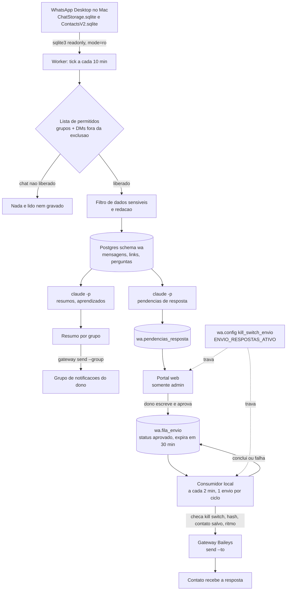

## 1. Visão geral

### O que o sistema faz

O sistema roda no Mac do dono do WhatsApp e faz quatro coisas:

1. Lê, em modo somente leitura, o banco local do WhatsApp Desktop e grava no Postgres (Supabase) apenas o que passou por um filtro de dados sensíveis e pela lista de permitidos.
2. Gera, com o modelo de linguagem (CLI `claude -p`), resumos diários e semanais de grupos liberados, decisões, perguntas, links e aprendizados por tema.
3. Detecta "pendências de resposta" em conversas diretas: quem escreveu e ainda espera resposta do dono, com pedido resumido, urgência e tipo de resposta. Nunca redige a resposta.
4. Permite que o dono responda uma pendência pelo portal web, aprovando o texto que ele mesmo escreveu. Um consumidor local no Mac pega a aprovação e envia pelo gateway (Baileys). Nada sai sem aprovação humana.

Os resumos e o digest "Quem espera sua resposta" podem ser enviados a um grupo de notificações do próprio dono.

### Para quem

Uma pessoa que usa o WhatsApp Desktop num Mac, participa de muitos grupos e recebe muitas conversas diretas, e quer: um resumo diário, uma fila de quem espera resposta e uma forma de responder com um clique de aprovação.

### Fluxo ponta a ponta



Resumo do fluxo de resposta: pendência detectada, dono escreve o texto no portal, clica "Aprovar e enviar", o banco grava a linha na fila com hash do texto e validade de 30 minutos, o consumidor local reivindica a linha de forma atômica, reconfere tudo, envia pelo gateway e conclui a linha. A pendência vira "respondida".

---

## 2. Arquitetura

### Componentes e responsabilidade

| Componente | Onde roda | Responsabilidade | Fala com |
|---|---|---|---|
| Leitor local | Worker (`src/reader.mjs`, `src/contatos.mjs`) | Consultas SQL somente leitura via CLI `sqlite3 -readonly` com URI `mode=ro` no banco de mensagens e na agenda do WhatsApp Desktop | Arquivos locais do WhatsApp |
| Schema guard | `src/schema-guard.mjs` | Aborta a ingestão se as tabelas e colunas esperadas do WhatsApp mudarem | Leitor |
| Lista de permitidos | `src/allowlist.mjs`, `src/dm.mjs` | Decide quais grupos e quais DMs podem ser lidos. Arquivos locais com permissão 600. Falha fechada | Leitor |
| Ingestão e redação | `src/ingest.mjs`, `src/processar.mjs`, `src/sensitive.mjs` | Converte linha crua em registro seguro, redige dado sensível antes de qualquer saída, grava por upsert idempotente | Postgres |
| Camada de banco | `src/db.mjs` | Fala com o Postgres via `psql` (pooler do Supabase), SQL por stdin, literais com dollar-quote de tag aleatória, erros devolvem só SQLSTATE | Postgres |
| Inteligência | `src/inteligencia.mjs`, `src/temas.mjs`, `src/llm.mjs` | Resumo diário e semanal, decisões, perguntas, aprendizados por tema, via `claude -p` sem ferramentas | CLI do Claude, Postgres |
| Pendências de resposta | `src/pendencias.mjs`, `src/naocontatos.mjs` | Classifica a conversa (regras) e consulta o modelo só para decidir se há pergunta ou pedido, urgência e tipo de resposta | CLI do Claude, Postgres |
| Sugestão de resposta | Não ligada | Previsto: módulo opcional gera rascunho. Hoje a resposta é escrita pelo dono | Nenhum |
| Fila de envio com aprovação | Schema `wa` (RPCs `aprovar_resposta_pendencia`, `reivindicar_envio_resposta`, `concluir_envio_resposta`) | Única porta de entrada da fila, estados, hash, expiração, ritmo, kill switch | Portal, consumidor |
| Consumidor de respostas | `src/respostas.mjs`, `src/respostas-cli.mjs` | Pega 1 aprovação por ciclo, reconfere tudo, envia pelo gateway, conclui | Postgres, gateway |
| Kill switch | `wa.config` (`kill_switch_envio`, `ENVIO_RESPOSTAS_ATIVO`) e `ENVIO_ATIVO` na config local | Para todo envio. Fail-closed | Portal, consumidor, worker |
| Gateway de envio | Pacote global `wa-gateway` (Baileys) + patch `send --to` | Único componente que envia. Daemon local com socket Unix | Consumidor, worker (resumos) |
| Portal web | Next.js + Supabase Auth (repo do portal, `app/operacao/whatsapp/`) | Telas de leitura, pendências, aprovação, links, aprendizados, resumos enviados | Supabase |
| Notificações | `src/formatar.mjs`, `src/sender.mjs`, `notificarResumos`, `notificarDigestDm` | Formata e envia resumo por grupo e digest de DM ao grupo de notificações do dono | Gateway |

### Como se comunicam

- Worker e consumidor falam com o Postgres por `psql` (conexão direta no pooler), usando a senha do banco lida de variável de ambiente ou arquivo local de permissão 600. Não usam a API REST do Supabase.
- O portal fala com o Supabase pela API (cliente `@supabase/ssr`) com a sessão do usuário logado. As escritas sensíveis passam por RPCs `security definer` que conferem admin.
- Worker e consumidor falam com o gateway por processo filho: `wa-gateway send ...` (CLI que fala com o daemon por socket Unix de permissão 600).
- O worker chama `claude -p` por processo filho, com `--tools ""`, `--no-session-persistence`, `--disable-slash-commands`, modelo configurável, timeout de 240 s.

### Processos agendados (LaunchAgents)

| Label | Comando | Intervalo | Observação |
|---|---|---|---|
| `local.wai.whatsapp-inteligencia` | `src/cli.mjs tick` | `StartInterval` 600 s (de `ritmo.ingestao_segundos`) | Ingestão, resumos, digest, semanal |
| `local.wai.whatsapp-pendencias` | `src/cli.mjs pendencias-atualizar` | `StartInterval` 900 s | `ProcessType` Background, `ExitTimeOut` 30 |
| `local.wai.whatsapp-respostas` | `src/respostas-cli.mjs --real` | `StartInterval` 120 s | O comentário dentro do plist diz 30 s, o valor efetivo é 120 s (comentário desatualizado; existe um `.bak-30s` do valor antigo) |
| `local.wai.whatsapp-gateway` | `dist/daemon-entry.js` do pacote | `RunAtLoad` e `KeepAlive` | Daemon do gateway; a variável do `--to` fica no `EnvironmentVariables` |

Todos usam o binário do node de uma versão específica (caminho do nvm gravado no plist). Isso importa para o TCC (seção 8a).

---

## 3. Modelo de dados (schema `wa`)

Fonte: migrations do portal em `supabase/migrations/` (9 arquivos `wa_*`, de 20261007120000 a 20261008150000; rollbacks em `supabase/rollbacks/*.rollback.sql.txt`, com extensão `.txt` de propósito para a CLI não aplicá-los).

Extensões usadas: `pg_trgm` (schema `extensions`) e `vector` (pgvector, schema `public`; as colunas `embedding` são `vector(1536)`). A migration base assume pgvector já habilitado no projeto: numa conta nova é preciso habilitar antes.

### Tabelas

| Tabela | Colunas principais | Propósito |
|---|---|---|
| `wa.chats` | `id` uuid, `jid` único, `tipo` (grupo, comunidade, direto), `nome`, `categoria`, `modo` (off, registrar, inteligencia, dm_sugerir; padrão off), `liberado_por` uuid, `liberado_em`, `ultimo_pk_local`, `ultima_msg_em`, `retencao_dias` (nulo = guardar sem expirar), `contato` boolean (nulo = não avaliado, true = salvo na agenda, false = desconhecido) | Lista de permitidos no banco. `modo = off` significa negado |
| `wa.participantes` | `chat_id`, `jid`, `nome`, `push_name`, `e_admin`, `ativo`, `e_dono`, `anonimizado`; único (`chat_id`, `jid`) | Autores das mensagens |
| `wa.mensagens` | `id` bigint, `chat_id`, `local_pk`, `stanza_id`, `autor_id`, `do_dono`, `enviada_em`, `tipo` smallint, `texto`, `redigida`, `apagada`, `responde_a`, `tem_midia`, `midia_meta` jsonb, `hash`, `texto_tsv` gerado; únicos (`chat_id`, `stanza_id`) e (`chat_id`, `local_pk`); check: redigida ou apagada implica `texto` nulo | Mensagens já filtradas. Mídia nunca sobe, só metadado |
| `wa.links` | `chat_id`, `mensagem_id`, `url`, `url_norm`, `dominio`, `titulo`, `compartilhado_em`, `vezes`, `tags`, `favorito`, `favoritado_em`; único (`chat_id`, `url_norm`) | Links extraídos de grupos (não de DMs) |
| `wa.link_mencoes` | (`link_id`, `mensagem_id`) | Torna `registrar_link` idempotente |
| `wa.perguntas` | `mensagem_id` único, `texto_norm`, `status` (aberta, respondida, ignorada), `dirigida_ao_dono`, `embedding` | Perguntas candidatas por heurística (contém "?" e 15 a 600 caracteres) |
| `wa.resumos` | `chat_id`, `periodo` (dia, semana), `data_ref`, `discutido`, `decidido`, `olhar` (jsonb arrays), `n_mensagens`, `modelo`; único (`chat_id`, `periodo`, `data_ref`) | Resumos por grupo |
| `wa.decisoes` | `chat_id`, `resumo_id`, `texto`, `mensagem_ref`, `decidida_em`, `responsavel`, `status` | Decisões extraídas; índice único evita duplicar por (resumo, md5 do texto) |
| `wa.aprendizados` | `chat_id`, `titulo`, `corpo`, `tags`, `fontes` bigint[] (mínimo 1), `confianca`, `status` (candidato, aprovado, descartado), `tema`, `motivo_descarte` (suporte, fora_do_tema), `embedding`, `busca_tsv` | Camada curta de aprendizados. Sem fonte não existe aprendizado |
| `wa.pendencias_resposta` | `chat_id`, `mensagem_id`, `contato_nome`, `espera_desde`, `pedido` (até 500), `urgencia` (alta, media, baixa), `tipo_resposta` (até 200, sem quebra de linha), `audio_sem_transcricao`, `status` (aberta, respondida, descartada), `modelo`; único (`chat_id`, `mensagem_id`) | Quem espera resposta. Não guarda texto de mensagem nem resposta redigida |
| `wa.sugestoes_resposta` | `chat_id`, `mensagem_origem`, `texto_sugerido`, `texto_final`, `status` (sugerida, aprovada, editada, enviada, rejeitada, expirada, reprovada_filtro), `exige_revisao_forte`, `autoria` jsonb, `validacoes` jsonb, `motivo_rejeicao`, `decidida_por` | Hoje só recebe a resposta que o dono escreveu, com autoria `{"origem":"dono","ia":false}` |
| `wa.fila_envio` | `sugestao_id` único, `pendencia_id`, `destino_jid`, `texto`, `texto_hash` (sha256, 64), `aprovado_por`, `aprovado_em`, `status`, `expira_em` (padrão agora mais 30 minutos), `tentativas`, `reivindicado_em`, `enviado_em`, `message_id`, `erro` (até 200, só código curto), `idempotency_key` | Fila de envio com aprovação |
| `wa.auditoria` | `quando`, `ator`, `acao`, `alvo`, `detalhe` jsonb | Só acréscimo. Triggers bloqueiam update, delete e truncate |
| `wa.ingestao_execucoes` | `iniciou_em`, `terminou_em`, `lidas`, `gravadas`, `descartadas_sensivel`, `erro` | Saúde da ingestão (o portal mostra "sem dados novos há X") |
| `wa.config` | `chave` (PK), `valor` jsonb | Chaves de operação (ver abaixo) |
| `wa.notificacao_destino` | linha única: `jid`, `nome`, `ativo` (só ativa com `jid`) | Destino das notificações no banco (somente leitura no portal) |

Chaves de `wa.config` semeadas pelas migrations:

| Chave | Padrão | Efeito |
|---|---|---|
| `kill_switch_envio` | `false` | Fail-closed: só o JSON `false` libera. `true`, texto, nulo, número ou linha ausente significam parado |
| `ENVIO_RESPOSTAS_ATIVO` | `false` | Chave geral do envio de respostas |
| `ENVIO_RESPOSTAS_INTERVALO_S` | `20` | Intervalo mínimo entre envios |
| `ENVIO_RESPOSTAS_MAX_HORA` | `30` | Limite de envios por hora |
| `aprendizado_temas` | lista de `{nome, descricao}` | Temas do dono para aprendizados (o worker lê daqui; nada fixo no código) |

### Views e funções

- Views com `security_invoker`: `wa.v_chats_resumo`, `wa.v_links`, `wa.v_aprendizados`, `wa.v_pendencias` (só `contato is true`, mais recente primeiro, com estado da fila mais recente da pendência).
- RPCs do worker (só `service_role`): `upsert_mensagem(s)`, `registrar_link`, `registrar_resumo`, `registrar_aprendizado`, `registrar_pendencia`, `fechar_pendencias`, `reivindicar_envio_resposta`, `concluir_envio_resposta`.
- RPCs do portal (`authenticated`, mas cada uma exige admin): `definir_modo_chat`, `aprovar_resposta_pendencia`, `cancelar_resposta_pendencia`, `liberar_reaprovacao`, `listar_mensagens`. Existe também `aprovar_sugestao`, o caminho legado do desenho inicial, não usado pelo fluxo atual.
- `wa.is_admin()` usa `wa.admins(user_id)` na versão independente.

### Regras

**Idempotência**
- Mensagem: chave natural (`chat_id`, `stanza_id`), com fallback (`chat_id`, `local_pk`). O worker só grava o que é novo ou mudou (compara `hash`). A janela de reconciliação de 72 horas reprocessa sem duplicar e captura edição e "apagada para todos".
- Link: único (`chat_id`, `url_norm`) mais `link_mencoes`.
- Resumo: upsert por (`chat_id`, `periodo`, `data_ref`).
- Notificação ao grupo: chave `whatsapp-inteligencia:resumo:v2:<dia>:<destino>:<grupo>:p<n>`; digest: `whatsapp-inteligencia:digest-dm:<dia>:<destino>:p<n>`. O gateway guarda um ledger de chaves e devolve `duplicate` se repetir.
- Resposta: `idempotency_key = 'wa-resp:' || fila_id || ':' || 12 primeiros hex do hash`, único e imutável.
- Auditoria de "não enviado" não repete a mesma (ação, alvo, motivo).

**O que é "pendência"**
- A última mensagem útil da conversa é do contato (não é figurinha, gif, mídia sem texto nem apagada), há pergunta ou pedido real e ela tem menos de 14 dias (`dm.pendencia_dias`).
- Áudio sem texto vira pendência "áudio sem transcrição"; mensagem redigida por sensibilidade vira "mensagem sensível omitida, abra no WhatsApp". Essas duas nascem por regra, sem consultar o modelo.
- Saudação isolada ("oi", "valeu", "ok") não é pendência. Se a última mensagem útil é do dono, a conversa está respondida e as pendências abertas são fechadas.
- Pendência nova substitui as antigas do mesmo contato. Só contato salvo na agenda entra no digest e no portal (`dm.somente_contatos`, padrão true). Contato nulo (não avaliado) conta como não contato.
- O modelo devolve apenas `pendente`, `pedido` (uma frase), `urgencia` e `tipo_resposta` (uma linha). Não redige a resposta.
- Gatilho no banco: só aceita chat liberado, tipo `direto`, mensagem do próprio chat e da outra pessoa.

**Estados da fila (`wa.fila_envio`)**
- Fluxo atual: `aprovado` vai para `enviando`, `cancelado`, `expirado` ou `falhou`; `enviando` vai para `enviado` ou `falhou`. `enviado`, `falhou`, `cancelado` e `expirado` são terminais e congelados. Há também os estados legados (`pendente`, `copiado`, `aberto_no_whatsapp`, `confirmado_pelo_dono`) do desenho de "envio assistido", que não migram para o fluxo novo.
- Um trigger torna imutáveis `sugestao_id`, `destino_jid`, `texto`, `texto_hash`, `aprovado_por`, `aprovado_em`, `pendencia_id` e `idempotency_key`.
- Uma aprovação viva por pendência (índice único parcial sobre `aprovado`, `enviando`, `enviado`, e `falhou` com erro `interrompido_verificar`).
- Envio incerto: erro `interrompido_verificar` significa "pode ter saído". Bloqueia nova aprovação até o dono conferir no WhatsApp e usar `liberar_reaprovacao` (erro passa a `verificado_nao_enviado`) ou marcar a pendência como respondida.
- Códigos de erro curtos: `hash_divergente`, `destino_invalido`, `fora_da_agenda_local`, `kill_switch_ligado`, `kill_switch_indisponivel`, `pendencia_fechada`, `agenda_local_indisponivel`, `gateway_recusou: <motivo>`.

**Expiração da aprovação**
- `expira_em` padrão: 30 minutos após a aprovação. Dentro de `reivindicar_envio_resposta`, linhas `aprovado` vencidas viram `expirado` (sugestão vira `expirada`) e geram auditoria. Linhas `enviando` há mais de 10 minutos viram `falhou` com `interrompido_verificar`. O consumidor ainda varre órfãs `enviando` há mais de 5 minutos.

---

## 4. Worker

### Comandos da CLI (`node src/cli.mjs <comando>`)

| Comando | O que faz |
|---|---|
| `init` | Cria, com permissão 600 e sem sobrescrever, a lista de permitidos, os termos proibidos, a config e a lista de exclusão de DMs |
| `status` | Estado local: banco do WhatsApp existe, arquivos de config, chats liberados, `ENVIO_ATIVO` |
| `dry-run` | Contagens por grupo (sem texto) em `/tmp/whatsapp-inteligencia` |
| `ingest [--grupo X] [--janela-horas N]` | Ingestão real incremental |
| `resumo [--grupo X] [--data AAAA-MM-DD]` | Resumo diário, decisões, perguntas, aprendizados |
| `resumo-semana --domingo AAAA-MM-DD` | Resumo semanal |
| `backfill-resumos [--dias 90]` | Resumos do passado, com teto de custo (`resumo.teto_backfill_usd`) |
| `enviar-resumo [--data X] [--grupo X] [--real] [--reenviar --sufixo S]` | Envia o resumo ao grupo de notificações. Dry-run por padrão. Grava auditoria |
| `pendencias-dm` | Análise completa das DMs (usa a agenda do WhatsApp) |
| `pendencias-atualizar [--dry-run]` | Rodada incremental e idempotente (agendada a cada 15 min) |
| `digest-dm [--real]` | Digest "Quem espera sua resposta". Só envia se `notificacao.destino_dm` estiver preenchido |
| `lista-nao-contatos` | Dry-run: lista de pendências abertas de quem não é contato salvo |
| `aprendizados-reclassificar [--aplicar \| --rollback ARQUIVO]` | Reclassifica aprendizados pelos temas de `wa.config`; `--aplicar` grava backup JSON antes |
| `tick` | O que o LaunchAgent principal roda |
| `plist` / `plist-pendencias` | Escrevem os plists (não carregam) |
| `enviar-teste [--real]` | Teste do adaptador de envio |

Consumidor de respostas, binário à parte: `node src/respostas-cli.mjs` (dry-run) e `node src/respostas-cli.mjs --real`. Fica fora de `cli.mjs` de propósito: lock próprio, nunca disputa com ingestão e resumos.

### Ciclos

- **Tick (a cada 600 s).** Fase 1, ingestão (lock `ingestao`, idade máxima 30 min). Fase 2, sob o lock `resumos` (idade máxima 3 h): resumo diário uma vez por dia depois de `ritmo.resumo_hora:resumo_minuto` (relógio fixo de Brasília); envio dos resumos ao grupo; análise de pendências de DM a cada tick; digest de DM uma vez por dia; resumo semanal no `resumo.semanal_dia_semana` depois de `semanal_hora`. Estado do que já rodou no dia fica no `state.json`.
- **Pendências (a cada 900 s).** `pendencias-atualizar` olha só contatos salvos com mensagem nova sem pendência registrada, mais conversas com pendência aberta (para fechar). Não abre a agenda do WhatsApp (usa `wa.chats.contato`, gravado pela ingestão). Teto de conversas enviadas ao modelo por rodada: `dm.atualizar_max_conversas` (10).
- **Consumidor (a cada 120 s).** No máximo um envio por ciclo. O ritmo real é imposto pelo banco (`ENVIO_RESPOSTAS_INTERVALO_S`, `ENVIO_RESPOSTAS_MAX_HORA`).

### Watchdogs e locks

- `tick`: `setTimeout` de `ritmo.tick_timeout_s` (2400 s); estourou, libera só os locks que esse processo segurou, escreve erro e sai com código 1. O próximo disparo do launchd retoma.
- `pendencias-atualizar`: watchdog de `dm.atualizar_timeout_s` (600 s); lock `pendencias` com idade máxima de timeout mais 300 s.
- `respostas-cli`: watchdog de 120 s; lock `respostas` de 3 min.
- Locks são arquivos com pid (`state.mjs`): lock de processo morto é retomado, lock velho expira por idade. Comandos manuais usam os mesmos locks e se recusam a rodar junto com o agente.
- `psql` tem teto de 60 s por chamada (SIGKILL). Leitura da agenda tem `timeout` de 20 s. Agenda dentro do consumidor tem teto de 30 s.

### Estado e logs

- Estado: `~/Library/Application Support/whatsapp-inteligencia/state.json` (marcas d'água por chat, custos por dia, datas dos resumos, `pendencias_vistas`), mais os arquivos `*.lock`. Diretório 0700, arquivos 0600, gravação atômica por rename.
- Logs do launchd no mesmo diretório: `tick.log`, `tick.err`, `pendencias.log`, `pendencias.err`, `respostas.log`, `respostas.err`. Só contagens, ids, prefixo de hash e tamanho. Nunca texto de mensagem.
- Variável `WAI_STATE_DIR` redireciona o estado (usada nos testes).

### Testes

```sh
cd apps/whatsapp-inteligencia
npm test        # node --test test/, com WAI_STATE_DIR temporário
```

Testes automatizados usam backends falsos e dados sintéticos; não validam envio real.

### Configuração (nomes, nunca valores)

Arquivos fora do repositório, em `~/.wa-intelligence/` (permissão 600; o código recusa arquivo mais aberto):

| Arquivo | Conteúdo |
|---|---|
| `whatsapp-allowlist.json` | `tipos_sessao_permitidos`, `allow` (lista de `{nome, match: exato\|prefixo\|contem, modo: registrar\|inteligencia, backfill_dias?, links?}`), `deny_always` |
| `whatsapp-deny-terms.txt` | Um termo por linha (assuntos pessoais do dono que nunca devem ser gravados) |
| `whatsapp-dm-excluir.json` | `excluir`: entradas `{nome}` ou `{telefone}` de contatos fora da leitura de DMs. Arquivo ausente significa que nenhuma DM é lida |
| `whatsapp-icones.json` | Ícones por tema para o cabeçalho dos resumos |
| `whatsapp-inteligencia-config.json` | Sobrepõe os padrões do código |
| `whatsapp-db.env` (opcional) | Variável da senha do banco |

Chaves da config local (padrões em `src/config.mjs`): `ENVIO_ATIVO`; `notificacao.grupo`, `notificacao.gateway_bin`, `notificacao.destino_dm`; `dm.ativo`, `dias_atividade`, `pendencia_dias`, `lote_llm`, `digest_max_por_mensagem`, `somente_contatos`, `atualizar_max_conversas`, `atualizar_timeout_s`; `ritmo.tick_timeout_s`, `ingestao_segundos`, `resumo_hora`, `resumo_minuto`; `janela_horas`; `banco.ref`, `banco.host`, `banco.port`; `resumo.modos`, `modelo`, `minimo_mensagens_dia`, `semanal_dia_semana`, `semanal_hora`, `max_aprendizados_por_dia`, `teto_backfill_usd`, `max_chars_entrada`; `termos_em_todas_as_mensagens`; `respostas.gateway_aceita_to` (ausente por padrão, e ausente significa que o consumidor se recusa a enviar).

Variáveis de ambiente: `WA_DB_PASSWORD` (senha do banco), `WAI_STATE_DIR` (estado), `PATH` (o plist injeta um PATH com node, psql e claude). A cópia incorporada remove a leitura do ambiente do portal original. Use apenas configuração do receptor.

Dependências externas: `sqlite3` e `psql` (libpq) no PATH; CLI `claude` autenticada; gateway `wa-gateway` instalado e pareado.

---

## 5. Gateway de envio (Baileys)

Pacote global `wa-gateway` 0.2.0 (leitura de `README.md`, `docs/ARCHITECTURE.md`, `docs/SECURITY.md`, `dist/cli.js`, `dist/daemon.js`, `dist/baileys.js`).

### Como funciona

- Três camadas: CLI determinística, API HTTP local por socket Unix (modo 0600) e adaptador Baileys, único dono da sessão do WhatsApp. O daemon roda como LaunchAgent independente de qualquer consumidor.
- Dados e credenciais em `~/Library/Application Support/WA Intelligence Gateway/` (diretórios 0700, arquivos 0600), fora do Git. O log nunca registra texto, QR nem segredo.
- Comandos: `install`, `pair`, `channel connect|disconnect|status|logout`, `start|stop|restart|status`, `groups`, `send`, `logs`, `doctor`, `uninstall [--purge]`.
- `send --group <nome-ou-id> --file <arquivo> --idempotency-key <chave>` envia texto a um grupo. O texto vem de arquivo UTF-8 (o consumidor grava um arquivo temporário 0600 e apaga depois).
- Ledger de idempotência em arquivo JSON: chave já aceita devolve `duplicate` e não reenvia. O ledger não é recibo de entrega.
- Conexão preguiçosa: o daemon só conecta ao WhatsApp no primeiro uso que precisa (por exemplo `groups` ou um envio). Reiniciar o serviço sozinho não reconecta nem prova que está pareado. Para verificar, provocar uma leitura (`groups`) e então conferir `channel status` mostrando `whatsapp: connected`.
- Segurança: Baileys fixado em `7.0.0-rc14`; `syncFullHistory` falso e `shouldSyncHistoryMessage` sempre falso; nenhuma API de download de mídia; nenhuma assinatura de conteúdo recebido; log do Baileys silencioso; `markOnlineOnConnect` falso.

### O patch `send --to`

O pacote original só envia a grupos. O worker precisa responder a contatos individuais. O patch (`gateway-patch/gateway-send-to-0.2.0.diff`, formato `patch -p1`, toca só `dist/cli.js` e `dist/daemon.js`) acrescenta:

1. `send --to <jid> --file <arquivo> --idempotency-key <chave>` para JID individual (`@s.whatsapp.net` ou `@lid`). Grupo, `--group` junto com `--to` e chave ausente são recusados.
2. Reserva `pending` no ledger antes de chamar o envio, com trava interna para chamadas simultâneas. Chave nova reserva, envia e grava o `messageId`; chave já enviada devolve `duplicate`; chave `pending` devolve HTTP 409 e nunca reenvia; erro no envio devolve 502 e deixa a reserva `pending` de propósito (pode ter saído).
3. Chaves de `--to` ficam no mesmo ledger com prefixo `to:`; não colidem com as de `--group`.
4. `--to` fica DESLIGADO por padrão. Só funciona com a variável de ambiente `WAI_GATEWAY_ALLOW_SEND_TO=1` no ambiente do daemon.
5. O ramo `--group` passou a ler e gravar o ledger por dentro da trava (`withLedger`), relendo o arquivo antes de gravar (correção de uma condição de corrida apontada no QA).
6. Toda recusa antes de qualquer tentativa de envio sai no stderr com o prefixo `RECUSADO:`. O consumidor só trata como recusa (linha volta a ser reaprovável) o que traz esse prefixo. Qualquer outra falha (timeout, 409, 502, daemon caiu, saída fora do padrão) vira `interrompido_verificar`.

Gateway incluído no pacote. Pareamento e conexão exigem configuração local.

### Limites conhecidos

- Só envia texto. Não há rota de mídia nem de leitura. Para arquivo, hospedar em outro lugar e mandar o link.
- Tamanho: o daemon recusa texto vazio e acima de 1 MB; o corpo da requisição tem teto de 1.100.000 bytes. Limites do sistema em volta: resumo ao grupo é dividido em partes de até 1.500 caracteres (`LIMITE_MENSAGEM`); resposta no portal vai até 4.000 caracteres (check no banco e no portal).
- Nenhuma rota aceita contato inferido; todo destino é explícito.
- Biblioteca não oficial (Baileys): quebra de protocolo e restrição de conta são possíveis.
- Um único daemon e um único socket por usuário: tudo que envia compete pela mesma sessão.

### Riscos operacionais

- NUNCA rodar `channel logout`, `logout` nem `pair` sem decisão humana explícita: desfazem o pareamento e exigem novo QR no celular. Se aparecer "não pareado" ou pedido de QR, parar e restaurar backup; não improvisar nem apagar a pasta `auth`.
- `npm update`, `npm install -g wa-gateway` ou reinstalar o pacote APAGA o patch. Reaplicar o diff e repetir a verificação.
- `wa-gateway install` regrava o plist e remove a variável do `--to`. Reaplicar a variável.
- O ledger é regravado por escrita comum (sem rename atômico). SIGTERM durante a gravação pode truncá-lo ou perder a última reserva. Por isso o serviço é parado antes de qualquer backup de dados.
- Plano de aplicação, reversão e testes do patch estão em `gateway-patch/PLANO-APLICACAO.md` (a parte de aplicação e reversão segue válida; só a linha de estado está desatualizada) e em `gateway-patch/testes/*.sh`.

---

## 6. Portal

Aplicação Next.js (App Router) com Supabase Auth, dentro do portal. Tudo do módulo vive em `app/operacao/whatsapp/`, `components/operacao/whatsapp/` e `lib/whatsapp/`.

### Autenticação e papéis

- Login do Supabase Auth (sessão por cookie, cliente servidor).
- Guarda do módulo: `exigirAdminWhatsapp()` em `lib/whatsapp/guarda.ts`, chamada no `layout.tsx` do módulo e em cada página. Quem não é admin recebe 404 (o módulo não revela que existe). `isAdmin()` consulta a tabela de vínculo usuário-cliente procurando `papel = 'admin'`.
- Segunda barreira no banco: `wa.is_admin()` nas policies de RLS e dentro das RPCs de escrita. Os dados do schema `wa` são invisíveis para qualquer outro papel. As server actions também checam `isAdmin()` antes de chamar o banco.
- Um papel só: admin. Não há papéis intermediários.

### Telas (abas de `NavWhatsapp`)

| Rota | Tela |
|---|---|
| `/operacao/whatsapp` | Visão geral: chats liberados (filtro grupos ou diretos) e saúde da ingestão |
| `/operacao/whatsapp/dashboard` | Dashboard de leitura |
| `/operacao/whatsapp/[chatId]` | Detalhe de um chat com mensagens paginadas por cursor |
| `/operacao/whatsapp/pendencias` | Pendências de resposta: lista ordenada, bloco de resposta, aprovar, cancelar, liberar reaprovação, marcar como respondida ou descartada, chave geral de envio |
| `/operacao/whatsapp/links` | Links com busca, filtros por domínio e favoritos |
| `/operacao/whatsapp/aprendizados` | Aprendizados por tema: busca, filtros, aprovar, descartar, editor de temas |
| `/operacao/whatsapp/resumos-enviados` e `/[id]` | Histórico de resumos e digests, com status derivado da auditoria |
| `/operacao/whatsapp/configuracoes` | Somente leitura: destino de notificação e chats liberados com modo |

### Aprovação e integração com a fila

1. Na pendência, o dono escreve o texto (campo "Sua resposta") e clica "Aprovar e enviar". O texto vem só do formulário; nunca é gerado por IA na versão atual.
2. A server action chama a RPC `wa.aprovar_resposta_pendencia(p_pendencia_id, p_texto)`. O banco confere: usuário autenticado e admin; kill switch igual a `false`; `ENVIO_RESPOSTAS_ATIVO` igual a `true`; texto não vazio e até 4.000 caracteres; pendência aberta; chat direto, com contato salvo, modo diferente de off e JID válido; nenhuma aprovação viva ou envio incerto anterior para a pendência. Então cria a sugestão (autoria `dono`, `ia: false`), a linha da fila com sha256 do texto e a chave de idempotência, e audita (só prefixo do hash e contagem de caracteres).
3. A tela mostra o estado da fila: "Aprovada, aguardando envio" com botão "Cancelar envio" (só enquanto `aprovado`; cancelar é atômico e devolve falso se já foi reivindicada), "Enviando", "Envio interrompido: confira no WhatsApp" com botão "Conferi: não saiu, liberar nova aprovação", falhou, expirou, cancelou.
4. Se o envio de respostas estiver desligado ou o kill switch ligado, o botão fica desabilitado com aviso. A chave geral `ENVIO_RESPOSTAS_ATIVO` é alternada pelo admin na própria tela de pendências.
5. O consumidor local executa o envio (seção 2). O portal nunca fala com o gateway.

---

## 7. Regras de segurança e privacidade e como cada uma é implementada

| Regra | Implementação (arquivo) |
|---|---|
| Leitura só do arquivo local, só leitura | `reader.mjs` e `contatos.mjs` chamam `sqlite3 -readonly` com URI `?mode=ro`. O original nunca é aberto para escrita. Nenhuma conexão longa (consultas curtas) |
| Falha fechada na lista de permitidos | `allowlist.mjs`: arquivo ausente lança erro; lista `allow` vazia significa que nada é lido; permissão diferente de 600 lança erro. Só grupos (`@g.us`) e só sessões de tipo permitido. `deny_always` vence qualquer regra |
| DMs só com autorização explícita | `dm.mjs`: sem a lista de exclusão local, nenhuma DM é lida. Só JIDs de telefone ou `lid`, só com atividade recente (`dm.dias_atividade`), exceto as já conhecidas |
| Chat novo nasce com o modo da lista local; chat existente nunca tem o modo alterado pelo worker | `ingest.mjs` (`sincronizarChats`): o portal manda. Toda mudança de modo é auditada por trigger (`altera_modo_chat`) |
| Trava no banco: sem chat liberado, sem gravação | Trigger `trg_exigir_chat_liberado` em participantes e mensagens; `wa.exigir_chat_liberado` nas RPCs |
| Redação de dados sensíveis antes de gravar | `sensitive.mjs` + `processar.mjs`: credenciais (padrões de chaves e tokens conhecidos), senha atribuída, Pix, boleto, cartão (prefixo de bandeira e Luhn), CPF e CNPJ com dígito verificador (CNPJ só com contexto de Pix), e termos pessoais. A mensagem vira `redigida = true` com texto nulo (check no banco impede texto numa linha redigida). A função devolve só o nome da regra, nunca o trecho. Em DM e em mensagens do próprio dono, os termos pessoais valem para todas as mensagens; em grupo só com a opção `termos_em_todas_as_mensagens` |
| Sem dados de pagamento ou senha | A mesma redação. Além disso, pendência de mensagem redigida mostra "abra no WhatsApp" em vez de resumir |
| Mídia nunca sobe | `midia_meta` guarda só o tipo. O gateway nem tem rota de mídia |
| Nenhum texto em log ou relatório | `safejson.mjs` (erros de JSON sem conteúdo), `db.mjs` (erros só com SQLSTATE), logs só com contagens |
| Resposta nunca sai sem humano | Única porta: `wa.aprovar_resposta_pendencia`, que exige `auth.uid()` e admin. Não há insert direto na fila (nenhum grant de escrita para `authenticated`). `aprovado_por` é obrigatório |
| Texto aprovado imutável e conferido | Trigger `trg_fila_envio_valida` bloqueia edição de texto, destino e hash. O banco recalcula o sha256 na reivindicação e o consumidor confere de novo antes de enviar (`hash_divergente`) |
| Aprovação expira | `expira_em` em 30 minutos; expiração tratada em `reivindicar_envio_resposta` |
| Kill switch fail-closed, em quatro pontos | Aprovação, reivindicação, rechecagem no consumidor imediatamente antes do envio (só o booleano `false` libera; erro de leitura vira `kill_switch_indisponivel`), e `ENVIO_ATIVO` na config local para os resumos |
| Lista de permitidos também no envio | O consumidor só envia a JID que está em `wa.chats` com `contato = true` e tipo direto (`jidsContatosDoBanco`); o banco reconfere contato, modo e JID na reivindicação (`fora_da_agenda_local`, `destino_invalido`) |
| Ritmo e volume | `ENVIO_RESPOSTAS_INTERVALO_S` e `ENVIO_RESPOSTAS_MAX_HORA`, impostos dentro do banco com advisory lock. Ausente ou inválido, não envia |
| Envio incerto nunca é reenviado | Qualquer falha após a possível saída vira `interrompido_verificar`; o banco bloqueia nova aprovação; o gateway devolve 409 para chave `pending` |
| Texto de envio sem travessão | `textguard.mjs` recusa texto com travessão (e com emoji, salvo mensagem do dono para si mesmo com `permitirEmoji`) antes de chamar o gateway |
| Auditoria imutável e sem conteúdo | `wa.auditoria` com triggers contra update, delete e truncate. Guarda só prefixo de hash e contagem de caracteres |
| Resumos sem citação literal | Prompts proíbem citar mensagens; saída passa por `textguard` e pelo validador de forma (se existir) |
| Segredos fora do repositório | Senha do banco por variável de ambiente ou arquivo 600; `.gitignore` do worker cobre `*allowlist*.json`, `*deny-terms*.txt`, `state.json`, logs e sqlite. Teste de privacidade garante que o repo não contém nome de grupo |
| SQL sem injeção | `db.mjs`: literais em dollar-quote com tag aleatória, SQL por stdin, `ON_ERROR_STOP` |

---
